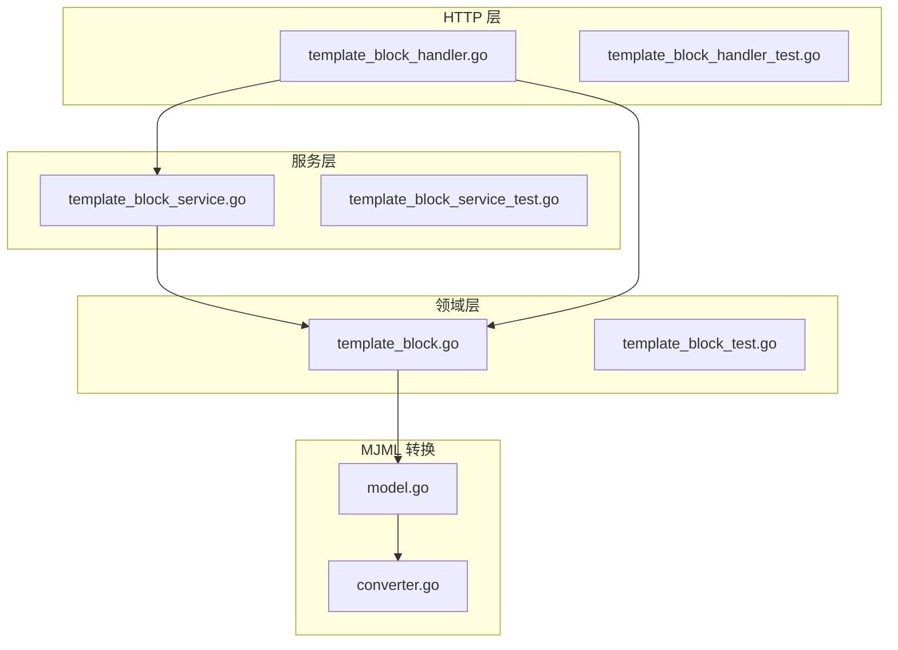
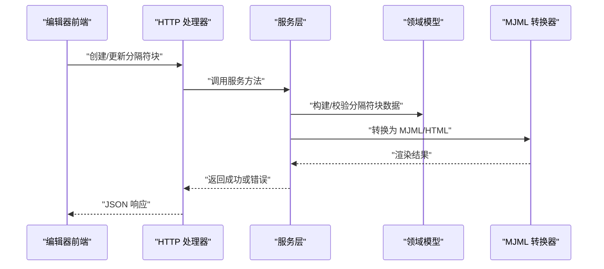
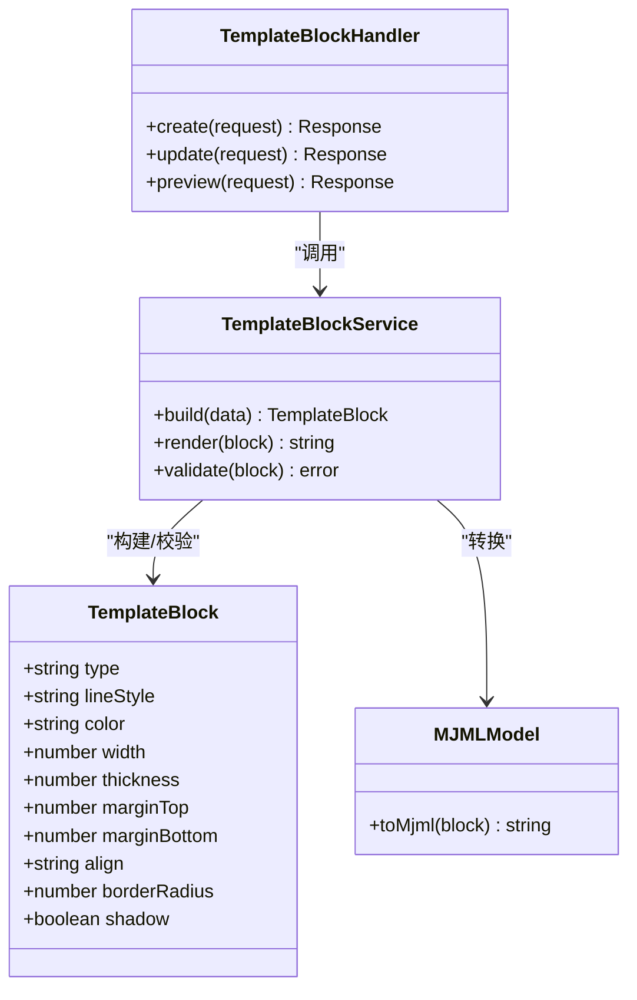
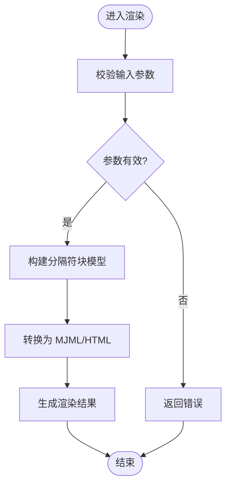
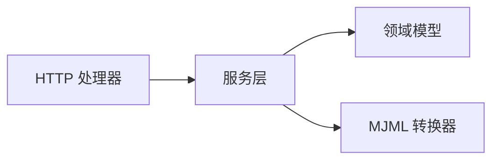

# 分隔符块

<cite>
**本文引用的文件**   
- [template_block.go](file://notifuse/internal/domain/template_block.go)
- [template_block_handler.go](file://notifuse/internal/http/template_block_handler.go)
- [template_block_service.go](file://notifuse/internal/service/template_block_service.go)
- [template_block_test.go](file://notifuse/internal/domain/template_block_test.go)
- [template_block_handler_test.go](file://notifuse/internal/http/template_block_handler_test.go)
- [template_block_service_test.go](file://notifuse/internal/service/template_block_service_test.go)
- [model.go](file://notifuse/pkg/notifuse_mjml/model.go)
- [converter.go](file://notifuse/pkg/notifuse_mjml/converter.go)
</cite>

## 目录
1. [简介](#简介)
2. [项目结构](#项目结构)
3. [核心组件](#核心组件)
4. [架构总览](#架构总览)
5. [详细组件分析](#详细组件分析)
6. [依赖分析](#依赖分析)
7. [性能考虑](#性能考虑)
8. [故障排查指南](#故障排查指南)
9. [结论](#结论)
10. [附录](#附录)

## 简介
本使用文档面向邮件编辑器中的“分隔符块”组件，聚焦以下目标：
- 如何创建与配置分隔符块
- 如何进行样式定制（线条样式、颜色、宽度、间距）
- 如何实现虚线、实线与渐变线条
- 如何处理响应式布局与移动端适配
- 在视觉层次设计与内容分组方面的最佳实践

说明基于代码仓库中模板块领域模型、HTTP 处理器与服务层实现，以及 MJML 转换模块的接口约定进行整理。

## 项目结构
与分隔符块相关的代码主要分布在以下位置：
- 领域模型与测试：internal/domain/template_block*.go
- HTTP 处理器与测试：internal/http/template_block_handler*.go
- 服务层与测试：internal/service/template_block_service*.go
- MJML 模型与转换器：pkg/notifuse_mjml/model.go, converter.go

图表来源
- [template_block.go](file://notifuse/internal/domain/template_block.go)
- [template_block_handler.go](file://notifuse/internal/http/template_block_handler.go)
- [template_block_service.go](file://notifuse/internal/service/template_block_service.go)
- [model.go](file://notifuse/pkg/notifuse_mjml/model.go)
- [converter.go](file://notifuse/pkg/notifuse_mjml/converter.go)

章节来源
- [template_block.go](file://notifuse/internal/domain/template_block.go)
- [template_block_handler.go](file://notifuse/internal/http/template_block_handler.go)
- [template_block_service.go](file://notifuse/internal/service/template_block_service.go)
- [model.go](file://notifuse/pkg/notifuse_mjml/model.go)
- [converter.go](file://notifuse/pkg/notifuse_mjml/converter.go)

## 核心组件
- 领域模型（Template Block）：定义分隔符块的属性与校验规则，包括类型、样式参数等。
- HTTP 处理器：负责接收前端请求、解析参数、调用服务层并返回结果。
- 服务层：编排业务逻辑，完成分隔符块的创建、更新、渲染与持久化。
- MJML 转换：将分隔符块的数据模型转换为 MJML/HTML，供邮件客户端渲染。

章节来源
- [template_block.go](file://notifuse/internal/domain/template_block.go)
- [template_block_handler.go](file://notifuse/internal/http/template_block_handler.go)
- [template_block_service.go](file://notifuse/internal/service/template_block_service.go)
- [model.go](file://notifuse/pkg/notifuse_mjml/model.go)
- [converter.go](file://notifuse/pkg/notifuse_mjml/converter.go)

## 架构总览
分隔符块从编辑器到最终渲染的关键流程如下：

图表来源
- [template_block_handler.go](file://notifuse/internal/http/template_block_handler.go)
- [template_block_service.go](file://notifuse/internal/service/template_block_service.go)
- [template_block.go](file://notifuse/internal/domain/template_block.go)
- [converter.go](file://notifuse/pkg/notifuse_mjml/converter.go)

## 详细组件分析

### 领域模型：分隔符块数据结构与校验
- 字段建议包含：
  - 类型：分隔符（用于区分其他块）
  - 线条样式：实线、虚线、点线、渐变
  - 颜色：主色、透明度
  - 宽度：百分比或像素值
  - 高度/厚度：线条粗细
  - 间距：上下边距
  - 对齐：左、中、右、两端
  - 圆角：可选
  - 阴影：可选
- 校验要点：
  - 数值范围限制（如宽度 0–100%，厚度 1–10px）
  - 颜色格式合法性（十六进制、RGB、RGBA）
  - 渐变方向与角度合法
  - 必填项检查（至少提供样式基础信息）

章节来源
- [template_block.go](file://notifuse/internal/domain/template_block.go)
- [template_block_test.go](file://notifuse/internal/domain/template_block_test.go)

### HTTP 处理器：请求处理与响应
- 职责：
  - 解析 JSON 请求体
  - 参数校验与错误包装
  - 调用服务层执行创建/更新/渲染
  - 返回统一 JSON 响应
- 常见端点：
  - 创建分隔符块
  - 更新分隔符块
  - 获取分隔符块预览（渲染为 HTML/MJML）

章节来源
- [template_block_handler.go](file://notifuse/internal/http/template_block_handler.go)
- [template_block_handler_test.go](file://notifuse/internal/http/template_block_handler_test.go)

### 服务层：业务编排与渲染
- 职责：
  - 组装领域模型
  - 调用 MJML 转换器生成可渲染内容
  - 处理异常与日志
  - 返回渲染结果或错误信息
- 关键流程：
  - 输入验证 → 构建分隔符块 → 转换 MJML → 返回结果

章节来源
- [template_block_service.go](file://notifuse/internal/service/template_block_service.go)
- [template_block_service_test.go](file://notifuse/internal/service/template_block_service_test.go)

### MJML 转换：分隔符块渲染
- 模型映射：
  - 分隔符块属性映射到 MJML 元素与属性
- 样式实现：
  - 实线：使用 solid 边框
  - 虚线：使用 dashed 边框
  - 点线：使用 dotted 边框
  - 渐变：使用线性渐变背景或 SVG 渐变
- 响应式支持：
  - 通过媒体查询或 MJML 响应式特性控制宽度与间距
  - 移动端默认全宽，桌面端可按比例显示

章节来源
- [model.go](file://notifuse/pkg/notifuse_mjml/model.go)
- [converter.go](file://notifuse/pkg/notifuse_mjml/converter.go)

#### 类图：分隔符块相关对象关系

图表来源
- [template_block.go](file://notifuse/internal/domain/template_block.go)
- [template_block_handler.go](file://notifuse/internal/http/template_block_handler.go)
- [template_block_service.go](file://notifuse/internal/service/template_block_service.go)
- [model.go](file://notifuse/pkg/notifuse_mjml/model.go)

#### 流程图：分隔符块渲染算法

图表来源
- [template_block_service.go](file://notifuse/internal/service/template_block_service.go)
- [converter.go](file://notifuse/pkg/notifuse_mjml/converter.go)

## 依赖分析
- 组件耦合：
  - HTTP 处理器依赖服务层，服务层依赖领域模型与 MJML 转换器
  - 领域模型独立于传输层，便于复用与测试
- 外部依赖：
  - MJML 转换器作为渲染后端，确保跨客户端兼容性
- 潜在循环依赖：
  - 当前分层清晰，未见循环引用

图表来源
- [template_block_handler.go](file://notifuse/internal/http/template_block_handler.go)
- [template_block_service.go](file://notifuse/internal/service/template_block_service.go)
- [template_block.go](file://notifuse/internal/domain/template_block.go)
- [converter.go](file://notifuse/pkg/notifuse_mjml/converter.go)

章节来源
- [template_block_handler.go](file://notifuse/internal/http/template_block_handler.go)
- [template_block_service.go](file://notifuse/internal/service/template_block_service.go)
- [template_block.go](file://notifuse/internal/domain/template_block.go)
- [converter.go](file://notifuse/pkg/notifuse_mjml/converter.go)

## 性能考虑
- 避免重复渲染：对相同配置的分隔符块进行缓存
- 减少大对象传递：仅传输必要字段，服务端按需计算
- 渐进增强：在低性能设备上简化样式（如禁用阴影）
- 批量操作：合并多次更新请求，降低网络开销

## 故障排查指南
- 常见问题：
  - 颜色格式非法：检查十六进制或 RGB 值是否完整
  - 宽度超出范围：确认百分比或像素值在允许范围内
  - 渐变方向无效：检查角度是否在 0–360 度之间
  - 渲染结果为空：确认 MJML 转换器是否正确映射属性
- 定位步骤：
  - 查看 HTTP 响应码与错误消息
  - 打印服务层中间状态日志
  - 对比 MJML 输出是否符合预期

章节来源
- [template_block_handler_test.go](file://notifuse/internal/http/template_block_handler_test.go)
- [template_block_service_test.go](file://notifuse/internal/service/template_block_service_test.go)
- [template_block_test.go](file://notifuse/internal/domain/template_block_test.go)

## 结论
分隔符块组件通过清晰的领域模型、服务层编排与 MJML 转换，实现了灵活的样式定制与良好的跨客户端兼容性。遵循本文的配置建议与最佳实践，可在邮件编辑器中高效地创建高质量的分隔符，提升内容的视觉层次与可读性。

## 附录

### 样式定制清单
- 线条样式
  - 实线：solid
  - 虚线：dashed
  - 点线：dotted
  - 渐变：linear-gradient 或 SVG 渐变
- 颜色设置
  - 支持十六进制、RGB、RGBA
  - 注意透明度对可读性的影响
- 宽度配置
  - 百分比：适合响应式布局
  - 像素：适合固定设计
- 间距调整
  - 上/下边距：控制段落间隔
  - 左右边距：控制缩进效果

### 响应式与移动端适配策略
- 默认全宽：移动端优先，保证可读性
- 媒体查询：在大屏设备上按比例显示
- 字体与间距：在小屏设备上适当缩小字号与间距
- 测试覆盖：在不同邮件客户端与设备尺寸上进行验证

### 视觉层次与内容分组最佳实践
- 使用分隔符划分不同内容区块，增强结构感
- 保持统一的线条风格与颜色体系，形成品牌一致性
- 合理运用留白与对齐，避免视觉拥挤
- 在长邮件中适度增加分隔符密度，帮助读者快速定位