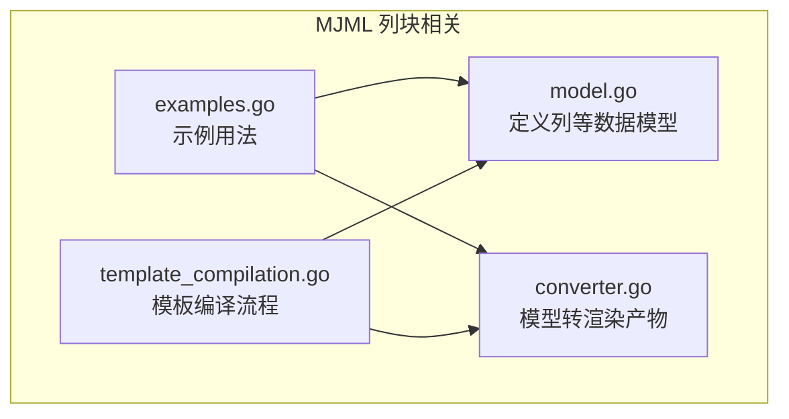
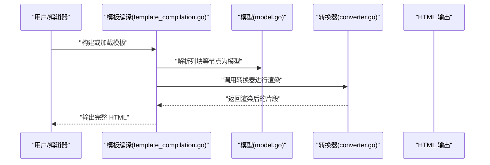
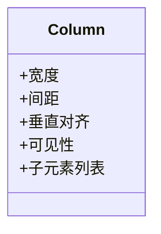
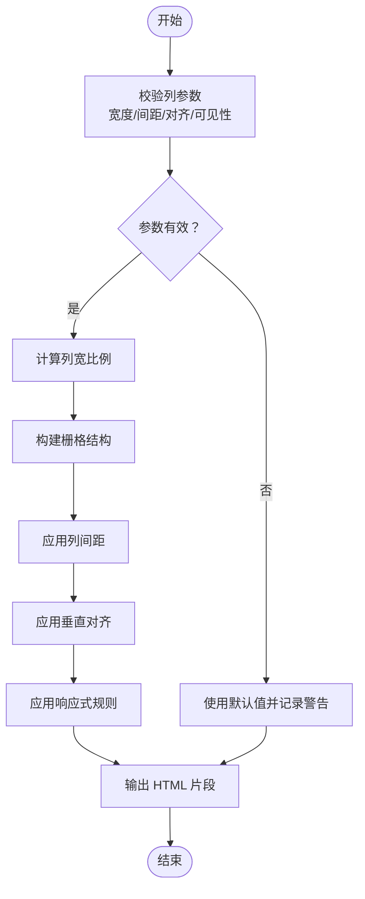
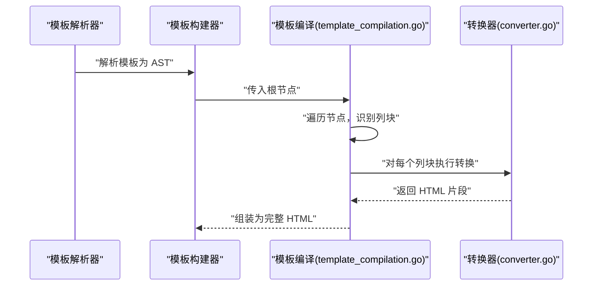
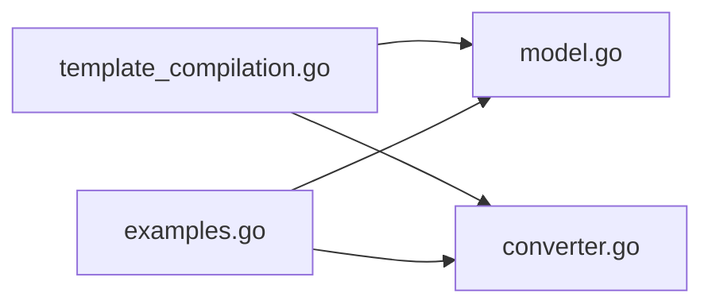

# 列块

<cite>
**本文引用的文件**   
- [model.go](file://notifuse/pkg/notifuse_mjml/model.go)
- [converter.go](file://notifuse/pkg/notifuse_mjml/converter.go)
- [template_compilation.go](file://notifuse/pkg/notifuse_mjml/template_compilation.go)
- [examples.go](file://notifuse/pkg/notifuse_mjml/examples.go)
</cite>

## 目录
1. [简介](#简介)
2. [项目结构](#项目结构)
3. [核心组件](#核心组件)
4. [架构总览](#架构总览)
5. [详细组件分析](#详细组件分析)
6. [依赖分析](#依赖分析)
7. [性能考虑](#性能考虑)
8. [故障排查指南](#故障排查指南)
9. [结论](#结论)
10. [附录](#附录)

## 简介
本文件聚焦于邮件编辑器中的“列块”能力，围绕以下目标展开：
- 列布局系统的工作原理、列宽分配与网格对齐
- 列间距设置、垂直对齐方式与响应式行为
- 列嵌套结构、混合布局与复杂表格替代方案
- 移动端列堆叠、列隐藏显示与动态列生成
- 响应式邮件布局的设计模式与实现技巧

该能力基于 MJML 的列模型进行建模与转换，并在模板编译阶段完成最终 HTML 输出。

## 项目结构
与列块相关的核心代码位于 notifuse/pkg/notifuse_mjml 目录下，关键文件包括：
- model.go：定义列（Column）等数据模型
- converter.go：将模型转换为最终渲染产物（如 HTML）
- template_compilation.go：模板编译流程入口，串联模型到渲染
- examples.go：示例用法，便于理解列块的组合与使用

图表来源
- [model.go](file://notifuse/pkg/notifuse_mjml/model.go)
- [converter.go](file://notifuse/pkg/notifuse_mjml/converter.go)
- [template_compilation.go](file://notifuse/pkg/notifuse_mjml/template_compilation.go)
- [examples.go](file://notifuse/pkg/notifuse_mjml/examples.go)

章节来源
- [model.go](file://notifuse/pkg/notifuse_mjml/model.go)
- [converter.go](file://notifuse/pkg/notifuse_mjml/converter.go)
- [template_compilation.go](file://notifuse/pkg/notifuse_mjml/template_compilation.go)
- [examples.go](file://notifuse/pkg/notifuse_mjml/examples.go)

## 核心组件
- 列数据模型：用于表达列的宽度、间距、对齐、可见性、嵌套子元素等属性
- 转换器：将列模型转换为邮件客户端兼容的 HTML 结构，处理栅格、间距与对齐
- 模板编译：在编译期整合列块与其他区块，生成最终可发送的邮件内容
- 示例：提供常见列布局的组合方式，帮助快速上手

章节来源
- [model.go](file://notifuse/pkg/notifuse_mjml/model.go)
- [converter.go](file://notifuse/pkg/notifuse_mjml/converter.go)
- [template_compilation.go](file://notifuse/pkg/notifuse_mjml/template_compilation.go)
- [examples.go](file://notifuse/pkg/notifuse_mjml/examples.go)

## 架构总览
列块从“设计时模型”到“运行时渲染”的整体流程如下：

图表来源
- [template_compilation.go](file://notifuse/pkg/notifuse_mjml/template_compilation.go)
- [model.go](file://notifuse/pkg/notifuse_mjml/model.go)
- [converter.go](file://notifuse/pkg/notifuse_mjml/converter.go)

## 详细组件分析

### 列数据模型（Model）
- 职责：描述列的结构与样式语义，包括列宽、间距、对齐、可见性与子元素
- 复杂度：以树形结构组织，支持多层嵌套；时间复杂度主要受子节点数量影响
- 优化点：在转换前对无效列进行裁剪，减少后续渲染开销

图表来源
- [model.go](file://notifuse/pkg/notifuse_mjml/model.go)

章节来源
- [model.go](file://notifuse/pkg/notifuse_mjml/model.go)

### 转换器（Converter）
- 职责：将列模型转换为邮件客户端兼容的 HTML，负责栅格计算、间距注入与对齐策略
- 关键点：
  - 列宽分配：按列数与权重计算每列百分比宽度
  - 网格对齐：通过外层容器与内层单元格保证多行等高与对齐
  - 间距控制：根据列间距配置插入必要的空白单元格或边距
  - 响应式：在特定断点下切换为单列堆叠或隐藏某些列
- 错误处理：对非法列宽、负间距、空列集合等进行校验与回退

图表来源
- [converter.go](file://notifuse/pkg/notifuse_mjml/converter.go)

章节来源
- [converter.go](file://notifuse/pkg/notifuse_mjml/converter.go)

### 模板编译（Template Compilation）
- 职责：将包含列块在内的模板节点编译为最终 HTML
- 流程要点：
  - 解析模板 AST，识别列块节点
  - 将列块节点实例化为模型对象
  - 调用转换器生成 HTML 片段
  - 合并到其他区块，形成完整文档

图表来源
- [template_compilation.go](file://notifuse/pkg/notifuse_mjml/template_compilation.go)
- [converter.go](file://notifuse/pkg/notifuse_mjml/converter.go)

章节来源
- [template_compilation.go](file://notifuse/pkg/notifuse_mjml/template_compilation.go)
- [converter.go](file://notifuse/pkg/notifuse_mjml/converter.go)

### 示例与最佳实践（Examples）
- 用途：展示列块在不同场景下的组合方式，包括两列、三列、嵌套列、条件显示等
- 建议：
  - 优先使用标准列数（2/3/4），避免非整数比例导致渲染不一致
  - 合理设置列间距，避免在小屏设备上溢出
  - 使用响应式规则控制移动端堆叠与隐藏

章节来源
- [examples.go](file://notifuse/pkg/notifuse_mjml/examples.go)

## 依赖分析
- 模块内依赖：
  - 模板编译依赖模型与转换器
  - 转换器依赖模型定义
  - 示例依赖模型与转换器
- 外部依赖：
  - 依赖 MJML 的列语义与兼容性约束
  - 输出需兼容主流邮件客户端的 CSS 特性

图表来源
- [template_compilation.go](file://notifuse/pkg/notifuse_mjml/template_compilation.go)
- [model.go](file://notifuse/pkg/notifuse_mjml/model.go)
- [converter.go](file://notifuse/pkg/notifuse_mjml/converter.go)
- [examples.go](file://notifuse/pkg/notifuse_mjml/examples.go)

章节来源
- [template_compilation.go](file://notifuse/pkg/notifuse_mjml/template_compilation.go)
- [model.go](file://notifuse/pkg/notifuse_mjml/model.go)
- [converter.go](file://notifuse/pkg/notifuse_mjml/converter.go)
- [examples.go](file://notifuse/pkg/notifuse_mjml/examples.go)

## 性能考虑
- 列数量与嵌套深度：过多列或深层嵌套会增加 DOM 体积与渲染成本
- 间距与对齐计算：尽量在编译期完成，避免运行时重排
- 响应式规则：集中管理断点与显隐逻辑，减少重复样式
- 输出压缩：对生成的 HTML 进行必要压缩，降低传输体积

## 故障排查指南
- 列宽异常：检查列宽总和是否超过 100%，以及是否存在非法数值
- 间距溢出：确认列间距未导致小屏设备横向滚动
- 对齐错乱：核对垂直对齐属性是否与内容高度匹配
- 响应式失效：验证断点配置与媒体查询是否被正确注入
- 空列或隐藏列：确保隐藏列不会破坏栅格结构

## 结论
列块通过清晰的模型定义与稳健的转换器，实现了跨客户端一致的栅格布局。结合模板编译流程，可在设计时灵活配置列宽、间距、对齐与响应式行为，满足复杂邮件布局需求。遵循本文的最佳实践与排查建议，可进一步提升布局稳定性与性能。

## 附录
- 术语说明：
  - 列块：表示一组并列的内容区域，支持宽度、间距、对齐与响应式
  - 栅格：基于百分比与表格/盒模型的布局体系
  - 断点：触发不同布局行为的屏幕宽度阈值
- 参考路径：
  - 模型定义：[model.go](file://notifuse/pkg/notifuse_mjml/model.go)
  - 转换逻辑：[converter.go](file://notifuse/pkg/notifuse_mjml/converter.go)
  - 编译流程：[template_compilation.go](file://notifuse/pkg/notifuse_mjml/template_compilation.go)
  - 示例用法：[examples.go](file://notifuse/pkg/notifuse_mjml/examples.go)