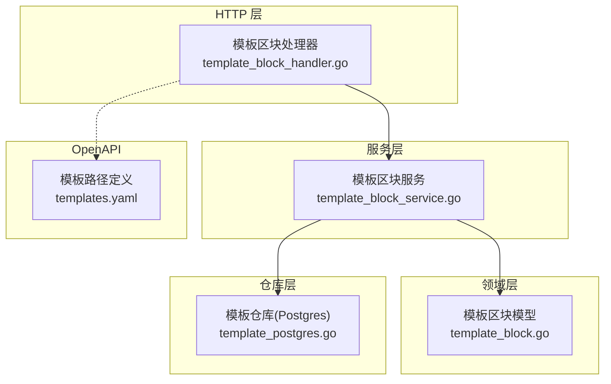
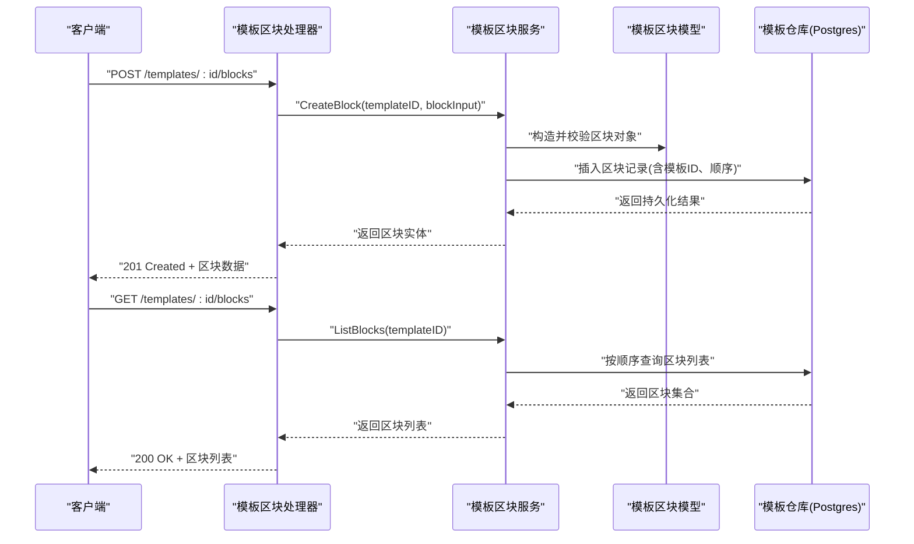
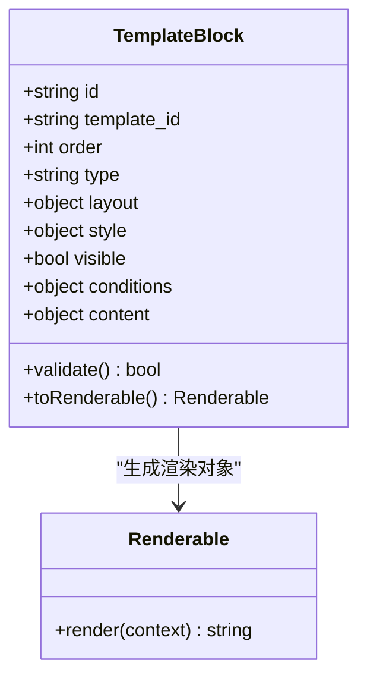
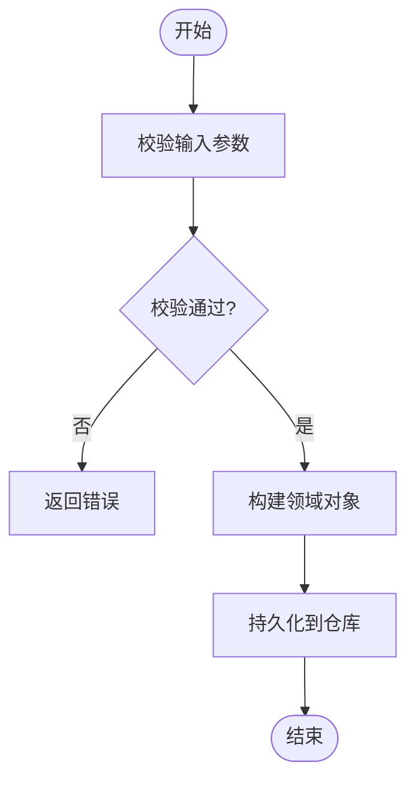
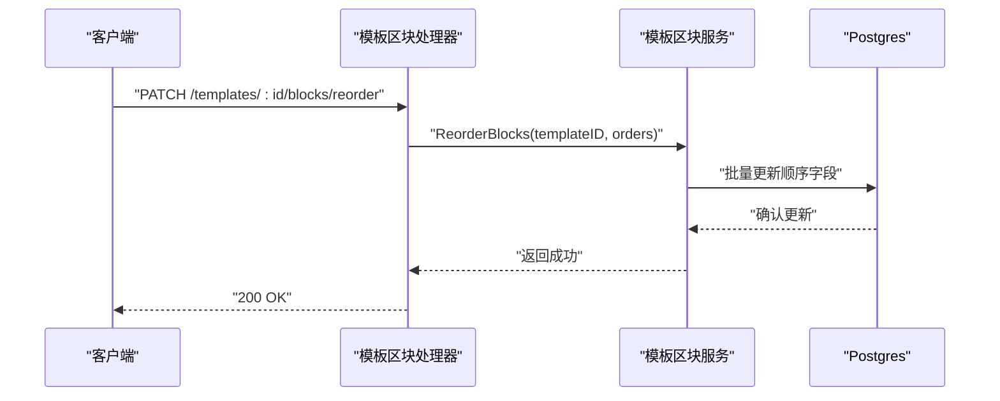
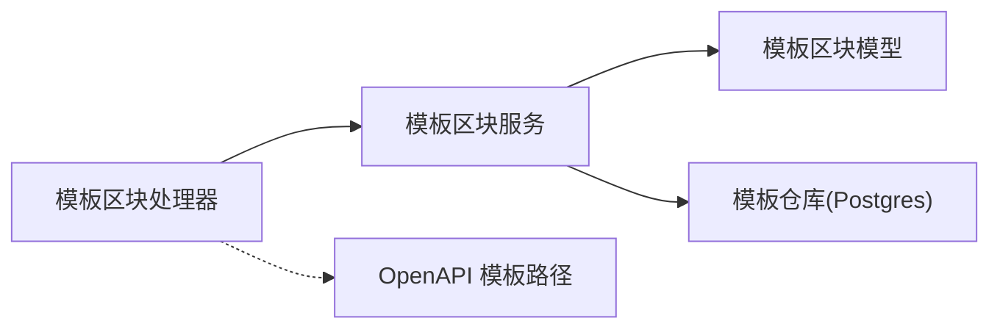

# 区块块

<cite>
**本文引用的文件**   
- [template_block.go](file://notifuse/internal/domain/template_block.go)
- [template_block_test.go](file://notifuse/internal/domain/template_block_test.go)
- [template_block_service.go](file://notifuse/internal/service/template_block_service.go)
- [template_block_service_test.go](file://notifuse/internal/service/template_block_service_test.go)
- [template_block_handler.go](file://notifuse/internal/http/template_block_handler.go)
- [template_block_handler_test.go](file://notifuse/internal/http/template_block_handler_test.go)
- [template_postgres.go](file://notifuse/internal/repository/template_postgres.go)
- [template_block_handler.yaml](file://notifuse/openapi/paths/templates.yaml)
</cite>

## 目录
1. [简介](#简介)
2. [项目结构](#项目结构)
3. [核心组件](#核心组件)
4. [架构总览](#架构总览)
5. [详细组件分析](#详细组件分析)
6. [依赖关系分析](#依赖关系分析)
7. [性能考虑](#性能考虑)
8. [故障排查指南](#故障排查指南)
9. [结论](#结论)
10. [附录](#附录)

## 简介
本文件围绕“邮件编辑器的区块块”进行系统化文档化，聚焦以下目标：
- 区块块的布局容器能力、嵌套结构与层级关系
- 背景设置、内边距与外边距配置、边界控制
- 响应式布局、断点策略与移动优先原则
- 可见性控制、条件显示与动态内容集成
- 复杂布局构建的最佳实践与性能优化建议

为便于读者理解，文档从领域模型、服务层、HTTP 接口到持久化层逐层展开，并辅以架构图、时序图与流程图说明数据与控制流。

## 项目结构
本项目采用分层架构：领域模型（domain）、服务层（service）、HTTP 处理器（http）、仓库层（repository）以及 OpenAPI 定义。与“区块块”相关的关键位置如下：
- 领域模型：模板区块的数据结构与校验
- 服务层：区块的创建、更新、查询、排序等编排逻辑
- HTTP 处理器：REST 端点实现与请求/响应映射
- 仓库层：PostgreSQL 持久化访问
- OpenAPI：模板与区块相关的 API 契约

图表来源
- [template_block_handler.go](file://notifuse/internal/http/template_block_handler.go)
- [template_block_service.go](file://notifuse/internal/service/template_block_service.go)
- [template_block.go](file://notifuse/internal/domain/template_block.go)
- [template_postgres.go](file://notifuse/internal/repository/template_postgres.go)
- [template_block_handler.yaml](file://notifuse/openapi/paths/templates.yaml)

章节来源
- [template_block.go](file://notifuse/internal/domain/template_block.go)
- [template_block_service.go](file://notifuse/internal/service/template_block_service.go)
- [template_block_handler.go](file://notifuse/internal/http/template_block_handler.go)
- [template_postgres.go](file://notifuse/internal/repository/template_postgres.go)
- [template_block_handler.yaml](file://notifuse/openapi/paths/templates.yaml)

## 核心组件
- 领域模型（模板区块）
  - 负责表达区块的结构、样式与行为属性，如布局容器、背景、间距、边界、可见性与条件渲染等。
  - 提供基础校验与默认值策略，确保数据一致性。
- 服务层（模板区块服务）
  - 编排区块的 CRUD、排序、关联模板等操作。
  - 处理业务规则，例如区块在模板中的层级约束、嵌套深度限制等。
- HTTP 处理器（模板区块处理器）
  - 暴露 REST 接口，将请求参数映射到领域模型或服务调用。
  - 统一错误码与响应格式。
- 仓库层（模板仓库 Postgres）
  - 负责模板与区块数据的持久化与读取。
  - 维护区块与模板的关联关系及顺序字段。

章节来源
- [template_block.go](file://notifuse/internal/domain/template_block.go)
- [template_block_service.go](file://notifuse/internal/service/template_block_service.go)
- [template_block_handler.go](file://notifuse/internal/http/template_block_handler.go)
- [template_postgres.go](file://notifuse/internal/repository/template_postgres.go)

## 架构总览
下图展示了从客户端到数据库的完整调用链，涵盖区块的创建、更新与查询流程。

图表来源
- [template_block_handler.go](file://notifuse/internal/http/template_block_handler.go)
- [template_block_service.go](file://notifuse/internal/service/template_block_service.go)
- [template_postgres.go](file://notifuse/internal/repository/template_postgres.go)

## 详细组件分析

### 领域模型：模板区块
- 职责
  - 定义区块的属性集，包括布局容器、背景、间距、边界、可见性与条件显示等。
  - 提供默认值与校验逻辑，保证区块在模板中的一致性与可渲染性。
- 关键概念
  - 布局容器：作为其他区块或内容的父级容器，支持嵌套。
  - 背景设置：颜色、渐变、图片等视觉背景。
  - 间距与边界：内边距（padding）、外边距（margin）、圆角（border-radius）等。
  - 可见性与条件：基于上下文或用户属性的显示/隐藏控制。
  - 动态内容：通过模板变量或外部数据源注入内容。
- 复杂度与数据结构
  - 区块树形结构：以父子关系组织，遍历与序列化需考虑深度与循环引用防护。
  - 样式属性扁平化存储，渲染时组合计算。

图表来源
- [template_block.go](file://notifuse/internal/domain/template_block.go)

章节来源
- [template_block.go](file://notifuse/internal/domain/template_block.go)
- [template_block_test.go](file://notifuse/internal/domain/template_block_test.go)

### 服务层：模板区块服务
- 职责
  - 编排区块的创建、更新、删除、排序与查询。
  - 校验区块与模板的关联关系，确保层级与顺序合法。
  - 处理区块可见性与条件渲染的业务规则。
- 典型流程
  - 创建区块：接收输入 -> 构造领域对象 -> 校验 -> 持久化 -> 返回结果。
  - 更新区块：加载现有区块 -> 合并变更 -> 重新校验 -> 持久化。
  - 列表查询：按模板 ID 与顺序字段排序返回。
- 错误处理
  - 非法模板 ID、区块类型不支持、顺序冲突等错误分类与提示。

图表来源
- [template_block_service.go](file://notifuse/internal/service/template_block_service.go)

章节来源
- [template_block_service.go](file://notifuse/internal/service/template_block_service.go)
- [template_block_service_test.go](file://notifuse/internal/service/template_block_service_test.go)

### HTTP 处理器：模板区块处理器
- 职责
  - 暴露 REST 端点，处理区块的增删改查请求。
  - 解析请求体、绑定参数、调用服务层并返回标准响应。
- 端点设计
  - 创建区块：POST /templates/:id/blocks
  - 列出区块：GET /templates/:id/blocks
  - 更新区块：PUT /templates/:id/blocks/:blockId
  - 删除区块：DELETE /templates/:id/blocks/:blockId
  - 调整顺序：PATCH /templates/:id/blocks/reorder
- 响应规范
  - 成功：200/201 + JSON 区块数据
  - 失败：4xx/5xx + 错误信息

图表来源
- [template_block_handler.go](file://notifuse/internal/http/template_block_handler.go)
- [template_block_service.go](file://notifuse/internal/service/template_block_service.go)
- [template_postgres.go](file://notifuse/internal/repository/template_postgres.go)

章节来源
- [template_block_handler.go](file://notifuse/internal/http/template_block_handler.go)
- [template_block_handler_test.go](file://notifuse/internal/http/template_block_handler_test.go)
- [template_block_handler.yaml](file://notifuse/openapi/paths/templates.yaml)

### 仓库层：模板仓库（Postgres）
- 职责
  - 管理模板与区块的关联表，维护区块顺序字段。
  - 提供事务性操作，确保区块顺序更新的原子性。
- 索引与查询
  - 针对模板 ID 与顺序字段建立索引，提升列表与重排查询性能。
  - 批量更新顺序以减少往返次数。

章节来源
- [template_postgres.go](file://notifuse/internal/repository/template_postgres.go)

## 依赖关系分析
- 耦合与内聚
  - 处理器仅依赖服务层，保持高内聚低耦合。
  - 服务层聚合领域模型与仓库层，承担业务编排。
  - 仓库层专注数据访问，避免业务逻辑渗透。
- 外部依赖
  - PostgreSQL 作为持久化后端。
  - OpenAPI 契约驱动接口设计与测试。

图表来源
- [template_block_handler.go](file://notifuse/internal/http/template_block_handler.go)
- [template_block_service.go](file://notifuse/internal/service/template_block_service.go)
- [template_block.go](file://notifuse/internal/domain/template_block.go)
- [template_postgres.go](file://notifuse/internal/repository/template_postgres.go)
- [template_block_handler.yaml](file://notifuse/openapi/paths/templates.yaml)

章节来源
- [template_block_handler.go](file://notifuse/internal/http/template_block_handler.go)
- [template_block_service.go](file://notifuse/internal/service/template_block_service.go)
- [template_block.go](file://notifuse/internal/domain/template_block.go)
- [template_postgres.go](file://notifuse/internal/repository/template_postgres.go)
- [template_block_handler.yaml](file://notifuse/openapi/paths/templates.yaml)

## 性能考虑
- 列表与排序
  - 使用模板 ID 与顺序字段的复合索引，加速区块列表与重排查询。
  - 分页与懒加载：对大型模板采用分页加载区块，减少首屏压力。
- 批量更新
  - 区块顺序调整采用批量更新，降低数据库往返次数。
- 缓存策略
  - 对热点模板的区块树进行短期缓存，结合失效策略（模板更新时清理）。
- 渲染优化
  - 按需渲染：根据可见性与条件过滤未显示的区块，减少 DOM 节点数量。
  - 样式合并与去重：避免重复样式计算，提升渲染效率。

[本节为通用性能指导，不直接分析具体文件]

## 故障排查指南
- 常见错误
  - 非法模板 ID：检查模板是否存在且权限正确。
  - 区块类型不支持：确认区块类型枚举与校验规则。
  - 顺序冲突：检查并发更新与事务隔离级别。
- 日志与追踪
  - 在处理器与服务层增加结构化日志，记录关键步骤与异常堆栈。
  - 使用链路追踪标识区块操作的 traceId，便于跨层定位问题。
- 回滚与重试
  - 区块顺序更新失败时，提供幂等接口与重试机制。
  - 对不可恢复错误返回明确错误码与修复建议。

章节来源
- [template_block_handler.go](file://notifuse/internal/http/template_block_handler.go)
- [template_block_service.go](file://notifuse/internal/service/template_block_service.go)

## 结论
“区块块”作为邮件编辑器的核心布局容器，具备完善的嵌套结构、样式配置与可见性控制能力。通过清晰的分层架构与严格的校验策略，系统在保证灵活性的同时维持了良好的可维护性与性能表现。建议在复杂布局场景中遵循移动优先与响应式设计原则，并结合缓存与批量更新策略进一步优化用户体验。

[本节为总结性内容，不直接分析具体文件]

## 附录
- 最佳实践
  - 合理划分区块粒度，避免过深嵌套导致渲染性能下降。
  - 使用统一的样式主题与变量，减少重复样式定义。
  - 对条件显示与动态内容进行灰度发布与 A/B 测试，验证效果。
- 术语表
  - 区块：模板中的最小布局单元，可包含内容与子区块。
  - 布局容器：承载子区块的父级区块，支持网格、分栏等布局模式。
  - 可见性控制：基于上下文或用户属性的显示/隐藏策略。
  - 动态内容：通过模板变量或外部数据源注入的内容片段。

[本节为补充信息，不直接分析具体文件]