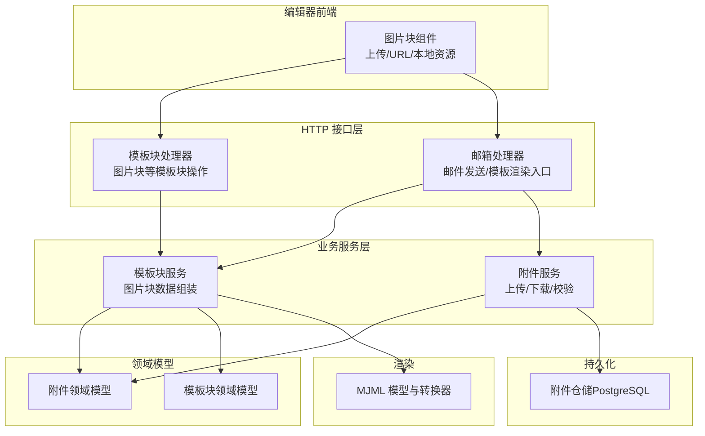
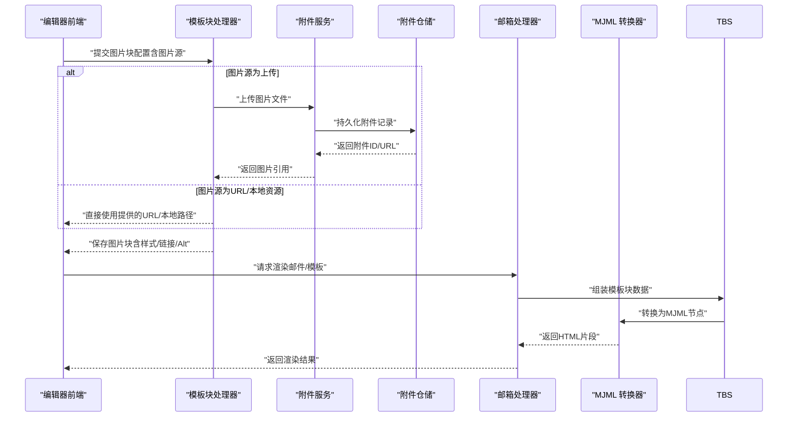
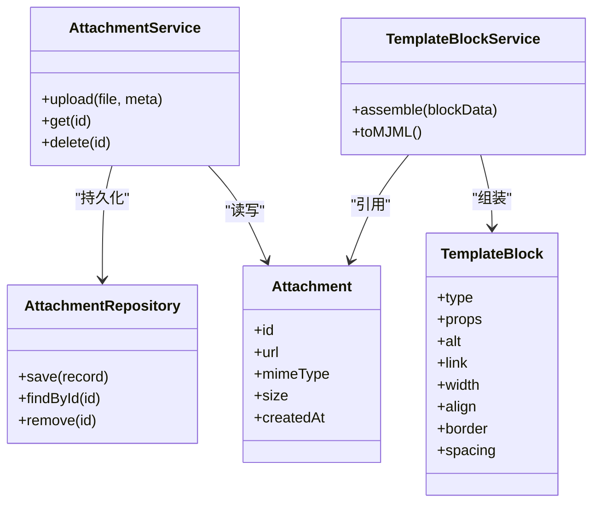
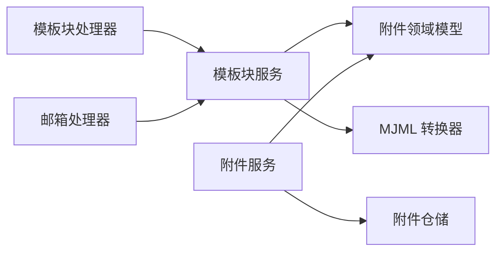

# 图片块

<cite>
**本文引用的文件**   
- [attachment.go](file://internal/domain/attachment.go)
- [attachment_service.go](file://internal/service/attachment_service.go)
- [attachment_postgres.go](file://internal/repository/attachment_postgres.go)
- [email_handler.go](file://internal/http/email_handler.go)
- [template_block.go](file://internal/domain/template_block.go)
- [template_block_service.go](file://internal/service/template_block_service.go)
- [template_block_handler.go](file://internal/http/template_block_handler.go)
- [model.go](file://pkg/notifuse_mjml/model.go)
- [converter.go](file://pkg/notifuse_mjml/converter.go)
</cite>

## 目录
1. [简介](#简介)
2. [项目结构](#项目结构)
3. [核心组件](#核心组件)
4. [架构总览](#架构总览)
5. [详细组件分析](#详细组件分析)
6. [依赖分析](#依赖分析)
7. [性能考虑](#性能考虑)
8. [故障排查指南](#故障排查指南)
9. [结论](#结论)
10. [附录](#附录)

## 简介
本文件为邮件编辑器中的“图片块”提供全面文档，覆盖以下能力：
- 图片来源与来源管理：上传、URL 引用、本地资源（附件）
- 样式与布局：尺寸设置、对齐方式、边框样式、间距控制
- 可访问性与链接：Alt 文本、链接包裹
- 渲染与兼容性：响应式图片处理、懒加载优化、跨客户端兼容
- 预览与体验：编辑态预览、占位与错误回退
- 优化建议与性能调优：压缩、格式选择、CDN 缓存策略

## 项目结构
围绕“图片块”的关键代码分布在领域模型、服务层、仓储层、HTTP 处理器以及 MJML 转换模块中。下图展示了从前端到后端再到渲染的核心路径。

图表来源
- [email_handler.go](file://internal/http/email_handler.go)
- [template_block_handler.go](file://internal/http/template_block_handler.go)
- [attachment_service.go](file://internal/service/attachment_service.go)
- [template_block_service.go](file://internal/service/template_block_service.go)
- [attachment.go](file://internal/domain/attachment.go)
- [template_block.go](file://internal/domain/template_block.go)
- [attachment_postgres.go](file://internal/repository/attachment_postgres.go)
- [model.go](file://pkg/notifuse_mjml/model.go)
- [converter.go](file://pkg/notifuse_mjml/converter.go)

章节来源
- [attachment.go](file://internal/domain/attachment.go)
- [attachment_service.go](file://internal/service/attachment_service.go)
- [attachment_postgres.go](file://internal/repository/attachment_postgres.go)
- [email_handler.go](file://internal/http/email_handler.go)
- [template_block.go](file://internal/domain/template_block.go)
- [template_block_service.go](file://internal/service/template_block_service.go)
- [template_block_handler.go](file://internal/http/template_block_handler.go)
- [model.go](file://pkg/notifuse_mjml/model.go)
- [converter.go](file://pkg/notifuse_mjml/converter.go)

## 核心组件
- 附件领域模型：定义图片资源的元数据与存储标识，支撑上传、引用与本地资源管理。
- 附件服务：负责图片上传流程、大小与类型校验、生成稳定 URL、清理与生命周期管理。
- 模板块领域模型与服务：将“图片块”的样式与行为（尺寸、对齐、边框、间距、Alt、链接）建模并转换为渲染所需的数据结构。
- HTTP 处理器：暴露上传、获取、删除等 API；在邮件发送或模板渲染时聚合图片块信息。
- MJML 模型与转换器：将图片块数据映射为 MJML 节点，再由渲染管线输出 HTML，确保跨客户端一致表现。

章节来源
- [attachment.go](file://internal/domain/attachment.go)
- [attachment_service.go](file://internal/service/attachment_service.go)
- [template_block.go](file://internal/domain/template_block.go)
- [template_block_service.go](file://internal/service/template_block_service.go)
- [email_handler.go](file://internal/http/email_handler.go)
- [template_block_handler.go](file://internal/http/template_block_handler.go)
- [model.go](file://pkg/notifuse_mjml/model.go)
- [converter.go](file://pkg/notifuse_mjml/converter.go)

## 架构总览
下图展示一次“上传图片并插入图片块”的典型调用序列，涵盖上传、存储、引用与渲染阶段。

图表来源
- [template_block_handler.go](file://internal/http/template_block_handler.go)
- [attachment_service.go](file://internal/service/attachment_service.go)
- [attachment_postgres.go](file://internal/repository/attachment_postgres.go)
- [email_handler.go](file://internal/http/email_handler.go)
- [template_block_service.go](file://internal/service/template_block_service.go)
- [model.go](file://pkg/notifuse_mjml/model.go)
- [converter.go](file://pkg/notifuse_mjml/converter.go)

## 详细组件分析

### 图片上传与本地资源管理
- 上传流程要点
  - 接收文件流与元信息（文件名、MIME、大小）。
  - 执行安全校验（类型白名单、大小上限、恶意内容检测）。
  - 生成唯一标识与稳定 URL，落盘或对象存储。
  - 返回可被图片块引用的地址。
- 本地资源管理
  - 通过附件 ID 或内部路径引用已上传资源。
  - 支持按工作区/用户隔离与权限控制。
  - 提供清理策略（未引用资源回收）。

章节来源
- [attachment_service.go](file://internal/service/attachment_service.go)
- [attachment_postgres.go](file://internal/repository/attachment_postgres.go)
- [attachment.go](file://internal/domain/attachment.go)

### URL 引用与外链策略
- 支持直接输入外部 URL 作为图片源。
- 建议在发送前进行可达性检查与防盗链策略评估。
- 对第三方 CDN 图片，优先使用 HTTPS 与缓存友好的域名。

章节来源
- [template_block.go](file://internal/domain/template_block.go)
- [template_block_service.go](file://internal/service/template_block_service.go)

### 图片块样式与布局
- 尺寸设置
  - 支持固定像素、百分比、自适应宽度。
  - 最大宽度限制，避免溢出容器。
- 对齐方式
  - 左对齐、居中、右对齐；在表格单元格内需兼容邮件客户端差异。
- 边框样式
  - 边框宽度、颜色、圆角；注意部分客户端对 CSS 属性支持有限。
- 间距控制
  - 外边距/内边距；移动端可读性与点击区域优化。

章节来源
- [template_block.go](file://internal/domain/template_block.go)
- [template_block_service.go](file://internal/service/template_block_service.go)

### Alt 文本与链接包裹
- Alt 文本
  - 必填或可选提示；用于可访问性与图片无法加载时的替代说明。
- 链接包裹
  - 可为图片添加跳转链接；点击区域最大化与无障碍标签传递。

章节来源
- [template_block.go](file://internal/domain/template_block.go)
- [template_block_service.go](file://internal/service/template_block_service.go)

### 预览与占位
- 编辑态预览
  - 上传后即时预览；URL 模式预检失败显示占位图。
- 错误回退
  - 网络不可达或 404 时显示默认占位图，保障版面稳定。

章节来源
- [template_block_handler.go](file://internal/http/template_block_handler.go)
- [template_block_service.go](file://internal/service/template_block_service.go)

### 渲染与跨客户端兼容
- MJML 模型映射
  - 将图片块的尺寸、对齐、边框、间距、Alt、链接映射为 MJML 节点属性。
- 渲染策略
  - 使用 mj-image/mj-column 等元素保证多客户端一致性。
  - 针对不支持现代 CSS 的客户端，降级为表格布局与内联样式。

章节来源
- [model.go](file://pkg/notifuse_mjml/model.go)
- [converter.go](file://pkg/notifuse_mjml/converter.go)

#### 类关系图（图片块相关）

图表来源
- [attachment.go](file://internal/domain/attachment.go)
- [template_block.go](file://internal/domain/template_block.go)
- [attachment_service.go](file://internal/service/attachment_service.go)
- [attachment_postgres.go](file://internal/repository/attachment_postgres.go)
- [template_block_service.go](file://internal/service/template_block_service.go)

## 依赖分析
- 组件耦合
  - 模板块服务依赖附件服务以解析图片源；依赖 MJML 转换器完成渲染。
  - HTTP 处理器仅暴露最小接口，降低与业务逻辑的耦合。
- 外部依赖
  - 对象存储/文件系统（由附件服务抽象）。
  - MJML 渲染器（由转换器封装）。
- 潜在循环依赖
  - 当前分层清晰，未见循环导入风险。

图表来源
- [template_block_handler.go](file://internal/http/template_block_handler.go)
- [email_handler.go](file://internal/http/email_handler.go)
- [template_block_service.go](file://internal/service/template_block_service.go)
- [attachment_service.go](file://internal/service/attachment_service.go)
- [attachment_postgres.go](file://internal/repository/attachment_postgres.go)
- [model.go](file://pkg/notifuse_mjml/model.go)
- [converter.go](file://pkg/notifuse_mjml/converter.go)

章节来源
- [template_block_handler.go](file://internal/http/template_block_handler.go)
- [email_handler.go](file://internal/http/email_handler.go)
- [template_block_service.go](file://internal/service/template_block_service.go)
- [attachment_service.go](file://internal/service/attachment_service.go)
- [attachment_postgres.go](file://internal/repository/attachment_postgres.go)
- [model.go](file://pkg/notifuse_mjml/model.go)
- [converter.go](file://pkg/notifuse_mjml/converter.go)

## 性能考虑
- 图片优化
  - 上传时自动压缩与格式转换（WebP/AVIF），保留必要质量。
  - 按需生成多分辨率缩略图，减少首屏传输体积。
- 懒加载与可见性
  - 非首屏图片采用懒加载策略，提升滚动体验。
  - 结合视口检测与优先级调度，避免阻塞关键渲染。
- 缓存与 CDN
  - 为静态图片启用强缓存与版本化 URL，提高命中率。
  - 合理设置 Cache-Control 与 ETag，减少重复传输。
- 并发与限流
  - 上传接口增加并发限制与速率限制，防止滥用。
  - 批量渲染时采用任务队列与分页处理，避免内存峰值。
- 客户端兼容
  - 对不支持现代属性的客户端提供降级方案（表格布局、内联样式）。
  - 避免使用复杂滤镜与动画，确保广泛兼容。

[本节为通用指导，不直接分析具体文件]

## 故障排查指南
- 上传失败
  - 检查文件大小与类型是否超出限制。
  - 确认对象存储/磁盘空间与权限。
  - 查看上传日志与错误码定位原因。
- 图片无法显示
  - 验证 URL 可达性与防盗链策略。
  - 检查 MIME 类型与浏览器/客户端解码支持。
  - 确认 CDN 缓存命中与回源状态。
- 渲染异常
  - 核对 MJML 节点属性是否符合规范。
  - 检查样式降级策略是否生效。
  - 对比不同客户端的渲染差异并调整模板。

章节来源
- [attachment_service.go](file://internal/service/attachment_service.go)
- [template_block_service.go](file://internal/service/template_block_service.go)
- [converter.go](file://pkg/notifuse_mjml/converter.go)

## 结论
图片块组件通过清晰的领域模型与服务分层，实现了上传、URL 引用与本地资源管理的统一入口，并在样式、可访问性与兼容性方面提供了完善的支撑。配合 MJML 渲染与优化策略，可在多客户端环境下获得一致的视觉与交互体验。建议在生产环境持续监控图片加载性能与错误率，结合 CDN 与缓存策略进一步优化用户体验。

[本节为总结，不直接分析具体文件]

## 附录
- 最佳实践清单
  - 始终填写 Alt 文本，描述图片内容与用途。
  - 外链图片优先使用 HTTPS 与可信域名。
  - 上传前进行前端与后端双重校验。
  - 为高频图片开启 CDN 与强缓存。
  - 定期清理未引用附件，释放存储空间。
- 参考实现路径
  - 上传与存储：[attachment_service.go](file://internal/service/attachment_service.go)、[attachment_postgres.go](file://internal/repository/attachment_postgres.go)
  - 图片块数据模型：[template_block.go](file://internal/domain/template_block.go)
  - 模板块服务与渲染：[template_block_service.go](file://internal/service/template_block_service.go)、[model.go](file://pkg/notifuse_mjml/model.go)、[converter.go](file://pkg/notifuse_mjml/converter.go)
  - HTTP 接口入口：[template_block_handler.go](file://internal/http/template_block_handler.go)、[email_handler.go](file://internal/http/email_handler.go)