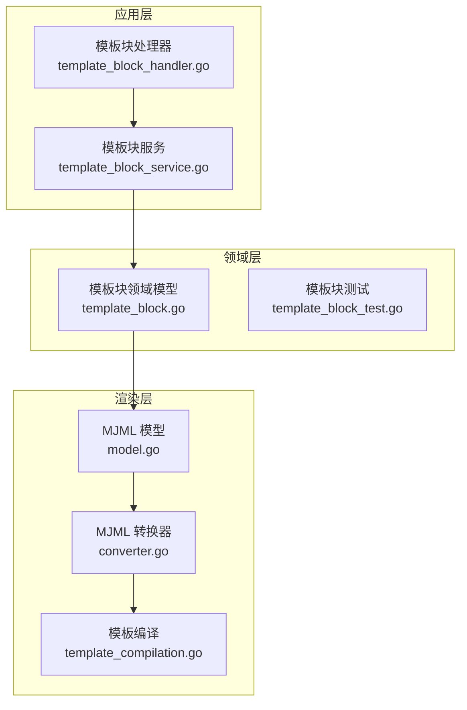
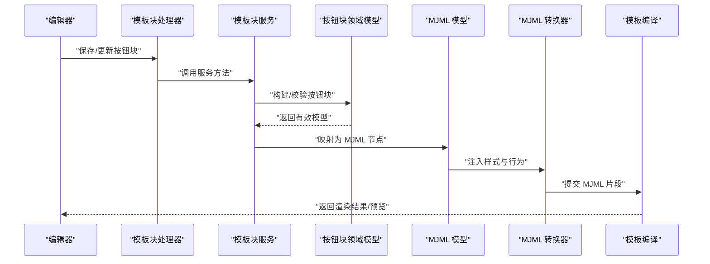
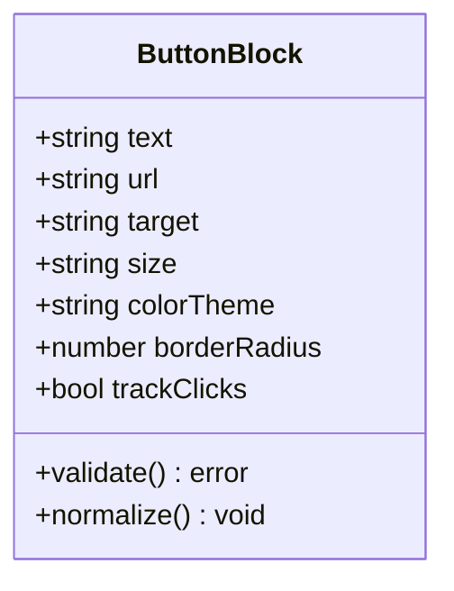
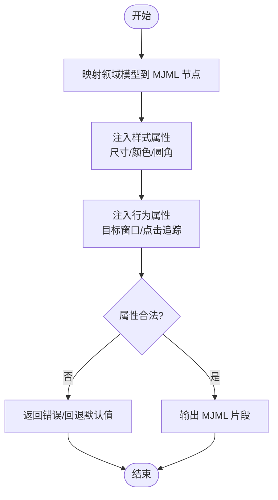
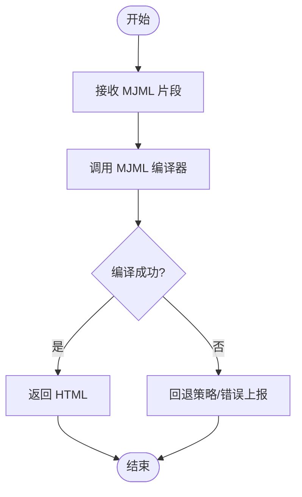
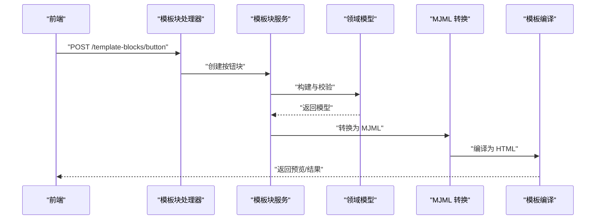
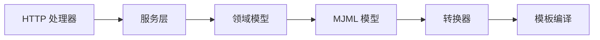

# 按钮块

<cite>
**本文引用的文件**   
- [template_block.go](file://internal/domain/template_block.go)
- [template_block_test.go](file://internal/domain/template_block_test.go)
- [template_block_handler.go](file://internal/http/template_block_handler.go)
- [template_block_service.go](file://internal/service/template_block_service.go)
- [model.go](file://pkg/notifuse_mjml/model.go)
- [converter.go](file://pkg/notifuse_mjml/converter.go)
- [template_compilation.go](file://pkg/notifuse_mjml/template_compilation.go)
</cite>

## 目录
1. [简介](#简介)
2. [项目结构](#项目结构)
3. [核心组件](#核心组件)
4. [架构总览](#架构总览)
5. [详细组件分析](#详细组件分析)
6. [依赖分析](#依赖分析)
7. [性能考虑](#性能考虑)
8. [故障排查指南](#故障排查指南)
9. [结论](#结论)
10. [附录](#附录) 

## 简介
本文件面向邮件编辑器中的“按钮块”组件，提供从创建、样式定制到行为配置的全流程使用文档。内容涵盖：
- 按钮尺寸、颜色主题、圆角设置与悬停效果
- 链接配置、目标窗口设置与点击追踪
- 响应式设计与移动端适配
- 无障碍访问支持
- CTA（行动号召）按钮的最佳实践与设计规范

说明基于仓库中模板块领域模型、MJML 渲染管线以及 HTTP/服务层接口实现进行归纳，确保读者既能上手使用，也能理解其内部数据流与扩展点。

## 项目结构
按钮块在系统中的关键位置如下：
- 领域模型：定义按钮块的属性与校验规则
- MJML 模型与转换：将领域模型转换为 MJML 节点并编译为 HTML
- HTTP 与服务层：提供按钮块的增删改查与模板集成能力

图示来源
- [template_block.go:1-200](file://internal/domain/template_block.go#L1-L200)
- [model.go:1-200](file://pkg/notifuse_mjml/model.go#L1-L200)
- [converter.go:1-200](file://pkg/notifuse_mjml/converter.go#L1-L200)
- [template_compilation.go:1-200](file://pkg/notifuse_mjml/template_compilation.go#L1-L200)
- [template_block_handler.go:1-200](file://internal/http/template_block_handler.go#L1-L200)
- [template_block_service.go:1-200](file://internal/service/template_block_service.go#L1-L200)

章节来源
- [template_block.go:1-200](file://internal/domain/template_block.go#L1-L200)
- [model.go:1-200](file://pkg/notifuse_mjml/model.go#L1-L200)
- [converter.go:1-200](file://pkg/notifuse_mjml/converter.go#L1-L200)
- [template_compilation.go:1-200](file://pkg/notifuse_mjml/template_compilation.go#L1-L200)
- [template_block_handler.go:1-200](file://internal/http/template_block_handler.go#L1-L200)
- [template_block_service.go:1-200](file://internal/service/template_block_service.go#L1-L200)

## 核心组件
- 按钮块领域模型
  - 负责描述按钮的文本、链接、样式与行为等元数据，并提供基础校验逻辑。
  - 典型字段包括：显示文本、链接地址、目标窗口策略、样式（尺寸、颜色、圆角）、事件追踪开关等。
- MJML 模型与转换
  - 将按钮块领域模型映射为 MJML 节点，生成可被 MJML 编译器处理的中间表示。
  - 转换器负责将样式与行为参数注入到 MJML 节点属性中。
- 模板编译
  - 接收 MJML 节点集合，输出最终 HTML，用于邮件客户端渲染。
- HTTP 与服务层
  - 提供按钮块的 CRUD 接口，并在模板上下文中组装按钮块实例。

章节来源
- [template_block.go:1-200](file://internal/domain/template_block.go#L1-L200)
- [model.go:1-200](file://pkg/notifuse_mjml/model.go#L1-L200)
- [converter.go:1-200](file://pkg/notifuse_mjml/converter.go#L1-L200)
- [template_compilation.go:1-200](file://pkg/notifuse_mjml/template_compilation.go#L1-L200)
- [template_block_handler.go:1-200](file://internal/http/template_block_handler.go#L1-L200)
- [template_block_service.go:1-200](file://internal/service/template_block_service.go#L1-L200)

## 架构总览
下图展示了从编辑器配置到最终邮件 HTML 的完整链路，突出按钮块在各层的流转。

图示来源
- [template_block_handler.go:1-200](file://internal/http/template_block_handler.go#L1-L200)
- [template_block_service.go:1-200](file://internal/service/template_block_service.go#L1-L200)
- [template_block.go:1-200](file://internal/domain/template_block.go#L1-L200)
- [model.go:1-200](file://pkg/notifuse_mjml/model.go#L1-L200)
- [converter.go:1-200](file://pkg/notifuse_mjml/converter.go#L1-L200)
- [template_compilation.go:1-200](file://pkg/notifuse_mjml/template_compilation.go#L1-L200)

## 详细组件分析

### 按钮块领域模型
- 职责
  - 定义按钮块的数据结构与约束，如必填字段、URL 格式、样式取值范围等。
  - 提供默认值与规范化处理，保证后续渲染一致性。
- 关键属性（概念性说明）
  - 文本：按钮显示文案
  - 链接：跳转 URL
  - 目标窗口：新标签页或当前页
  - 样式：尺寸、颜色主题、圆角半径
  - 行为：是否启用点击追踪
- 复杂度与健壮性
  - 输入校验集中在领域层，避免下游重复检查
  - 对非法链接、空文本等边界情况给出明确错误信息

图示来源
- [template_block.go:1-200](file://internal/domain/template_block.go#L1-L200)

章节来源
- [template_block.go:1-200](file://internal/domain/template_block.go#L1-L200)
- [template_block_test.go:1-200](file://internal/domain/template_block_test.go#L1-L200)

### MJML 模型与转换
- 职责
  - 将按钮块领域模型映射为 MJML 节点，包含文本、链接、样式与行为属性。
  - 转换器根据样式与行为配置注入 MJML 属性，确保兼容主流邮件客户端。
- 关键点
  - 尺寸映射：将抽象尺寸枚举映射为具体像素或相对单位
  - 颜色主题：映射为主题色板中的具体色值
  - 圆角：以像素或百分比形式写入对应属性
  - 目标窗口：通过链接协议或属性控制打开方式
  - 点击追踪：在链接上附加追踪参数或包裹埋点元素

图示来源
- [model.go:1-200](file://pkg/notifuse_mjml/model.go#L1-L200)
- [converter.go:1-200](file://pkg/notifuse_mjml/converter.go#L1-L200)

章节来源
- [model.go:1-200](file://pkg/notifuse_mjml/model.go#L1-L200)
- [converter.go:1-200](file://pkg/notifuse_mjml/converter.go#L1-L200)

### 模板编译
- 职责
  - 接收 MJML 片段，调用 MJML 编译器生成 HTML。
  - 处理编译异常与降级策略，确保邮件渲染稳定性。
- 关键点
  - 错误捕获与日志记录
  - 缓存已编译片段以提升性能（若实现）

图示来源
- [template_compilation.go:1-200](file://pkg/notifuse_mjml/template_compilation.go#L1-L200)

章节来源
- [template_compilation.go:1-200](file://pkg/notifuse_mjml/template_compilation.go#L1-L200)

### HTTP 与服务层
- 职责
  - 暴露按钮块的增删改查接口，供编辑器前端调用。
  - 在服务层组合领域模型与渲染管线，完成保存、预览与发布流程。
- 关键点
  - 请求校验与权限控制
  - 事务性与幂等性保障（若涉及持久化）
  - 与模板上下文集成，支持动态变量替换

图示来源
- [template_block_handler.go:1-200](file://internal/http/template_block_handler.go#L1-L200)
- [template_block_service.go:1-200](file://internal/service/template_block_service.go#L1-L200)
- [template_block.go:1-200](file://internal/domain/template_block.go#L1-L200)
- [model.go:1-200](file://pkg/notifuse_mjml/model.go#L1-L200)
- [converter.go:1-200](file://pkg/notifuse_mjml/converter.go#L1-L200)
- [template_compilation.go:1-200](file://pkg/notifuse_mjml/template_compilation.go#L1-L200)

章节来源
- [template_block_handler.go:1-200](file://internal/http/template_block_handler.go#L1-L200)
- [template_block_service.go:1-200](file://internal/service/template_block_service.go#L1-L200)

## 依赖分析
- 组件耦合
  - 领域模型独立于渲染层，便于复用与测试
  - 转换器依赖 MJML 模型，输出稳定的中间表示
  - 服务层聚合领域与渲染，屏蔽底层细节
- 外部依赖
  - MJML 编译器：负责最终 HTML 生成
  - 可选：缓存与日志系统（若实现）

图示来源
- [template_block.go:1-200](file://internal/domain/template_block.go#L1-L200)
- [model.go:1-200](file://pkg/notifuse_mjml/model.go#L1-L200)
- [converter.go:1-200](file://pkg/notifuse_mjml/converter.go#L1-L200)
- [template_compilation.go:1-200](file://pkg/notifuse_mjml/template_compilation.go#L1-L200)
- [template_block_handler.go:1-200](file://internal/http/template_block_handler.go#L1-L200)
- [template_block_service.go:1-200](file://internal/service/template_block_service.go#L1-L200)

章节来源
- [template_block.go:1-200](file://internal/domain/template_block.go#L1-L200)
- [model.go:1-200](file://pkg/notifuse_mjml/model.go#L1-L200)
- [converter.go:1-200](file://pkg/notifuse_mjml/converter.go#L1-L200)
- [template_compilation.go:1-200](file://pkg/notifuse_mjml/template_compilation.go#L1-L200)
- [template_block_handler.go:1-200](file://internal/http/template_block_handler.go#L1-L200)
- [template_block_service.go:1-200](file://internal/service/template_block_service.go#L1-L200)

## 性能考虑
- 预编译与缓存
  - 对静态按钮块片段进行缓存，减少重复编译开销
- 最小化样式体积
  - 仅注入必要样式属性，避免冗余 CSS
- 批量渲染
  - 在模板中合并多个按钮块，降低 MJML 编译次数
- 错误快速失败
  - 在领域层尽早校验，避免进入渲染阶段后失败

[本节为通用指导，不直接分析具体文件]

## 故障排查指南
- 常见错误
  - 链接无效或缺失：检查领域模型的 URL 校验与必填项
  - 样式不生效：确认尺寸、颜色主题与圆角取值是否在允许范围内
  - 目标窗口未生效：核对目标窗口策略与链接协议是否正确
  - 点击追踪未记录：确认追踪开关与埋点参数注入逻辑
- 定位步骤
  - 查看领域模型校验错误信息
  - 检查 MJML 节点属性是否正确注入
  - 审查模板编译日志与回退策略
  - 对比预期与实际的 HTML 输出差异

章节来源
- [template_block_test.go:1-200](file://internal/domain/template_block_test.go#L1-L200)
- [template_compilation.go:1-200](file://pkg/notifuse_mjml/template_compilation.go#L1-L200)

## 结论
按钮块组件通过清晰的领域模型、稳定的 MJML 转换与可靠的模板编译，提供了易用且可扩展的邮件按钮能力。遵循本文的尺寸、颜色、圆角、悬停、链接、目标窗口与点击追踪配置建议，并结合响应式与无障碍最佳实践，可在不同邮件客户端中获得一致的用户体验。

[本节为总结性内容，不直接分析具体文件]

## 附录

### 按钮创建与配置清单
- 基本配置
  - 文本：简洁明确的行动文案
  - 链接：有效的绝对或相对 URL
  - 目标窗口：新标签页或当前页
- 样式定制
  - 尺寸：小/中/大，按内容密度选择
  - 颜色主题：品牌主色或语义色（成功、警告、危险）
  - 圆角：0-8px 常用范围，保持视觉一致性
  - 悬停效果：背景色加深或边框高亮
- 行为配置
  - 点击追踪：开启并附带唯一事件标识
  - 无障碍：提供 aria-label 与键盘可达性

[本节为概念性清单，不直接分析具体文件]

### 响应式与移动端适配
- 全宽按钮在窄屏下更易点击
- 内边距与字号随屏幕宽度调整
- 避免在小屏幕上出现溢出或重叠

[本节为概念性指导，不直接分析具体文件]

### 无障碍访问支持
- 为按钮提供有意义的文本或 aria-label
- 确保焦点可见与键盘操作可用
- 颜色对比度符合 WCAG 标准

[本节为概念性指导，不直接分析具体文件]

### CTA 按钮最佳实践与设计规范
- 文案：动词开头，强调价值与下一步动作
- 视觉：高对比度、适度留白、统一风格
- 布局：重要 CTA 置于首屏可视区域
- 交互：悬停与点击反馈清晰
- 度量：结合点击追踪评估转化效果

[本节为概念性指导，不直接分析具体文件]