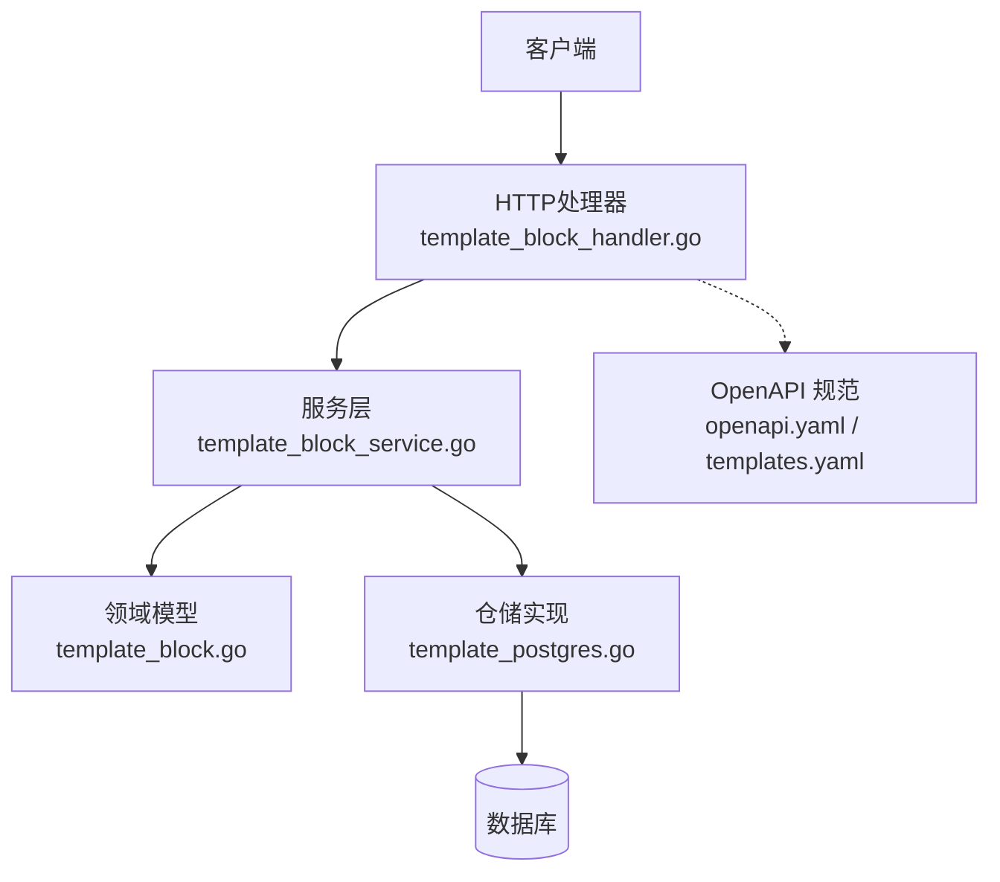
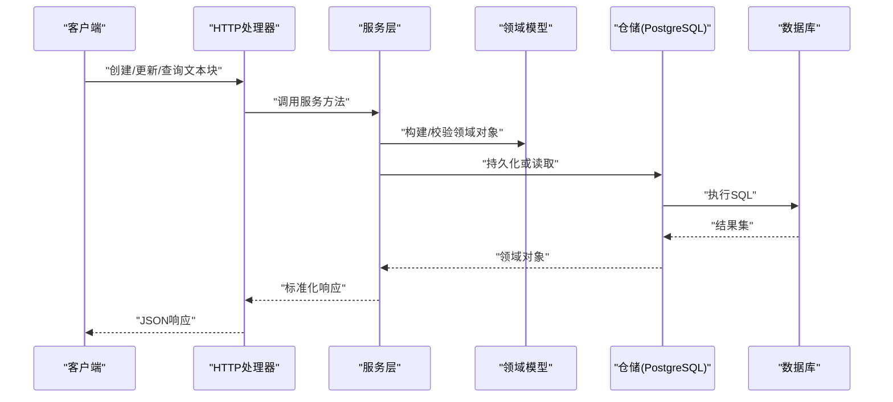
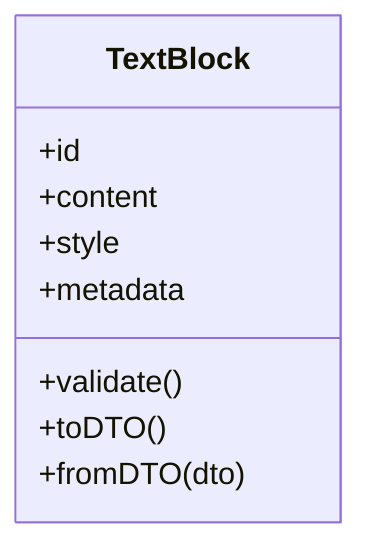
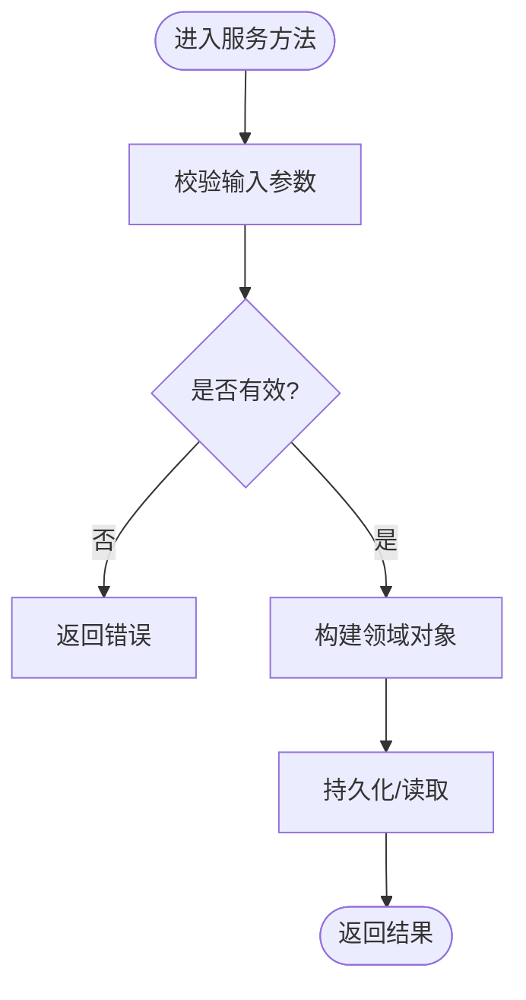
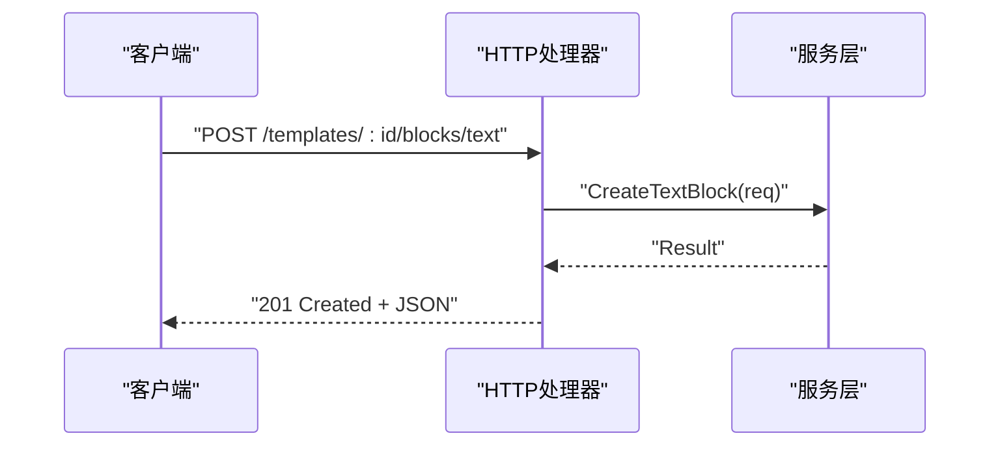
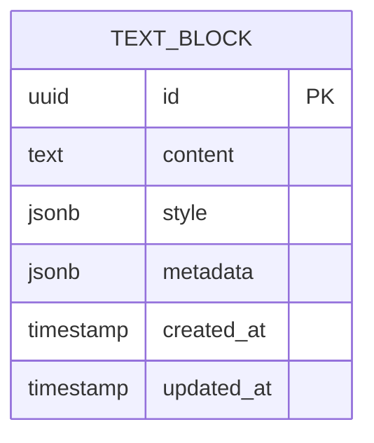
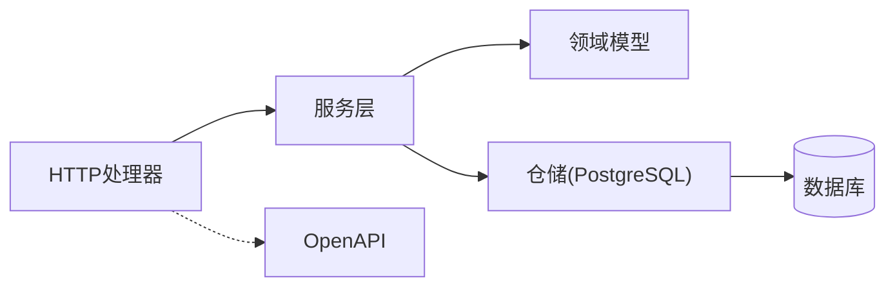

# 文本块

<cite>
**本文引用的文件**   
- [template_block.go](file://internal/domain/template_block.go)
- [template_block_test.go](file://internal/domain/template_block_test.go)
- [template_block_service.go](file://internal/service/template_block_service.go)
- [template_block_service_test.go](file://internal/service/template_block_service_test.go)
- [template_block_handler.go](file://internal/http/handler/template_block_handler.go)
- [template_block_handler_test.go](file://internal/http/handler/template_block_handler_test.go)
- [template_postgres.go](file://internal/repository/template_postgres.go)
- [template_postgres_test.go](file://internal/repository/template_postgres_test.go)
- [openapi.yaml](file://openapi/openapi.yaml)
- [templates.yaml](file://openapi/paths/templates.yaml)
</cite>

## 目录
1. [简介](#简介)
2. [项目结构](#项目结构)
3. [核心组件](#核心组件)
4. [架构总览](#架构总览)
5. [详细组件分析](#详细组件分析)
6. [依赖关系分析](#依赖关系分析)
7. [性能考虑](#性能考虑)
8. [故障排查指南](#故障排查指南)
9. [结论](#结论)
10. [附录](#附录)

## 简介
本文件为邮件编辑器的“文本块”能力提供系统化文档，覆盖基本用法、支持的HTML标签与样式属性、文本格式化选项（粗体、斜体、下划线等）、字体设置、颜色配置、对齐方式、响应式处理、换行控制、链接插入，以及多语言支持与无障碍访问建议。内容基于仓库中模板与文本块相关的领域模型、服务层、HTTP处理器与OpenAPI定义进行梳理与归纳，帮助开发者与使用者快速理解并正确使用该功能。

## 项目结构
文本块能力贯穿领域模型、服务层、HTTP接口与持久化层：
- 领域模型：定义文本块的类型、字段与校验规则
- 服务层：封装业务逻辑（创建、更新、查询、删除）
- HTTP处理器：暴露REST API
- 持久化：PostgreSQL存储实现
- OpenAPI：对外接口契约

图表来源
- [template_block_handler.go:1-200](file://internal/http/handler/template_block_handler.go#L1-200)
- [template_block_service.go:1-200](file://internal/service/template_block_service.go#L1-200)
- [template_block.go:1-200](file://internal/domain/template_block.go#L1-200)
- [template_postgres.go:1-200](file://internal/repository/template_postgres.go#L1-200)
- [openapi.yaml:1-200](file://openapi/openapi.yaml#L1-200)
- [templates.yaml:1-200](file://openapi/paths/templates.yaml#L1-200)

章节来源
- [template_block.go:1-200](file://internal/domain/template_block.go#L1-200)
- [template_block_service.go:1-200](file://internal/service/template_block_service.go#L1-200)
- [template_block_handler.go:1-200](file://internal/http/handler/template_block_handler.go#L1-200)
- [template_postgres.go:1-200](file://internal/repository/template_postgres.go#L1-200)
- [openapi.yaml:1-200](file://openapi/openapi.yaml#L1-200)
- [templates.yaml:1-200](file://openapi/paths/templates.yaml#L1-200)

## 核心组件
- 领域模型（文本块）
  - 负责描述文本块的结构与约束，包括内容、富文本标记、样式与元数据等
  - 用于服务层与持久化层的统一数据载体
- 服务层（文本块服务）
  - 提供文本块的CRUD操作、校验与转换逻辑
  - 协调领域模型与仓储层
- HTTP处理器（文本块API）
  - 将请求映射到服务方法，返回标准响应
  - 遵循OpenAPI契约
- 仓储层（PostgreSQL实现）
  - 负责文本块数据的持久化与读取

章节来源
- [template_block.go:1-200](file://internal/domain/template_block.go#L1-200)
- [template_block_service.go:1-200](file://internal/service/template_block_service.go#L1-200)
- [template_block_handler.go:1-200](file://internal/http/handler/template_block_handler.go#L1-200)
- [template_postgres.go:1-200](file://internal/repository/template_postgres.go#L1-200)

## 架构总览
文本块在系统中的调用链如下：

图表来源
- [template_block_handler.go:1-200](file://internal/http/handler/template_block_handler.go#L1-200)
- [template_block_service.go:1-200](file://internal/service/template_block_service.go#L1-200)
- [template_block.go:1-200](file://internal/domain/template_block.go#L1-200)
- [template_postgres.go:1-200](file://internal/repository/template_postgres.go#L1-200)

## 详细组件分析

### 领域模型：文本块
- 职责
  - 定义文本块的数据结构与约束
  - 承载富文本内容与样式信息
- 关键要点
  - 支持富文本内容（HTML片段）
  - 可包含基础样式与排版相关字段（如字体、颜色、对齐等）
  - 提供校验与默认值策略

图表来源
- [template_block.go:1-200](file://internal/domain/template_block.go#L1-200)

章节来源
- [template_block.go:1-200](file://internal/domain/template_block.go#L1-200)
- [template_block_test.go:1-200](file://internal/domain/template_block_test.go#L1-200)

### 服务层：文本块服务
- 职责
  - 编排文本块的创建、更新、查询、删除流程
  - 执行输入校验、转换与错误处理
- 关键要点
  - 对前端提交的富文本内容进行清洗与规范化
  - 保证与领域模型的边界清晰
  - 提供统一的错误码与消息

图表来源
- [template_block_service.go:1-200](file://internal/service/template_block_service.go#L1-200)

章节来源
- [template_block_service.go:1-200](file://internal/service/template_block_service.go#L1-200)
- [template_block_service_test.go:1-200](file://internal/service/template_block_service_test.go#L1-200)

### HTTP处理器：文本块API
- 职责
  - 解析请求、路由到服务层
  - 序列化响应、处理异常
- 关键要点
  - 遵循OpenAPI定义的请求/响应格式
  - 统一错误响应结构

图表来源
- [template_block_handler.go:1-200](file://internal/http/handler/template_block_handler.go#L1-200)
- [templates.yaml:1-200](file://openapi/paths/templates.yaml#L1-200)

章节来源
- [template_block_handler.go:1-200](file://internal/http/handler/template_block_handler.go#L1-200)
- [template_block_handler_test.go:1-200](file://internal/http/handler/template_block_handler_test.go#L1-200)
- [templates.yaml:1-200](file://openapi/paths/templates.yaml#L1-200)

### 持久化：PostgreSQL实现
- 职责
  - 将文本块数据持久化到数据库
  - 提供查询与更新能力
- 关键要点
  - 使用事务确保一致性
  - 对富文本内容进行安全存储

图表来源
- [template_postgres.go:1-200](file://internal/repository/template_postgres.go#L1-200)

章节来源
- [template_postgres.go:1-200](file://internal/repository/template_postgres.go#L1-200)
- [template_postgres_test.go:1-200](file://internal/repository/template_postgres_test.go#L1-200)

## 依赖关系分析
- 组件耦合
  - HTTP处理器依赖服务层，不直接访问领域模型或仓储
  - 服务层依赖领域模型与仓储，保持业务编排职责
  - 仓储仅关注数据存取，不感知上层业务
- 外部依赖
  - OpenAPI规范驱动接口契约
  - PostgreSQL作为持久化后端

图表来源
- [template_block_handler.go:1-200](file://internal/http/handler/template_block_handler.go#L1-200)
- [template_block_service.go:1-200](file://internal/service/template_block_service.go#L1-200)
- [template_block.go:1-200](file://internal/domain/template_block.go#L1-200)
- [template_postgres.go:1-200](file://internal/repository/template_postgres.go#L1-200)
- [openapi.yaml:1-200](file://openapi/openapi.yaml#L1-200)

章节来源
- [openapi.yaml:1-200](file://openapi/openapi.yaml#L1-200)
- [templates.yaml:1-200](file://openapi/paths/templates.yaml#L1-200)

## 性能考虑
- 富文本大小控制
  - 限制单次文本块内容大小，避免大体积JSON/HTML导致网络与存储压力
- 索引设计
  - 对常用查询字段建立索引（如模板ID、创建时间）
- 缓存策略
  - 对热点文本块进行短期缓存，减少重复查询
- 批量操作
  - 批量创建/更新时采用事务合并，降低往返开销
- 渲染优化
  - 服务端预计算部分样式，减少客户端渲染负担

## 故障排查指南
- 常见错误
  - 输入校验失败：检查必填字段、长度限制、格式要求
  - 权限不足：确认当前用户具备对应模板的编辑权限
  - 数据库异常：检查连接池、事务超时与SQL错误码
- 定位步骤
  - 查看HTTP状态码与错误消息
  - 核对OpenAPI契约中的请求/响应结构
  - 检查服务层日志与仓储层SQL执行记录
- 恢复建议
  - 修正输入后重试
  - 调整系统配置（如超时、限流）
  - 回滚至最近可用版本

章节来源
- [template_block_handler_test.go:1-200](file://internal/http/handler/template_block_handler_test.go#L1-200)
- [template_block_service_test.go:1-200](file://internal/service/template_block_service_test.go#L1-200)
- [template_postgres_test.go:1-200](file://internal/repository/template_postgres_test.go#L1-200)

## 结论
文本块作为邮件编辑器的重要组成，通过清晰的领域模型与服务编排，提供了稳定的富文本处理能力。结合OpenAPI契约与PostgreSQL持久化，实现了可扩展、可维护的端到端能力。建议在接入时严格遵循输入校验与安全策略，并结合性能与可用性指标持续优化。

## 附录

### 支持的HTML标签与样式属性（概览）
- 文本语义与结构
  - 段落、标题、列表、引用、分隔线等
- 文本格式化
  - 粗体、斜体、下划线、删除线、上标/下标
- 链接与媒体
  - 超链接、图片占位（如需）
- 样式属性
  - 字体族、字号、字重、行高、字间距
  - 文本颜色、背景色
  - 对齐方式（左、中、右、两端）
  - 缩进与边距
- 响应式与换行
  - 断点适配（通过容器宽度与相对单位）
  - 自动换行与强制换行控制

说明：以上为通用能力清单，具体实现以领域模型与服务层校验为准。

### 文本格式化与样式配置示例（路径指引）
- 创建文本块请求示例
  - 参考：[templates.yaml](file://openapi/paths/templates.yaml)
- 文本块领域模型字段说明
  - 参考：[template_block.go](file://internal/domain/template_block.go)
- 服务层校验与转换逻辑
  - 参考：[template_block_service.go](file://internal/service/template_block_service.go)

### 最佳实践
- 内容安全
  - 在服务端对富文本进行白名单过滤与转义
- 可访问性
  - 为图片提供替代文本；为链接提供明确描述；确保对比度符合WCAG建议
- 多语言支持
  - 使用键值化的文案与动态替换；避免硬编码字符串
- 性能与体验
  - 合理拆分长文本；优先使用相对单位；避免过度嵌套

### 多语言支持与无障碍访问考虑
- 多语言
  - 将静态文案抽离为翻译键；根据用户语言环境加载对应资源
  - 富文本内容中的可变文案通过模板变量注入
- 无障碍
  - 为交互元素提供语义化标签与ARIA属性
  - 确保键盘可达性与屏幕阅读器友好