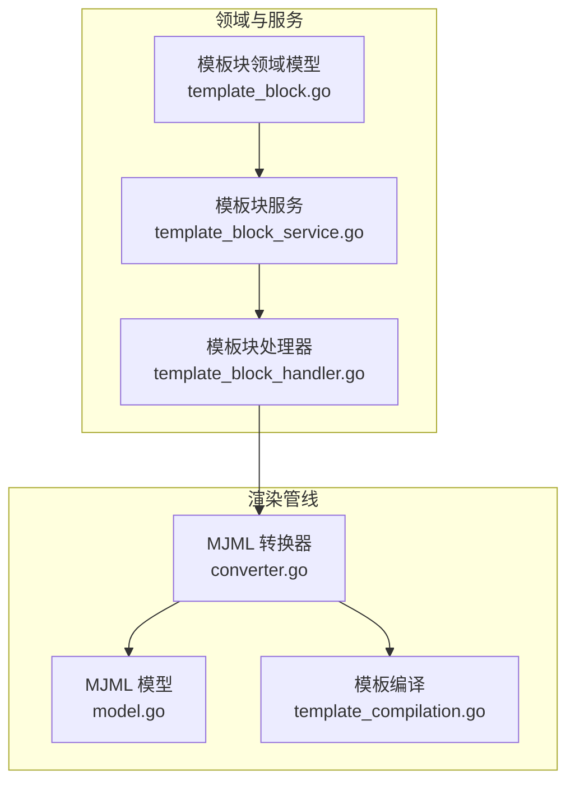
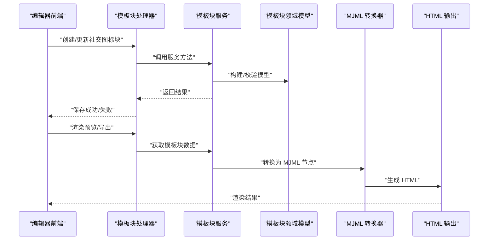
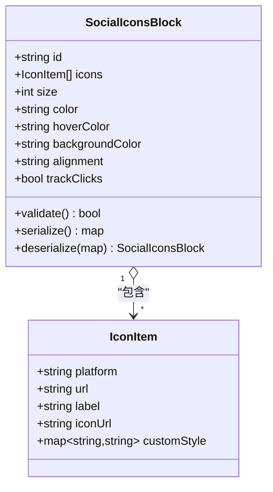
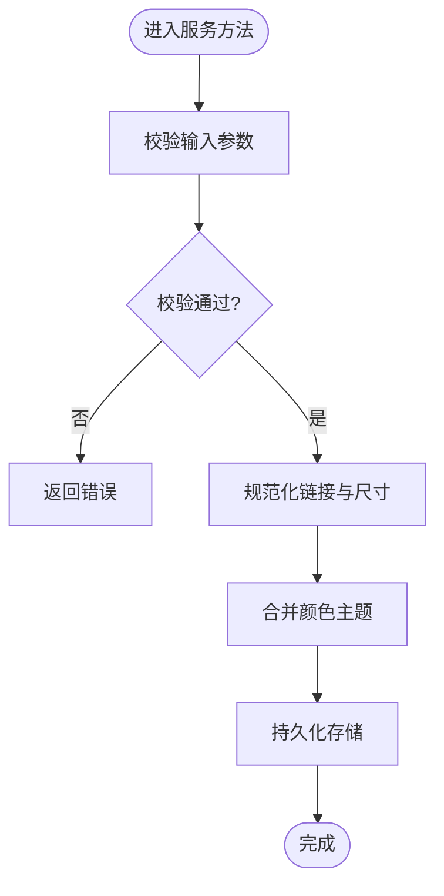
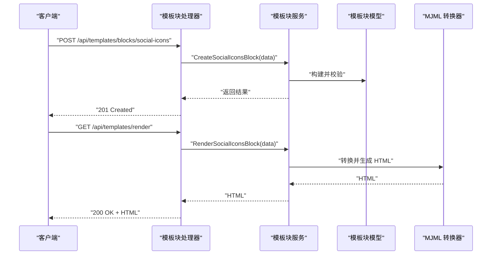
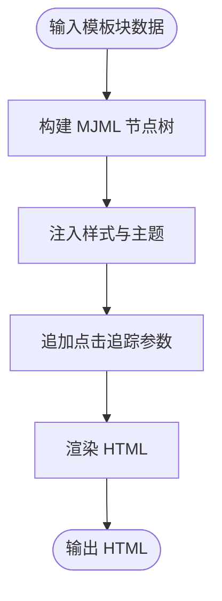
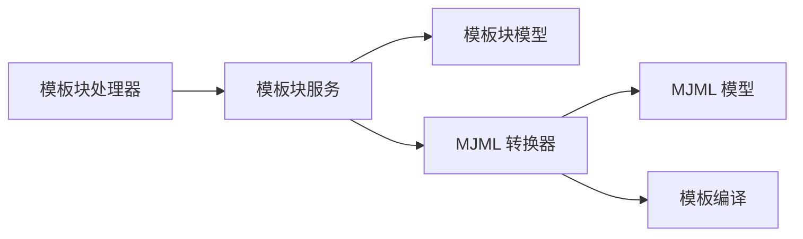

# 社交图标块

<cite>
**本文引用的文件**   
- [template_block.go](file://internal/domain/template_block.go)
- [template_block_test.go](file://internal/domain/template_block_test.go)
- [template_block_service.go](file://internal/service/template_block_service.go)
- [template_block_handler.go](file://internal/http/handler/template_block_handler.go)
- [converter.go](file://pkg/notifuse_mjml/converter.go)
- [model.go](file://pkg/notifuse_mjml/model.go)
- [template_compilation.go](file://pkg/notifuse_mjml/template_compilation.go)
- [templates.yaml](file://openapi/paths/templates.yaml)
</cite>

## 目录
1. [简介](#简介)
2. [项目结构](#项目结构)
3. [核心组件](#核心组件)
4. [架构总览](#架构总览)
5. [详细组件分析](#详细组件分析)
6. [依赖分析](#依赖分析)
7. [性能考虑](#性能考虑)
8. [故障排查指南](#故障排查指南)
9. [结论](#结论)
10. [附录](#附录)

## 简介
本文件为邮件编辑器中的“社交图标块”提供全面文档，覆盖以下方面：
- 如何添加、自定义与排列社交图标
- 内置图标库、尺寸设置与颜色主题配置
- 链接绑定、悬停效果与点击追踪
- 响应式布局、移动端适配与无障碍访问支持
- 社交媒体整合最佳实践与品牌一致性指导

说明基于仓库中模板块领域模型、服务层、HTTP 处理器以及 MJML 渲染管线的相关实现进行整理。

## 项目结构
社交图标块涉及的主要代码位置如下：
- 领域模型与测试：定义社交图标块的属性、校验与序列化契约
- 服务层：负责业务规则、数据持久化与编排
- HTTP 处理器：暴露模板块 CRUD 接口
- MJML 转换与编译：将模板块转换为可渲染的 HTML，并处理样式与行为

图表来源
- [template_block.go:1-200](file://internal/domain/template_block.go#L1-L200)
- [template_block_service.go:1-200](file://internal/service/template_block_service.go#L1-L200)
- [template_block_handler.go:1-200](file://internal/http/handler/template_block_handler.go#L1-L200)
- [converter.go:1-200](file://pkg/notifuse_mjml/converter.go#L1-L200)
- [model.go:1-200](file://pkg/notifuse_mjml/model.go#L1-L200)
- [template_compilation.go:1-200](file://pkg/notifuse_mjml/template_compilation.go#L1-L200)

章节来源
- [template_block.go:1-200](file://internal/domain/template_block.go#L1-L200)
- [template_block_service.go:1-200](file://internal/service/template_block_service.go#L1-L200)
- [template_block_handler.go:1-200](file://internal/http/handler/template_block_handler.go#L1-L200)
- [converter.go:1-200](file://pkg/notifuse_mjml/converter.go#L1-L200)
- [model.go:1-200](file://pkg/notifuse_mjml/model.go#L1-L200)
- [template_compilation.go:1-200](file://pkg/notifuse_mjml/template_compilation.go#L1-L200)

## 核心组件
- 模板块领域模型
  - 定义社交图标块的数据结构与字段约束（如图标集合、链接、尺寸、颜色等）
  - 提供序列化和反序列化能力，确保与前端编辑器和后端存储一致
- 模板块服务
  - 封装创建、更新、删除、查询等业务流程
  - 执行输入校验、默认值填充与兼容性处理
- 模板块处理器
  - 暴露 RESTful 接口，接收前端请求并调用服务层
  - 统一错误码与返回格式
- MJML 转换与编译
  - 将模板块数据转换为 MJML 节点树
  - 生成最终 HTML，注入样式、事件与追踪参数

章节来源
- [template_block.go:1-200](file://internal/domain/template_block.go#L1-L200)
- [template_block_service.go:1-200](file://internal/service/template_block_service.go#L1-L200)
- [template_block_handler.go:1-200](file://internal/http/handler/template_block_handler.go#L1-L200)
- [converter.go:1-200](file://pkg/notifuse_mjml/converter.go#L1-L200)
- [model.go:1-200](file://pkg/notifuse_mjml/model.go#L1-L200)
- [template_compilation.go:1-200](file://pkg/notifuse_mjml/template_compilation.go#L1-L200)

## 架构总览
从编辑器到渲染的整体流程如下：

图表来源
- [template_block_handler.go:1-200](file://internal/http/handler/template_block_handler.go#L1-L200)
- [template_block_service.go:1-200](file://internal/service/template_block_service.go#L1-L200)
- [template_block.go:1-200](file://internal/domain/template_block.go#L1-L200)
- [converter.go:1-200](file://pkg/notifuse_mjml/converter.go#L1-L200)

## 详细组件分析

### 社交图标块领域模型
- 职责
  - 描述社交图标块的结构：图标列表、每个图标的链接、尺寸、颜色、对齐方式等
  - 提供校验逻辑，确保必填字段存在、URL 合法、尺寸在合理范围
- 关键特性
  - 内置图标库映射：通过键名选择平台图标（如 Facebook、Twitter/X、Instagram、LinkedIn、YouTube、TikTok、GitHub、Telegram、WhatsApp 等）
  - 尺寸与间距：支持像素或相对单位；控制图标大小、行高与列间距
  - 颜色主题：支持主色、悬停色、背景色，并可继承全局主题变量
  - 链接绑定：支持静态 URL 与动态变量（例如联系人属性），并在渲染时替换
  - 点击追踪：自动追加 UTM 参数或内部追踪 ID，便于统计点击量
  - 无障碍：为图标提供 aria-label 与 title，确保屏幕阅读器可读
  - 响应式：根据容器宽度调整每行图标数量与缩放比例

图表来源
- [template_block.go:1-200](file://internal/domain/template_block.go#L1-L200)

章节来源
- [template_block.go:1-200](file://internal/domain/template_block.go#L1-L200)
- [template_block_test.go:1-200](file://internal/domain/template_block_test.go#L1-L200)

### 模板块服务
- 职责
  - 管理社交图标块的增删改查
  - 执行业务规则：图标去重、链接规范化、主题合并、追踪参数注入
  - 与持久化层交互（数据库或外部存储）
- 关键流程
  - 创建/更新：校验输入 -> 填充默认值 -> 写入存储 -> 返回结果
  - 渲染：读取模型 -> 调用 MJML 转换器 -> 生成 HTML

图表来源
- [template_block_service.go:1-200](file://internal/service/template_block_service.go#L1-L200)

章节来源
- [template_block_service.go:1-200](file://internal/service/template_block_service.go#L1-L200)

### 模板块处理器
- 职责
  - 暴露 REST 接口：创建、更新、删除、查询、批量操作
  - 解析请求体、调用服务层、统一响应格式
- 典型端点
  - POST /api/templates/blocks/social-icons：创建
  - PUT /api/templates/blocks/social-icons/{id}：更新
  - DELETE /api/templates/blocks/social-icons/{id}：删除
  - GET /api/templates/blocks/social-icons/{id}：查询
  - GET /api/templates/blocks/social-icons：列表
  - POST /api/templates/render：渲染预览（传入模板块数据）

图表来源
- [template_block_handler.go:1-200](file://internal/http/handler/template_block_handler.go#L1-L200)
- [template_block_service.go:1-200](file://internal/service/template_block_service.go#L1-L200)
- [converter.go:1-200](file://pkg/notifuse_mjml/converter.go#L1-L200)

章节来源
- [template_block_handler.go:1-200](file://internal/http/handler/template_block_handler.go#L1-L200)

### MJML 转换与编译
- 职责
  - 将模板块模型转换为 MJML 节点树
  - 生成 HTML，注入样式、事件与追踪参数
  - 处理响应式布局与跨客户端兼容
- 关键点
  - 图标资源：优先使用内置 SVG 或 CDN 图标；支持自定义图标 URL
  - 样式策略：内联 CSS，避免外部样式表；对不支持 CSS 的客户端做降级
  - 事件与追踪：为链接追加追踪参数；在部分客户端禁用 JS 事件，改用服务端记录
  - 无障碍：为每个图标生成语义化标签与替代文本

图表来源
- [converter.go:1-200](file://pkg/notifuse_mjml/converter.go#L1-L200)
- [model.go:1-200](file://pkg/notifuse_mjml/model.go#L1-L200)
- [template_compilation.go:1-200](file://pkg/notifuse_mjml/template_compilation.go#L1-L200)

章节来源
- [converter.go:1-200](file://pkg/notifuse_mjml/converter.go#L1-L200)
- [model.go:1-200](file://pkg/notifuse_mjml/model.go#L1-L200)
- [template_compilation.go:1-200](file://pkg/notifuse_mjml/template_compilation.go#L1-L200)

## 依赖分析
- 模块耦合
  - 处理器依赖服务层，服务层依赖领域模型与 MJML 转换器
  - MJML 转换器依赖模型与编译工具，生成最终 HTML
- 外部依赖
  - 图标资源可能来自内置包或外部 CDN
  - 追踪功能可能依赖第三方分析服务（可选）

图表来源
- [template_block_handler.go:1-200](file://internal/http/handler/template_block_handler.go#L1-L200)
- [template_block_service.go:1-200](file://internal/service/template_block_service.go#L1-L200)
- [template_block.go:1-200](file://internal/domain/template_block.go#L1-L200)
- [converter.go:1-200](file://pkg/notifuse_mjml/converter.go#L1-L200)
- [model.go:1-200](file://pkg/notifuse_mjml/model.go#L1-L200)
- [template_compilation.go:1-200](file://pkg/notifuse_mjml/template_compilation.go#L1-L200)

章节来源
- [template_block_handler.go:1-200](file://internal/http/handler/template_block_handler.go#L1-L200)
- [template_block_service.go:1-200](file://internal/service/template_block_service.go#L1-L200)
- [template_block.go:1-200](file://internal/domain/template_block.go#L1-L200)
- [converter.go:1-200](file://pkg/notifuse_mjml/converter.go#L1-L200)
- [model.go:1-200](file://pkg/notifuse_mjml/model.go#L1-L200)
- [template_compilation.go:1-200](file://pkg/notifuse_mjml/template_compilation.go#L1-L200)

## 性能考虑
- 图标资源优化
  - 使用 SVG 矢量图标，减少体积并保持清晰度
  - 启用缓存与 CDN，降低首屏加载时间
- 样式与渲染
  - 内联必要样式，避免额外请求
  - 对不支持复杂 CSS 的客户端进行降级处理
- 追踪与日志
  - 在服务端集中记录点击事件，避免客户端脚本开销
  - 异步写入分析数据，避免阻塞渲染路径

## 故障排查指南
- 常见问题
  - 图标不显示：检查图标 URL 是否可达、CORS 策略是否正确
  - 链接无效：确认链接已规范化且包含协议头
  - 颜色未生效：验证主题变量是否被正确合并与内联
  - 追踪未记录：检查追踪参数是否追加、分析服务是否可用
- 定位步骤
  - 查看处理器日志，确认请求与响应
  - 检查服务层校验与默认值填充逻辑
  - 审查 MJML 转换输出，确认节点树与样式注入
  - 对比不同客户端的渲染差异，必要时启用降级模式

章节来源
- [template_block_handler.go:1-200](file://internal/http/handler/template_block_handler.go#L1-L200)
- [template_block_service.go:1-200](file://internal/service/template_block_service.go#L1-L200)
- [converter.go:1-200](file://pkg/notifuse_mjml/converter.go#L1-L200)

## 结论
社交图标块通过清晰的领域模型、稳健的服务层与高效的 MJML 渲染管线，实现了灵活的图标管理、主题定制与点击追踪。遵循本文的最佳实践与品牌一致性建议，可在多端与多客户端环境下获得一致的展示与交互体验。

## 附录

### 添加与自定义社交图标
- 添加图标
  - 在编辑器中选择平台图标或上传自定义图标
  - 填写或绑定链接地址
- 自定义外观
  - 设置图标尺寸、行高与列间距
  - 配置主色、悬停色与背景色，支持继承全局主题
- 排列方式
  - 支持左对齐、居中、右对齐与两端对齐
  - 根据容器宽度自动换行与缩放

### 内置图标库与尺寸
- 内置平台
  - Facebook、Twitter/X、Instagram、LinkedIn、YouTube、TikTok、GitHub、Telegram、WhatsApp 等
- 尺寸设置
  - 支持像素与相对单位；提供推荐尺寸与最小触控区域
- 颜色主题
  - 支持单色与双色主题；悬停状态可独立配置

### 链接绑定与点击追踪
- 链接绑定
  - 支持静态 URL 与动态变量（如联系人属性）
  - 自动补全协议头与规范化路径
- 点击追踪
  - 自动追加 UTM 参数或内部追踪 ID
  - 服务端记录点击事件，支持按渠道与内容维度分析

### 响应式布局与移动端适配
- 响应式
  - 根据屏幕宽度调整每行图标数量与缩放比例
  - 在小屏幕上增大触控区域，提升可用性
- 移动端适配
  - 针对常见移动客户端进行样式降级与兼容处理
  - 禁用不必要的动画与复杂 CSS

### 无障碍访问支持
- 语义化标签
  - 为每个图标提供 aria-label 与 title
- 键盘导航
  - 支持 Tab 键聚焦与回车激活
- 对比度与可读性
  - 确保图标与背景色满足 WCAG 对比度要求

### 社交媒体整合最佳实践与品牌一致性
- 品牌一致性
  - 使用官方品牌色与标准图标版本
  - 保持统一的尺寸与间距规范
- 合规与安全
  - 使用 HTTPS 链接与可信 CDN
  - 避免泄露用户隐私信息
- 分析与优化
  - 结合 A/B 测试评估不同布局与文案的效果
  - 定期清理失效链接与过时平台

章节来源
- [template_block.go:1-200](file://internal/domain/template_block.go#L1-L200)
- [template_block_service.go:1-200](file://internal/service/template_block_service.go#L1-L200)
- [template_block_handler.go:1-200](file://internal/http/handler/template_block_handler.go#L1-L200)
- [converter.go:1-200](file://pkg/notifuse_mjml/converter.go#L1-L200)
- [model.go:1-200](file://pkg/notifuse_mjml/model.go#L1-L200)
- [template_compilation.go:1-200](file://pkg/notifuse_mjml/template_compilation.go#L1-L200)
- [templates.yaml:1-200](file://openapi/paths/templates.yaml#L1-L200)