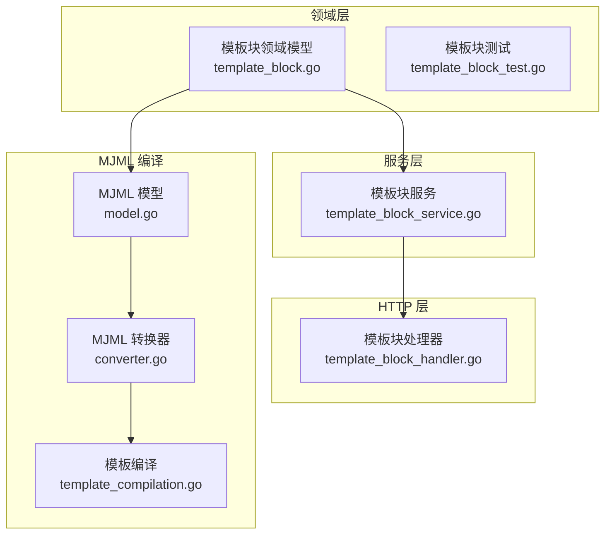
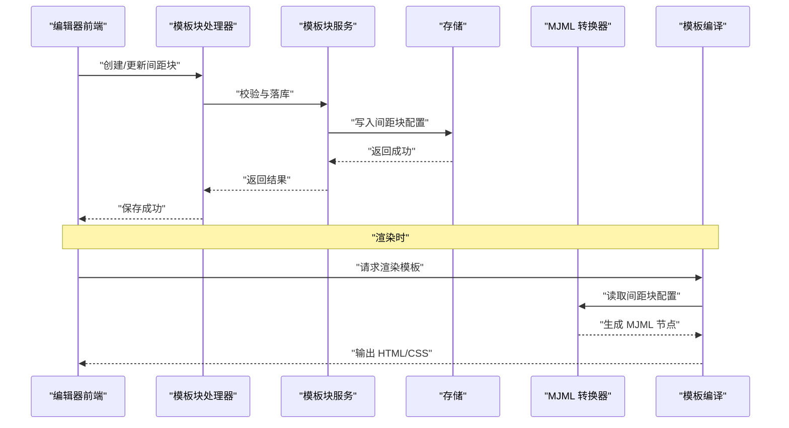
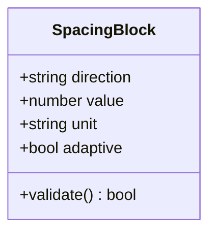
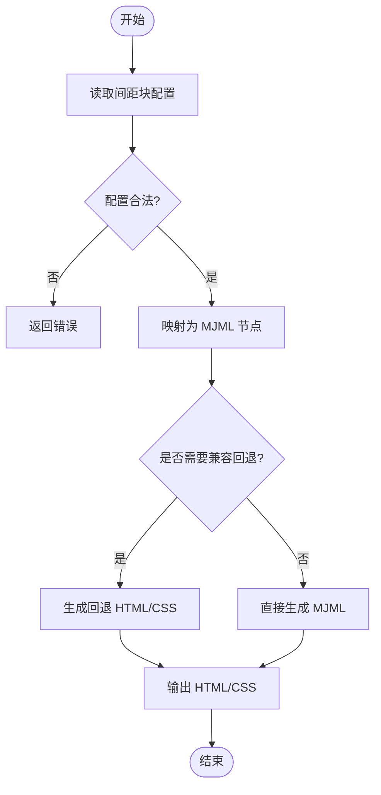
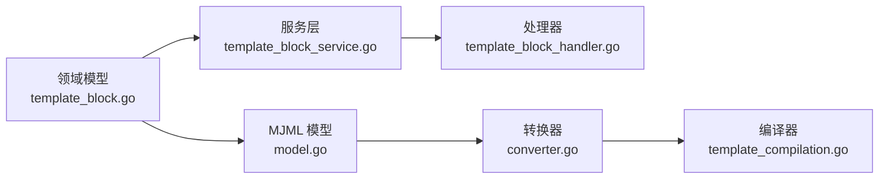

# 间距块

<cite>
**本文引用的文件**   
- [template_block.go](file://internal/domain/template_block.go)
- [template_block_test.go](file://internal/domain/template_block_test.go)
- [template_block_service.go](file://internal/service/template_block_service.go)
- [template_block_handler.go](file://internal/http/handler/template_block_handler.go)
- [model.go](file://pkg/notifuse_mjml/model.go)
- [converter.go](file://pkg/notifuse_mjml/converter.go)
- [template_compilation.go](file://pkg/notifuse_mjml/template_compilation.go)
</cite>

## 目录
1. [简介](#简介)
2. [项目结构](#项目结构)
3. [核心组件](#核心组件)
4. [架构总览](#架构总览)
5. [详细组件分析](#详细组件分析)
6. [依赖关系分析](#依赖关系分析)
7. [性能与渲染特性](#性能与渲染特性)
8. [故障排查指南](#故障排查指南)
9. [结论](#结论)
10. [附录](#附录)

## 简介
本文件聚焦于邮件编辑器中的“间距块”组件，系统性地说明其用途、高度设置与响应式行为，覆盖垂直间距、水平间距与自适应间距的配置方法；解释不同邮件客户端在间距渲染上的差异与兼容性问题；阐述间距在布局中的作用与设计节奏控制；并提供最佳实践与视觉平衡技巧。文档同时给出代码级实现路径与架构图示，便于开发者快速定位与扩展。

## 项目结构
本项目中，间距块作为模板块（Template Block）的一种类型存在，贯穿领域模型、服务层、HTTP 接口以及 MJML 编译转换流程：
- 领域模型定义间距块的属性与校验规则
- 服务层提供创建、更新、查询等能力
- HTTP 处理器暴露 CRUD 接口
- MJML 转换器将间距块配置转换为最终 HTML/CSS 输出

图示来源
- [template_block.go:1-200](file://internal/domain/template_block.go#L1-L200)
- [template_block_test.go:1-200](file://internal/domain/template_block_test.go#L1-L200)
- [template_block_service.go:1-200](file://internal/service/template_block_service.go#L1-L200)
- [template_block_handler.go:1-200](file://internal/http/handler/template_block_handler.go#L1-L200)
- [model.go:1-200](file://pkg/notifuse_mjml/model.go#L1-L200)
- [converter.go:1-200](file://pkg/notifuse_mjml/converter.go#L1-L200)
- [template_compilation.go:1-200](file://pkg/notifuse_mjml/template_compilation.go#L1-L200)

章节来源
- [template_block.go:1-200](file://internal/domain/template_block.go#L1-L200)
- [template_block_service.go:1-200](file://internal/service/template_block_service.go#L1-L200)
- [template_block_handler.go:1-200](file://internal/http/handler/template_block_handler.go#L1-L200)
- [model.go:1-200](file://pkg/notifuse_mjml/model.go#L1-L200)
- [converter.go:1-200](file://pkg/notifuse_mjml/converter.go#L1-L200)
- [template_compilation.go:1-200](file://pkg/notifuse_mjml/template_compilation.go#L1-L200)

## 核心组件
- 间距块领域模型
  - 负责定义间距块的数据结构与约束，包括方向（垂直/水平）、尺寸值、单位、是否自适应等字段，以及基础校验逻辑。
- 模板块服务
  - 封装间距块的增删改查、批量操作与业务校验，确保数据一致性。
- 模板块处理器
  - 对外暴露 RESTful 接口，接收前端请求并调用服务层完成业务处理。
- MJML 模型与转换器
  - 将间距块配置映射为 MJML 节点，再由编译器生成目标 HTML/CSS，考虑邮件客户端兼容性策略。

章节来源
- [template_block.go:1-200](file://internal/domain/template_block.go#L1-L200)
- [template_block_service.go:1-200](file://internal/service/template_block_service.go#L1-L200)
- [template_block_handler.go:1-200](file://internal/http/handler/template_block_handler.go#L1-L200)
- [model.go:1-200](file://pkg/notifuse_mjml/model.go#L1-L200)
- [converter.go:1-200](file://pkg/notifuse_mjml/converter.go#L1-L200)

## 架构总览
从编辑器到渲染的完整链路如下：
- 用户在编辑器中选择或新增“间距块”，配置方向、数值、单位与自适应选项
- 前端通过 HTTP 接口保存或更新间距块
- 后端服务进行校验与持久化
- 模板编译阶段，MJML 转换器根据间距块配置生成对应的 MJML 节点
- 编译器输出兼容多客户端的 HTML/CSS

图示来源
- [template_block_handler.go:1-200](file://internal/http/handler/template_block_handler.go#L1-L200)
- [template_block_service.go:1-200](file://internal/service/template_block_service.go#L1-L200)
- [model.go:1-200](file://pkg/notifuse_mjml/model.go#L1-L200)
- [converter.go:1-200](file://pkg/notifuse_mjml/converter.go#L1-L200)
- [template_compilation.go:1-200](file://pkg/notifuse_mjml/template_compilation.go#L1-L200)

## 详细组件分析

### 间距块领域模型
- 职责
  - 定义间距块的核心属性：方向（垂直/水平）、数值、单位、是否自适应、最小/最大限制等
  - 提供基础校验：数值范围、单位合法性、组合约束（如自适应与固定值的互斥）
- 复杂度
  - 数据结构简单，校验逻辑以条件判断为主，时间复杂度 O(1)
- 优化点
  - 可引入枚举与常量集中管理单位与方向，减少魔法字符串
  - 对边界值进行预检查，避免后续重复校验

图示来源
- [template_block.go:1-200](file://internal/domain/template_block.go#L1-L200)

章节来源
- [template_block.go:1-200](file://internal/domain/template_block.go#L1-L200)
- [template_block_test.go:1-200](file://internal/domain/template_block_test.go#L1-L200)

### 模板块服务
- 职责
  - 提供间距块的创建、更新、删除、查询等能力
  - 聚合领域校验与业务规则，保证数据一致性与完整性
- 错误处理
  - 统一错误码与消息，便于前端提示与日志追踪
- 并发与事务
  - 在需要时包裹数据库事务，确保多步操作的原子性

章节来源
- [template_block_service.go:1-200](file://internal/service/template_block_service.go#L1-L200)

### 模板块处理器
- 职责
  - 解析 HTTP 请求参数，调用服务层完成业务处理
  - 返回标准响应格式，包含状态码与提示信息
- 安全与鉴权
  - 校验用户权限与输入合法性，防止越权访问与注入攻击

章节来源
- [template_block_handler.go:1-200](file://internal/http/handler/template_block_handler.go#L1-L200)

### MJML 模型与转换器
- 职责
  - 将间距块配置映射为 MJML 节点（例如 vspacer/hspacer 或等效结构）
  - 根据邮件客户端兼容性策略，生成稳健的 HTML/CSS
- 适配策略
  - 针对不支持某些属性的客户端，采用回退方案（如使用表格/空行占位）
  - 对响应式场景，结合媒体查询或弹性布局策略

图示来源
- [model.go:1-200](file://pkg/notifuse_mjml/model.go#L1-L200)
- [converter.go:1-200](file://pkg/notifuse_mjml/converter.go#L1-L200)
- [template_compilation.go:1-200](file://pkg/notifuse_mjml/template_compilation.go#L1-L200)

章节来源
- [model.go:1-200](file://pkg/notifuse_mjml/model.go#L1-L200)
- [converter.go:1-200](file://pkg/notifuse_mjml/converter.go#L1-L200)
- [template_compilation.go:1-200](file://pkg/notifuse_mjml/template_compilation.go#L1-L200)

## 依赖关系分析
- 耦合与内聚
  - 领域模型与服务层低耦合，服务层对处理器透明，利于单元测试与替换实现
  - MJML 转换器独立于业务层，仅依赖模型与配置，具备良好的可移植性
- 外部依赖
  - MJML 编译器用于最终渲染，需关注版本兼容性与特性支持矩阵
- 潜在循环依赖
  - 当前分层清晰，未见循环导入风险

图示来源
- [template_block.go:1-200](file://internal/domain/template_block.go#L1-L200)
- [template_block_service.go:1-200](file://internal/service/template_block_service.go#L1-L200)
- [template_block_handler.go:1-200](file://internal/http/handler/template_block_handler.go#L1-L200)
- [model.go:1-200](file://pkg/notifuse_mjml/model.go#L1-L200)
- [converter.go:1-200](file://pkg/notifuse_mjml/converter.go#L1-L200)
- [template_compilation.go:1-200](file://pkg/notifuse_mjml/template_compilation.go#L1-L200)

章节来源
- [template_block.go:1-200](file://internal/domain/template_block.go#L1-L200)
- [template_block_service.go:1-200](file://internal/service/template_block_service.go#L1-L200)
- [template_block_handler.go:1-200](file://internal/http/handler/template_block_handler.go#L1-L200)
- [model.go:1-200](file://pkg/notifuse_mjml/model.go#L1-L200)
- [converter.go:1-200](file://pkg/notifuse_mjml/converter.go#L1-L200)
- [template_compilation.go:1-200](file://pkg/notifuse_mjml/template_compilation.go#L1-L200)

## 性能与渲染特性
- 渲染性能
  - 间距块通常不引入复杂计算，主要开销在于 MJML 转换与 CSS 生成，整体开销较低
- 响应式行为
  - 建议在移动端使用较小的间距值，在大屏上适度放大，保持阅读节奏
- 兼容性策略
  - 针对不支持某些 CSS 属性的客户端，优先使用表格布局或空行占位等回退方案
  - 对关键间距（如段落间、模块间）建议显式设置，避免依赖默认样式

[本节为通用指导，无需特定文件引用]

## 故障排查指南
- 常见错误
  - 配置非法：数值超出范围、单位不合法、自适应与固定值冲突
  - 渲染异常：MJML 节点缺失、CSS 被客户端过滤
- 排查步骤
  - 检查领域模型的校验结果与错误信息
  - 查看 MJML 转换器生成的中间产物，确认节点是否正确
  - 在不同客户端预览，验证回退策略是否生效
- 日志与监控
  - 记录关键路径的错误码与上下文，便于快速定位问题

章节来源
- [template_block_test.go:1-200](file://internal/domain/template_block_test.go#L1-L200)
- [converter.go:1-200](file://pkg/notifuse_mjml/converter.go#L1-L200)

## 结论
间距块是邮件模板中控制视觉节奏的关键组件。通过清晰的领域模型、稳健的服务层与兼容性的 MJML 转换策略，可以在多客户端环境下获得一致的间距表现。遵循本文的最佳实践与兼容性建议，有助于提升邮件的可读性与专业度。

[本节为总结性内容，无需特定文件引用]

## 附录
- 设计节奏控制
  - 建立统一的间距规范（如 8px 网格），在标题、正文、模块之间保持一致的层级
- 视觉平衡技巧
  - 利用垂直间距分隔内容区块，使用水平间距对齐元素，避免拥挤
- 最佳实践清单
  - 明确方向与单位，避免混用
  - 合理设置最小/最大值，防止极端情况
  - 在关键位置显式声明间距，降低客户端差异影响
  - 定期在多客户端验证渲染效果

[本节为通用指导，无需特定文件引用]