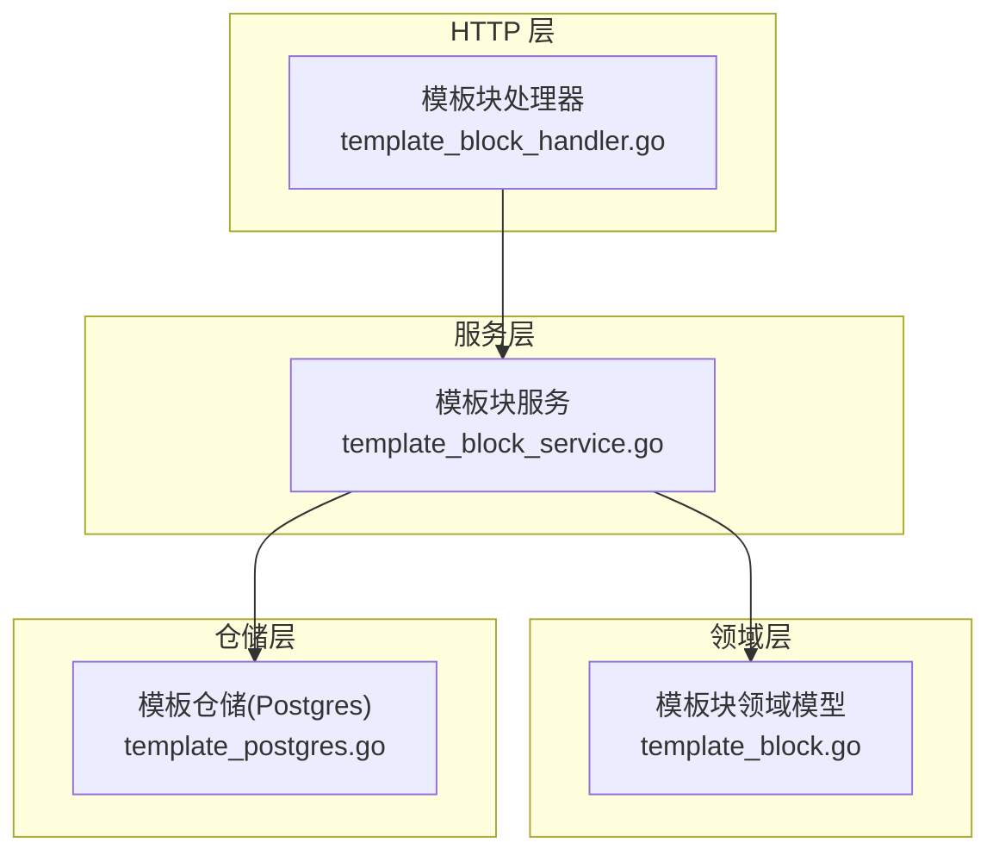
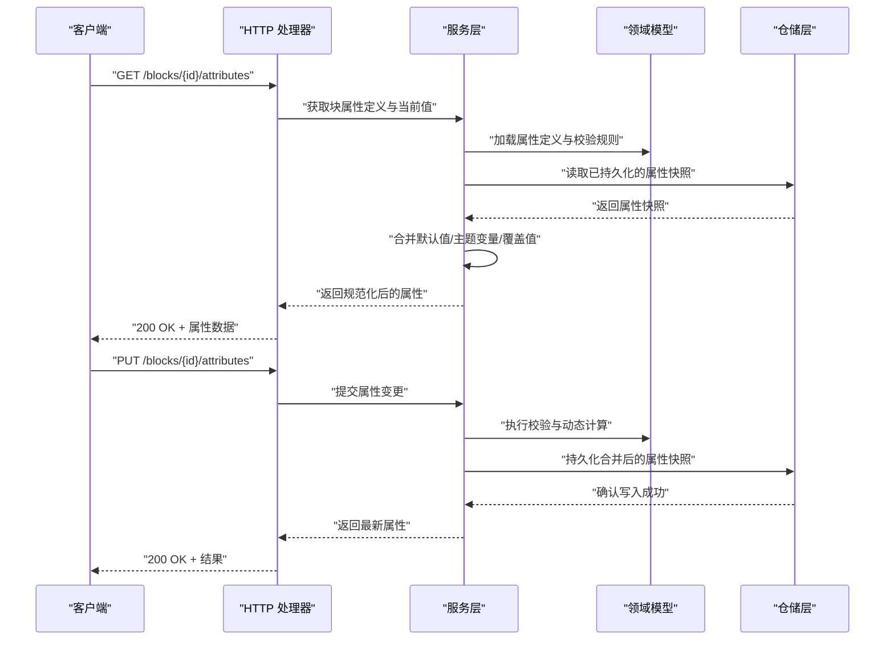
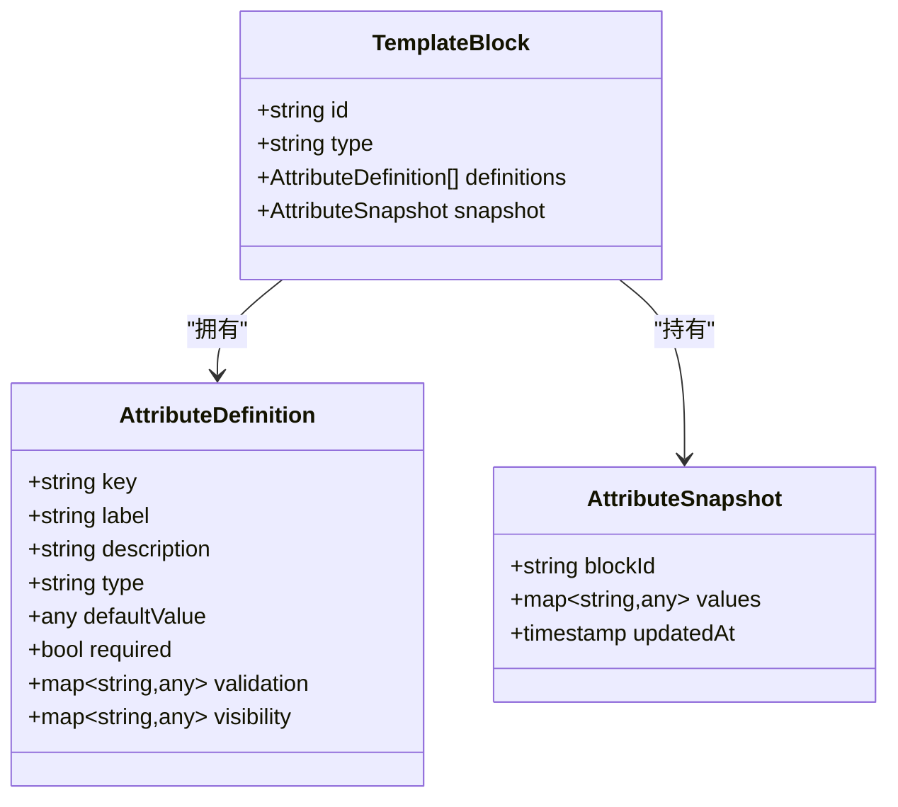
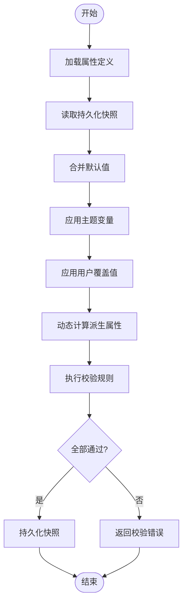
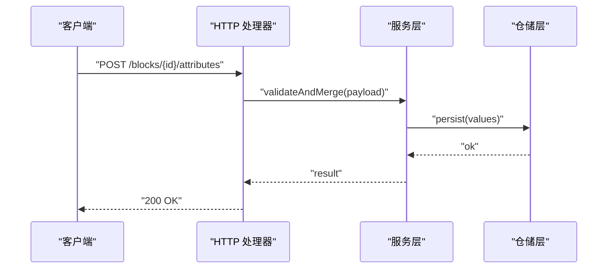
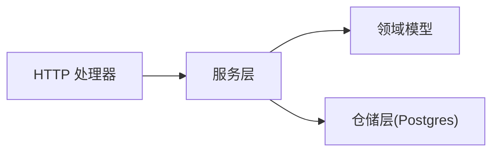

# 块属性系统

<cite>
**本文引用的文件**   
- [template_block.go](file://notifuse/internal/domain/template_block.go)
- [template_block_test.go](file://notifuse/internal/domain/template_block_test.go)
- [template_service_helpers_test.go](file://notifuse/internal/service/template_service_helpers_test.go)
- [template_block_handler.go](file://notifuse/internal/http/template_block_handler.go)
- [template_block_handler_test.go](file://notifuse/internal/http/template_block_handler_test.go)
- [template_block_service.go](file://notifuse/internal/service/template_block_service.go)
- [template_block_service_test.go](file://notifuse/internal/service/template_block_service_test.go)
- [template_postgres.go](file://notifuse/internal/repository/template_postgres.go)
- [template_postgres_test.go](file://notifuse/internal/repository/template_postgres_test.go)
</cite>

## 目录
1. [简介](#简介)
2. [项目结构](#项目结构)
3. [核心组件](#核心组件)
4. [架构总览](#架构总览)
5. [详细组件分析](#详细组件分析)
6. [依赖关系分析](#依赖关系分析)
7. [性能考虑](#性能考虑)
8. [故障排查指南](#故障排查指南)
9. [结论](#结论)
10. [附录](#附录)

## 简介
本技术文档围绕“块属性系统”展开，聚焦于模板块（Template Block）的属性定义、数据类型与校验、配置界面生成机制、数据绑定与持久化、继承与覆盖策略，以及扩展方法与自定义控件开发指南。目标读者包括前端开发者、后端工程师与产品/运营人员，力求以循序渐进的方式呈现从概念到实现的全景视图。

## 项目结构
仓库中与块属性系统直接相关的代码主要分布在以下层次：
- 领域层：定义块属性模型、类型与校验规则
- 服务层：编排业务逻辑，处理属性的序列化、合并、默认值与动态计算
- 仓储层：负责将属性数据持久化到数据库
- HTTP 层：提供 REST API，用于查询和更新块属性
- 测试：覆盖关键路径的单元测试与集成测试

图表来源
- [template_block_handler.go](file://notifuse/internal/http/template_block_handler.go)
- [template_block_service.go](file://notifuse/internal/service/template_block_service.go)
- [template_block.go](file://notifuse/internal/domain/template_block.go)
- [template_postgres.go](file://notifuse/internal/repository/template_postgres.go)

章节来源
- [template_block.go](file://notifuse/internal/domain/template_block.go)
- [template_block_handler.go](file://notifuse/internal/http/template_block_handler.go)
- [template_block_service.go](file://notifuse/internal/service/template_block_service.go)
- [template_postgres.go](file://notifuse/internal/repository/template_postgres.go)

## 核心组件
- 领域模型与类型
  - 块属性定义：包含键名、显示标签、说明、默认值、是否必填、可见性条件等元信息
  - 数据类型支持：字符串、布尔、数字、枚举、富文本、JSON 等
  - 校验规则：格式、范围、长度、正则表达式、依赖字段联动等
- 服务编排
  - 属性清单获取：按块类型返回可编辑属性集合
  - 属性合并：应用主题变量、默认值与用户覆盖值
  - 动态计算：基于上下文或关联数据实时计算某些属性值
- 持久化
  - 属性快照存储：保存块的最终生效属性集
  - 版本与回滚：保留历史版本以便审计与恢复
- HTTP 接口
  - 查询块属性定义与当前值
  - 批量更新块属性并触发校验与合并流程

章节来源
- [template_block.go](file://notifuse/internal/domain/template_block.go)
- [template_block_service.go](file://notifuse/internal/service/template_block_service.go)
- [template_postgres.go](file://notifuse/internal/repository/template_postgres.go)

## 架构总览
下图展示了块属性系统在请求生命周期中的交互关系：客户端通过 HTTP 接口访问，服务层协调领域模型与仓储层完成读取、校验、合并与持久化。

图表来源
- [template_block_handler.go](file://notifuse/internal/http/template_block_handler.go)
- [template_block_service.go](file://notifuse/internal/service/template_block_service.go)
- [template_block.go](file://notifuse/internal/domain/template_block.go)
- [template_postgres.go](file://notifuse/internal/repository/template_postgres.go)

## 详细组件分析

### 领域模型与数据类型
- 属性定义结构
  - 键名：唯一标识，用于数据绑定与渲染
  - 显示标签与说明：面向用户的文案
  - 数据类型：string、boolean、number、enum、richtext、json 等
  - 默认值：未设置时的回退值
  - 校验规则：required、min/max、pattern、enum 等
  - 可见性与条件：根据上下文或父级属性控制显示
- 数据结构复杂度
  - 属性清单为 O(n) 遍历；校验为 O(k) 次规则检查；合并为 O(m) 次覆盖计算
- 优化建议
  - 对常用校验规则建立索引缓存
  - 对大对象属性采用懒加载与增量更新

章节来源
- [template_block.go](file://notifuse/internal/domain/template_block.go)
- [template_block_test.go](file://notifuse/internal/domain/template_block_test.go)

#### 类图（领域模型）

图表来源
- [template_block.go](file://notifuse/internal/domain/template_block.go)

### 服务层：属性合并与校验
- 合并策略
  - 优先级：主题变量 > 默认值 > 用户覆盖值
  - 动态计算：在合并后基于上下文重新计算派生属性
- 校验流程
  - 逐条规则校验，收集错误并返回结构化错误信息
  - 支持跨字段校验与条件校验
- 性能特征
  - 合并与校验均为线性复杂度，适合中等规模属性集

图表来源
- [template_block_service.go](file://notifuse/internal/service/template_block_service.go)
- [template_block.go](file://notifuse/internal/domain/template_block.go)

章节来源
- [template_block_service.go](file://notifuse/internal/service/template_block_service.go)
- [template_block_service_test.go](file://notifuse/internal/service/template_block_service_test.go)

### HTTP 层：API 工作流
- 查询属性
  - 输入：块 ID
  - 输出：属性定义与当前值
- 更新属性
  - 输入：块 ID 与属性变更
  - 输出：校验结果与最新属性
- 错误处理
  - 参数缺失、类型不匹配、校验失败、权限不足等

图表来源
- [template_block_handler.go](file://notifuse/internal/http/template_block_handler.go)
- [template_block_service.go](file://notifuse/internal/service/template_block_service.go)
- [template_postgres.go](file://notifuse/internal/repository/template_postgres.go)

章节来源
- [template_block_handler.go](file://notifuse/internal/http/template_block_handler.go)
- [template_block_handler_test.go](file://notifuse/internal/http/template_block_handler_test.go)

### 配置界面生成机制
- 表单控件映射
  - string → 文本框/多行文本
  - boolean → 开关/复选框
  - number → 数字输入/滑块
  - enum → 下拉选择/单选组
  - richtext → 富文本编辑器
  - json → JSON 编辑器/可视化表单
- 动态显示与条件渲染
  - 基于 visibility 与依赖字段进行显隐控制
  - 支持分组与折叠，提升长表单可读性
- 实时更新
  - 前端监听属性变化，即时重算派生字段并预览效果
- 最佳实践
  - 使用防抖减少频繁更新
  - 对富文本与 JSON 提供语法高亮与校验提示

章节来源
- [template_block.go](file://notifuse/internal/domain/template_block.go)
- [template_service_helpers_test.go](file://notifuse/internal/service/template_service_helpers_test.go)

### 数据绑定机制
- 双向绑定
  - 表单控件 ↔ 属性值对象，任一方向变更均同步
- 实时更新
  - 事件驱动更新，避免整表重渲染
- 持久化存储
  - 变更落库时携带块 ID 与时间戳，支持并发控制与冲突解决

章节来源
- [template_postgres.go](file://notifuse/internal/repository/template_postgres.go)
- [template_postgres_test.go](file://notifuse/internal/repository/template_postgres_test.go)

### 继承与覆盖机制
- 默认值设置
  - 属性定义中声明默认值，作为最低优先级回退
- 主题变量
  - 全局或局部主题覆盖默认值，便于统一风格
- 动态计算
  - 基于上下文或关联数据计算派生属性，不参与持久化
- 覆盖顺序
  - 主题变量 > 默认值 > 用户覆盖值

章节来源
- [template_block.go](file://notifuse/internal/domain/template_block.go)
- [template_block_service.go](file://notifuse/internal/service/template_block_service.go)

### 扩展方法与自定义控件开发指南
- 扩展点
  - 新增数据类型：在领域模型注册新类型，并在服务层添加解析与校验逻辑
  - 新增校验规则：在规则引擎中注册新规则，并提供错误消息模板
  - 新增 UI 控件：在前端注册控件映射，实现与属性类型的双向绑定
- 开发步骤
  - 定义类型与校验契约
  - 在服务层实现解析、合并与校验
  - 在 HTTP 层暴露必要接口
  - 编写单测与集成用例
- 注意事项
  - 保持向后兼容，避免破坏现有快照结构
  - 对复杂类型提供迁移脚本与降级策略

章节来源
- [template_block.go](file://notifuse/internal/domain/template_block.go)
- [template_block_service.go](file://notifuse/internal/service/template_block_service.go)
- [template_block_handler.go](file://notifuse/internal/http/template_block_handler.go)

## 依赖关系分析
- 组件耦合
  - HTTP 层仅依赖服务层接口，领域模型与服务层强耦合
  - 服务层依赖仓储层进行持久化
- 外部依赖
  - 数据库：PostgreSQL（通过仓储层抽象）
- 潜在循环依赖
  - 当前分层清晰，未见循环引用

图表来源
- [template_block_handler.go](file://notifuse/internal/http/template_block_handler.go)
- [template_block_service.go](file://notifuse/internal/service/template_block_service.go)
- [template_block.go](file://notifuse/internal/domain/template_block.go)
- [template_postgres.go](file://notifuse/internal/repository/template_postgres.go)

章节来源
- [template_block_handler.go](file://notifuse/internal/http/template_block_handler.go)
- [template_block_service.go](file://notifuse/internal/service/template_block_service.go)
- [template_block.go](file://notifuse/internal/domain/template_block.go)
- [template_postgres.go](file://notifuse/internal/repository/template_postgres.go)

## 性能考虑
- 属性清单缓存：对静态定义进行缓存，降低重复解析开销
- 增量合并：仅对变更属性进行合并与校验
- 异步持久化：对非关键路径的持久化采用队列与批处理
- 前端优化：防抖、节流与虚拟列表渲染长表单

[本节为通用指导，无需特定文件来源]

## 故障排查指南
- 常见问题
  - 属性校验失败：检查必填项、类型与范围约束
  - 主题变量未生效：确认变量作用域与覆盖顺序
  - 持久化失败：检查数据库连接与事务状态
- 定位方法
  - 查看服务层日志与错误码
  - 对比属性快照差异，定位覆盖冲突
  - 使用测试用例复现问题路径

章节来源
- [template_block_service.go](file://notifuse/internal/service/template_block_service.go)
- [template_block_handler.go](file://notifuse/internal/http/template_block_handler.go)

## 结论
块属性系统通过清晰的领域模型、健壮的服务编排与稳定的仓储抽象，实现了可扩展、可维护且高性能的属性管理方案。配合完善的校验、合并与 UI 映射机制，既能满足复杂业务场景，又具备良好的扩展能力。

[本节为总结性内容，无需特定文件来源]

## 附录
- 术语
  - 块属性：模板块的可配置项集合
  - 属性快照：某时刻块属性的持久化状态
  - 主题变量：用于统一风格的覆盖值
- 参考实现路径
  - 领域模型：[template_block.go](file://notifuse/internal/domain/template_block.go)
  - 服务编排：[template_block_service.go](file://notifuse/internal/service/template_block_service.go)
  - HTTP 接口：[template_block_handler.go](file://notifuse/internal/http/template_block_handler.go)
  - 持久化：[template_postgres.go](file://notifuse/internal/repository/template_postgres.go)