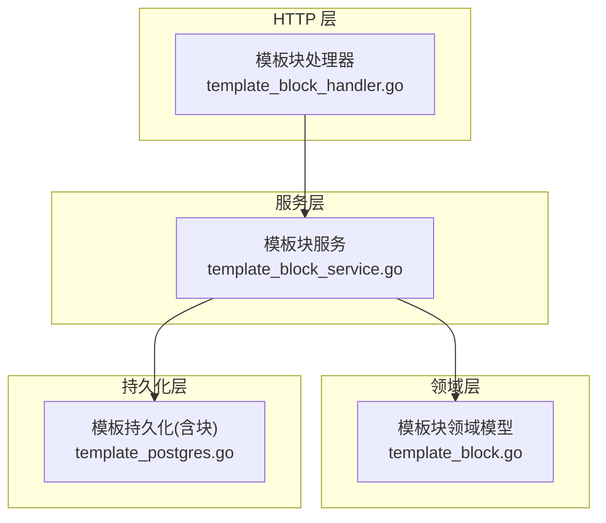
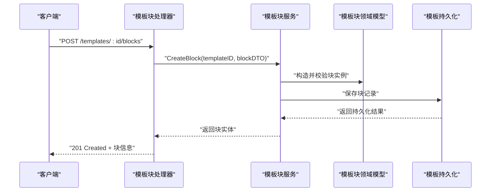
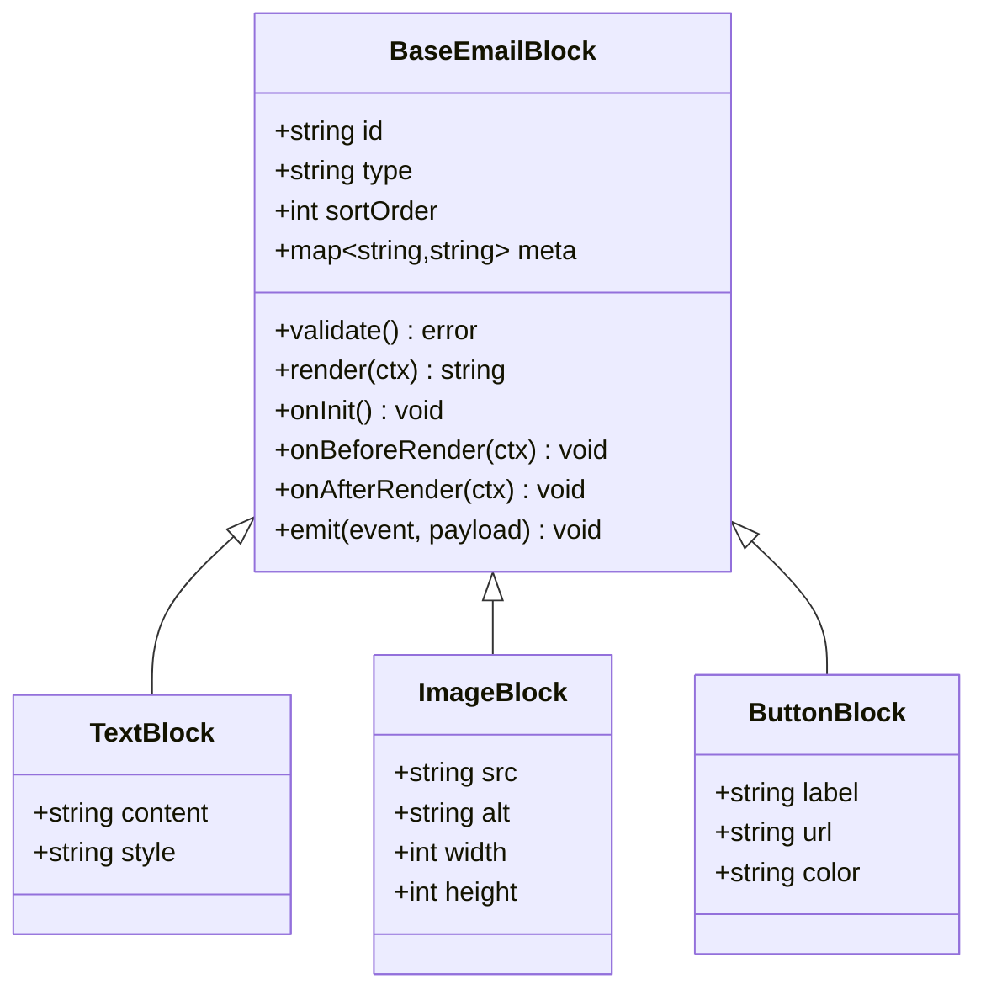
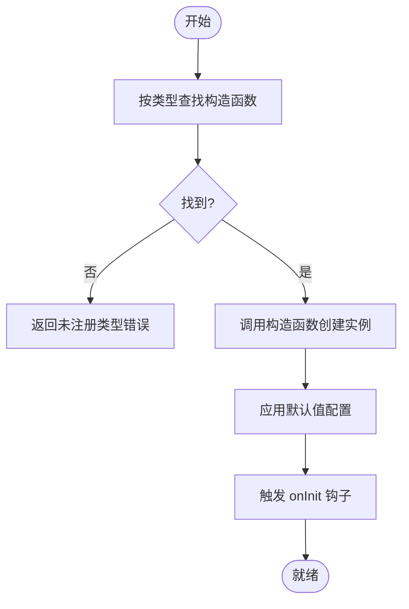
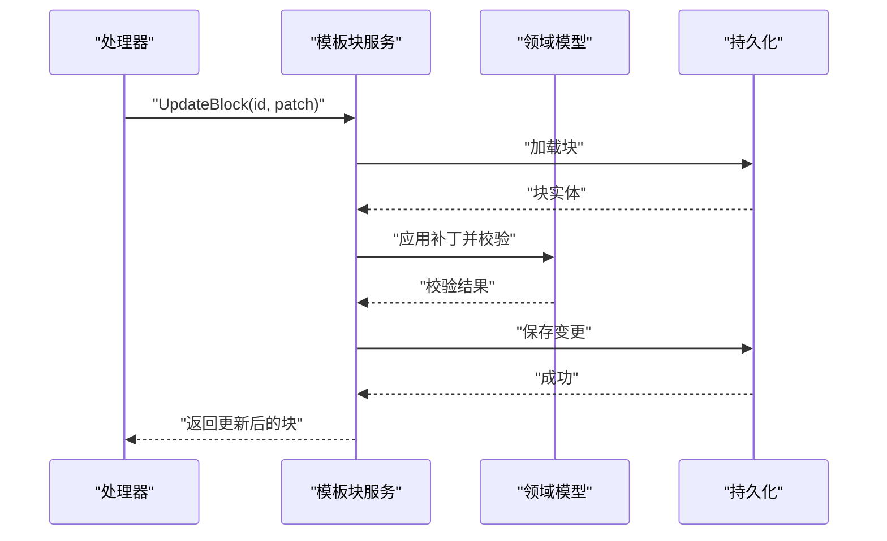
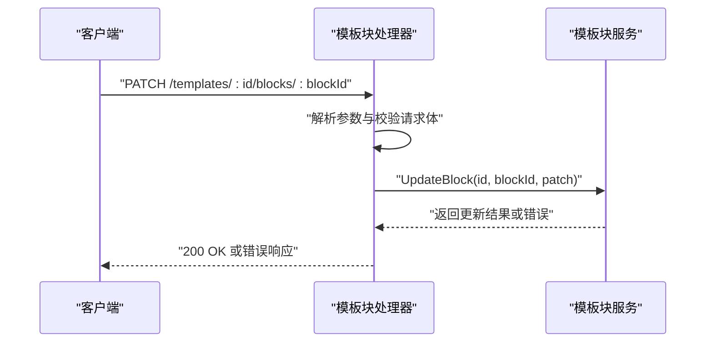
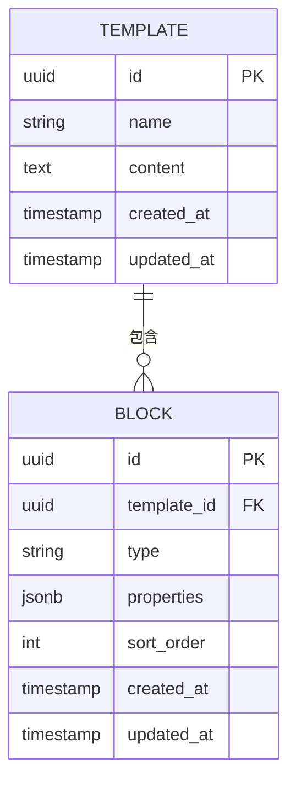
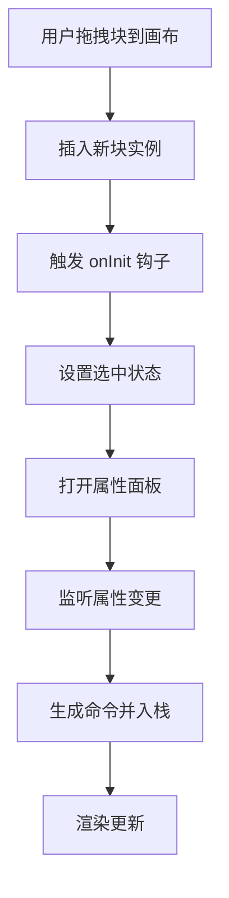
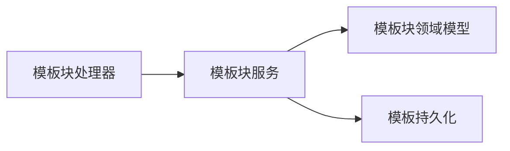

# 块架构设计

<cite>
**本文引用的文件**   
- [template_block.go](file://notifuse/internal/domain/template_block.go)
- [template_block_test.go](file://notifuse/internal/domain/template_block_test.go)
- [template_block_handler.go](file://notifuse/internal/http/template_block_handler.go)
- [template_block_handler_test.go](file://notifuse/internal/http/template_block_handler_test.go)
- [template_block_service.go](file://notifuse/internal/service/template_block_service.go)
- [template_block_service_test.go](file://notifuse/internal/service/template_block_service_test.go)
- [template_postgres.go](file://notifuse/internal/repository/template_postgres.go)
- [template_postgres_test.go](file://notifuse/internal/repository/template_postgres_test.go)
</cite>

## 目录
1. [简介](#简介)
2. [项目结构](#项目结构)
3. [核心组件](#核心组件)
4. [架构总览](#架构总览)
5. [详细组件分析](#详细组件分析)
6. [依赖关系分析](#依赖关系分析)
7. [性能考虑](#性能考虑)
8. [故障排查指南](#故障排查指南)
9. [结论](#结论)
10. [附录](#附录)

## 简介
本技术文档围绕“邮件编辑器块架构”展开，聚焦于块系统的核心架构模式与实现细节。内容涵盖：
- 块工厂模式的实现、块的注册机制与生命周期管理
- BaseEmailBlock 基类的设计要点（通用属性、事件处理、验证规则、渲染方法）
- 块类型定义系统（TypeScript 接口、属性类型约束、默认值配置）
- 块与编辑器的集成方式（拖拽支持、选择状态管理、撤销重做）
- 性能优化策略与内存管理机制

说明：仓库中未发现前端 TypeScript 编辑器代码，因此关于“TypeScript 接口、属性类型约束、默认值配置、拖拽/选择/撤销重做”的章节以概念性设计与最佳实践为主，不直接引用具体源码文件。

## 项目结构
后端采用分层架构：领域模型（domain）、服务层（service）、HTTP 处理器（http）、持久化（repository）。邮件模板块相关的关键文件分布如下：
- 领域模型：定义块的数据结构与基础能力
- 服务层：编排业务逻辑，协调持久化与校验
- HTTP 处理器：暴露 REST API，负责请求解析与响应封装
- 持久化：基于 PostgreSQL 的模板与块数据存取

图表来源
- [template_block_handler.go](file://notifuse/internal/http/template_block_handler.go)
- [template_block_service.go](file://notifuse/internal/service/template_block_service.go)
- [template_block.go](file://notifuse/internal/domain/template_block.go)
- [template_postgres.go](file://notifuse/internal/repository/template_postgres.go)

章节来源
- [template_block.go](file://notifuse/internal/domain/template_block.go)
- [template_block_service.go](file://notifuse/internal/service/template_block_service.go)
- [template_block_handler.go](file://notifuse/internal/http/template_block_handler.go)
- [template_postgres.go](file://notifuse/internal/repository/template_postgres.go)

## 核心组件
- 模板块领域模型：承载块的核心数据结构与行为，提供统一的基类能力与扩展点
- 模板块服务：编排创建、更新、删除、查询等业务流程，执行校验与事务边界
- 模板块处理器：将 HTTP 请求映射到服务调用，完成参数绑定、错误转换与响应序列化
- 模板持久化：负责模板与块数据的读写，包含必要的索引与一致性保证

章节来源
- [template_block.go](file://notifuse/internal/domain/template_block.go)
- [template_block_service.go](file://notifuse/internal/service/template_block_service.go)
- [template_block_handler.go](file://notifuse/internal/http/template_block_handler.go)
- [template_postgres.go](file://notifuse/internal/repository/template_postgres.go)

## 架构总览
下图展示了从 HTTP 请求到持久化的完整链路，以及领域模型在其中的角色。

图表来源
- [template_block_handler.go](file://notifuse/internal/http/template_block_handler.go)
- [template_block_service.go](file://notifuse/internal/service/template_block_service.go)
- [template_block.go](file://notifuse/internal/domain/template_block.go)
- [template_postgres.go](file://notifuse/internal/repository/template_postgres.go)

## 详细组件分析

### 领域模型：BaseEmailBlock 与块类型体系
- 基类职责
  - 统一标识与元数据：如 ID、类型、版本、排序位置等
  - 通用属性容器：用于存储不同块类型的差异化字段
  - 生命周期钩子：初始化、校验、渲染前/后回调等
  - 事件总线：订阅/发布块级事件（如变更、选中、销毁）
- 块类型定义系统（概念性）
  - 使用 TypeScript 接口描述块的数据契约
  - 通过属性类型约束确保 JSON Schema 与运行时校验一致
  - 默认值配置集中管理，便于 UI 初始化与回退
- 渲染管线
  - 基类提供渲染入口，子类实现具体 HTML/MJML 片段生成
  - 支持上下文注入（主题、语言、变量），保证可移植性与多端适配

图表来源
- [template_block.go](file://notifuse/internal/domain/template_block.go)

章节来源
- [template_block.go](file://notifuse/internal/domain/template_block.go)
- [template_block_test.go](file://notifuse/internal/domain/template_block_test.go)

### 工厂模式与注册机制
- 工厂职责
  - 根据块类型字符串创建对应块实例
  - 注入默认值与上下文
  - 触发初始化钩子
- 注册机制
  - 全局注册表维护类型到构造函数的映射
  - 支持动态发现与热加载（可选）
  - 提供去重与冲突检测
- 生命周期管理
  - 创建：构造 -> 默认值填充 -> 初始化钩子
  - 运行：校验 -> 渲染 -> 事件广播
  - 销毁：释放资源、取消订阅、清理缓存

图表来源
- [template_block.go](file://notifuse/internal/domain/template_block.go)

章节来源
- [template_block.go](file://notifuse/internal/domain/template_block.go)

### 服务层：模板块服务
- 主要职责
  - 编排块的 CRUD 流程
  - 执行业务校验（唯一性、依赖关系、权限）
  - 管理事务边界与错误传播
- 关键流程
  - 创建块：接收 DTO -> 构建领域对象 -> 校验 -> 持久化 -> 返回
  - 更新块：加载现有块 -> 合并变更 -> 校验 -> 持久化 -> 返回
  - 删除块：级联清理关联数据（如有）
  - 查询块：分页、过滤、排序

图表来源
- [template_block_service.go](file://notifuse/internal/service/template_block_service.go)
- [template_block.go](file://notifuse/internal/domain/template_block.go)
- [template_postgres.go](file://notifuse/internal/repository/template_postgres.go)

章节来源
- [template_block_service.go](file://notifuse/internal/service/template_block_service.go)
- [template_block_service_test.go](file://notifuse/internal/service/template_block_service_test.go)

### HTTP 处理器：模板块处理器
- 职责
  - 解析路径参数与请求体
  - 调用服务层完成业务操作
  - 统一错误码与响应格式
- 典型端点
  - 创建块：POST /templates/:id/blocks
  - 更新块：PATCH /templates/:id/blocks/:blockId
  - 删除块：DELETE /templates/:id/blocks/:blockId
  - 查询块列表：GET /templates/:id/blocks

图表来源
- [template_block_handler.go](file://notifuse/internal/http/template_block_handler.go)
- [template_block_service.go](file://notifuse/internal/service/template_block_service.go)

章节来源
- [template_block_handler.go](file://notifuse/internal/http/template_block_handler.go)
- [template_block_handler_test.go](file://notifuse/internal/http/template_block_handler_test.go)

### 持久化：模板持久化（含块）
- 职责
  - 模板与块的增删改查
  - 批量操作与事务控制
  - 索引优化与查询计划稳定
- 关键点
  - 块数据通常作为模板的子集合进行存储
  - 提供按模板 ID 查询块列表的能力
  - 支持软删除与版本控制（视需求）

图表来源
- [template_postgres.go](file://notifuse/internal/repository/template_postgres.go)

章节来源
- [template_postgres.go](file://notifuse/internal/repository/template_postgres.go)
- [template_postgres_test.go](file://notifuse/internal/repository/template_postgres_test.go)

### 编辑器集成（概念性设计）
- 拖拽支持
  - 在工具栏中列出可用块类型，用户可将块拖入画布
  - 拖拽过程中预览块占位与尺寸
  - 放置时插入新块并触发初始化
- 选择状态管理
  - 点击块进入选中态，显示边框与操作手柄
  - 多选支持（Shift/Ctrl 组合键）
  - 选中态下同步右侧属性面板
- 撤销重做
  - 每次块操作（新增、移动、删除、属性变更）产生一个命令
  - 命令栈支持最大深度限制与内存回收
  - 批量操作合并为单一命令以减少栈增长

[本节为概念性设计，不直接分析具体源码文件]

## 依赖关系分析
- 耦合与内聚
  - 处理器仅依赖服务接口，保持低耦合
  - 服务层聚合领域模型与持久化接口，具备较高内聚
  - 领域模型自包含，尽量无外部副作用
- 外部依赖
  - 数据库驱动与 ORM/SQL 构建器
  - 日志与追踪（可选）
  - 事件总线（可选，用于块间通信）

图表来源
- [template_block_handler.go](file://notifuse/internal/http/template_block_handler.go)
- [template_block_service.go](file://notifuse/internal/service/template_block_service.go)
- [template_block.go](file://notifuse/internal/domain/template_block.go)
- [template_postgres.go](file://notifuse/internal/repository/template_postgres.go)

章节来源
- [template_block_handler.go](file://notifuse/internal/http/template_block_handler.go)
- [template_block_service.go](file://notifuse/internal/service/template_block_service.go)
- [template_block.go](file://notifuse/internal/domain/template_block.go)
- [template_postgres.go](file://notifuse/internal/repository/template_postgres.go)

## 性能考虑
- 渲染优化
  - 对大块内容进行懒渲染与增量更新
  - 缓存已渲染片段，避免重复计算
  - 使用虚拟 DOM 或差异算法减少重排
- 内存管理
  - 及时释放块实例的资源（如图片解码缓存、事件监听器）
  - 限制撤销栈大小，超出阈值时丢弃旧命令
  - 对大对象使用弱引用或池化
- I/O 优化
  - 批量写入与事务合并
  - 分页与游标查询，避免一次性加载大量块
  - 合理索引提升查询效率

[本节提供一般性指导，不直接分析具体源码文件]

## 故障排查指南
- 常见问题
  - 未注册块类型：检查工厂注册表是否包含该类型
  - 校验失败：查看属性类型约束与默认值配置是否匹配
  - 渲染异常：确认上下文注入与依赖资源可用性
  - 性能问题：定位热点渲染路径与内存泄漏点
- 调试建议
  - 启用详细日志，记录块生命周期事件
  - 使用单元测试覆盖边界条件与异常路径
  - 对持久化层添加慢查询监控

章节来源
- [template_block_test.go](file://notifuse/internal/domain/template_block_test.go)
- [template_block_service_test.go](file://notifuse/internal/service/template_block_service_test.go)
- [template_block_handler_test.go](file://notifuse/internal/http/template_block_handler_test.go)
- [template_postgres_test.go](file://notifuse/internal/repository/template_postgres_test.go)

## 结论
本架构通过清晰的层次划分与领域建模，实现了可扩展、可维护的邮件编辑器块系统。工厂模式与注册机制使新增块类型变得简单；BaseEmailBlock 提供了统一的生命周期与事件能力；服务层与持久化层保证了业务的一致性与性能。结合概念性的编辑器集成方案，可实现流畅的拖拽、选择与撤销重做体验。建议在后续迭代中持续完善性能监控与内存治理，确保大规模模板场景下的稳定性。

## 附录
- 术语
  - 块：邮件模板中的最小可编辑单元
  - 工厂：根据类型创建块实例的组件
  - 注册表：维护类型到构造函数的映射
  - 生命周期：从创建到销毁的全过程
- 参考
  - 领域模型与测试用例
  - 服务层与处理器测试用例
  - 持久化层与测试用例