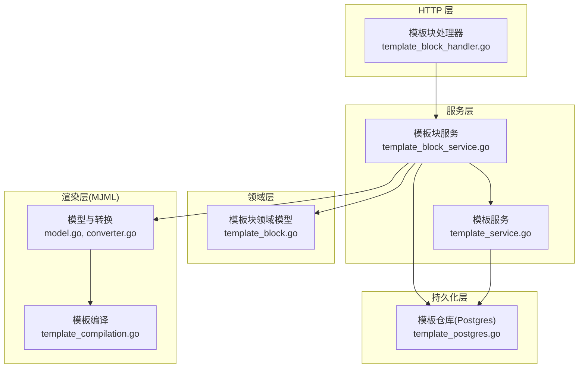
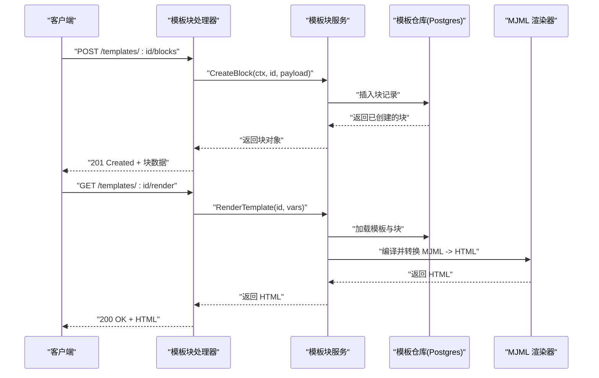
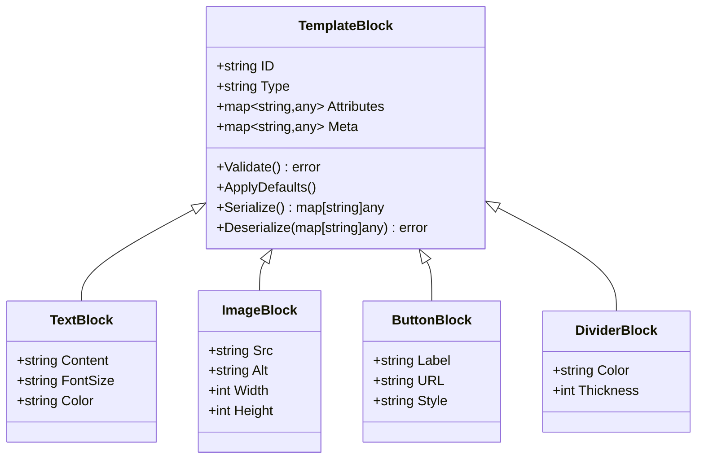
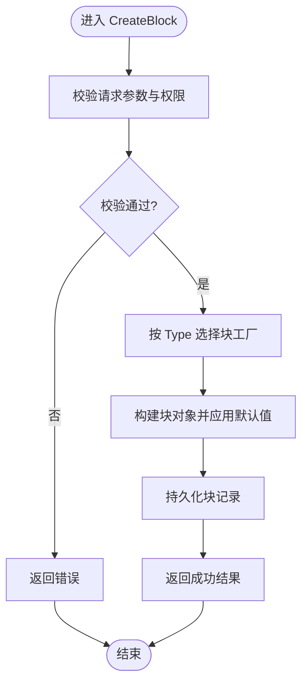
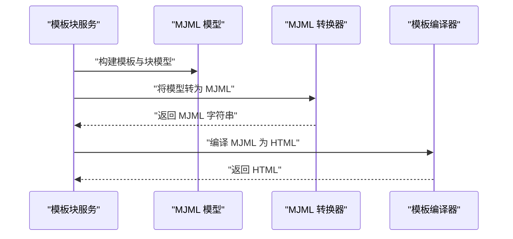
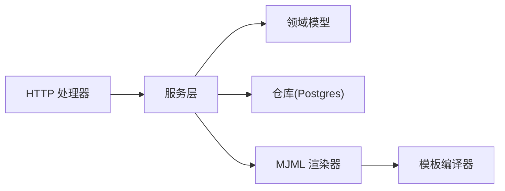

# 块系统

<cite>
**本文引用的文件**   
- [template_block.go](file://notifuse/internal/domain/template_block.go)
- [template_block_test.go](file://notifuse/internal/domain/template_block_test.go)
- [template_block_service.go](file://notifuse/internal/service/template_block_service.go)
- [template_block_service_test.go](file://notifuse/internal/service/template_block_service_test.go)
- [template_block_handler.go](file://notifuse/internal/http/template_block_handler.go)
- [template_block_handler_test.go](file://notifuse/internal/http/template_block_handler_test.go)
- [template_postgres.go](file://notifuse/internal/repository/template_postgres.go)
- [template_service.go](file://notifuse/internal/service/template_service.go)
- [model.go](file://notifuse/pkg/notifuse_mjml/model.go)
- [converter.go](file://notifuse/pkg/notifuse_mjml/converter.go)
- [template_compilation.go](file://notifuse/pkg/notifuse_mjml/template_compilation.go)
</cite>

## 目录
1. [简介](#简介)
2. [项目结构](#项目结构)
3. [核心组件](#核心组件)
4. [架构总览](#架构总览)
5. [详细组件分析](#详细组件分析)
6. [依赖关系分析](#依赖关系分析)
7. [性能考量](#性能考量)
8. [故障排查指南](#故障排查指南)
9. [结论](#结论)
10. [附录](#附录) 

## 简介
本技术文档围绕邮件编辑器“块系统”展开，聚焦于模板块（Template Block）的架构设计、工厂模式与生命周期管理、内置块类型实现、属性配置系统、渲染引擎（MJML 转换、HTML 生成与样式处理）、自定义块开发指南，以及块间数据传递、事件通信与依赖关系管理等主题。文档旨在为开发者提供从概念到落地的完整参考，帮助快速理解并扩展块系统能力。

## 项目结构
块系统涉及领域模型、服务层、HTTP 接口、持久化与 MJML 渲染等模块，整体采用分层架构：
- 领域层：定义块的数据结构与基础行为
- 服务层：编排块的创建、更新、删除、查询与批量操作
- HTTP 层：暴露 RESTful API，负责请求校验与响应封装
- 持久化层：将块数据持久化至数据库
- 渲染层：基于 MJML 进行模板编译与 HTML 输出

图表来源
- [template_block_handler.go](file://notifuse/internal/http/template_block_handler.go)
- [template_block_service.go](file://notifuse/internal/service/template_block_service.go)
- [template_block.go](file://notifuse/internal/domain/template_block.go)
- [template_postgres.go](file://notifuse/internal/repository/template_postgres.go)
- [template_service.go](file://notifuse/internal/service/template_service.go)
- [model.go](file://notifuse/pkg/notifuse_mjml/model.go)
- [converter.go](file://notifuse/pkg/notifuse_mjml/converter.go)
- [template_compilation.go](file://notifuse/pkg/notifuse_mjml/template_compilation.go)

章节来源
- [template_block.go](file://notifuse/internal/domain/template_block.go)
- [template_block_service.go](file://notifuse/internal/service/template_block_service.go)
- [template_block_handler.go](file://notifuse/internal/http/template_block_handler.go)
- [template_postgres.go](file://notifuse/internal/repository/template_postgres.go)
- [template_service.go](file://notifuse/internal/service/template_service.go)
- [model.go](file://notifuse/pkg/notifuse_mjml/model.go)
- [converter.go](file://notifuse/pkg/notifuse_mjml/converter.go)
- [template_compilation.go](file://notifuse/pkg/notifuse_mjml/template_compilation.go)

## 核心组件
- 模板块领域模型：定义块类型、属性、元数据与基本方法，作为块系统的统一抽象
- 模板块服务：提供 CRUD、排序、移动、复制、批量删除等编排逻辑，维护块在模板中的顺序与依赖
- 模板块处理器：对外暴露 HTTP 接口，完成参数校验、鉴权上下文注入、错误映射
- 模板仓库（Postgres）：负责块数据的持久化与查询
- MJML 渲染器：将模板与块转换为最终 HTML，支持安全变量与模板编译优化

章节来源
- [template_block.go](file://notifuse/internal/domain/template_block.go)
- [template_block_service.go](file://notifuse/internal/service/template_block_service.go)
- [template_block_handler.go](file://notifuse/internal/http/template_block_handler.go)
- [template_postgres.go](file://notifuse/internal/repository/template_postgres.go)
- [model.go](file://notifuse/pkg/notifuse_mjml/model.go)
- [converter.go](file://notifuse/pkg/notifuse_mjml/converter.go)
- [template_compilation.go](file://notifuse/pkg/notifuse_mjml/template_compilation.go)

## 架构总览
块系统遵循清晰的职责分离与依赖方向：HTTP 层仅做协议适配，服务层承载业务编排，领域层定义不变式，持久化层屏蔽存储细节，渲染层专注 MJML 到 HTML 的转换。

图表来源
- [template_block_handler.go](file://notifuse/internal/http/template_block_handler.go)
- [template_block_service.go](file://notifuse/internal/service/template_block_service.go)
- [template_postgres.go](file://notifuse/internal/repository/template_postgres.go)
- [template_compilation.go](file://notifuse/pkg/notifuse_mjml/template_compilation.go)

## 详细组件分析

### 领域模型：模板块
- 职责：定义块类型枚举、通用属性、元数据与序列化/反序列化契约；为工厂模式提供注册入口
- 关键点：
  - 块类型：文本、图片、按钮、分隔符等内置类型
  - 属性：键值对形式，支持字符串、布尔、数字、数组、对象等
  - 验证：字段级校验与业务规则校验
  - 默认值：缺失属性时回退到默认值
  - 动态属性：支持运行时计算或外部数据注入

图表来源
- [template_block.go](file://notifuse/internal/domain/template_block.go)

章节来源
- [template_block.go](file://notifuse/internal/domain/template_block.go)
- [template_block_test.go](file://notifuse/internal/domain/template_block_test.go)

### 服务层：模板块服务
- 职责：编排块的创建、更新、删除、排序、移动、复制、批量删除；保证模板内块顺序一致性与依赖完整性
- 关键点：
  - 工厂模式：根据块类型实例化具体块对象
  - 事务性：块与模板关联变更在同一事务中提交
  - 校验：入参校验、块属性校验、依赖检查
  - 缓存：可选缓存已编译的模板片段以提升渲染性能

图表来源
- [template_block_service.go](file://notifuse/internal/service/template_block_service.go)

章节来源
- [template_block_service.go](file://notifuse/internal/service/template_block_service.go)
- [template_block_service_test.go](file://notifuse/internal/service/template_block_service_test.go)

### HTTP 层：模板块处理器
- 职责：解析路由与请求体、注入用户上下文、调用服务层、统一错误码与响应格式
- 关键点：
  - 路径参数与查询参数解析
  - JSON 请求体验证
  - 鉴权与授权检查
  - 分页与过滤支持（列表接口）

章节来源
- [template_block_handler.go](file://notifuse/internal/http/template_block_handler.go)
- [template_block_handler_test.go](file://notifuse/internal/http/template_block_handler_test.go)

### 持久化层：模板仓库（Postgres）
- 职责：提供块的增删改查、按模板 ID 查询块列表、按索引排序等
- 关键点：
  - 表结构设计：块 ID、模板 ID、类型、属性 JSON、元数据、排序索引
  - 并发安全：使用行锁或版本号避免竞态
  - 迁移：随版本演进保持向后兼容

章节来源
- [template_postgres.go](file://notifuse/internal/repository/template_postgres.go)

### 渲染层：MJML 转换与 HTML 生成
- 职责：将模板与块组合成 MJML，再转换为最终 HTML；支持安全变量替换与模板编译优化
- 关键点：
  - 模型：定义 MJML 节点、属性与布局约束
  - 转换器：遍历块树，生成 MJML 片段
  - 编译：预编译常用片段，减少运行时开销
  - 安全：限制危险标签与脚本注入

图表来源
- [model.go](file://notifuse/pkg/notifuse_mjml/model.go)
- [converter.go](file://notifuse/pkg/notifuse_mjml/converter.go)
- [template_compilation.go](file://notifuse/pkg/notifuse_mjml/template_compilation.go)

章节来源
- [model.go](file://notifuse/pkg/notifuse_mjml/model.go)
- [converter.go](file://notifuse/pkg/notifuse_mjml/converter.go)
- [template_compilation.go](file://notifuse/pkg/notifuse_mjml/template_compilation.go)

### 内置块类型实现要点
- 文本块：内容、字体大小、颜色、对齐方式等属性；支持富文本与安全转义
- 图片块：源地址、替代文本、宽高、圆角、阴影等属性；支持 CDN 与懒加载
- 按钮块：标签、链接、样式（主色/次色/描边）、圆角、间距
- 分隔符块：颜色、粗细、间距；用于视觉分区

章节来源
- [template_block.go](file://notifuse/internal/domain/template_block.go)

### 属性配置系统
- 数据类型验证：字符串、布尔、数字、数组、对象、枚举等
- 默认值设置：缺失属性时使用默认值，确保渲染一致性
- 动态属性：支持运行时注入（如用户变量、环境变量），并在渲染前进行安全校验

章节来源
- [template_block.go](file://notifuse/internal/domain/template_block.go)

### 自定义块开发指南
- 步骤：
  1. 在领域层新增块类型，继承模板块基类，定义属性与校验规则
  2. 在服务层工厂中注册新类型，确保创建与更新流程可识别
  3. 在渲染层添加对应 MJML 片段生成逻辑
  4. 编写单元测试覆盖校验、默认值、渲染输出
- 最佳实践：
  - 属性命名规范与最小必要原则
  - 严格的安全校验与输入清洗
  - 向后兼容：新增属性需有默认值
  - 可测试性：隔离渲染与业务逻辑

章节来源
- [template_block.go](file://notifuse/internal/domain/template_block.go)
- [template_block_service.go](file://notifuse/internal/service/template_block_service.go)
- [converter.go](file://notifuse/pkg/notifuse_mjml/converter.go)

### 块间数据传递、事件通信与依赖关系管理
- 数据传递：通过模板上下文与块属性共享数据，避免直接耦合
- 事件通信：服务层在关键生命周期（创建、更新、删除、排序）触发事件钩子，供监听者执行副作用（如缓存失效、统计上报）
- 依赖管理：块之间可通过引用 ID 建立弱依赖，服务层在移动/删除时进行依赖检查与冲突解决

章节来源
- [template_block_service.go](file://notifuse/internal/service/template_block_service.go)

## 依赖关系分析
- 组件耦合：
  - HTTP 层仅依赖服务层，不直接访问持久化与渲染
  - 服务层依赖领域模型、仓库与渲染器，承担编排职责
  - 渲染器独立于业务逻辑，专注于 MJML 到 HTML 的转换
- 外部依赖：
  - Postgres 数据库
  - MJML 渲染库（内部封装）

图表来源
- [template_block_handler.go](file://notifuse/internal/http/template_block_handler.go)
- [template_block_service.go](file://notifuse/internal/service/template_block_service.go)
- [template_block.go](file://notifuse/internal/domain/template_block.go)
- [template_postgres.go](file://notifuse/internal/repository/template_postgres.go)
- [converter.go](file://notifuse/pkg/notifuse_mjml/converter.go)
- [template_compilation.go](file://notifuse/pkg/notifuse_mjml/template_compilation.go)

章节来源
- [template_block_handler.go](file://notifuse/internal/http/template_block_handler.go)
- [template_block_service.go](file://notifuse/internal/service/template_block_service.go)
- [template_block.go](file://notifuse/internal/domain/template_block.go)
- [template_postgres.go](file://notifuse/internal/repository/template_postgres.go)
- [converter.go](file://notifuse/pkg/notifuse_mjml/converter.go)
- [template_compilation.go](file://notifuse/pkg/notifuse_mjml/template_compilation.go)

## 性能考量
- 渲染优化：
  - 模板片段缓存：对常用 MJML 片段进行编译缓存，降低重复转换开销
  - 增量渲染：仅对变更块重新生成片段，合并到模板
- 持久化优化：
  - 批量写入：批量创建/更新块时采用事务与批量 SQL
  - 索引优化：按模板 ID 与排序索引提升查询效率
- 内存与 GC：
  - 避免大对象频繁分配，复用缓冲区
  - 合理控制日志与调试信息输出

[本节为通用指导，无需特定文件来源]

## 故障排查指南
- 常见问题：
  - 块类型未注册：检查工厂是否包含新类型映射
  - 属性校验失败：确认属性类型与必填项
  - 渲染异常：检查 MJML 片段合法性与安全变量注入
  - 排序不一致：确认事务与并发锁策略
- 定位手段：
  - 启用详细日志，记录块创建/更新/删除的关键路径
  - 使用单元测试复现问题，缩小范围
  - 对比预期与实际的 MJML/HTML 输出，定位差异点

章节来源
- [template_block_service_test.go](file://notifuse/internal/service/template_block_service_test.go)
- [template_block_handler_test.go](file://notifuse/internal/http/template_block_handler_test.go)

## 结论
块系统通过领域模型、服务编排、HTTP 适配、持久化与 MJML 渲染的分层设计，实现了高内聚、低耦合的可扩展架构。工厂模式与属性配置系统使内置块与自定义块的开发保持一致的体验；渲染层的 MJML 转换与模板编译保障了输出质量与性能。建议在实际项目中遵循本文的最佳实践，持续完善校验、安全与可观测性。

[本节为总结，无需特定文件来源]

## 附录
- 术语：
  - 块：模板的最小可视化单元
  - 工厂：根据类型创建具体块对象的机制
  - MJML：用于生成跨客户端兼容 HTML 的标记语言
- 参考路径：
  - 领域模型：[template_block.go](file://notifuse/internal/domain/template_block.go)
  - 服务层：[template_block_service.go](file://notifuse/internal/service/template_block_service.go)
  - HTTP 层：[template_block_handler.go](file://notifuse/internal/http/template_block_handler.go)
  - 持久化：[template_postgres.go](file://notifuse/internal/repository/template_postgres.go)
  - 渲染层：[model.go](file://notifuse/pkg/notifuse_mjml/model.go)、[converter.go](file://notifuse/pkg/notifuse_mjml/converter.go)、[template_compilation.go](file://notifuse/pkg/notifuse_mjml/template_compilation.go)