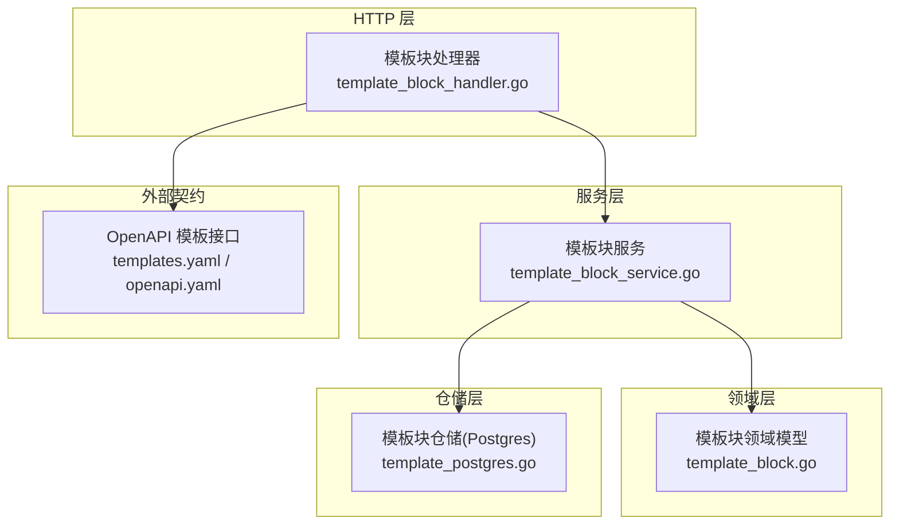
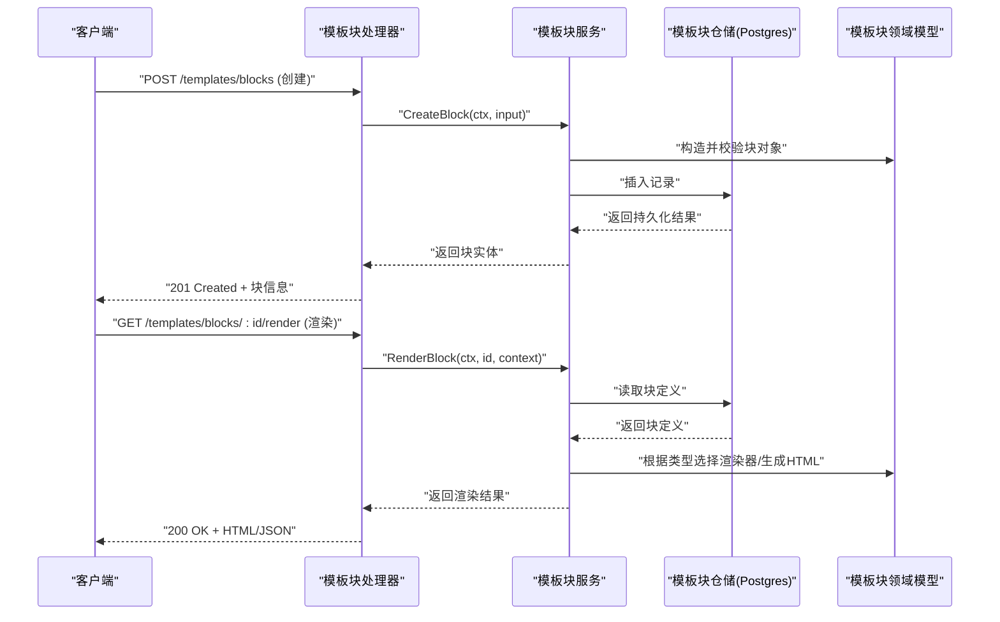
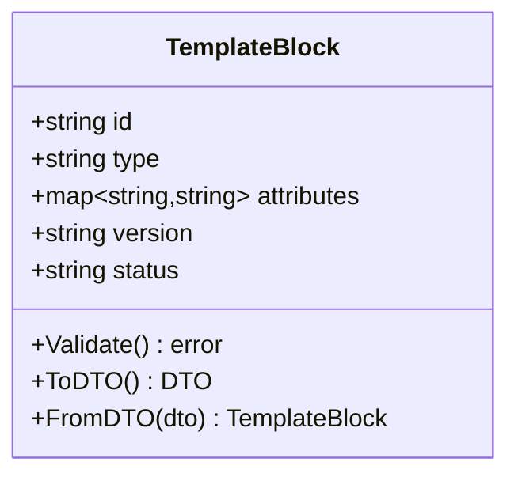
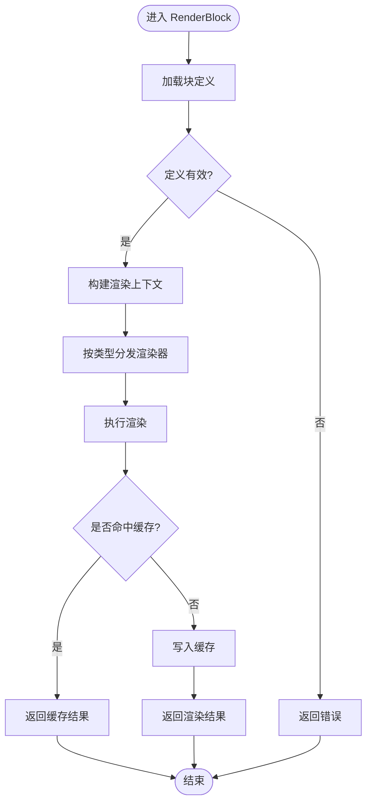
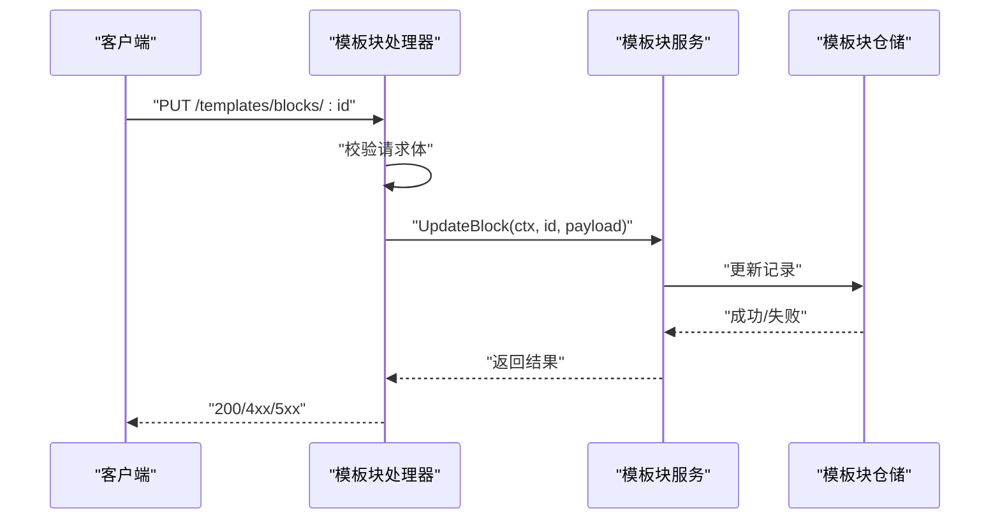
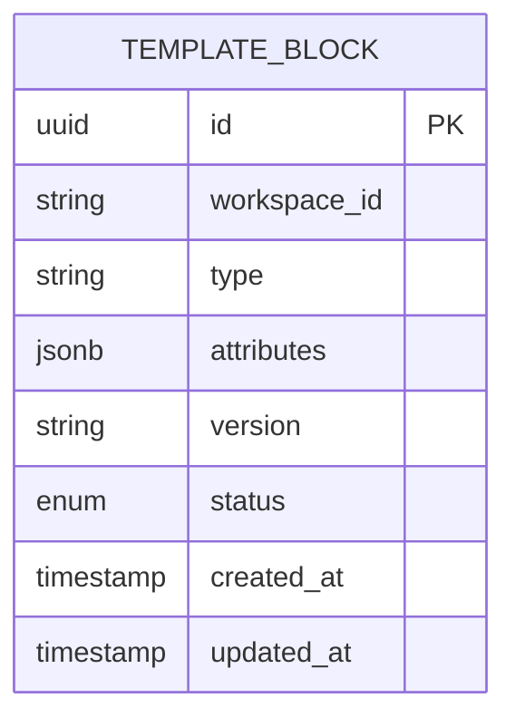
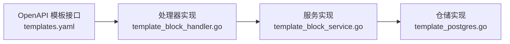
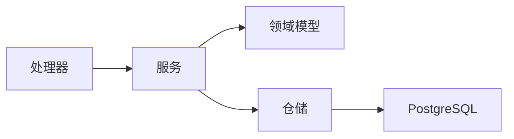

# 自定义块开发

<cite>
**本文引用的文件**   
- [template_block.go](file://notifuse/internal/domain/template_block.go)
- [template_block_test.go](file://notifuse/internal/domain/template_block_test.go)
- [template_block_service.go](file://notifuse/internal/service/template_block_service.go)
- [template_block_service_test.go](file://notifuse/internal/service/template_block_service_test.go)
- [template_block_handler.go](file://notifuse/internal/http/template_block_handler.go)
- [template_block_handler_test.go](file://notifuse/internal/http/template_block_handler_test.go)
- [template_postgres.go](file://notifuse/internal/repository/template_postgres.go)
- [template_postgres_test.go](file://notifuse/internal/repository/template_postgres_test.go)
- [templates.yaml](file://notifuse/openapi/paths/templates.yaml)
- [openapi.yaml](file://notifuse/openapi/openapi.yaml)
</cite>

## 目录
1. [简介](#简介)
2. [项目结构](#项目结构)
3. [核心组件](#核心组件)
4. [架构总览](#架构总览)
5. [详细组件分析](#详细组件分析)
6. [依赖关系分析](#依赖关系分析)
7. [性能考虑](#性能考虑)
8. [故障排查指南](#故障排查指南)
9. [结论](#结论)
10. [附录](#附录)

## 简介
本指南面向需要在系统中扩展“模板块”能力的开发者，提供从概念到落地的完整开发路径。内容涵盖：
- 块类继承与属性定义
- 渲染逻辑与样式定制
- 交互行为扩展（用户输入、实时预览、数据绑定）
- 最佳实践（性能优化、错误处理、测试策略）
- 从简单文本块到复杂交互式块的示例流程
- 调试技巧与常见问题解决方案

说明：仓库中“块”的概念围绕“模板块”实现，包含领域模型、服务层、HTTP 接口与持久化等层次。下文将基于这些真实代码组织进行系统化讲解。

## 项目结构
与“模板块”相关的代码分布在以下层次：
- 领域层：定义块的数据结构与基础能力
- 服务层：编排业务逻辑（如注册、校验、渲染上下文准备）
- HTTP 层：对外暴露 REST API（创建、更新、删除、查询、渲染）
- 仓储层：负责持久化（PostgreSQL）
- OpenAPI：描述接口契约

**图表来源**
- [template_block_handler.go](file://notifuse/internal/http/template_block_handler.go)
- [template_block_service.go](file://notifuse/internal/service/template_block_service.go)
- [template_block.go](file://notifuse/internal/domain/template_block.go)
- [template_postgres.go](file://notifuse/internal/repository/template_postgres.go)
- [templates.yaml](file://notifuse/openapi/paths/templates.yaml)
- [openapi.yaml](file://notifuse/openapi/openapi.yaml)

**章节来源**
- [template_block.go](file://notifuse/internal/domain/template_block.go)
- [template_block_service.go](file://notifuse/internal/service/template_block_service.go)
- [template_block_handler.go](file://notifuse/internal/http/template_block_handler.go)
- [template_postgres.go](file://notifuse/internal/repository/template_postgres.go)
- [templates.yaml](file://notifuse/openapi/paths/templates.yaml)
- [openapi.yaml](file://notifuse/openapi/openapi.yaml)

## 核心组件
- 领域模型（模板块）
  - 职责：定义块类型、属性、元数据、版本、状态等；提供序列化/反序列化与校验入口
  - 关键点：类型标识用于区分不同块；属性结构决定渲染与编辑表单；版本控制支持向后兼容
- 服务层（模板块服务）
  - 职责：编排 CRUD、校验、渲染上下文组装、权限与工作区隔离
  - 关键点：集中错误处理与日志埋点；为渲染提供统一数据源
- HTTP 处理器（模板块处理器）
  - 职责：解析请求、调用服务、返回响应；与 OpenAPI 契约对齐
  - 关键点：参数校验、分页/过滤、幂等性、限流与鉴权
- 仓储（模板块仓储）
  - 职责：与数据库交互，完成增删改查与批量操作
  - 关键点：事务边界、索引设计、SQL 注入防护、迁移脚本配合

**章节来源**
- [template_block.go](file://notifuse/internal/domain/template_block.go)
- [template_block_service.go](file://notifuse/internal/service/template_block_service.go)
- [template_block_handler.go](file://notifuse/internal/http/template_block_handler.go)
- [template_postgres.go](file://notifuse/internal/repository/template_postgres.go)

## 架构总览
下图展示了从客户端到数据库的端到端调用链，以及各层的职责边界。

**图表来源**
- [template_block_handler.go](file://notifuse/internal/http/template_block_handler.go)
- [template_block_service.go](file://notifuse/internal/service/template_block_service.go)
- [template_postgres.go](file://notifuse/internal/repository/template_postgres.go)
- [template_block.go](file://notifuse/internal/domain/template_block.go)

## 详细组件分析

### 领域模型：模板块
- 关键要点
  - 类型标识：用于路由到具体渲染逻辑
  - 属性结构：声明式定义，便于前端动态生成编辑器
  - 版本与状态：支持灰度发布与回滚
  - 校验规则：在领域层保证不变量
- 复杂度与可扩展性
  - 新增块类型只需扩展类型枚举与对应渲染分支
  - 属性变更通过版本字段保障兼容性

**图表来源**
- [template_block.go](file://notifuse/internal/domain/template_block.go)

**章节来源**
- [template_block.go](file://notifuse/internal/domain/template_block.go)
- [template_block_test.go](file://notifuse/internal/domain/template_block_test.go)

### 服务层：模板块服务
- 关键要点
  - 编排创建/更新/删除/查询/渲染
  - 统一错误封装与日志
  - 渲染时组装上下文（工作区、变量、主题等）
- 性能考量
  - 缓存热点块定义
  - 渲染前对大对象做裁剪与懒加载

**图表来源**
- [template_block_service.go](file://notifuse/internal/service/template_block_service.go)

**章节来源**
- [template_block_service.go](file://notifuse/internal/service/template_block_service.go)
- [template_block_service_test.go](file://notifuse/internal/service/template_block_service_test.go)

### HTTP 层：模板块处理器
- 关键要点
  - 与 OpenAPI 契约一致的路径与方法
  - 请求参数校验、分页与过滤
  - 鉴权与工作区隔离
- 错误处理
  - 标准化错误码与消息
  - 敏感信息脱敏

**图表来源**
- [template_block_handler.go](file://notifuse/internal/http/template_block_handler.go)
- [template_block_service.go](file://notifuse/internal/service/template_block_service.go)
- [template_postgres.go](file://notifuse/internal/repository/template_postgres.go)

**章节来源**
- [template_block_handler.go](file://notifuse/internal/http/template_block_handler.go)
- [template_block_handler_test.go](file://notifuse/internal/http/template_block_handler_test.go)

### 仓储层：模板块仓储（Postgres）
- 关键要点
  - 使用事务保证一致性
  - 合理索引提升查询性能
  - 与迁移脚本协同演进 schema
- 安全
  - 参数化查询防止 SQL 注入
  - 敏感字段加密存储（如需）

**图表来源**
- [template_postgres.go](file://notifuse/internal/repository/template_postgres.go)

**章节来源**
- [template_postgres.go](file://notifuse/internal/repository/template_postgres.go)
- [template_postgres_test.go](file://notifuse/internal/repository/template_postgres_test.go)

### 接口契约：OpenAPI
- 关键要点
  - 明确请求/响应结构、状态码与错误格式
  - 与处理器实现保持一致
  - 作为前后端联调与自动化测试的依据

**图表来源**
- [templates.yaml](file://notifuse/openapi/paths/templates.yaml)
- [openapi.yaml](file://notifuse/openapi/openapi.yaml)
- [template_block_handler.go](file://notifuse/internal/http/template_block_handler.go)
- [template_block_service.go](file://notifuse/internal/service/template_block_service.go)
- [template_postgres.go](file://notifuse/internal/repository/template_postgres.go)

**章节来源**
- [templates.yaml](file://notifuse/openapi/paths/templates.yaml)
- [openapi.yaml](file://notifuse/openapi/openapi.yaml)

## 依赖关系分析
- 耦合与内聚
  - 处理器仅依赖服务接口，保持高内聚低耦合
  - 服务聚合领域模型与仓储，承担编排职责
  - 仓储独立于上层，便于替换或模拟
- 外部依赖
  - 数据库：PostgreSQL
  - 配置与环境变量：由应用启动阶段注入
- 潜在循环依赖
  - 当前分层清晰，未见循环导入风险

**图表来源**
- [template_block_handler.go](file://notifuse/internal/http/template_block_handler.go)
- [template_block_service.go](file://notifuse/internal/service/template_block_service.go)
- [template_block.go](file://notifuse/internal/domain/template_block.go)
- [template_postgres.go](file://notifuse/internal/repository/template_postgres.go)

**章节来源**
- [template_block_handler.go](file://notifuse/internal/http/template_block_handler.go)
- [template_block_service.go](file://notifuse/internal/service/template_block_service.go)
- [template_block.go](file://notifuse/internal/domain/template_block.go)
- [template_postgres.go](file://notifuse/internal/repository/template_postgres.go)

## 性能考虑
- 渲染性能
  - 对热点块启用缓存（内存/分布式），设置合理 TTL
  - 按需加载大块资源（图片、富媒体）
- 数据库性能
  - 针对常用查询建立复合索引
  - 避免 N+1 查询，采用批量加载
- 并发与限流
  - 对渲染接口实施限流与熔断
  - 长耗时任务异步化（队列/任务调度）
- 序列化开销
  - 减少不必要的 JSON 编解码
  - 使用更紧凑的数据结构传输

[本节为通用指导，不直接分析具体文件]

## 故障排查指南
- 常见错误定位
  - 参数校验失败：检查请求体与 OpenAPI 契约一致性
  - 渲染异常：查看服务层日志与上下文变量是否正确注入
  - 持久化失败：核对事务边界、唯一约束与外键
- 调试技巧
  - 开启详细日志与追踪 ID，关联一次请求全链路
  - 使用单元测试与集成测试复现问题
  - 对渲染输出进行快照对比，快速定位差异
- 恢复策略
  - 版本回滚：利用块的版本字段与灰度开关
  - 降级策略：当渲染失败时返回默认占位内容

**章节来源**
- [template_block_service_test.go](file://notifuse/internal/service/template_block_service_test.go)
- [template_block_handler_test.go](file://notifuse/internal/http/template_block_handler_test.go)
- [template_block_test.go](file://notifuse/internal/domain/template_block_test.go)

## 结论
通过在领域层定义清晰的块模型、在服务层编排渲染与校验、在 HTTP 层对齐 OpenAPI 契约、在仓储层确保数据一致性与性能，可以高效地扩展新的模板块类型。遵循本文的最佳实践与排障建议，可显著提升系统的稳定性与可维护性。

[本节为总结性内容，不直接分析具体文件]

## 附录

### 自定义块开发步骤（模板）
- 步骤一：定义块类型与属性
  - 在领域模型中扩展类型标识与属性结构
  - 编写对应的单元测试覆盖校验与序列化
- 步骤二：实现渲染逻辑
  - 在服务层按类型分发渲染器
  - 为渲染过程添加上下文注入与错误处理
- 步骤三：暴露 HTTP 接口
  - 在处理器中新增路由与校验
  - 与 OpenAPI 同步更新接口契约
- 步骤四：持久化与迁移
  - 在仓储层实现读写逻辑
  - 编写数据库迁移脚本，确保向后兼容
- 步骤五：测试与验收
  - 单元/集成/E2E 测试覆盖关键路径
  - 性能基准与回归测试纳入 CI

**章节来源**
- [template_block.go](file://notifuse/internal/domain/template_block.go)
- [template_block_service.go](file://notifuse/internal/service/template_block_service.go)
- [template_block_handler.go](file://notifuse/internal/http/template_block_handler.go)
- [template_postgres.go](file://notifuse/internal/repository/template_postgres.go)
- [templates.yaml](file://notifuse/openapi/paths/templates.yaml)

### 最佳实践清单
- 性能优化
  - 缓存热点块与渲染结果
  - 延迟加载与分片渲染
- 错误处理
  - 统一错误码与结构化日志
  - 关键路径增加重试与熔断
- 测试策略
  - 领域层：属性校验、序列化/反序列化
  - 服务层：渲染上下文、异常分支
  - HTTP 层：参数校验、鉴权、分页
  - 仓储层：事务、索引、迁移
- 交互扩展
  - 用户输入：前端表单与后端双向校验
  - 实时预览：WebSocket/SSE 推送增量渲染
  - 数据绑定：声明式绑定与脏检查

[本节为通用指导，不直接分析具体文件]

### 示例场景指引
- 简单文本块
  - 类型：纯文本
  - 属性：标题、正文、样式选项
  - 渲染：直接拼接 HTML
- 富媒体块
  - 类型：图片/视频
  - 属性：URL、尺寸、替代文本
  - 渲染：生成响应式标签与懒加载
- 交互式块
  - 类型：表单/投票
  - 属性：字段定义、提交目标、回调
  - 渲染：生成表单与事件绑定，提交后刷新局部视图

[本节为概念性示例，不直接分析具体文件]