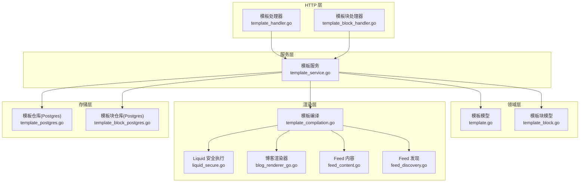
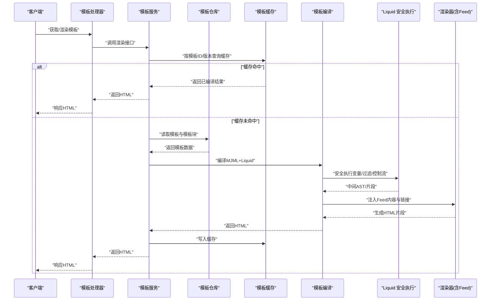
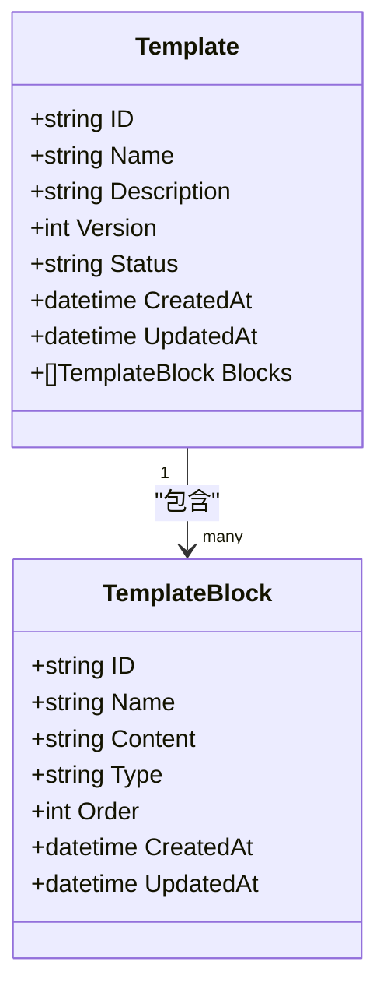
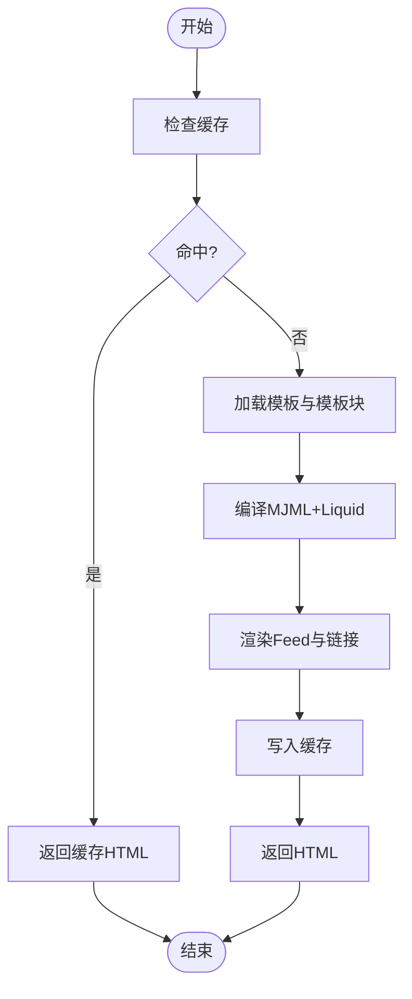
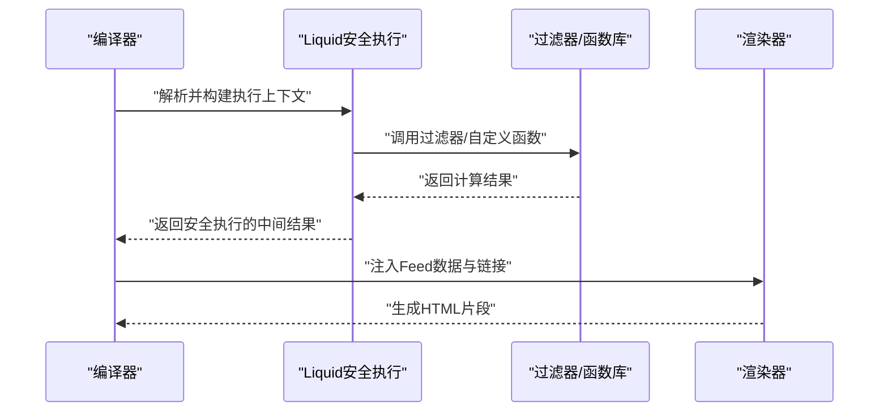
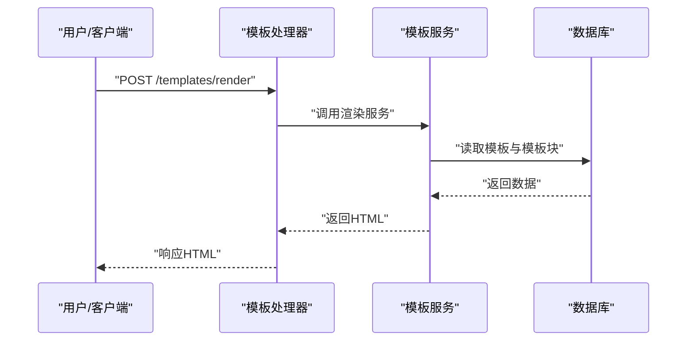
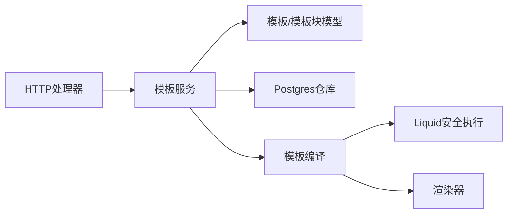

# 模板引擎

<cite>
**本文引用的文件**   
- [template.go](file://notifuse/internal/domain/template.go)
- [template_block.go](file://notifuse/internal/domain/template_block.go)
- [template_service.go](file://notifuse/internal/service/template_service.go)
- [template_compilation.go](file://notifuse/pkg/notifuse_mjml/template_compilation.go)
- [liquid_secure.go](file://notifuse/pkg/notifuse_mjml/liquid_secure.go)
- [blog_renderer_go.go](file://notifuse/pkg/liquid/blog_renderer_go.go)
- [feed_content.go](file://notifuse/pkg/liquid/feed_content.go)
- [feed_discovery.go](file://notifuse/pkg/liquid/feed_discovery.go)
- [template_handler.go](file://notifuse/internal/http/handlers/template_handler.go)
- [template_block_handler.go](file://notifuse/internal/http/handlers/template_block_handler.go)
- [template_postgres.go](file://notifuse/internal/repository/template_postgres.go)
- [template_block_postgres.go](file://notifuse/internal/repository/template_block_postgres.go)
</cite>

## 目录
1. [简介](#简介)
2. [项目结构](#项目结构)
3. [核心组件](#核心组件)
4. [架构总览](#架构总览)
5. [详细组件分析](#详细组件分析)
6. [依赖关系分析](#依赖关系分析)
7. [性能与缓存](#性能与缓存)
8. [调试与排障](#调试与排障)
9. [最佳实践与安全](#最佳实践与安全)
10. [版本管理与协作编辑](#版本管理与协作编辑)
11. [结论](#结论)

## 简介
本技术文档围绕邮件编辑器中的模板引擎展开，重点说明 Liquid 模板引擎的集成方案、从 Liquid 语法到最终 HTML 的编译流程、模板缓存机制与性能优化策略、函数库（内置函数、自定义函数与过滤器）、调试工具能力、安全考虑以及版本管理与协作编辑支持。文档面向开发者与维护者，力求在保持技术深度的同时提供清晰的可视化图示与可操作的指导。

## 项目结构
与模板引擎相关的代码主要分布在以下层次：
- 领域层：模板与模板块的数据模型与基础行为
- 服务层：模板生命周期管理、渲染编排、缓存策略
- 渲染层：MJML 模板编译、Liquid 安全执行环境、Feed 内容渲染
- 存储层：PostgreSQL 持久化模板与模板块
- HTTP 层：模板与模板块的 API 处理

**图表来源**
- [template_handler.go](file://notifuse/internal/http/handlers/template_handler.go)
- [template_block_handler.go](file://notifuse/internal/http/handlers/template_block_handler.go)
- [template_service.go](file://notifuse/internal/service/template_service.go)
- [template.go](file://notifuse/internal/domain/template.go)
- [template_block.go](file://notifuse/internal/domain/template_block.go)
- [template_compilation.go](file://notifuse/pkg/notifuse_mjml/template_compilation.go)
- [liquid_secure.go](file://notifuse/pkg/notifuse_mjml/liquid_secure.go)
- [blog_renderer_go.go](file://notifuse/pkg/liquid/blog_renderer_go.go)
- [feed_content.go](file://notifuse/pkg/liquid/feed_content.go)
- [feed_discovery.go](file://notifuse/pkg/liquid/feed_discovery.go)
- [template_postgres.go](file://notifuse/internal/repository/template_postgres.go)
- [template_block_postgres.go](file://notifuse/internal/repository/template_block_postgres.go)

**章节来源**
- [template_handler.go](file://notifuse/internal/http/handlers/template_handler.go)
- [template_block_handler.go](file://notifuse/internal/http/handlers/template_block_handler.go)
- [template_service.go](file://notifuse/internal/service/template_service.go)
- [template.go](file://notifuse/internal/domain/template.go)
- [template_block.go](file://notifuse/internal/domain/template_block.go)
- [template_compilation.go](file://notifuse/pkg/notifuse_mjml/template_compilation.go)
- [liquid_secure.go](file://notifuse/pkg/notifuse_mjml/liquid_secure.go)
- [blog_renderer_go.go](file://notifuse/pkg/liquid/blog_renderer_go.go)
- [feed_content.go](file://notifuse/pkg/liquid/feed_content.go)
- [feed_discovery.go](file://notifuse/pkg/liquid/feed_discovery.go)
- [template_postgres.go](file://notifuse/internal/repository/template_postgres.go)
- [template_block_postgres.go](file://notifuse/internal/repository/template_block_postgres.go)

## 核心组件
- 模板与模板块模型：定义模板的结构、关联的模板块、版本信息与状态等，支撑模板的组合与复用。
- 模板服务：负责模板的创建、更新、删除、查询、渲染与缓存管理；协调存储层与渲染层。
- 模板编译：将 MJML/Liquid 模板转换为 HTML，包含变量替换、条件渲染、循环逻辑与过滤器应用。
- Liquid 安全执行：限制危险操作，提供安全的变量访问与函数调用白名单。
- Feed 渲染与发现：为动态内容（如博客、订阅源）提供数据填充与链接发现。
- 存储层：通过 PostgreSQL 持久化模板与模板块，并提供事务与一致性保障。
- HTTP 处理器：暴露模板与模板块的 CRUD 与渲染接口，供前端或外部系统调用。

**章节来源**
- [template.go](file://notifuse/internal/domain/template.go)
- [template_block.go](file://notifuse/internal/domain/template_block.go)
- [template_service.go](file://notifuse/internal/service/template_service.go)
- [template_compilation.go](file://notifuse/pkg/notifuse_mjml/template_compilation.go)
- [liquid_secure.go](file://notifuse/pkg/notifuse_mjml/liquid_secure.go)
- [blog_renderer_go.go](file://notifuse/pkg/liquid/blog_renderer_go.go)
- [feed_content.go](file://notifuse/pkg/liquid/feed_content.go)
- [feed_discovery.go](file://notifuse/pkg/liquid/feed_discovery.go)
- [template_postgres.go](file://notifuse/internal/repository/template_postgres.go)
- [template_block_postgres.go](file://notifuse/internal/repository/template_block_postgres.go)

## 架构总览
下图展示从 HTTP 请求到模板渲染输出的端到端流程，包括缓存命中路径与未命中时的编译路径。

**图表来源**
- [template_handler.go](file://notifuse/internal/http/handlers/template_handler.go)
- [template_service.go](file://notifuse/internal/service/template_service.go)
- [template_postgres.go](file://notifuse/internal/repository/template_postgres.go)
- [template_compilation.go](file://notifuse/pkg/notifuse_mjml/template_compilation.go)
- [liquid_secure.go](file://notifuse/pkg/notifuse_mjml/liquid_secure.go)
- [blog_renderer_go.go](file://notifuse/pkg/liquid/blog_renderer_go.go)
- [feed_content.go](file://notifuse/pkg/liquid/feed_content.go)
- [feed_discovery.go](file://notifuse/pkg/liquid/feed_discovery.go)

## 详细组件分析

### 模板与模板块模型
- 模板模型：承载模板标识、名称、描述、版本、状态、创建与更新时间等元信息，并关联多个模板块。
- 模板块模型：表示可复用的模板片段，支持组合到不同模板中，便于团队协作与多语言/主题扩展。

**图表来源**
- [template.go](file://notifuse/internal/domain/template.go)
- [template_block.go](file://notifuse/internal/domain/template_block.go)

**章节来源**
- [template.go](file://notifuse/internal/domain/template.go)
- [template_block.go](file://notifuse/internal/domain/template_block.go)

### 模板服务与渲染编排
- 职责：接收渲染请求，优先从缓存获取结果；未命中时组织模板与模板块数据，调用编译器进行转换，并将结果写回缓存。
- 关键点：
  - 渲染上下文：注入用户、联系人、业务对象等变量，用于变量替换。
  - 条件渲染与循环：由 Liquid 控制流实现，结合过滤器完成格式化与计算。
  - 错误处理：对解析失败、执行异常、网络请求失败等进行统一封装与日志记录。

**图表来源**
- [template_service.go](file://notifuse/internal/service/template_service.go)
- [template_compilation.go](file://notifuse/pkg/notifuse_mjml/template_compilation.go)
- [feed_content.go](file://notifuse/pkg/liquid/feed_content.go)
- [feed_discovery.go](file://notifuse/pkg/liquid/feed_discovery.go)

**章节来源**
- [template_service.go](file://notifuse/internal/service/template_service.go)
- [template_compilation.go](file://notifuse/pkg/notifuse_mjml/template_compilation.go)
- [feed_content.go](file://notifuse/pkg/liquid/feed_content.go)
- [feed_discovery.go](file://notifuse/pkg/liquid/feed_discovery.go)

### 模板编译与 Liquid 安全执行
- 编译流程：
  - 解析 MJML 结构与 Liquid 标签。
  - 构建安全的执行环境，限制危险函数与全局访问。
  - 应用过滤器与自定义函数，完成变量替换与控制流。
  - 输出 HTML 片段，交由渲染器整合。
- 安全策略：
  - 白名单函数与过滤器。
  - 变量访问边界控制，防止越界与注入。
  - 资源访问限制（如禁止任意网络请求）。

**图表来源**
- [template_compilation.go](file://notifuse/pkg/notifuse_mjml/template_compilation.go)
- [liquid_secure.go](file://notifuse/pkg/notifuse_mjml/liquid_secure.go)
- [blog_renderer_go.go](file://notifuse/pkg/liquid/blog_renderer_go.go)
- [feed_content.go](file://notifuse/pkg/liquid/feed_content.go)
- [feed_discovery.go](file://notifuse/pkg/liquid/feed_discovery.go)

**章节来源**
- [template_compilation.go](file://notifuse/pkg/notifuse_mjml/template_compilation.go)
- [liquid_secure.go](file://notifuse/pkg/notifuse_mjml/liquid_secure.go)
- [blog_renderer_go.go](file://notifuse/pkg/liquid/blog_renderer_go.go)
- [feed_content.go](file://notifuse/pkg/liquid/feed_content.go)
- [feed_discovery.go](file://notifuse/pkg/liquid/feed_discovery.go)

### HTTP 处理器与API
- 模板处理器：提供模板的创建、更新、删除、查询与渲染接口。
- 模板块处理器：提供模板块的增删改查与排序调整接口。
- 输入校验与权限控制：确保仅授权用户可操作模板与模板块，并对输入参数进行严格校验。

**图表来源**
- [template_handler.go](file://notifuse/internal/http/handlers/template_handler.go)
- [template_block_handler.go](file://notifuse/internal/http/handlers/template_block_handler.go)
- [template_service.go](file://notifuse/internal/service/template_service.go)
- [template_postgres.go](file://notifuse/internal/repository/template_postgres.go)
- [template_block_postgres.go](file://notifuse/internal/repository/template_block_postgres.go)

**章节来源**
- [template_handler.go](file://notifuse/internal/http/handlers/template_handler.go)
- [template_block_handler.go](file://notifuse/internal/http/handlers/template_block_handler.go)
- [template_service.go](file://notifuse/internal/service/template_service.go)
- [template_postgres.go](file://notifuse/internal/repository/template_postgres.go)
- [template_block_postgres.go](file://notifuse/internal/repository/template_block_postgres.go)

## 依赖关系分析
- 组件耦合：
  - 模板服务强依赖模板与模板块模型、存储仓库与编译器。
  - 编译器依赖 Liquid 安全执行与渲染器。
  - HTTP 处理器依赖模板服务，间接依赖存储与渲染。
- 外部依赖：
  - PostgreSQL 作为持久化存储。
  - Liquid 模板引擎用于变量替换与控制流。
  - MJML 用于邮件模板结构与样式。

**图表来源**
- [template_handler.go](file://notifuse/internal/http/handlers/template_handler.go)
- [template_service.go](file://notifuse/internal/service/template_service.go)
- [template.go](file://notifuse/internal/domain/template.go)
- [template_block.go](file://notifuse/internal/domain/template_block.go)
- [template_postgres.go](file://notifuse/internal/repository/template_postgres.go)
- [template_block_postgres.go](file://notifuse/internal/repository/template_block_postgres.go)
- [template_compilation.go](file://notifuse/pkg/notifuse_mjml/template_compilation.go)
- [liquid_secure.go](file://notifuse/pkg/notifuse_mjml/liquid_secure.go)
- [blog_renderer_go.go](file://notifuse/pkg/liquid/blog_renderer_go.go)

**章节来源**
- [template_handler.go](file://notifuse/internal/http/handlers/template_handler.go)
- [template_service.go](file://notifuse/internal/service/template_service.go)
- [template.go](file://notifuse/internal/domain/template.go)
- [template_block.go](file://notifuse/internal/domain/template_block.go)
- [template_postgres.go](file://notifuse/internal/repository/template_postgres.go)
- [template_block_postgres.go](file://notifuse/internal/repository/template_block_postgres.go)
- [template_compilation.go](file://notifuse/pkg/notifuse_mjml/template_compilation.go)
- [liquid_secure.go](file://notifuse/pkg/notifuse_mjml/liquid_secure.go)
- [blog_renderer_go.go](file://notifuse/pkg/liquid/blog_renderer_go.go)

## 性能与缓存
- 缓存策略：
  - 基于模板ID与版本的键空间，避免重复编译。
  - 多级缓存：内存缓存为主，必要时引入分布式缓存以支持水平扩展。
  - 失效策略：模板更新或版本变更时主动失效相关缓存条目。
- 编译优化：
  - 增量编译：仅重新编译变更的模板块。
  - 并行渲染：对独立模块进行并发渲染，减少整体耗时。
  - 预取与预热：启动阶段预编译常用模板，降低冷启动延迟。
- 资源限制：
  - 设置最大渲染深度与超时时间，防止恶意模板导致资源耗尽。
  - 限制过滤器与函数的执行时间与内存占用。

[本节为通用性能建议，不直接分析具体文件]

## 调试与排障
- 断点调试：
  - 在关键节点（解析、执行、渲染）插入断点，观察中间状态。
  - 使用结构化日志记录变量上下文与执行路径。
- 变量查看：
  - 提供调试视图，显示当前模板可用的变量与作用域。
  - 支持导出渲染快照，便于离线分析与对比。
- 执行跟踪：
  - 记录每个过滤器与自定义函数的调用栈与耗时。
  - 对异常进行堆栈追踪与错误分类，辅助快速定位问题。
- 常见错误：
  - 变量缺失或类型不匹配：检查上下文注入与数据类型转换。
  - 过滤器未注册或权限不足：确认白名单配置与函数注册。
  - 网络请求失败：检查外部依赖可用性与重试策略。

**章节来源**
- [template_compilation.go](file://notifuse/pkg/notifuse_mjml/template_compilation.go)
- [liquid_secure.go](file://notifuse/pkg/notifuse_mjml/liquid_secure.go)
- [template_service.go](file://notifuse/internal/service/template_service.go)

## 最佳实践与安全
- 开发最佳实践：
  - 使用模板块拆分复杂模板，提升可维护性与复用性。
  - 明确变量命名规范与作用域，避免冲突与歧义。
  - 编写单元测试覆盖关键渲染路径与边界条件。
- 安全考虑：
  - 启用 Liquid 安全执行，禁用危险函数与全局访问。
  - 对用户输入进行严格校验与转义，防止模板注入攻击。
  - 限制外部资源访问，避免 SSRF 与数据泄露风险。
  - 定期审计自定义函数与过滤器，确保符合安全基线。

[本节为通用安全建议，不直接分析具体文件]

## 版本管理与协作编辑
- 版本管理：
  - 模板与模板块均具备版本号，支持灰度发布与回滚。
  - 变更历史与差异对比，便于审查与追溯。
- 协作编辑：
  - 基于模板块的细粒度协作，多人可同时编辑不同块。
  - 合并策略与冲突解决，确保团队高效协同。
- 审批与发布：
  - 工作流驱动：草稿、评审、测试、发布各阶段状态管理。
  - 权限控制：区分编辑、评审与发布角色，保障质量与合规。

**章节来源**
- [template.go](file://notifuse/internal/domain/template.go)
- [template_block.go](file://notifuse/internal/domain/template_block.go)
- [template_handler.go](file://notifuse/internal/http/handlers/template_handler.go)
- [template_block_handler.go](file://notifuse/internal/http/handlers/template_block_handler.go)

## 结论
本模板引擎通过模块化设计与安全执行环境，实现了从 Liquid 语法到 HTML 的高效转换，并结合缓存与优化策略满足高并发场景需求。配合完善的调试工具、最佳实践与安全策略，以及版本管理与协作编辑支持，能够为邮件编辑器的稳定运行与持续演进提供坚实基础。