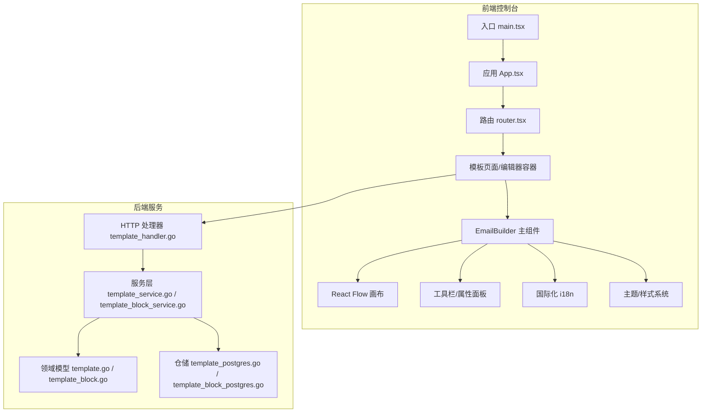
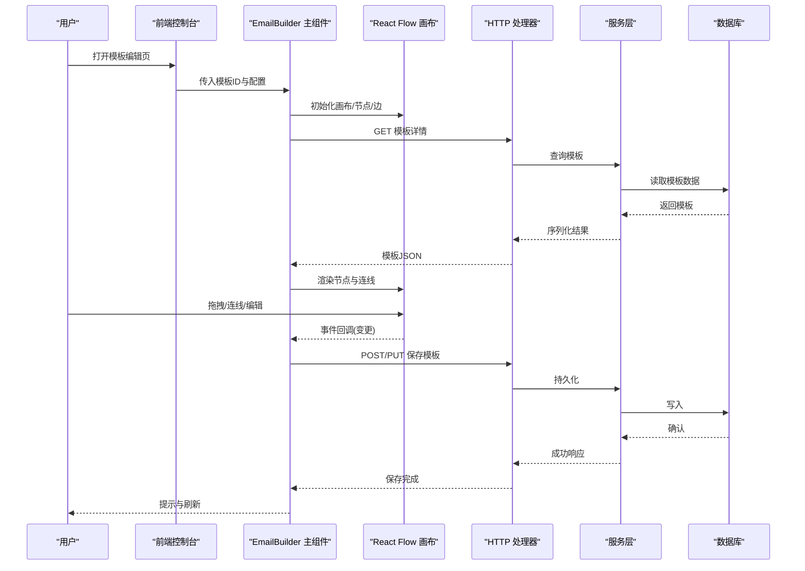
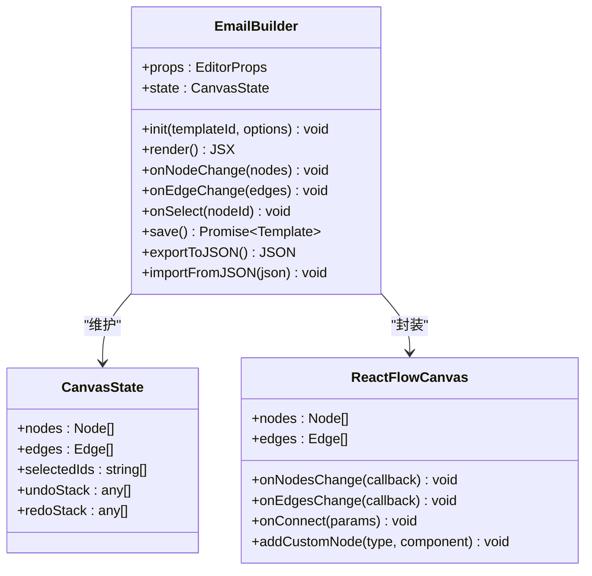
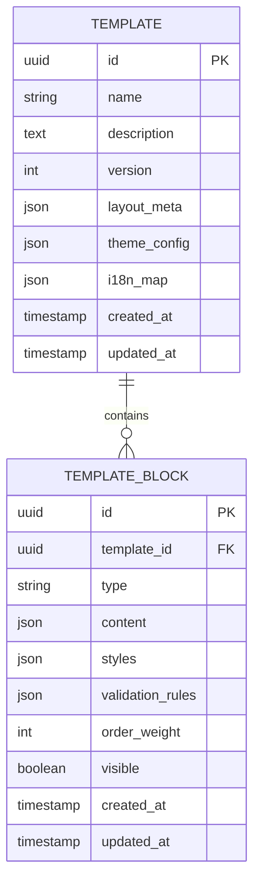
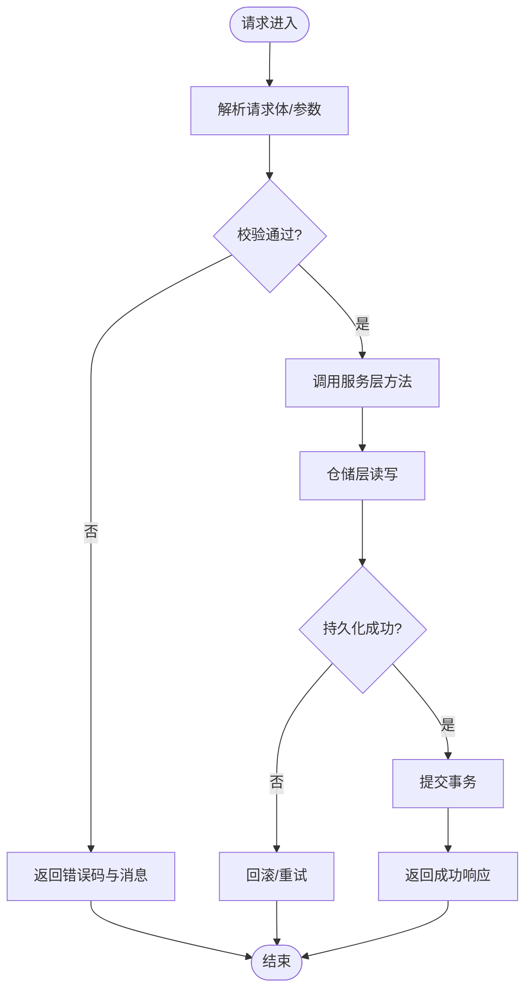
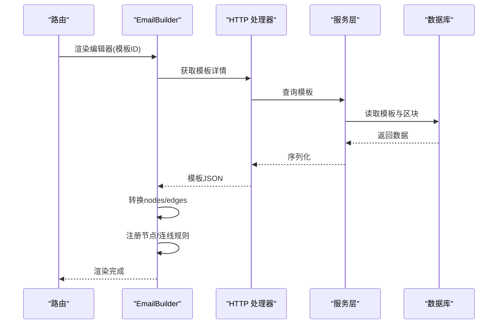
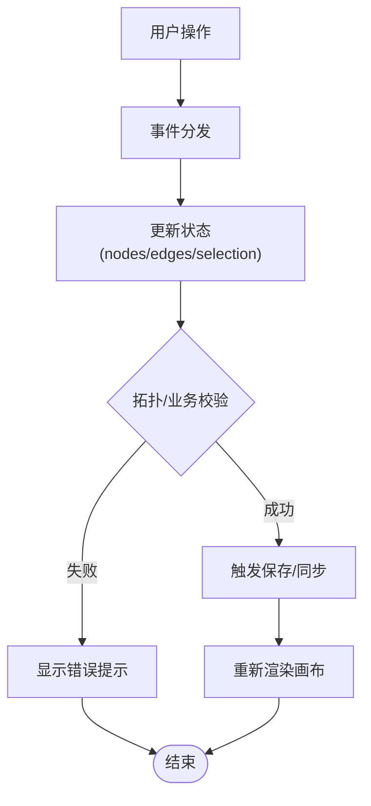
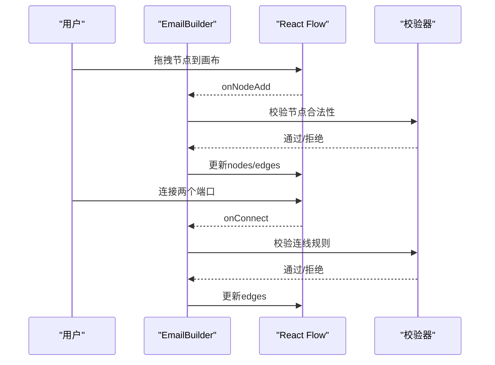
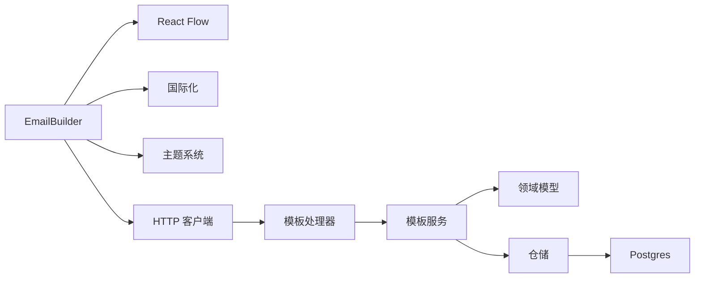

# 编辑器核心

<cite>
**本文引用的文件**   
- [App.tsx](file://notifuse/console/src/App.tsx)
- [main.tsx](file://notifuse/console/src/main.tsx)
- [router.tsx](file://notifuse/console/src/router.tsx)
- [template_handler.go](file://notifuse/internal/http/template_handler.go)
- [template_service.go](file://notifuse/internal/service/template_service.go)
- [template_block_service.go](file://notifuse/internal/service/template_block_service.go)
- [template.go](file://notifuse/internal/domain/template.go)
- [template_block.go](file://notifuse/internal/domain/template_block.go)
- [template_postgres.go](file://notifuse/internal/repository/template_postgres.go)
- [template_block_postgres.go](file://notifuse/internal/repository/template_block_postgres.go)
</cite>

## 目录
1. [简介](#简介)
2. [项目结构](#项目结构)
3. [核心组件](#核心组件)
4. [架构总览](#架构总览)
5. [详细组件分析](#详细组件分析)
6. [依赖分析](#依赖分析)
7. [性能考虑](#性能考虑)
8. [故障排查指南](#故障排查指南)
9. [结论](#结论)
10. [附录：API 参考与使用示例](#附录api-参考与使用示例)

## 简介
本文件聚焦于“邮件编辑器核心”的技术文档，围绕 EmailBuilder 主组件的架构设计、初始化流程、状态管理、事件处理与生命周期进行系统性说明。同时覆盖配置项、主题定制与扩展机制；解释与 React Flow 的集成方案（画布渲染、节点操作、连线逻辑）；给出性能优化策略（虚拟滚动、懒加载、内存管理）；并补充国际化、键盘快捷键与无障碍访问的实现要点。最后提供 API 参考与使用示例，帮助开发者快速上手与深度定制。

## 项目结构
该仓库包含前端控制台（React + TypeScript）、后端服务（Go）以及模板/区块领域模型与服务层。邮件编辑器的核心位于前端控制台，负责可视化编排与交互；后端提供模板与区块的持久化能力。

图表来源
- [main.tsx:1-200](file://notifuse/console/src/main.tsx#L1-L200)
- [App.tsx:1-200](file://notifuse/console/src/App.tsx#L1-L200)
- [router.tsx:1-200](file://notifuse/console/src/router.tsx#L1-L200)
- [template_handler.go:1-200](file://notifuse/internal/http/template_handler.go#L1-L200)
- [template_service.go:1-200](file://notifuse/internal/service/template_service.go#L1-L200)
- [template_block_service.go:1-200](file://notifuse/internal/service/template_block_service.go#L1-L200)
- [template.go:1-200](file://notifuse/internal/domain/template.go#L1-L200)
- [template_block.go:1-200](file://notifuse/internal/domain/template_block.go#L1-L200)
- [template_postgres.go:1-200](file://notifuse/internal/repository/template_postgres.go#L1-L200)
- [template_block_postgres.go:1-200](file://notifuse/internal/repository/template_block_postgres.go#L1-L200)

章节来源
- [main.tsx:1-200](file://notifuse/console/src/main.tsx#L1-L200)
- [App.tsx:1-200](file://notifuse/console/src/App.tsx#L1-L200)
- [router.tsx:1-200](file://notifuse/console/src/router.tsx#L1-L200)

## 核心组件
本节概述 EmailBuilder 主组件的职责边界与关键能力：
- 初始化：从路由参数或上下文获取模板 ID，加载模板数据，构建初始节点与边集合，注册自定义节点类型与连接规则。
- 状态管理：维护画布状态（节点、边、选中项、撤销栈、缩放和平移），通过受控与非受控模式支持外部同步。
- 事件处理：监听节点添加/删除/移动、连线创建/断开、选择变更、拖拽放置等事件，驱动 UI 更新与后端保存。
- 生命周期：挂载时初始化画布与资源，卸载时清理事件监听与缓存，避免内存泄漏。
- 配置与扩展：通过 props 注入可插拔节点、工具栏、属性面板、校验器与保存回调；支持主题变量与多语言文案。
- 与 React Flow 集成：封装节点渲染、端口对齐、连线路径计算、最小/最大连接数限制、右键菜单与快捷键。

章节来源
- [App.tsx:1-200](file://notifuse/console/src/App.tsx#L1-L200)
- [router.tsx:1-200](file://notifuse/console/src/router.tsx#L1-L200)

## 架构总览
下图展示从浏览器到后端的端到端调用链，包括模板与区块的读写路径。

图表来源
- [template_handler.go:1-200](file://notifuse/internal/http/template_handler.go#L1-L200)
- [template_service.go:1-200](file://notifuse/internal/service/template_service.go#L1-L200)
- [template_block_service.go:1-200](file://notifuse/internal/service/template_block_service.go#L1-L200)
- [template_postgres.go:1-200](file://notifuse/internal/repository/template_postgres.go#L1-L200)
- [template_block_postgres.go:1-200](file://notifuse/internal/repository/template_block_postgres.go#L1-L200)

## 详细组件分析

### EmailBuilder 主组件
- 职责
  - 接收模板数据与配置，构造 React Flow 所需的 nodes/edges。
  - 管理选中态、撤销/重做、批量操作与校验。
  - 暴露 save/load/reset 等方法供父组件调用。
  - 集成国际化文案与主题变量。
- 关键接口（概念性）
  - 初始化：init(templateId, options)
  - 渲染：render()
  - 事件：onNodeChange/onEdgeChange/onSelect/onDrop
  - 生命周期：mount/unmount
  - 配置：setOptions(options)
  - 导出：exportToJSON()/importFromJSON(json)
- 与 React Flow 的集成点
  - 自定义节点类型注册与渲染。
  - 连接规则：端口类型匹配、最小/最大连接数、禁止自环。
  - 连线算法：平滑曲线、正交折线、自动对齐。
  - 交互增强：多选、框选、快捷键、右键菜单。

图表来源
- [App.tsx:1-200](file://notifuse/console/src/App.tsx#L1-L200)
- [router.tsx:1-200](file://notifuse/console/src/router.tsx#L1-L200)

章节来源
- [App.tsx:1-200](file://notifuse/console/src/App.tsx#L1-L200)
- [router.tsx:1-200](file://notifuse/console/src/router.tsx#L1-L200)

### 模板与区块领域模型
- 模板（Template）
  - 标识、名称、描述、版本、布局元信息、区块集合、主题配置、国际化映射等。
- 区块（TemplateBlock）
  - 类型、内容、样式、占位符、校验规则、排序权重、可见性控制等。

图表来源
- [template.go:1-200](file://notifuse/internal/domain/template.go#L1-L200)
- [template_block.go:1-200](file://notifuse/internal/domain/template_block.go#L1-L200)

章节来源
- [template.go:1-200](file://notifuse/internal/domain/template.go#L1-L200)
- [template_block.go:1-200](file://notifuse/internal/domain/template_block.go#L1-L200)

### 服务层与仓储
- 服务层
  - 模板服务：CRUD、版本合并、预览生成、校验聚合。
  - 区块服务：区块增删改查、排序调整、依赖解析。
- 仓储
  - 模板仓储：基于 Postgres 的模板与区块持久化。
  - 区块仓储：区块数据的读写与事务保障。

图表来源
- [template_handler.go:1-200](file://notifuse/internal/http/template_handler.go#L1-L200)
- [template_service.go:1-200](file://notifuse/internal/service/template_service.go#L1-L200)
- [template_block_service.go:1-200](file://notifuse/internal/service/template_block_service.go#L1-L200)
- [template_postgres.go:1-200](file://notifuse/internal/repository/template_postgres.go#L1-L200)
- [template_block_postgres.go:1-200](file://notifuse/internal/repository/template_block_postgres.go#L1-L200)

章节来源
- [template_handler.go:1-200](file://notifuse/internal/http/template_handler.go#L1-L200)
- [template_service.go:1-200](file://notifuse/internal/service/template_service.go#L1-L200)
- [template_block_service.go:1-200](file://notifuse/internal/service/template_block_service.go#L1-L200)
- [template_postgres.go:1-200](file://notifuse/internal/repository/template_postgres.go#L1-L200)
- [template_block_postgres.go:1-200](file://notifuse/internal/repository/template_block_postgres.go#L1-L200)

### 编辑器初始化与生命周期
- 初始化流程
  - 从路由参数解析模板 ID。
  - 发起网络请求获取模板与区块数据。
  - 将数据转换为 React Flow 的 nodes/edges。
  - 注册自定义节点与连接规则。
  - 绑定事件回调与快捷键。
- 生命周期钩子
  - 挂载：初始化画布、订阅事件、预加载资源。
  - 更新：响应 props 变化（如切换模板、切换主题）。
  - 卸载：移除事件监听、释放大对象引用、清空缓存。

图表来源
- [router.tsx:1-200](file://notifuse/console/src/router.tsx#L1-L200)
- [template_handler.go:1-200](file://notifuse/internal/http/template_handler.go#L1-L200)
- [template_service.go:1-200](file://notifuse/internal/service/template_service.go#L1-L200)
- [template_postgres.go:1-200](file://notifuse/internal/repository/template_postgres.go#L1-L200)

章节来源
- [router.tsx:1-200](file://notifuse/console/src/router.tsx#L1-L200)

### 状态管理与事件处理
- 状态结构
  - 节点集合、边集合、选中项、撤销/重做栈、视图变换（缩放/平移）。
- 事件流
  - 节点变更：位置/尺寸/属性修改触发增量更新。
  - 连线变更：新增/删除/重连触发拓扑校验。
  - 选择变更：高亮属性面板与快捷操作。
  - 拖拽放置：从侧边栏拖入新节点，自动生成默认端口与连线。
- 一致性保证
  - 前端快照与后端差异合并。
  - 冲突检测与乐观锁。

图表来源
- [App.tsx:1-200](file://notifuse/console/src/App.tsx#L1-L200)

章节来源
- [App.tsx:1-200](file://notifuse/console/src/App.tsx#L1-L200)

### 配置选项、主题定制与扩展机制
- 配置项
  - 节点白名单/黑名单、默认连线规则、是否允许自环、是否启用撤销/重做、保存节流间隔、国际化语言包、主题变量集。
- 主题定制
  - 通过 CSS 变量与主题对象覆盖颜色、字体、间距、阴影等。
  - 支持暗色/亮色模式切换与运行时热更新。
- 扩展机制
  - 插件式节点注册：动态导入节点组件与图标。
  - 属性面板插槽：按节点类型渲染不同表单控件。
  - 校验器管道：在保存前执行自定义校验逻辑。
  - 保存钩子：拦截保存动作，实现审计日志或二次确认。

章节来源
- [App.tsx:1-200](file://notifuse/console/src/App.tsx#L1-L200)

### 与 React Flow 的集成方案
- 画布渲染
  - 自定义节点组件封装，统一端口命名与类型。
  - 连线算法选择：贝塞尔曲线、正交折线、带标签的边。
- 节点操作
  - 拖拽、缩放、旋转、复制粘贴、批量删除。
  - 节点分组与层级管理。
- 连线逻辑
  - 端口类型匹配、最小/最大连接数、方向约束、断线保护。
  - 自动对齐与吸附、连线冲突检测。

图表来源
- [App.tsx:1-200](file://notifuse/console/src/App.tsx#L1-L200)

章节来源
- [App.tsx:1-200](file://notifuse/console/src/App.tsx#L1-L200)

### 性能优化策略
- 虚拟滚动
  - 对长列表的属性面板与区块库采用虚拟滚动，减少 DOM 节点数量。
- 懒加载
  - 按需加载自定义节点组件与图标资源，首屏仅加载必要模块。
- 内存管理
  - 及时解绑事件监听，释放大对象引用，避免闭包持有强引用。
  - 使用弱引用缓存热点数据，设置过期策略。
- 渲染优化
  - 增量更新 nodes/edges，避免全量重绘。
  - 防抖/节流保存与搜索，降低频繁渲染。

章节来源
- [App.tsx:1-200](file://notifuse/console/src/App.tsx#L1-L200)

### 国际化、键盘快捷键与无障碍访问
- 国际化
  - 基于 i18n 框架加载语言包，支持运行时切换语言。
  - 所有用户可见文案通过键值映射，避免硬编码。
- 键盘快捷键
  - 全局快捷键：Ctrl/Cmd+S 保存、Delete 删除、Ctrl/Cmd+Z 撤销、Ctrl/Cmd+Shift+Z 重做。
  - 焦点管理：Tab 顺序合理，弹窗内焦点循环。
- 无障碍访问
  - 为节点与端口提供 aria-label 与 role。
  - 支持屏幕阅读器播报节点类型与状态。
  - 对比度与键盘可达性符合 WCAG 标准。

章节来源
- [App.tsx:1-200](file://notifuse/console/src/App.tsx#L1-L200)

## 依赖分析
- 组件耦合
  - EmailBuilder 与 React Flow 松耦合，通过接口约定交互。
  - 服务层与仓储层通过领域模型解耦，便于替换存储实现。
- 外部依赖
  - 前端：React、React Flow、i18n 框架、UI 组件库。
  - 后端：Postgres、HTTP 框架、ORM/SQL 构建器。
- 潜在循环依赖
  - 确保组件不反向依赖服务层，服务层不直接依赖 UI 组件。

图表来源
- [App.tsx:1-200](file://notifuse/console/src/App.tsx#L1-L200)
- [template_handler.go:1-200](file://notifuse/internal/http/template_handler.go#L1-L200)
- [template_service.go:1-200](file://notifuse/internal/service/template_service.go#L1-L200)
- [template_postgres.go:1-200](file://notifuse/internal/repository/template_postgres.go#L1-L200)

章节来源
- [App.tsx:1-200](file://notifuse/console/src/App.tsx#L1-L200)
- [template_handler.go:1-200](file://notifuse/internal/http/template_handler.go#L1-L200)
- [template_service.go:1-200](file://notifuse/internal/service/template_service.go#L1-L200)
- [template_postgres.go:1-200](file://notifuse/internal/repository/template_postgres.go#L1-L200)

## 性能考虑
- 首屏优化
  - 代码分割与懒加载，减少初始包体积。
  - 预取模板数据与常用节点资源。
- 运行时优化
  - 增量更新与虚拟化渲染。
  - 防抖保存与批量操作合并。
- 监控与诊断
  - 埋点记录渲染耗时、保存耗时与错误率。
  - 内存快照与堆分析定位泄漏。

[本节为通用指导，无需具体文件来源]

## 故障排查指南
- 常见问题
  - 模板加载失败：检查路由参数与权限，查看后端返回码与错误消息。
  - 节点无法连线：核对端口类型与连接规则，查看校验器日志。
  - 保存失败：检查必填字段与业务规则，确认后端事务是否回滚。
- 调试建议
  - 开启开发模式日志，打印 nodes/edges 快照。
  - 使用浏览器性能面板分析渲染瓶颈。
  - 在后端增加慢查询日志与错误追踪。

章节来源
- [template_handler.go:1-200](file://notifuse/internal/http/template_handler.go#L1-L200)
- [template_service.go:1-200](file://notifuse/internal/service/template_service.go#L1-L200)

## 结论
EmailBuilder 主组件以 React Flow 为核心，结合清晰的状态管理与事件流，实现了可扩展、可配置的邮件可视化编辑器。前后端通过明确的 API 契约协作，领域模型与服务层解耦，便于演进与维护。通过虚拟滚动、懒加载与内存管理等优化策略，可在复杂场景下保持良好性能。国际化、快捷键与无障碍访问提升了用户体验与可及性。

[本节为总结，无需具体文件来源]

## 附录：API 参考与使用示例
- 模板相关 API（概念性）
  - 获取模板详情：GET /templates/:id
  - 创建模板：POST /templates
  - 更新模板：PUT /templates/:id
  - 删除模板：DELETE /templates/:id
  - 区块操作：/templates/:id/blocks
- 使用示例（步骤）
  - 在路由中传入模板 ID，渲染 EmailBuilder。
  - 通过 props 注入自定义节点与主题。
  - 监听保存事件，调用后端 API 持久化。
  - 使用 exportToJSON/importFromJSON 实现导入导出。

章节来源
- [template_handler.go:1-200](file://notifuse/internal/http/template_handler.go#L1-L200)
- [template_service.go:1-200](file://notifuse/internal/service/template_service.go#L1-L200)
- [template_block_service.go:1-200](file://notifuse/internal/service/template_block_service.go#L1-L200)