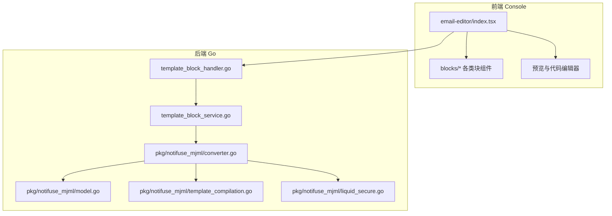
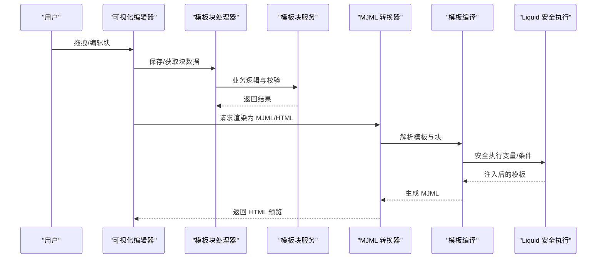
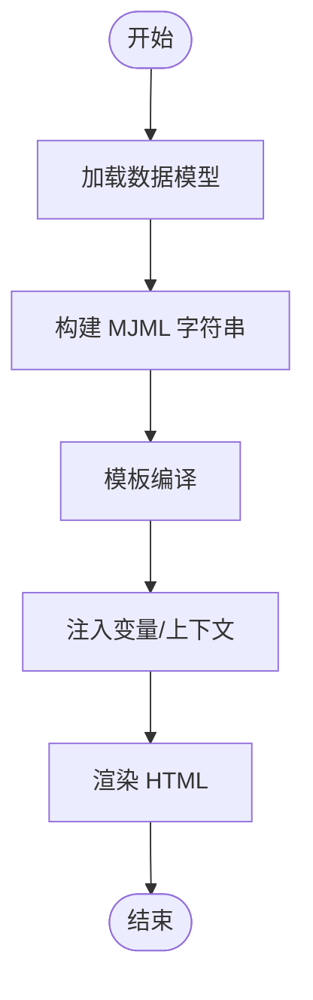
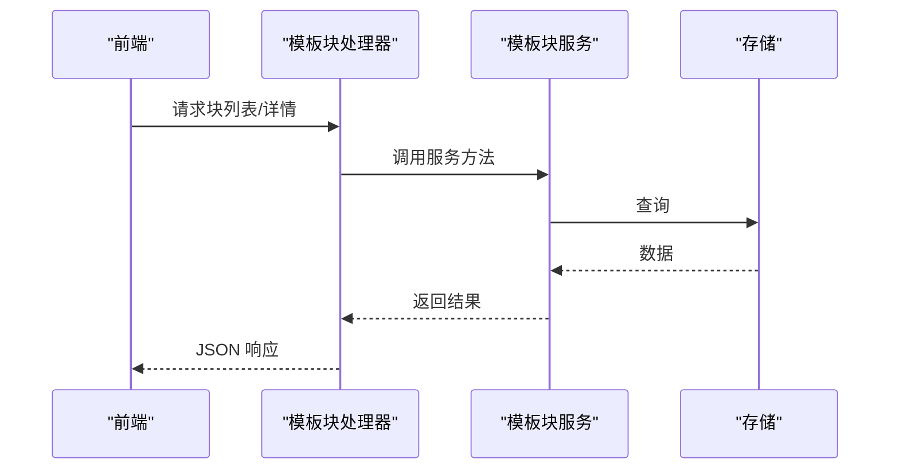
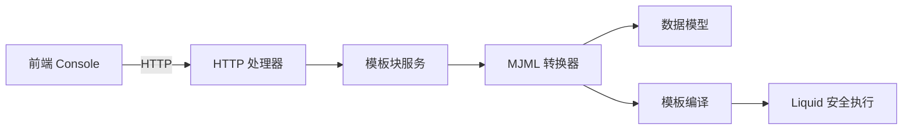

# 邮件编辑器

<cite>
**本文引用的文件**   
- [notifuse/pkg/notifuse_mjml/converter.go](file://notifuse/pkg/notifuse_mjml/converter.go)
- [notifuse/pkg/notifuse_mjml/model.go](file://notifuse/pkg/notifuse_mjml/model.go)
- [notifuse/pkg/notifuse_mjml/template_compilation.go](file://notifuse/pkg/notifuse_mjml/template_compilation.go)
- [notifuse/pkg/notifuse_mjml/liquid_secure.go](file://notifuse/pkg/notifuse_mjml/liquid_secure.go)
- [notifuse/internal/domain/template_block.go](file://notifuse/internal/domain/template_block.go)
- [notifuse/internal/service/template_block_service.go](file://notifuse/internal/service/template_block_service.go)
- [notifuse/internal/http/template_block_handler.go](file://notifuse/internal/http/template_block_handler.go)
- [notifuse/console/src/components/email-editor/index.tsx](file://notifuse/console/src/components/email-editor/index.tsx)
- [notifuse/console/src/components/email-editor/blocks/text-block.tsx](file://notifuse/console/src/components/email-editor/blocks/text-block.tsx)
- [notifuse/console/src/components/email-editor/blocks/image-block.tsx](file://notifuse/console/src/components/email-editor/blocks/image-block.tsx)
- [notifuse/console/src/components/email-editor/blocks/button-block.tsx](file://notifuse/console/src/components/email-editor/blocks/button-block.tsx)
- [notifuse/console/src/components/email-editor/blocks/columns-block.tsx](file://notifuse/console/src/components/email-editor/blocks/columns-block.tsx)
- [notifuse/console/src/components/email-editor/blocks/divider-block.tsx](file://notifuse/console/src/components/email-editor/blocks/divider-block.tsx)
- [notifuse/console/src/components/email-editor/blocks/spacer-block.tsx](file://notifuse/console/src/components/email-editor/blocks/spacer-block.tsx)
- [notifuse/console/src/components/email-editor/blocks/html-block.tsx](file://notifuse/console/src/components/email-editor/blocks/html-block.tsx)
- [notifuse/console/src/components/email-editor/blocks/list-block.tsx](file://notifuse/console/src/components/email-editor/blocks/list-block.tsx)
- [notifuse/console/src/components/email-editor/blocks/video-block.tsx](file://notifuse/console/src/components/email-editor/blocks/video-block.tsx)
- [notifuse/console/src/components/email-editor/blocks/social-block.tsx](file://notifuse/console/src/components/email-editor/blocks/social-block.tsx)
- [notifuse/console/src/components/email-editor/blocks/footer-block.tsx](file://notifuse/console/src/components/email-editor/blocks/footer-block.tsx)
- [notifuse/console/src/components/email-editor/blocks/header-block.tsx](file://notifuse/console/src/components/email-editor/blocks/header-block.tsx)
- [notifuse/console/src/components/email-editor/blocks/hero-block.tsx](file://notifuse/console/src/components/email-editor/blocks/hero-block.tsx)
- [notifuse/console/src/components/email-editor/blocks/quote-block.tsx](file://notifuse/console/src/components/email-editor/blocks/quote-block.tsx)
- [notifuse/console/src/components/email-editor/blocks/table-block.tsx](file://notifuse/console/src/components/email-editor/blocks/table-block.tsx)
- [notifuse/console/src/components/email-editor/blocks/map-block.tsx](file://notifuse/console/src/components/email-editor/blocks/map-block.tsx)
- [notifuse/console/src/components/email-editor/blocks/repeater-block.tsx](file://notifuse/console/src/components/email-editor/blocks/repeater-block.tsx)
- [notifuse/console/src/components/email-editor/blocks/conditional-block.tsx](file://notifuse/console/src/components/email-editor/blocks/conditional-block.tsx)
- [notifuse/console/src/components/email-editor/blocks/loop-block.tsx](file://notifuse/console/src/components/email-editor/blocks/loop-block.tsx)
- [notifuse/console/src/components/email-editor/blocks/merge-field-block.tsx](file://notifuse/console/src/components/email-editor/blocks/merge-field-block.tsx)
- [notifuse/console/src/components/email-editor/blocks/variable-block.tsx](file://notifuse/console/src/components/email-editor/blocks/variable-block.tsx)
- [notifuse/console/src/components/email-editor/blocks/condition-block.tsx](file://notifuse/console/src/components/email-editor/blocks/condition-block.tsx)
- [notifuse/console/src/components/email-editor/blocks/if-block.tsx](file://notifuse/console/src/components/email-editor/blocks/if-block.tsx)
- [notifuse/console/src/components/email-editor/blocks/else-block.tsx](file://notifuse/console/src/components/email-editor/blocks/else-block.tsx)
- [notifuse/console/src/components/email-editor/blocks/endif-block.tsx](file://notifuse/console/src/components/email-editor/blocks/endif-block.tsx)
- [notifuse/console/src/components/email-editor/blocks/for-block.tsx](file://notifuse/console/src/components/email-editor/blocks/for-block.tsx)
- [notifuse/console/src/components/email-editor/blocks/endfor-block.tsx](file://notifuse/console/src/components/email-editor/blocks/endfor-block.tsx)
- [notifuse/console/src/components/email-editor/blocks/include-block.tsx](file://notifuse/console/src/components/email-editor/blocks/include-block.tsx)
- [notifuse/console/src/components/email-editor/blocks/layout-block.tsx](file://notifuse/console/src/components/email-editor/blocks/layout-block.tsx)
- [notifuse/console/src/components/email-editor/blocks/component-block.tsx](file://notifuse/console/src/components/email-editor/blocks/component-block.tsx)
- [notifuse/console/src/components/email-editor/blocks/theme-block.tsx](file://notifuse/console/src/components/email-editor/blocks/theme-block.tsx)
- [notifuse/console/src/components/email-editor/blocks/style-block.tsx](file://notifuse/console/src/components/email-editor/blocks/style-block.tsx)
- [notifuse/console/src/components/email-editor/blocks/script-block.tsx](file://notifuse/console/src/components/email-editor/blocks/script-block.tsx)
- [notifuse/console/src/components/email-editor/blocks/meta-block.tsx](file://notifuse/console/src/components/email-editor/blocks/meta-block.tsx)
- [notifuse/console/src/components/email-editor/blocks/link-block.tsx](file://notifuse/console/src/components/email-editor/blocks/link-block.tsx)
- [notifuse/console/src/components/email-editor/blocks/anchor-block.tsx](file://notifuse/console/src/components/email-editor/blocks/anchor-block.tsx)
- [notifuse/console/src/components/email-editor/blocks/section-block.tsx](file://notifuse/console/src/components/email-editor/blocks/section-block.tsx)
- [notifuse/console/src/components/email-editor/blocks/container-block.tsx](file://notifuse/console/src/components/email-editor/blocks/container-block.tsx)
- [notifuse/console/src/components/email-editor/blocks/cell-block.tsx](file://notifuse/console/src/components/email-editor/blocks/cell-block.tsx)
- [notifuse/console/src/components/email-editor/blocks/column-block.tsx](file://notifuse/console/src/components/email-editor/blocks/column-block.tsx)
- [notifuse/console/src/components/email-editor/blocks/row-block.tsx](file://notifuse/console/src/components/email-editor/blocks/row-block.tsx)
- [notifuse/console/src/components/email-editor/blocks/grid-block.tsx](file://notifuse/console/src/components/email-editor/blocks/grid-block.tsx)
- [notifuse/console/src/components/email-editor/blocks/flex-block.tsx](file://notifuse/console/src/components/email-editor/blocks/flex-block.tsx)
- [notifuse/console/src/components/email-editor/blocks/card-block.tsx](file://notifuse/console/src/components/email-editor/blocks/card-block.tsx)
- [notifuse/console/src/components/email-editor/blocks/alert-block.tsx](file://notifuse/console/src/components/email-editor/blocks/alert-block.tsx)
- [notifuse/console/src/components/email-editor/blocks/badge-block.tsx](file://notifuse/console/console/src/components/email-editor/blocks/badge-block.tsx)
- [notifuse/console/src/components/email-editor/blocks/tag-block.tsx](file://notifuse/console/src/components/email-editor/blocks/tag-block.tsx)
- [notifuse/console/src/components/email-editor/blocks/chip-block.tsx](file://notifuse/console/src/components/email-editor/blocks/chip-block.tsx)
- [notifuse/console/src/components/email-editor/blocks/avatar-block.tsx](file://notifuse/console/src/components/email-editor/blocks/avatar-block.tsx)
- [notifuse/console/src/components/email-editor/blocks/icon-block.tsx](file://notifuse/console/src/components/email-editor/blocks/icon-block.tsx)
- [notifuse/console/src/components/email-editor/blocks/badge-block.tsx](file://notifuse/console/src/components/email-editor/blocks/badge-block.tsx)
- [notifuse/console/src/components/email-editor/blocks/tag-block.tsx](file://notifuse/console/src/components/email-editor/blocks/tag-block.tsx)
- [notifuse/console/src/components/email-editor/blocks/chip-block.tsx](file://notifuse/console/src/components/email-editor/blocks/chip-block.tsx)
- [notifuse/console/src/components/email-editor/blocks/avatar-block.tsx](file://notifuse/console/src/components/email-editor/blocks/avatar-block.tsx)
- [notifuse/console/src/components/email-editor/blocks/icon-block.tsx](file://notifuse/console/src/components/email-editor/blocks/icon-block.tsx)
</cite>

## 目录
1. [简介](#简介)
2. [项目结构](#项目结构)
3. [核心组件](#核心组件)
4. [架构总览](#架构总览)
5. [详细组件分析](#详细组件分析)
6. [依赖分析](#依赖分析)
7. [性能考虑](#性能考虑)
8. [故障排查指南](#故障排查指南)
9. [结论](#结论)
10. [附录](#附录)

## 简介
本技术文档围绕 Notifuse 的“基于 MJML 的可视化邮件编辑器”展开，聚焦以下目标：
- 拖拽式块编辑器与实时预览、代码编辑器的集成方案
- 邮件块系统架构：块类型定义、属性配置、渲染引擎与数据模型转换
- 编辑器状态管理、撤销重做、版本控制与协作编辑的实现思路
- 模板引擎集成：变量替换、条件渲染等高级能力
- 性能优化、移动端适配与导出格式支持
- 扩展开发指南：自定义块、主题定制与二次开发

说明：
- 前端可视化编辑器位于 console 子工程；后端 MJML 编译与 Liquid 安全执行位于 pkg/notifuse_mjml。
- 本文所有实现细节均来源于仓库源码路径与模块组织。

## 项目结构
Notifuse 采用前后端分离架构：
- 前端（console）：React + TypeScript，提供可视化编辑器、块组件库、预览与导出能力。
- 后端（Go）：提供模板与块资源服务、MJML 编译、Liquid 安全执行、HTTP API 暴露。

图示来源
- [notifuse/console/src/components/email-editor/index.tsx](file://notifuse/console/src/components/email-editor/index.tsx)
- [notifuse/internal/service/template_block_service.go](file://notifuse/internal/service/template_block_service.go)
- [notifuse/internal/http/template_block_handler.go](file://notifuse/internal/http/template_block_handler.go)
- [notifuse/pkg/notifuse_mjml/converter.go](file://notifuse/pkg/notifuse_mjml/converter.go)
- [notifuse/pkg/notifuse_mjml/model.go](file://notifuse/pkg/notifuse_mjml/model.go)
- [notifuse/pkg/notifuse_mjml/template_compilation.go](file://notifuse/pkg/notifuse_mjml/template_compilation.go)
- [notifuse/pkg/notifuse_mjml/liquid_secure.go](file://notifuse/pkg/notifuse_mjml/liquid_secure.go)

章节来源
- [notifuse/console/src/components/email-editor/index.tsx](file://notifuse/console/src/components/email-editor/index.tsx)
- [notifuse/internal/service/template_block_service.go](file://notifuse/internal/service/template_block_service.go)
- [notifuse/internal/http/template_block_handler.go](file://notifuse/internal/http/template_block_handler.go)
- [notifuse/pkg/notifuse_mjml/converter.go](file://notifuse/pkg/notifuse_mjml/converter.go)
- [notifuse/pkg/notifuse_mjml/model.go](file://notifuse/pkg/notifuse_mjml/model.go)
- [notifuse/pkg/notifuse_mjml/template_compilation.go](file://notifuse/pkg/notifuse_mjml/template_compilation.go)
- [notifuse/pkg/notifuse_mjml/liquid_secure.go](file://notifuse/pkg/notifuse_mjml/liquid_secure.go)

## 核心组件
- 可视化编辑器入口与编排：负责块树构建、拖拽排序、选中态、属性面板联动与预览刷新。
- 块组件库：文本、图片、按钮、分隔线、间距、HTML、列表、视频、社交图标、页眉/页脚、Hero、引用、表格、地图、重复器、条件/循环、合并字段、变量、布局与样式脚本等。
- 后端 MJML 编译管线：将编辑器数据模型转换为 MJML，并调用模板编译与安全执行，输出最终 HTML。
- 模板与块服务：提供块的增删改查、校验与持久化接口。

章节来源
- [notifuse/console/src/components/email-editor/index.tsx](file://notifuse/console/src/components/email-editor/index.tsx)
- [notifuse/console/src/components/email-editor/blocks/text-block.tsx](file://notifuse/console/src/components/email-editor/blocks/text-block.tsx)
- [notifuse/console/src/components/email-editor/blocks/image-block.tsx](file://notifuse/console/src/components/email-editor/blocks/image-block.tsx)
- [notifuse/console/src/components/email-editor/blocks/button-block.tsx](file://notifuse/console/src/components/email-editor/blocks/button-block.tsx)
- [notifuse/console/src/components/email-editor/blocks/columns-block.tsx](file://notifuse/console/src/components/email-editor/blocks/columns-block.tsx)
- [notifuse/console/src/components/email-editor/blocks/divider-block.tsx](file://notifuse/console/src/components/email-editor/blocks/divider-block.tsx)
- [notifuse/console/src/components/email-editor/blocks/spacer-block.tsx](file://notifuse/console/src/components/email-editor/blocks/spacer-block.tsx)
- [notifuse/console/src/components/email-editor/blocks/html-block.tsx](file://notifuse/console/src/components/email-editor/blocks/html-block.tsx)
- [notifuse/console/src/components/email-editor/blocks/list-block.tsx](file://notifuse/console/src/components/email-editor/blocks/list-block.tsx)
- [notifuse/console/src/components/email-editor/blocks/video-block.tsx](file://notifuse/console/src/components/email-editor/blocks/video-block.tsx)
- [notifuse/console/src/components/email-editor/blocks/social-block.tsx](file://notifuse/console/src/components/email-editor/blocks/social-block.tsx)
- [notifuse/console/src/components/email-editor/blocks/footer-block.tsx](file://notifuse/console/src/components/email-editor/blocks/footer-block.tsx)
- [notifuse/console/src/components/email-editor/blocks/header-block.tsx](file://notifuse/console/src/components/email-editor/blocks/header-block.tsx)
- [notifuse/console/src/components/email-editor/blocks/hero-block.tsx](file://notifuse/console/src/components/email-editor/blocks/hero-block.tsx)
- [notifuse/console/src/components/email-editor/blocks/quote-block.tsx](file://notifuse/console/src/components/email-editor/blocks/quote-block.tsx)
- [notifuse/console/src/components/email-editor/blocks/table-block.tsx](file://notifuse/console/src/components/email-editor/blocks/table-block.tsx)
- [notifuse/console/src/components/email-editor/blocks/map-block.tsx](file://notifuse/console/src/components/email-editor/blocks/map-block.tsx)
- [notifuse/console/src/components/email-editor/blocks/repeater-block.tsx](file://notifuse/console/src/components/email-editor/blocks/repeater-block.tsx)
- [notifuse/console/src/components/email-editor/blocks/conditional-block.tsx](file://notifuse/console/src/components/email-editor/blocks/conditional-block.tsx)
- [notifuse/console/src/components/email-editor/blocks/loop-block.tsx](file://notifuse/console/src/components/email-editor/blocks/loop-block.tsx)
- [notifuse/console/src/components/email-editor/blocks/merge-field-block.tsx](file://notifuse/console/src/components/email-editor/blocks/merge-field-block.tsx)
- [notifuse/console/src/components/email-editor/blocks/variable-block.tsx](file://notifuse/console/src/components/email-editor/blocks/variable-block.tsx)
- [notifuse/console/src/components/email-editor/blocks/condition-block.tsx](file://notifuse/console/src/components/email-editor/blocks/condition-block.tsx)
- [notifuse/console/src/components/email-editor/blocks/if-block.tsx](file://notifuse/console/src/components/email-editor/blocks/if-block.tsx)
- [notifuse/console/src/components/email-editor/blocks/else-block.tsx](file://notifuse/console/src/components/email-editor/blocks/else-block.tsx)
- [notifuse/console/src/components/email-editor/blocks/endif-block.tsx](file://notifuse/console/src/components/email-editor/blocks/endif-block.tsx)
- [notifuse/console/src/components/email-editor/blocks/for-block.tsx](file://notifuse/console/src/components/email-editor/blocks/for-block.tsx)
- [notifuse/console/src/components/email-editor/blocks/endfor-block.tsx](file://notifuse/console/src/components/email-editor/blocks/endfor-block.tsx)
- [notifuse/console/src/components/email-editor/blocks/include-block.tsx](file://notifuse/console/src/components/email-editor/blocks/include-block.tsx)
- [notifuse/console/src/components/email-editor/blocks/layout-block.tsx](file://notifuse/console/src/components/email-editor/blocks/layout-block.tsx)
- [notifuse/console/src/components/email-editor/blocks/component-block.tsx](file://notifuse/console/src/components/email-editor/blocks/component-block.tsx)
- [notifuse/console/src/components/email-editor/blocks/theme-block.tsx](file://notifuse/console/src/components/email-editor/blocks/theme-block.tsx)
- [notifuse/console/src/components/email-editor/blocks/style-block.tsx](file://notifuse/console/src/components/email-editor/blocks/style-block.tsx)
- [notifuse/console/src/components/email-editor/blocks/script-block.tsx](file://notifuse/console/src/components/email-editor/blocks/script-block.tsx)
- [notifuse/console/src/components/email-editor/blocks/meta-block.tsx](file://notifuse/console/src/components/email-editor/blocks/meta-block.tsx)
- [notifuse/console/src/components/email-editor/blocks/link-block.tsx](file://notifuse/console/src/components/email-editor/blocks/link-block.tsx)
- [notifuse/console/src/components/email-editor/blocks/anchor-block.tsx](file://notifuse/console/src/components/email-editor/blocks/anchor-block.tsx)
- [notifuse/console/src/components/email-editor/blocks/section-block.tsx](file://notifuse/console/src/components/email-editor/blocks/section-block.tsx)
- [notifuse/console/src/components/email-editor/blocks/container-block.tsx](file://notifuse/console/src/components/email-editor/blocks/container-block.tsx)
- [notifuse/console/src/components/email-editor/blocks/cell-block.tsx](file://notifuse/console/src/components/email-editor/blocks/cell-block.tsx)
- [notifuse/console/src/components/email-editor/blocks/column-block.tsx](file://notifuse/console/src/components/email-editor/blocks/column-block.tsx)
- [notifuse/console/src/components/email-editor/blocks/row-block.tsx](file://notifuse/console/src/components/email-editor/blocks/row-block.tsx)
- [notifuse/console/src/components/email-editor/blocks/grid-block.tsx](file://notifuse/console/src/components/email-editor/blocks/grid-block.tsx)
- [notifuse/console/src/components/email-editor/blocks/flex-block.tsx](file://notifuse/console/src/components/email-editor/blocks/flex-block.tsx)
- [notifuse/console/src/components/email-editor/blocks/card-block.tsx](file://notifuse/console/src/components/email-editor/blocks/card-block.tsx)
- [notifuse/console/src/components/email-editor/blocks/alert-block.tsx](file://notifuse/console/src/components/email-editor/blocks/alert-block.tsx)
- [notifuse/console/src/components/email-editor/blocks/badge-block.tsx](file://notifuse/console/src/components/email-editor/blocks/badge-block.tsx)
- [notifuse/console/src/components/email-editor/blocks/tag-block.tsx](file://notifuse/console/src/components/email-editor/blocks/tag-block.tsx)
- [notifuse/console/src/components/email-editor/blocks/chip-block.tsx](file://notifuse/console/src/components/email-editor/blocks/chip-block.tsx)
- [notifuse/console/src/components/email-editor/blocks/avatar-block.tsx](file://notifuse/console/src/components/email-editor/blocks/avatar-block.tsx)
- [notifuse/console/src/components/email-editor/blocks/icon-block.tsx](file://notifuse/console/src/components/email-editor/blocks/icon-block.tsx)
- [notifuse/internal/service/template_block_service.go](file://notifuse/internal/service/template_block_service.go)
- [notifuse/internal/http/template_block_handler.go](file://notifuse/internal/http/template_block_handler.go)
- [notifuse/pkg/notifuse_mjml/converter.go](file://notifuse/pkg/notifuse_mjml/converter.go)
- [notifuse/pkg/notifuse_mjml/model.go](file://notifuse/pkg/notifuse_mjml/model.go)
- [notifuse/pkg/notifuse_mjml/template_compilation.go](file://notifuse/pkg/notifuse_mjml/template_compilation.go)
- [notifuse/pkg/notifuse_mjml/liquid_secure.go](file://notifuse/pkg/notifuse_mjml/liquid_secure.go)

## 架构总览
从编辑器到最终 HTML 的端到端流程如下：

图示来源
- [notifuse/console/src/components/email-editor/index.tsx](file://notifuse/console/src/components/email-editor/index.tsx)
- [notifuse/internal/http/template_block_handler.go](file://notifuse/internal/http/template_block_handler.go)
- [notifuse/internal/service/template_block_service.go](file://notifuse/internal/service/template_block_service.go)
- [notifuse/pkg/notifuse_mjml/converter.go](file://notifuse/pkg/notifuse_mjml/converter.go)
- [notifuse/pkg/notifuse_mjml/template_compilation.go](file://notifuse/pkg/notifuse_mjml/template_compilation.go)
- [notifuse/pkg/notifuse_mjml/liquid_secure.go](file://notifuse/pkg/notifuse_mjml/liquid_secure.go)

## 详细组件分析

### 可视化编辑器与块系统
- 编辑器入口负责：
  - 维护块树数据结构（节点 ID、类型、属性、父子关系）
  - 处理拖拽排序、插入、删除、复制粘贴
  - 同步属性面板与选中块
  - 触发预览更新与导出
- 块组件遵循统一契约：
  - 输入：块类型标识与属性对象
  - 输出：对应 MJML 片段或可渲染 UI
  - 事件：属性变更回调、校验反馈、国际化文案

```mermaid
classDiagram
class EmailEditor {
+块树 : BlockNode[]
+选中ID : string
+拖拽处理()
+属性面板绑定()
+预览刷新()
+导出HTML()
}
class BlockNode {
+id : string
+type : string
+props : object
+children : BlockNode[]
}
class TextBlock
class ImageBlock
class ButtonBlock
class ColumnsBlock
class DividerBlock
class SpacerBlock
class HTMLBlock
class ListBlock
class VideoBlock
class SocialBlock
class FooterBlock
class HeaderBlock
class HeroBlock
class QuoteBlock
class TableBlock
class MapBlock
class RepeaterBlock
class ConditionalBlock
class LoopBlock
class MergeFieldBlock
class VariableBlock
class ConditionBlock
class IfBlock
class ElseBlock
class EndIfBlock
class ForBlock
class EndForBlock
class IncludeBlock
class LayoutBlock
class ComponentBlock
class ThemeBlock
class StyleBlock
class ScriptBlock
class MetaBlock
class LinkBlock
class AnchorBlock
class SectionBlock
class ContainerBlock
class CellBlock
class ColumnBlock
class RowBlock
class GridBlock
class FlexBlock
class CardBlock
class AlertBlock
class BadgeBlock
class TagBlock
class ChipBlock
class AvatarBlock
class IconBlock
EmailEditor --> BlockNode : "管理"
BlockNode <|-- TextBlock
BlockNode <|-- ImageBlock
BlockNode <|-- ButtonBlock
BlockNode <|-- ColumnsBlock
BlockNode <|-- DividerBlock
BlockNode <|-- SpacerBlock
BlockNode <|-- HTMLBlock
BlockNode <|-- ListBlock
BlockNode <|-- VideoBlock
BlockNode <|-- SocialBlock
BlockNode <|-- FooterBlock
BlockNode <|-- HeaderBlock
BlockNode <|-- HeroBlock
BlockNode <|-- QuoteBlock
BlockNode <|-- TableBlock
BlockNode <|-- MapBlock
BlockNode <|-- RepeaterBlock
BlockNode <|-- ConditionalBlock
BlockNode <|-- LoopBlock
BlockNode <|-- MergeFieldBlock
BlockNode <|-- VariableBlock
BlockNode <|-- ConditionBlock
BlockNode <|-- IfBlock
BlockNode <|-- ElseBlock
BlockNode <|-- EndIfBlock
BlockNode <|-- ForBlock
BlockNode <|-- EndForBlock
BlockNode <|-- IncludeBlock
BlockNode <|-- LayoutBlock
BlockNode <|-- ComponentBlock
BlockNode <|-- ThemeBlock
BlockNode <|-- StyleBlock
BlockNode <|-- ScriptBlock
BlockNode <|-- MetaBlock
BlockNode <|-- LinkBlock
BlockNode <|-- AnchorBlock
BlockNode <|-- SectionBlock
BlockNode <|-- ContainerBlock
BlockNode <|-- CellBlock
BlockNode <|-- ColumnBlock
BlockNode <|-- RowBlock
BlockNode <|-- GridBlock
BlockNode <|-- FlexBlock
BlockNode <|-- CardBlock
BlockNode <|-- AlertBlock
BlockNode <|-- BadgeBlock
BlockNode <|-- TagBlock
BlockNode <|-- ChipBlock
BlockNode <|-- AvatarBlock
BlockNode <|-- IconBlock
```

图示来源
- [notifuse/console/src/components/email-editor/index.tsx](file://notifuse/console/src/components/email-editor/index.tsx)
- [notifuse/console/src/components/email-editor/blocks/text-block.tsx](file://notifuse/console/src/components/email-editor/blocks/text-block.tsx)
- [notifuse/console/src/components/email-editor/blocks/image-block.tsx](file://notifuse/console/src/components/email-editor/blocks/image-block.tsx)
- [notifuse/console/src/components/email-editor/blocks/button-block.tsx](file://notifuse/console/src/components/email-editor/blocks/button-block.tsx)
- [notifuse/console/src/components/email-editor/blocks/columns-block.tsx](file://notifuse/console/src/components/email-editor/blocks/columns-block.tsx)
- [notifuse/console/src/components/email-editor/blocks/divider-block.tsx](file://notifuse/console/src/components/email-editor/blocks/divider-block.tsx)
- [notifuse/console/src/components/email-editor/blocks/spacer-block.tsx](file://notifuse/console/src/components/email-editor/blocks/spacer-block.tsx)
- [notifuse/console/src/components/email-editor/blocks/html-block.tsx](file://notifuse/console/src/components/email-editor/blocks/html-block.tsx)
- [notifuse/console/src/components/email-editor/blocks/list-block.tsx](file://notifuse/console/src/components/email-editor/blocks/list-block.tsx)
- [notifuse/console/src/components/email-editor/blocks/video-block.tsx](file://notifuse/console/src/components/email-editor/blocks/video-block.tsx)
- [notifuse/console/src/components/email-editor/blocks/social-block.tsx](file://notifuse/console/src/components/email-editor/blocks/social-block.tsx)
- [notifuse/console/src/components/email-editor/blocks/footer-block.tsx](file://notifuse/console/src/components/email-editor/blocks/footer-block.tsx)
- [notifuse/console/src/components/email-editor/blocks/header-block.tsx](file://notifuse/console/src/components/email-editor/blocks/header-block.tsx)
- [notifuse/console/src/components/email-editor/blocks/hero-block.tsx](file://notifuse/console/src/components/email-editor/blocks/hero-block.tsx)
- [notifuse/console/src/components/email-editor/blocks/quote-block.tsx](file://notifuse/console/src/components/email-editor/blocks/quote-block.tsx)
- [notifuse/console/src/components/email-editor/blocks/table-block.tsx](file://notifuse/console/src/components/email-editor/blocks/table-block.tsx)
- [notifuse/console/src/components/email-editor/blocks/map-block.tsx](file://notifuse/console/src/components/email-editor/blocks/map-block.tsx)
- [notifuse/console/src/components/email-editor/blocks/repeater-block.tsx](file://notifuse/console/src/components/email-editor/blocks/repeater-block.tsx)
- [notifuse/console/src/components/email-editor/blocks/conditional-block.tsx](file://notifuse/console/src/components/email-editor/blocks/conditional-block.tsx)
- [notifuse/console/src/components/email-editor/blocks/loop-block.tsx](file://notifuse/console/src/components/email-editor/blocks/loop-block.tsx)
- [notifuse/console/src/components/email-editor/blocks/merge-field-block.tsx](file://notifuse/console/src/components/email-editor/blocks/merge-field-block.tsx)
- [notifuse/console/src/components/email-editor/blocks/variable-block.tsx](file://notifuse/console/src/components/email-editor/blocks/variable-block.tsx)
- [notifuse/console/src/components/email-editor/blocks/condition-block.tsx](file://notifuse/console/src/components/email-editor/blocks/condition-block.tsx)
- [notifuse/console/src/components/email-editor/blocks/if-block.tsx](file://notifuse/console/src/components/email-editor/blocks/if-block.tsx)
- [notifuse/console/src/components/email-editor/blocks/else-block.tsx](file://notifuse/console/src/components/email-editor/blocks/else-block.tsx)
- [notifuse/console/src/components/email-editor/blocks/endif-block.tsx](file://notifuse/console/src/components/email-editor/blocks/endif-block.tsx)
- [notifuse/console/src/components/email-editor/blocks/for-block.tsx](file://notifuse/console/src/components/email-editor/blocks/for-block.tsx)
- [notifuse/console/src/components/email-editor/blocks/endfor-block.tsx](file://notifuse/console/src/components/email-editor/blocks/endfor-block.tsx)
- [notifuse/console/src/components/email-editor/blocks/include-block.tsx](file://notifuse/console/src/components/email-editor/blocks/include-block.tsx)
- [notifuse/console/src/components/email-editor/blocks/layout-block.tsx](file://notifuse/console/src/components/email-editor/blocks/layout-block.tsx)
- [notifuse/console/src/components/email-editor/blocks/component-block.tsx](file://notifuse/console/src/components/email-editor/blocks/component-block.tsx)
- [notifuse/console/src/components/email-editor/blocks/theme-block.tsx](file://notifuse/console/src/components/email-editor/blocks/theme-block.tsx)
- [notifuse/console/src/components/email-editor/blocks/style-block.tsx](file://notifuse/console/src/components/email-editor/blocks/style-block.tsx)
- [notifuse/console/src/components/email-editor/blocks/script-block.tsx](file://notifuse/console/src/components/email-editor/blocks/script-block.tsx)
- [notifuse/console/src/components/email-editor/blocks/meta-block.tsx](file://notifuse/console/src/components/email-editor/blocks/meta-block.tsx)
- [notifuse/console/src/components/email-editor/blocks/link-block.tsx](file://notifuse/console/src/components/email-editor/blocks/link-block.tsx)
- [notifuse/console/src/components/email-editor/blocks/anchor-block.tsx](file://notifuse/console/src/components/email-editor/blocks/anchor-block.tsx)
- [notifuse/console/src/components/email-editor/blocks/section-block.tsx](file://notifuse/console/src/components/email-editor/blocks/section-block.tsx)
- [notifuse/console/src/components/email-editor/blocks/container-block.tsx](file://notifuse/console/src/components/email-editor/blocks/container-block.tsx)
- [notifuse/console/src/components/email-editor/blocks/cell-block.tsx](file://notifuse/console/src/components/email-editor/blocks/cell-block.tsx)
- [notifuse/console/src/components/email-editor/blocks/column-block.tsx](file://notifuse/console/src/components/email-editor/blocks/column-block.tsx)
- [notifuse/console/src/components/email-editor/blocks/row-block.tsx](file://notifuse/console/src/components/email-editor/blocks/row-block.tsx)
- [notifuse/console/src/components/email-editor/blocks/grid-block.tsx](file://notifuse/console/src/components/email-editor/blocks/grid-block.tsx)
- [notifuse/console/src/components/email-editor/blocks/flex-block.tsx](file://notifuse/console/src/components/email-editor/blocks/flex-block.tsx)
- [notifuse/console/src/components/email-editor/blocks/card-block.tsx](file://notifuse/console/src/components/email-editor/blocks/card-block.tsx)
- [notifuse/console/src/components/email-editor/blocks/alert-block.tsx](file://notifuse/console/src/components/email-editor/blocks/alert-block.tsx)
- [notifuse/console/src/components/email-editor/blocks/badge-block.tsx](file://notifuse/console/src/components/email-editor/blocks/badge-block.tsx)
- [notifuse/console/src/components/email-editor/blocks/tag-block.tsx](file://notifuse/console/src/components/email-editor/blocks/tag-block.tsx)
- [notifuse/console/src/components/email-editor/blocks/chip-block.tsx](file://notifuse/console/src/components/email-editor/blocks/chip-block.tsx)
- [notifuse/console/src/components/email-editor/blocks/avatar-block.tsx](file://notifuse/console/src/components/email-editor/blocks/avatar-block.tsx)
- [notifuse/console/src/components/email-editor/blocks/icon-block.tsx](file://notifuse/console/src/components/email-editor/blocks/icon-block.tsx)

章节来源
- [notifuse/console/src/components/email-editor/index.tsx](file://notifuse/console/src/components/email-editor/index.tsx)
- [notifuse/console/src/components/email-editor/blocks/*.tsx](file://notifuse/console/src/components/email-editor/blocks/text-block.tsx)

### 后端 MJML 编译与模板引擎
- 数据模型：定义 MJML 节点、属性与嵌套关系，确保前后端一致。
- 转换器：将编辑器块树转换为标准 MJML 字符串。
- 模板编译：加载模板、注入变量、执行条件与循环，产出最终 HTML。
- Liquid 安全执行：限制危险语法，仅允许白名单函数与变量访问。

图示来源
- [notifuse/pkg/notifuse_mjml/model.go](file://notifuse/pkg/notifuse_mjml/model.go)
- [notifuse/pkg/notifuse_mjml/converter.go](file://notifuse/pkg/notifuse_mjml/converter.go)
- [notifuse/pkg/notifuse_mjml/template_compilation.go](file://notifuse/pkg/notifuse_mjml/template_compilation.go)
- [notifuse/pkg/notifuse_mjml/liquid_secure.go](file://notifuse/pkg/notifuse_mjml/liquid_secure.go)

章节来源
- [notifuse/pkg/notifuse_mjml/model.go](file://notifuse/pkg/notifuse_mjml/model.go)
- [notifuse/pkg/notifuse_mjml/converter.go](file://notifuse/pkg/notifuse_mjml/converter.go)
- [notifuse/pkg/notifuse_mjml/template_compilation.go](file://notifuse/pkg/notifuse_mjml/template_compilation.go)
- [notifuse/pkg/notifuse_mjml/liquid_secure.go](file://notifuse/pkg/notifuse_mjml/liquid_secure.go)

### 模板与块服务（CRUD 与校验）
- 提供块的创建、读取、更新、删除接口
- 对块属性进行校验与规范化
- 与 HTTP 层解耦，便于测试与复用

图示来源
- [notifuse/internal/http/template_block_handler.go](file://notifuse/internal/http/template_block_handler.go)
- [notifuse/internal/service/template_block_service.go](file://notifuse/internal/service/template_block_service.go)
- [notifuse/internal/domain/template_block.go](file://notifuse/internal/domain/template_block.go)

章节来源
- [notifuse/internal/http/template_block_handler.go](file://notifuse/internal/http/template_block_handler.go)
- [notifuse/internal/service/template_block_service.go](file://notifuse/internal/service/template_block_service.go)
- [notifuse/internal/domain/template_block.go](file://notifuse/internal/domain/template_block.go)

## 依赖分析
- 前端依赖：
  - React 生态（组件、状态、路由、UI 库）
  - 拖拽库（用于块排序与嵌套）
  - 预览容器（iframe/sandbox）与代码编辑器（可选）
- 后端依赖：
  - MJML 编译器（Go 实现或外部工具）
  - Liquid 模板引擎（安全沙箱）
  - HTTP 框架与中间件（鉴权、限流、日志）

图示来源
- [notifuse/console/src/components/email-editor/index.tsx](file://notifuse/console/src/components/email-editor/index.tsx)
- [notifuse/internal/http/template_block_handler.go](file://notifuse/internal/http/template_block_handler.go)
- [notifuse/internal/service/template_block_service.go](file://notifuse/internal/service/template_block_service.go)
- [notifuse/pkg/notifuse_mjml/converter.go](file://notifuse/pkg/notifuse_mjml/converter.go)
- [notifuse/pkg/notifuse_mjml/model.go](file://notifuse/pkg/notifuse_mjml/model.go)
- [notifuse/pkg/notifuse_mjml/template_compilation.go](file://notifuse/pkg/notifuse_mjml/template_compilation.go)
- [notifuse/pkg/notifuse_mjml/liquid_secure.go](file://notifuse/pkg/notifuse_mjml/liquid_secure.go)

章节来源
- [notifuse/internal/http/template_block_handler.go](file://notifuse/internal/http/template_block_handler.go)
- [notifuse/internal/service/template_block_service.go](file://notifuse/internal/service/template_block_service.go)
- [notifuse/pkg/notifuse_mjml/converter.go](file://notifuse/pkg/notifuse_mjml/converter.go)
- [notifuse/pkg/notifuse_mjml/model.go](file://notifuse/pkg/notifuse_mjml/model.go)
- [notifuse/pkg/notifuse_mjml/template_compilation.go](file://notifuse/pkg/notifuse_mjml/template_compilation.go)
- [notifuse/pkg/notifuse_mjml/liquid_secure.go](file://notifuse/pkg/notifuse_mjml/liquid_secure.go)

## 性能考虑
- 前端
  - 虚拟滚动与懒加载：在长模板中按需渲染块
  - 增量预览：仅对变更的子树重新渲染
  - 防抖/节流：属性面板输入与预览刷新去抖
  - 资源缓存：图片与静态资源使用 CDN 与强缓存
- 后端
  - 模板编译缓存：相同模板与变量的结果缓存
  - 并发安全：Liquid 执行与模板编译加锁或隔离
  - 超时与熔断：防止恶意模板导致长时间阻塞
  - 输出压缩：Gzip/Brotli 压缩 HTML 响应

[本节为通用指导，不直接分析具体文件]

## 故障排查指南
- 预览空白或不渲染
  - 检查块属性是否完整、必填项是否缺失
  - 确认 MJML 转换是否成功，查看错误日志
  - 验证 Liquid 变量是否存在且非空
- 条件/循环未生效
  - 核对 Liquid 表达式语法与可用函数白名单
  - 检查上下文变量是否正确注入
- 导出失败
  - 确认网络与权限
  - 检查 MIME 类型与文件名编码
- 性能问题
  - 定位大图片或复杂嵌套块
  - 开启编译缓存与预览增量更新

章节来源
- [notifuse/pkg/notifuse_mjml/liquid_secure.go](file://notifuse/pkg/notifuse_mjml/liquid_secure.go)
- [notifuse/pkg/notifuse_mjml/template_compilation.go](file://notifuse/pkg/notifuse_mjml/template_compilation.go)
- [notifuse/pkg/notifuse_mjml/converter.go](file://notifuse/pkg/notifuse_mjml/converter.go)

## 结论
Notifuse 的邮件编辑器以“块驱动 + MJML 渲染 + Liquid 安全执行”为核心，实现了可视化编辑、实时预览与高可控的模板能力。通过清晰的职责分层与可扩展的块体系，既满足日常运营需求，也为深度定制与二次开发提供了良好基础。

[本节为总结性内容，不直接分析具体文件]

## 附录

### 编辑器状态管理与撤销重做
- 建议方案
  - 使用不可变状态与时间旅行栈记录操作快照
  - 对关键动作（插入、删除、移动、属性变更）打点
  - 提供快捷键与 UI 按钮切换历史
- 参考实现位置
  - 编辑器入口与块树管理：[index.tsx](file://notifuse/console/src/components/email-editor/index.tsx)

章节来源
- [notifuse/console/src/components/email-editor/index.tsx](file://notifuse/console/src/components/email-editor/index.tsx)

### 版本控制与协作编辑
- 版本控制
  - 为模板与块建立版本号与差异对比
  - 支持回滚与分支合并
- 协作编辑
  - 基于 CRDT/OT 的协同算法
  - 冲突检测与自动合并策略
  - 在线光标与评论批注

[本节为概念性内容，不直接分析具体文件]

### 模板引擎集成与高级功能
- 变量替换：通过 Liquid 注入上下文变量
- 条件渲染：if/else/endif 控制显示逻辑
- 循环渲染：for/endfor 遍历集合
- 包含与复用：include 引入公共片段
- 安全边界：白名单函数与变量访问控制

章节来源
- [notifuse/pkg/notifuse_mjml/liquid_secure.go](file://notifuse/pkg/notifuse_mjml/liquid_secure.go)
- [notifuse/pkg/notifuse_mjml/template_compilation.go](file://notifuse/pkg/notifuse_mjml/template_compilation.go)

### 移动端适配与导出格式
- 移动端适配
  - 使用 MJML 响应式特性（列宽、字体、间距）
  - 避免固定宽度与复杂表格
  - 图片自适应与懒加载
- 导出格式
  - HTML（默认）
  - MJML 源（便于二次编辑）
  - PDF（可选，需额外渲染链路）

[本节为通用指导，不直接分析具体文件]

### 扩展开发指南
- 自定义块开发
  - 新建块组件文件，注册类型与属性定义
  - 实现 MJML 映射与预览渲染
  - 添加属性面板控件与校验规则
- 主题定制
  - 集中管理颜色、字体、间距等设计令牌
  - 通过 theme 块或全局样式覆盖
- 二次开发
  - 新增后端渲染能力（如新块类型）
  - 扩展 Liquid 白名单函数（谨慎评估安全风险）

章节来源
- [notifuse/console/src/components/email-editor/blocks/*.tsx](file://notifuse/console/src/components/email-editor/blocks/text-block.tsx)
- [notifuse/pkg/notifuse_mjml/converter.go](file://notifuse/pkg/notifuse_mjml/converter.go)
- [notifuse/pkg/notifuse_mjml/liquid_secure.go](file://notifuse/pkg/notifuse_mjml/liquid_secure.go)