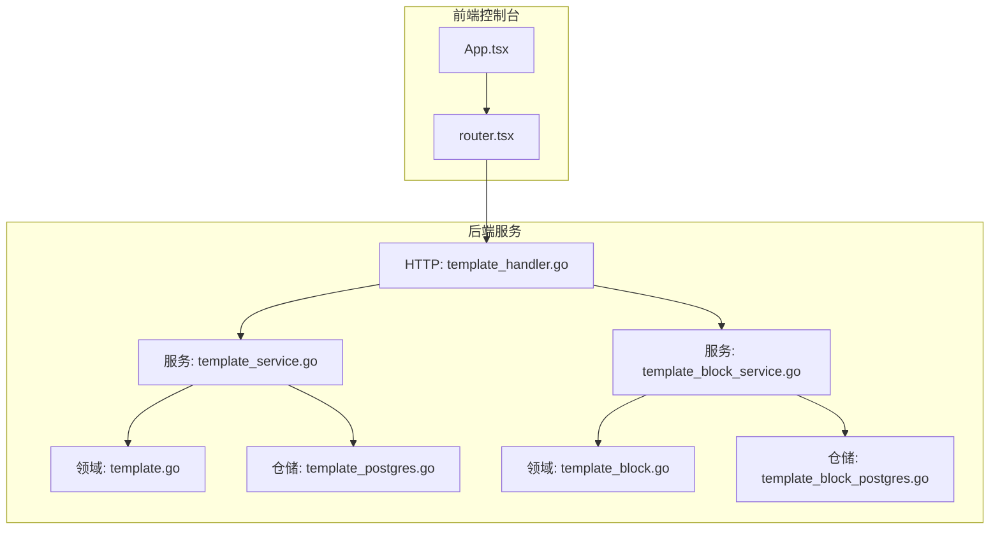
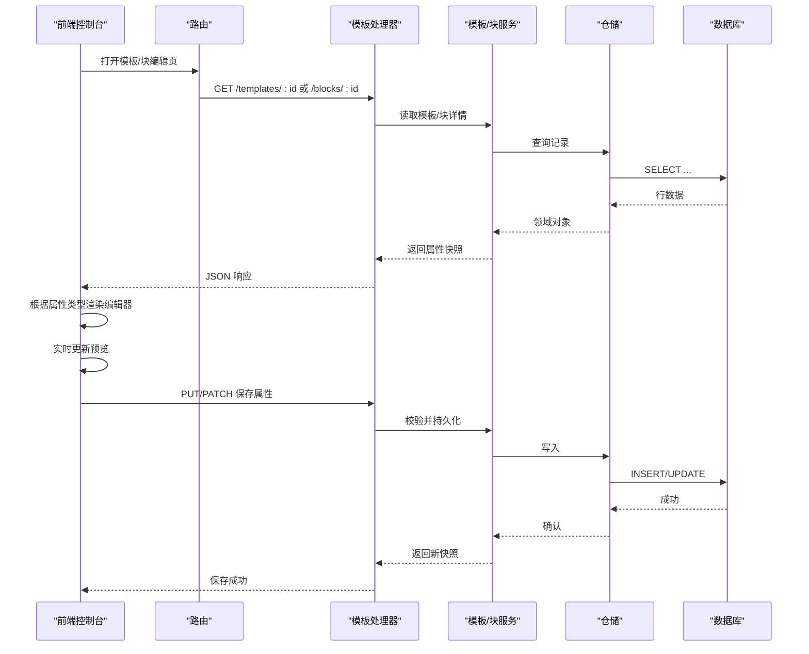
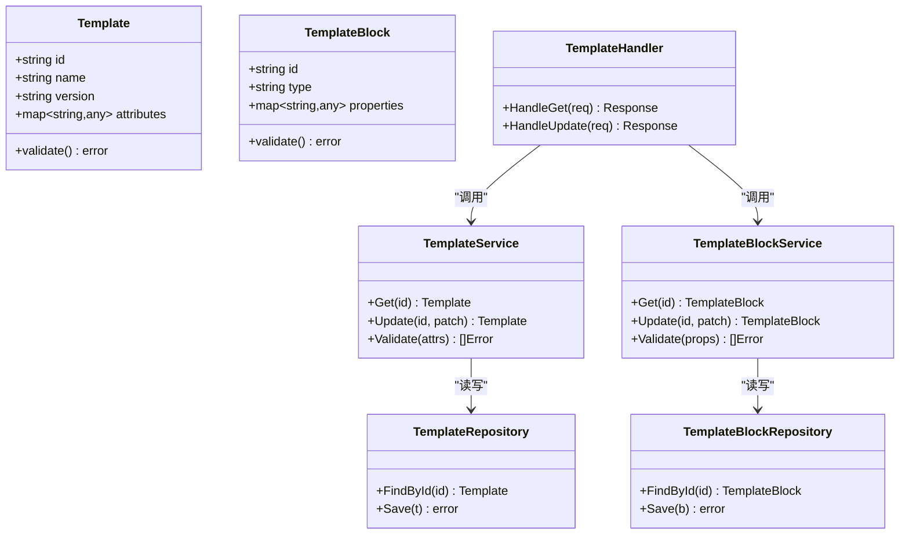
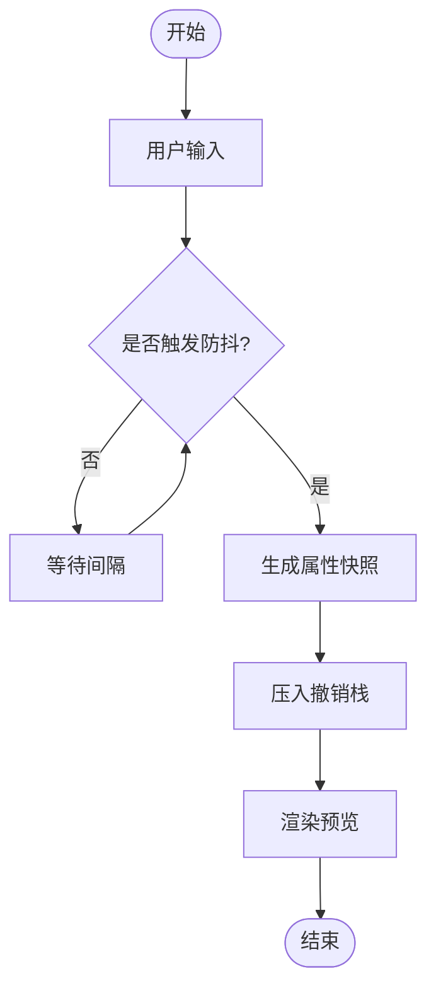
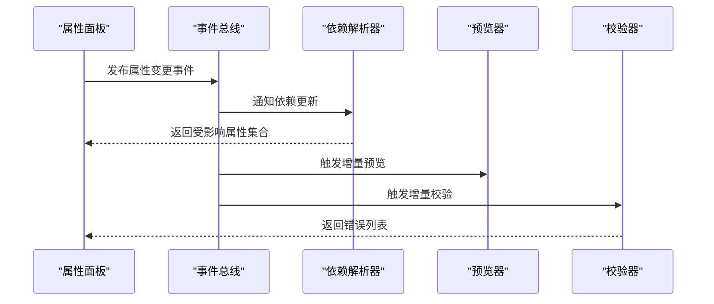
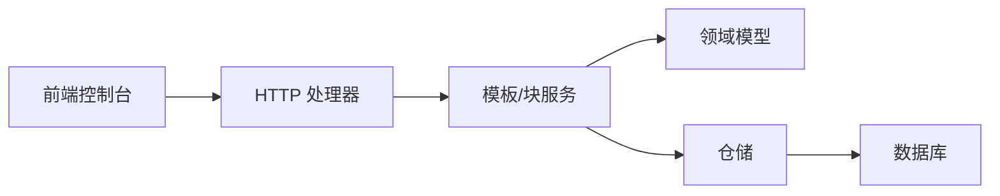

# 属性编辑面板

<cite>
**本文引用的文件**   
- [App.tsx](file://notifuse/console/src/App.tsx)
- [router.tsx](file://notifuse/console/src/router.tsx)
- [template_handler.go](file://notifuse/internal/http/template_handler.go)
- [template_service.go](file://notifuse/internal/service/template_service.go)
- [template_block_service.go](file://notifuse/internal/service/template_block_service.go)
- [template.go](file://notifuse/internal/domain/template.go)
- [template_block.go](file://notifuse/internal/domain/template_block.go)
- [template_postgres.go](file://notifuse/internal/repository/template_postgres.go)
- [template_block_postgres.go](file://notifuse/internal/repository/template_block_postgres.go)
</cite>

## 目录
1. [简介](#简介)
2. [项目结构](#项目结构)
3. [核心组件](#核心组件)
4. [架构总览](#架构总览)
5. [详细组件分析](#详细组件分析)
6. [依赖分析](#依赖分析)
7. [性能考虑](#性能考虑)
8. [故障排查指南](#故障排查指南)
9. [结论](#结论)
10. [附录](#附录)

## 简介
本技术文档围绕“邮件编辑器的属性编辑面板”展开，聚焦以下目标：
- 属性值的动态编辑机制与不同类型属性的编辑器组件映射
- 实时预览与撤销/重做的实现思路
- 属性变更的事件传播与依赖更新机制
- 复杂属性（JSON、代码、富文本）的编辑器实现要点
- 属性验证规则与错误提示机制
- 自定义属性编辑器的开发指南与集成示例

说明：当前仓库包含前端控制台（console）与后端服务（Go）。由于未检索到具体的“属性编辑面板”前端源码，本文基于模板与模板块相关的领域模型与服务层进行架构级分析与设计建议，确保读者能据此落地实现。

## 项目结构
本项目采用前后端分离：
- 前端控制台位于 notifuse/console/src，负责页面路由、状态管理与 UI 交互
- 后端服务位于 notifuse/internal，提供 HTTP 接口、领域服务、仓储与数据库迁移等

图表来源
- [App.tsx](file://notifuse/console/src/App.tsx)
- [router.tsx](file://notifuse/console/src/router.tsx)
- [template_handler.go](file://notifuse/internal/http/template_handler.go)
- [template_service.go](file://notifuse/internal/service/template_service.go)
- [template_block_service.go](file://notifuse/internal/service/template_block_service.go)
- [template.go](file://notifuse/internal/domain/template.go)
- [template_block.go](file://notifuse/internal/domain/template_block.go)
- [template_postgres.go](file://notifuse/internal/repository/template_postgres.go)
- [template_block_postgres.go](file://notifuse/internal/repository/template_block_postgres.go)

章节来源
- [App.tsx](file://notifuse/console/src/App.tsx)
- [router.tsx](file://notifuse/console/src/router.tsx)
- [template_handler.go](file://notifuse/internal/http/template_handler.go)
- [template_service.go](file://notifuse/internal/service/template_service.go)
- [template_block_service.go](file://notifuse/internal/service/template_block_service.go)
- [template.go](file://notifuse/internal/domain/template.go)
- [template_block.go](file://notifuse/internal/domain/template_block.go)
- [template_postgres.go](file://notifuse/internal/repository/template_postgres.go)
- [template_block_postgres.go](file://notifuse/internal/repository/repository/template_block_postgres.go)

## 核心组件
- 模板领域模型：定义模板及其块的元数据、内容结构与校验约束
- 模板块领域模型：定义块类型、渲染参数、布局与样式等属性
- 模板服务：编排模板的创建、更新、查询与版本化逻辑
- 模板块服务：编排块的增删改查、排序与依赖解析
- HTTP 处理器：暴露 REST 接口，承载请求校验、事务边界与响应封装
- 仓储层：持久化模板与块，处理 SQL 构建与结果映射

章节来源
- [template.go](file://notifuse/internal/domain/template.go)
- [template_block.go](file://notifuse/internal/domain/template_block.go)
- [template_service.go](file://notifuse/internal/service/template_service.go)
- [template_block_service.go](file://notifuse/internal/service/template_block_service.go)
- [template_handler.go](file://notifuse/internal/http/template_handler.go)
- [template_postgres.go](file://notifuse/internal/repository/template_postgres.go)
- [template_block_postgres.go](file://notifuse/internal/repository/template_block_postgres.go)

## 架构总览
属性编辑面板的整体流程如下：
- 前端通过路由进入模板或模板块编辑页
- 调用后端模板/块 API 获取当前属性快照
- 在面板中按属性类型选择对应编辑器（文本、JSON、代码、富文本等）
- 用户输入触发本地状态更新与实时预览
- 提交时执行服务端校验并持久化，同时维护撤销/重做历史

图表来源
- [router.tsx](file://notifuse/console/src/router.tsx)
- [template_handler.go](file://notifuse/internal/http/template_handler.go)
- [template_service.go](file://notifuse/internal/service/template_service.go)
- [template_block_service.go](file://notifuse/internal/service/template_block_service.go)
- [template_postgres.go](file://notifuse/internal/repository/template_postgres.go)
- [template_block_postgres.go](file://notifuse/internal/repository/template_block_postgres.go)

## 详细组件分析

### 属性值动态编辑与编辑器映射
- 属性类型到编辑器映射策略
  - 文本/多行文本：基础输入控件
  - 布尔/开关：切换控件
  - 枚举/单选：下拉或选项卡
  - 数值/范围：数字输入或滑块
  - JSON：带语法高亮与格式化的 JSON 编辑器
  - 代码：支持语言选择与主题的代码编辑器
  - 富文本：所见即所得编辑器，输出 HTML 或结构化内容
- 动态表单生成
  - 由后端返回的属性描述（字段名、类型、默认值、校验规则、依赖关系）驱动前端动态渲染
  - 前端根据类型分发至对应编辑器组件，统一事件总线上报变更
- 依赖联动
  - 当某属性变化时，根据依赖图重新计算可见性、禁用态与默认值
  - 对受影响的下游属性触发增量更新，避免全量重渲染

章节来源
- [template.go](file://notifuse/internal/domain/template.go)
- [template_block.go](file://notifuse/internal/domain/template_block.go)
- [template_service.go](file://notifuse/internal/service/template_service.go)
- [template_block_service.go](file://notifuse/internal/service/template_block_service.go)

#### 类图（领域与服务）

图表来源
- [template.go](file://notifuse/internal/domain/template.go)
- [template_block.go](file://notifuse/internal/domain/template_block.go)
- [template_service.go](file://notifuse/internal/service/template_service.go)
- [template_block_service.go](file://notifuse/internal/service/template_block_service.go)
- [template_handler.go](file://notifuse/internal/http/template_handler.go)
- [template_postgres.go](file://notifuse/internal/repository/template_postgres.go)
- [template_block_postgres.go](file://notifuse/internal/repository/template_block_postgres.go)

### 实时预览与撤销/重做
- 实时预览
  - 使用防抖/节流减少频繁渲染开销
  - 将属性快照序列化为可渲染的中间表示，按需局部更新
- 撤销/重做
  - 维护操作栈（命令模式），每次有效变更入栈
  - 限制栈深度与内存占用，必要时压缩相邻同类操作
  - 支持跨标签页共享历史（可选）

[本节为概念性流程图，不直接映射具体源码文件]

### 属性变更事件传播与依赖更新
- 事件总线
  - 属性变更发布事件，订阅者包括：预览器、校验器、依赖解析器
- 依赖图
  - 以有向无环图表达属性间依赖，变更时仅重算受影响子树
- 冲突与幂等
  - 合并策略保证多次变更最终一致
  - 版本号或时间戳防止覆盖

[本节为概念性时序图，不直接映射具体源码文件]

### 复杂属性编辑器实现要点
- JSON 编辑器
  - 语法高亮、自动补全、格式化、错误定位
  - 与后端 schema 对齐，提交前进行轻量校验
- 代码编辑器
  - 支持多种语言与主题
  - 提供片段库与快捷键
- 富文本编辑器
  - 输出 HTML 或结构化内容
  - 安全过滤与白名单策略
  - 与模板变量插值兼容

[本节为通用实现建议，不直接映射具体源码文件]

### 属性验证规则与错误提示
- 客户端校验
  - 即时反馈，提升体验
  - 与服务器端规则保持一致
- 服务端校验
  - 作为权威校验入口，拒绝非法数据
  - 返回结构化错误信息，便于前端展示
- 错误提示
  - 字段级错误与全局错误并存
  - 支持国际化与可访问性

章节来源
- [template_service.go](file://notifuse/internal/service/template_service.go)
- [template_block_service.go](file://notifuse/internal/service/template_block_service.go)
- [template_handler.go](file://notifuse/internal/http/template_handler.go)

### 自定义属性编辑器开发指南与集成示例
- 步骤
  1. 定义属性描述：字段名、类型、默认值、校验规则、依赖关系
  2. 实现编辑器组件：遵循统一 props 与事件契约
  3. 注册映射：将类型名映射到组件
  4. 接入事件总线：监听变更、触发预览与校验
  5. 编写测试：单元测试与端到端用例
- 集成示例（概念）
  - 新增“颜色选择器”属性
  - 在属性描述中声明类型为 color
  - 注册 color -> ColorPicker 组件
  - 变更时触发预览与校验，错误提示显示于字段下方

[本节为概念性指南，不直接映射具体源码文件]

## 依赖分析
- 组件耦合
  - HTTP 处理器依赖服务层，服务层依赖领域模型与仓储
  - 前端通过路由组织页面，页面组件依赖服务与状态管理
- 外部依赖
  - 数据库（PostgreSQL）
  - 可能的第三方编辑器库（JSON/代码/富文本）

图表来源
- [router.tsx](file://notifuse/console/src/router.tsx)
- [template_handler.go](file://notifuse/internal/http/template_handler.go)
- [template_service.go](file://notifuse/internal/service/template_service.go)
- [template_block_service.go](file://notifuse/internal/service/template_block_service.go)
- [template.go](file://notifuse/internal/domain/template.go)
- [template_block.go](file://notifuse/internal/domain/template_block.go)
- [template_postgres.go](file://notifuse/internal/repository/template_postgres.go)
- [template_block_postgres.go](file://notifuse/internal/repository/template_block_postgres.go)

章节来源
- [template_handler.go](file://notifuse/internal/http/template_handler.go)
- [template_service.go](file://notifuse/internal/service/template_service.go)
- [template_block_service.go](file://notifuse/internal/service/template_block_service.go)
- [template.go](file://notifuse/internal/domain/template.go)
- [template_block.go](file://notifuse/internal/domain/template_block.go)
- [template_postgres.go](file://notifuse/internal/repository/template_postgres.go)
- [template_block_postgres.go](file://notifuse/internal/repository/template_block_postgres.go)

## 性能考虑
- 前端
  - 使用虚拟滚动与懒加载渲染长列表属性
  - 防抖/节流与增量更新降低重绘成本
  - 撤销栈限深与压缩策略控制内存
- 后端
  - 批量查询与只读缓存减少数据库压力
  - 校验失败快速返回，避免不必要的持久化
  - 大对象（富文本/代码）分片存储与按需加载

[本节为通用指导，不直接映射具体源码文件]

## 故障排查指南
- 常见问题
  - 属性未生效：检查事件总线订阅与依赖图更新路径
  - 预览异常：核对快照序列化与渲染管线
  - 撤销失效：检查操作栈入栈时机与幂等键
  - 校验不一致：对比前后端规则差异
- 日志与追踪
  - 关键节点埋点：属性变更、预览刷新、保存成功/失败
  - 错误码与消息标准化，便于前端展示

章节来源
- [template_handler.go](file://notifuse/internal/http/template_handler.go)
- [template_service.go](file://notifuse/internal/service/template_service.go)
- [template_block_service.go](file://notifuse/internal/service/template_block_service.go)

## 结论
属性编辑面板的核心在于“类型驱动的动态表单 + 事件驱动的依赖更新 + 可靠的撤销/重做”。通过清晰的领域模型与服务分层、严格的校验与错误处理、以及可扩展的编辑器映射机制，可以在保证用户体验的同时维持系统的可维护性与扩展性。

## 附录
- 术语
  - 属性快照：某一时刻属性值的不可变副本
  - 依赖图：描述属性间依赖关系的有向无环图
  - 撤销栈：记录用户操作的有序集合，支持回滚与重做
- 参考
  - 模板与模板块相关领域模型与服务实现