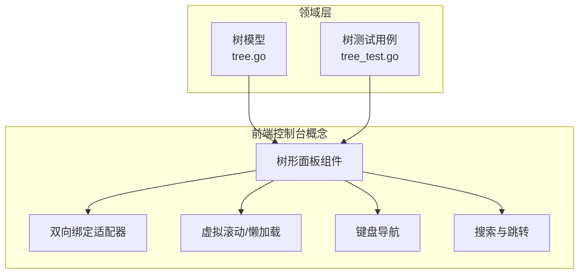
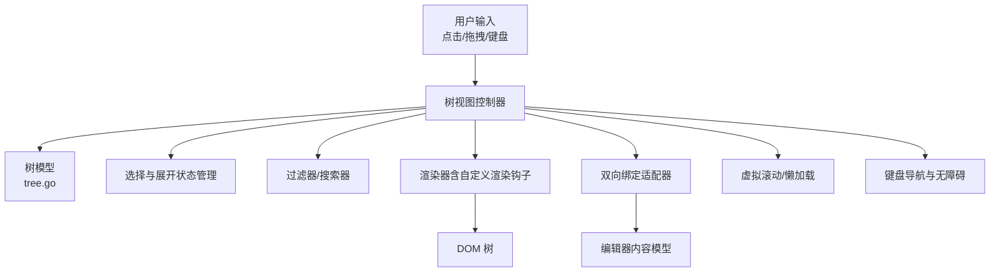
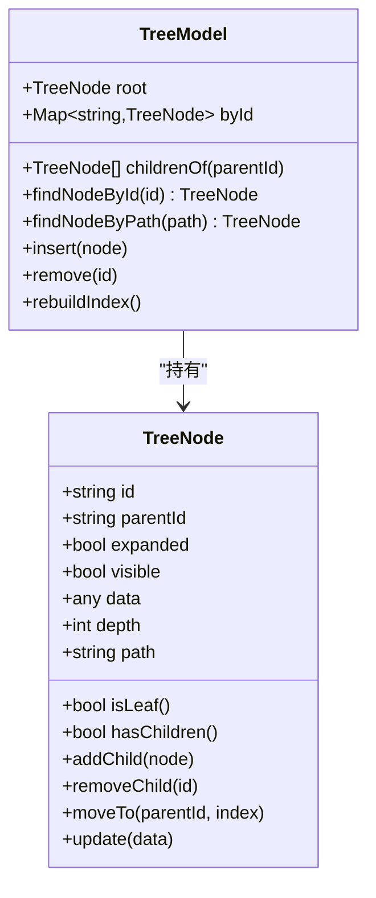
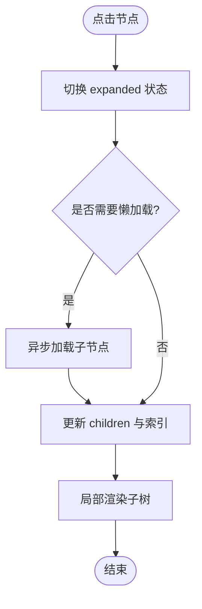
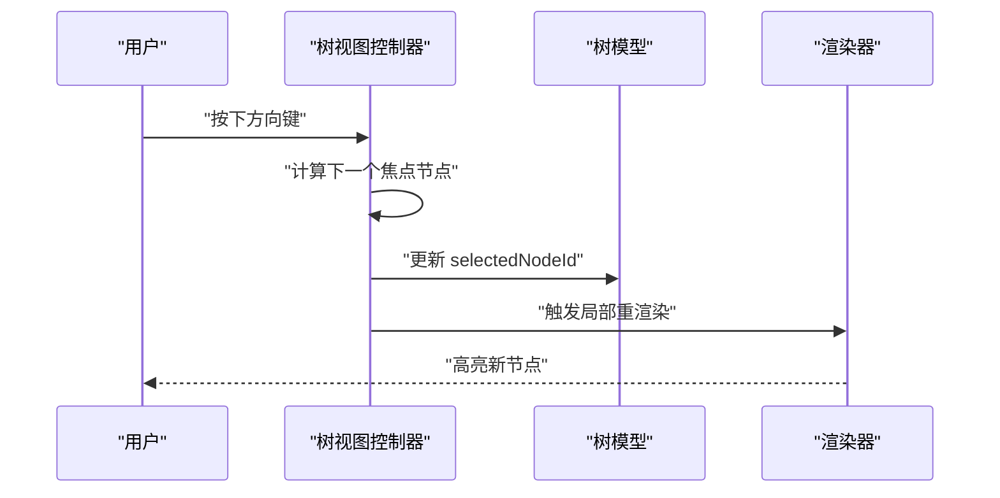
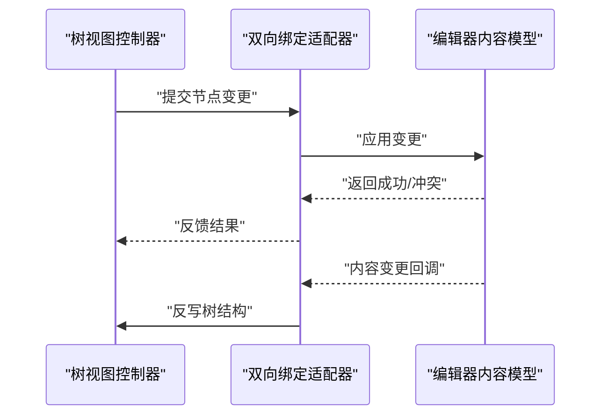
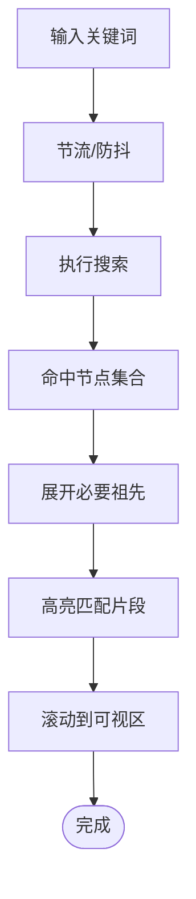
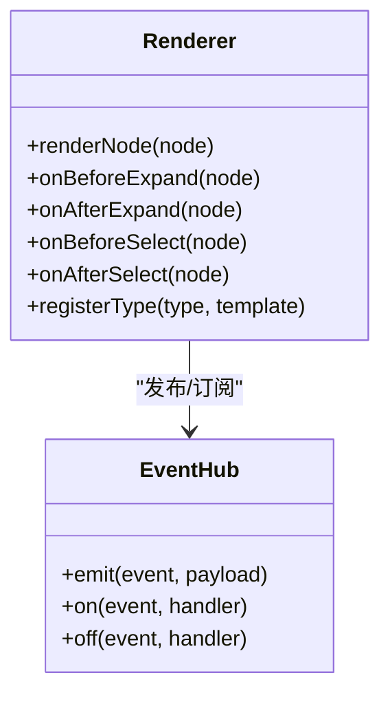
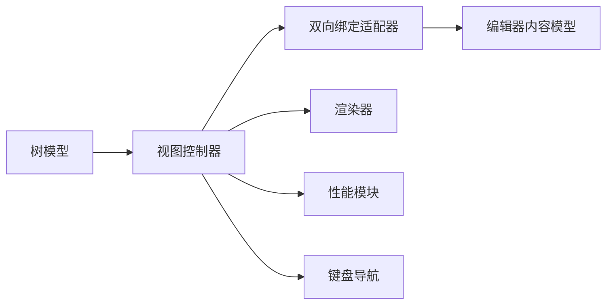

# 树形结构面板

<cite>
**本文引用的文件**   
- [tree.go](file://notifuse/internal/domain/tree.go)
- [tree_test.go](file://notifuse/internal/domain/tree_test.go)
</cite>

## 目录
1. [简介](#简介)
2. [项目结构](#项目结构)
3. [核心组件](#核心组件)
4. [架构总览](#架构总览)
5. [详细组件分析](#详细组件分析)
6. [依赖分析](#依赖分析)
7. [性能考虑](#性能考虑)
8. [故障排查指南](#故障排查指南)
9. [结论](#结论)
10. [附录](#附录)

## 简介
本技术文档围绕“邮件编辑器的树形结构面板”展开，聚焦于 DOM 树的可视化展示与交互机制。内容涵盖节点展开/折叠、层级关系与属性显示、选中与高亮、键盘导航、与编辑器内容的双向绑定、搜索定位与快速跳转，以及虚拟滚动与懒加载等性能优化策略。同时提供自定义渲染器与事件处理扩展指南，帮助开发者在现有领域模型基础上构建高性能、可访问的树形面板。

## 项目结构
该仓库包含后端服务与前端控制台等多个子系统。与“树形结构面板”直接相关的核心领域模型位于内部领域层，提供通用的树数据结构与操作能力；前端控制台则负责 UI 渲染与交互。为便于落地，本文以领域层的树模型为基础，给出面向前端的实现建议与集成方式。

[无图表来源：此图为概念性结构示意]

## 核心组件
本节从领域模型出发，抽象出树形面板所需的核心能力，并映射到前端实现要点。

- 树节点模型
  - 唯一标识、父/子引用、可见性、展开状态、数据负载等字段
  - 支持按路径或 ID 快速定位
- 树视图控制器
  - 维护当前选中节点、展开集合、过滤条件
  - 驱动渲染与更新
- 双向绑定适配器
  - 将树节点变更同步至编辑器内容，或将编辑器内容变更反写回树
- 性能模块
  - 虚拟滚动：仅渲染可视区域节点
  - 懒加载：按需展开与加载深层节点
- 交互模块
  - 键盘导航：方向键、Enter、Space、Home/End、PageUp/PageDown
  - 搜索定位：模糊匹配、高亮匹配片段、回车跳转

章节来源
- [tree.go:1-200](file://notifuse/internal/domain/tree.go#L1-L200)
- [tree_test.go:1-200](file://notifuse/internal/domain/tree_test.go#L1-L200)

## 架构总览
下图展示了树形面板的整体架构与关键交互流程。领域层提供稳定的树模型与操作接口；前端通过适配器完成与编辑器内容的双向同步；性能与交互模块分别保障大规模节点的流畅体验与可访问性。

[无图表来源：此图为概念性架构示意]

## 详细组件分析

### 树模型与节点关系
- 节点定义
  - 关键字段：id、parentId、children、expanded、visible、data
  - 计算属性：depth、path、isLeaf、hasChildren
- 常用操作
  - 插入/删除/移动节点
  - 批量更新与增量 diff
  - 遍历：深度优先/广度优先
- 复杂度
  - 插入/删除：O(1)~O(n) 取决于是否需重建索引
  - 查找：基于 id/path 的 O(1)~O(log n)
  - 遍历：O(n)

图表来源
- [tree.go:1-200](file://notifuse/internal/domain/tree.go#L1-L200)

章节来源
- [tree.go:1-200](file://notifuse/internal/domain/tree.go#L1-L200)
- [tree_test.go:1-200](file://notifuse/internal/domain/tree_test.go#L1-L200)

### 展开/折叠与层级展示
- 展开/折叠
  - 切换节点 expanded 状态，触发局部重渲染
  - 对子树进行惰性加载时，首次展开才请求数据
- 层级缩进
  - 根据 depth 计算缩进样式
  - 使用 aria-level 暴露给辅助技术
- 性能
  - 避免整树重绘，采用 key 稳定与最小化 diff
  - 对大子树使用分页/虚拟列表

[无图表来源：此图为概念性流程图]

### 选中、高亮与键盘导航
- 选中与高亮
  - 维护 selectedNodeId，渲染时应用高亮样式
  - 支持多选（可选）：selectedIds 集合
- 键盘导航
  - 方向键：上下移动焦点，左右展开/折叠
  - Enter/Space：确认选择或切换展开
  - Home/End：跳到同级首尾
  - PageUp/PageDown：翻页
  - 结合 aria-activedescendant 与 role="treeitem" 提升可访问性
- 事件传播
  - 阻止冒泡以避免误触父节点

[无图表来源：此图为概念性时序图]

### 与编辑器内容的双向绑定
- 正向：树→编辑器
  - 节点变更（文本、样式、结构）经适配器写入编辑器内容模型
  - 合并冲突策略：时间戳或操作序列
- 反向：编辑器→树
  - 监听编辑器内容变化，生成差异并应用到树
  - 防抖与批处理，减少频繁更新
- 一致性保证
  - 乐观更新+回滚
  - 版本号或操作日志用于恢复

[无图表来源：此图为概念性时序图]

### 搜索定位与快速跳转
- 搜索策略
  - 多字段匹配：标题、摘要、标签
  - 模糊匹配与正则（可选）
  - 命中片段高亮
- 定位与跳转
  - 返回匹配节点路径，自动展开祖先节点
  - 滚动到可视区并高亮
- 性能
  - 增量索引：对高频字段建立倒排索引
  - 节流搜索输入，避免频繁查询

[无图表来源：此图为概念性流程图]

### 自定义渲染器与事件处理扩展
- 渲染器接口
  - 节点渲染：根据节点类型与数据决定模板
  - 占位符：加载中、空状态、错误提示
  - 主题与样式注入点
- 事件钩子
  - onBeforeExpand/onAfterExpand
  - onBeforeSelect/onAfterSelect
  - onRenderNode（允许替换默认渲染）
- 扩展点
  - 注册自定义节点类型
  - 覆盖默认键盘行为
  - 接入第三方可视化库（如力导向图）

[无图表来源：此图为概念性类图]

## 依赖分析
- 内聚与耦合
  - 树模型与视图控制器解耦：通过接口传递变更事件
  - 渲染器与业务逻辑分离：渲染器只关注展示
- 外部依赖
  - 虚拟滚动容器（可选）
  - 无障碍库（可选）
  - 编辑器内容模型（双向绑定目标）
- 潜在循环依赖
  - 避免渲染器直接依赖编辑器模型，应通过适配器中转

[无图表来源：此图为概念性依赖图]

## 性能考虑
- 虚拟滚动
  - 仅渲染可视区间节点，固定行高或估算高度
  - 窗口大小变化时重新计算视口范围
- 懒加载
  - 首次展开再拉取子节点，缓存已加载分支
  - 预取策略：临近节点预加载
- 增量更新
  - 使用稳定 key，最小化 diff
  - 批量更新合并，减少重排重绘
- 内存管理
  - 不可见分支去激活与释放
  - 事件监听器及时移除

[本节为通用性能指导，不直接分析具体文件]

## 故障排查指南
- 常见问题
  - 节点未正确展开：检查 expanded 状态与懒加载触发条件
  - 选中态异常：核对 selectedNodeId 与渲染高亮逻辑
  - 键盘导航失效：确认 focus 管理与 aria-* 属性
  - 搜索无结果：验证索引字段与匹配规则
- 调试建议
  - 输出树快照与变更日志
  - 记录键盘事件与焦点变化
  - 对比编辑器内容与树模型的一致性

章节来源
- [tree_test.go:1-200](file://notifuse/internal/domain/tree_test.go#L1-L200)

## 结论
通过领域层提供的稳定树模型与操作能力，结合前端的双向绑定、虚拟滚动、懒加载与完善的键盘导航，可以构建出高性能、可访问且易扩展的邮件编辑器树形结构面板。建议在项目中引入清晰的渲染器与事件钩子，使界面定制与功能扩展更加灵活。

## 附录
- 术语
  - 虚拟滚动：仅渲染可视区域的列表项
  - 懒加载：按需加载数据以减少初始开销
  - 双向绑定：数据源与视图之间的自动同步
- 参考实现位置
  - 树模型与测试：见领域层 tree.go 与 tree_test.go