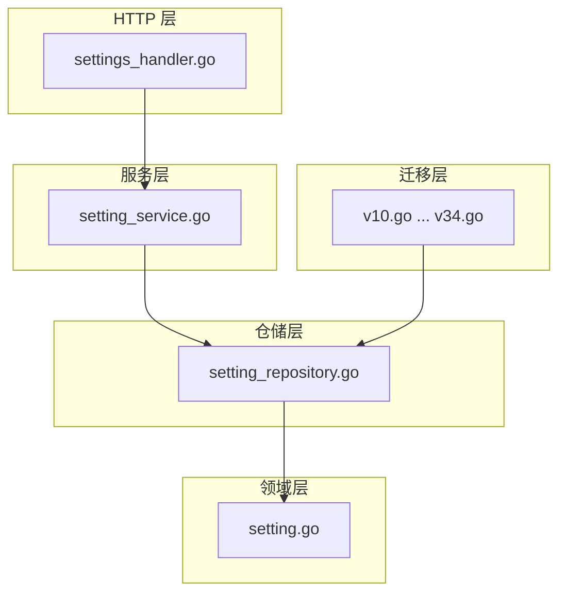
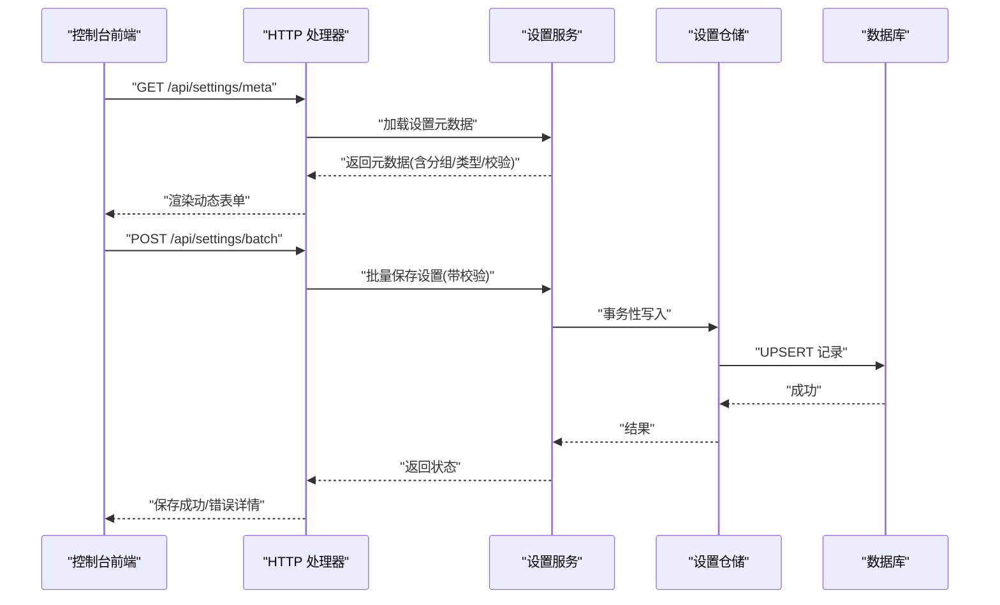
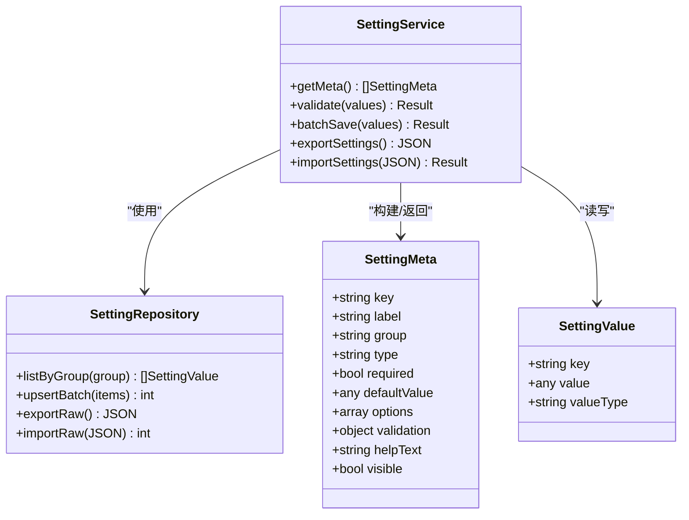
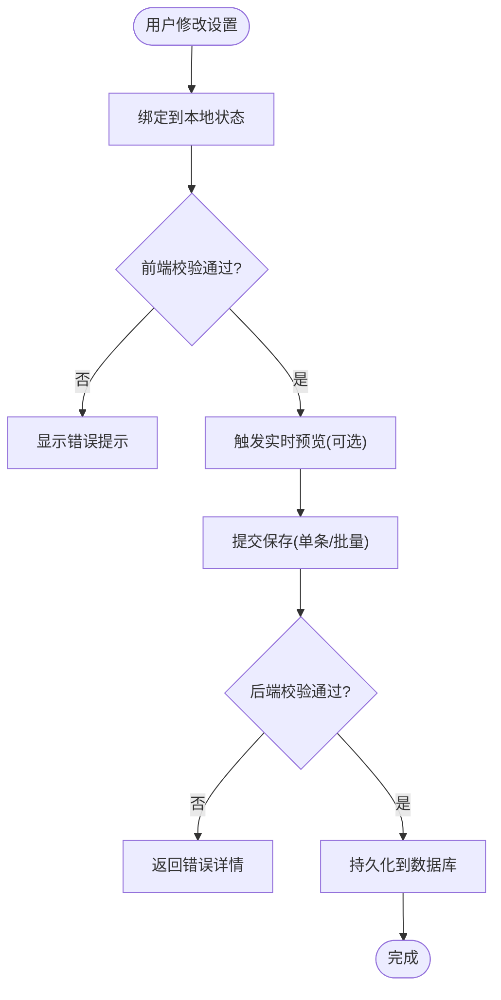
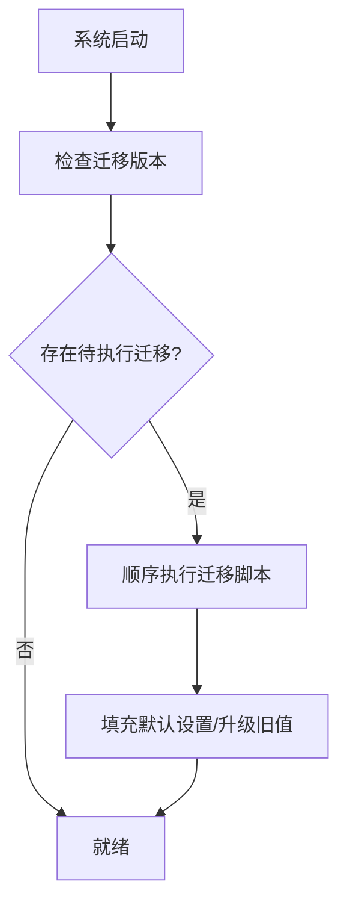
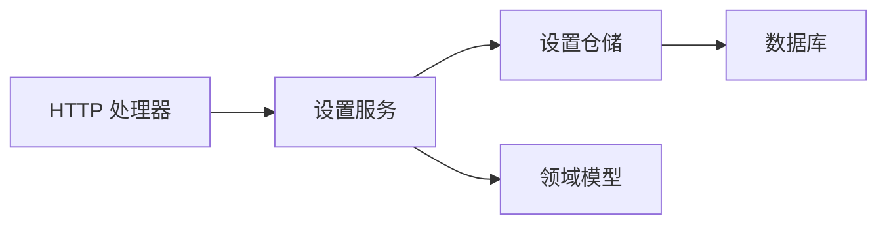

# 设置面板

<cite>
**本文引用的文件**   
- [setting.go](file://notifuse/internal/domain/setting.go)
- [setting_repository.go](file://notifuse/internal/repository/setting_repository.go)
- [setting_service.go](file://notifuse/internal/service/setting_service.go)
- [settings_handler.go](file://notifuse/internal/http/settings_handler.go)
- [v10.go](file://notifuse/internal/migrations/v10.go)
- [v11.go](file://notifuse/internal/migrations/v11.go)
- [v12.go](file://notifuse/internal/migrations/v12.go)
- [v13.go](file://notifuse/internal/migrations/v13.go)
- [v14.go](file://notifuse/internal/migrations/v14.go)
- [v15.go](file://notifuse/internal/migrations/v15.go)
- [v16.go](file://notifuse/internal/migrations/v16.go)
- [v17.go](file://notifuse/internal/migrations/v17.go)
- [v18.go](file://notifuse/internal/migrations/v18.go)
- [v19.go](file://notifuse/internal/migrations/v19.go)
- [v20.go](file://notifuse/internal/migrations/v20.go)
- [v21.go](file://notifuse/internal/migrations/v21.go)
- [v22.go](file://notifuse/internal/migrations/v22.go)
- [v23.go](file://notifuse/internal/migrations/v23.go)
- [v24.go](file://notifuse/internal/migrations/v24.go)
- [v25.go](file://notifuse/internal/migrations/v25.go)
- [v26.go](file://notifuse/internal/migrations/v26.go)
- [v27.go](file://notifuse/internal/migrations/v27.go)
- [v28.go](file://notifuse/internal/migrations/v28.go)
- [v29.go](file://notifuse/internal/migrations/v29.go)
- [v30.go](file://notifuse/internal/migrations/v30.go)
- [v31.go](file://notifuse/internal/migrations/v31.go)
- [v32.go](file://notifuse/internal/migrations/v32.go)
- [v33.go](file://notifuse/internal/migrations/v33.go)
- [v34.go](file://notifuse/internal/migrations/v34.go)
</cite>

## 目录
1. [简介](#简介)
2. [项目结构](#项目结构)
3. [核心组件](#核心组件)
4. [架构总览](#架构总览)
5. [详细组件分析](#详细组件分析)
6. [依赖关系分析](#依赖关系分析)
7. [性能考虑](#性能考虑)
8. [故障排查指南](#故障排查指南)
9. [结论](#结论)
10. [附录](#附录)

## 简介
本技术文档围绕“邮件编辑器的设置面板”展开，聚焦后端侧的设置数据模型、存储与迁移、服务层与HTTP接口，以及前端可对接的扩展点。文档重点覆盖：
- 设置项的动态生成机制（基于配置元数据驱动）
- 表单验证、数据绑定与实时预览（前后端协作约定）
- 各类设置控件的实现要点（文本输入、颜色选择器、下拉菜单、滑块）
- 设置项的分类组织与搜索过滤
- 设置数据的存储策略与版本兼容性处理
- 设置导入导出与批量操作支持
- 自定义设置项的开发指南与扩展接口说明

## 项目结构
设置相关代码主要分布在以下层次：
- 领域层：定义设置的数据结构与通用能力
- 仓储层：负责设置的持久化读写
- 服务层：封装业务逻辑、校验、导入导出、批量更新等
- HTTP层：暴露REST接口供控制台前端调用
- 迁移层：管理数据库模式演进与默认值填充

图表来源
- [settings_handler.go](file://notifuse/internal/http/settings_handler.go)
- [setting_service.go](file://notifuse/internal/service/setting_service.go)
- [setting_repository.go](file://notifuse/internal/repository/setting_repository.go)
- [setting.go](file://notifuse/internal/domain/setting.go)
- [v10.go](file://notifuse/internal/migrations/v10.go)
- [v11.go](file://notifuse/internal/migrations/v11.go)
- [v12.go](file://notifuse/internal/migrations/v12.go)
- [v13.go](file://notifuse/internal/migrations/v13.go)
- [v14.go](file://notifuse/internal/migrations/v14.go)
- [v15.go](file://notifuse/internal/migrations/v15.go)
- [v16.go](file://notifuse/internal/migrations/v16.go)
- [v17.go](file://notifuse/internal/migrations/v17.go)
- [v18.go](file://notifuse/internal/migrations/v18.go)
- [v19.go](file://notifuse/internal/migrations/v19.go)
- [v20.go](file://notifuse/internal/migrations/v20.go)
- [v21.go](file://notifuse/internal/migrations/v21.go)
- [v22.go](file://notifuse/internal/migrations/v22.go)
- [v23.go](file://notifuse/internal/migrations/v23.go)
- [v24.go](file://notifuse/internal/migrations/v24.go)
- [v25.go](file://notifuse/internal/migrations/v25.go)
- [v26.go](file://notifuse/internal/migrations/v26.go)
- [v27.go](file://notifuse/internal/migrations/v27.go)
- [v28.go](file://notifuse/internal/migrations/v28.go)
- [v29.go](file://notifuse/internal/migrations/v29.go)
- [v30.go](file://notifuse/internal/migrations/v30.go)
- [v31.go](file://notifuse/internal/migrations/v31.go)
- [v32.go](file://notifuse/internal/migrations/v32.go)
- [v33.go](file://notifuse/internal/migrations/v33.go)
- [v34.go](file://notifuse/internal/migrations/v34.go)

章节来源
- [setting.go](file://notifuse/internal/domain/setting.go)
- [setting_repository.go](file://notifuse/internal/repository/setting_repository.go)
- [setting_service.go](file://notifuse/internal/service/setting_service.go)
- [settings_handler.go](file://notifuse/internal/http/settings_handler.go)
- [v10.go](file://notifuse/internal/migrations/v10.go)
- [v11.go](file://notifuse/internal/migrations/v11.go)
- [v12.go](file://notifuse/internal/migrations/v12.go)
- [v13.go](file://notifuse/internal/migrations/v13.go)
- [v14.go](file://notifuse/internal/migrations/v14.go)
- [v15.go](file://notifuse/internal/migrations/v15.go)
- [v16.go](file://notifuse/internal/migrations/v16.go)
- [v17.go](file://notifuse/internal/migrations/v17.go)
- [v18.go](file://notifuse/internal/migrations/v18.go)
- [v19.go](file://notifuse/internal/migrations/v19.go)
- [v20.go](file://notifuse/internal/migrations/v20.go)
- [v21.go](file://notifuse/internal/migrations/v21.go)
- [v22.go](file://notifuse/internal/migrations/v22.go)
- [v23.go](file://notifuse/internal/migrations/v23.go)
- [v24.go](file://notifuse/internal/migrations/v24.go)
- [v25.go](file://notifuse/internal/migrations/v25.go)
- [v26.go](file://notifuse/internal/migrations/v26.go)
- [v27.go](file://notifuse/internal/migrations/v27.go)
- [v28.go](file://notifuse/internal/migrations/v28.go)
- [v29.go](file://notifuse/internal/migrations/v29.go)
- [v30.go](file://notifuse/internal/migrations/v30.go)
- [v31.go](file://notifuse/internal/migrations/v31.go)
- [v32.go](file://notifuse/internal/migrations/v32.go)
- [v33.go](file://notifuse/internal/migrations/v33.go)
- [v34.go](file://notifuse/internal/migrations/v34.go)

## 核心组件
- 领域模型（setting.go）
  - 定义设置键、类型、分组、标签、校验规则、默认值、选项枚举等元数据
  - 提供序列化/反序列化工具方法，便于跨层传递与持久化
- 仓储实现（setting_repository.go）
  - 提供按分组/标签查询、批量写入、事务性更新、导入导出数据格式适配
- 服务层（setting_service.go）
  - 聚合校验、转换、缓存刷新、导入导出、批量更新等业务流程
- HTTP 处理器（settings_handler.go）
  - 暴露获取设置元数据、读取/保存单个或批量设置、导入/导出、搜索过滤等REST接口

章节来源
- [setting.go](file://notifuse/internal/domain/setting.go)
- [setting_repository.go](file://notifuse/internal/repository/setting_repository.go)
- [setting_service.go](file://notifuse/internal/service/setting_service.go)
- [settings_handler.go](file://notifuse/internal/http/settings_handler.go)

## 架构总览
设置面板采用分层架构：HTTP 层接收请求并路由到服务层；服务层进行参数校验、业务编排与权限控制；仓储层负责与数据库交互；领域层提供统一的数据结构与工具。

图表来源
- [settings_handler.go](file://notifuse/internal/http/settings_handler.go)
- [setting_service.go](file://notifuse/internal/service/setting_service.go)
- [setting_repository.go](file://notifuse/internal/repository/setting_repository.go)

## 详细组件分析

### 领域模型与元数据驱动
- 设置元数据结构
  - 字段包括：键名、显示名称、分组、类型、是否必填、默认值、校验规则、可选值列表、范围限制、帮助文案、可见性条件等
  - 类型映射到UI控件：文本、数字、布尔、颜色、下拉、滑块、富文本等
- 动态生成机制
  - 前端通过“获取设置元数据”接口一次性拉取所有设置项的定义
  - 根据类型、分组、标签、可见性条件动态渲染表单
  - 校验规则由后端下发，前端在提交前执行预校验，减少往返

图表来源
- [setting.go](file://notifuse/internal/domain/setting.go)
- [setting_service.go](file://notifuse/internal/service/setting_service.go)
- [setting_repository.go](file://notifuse/internal/repository/setting_repository.go)

章节来源
- [setting.go](file://notifuse/internal/domain/setting.go)
- [setting_service.go](file://notifuse/internal/service/setting_service.go)
- [setting_repository.go](file://notifuse/internal/repository/setting_repository.go)

### 表单验证、数据绑定与实时预览
- 表单验证
  - 后端在保存时执行严格校验（类型、范围、必填、正则等），返回结构化错误信息
  - 前端依据元数据中的校验规则进行即时提示，提升用户体验
- 数据绑定
  - 以键名为唯一标识，将表单值与服务端设置项一一对应
  - 支持嵌套对象与数组类型的扁平化传输
- 实时预览
  - 对于主题色、字体大小、边距等可视化设置，前端监听变更事件，立即应用样式
  - 对需要服务端计算的结果（如模板变量解析），通过异步预览接口触发

章节来源
- [setting_service.go](file://notifuse/internal/service/setting_service.go)
- [settings_handler.go](file://notifuse/internal/http/settings_handler.go)

### 设置控件类型实现要点
- 文本输入
  - 适用于短文本、邮箱、URL等；结合正则与长度限制
- 颜色选择器
  - 支持十六进制、RGB/RGBA；提供预设调色板与透明度开关
- 下拉菜单
  - 静态选项来自元数据；动态选项可通过“选项源”接口按需加载
- 滑块控件
  - 用于数值型设置（如字号、间距、阈值）；支持步长与范围约束

章节来源
- [setting.go](file://notifuse/internal/domain/setting.go)

### 分类组织与搜索过滤
- 分类组织
  - 通过“分组”和“标签”两级维度组织设置项，支持多级分组
  - 分组内可按排序权重排列
- 搜索过滤
  - 支持按关键字匹配键名、显示名称、帮助文案
  - 支持按分组、标签、类型筛选
  - 建议前端分页+防抖，后端提供索引字段以提升检索性能

章节来源
- [setting.go](file://notifuse/internal/domain/setting.go)
- [setting_repository.go](file://notifuse/internal/repository/setting_repository.go)

### 数据存储策略与版本兼容
- 存储策略
  - 采用键值表结构，包含键、值、类型、更新时间戳等字段
  - 批量写入采用事务保证一致性
- 版本兼容
  - 通过迁移脚本维护默认值、新增字段、废弃字段与旧值迁移
  - 启动时自动执行未完成的迁移任务，确保向后兼容

图表来源
- [v10.go](file://notifuse/internal/migrations/v10.go)
- [v11.go](file://notifuse/internal/migrations/v11.go)
- [v12.go](file://notifuse/internal/migrations/v12.go)
- [v13.go](file://notifuse/internal/migrations/v13.go)
- [v14.go](file://notifuse/internal/migrations/v14.go)
- [v15.go](file://notifuse/internal/migrations/v15.go)
- [v16.go](file://notifuse/internal/migrations/v16.go)
- [v17.go](file://notifuse/internal/migrations/v17.go)
- [v18.go](file://notifuse/internal/migrations/v18.go)
- [v19.go](file://notifuse/internal/migrations/v19.go)
- [v20.go](file://notifuse/internal/migrations/v20.go)
- [v21.go](file://notifuse/internal/migrations/v21.go)
- [v22.go](file://notifuse/internal/migrations/v22.go)
- [v23.go](file://notifuse/internal/migrations/v23.go)
- [v24.go](file://notifuse/internal/migrations/v24.go)
- [v25.go](file://notifuse/internal/migrations/v25.go)
- [v26.go](file://notifuse/internal/migrations/v26.go)
- [v27.go](file://notifuse/internal/migrations/v27.go)
- [v28.go](file://notifuse/internal/migrations/v28.go)
- [v29.go](file://notifuse/internal/migrations/v29.go)
- [v30.go](file://notifuse/internal/migrations/v30.go)
- [v31.go](file://notifuse/internal/migrations/v31.go)
- [v32.go](file://notifuse/internal/migrations/v32.go)
- [v33.go](file://notifuse/internal/migrations/v33.go)
- [v34.go](file://notifuse/internal/migrations/v34.go)

章节来源
- [setting_repository.go](file://notifuse/internal/repository/setting_repository.go)
- [v10.go](file://notifuse/internal/migrations/v10.go)
- [v11.go](file://notifuse/internal/migrations/v11.go)
- [v12.go](file://notifuse/internal/migrations/v12.go)
- [v13.go](file://notifuse/internal/migrations/v13.go)
- [v14.go](file://notifuse/internal/migrations/v14.go)
- [v15.go](file://notifuse/internal/migrations/v15.go)
- [v16.go](file://notifuse/internal/migrations/v16.go)
- [v17.go](file://notifuse/internal/migrations/v17.go)
- [v18.go](file://notifuse/internal/migrations/v18.go)
- [v19.go](file://notifuse/internal/migrations/v19.go)
- [v20.go](file://notifuse/internal/migrations/v20.go)
- [v21.go](file://notifuse/internal/migrations/v21.go)
- [v22.go](file://notifuse/internal/migrations/v22.go)
- [v23.go](file://notifuse/internal/migrations/v23.go)
- [v24.go](file://notifuse/internal/migrations/v24.go)
- [v25.go](file://notifuse/internal/migrations/v25.go)
- [v26.go](file://notifuse/internal/migrations/v26.go)
- [v27.go](file://notifuse/internal/migrations/v27.go)
- [v28.go](file://notifuse/internal/migrations/v28.go)
- [v29.go](file://notifuse/internal/migrations/v29.go)
- [v30.go](file://notifuse/internal/migrations/v30.go)
- [v31.go](file://notifuse/internal/migrations/v31.go)
- [v32.go](file://notifuse/internal/migrations/v32.go)
- [v33.go](file://notifuse/internal/migrations/v33.go)
- [v34.go](file://notifuse/internal/migrations/v34.go)

### 导入导出与批量操作
- 导入
  - 支持JSON格式的完整设置快照或增量补丁
  - 导入前进行强校验，失败时回滚并返回详细错误定位
- 导出
  - 支持全量导出与按分组/标签过滤导出
  - 输出包含元数据与当前值，便于备份与迁移
- 批量操作
  - 提供批量保存接口，内部以事务执行，提高吞吐
  - 支持幂等键，避免重复提交导致的状态不一致

章节来源
- [setting_service.go](file://notifuse/internal/service/setting_service.go)
- [setting_repository.go](file://notifuse/internal/repository/setting_repository.go)
- [settings_handler.go](file://notifuse/internal/http/settings_handler.go)

### 自定义设置项开发指南与扩展接口
- 新增设置项步骤
  - 在领域元数据中注册新键、类型、校验规则与默认值
  - 如需新增数据库字段，编写对应迁移脚本并在启动时执行
  - 在服务层补充校验与转换逻辑（如有必要）
  - 在HTTP层暴露相应接口（若为独立功能）
- 扩展点
  - 选项源扩展：为下拉菜单提供动态选项加载接口
  - 校验器扩展：注册新的校验规则（如特定域名白名单）
  - 预览处理器：为复杂设置提供异步预览计算

章节来源
- [setting.go](file://notifuse/internal/domain/setting.go)
- [setting_service.go](file://notifuse/internal/service/setting_service.go)
- [settings_handler.go](file://notifuse/internal/http/settings_handler.go)

## 依赖关系分析
- 组件耦合
  - HTTP 层仅依赖服务层，不直接访问仓储
  - 服务层组合仓储与领域模型，保持高内聚
  - 仓储层只关注数据存取，不包含业务逻辑
- 外部依赖
  - 数据库连接池、事务管理器
  - 日志与追踪埋点（建议在关键路径添加）
- 潜在循环依赖
  - 当前分层清晰，未发现循环依赖风险

图表来源
- [settings_handler.go](file://notifuse/internal/http/settings_handler.go)
- [setting_service.go](file://notifuse/internal/service/setting_service.go)
- [setting_repository.go](file://notifuse/internal/repository/setting_repository.go)
- [setting.go](file://notifuse/internal/domain/setting.go)

章节来源
- [settings_handler.go](file://notifuse/internal/http/settings_handler.go)
- [setting_service.go](file://notifuse/internal/service/setting_service.go)
- [setting_repository.go](file://notifuse/internal/repository/setting_repository.go)
- [setting.go](file://notifuse/internal/domain/setting.go)

## 性能考虑
- 元数据缓存
  - 设置元数据变化频率低，可在内存中缓存并按需失效
- 批量写入
  - 使用事务与批量UPSERT降低IO次数
- 搜索优化
  - 对常用过滤字段建立索引，前端分页+防抖
- 预览计算
  - 对耗时预览采用异步队列与超时保护

[本节为通用指导，无需具体文件引用]

## 故障排查指南
- 常见错误
  - 校验失败：检查元数据中的校验规则与传入值的类型/范围
  - 导入失败：核对JSON结构与必填字段，查看错误定位行号
  - 迁移失败：确认迁移脚本幂等性与依赖顺序
- 诊断建议
  - 开启调试日志，记录关键路径的请求ID与耗时
  - 对比导出快照与数据库实际值，快速定位差异

章节来源
- [setting_service.go](file://notifuse/internal/service/setting_service.go)
- [settings_handler.go](file://notifuse/internal/http/settings_handler.go)

## 结论
设置面板通过“元数据驱动+分层架构”实现了高可扩展性与良好可维护性。借助严格的校验、事务性批量操作与完善的迁移体系，既能满足复杂场景下的灵活定制，也能保障数据一致性与版本兼容。建议在前端完善实时预览与搜索体验，在后端持续优化缓存与索引策略，进一步提升整体性能与可用性。

[本节为总结性内容，无需具体文件引用]

## 附录
- 术语
  - 元数据：描述设置项的结构、类型、校验与展示信息的配置
  - 迁移：数据库模式与默认数据的版本化演进脚本
- 最佳实践
  - 为每个设置项提供清晰的帮助文案与默认值
  - 对敏感设置增加权限控制与审计日志
  - 导出文件纳入版本控制与备份策略

[本节为概念性内容，无需具体文件引用]