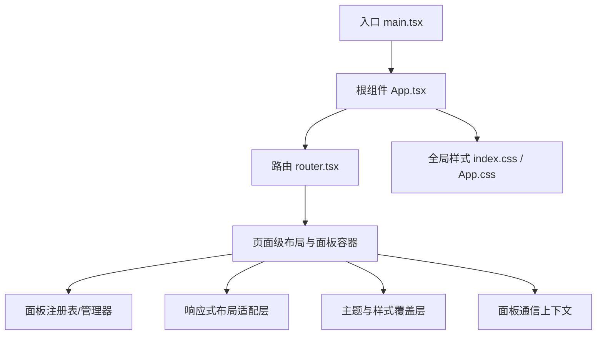
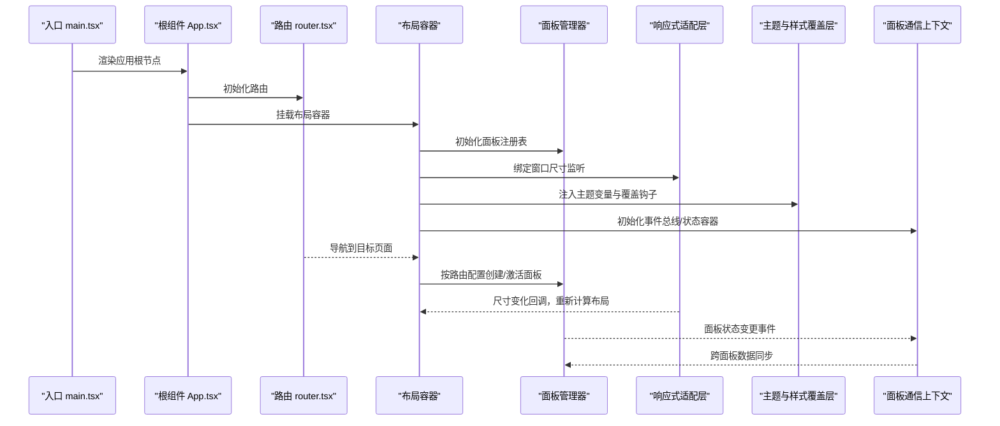
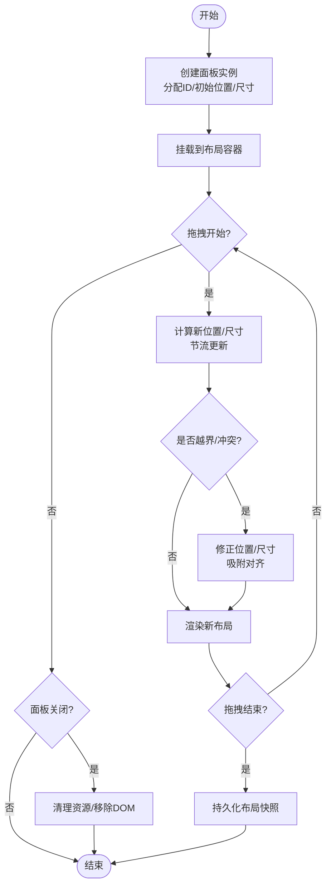
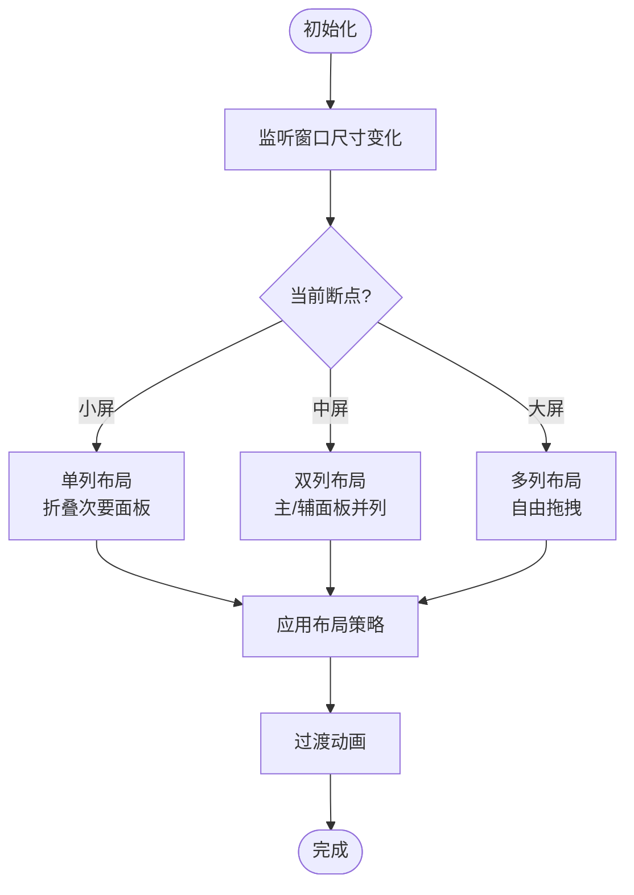
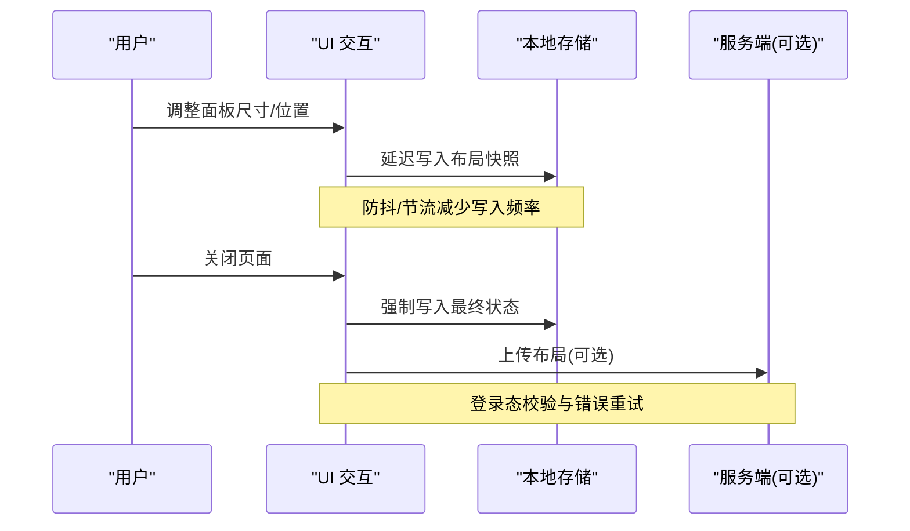
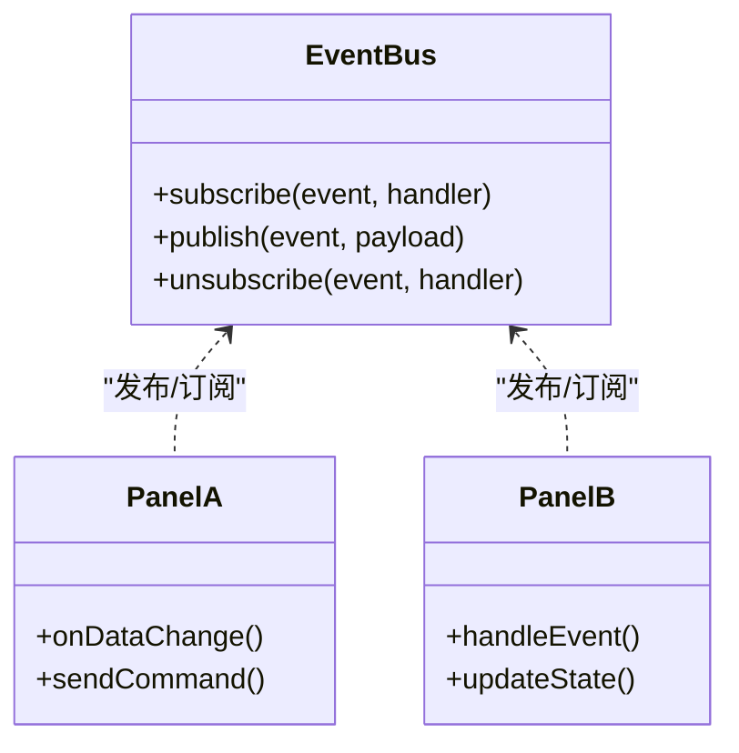
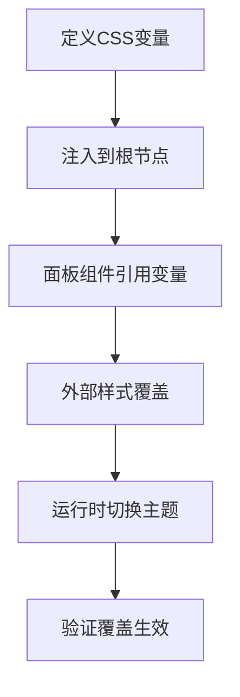
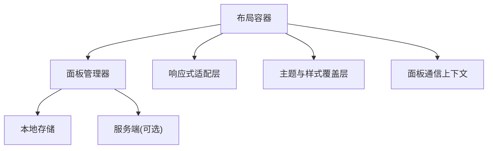

# 面板布局系统

<cite>
**本文引用的文件**   
- [App.tsx](file://notifuse/console/src/App.tsx)
- [router.tsx](file://notifuse/console/src/router.tsx)
- [main.tsx](file://notifuse/console/src/main.tsx)
- [index.css](file://notifuse/console/src/index.css)
- [App.css](file://notifuse/console/src/App.css)
</cite>

## 目录
1. [简介](#简介)
2. [项目结构](#项目结构)
3. [核心组件](#核心组件)
4. [架构总览](#架构总览)
5. [详细组件分析](#详细组件分析)
6. [依赖关系分析](#依赖关系分析)
7. [性能考虑](#性能考虑)
8. [故障排查指南](#故障排查指南)
9. [结论](#结论)
10. [附录](#附录)

## 简介
本技术文档聚焦于邮件编辑器的“面板布局系统”，围绕可拖拽面板的创建、销毁与生命周期管理，响应式布局在不同屏幕尺寸下的自适应显示，面板状态持久化（用户偏好与布局记忆），面板间通信协议与数据共享机制，主题定制接口与样式覆盖方案，以及最佳实践与性能优化建议进行系统化说明。文档在保持技术深度的同时，尽量以循序渐进的方式呈现，便于不同背景的读者理解与落地。

## 项目结构
本项目为前端控制台应用，采用 React + TypeScript 技术栈，路由由独立模块定义，全局样式通过 CSS 文件集中管理。面板布局系统通常位于应用根组件与路由层之间，负责：
- 初始化全局布局容器
- 挂载/卸载面板区域
- 监听窗口尺寸变化并触发响应式策略
- 提供主题变量与样式覆盖入口
- 承载面板间通信上下文（如事件总线或状态容器）

图表来源
- [main.tsx](file://notifuse/console/src/main.tsx)
- [App.tsx](file://notifuse/console/src/App.tsx)
- [router.tsx](file://notifuse/console/src/router.tsx)
- [index.css](file://notifuse/console/src/index.css)
- [App.css](file://notifuse/console/src/App.css)

章节来源
- [main.tsx](file://notifuse/console/src/main.tsx)
- [App.tsx](file://notifuse/console/src/App.tsx)
- [router.tsx](file://notifuse/console/src/router.tsx)
- [index.css](file://notifuse/console/src/index.css)
- [App.css](file://notifuse/console/src/App.css)

## 核心组件
- 布局容器：作为面板系统的宿主，负责渲染主区域、侧边栏、工具栏等区块，并提供拖拽调整尺寸的交互能力。
- 面板注册表/管理器：维护面板实例的生命周期（创建、激活、隐藏、销毁），记录面板位置、尺寸、折叠状态等元信息。
- 响应式适配层：监听窗口尺寸变化，根据断点切换面板布局模式（例如单列/双列/三列），并在移动端自动收起次要面板。
- 主题与样式覆盖层：暴露 CSS 变量与类名约定，允许上层业务面板按需覆盖默认样式。
- 面板通信上下文：提供发布/订阅或状态同步机制，使面板间可以安全地交换数据与事件。

章节来源
- [App.tsx](file://notifuse/console/src/App.tsx)
- [router.tsx](file://notifuse/console/src/router.tsx)
- [index.css](file://notifuse/console/src/index.css)
- [App.css](file://notifuse/console/src/App.css)

## 架构总览
下图展示了面板布局系统在应用中的整体位置与关键交互路径。入口文件加载根组件，根组件装配路由与布局容器；路由驱动页面级布局，布局容器承载面板管理器、响应式适配层、主题覆盖层与通信上下文。

图表来源
- [main.tsx](file://notifuse/console/src/main.tsx)
- [App.tsx](file://notifuse/console/src/App.tsx)
- [router.tsx](file://notifuse/console/src/router.tsx)
- [index.css](file://notifuse/console/src/index.css)
- [App.css](file://notifuse/console/src/App.css)

## 详细组件分析

### 可拖拽面板架构
- 面板创建与销毁
  - 创建：当路由进入或用户操作触发时，布局容器向面板管理器请求创建面板实例，管理器分配唯一标识、初始位置与尺寸，并将其加入可见集合。
  - 销毁：面板关闭或离开路由时，管理器触发销毁流程，释放资源并从 DOM 中移除。
- 生命周期管理
  - 初始化阶段：注册面板元信息、设置默认样式与行为。
  - 活跃阶段：处理拖拽、折叠、最大化、最小化等交互。
  - 退出阶段：清理事件监听、取消未完成的异步任务、保存布局快照。
- 拖拽实现要点
  - 使用原生 Pointer/Mouse 事件或现代拖拽 API，结合布局容器的网格/分栏模型计算新坐标与尺寸。
  - 防抖与节流：对高频尺寸更新进行节流，避免重排抖动。
  - 边界约束：限制面板不可超出可视区域，支持吸附对齐与智能停靠。

章节来源
- [App.tsx](file://notifuse/console/src/App.tsx)
- [router.tsx](file://notifuse/console/src/router.tsx)
- [index.css](file://notifuse/console/src/index.css)
- [App.css](file://notifuse/console/src/App.css)

### 响应式布局实现
- 断点策略
  - 小屏（手机）：单列布局，仅保留核心面板，其他面板折叠至抽屉或底部。
  - 中屏（平板）：双列布局，主面板与辅助面板并列。
  - 大屏（桌面）：三列或多列布局，支持多面板并排与自由拖拽。
- 实现方式
  - 监听窗口尺寸变化，基于断点切换布局模式。
  - 使用 CSS Grid/Flexbox 配合媒体查询，确保面板在不同尺寸下自适应。
  - 在布局切换时，平滑过渡动画提升用户体验。

章节来源
- [index.css](file://notifuse/console/src/index.css)
- [App.css](file://notifuse/console/src/App.css)

### 面板状态持久化机制
- 存储位置
  - 本地存储：用于保存用户偏好与布局快照（面板顺序、尺寸、折叠状态）。
  - 服务端存储（可选）：在多设备同步场景下，将布局状态上传至后端，登录时拉取恢复。
- 持久化时机
  - 面板尺寸/位置变化后延迟写入，避免频繁 IO。
  - 页面卸载前强制写入，确保状态不丢失。
- 恢复策略
  - 应用启动时读取快照，重建面板布局。
  - 若快照损坏或缺失，回退到默认布局。

章节来源
- [App.tsx](file://notifuse/console/src/App.tsx)
- [router.tsx](file://notifuse/console/src/router.tsx)

### 面板间通信协议与数据共享
- 事件总线
  - 提供统一的事件命名空间，面板通过发布/订阅机制交换消息。
  - 支持一次性事件与持续监听，避免内存泄漏需正确解绑。
- 状态容器
  - 使用集中式状态管理，面板订阅相关状态片段，实现数据一致性。
- 通信契约
  - 定义清晰的消息类型与字段约束，包含版本兼容策略。
  - 错误处理：对无效消息进行丢弃与日志记录，保证系统健壮性。

图表来源
- [App.tsx](file://notifuse/console/src/App.tsx)
- [router.tsx](file://notifuse/console/src/router.tsx)

章节来源
- [App.tsx](file://notifuse/console/src/App.tsx)
- [router.tsx](file://notifuse/console/src/router.tsx)

### 主题定制接口与样式覆盖
- CSS 变量
  - 在根节点定义主题变量（颜色、字体、间距、阴影等），面板组件通过 var() 引用。
- 类名约定
  - 为面板区域定义稳定的类名，便于外部覆盖样式。
- 动态主题
  - 支持运行时切换主题，通过属性或上下文注入新的变量值。
- 覆盖优先级
  - 明确样式覆盖规则，避免被第三方库样式意外覆盖。

章节来源
- [index.css](file://notifuse/console/src/index.css)
- [App.css](file://notifuse/console/src/App.css)

## 依赖关系分析
- 组件耦合
  - 布局容器依赖面板管理器、响应式适配层、主题层与通信上下文，形成松耦合的组合关系。
- 外部依赖
  - 浏览器 API：ResizeObserver、LocalStorage、Pointer Events。
  - 样式框架：CSS Grid/Flexbox、媒体查询。
- 潜在循环依赖
  - 避免面板管理器直接依赖具体面板实现，应通过接口或事件解耦。

图表来源
- [App.tsx](file://notifuse/console/src/App.tsx)
- [router.tsx](file://notifuse/console/src/router.tsx)
- [index.css](file://notifuse/console/src/index.css)
- [App.css](file://notifuse/console/src/App.css)

章节来源
- [App.tsx](file://notifuse/console/src/App.tsx)
- [router.tsx](file://notifuse/console/src/router.tsx)
- [index.css](file://notifuse/console/src/index.css)
- [App.css](file://notifuse/console/src/App.css)

## 性能考虑
- 渲染优化
  - 使用虚拟滚动或懒加载，仅在面板可见时渲染内容。
  - 对拖拽过程中的高频更新进行节流，减少重排与重绘。
- 内存管理
  - 面板销毁时及时解绑事件监听与定时器，避免内存泄漏。
- 网络与存储
  - 持久化写入合并与去抖，降低 I/O 压力。
  - 大对象序列化前压缩或分片存储。
- 样式与主题
  - 避免过度嵌套选择器，优先使用 CSS 变量与模块化样式。
  - 主题切换时增量更新变量，而非全量替换样式。

[本节为通用指导，无需特定文件来源]

## 故障排查指南
- 常见问题
  - 面板无法拖拽：检查指针事件是否被父元素拦截，确认布局容器 z-index 层级。
  - 响应式失效：确认 ResizeObserver 是否正确绑定，媒体查询断点是否与逻辑一致。
  - 状态未持久化：检查本地存储权限与配额，确认写入时机与错误重试。
  - 主题覆盖不生效：核对类名与变量作用域，确认样式加载顺序。
- 调试技巧
  - 在布局容器添加可视化边框与尺寸标注，辅助定位问题。
  - 使用浏览器开发者工具的 Performance 面板分析拖拽卡顿。
  - 打印事件总线消息，验证面板间通信是否符合契约。

章节来源
- [App.tsx](file://notifuse/console/src/App.tsx)
- [router.tsx](file://notifuse/console/src/router.tsx)
- [index.css](file://notifuse/console/src/index.css)
- [App.css](file://notifuse/console/src/App.css)

## 结论
面板布局系统通过清晰的职责划分与松耦合设计，实现了可拖拽、响应式、可持久化与可主题化的完整能力。遵循本文的最佳实践与性能优化建议，可在复杂邮件编辑器场景中提供稳定且高效的交互体验。

[本节为总结性内容，无需特定文件来源]

## 附录
- 术语表
  - 面板：可独立展示与交互的 UI 区块。
  - 布局容器：承载面板并进行布局计算的根区域。
  - 断点：响应式布局的尺寸阈值。
  - 事件总线：面板间通信的发布/订阅通道。
- 参考实现路径
  - 入口与根组件：[main.tsx](file://notifuse/console/src/main.tsx)、[App.tsx](file://notifuse/console/src/App.tsx)
  - 路由与页面布局：[router.tsx](file://notifuse/console/src/router.tsx)
  - 全局样式与主题变量：[index.css](file://notifuse/console/src/index.css)、[App.css](file://notifuse/console/src/App.css)