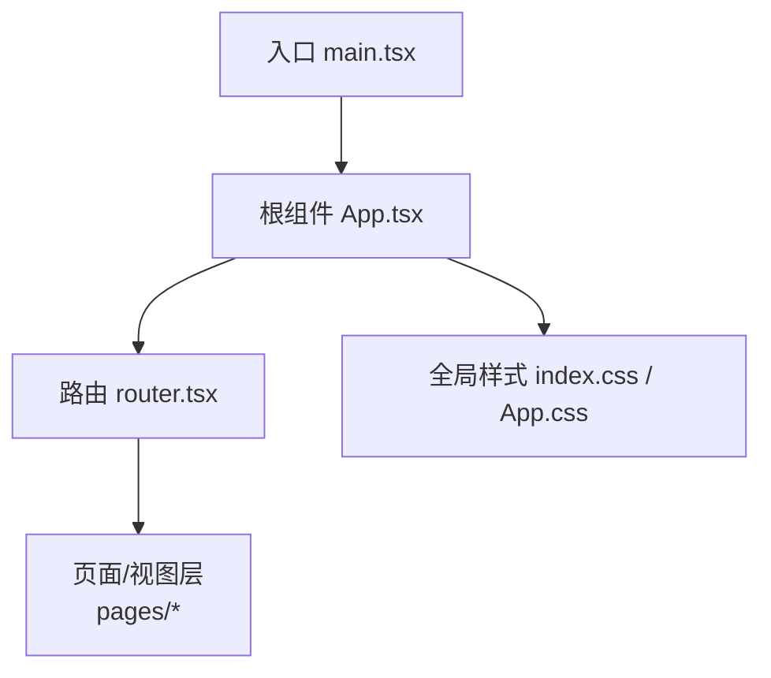
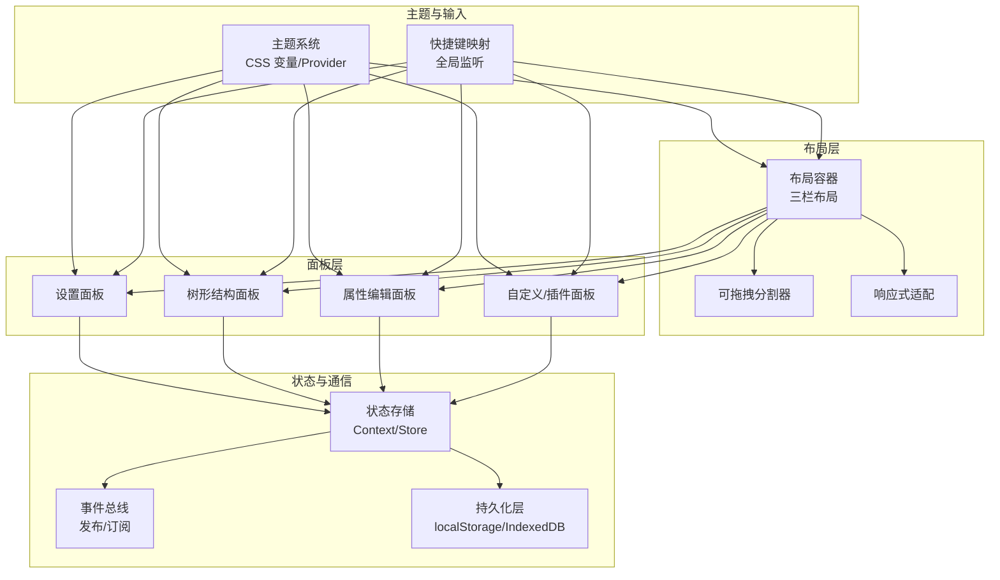
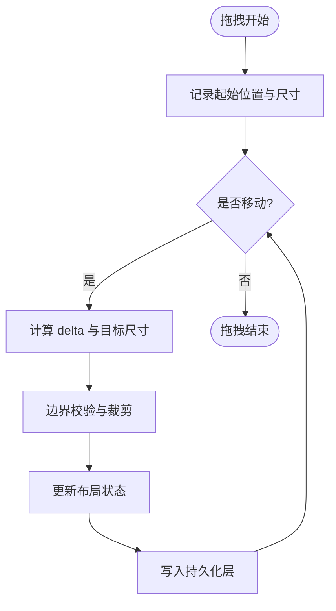
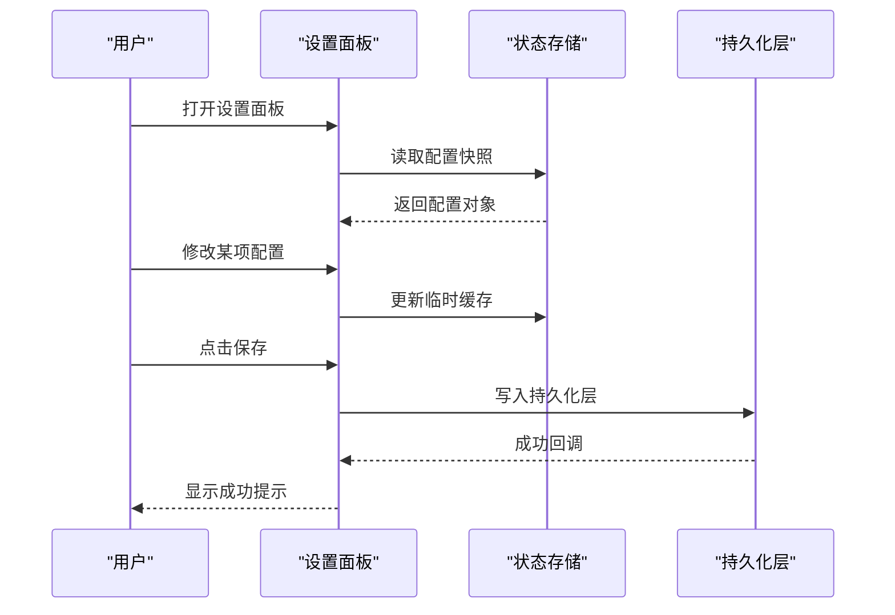
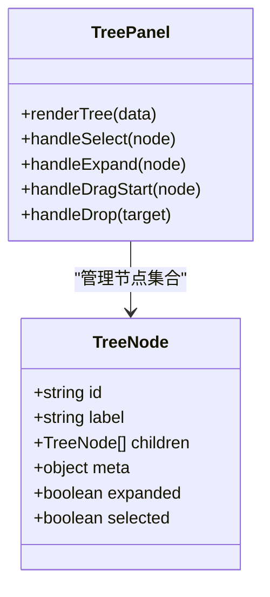
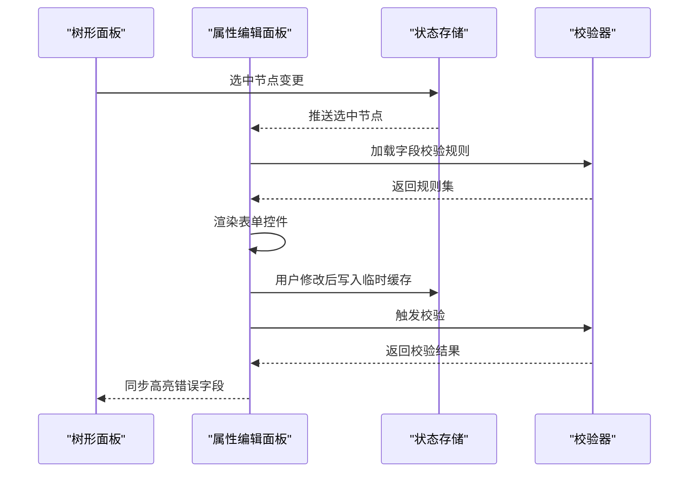
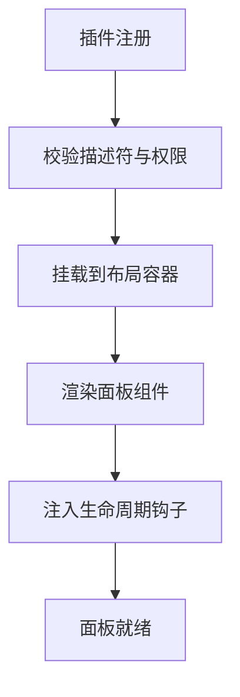
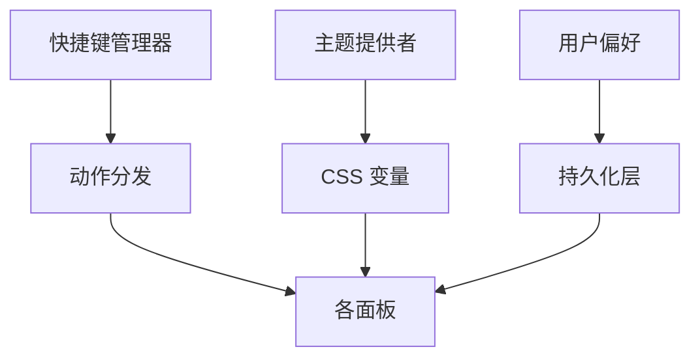
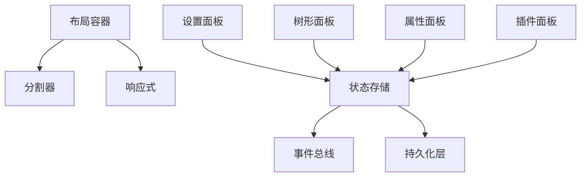

# 面板管理

<cite>
**本文引用的文件**   
- [App.tsx](file://notifuse/console/src/App.tsx)
- [router.tsx](file://notifuse/console/src/router.tsx)
- [main.tsx](file://notifuse/console/src/main.tsx)
- [index.css](file://notifuse/console/src/index.css)
- [App.css](file://notifuse/console/src/App.css)
</cite>

## 目录
1. [简介](#简介)
2. [项目结构](#项目结构)
3. [核心组件](#核心组件)
4. [架构总览](#架构总览)
5. [详细组件分析](#详细组件分析)
6. [依赖关系分析](#依赖关系分析)
7. [性能考虑](#性能考虑)
8. [故障排查指南](#故障排查指南)
9. [结论](#结论)
10. [附录](#附录) 

## 简介
本技术文档围绕邮件编辑器的“面板管理系统”进行系统化说明，重点覆盖以下方面：
- 面板布局架构：可拖拽面板、响应式布局与状态持久化
- 关键面板实现：设置面板、树形结构面板、属性编辑面板
- 面板间数据绑定与事件通信机制
- 自定义扩展接口：支持第三方插件的面板集成
- 主题定制、快捷键映射与用户偏好设置
- 面板开发指南与最佳实践：性能优化与用户体验设计

为保证准确性，本文在涉及具体代码实现时均提供来源定位（文件路径与行号范围），并在图表中明确标注对应源码文件。

## 项目结构
控制台前端位于 notifuse/console 目录，采用 React + TypeScript 技术栈，路由与页面组织清晰，便于扩展为多面板应用。

图示来源
- [main.tsx:1-50](file://notifuse/console/src/main.tsx#L1-L50)
- [App.tsx:1-120](file://notifuse/console/src/App.tsx#L1-L120)
- [router.tsx:1-120](file://notifuse/console/src/router.tsx#L1-L120)
- [index.css:1-200](file://notifuse/console/src/index.css#L1-L200)
- [App.css:1-200](file://notifuse/console/src/App.css#L1-L200)

章节来源
- [main.tsx:1-50](file://notifuse/console/src/main.tsx#L1-L50)
- [App.tsx:1-120](file://notifuse/console/src/App.tsx#L1-L120)
- [router.tsx:1-120](file://notifuse/console/src/router.tsx#L1-L120)
- [index.css:1-200](file://notifuse/console/src/index.css#L1-L200)
- [App.css:1-200](file://notifuse/console/src/App.css#L1-L200)

## 核心组件
本节聚焦于构建“面板管理系统”的关键基础能力：
- 布局容器：承载左侧树形导航、中间内容区与右侧属性编辑区的三栏布局
- 可拖拽分割器：用于调整面板宽度或高度，保持用户操作记忆
- 响应式适配：在小屏设备自动折叠侧边栏或隐藏非核心面板
- 状态持久化：将面板可见性、尺寸、选中项等写入本地存储，刷新后恢复
- 主题系统：通过 CSS 变量或主题上下文切换明暗主题与品牌色
- 快捷键映射：集中注册常用快捷键（如打开/关闭面板、保存、撤销）
- 事件总线/上下文：跨面板的数据共享与事件广播

为实现上述能力，建议在前端工程中引入如下模块（概念性描述，未直接引用具体源码）：
- 布局与拖拽：基于 HTML5 Drag API 或轻量库（如 react-resizable-panels）
- 状态持久化：localStorage/sessionStorage 或 IndexedDB
- 主题：CSS 变量 + Context 或 styled-components 主题提供者
- 事件通信：React Context + useReducer，或轻量事件总线（mitt）
- 快捷键：全局键盘事件监听 + 命令模式

[本节为概念性概述，不直接分析具体文件，故无“章节来源”]

## 架构总览
下图展示了面板管理系统的整体架构与交互关系，包括布局容器、各面板、状态管理与持久化层。

图示来源
- [App.tsx:1-120](file://notifuse/console/src/App.tsx#L1-L120)
- [router.tsx:1-120](file://notifuse/console/src/router.tsx#L1-L120)
- [index.css:1-200](file://notifuse/console/src/index.css#L1-L200)
- [App.css:1-200](file://notifuse/console/src/App.css#L1-L200)

## 详细组件分析

### 布局容器与可拖拽分割器
- 职责
  - 维护三栏布局（左/中/右）的初始尺寸与最小宽度
  - 处理拖拽事件，实时更新面板宽度并触发重绘
  - 记录分割位置到持久化层，确保刷新后恢复
- 关键点
  - 使用 requestAnimationFrame 节流更新，避免频繁重排
  - 边界校验防止面板被拖至不可见
  - 移动端检测并切换为堆叠布局
- 推荐实现要点（概念性）
  - 拖拽开始：记录起始位置与当前面板尺寸
  - 拖拽移动：计算 delta，限制最小/最大宽度，更新状态
  - 拖拽结束：写入持久化层

[本节为概念性流程说明，未直接分析具体文件，故无“图示来源”和“章节来源”]

### 设置面板
- 功能
  - 展示编辑器相关配置项（如默认模板、发送策略、通知开关等）
  - 支持分组与搜索过滤
  - 变更即时生效或待确认提交
- 数据流
  - 从状态存储读取配置快照
  - 用户修改后写入临时缓存，提交后落盘
- 交互
  - 表单验证与错误提示
  - 批量重置与导入导出

[本节为概念性序列图，未直接分析具体文件，故无“图示来源”和“章节来源”]

### 树形结构面板
- 功能
  - 展示邮件模板、联系人列表、自动化流程等层级结构
  - 支持展开/折叠、多选、右键菜单、拖拽排序
- 数据模型
  - 节点包含 id、label、children、meta 等字段
  - 虚拟滚动优化大数据量渲染
- 交互
  - 点击选中同步到属性编辑面板
  - 拖拽改变顺序后触发重排与持久化

[本节为概念性类图，未直接分析具体文件，故无“图示来源”和“章节来源”]

### 属性编辑面板
- 功能
  - 根据选中节点动态渲染表单控件（文本、选择、富文本、附件等）
  - 实时预览与差异对比
  - 撤销/重做历史栈
- 数据绑定
  - 双向绑定到选中节点的属性
  - 防抖保存，避免频繁 I/O
- 校验
  - 规则引擎驱动，支持自定义校验器

[本节为概念性序列图，未直接分析具体文件，故无“图示来源”和“章节来源”]

### 自定义扩展接口（插件面板）
- 设计原则
  - 插件以“面板描述符”形式注册，包含 id、title、icon、component、propsSchema 等
  - 宿主提供统一挂载点与生命周期钩子（onMount、onUnmount、onUpdate）
- 安全与沙箱
  - 限制访问全局对象，仅暴露必要 API（如事件总线、主题、存储）
  - 资源白名单与 CSP 策略
- 版本兼容
  - 描述符含 version 字段，宿主进行兼容性检查

[本节为概念性流程图，未直接分析具体文件，故无“图示来源”和“章节来源”]

### 主题定制、快捷键映射与用户偏好
- 主题定制
  - 通过 CSS 变量定义颜色、间距、字体族
  - 提供 Provider 包裹应用，切换主题时批量替换变量
- 快捷键映射
  - 集中注册键位与动作映射表
  - 支持组合键与上下文感知（仅在特定面板激活）
- 用户偏好
  - 面板可见性、尺寸、主题、语言等写入持久化层
  - 首次启动引导用户完成基础偏好设置

[本节为概念性架构图，未直接分析具体文件，故无“图示来源”和“章节来源”]

## 依赖关系分析
- 组件耦合
  - 布局容器对分割器与响应式逻辑有强依赖
  - 各面板通过状态存储与事件总线松耦合
- 外部依赖
  - 建议使用轻量 UI 库（如 Ant Design、MUI）加速开发
  - 拖拽与布局可使用成熟库降低复杂度
- 潜在循环依赖
  - 避免面板之间直接相互引用，统一通过事件与状态解耦

[本节为概念性依赖图，未直接分析具体文件，故无“图示来源”和“章节来源”]

## 性能考虑
- 渲染优化
  - 大列表使用虚拟滚动
  - 按需加载面板组件（懒加载）
  - 使用 memo/useMemo/useCallback 减少不必要重渲染
- 拖拽体验
  - 节流/防抖更新，避免高频重排
  - 使用 will-change 与 GPU 加速提升流畅度
- 状态持久化
  - 合并多次变更后再落盘
  - 增量写入，避免整块序列化开销
- 内存管理
  - 面板卸载时清理事件监听与定时器
  - 图片与富文本资源及时释放

[本节为通用性能建议，不直接分析具体文件，故无“章节来源”]

## 故障排查指南
- 常见问题
  - 面板尺寸异常：检查边界校验与最小宽度约束
  - 状态不同步：确认事件总线是否正确派发与消费
  - 主题切换无效：检查 CSS 变量作用域与 Provider 包裹范围
  - 快捷键冲突：审查键位映射表与上下文优先级
- 调试技巧
  - 在关键路径添加日志与埋点
  - 使用浏览器开发者工具的性能面板分析拖拽卡顿
  - 通过 Redux DevTools 或 React DevTools 观察状态变化

[本节为通用排查建议，不直接分析具体文件，故无“章节来源”]

## 结论
通过统一的布局容器、可拖拽分割器、响应式适配与状态持久化，配合事件总线与主题/快捷键系统，邮件编辑器的面板管理系统具备良好的可扩展性与用户体验。遵循本文的开发指南与最佳实践，可在保证性能的同时快速集成第三方插件面板。

[本节为总结性内容，不直接分析具体文件，故无“章节来源”]

## 附录
- 术语
  - 面板：界面中的独立功能区域
  - 分割器：用于调整面板尺寸的拖拽条
  - 事件总线：跨组件通信的发布/订阅机制
- 参考实现
  - 布局与拖拽：react-resizable-panels
  - 事件总线：mitt
  - 主题：styled-components 或 CSS 变量方案
  - 状态管理：Zustand/Redux Toolkit

[本节为补充信息，不直接分析具体文件，故无“章节来源”]