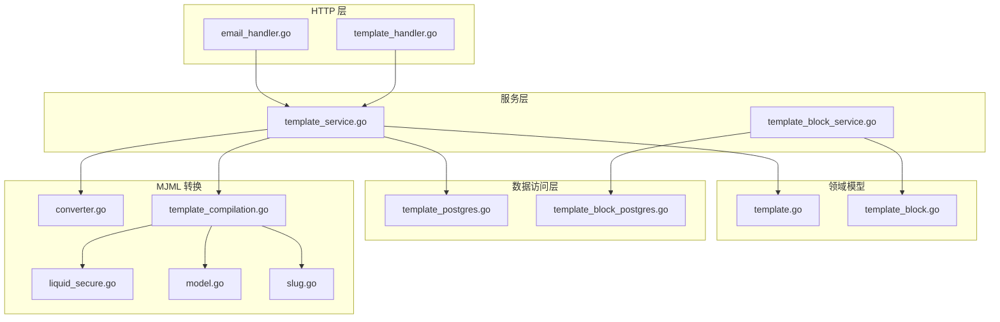
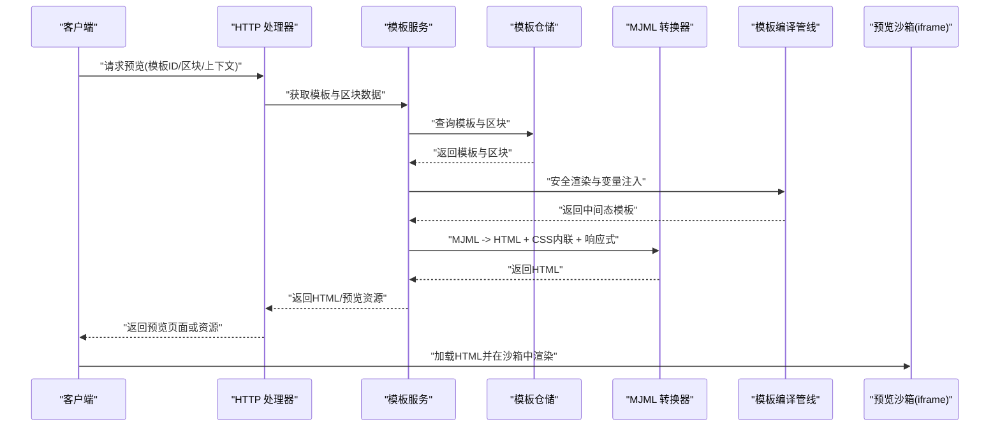
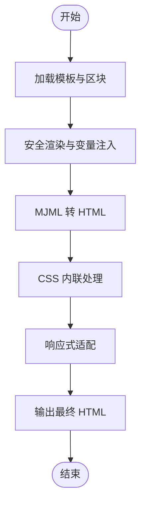
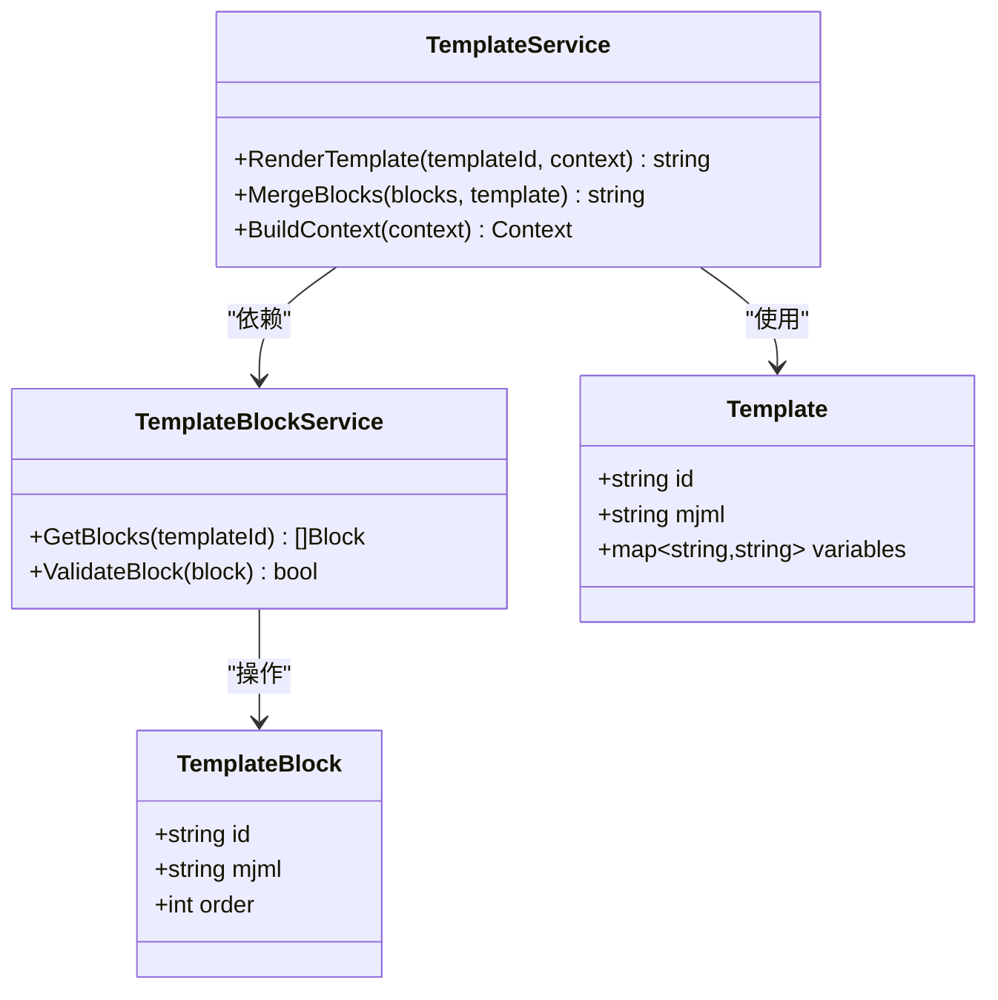
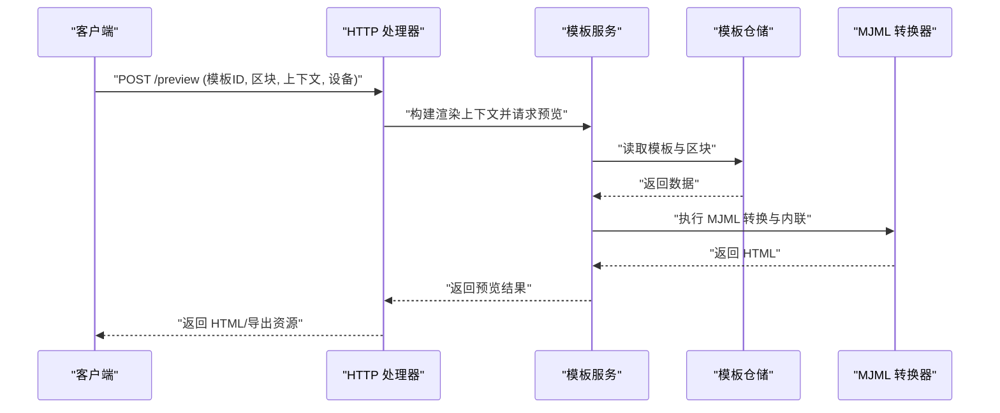
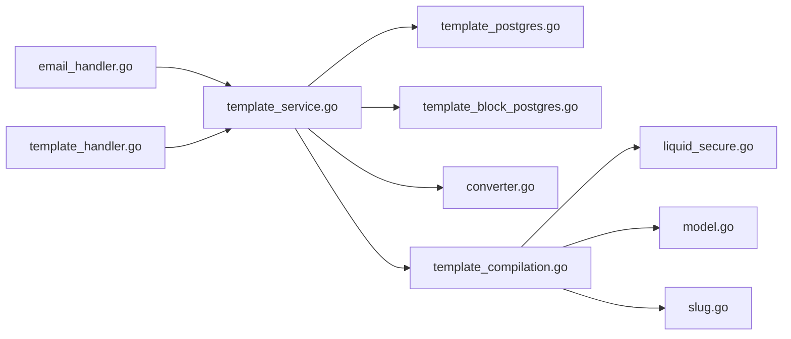

# 预览系统

<cite>
**本文引用的文件**   
- [converter.go](file://notifuse/pkg/notifuse_mjml/converter.go)
- [template_compilation.go](file://notifuse/pkg/notifuse_mjml/template_compilation.go)
- [liquid_secure.go](file://notifuse/pkg/notifuse_mjml/liquid_secure.go)
- [model.go](file://notifuse/pkg/notifuse_mjml/model.go)
- [slug.go](file://notifuse/pkg/notifuse_mjml/slug.go)
- [email_handler.go](file://notifuse/internal/http/email_handler.go)
- [template_handler.go](file://notifuse/internal/http/template_handler.go)
- [template_service.go](file://notifuse/internal/service/template_service.go)
- [template_block_service.go](file://notifuse/internal/service/template_block_service.go)
- [template.go](file://notifuse/internal/domain/template.go)
- [template_block.go](file://notifuse/internal/domain/template_block.go)
- [template_postgres.go](file://notifuse/internal/repository/template_postgres.go)
- [template_block_postgres.go](file://notifuse/internal/repository/template_block_postgres.go)
</cite>

## 目录
1. [简介](#简介)
2. [项目结构](#项目结构)
3. [核心组件](#核心组件)
4. [架构总览](#架构总览)
5. [详细组件分析](#详细组件分析)
6. [依赖关系分析](#依赖关系分析)
7. [性能考虑](#性能考虑)
8. [故障排查指南](#故障排查指南)
9. [结论](#结论)
10. [附录](#附录)

## 简介
本技术文档围绕邮件编辑器预览系统，聚焦以下目标：
- 实时预览实现原理：MJML 到 HTML 的转换、CSS 内联与响应式适配。
- 多设备预览：桌面端、移动端、平板设备的模拟显示策略。
- 预览性能优化：增量更新、缓存机制与渲染优化。
- 预览沙箱安全隔离：iframe 使用、样式隔离与内容安全策略（CSP）。
- 预览导出：支持 PDF、HTML、纯文本格式生成。
- 调试工具与错误诊断方法。

该文档以代码仓库中的 MJML 转换与模板服务为核心，结合 HTTP 处理器与服务层接口，给出端到端的预览流程说明与可视化图示。

## 项目结构
预览相关能力主要分布在如下模块：
- MJML 转换与模板编译：pkg/notifuse_mjml
- 模板与区块领域模型：internal/domain
- 模板与区块服务层：internal/service
- HTTP 处理器（预览入口）：internal/http
- 模板持久化（PostgreSQL）：internal/repository

图表来源
- [email_handler.go](file://notifuse/internal/http/email_handler.go)
- [template_handler.go](file://notifuse/internal/http/template_handler.go)
- [template_service.go](file://notifuse/internal/service/template_service.go)
- [template_block_service.go](file://notifuse/internal/service/template_block_service.go)
- [template.go](file://notifuse/internal/domain/template.go)
- [template_block.go](file://notifuse/internal/domain/template_block.go)
- [template_postgres.go](file://notifuse/internal/repository/template_postgres.go)
- [template_block_postgres.go](file://notifuse/internal/repository/template_block_postgres.go)
- [converter.go](file://notifuse/pkg/notifuse_mjml/converter.go)
- [template_compilation.go](file://notifuse/pkg/notifuse_mjml/template_compilation.go)
- [liquid_secure.go](file://notifuse/pkg/notifuse_mjml/liquid_secure.go)
- [model.go](file://notifuse/pkg/notifuse_mjml/model.go)
- [slug.go](file://notifuse/pkg/notifuse_mjml/slug.go)

章节来源
- [email_handler.go](file://notifuse/internal/http/email_handler.go)
- [template_handler.go](file://notifuse/internal/http/template_handler.go)
- [template_service.go](file://notifuse/internal/service/template_service.go)
- [template_block_service.go](file://notifuse/internal/service/template_block_service.go)
- [template.go](file://notifuse/internal/domain/template.go)
- [template_block.go](file://notifuse/internal/domain/template_block.go)
- [template_postgres.go](file://notifuse/internal/repository/template_postgres.go)
- [template_block_postgres.go](file://notifuse/internal/repository/template_block_postgres.go)
- [converter.go](file://notifuse/pkg/notifuse_mjml/converter.go)
- [template_compilation.go](file://notifuse/pkg/notifuse_mjml/template_compilation.go)
- [liquid_secure.go](file://notifuse/pkg/notifuse_mjml/liquid_secure.go)
- [model.go](file://notifuse/pkg/notifuse_mjml/model.go)
- [slug.go](file://notifuse/pkg/notifuse_mjml/slug.go)

## 核心组件
- MJML 转换器：负责将 MJML 转换为 HTML，并集成 CSS 内联与响应式处理。
- 模板编译管线：对模板进行安全 Liquid 渲染、变量注入、Slug 规范化等预处理。
- 模板服务：编排模板与区块的读取、合并、渲染与预览输出。
- HTTP 处理器：暴露预览相关的 API，接收请求参数并返回渲染结果或预览资源。
- 领域模型与仓储：定义模板与区块的数据结构，并提供数据库读写能力。

章节来源
- [converter.go](file://notifuse/pkg/notifuse_mjml/converter.go)
- [template_compilation.go](file://notifuse/pkg/notifuse_mjml/template_compilation.go)
- [liquid_secure.go](file://notifuse/pkg/notifuse_mjml/liquid_secure.go)
- [model.go](file://notifuse/pkg/notifuse_mjml/model.go)
- [slug.go](file://notifuse/pkg/notifuse_mjml/slug.go)
- [template_service.go](file://notifuse/internal/service/template_service.go)
- [template_block_service.go](file://notifuse/internal/service/template_block_service.go)
- [template.go](file://notifuse/internal/domain/template.go)
- [template_block.go](file://notifuse/internal/domain/template_block.go)
- [email_handler.go](file://notifuse/internal/http/email_handler.go)
- [template_handler.go](file://notifuse/internal/http/template_handler.go)

## 架构总览
预览系统的整体调用链从 HTTP 处理器开始，进入服务层组织模板与区块，再经由 MJML 转换与模板编译管线产出最终 HTML，最后由前端在沙箱中渲染预览。

图表来源
- [email_handler.go](file://notifuse/internal/http/email_handler.go)
- [template_handler.go](file://notifuse/internal/http/template_handler.go)
- [template_service.go](file://notifuse/internal/service/template_service.go)
- [template_postgres.go](file://notifuse/internal/repository/template_postgres.go)
- [template_block_postgres.go](file://notifuse/internal/repository/template_block_postgres.go)
- [converter.go](file://notifuse/pkg/notifuse_mjml/converter.go)
- [template_compilation.go](file://notifuse/pkg/notifuse_mjml/template_compilation.go)

## 详细组件分析

### MJML 转换与渲染管线
- 功能要点
  - 将 MJML 转换为兼容邮件客户端的 HTML。
  - 执行 CSS 内联，确保多数邮件客户端样式正确呈现。
  - 应用响应式规则，适配不同屏幕尺寸。
  - 提供可配置的转换选项（如是否启用内联、媒体查询策略等）。
- 关键路径
  - 转换入口与配置：[converter.go](file://notifuse/pkg/notifuse_mjml/converter.go)
  - 模板编译与安全渲染：[template_compilation.go](file://notifuse/pkg/notifuse_mjml/template_compilation.go)、[liquid_secure.go](file://notifuse/pkg/notifuse_mjml/liquid_secure.go)
  - 模型与 Slug 处理：[model.go](file://notifuse/pkg/notifuse_mjml/model.go)、[slug.go](file://notifuse/pkg/notifuse_mjml/slug.go)

图表来源
- [converter.go](file://notifuse/pkg/notifuse_mjml/converter.go)
- [template_compilation.go](file://notifuse/pkg/notifuse_mjml/template_compilation.go)
- [liquid_secure.go](file://notifuse/pkg/notifuse_mjml/liquid_secure.go)
- [model.go](file://notifuse/pkg/notifuse_mjml/model.go)
- [slug.go](file://notifuse/pkg/notifuse_mjml/slug.go)

章节来源
- [converter.go](file://notifuse/pkg/notifuse_mjml/converter.go)
- [template_compilation.go](file://notifuse/pkg/notifuse_mjml/template_compilation.go)
- [liquid_secure.go](file://notifuse/pkg/notifuse_mjml/liquid_secure.go)
- [model.go](file://notifuse/pkg/notifuse_mjml/model.go)
- [slug.go](file://notifuse/pkg/notifuse_mjml/slug.go)

### 模板服务与区块组合
- 职责
  - 聚合模板与区块，按顺序合并内容。
  - 管理渲染上下文（变量、主题、语言等）。
  - 协调 MJML 转换与模板编译管线。
- 关键路径
  - 模板服务：[template_service.go](file://notifuse/internal/service/template_service.go)
  - 区块服务：[template_block_service.go](file://notifuse/internal/service/template_block_service.go)
  - 领域模型：[template.go](file://notifuse/internal/domain/template.go)、[template_block.go](file://notifuse/internal/domain/template_block.go)

图表来源
- [template_service.go](file://notifuse/internal/service/template_service.go)
- [template_block_service.go](file://notifuse/internal/service/template_block_service.go)
- [template.go](file://notifuse/internal/domain/template.go)
- [template_block.go](file://notifuse/internal/domain/template_block.go)

章节来源
- [template_service.go](file://notifuse/internal/service/template_service.go)
- [template_block_service.go](file://notifuse/internal/service/template_block_service.go)
- [template.go](file://notifuse/internal/domain/template.go)
- [template_block.go](file://notifuse/internal/domain/template_block.go)

### HTTP 预览入口
- 职责
  - 接收预览请求（模板 ID、区块列表、渲染上下文、设备类型等）。
  - 调用模板服务完成渲染，返回 HTML 或预览资源。
  - 支持导出参数（PDF、HTML、纯文本）。
- 关键路径
  - 邮件相关处理器：[email_handler.go](file://notifuse/internal/http/email_handler.go)
  - 模板相关处理器：[template_handler.go](file://notifuse/internal/http/template_handler.go)

图表来源
- [email_handler.go](file://notifuse/internal/http/email_handler.go)
- [template_handler.go](file://notifuse/internal/http/template_handler.go)
- [template_service.go](file://notifuse/internal/service/template_service.go)
- [template_postgres.go](file://notifuse/internal/repository/template_postgres.go)
- [template_block_postgres.go](file://notifuse/internal/repository/template_block_postgres.go)
- [converter.go](file://notifuse/pkg/notifuse_mjml/converter.go)

章节来源
- [email_handler.go](file://notifuse/internal/http/email_handler.go)
- [template_handler.go](file://notifuse/internal/http/template_handler.go)

### 多设备预览策略
- 策略概述
  - 通过响应式 CSS 与媒体查询适配桌面、平板、手机三种典型视口。
  - 在预览界面中提供设备切换控件，动态调整 iframe 宽度以模拟不同设备。
  - 可选：为特定设备注入额外样式或脚本，增强兼容性测试。
- 实现建议
  - 在 MJML 转换阶段保留必要的响应式规则。
  - 在 CSS 内联后，追加全局媒体查询块，避免被内联覆盖。
  - 前端根据设备类型设置 iframe 的 viewport 与缩放比例。

章节来源
- [converter.go](file://notifuse/pkg/notifuse_mjml/converter.go)
- [template_compilation.go](file://notifuse/pkg/notifuse_mjml/template_compilation.go)

### 预览沙箱安全隔离
- 隔离手段
  - 使用 iframe 承载预览内容，限制跨域访问与脚本执行。
  - 配置 CSP 头，仅允许必要资源加载与脚本执行。
  - 样式隔离：通过沙箱样式前缀或 Shadow DOM 防止污染宿主页面。
- 注意事项
  - 谨慎注入外部资源，避免引入不受信任的脚本与样式。
  - 对用户上传的模板内容进行白名单校验与清理。

章节来源
- [email_handler.go](file://notifuse/internal/http/email_handler.go)
- [template_handler.go](file://notifuse/internal/http/template_handler.go)

### 预览导出功能
- 支持格式
  - HTML：直接输出渲染后的完整 HTML。
  - 纯文本：剥离标签与样式，提取正文文本。
  - PDF：基于 HTML 渲染生成 PDF（需后端集成 PDF 引擎或第三方服务）。
- 实现建议
  - HTML 导出：复用预览渲染管线，直接返回 HTML 字符串。
  - 纯文本导出：解析 HTML 节点树，提取文本内容并做基础格式化。
  - PDF 导出：调用服务端 PDF 生成库或服务，传入 HTML 与页面布局参数。

章节来源
- [template_service.go](file://notifuse/internal/service/template_service.go)
- [email_handler.go](file://notifuse/internal/http/email_handler.go)
- [template_handler.go](file://notifuse/internal/http/template_handler.go)

### 调试工具与错误诊断
- 调试建议
  - 在模板编译阶段记录中间态（安全渲染结果、变量注入情况）。
  - 在 MJML 转换前后输出日志，便于定位样式与结构问题。
  - 提供“查看源码”按钮，展示最终 HTML 以便开发者检查。
- 错误诊断
  - 捕获并上报渲染异常（模板语法错误、变量缺失、资源加载失败）。
  - 针对常见错误提供提示与建议修复方案。

章节来源
- [template_compilation.go](file://notifuse/pkg/notifuse_mjml/template_compilation.go)
- [converter.go](file://notifuse/pkg/notifuse_mjml/converter.go)

## 依赖关系分析
预览系统的关键依赖包括：
- HTTP 处理器依赖模板服务。
- 模板服务依赖模板与区块仓储以及 MJML 转换与模板编译管线。
- 模板编译管线依赖安全渲染、模型与 Slug 处理。

图表来源
- [email_handler.go](file://notifuse/internal/http/email_handler.go)
- [template_handler.go](file://notifuse/internal/http/template_handler.go)
- [template_service.go](file://notifuse/internal/service/template_service.go)
- [template_postgres.go](file://notifuse/internal/repository/template_postgres.go)
- [template_block_postgres.go](file://notifuse/internal/repository/template_block_postgres.go)
- [converter.go](file://notifuse/pkg/notifuse_mjml/converter.go)
- [template_compilation.go](file://notifuse/pkg/notifuse_mjml/template_compilation.go)
- [liquid_secure.go](file://notifuse/pkg/notifuse_mjml/liquid_secure.go)
- [model.go](file://notifuse/pkg/notifuse_mjml/model.go)
- [slug.go](file://notifuse/pkg/notifuse_mjml/slug.go)

章节来源
- [email_handler.go](file://notifuse/internal/http/email_handler.go)
- [template_handler.go](file://notifuse/internal/http/template_handler.go)
- [template_service.go](file://notifuse/internal/service/template_service.go)
- [template_postgres.go](file://notifuse/internal/repository/template_postgres.go)
- [template_block_postgres.go](file://notifuse/internal/repository/template_block_postgres.go)
- [converter.go](file://notifuse/pkg/notifuse_mjml/converter.go)
- [template_compilation.go](file://notifuse/pkg/notifuse_mjml/template_compilation.go)
- [liquid_secure.go](file://notifuse/pkg/notifuse_mjml/liquid_secure.go)
- [model.go](file://notifuse/pkg/notifuse_mjml/model.go)
- [slug.go](file://notifuse/pkg/notifuse_mjml/slug.go)

## 性能考虑
- 增量更新
  - 对未变更的模板与区块跳过渲染，直接返回缓存结果。
  - 使用内容哈希作为缓存键，提高命中率。
- 缓存机制
  - 在服务端维护模板渲染结果的内存缓存，设置合理的过期时间。
  - 对静态资源（字体、图片）采用浏览器缓存策略。
- 渲染优化
  - 减少不必要的 CSS 内联范围，优先内联关键样式。
  - 合并重复的媒体查询与样式规则，降低 HTML 体积。
  - 异步加载非关键资源，提升首屏渲染速度。

## 故障排查指南
- 常见问题
  - 模板变量缺失：检查上下文注入是否正确，确认变量名与大小写。
  - MJML 语法错误：查看转换阶段的错误日志，修正标签与属性。
  - 样式错乱：检查 CSS 内联策略与媒体查询优先级。
  - 资源加载失败：确认 CSP 配置与外部资源域名白名单。
- 诊断步骤
  - 启用详细日志，记录渲染各阶段输入与输出。
  - 使用“查看源码”功能对比预期与实际 HTML。
  - 在不同设备视口下复现问题，定位响应式适配缺陷。

## 结论
预览系统通过 MJML 转换与模板编译管线实现了高效的邮件预览能力，结合响应式适配与沙箱隔离，提供了稳定且安全的预览体验。通过增量更新、缓存与渲染优化，系统在性能与用户体验之间取得平衡。未来可进一步扩展导出能力与调试工具，以提升开发效率与问题定位速度。

## 附录
- 术语
  - MJML：一种用于编写响应式邮件的标记语言。
  - CSS 内联：将样式直接写入 HTML 元素属性，提高邮件客户端兼容性。
  - 响应式适配：通过媒体查询与布局策略适配不同屏幕尺寸。
  - 沙箱隔离：使用 iframe 与 CSP 限制预览内容的权限与资源访问。
- 参考路径
  - MJML 转换与模板编译：[converter.go](file://notifuse/pkg/notifuse_mjml/converter.go)、[template_compilation.go](file://notifuse/pkg/notifuse_mjml/template_compilation.go)
  - 模板服务与区块：[template_service.go](file://notifuse/internal/service/template_service.go)、[template_block_service.go](file://notifuse/internal/service/template_block_service.go)
  - HTTP 预览入口：[email_handler.go](file://notifuse/internal/http/email_handler.go)、[template_handler.go](file://notifuse/internal/http/template_handler.go)