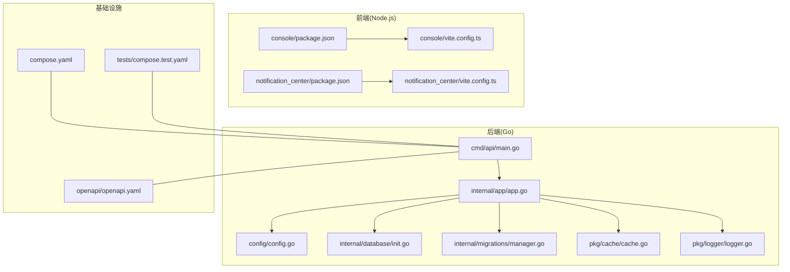
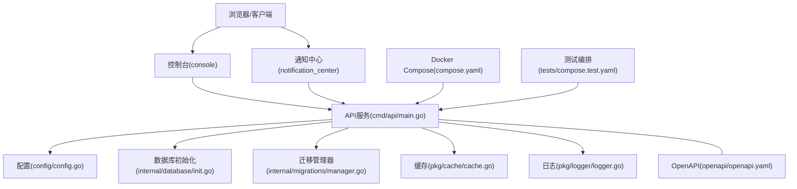
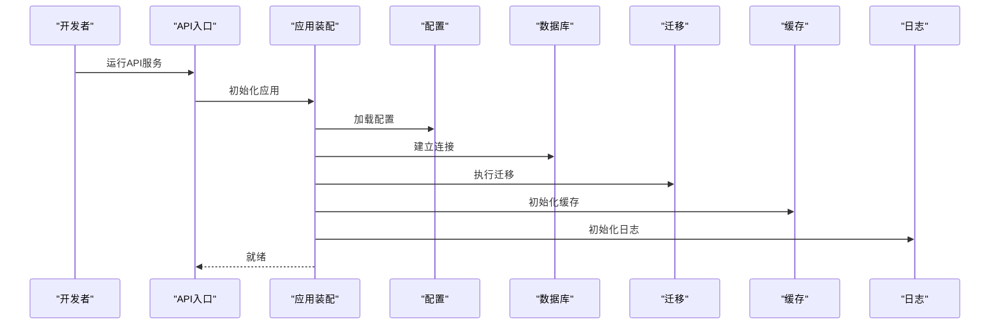
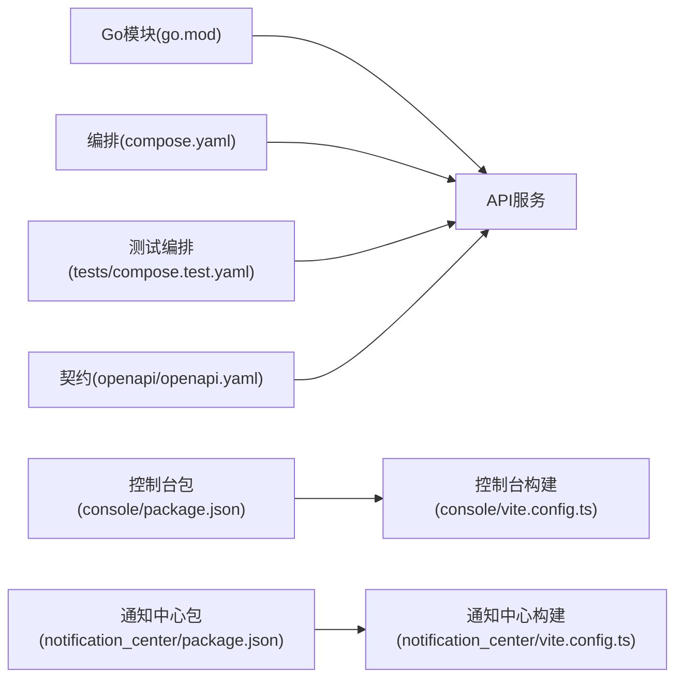

# 开发者指南

<cite>
**本文引用的文件**   
- [README.md](file://notifuse/README.md)
- [Makefile](file://notifuse/Makefile)
- [compose.yaml](file://notifuse/compose.yaml)
- [env.example](file://notifuse/env.example)
- [go.mod](file://notifuse/go.mod)
- [cmd/api/main.go](file://notifuse/cmd/api/main.go)
- [internal/app/app.go](file://notifuse/internal/app/app.go)
- [config/config.go](file://notifuse/config/config.go)
- [internal/database/init.go](file://notifuse/internal/database/init.go)
- [internal/migrations/manager.go](file://notifuse/internal/migrations/manager.go)
- [pkg/cache/cache.go](file://notifuse/pkg/cache/cache.go)
- [pkg/logger/logger.go](file://notifuse/pkg/logger/logger.go)
- [scripts/run-integration-tests.sh](file://notifuse/scripts/run-integration-tests.sh)
- [tests/compose.test.yaml](file://notifuse/tests/compose.test.yaml)
- [console/package.json](file://notifuse/console/package.json)
- [console/vite.config.ts](file://notifuse/console/vite.config.ts)
- [console/playwright.config.ts](file://notifuse/console/playwright.config.ts)
- [notification_center/package.json](file://notifuse/notification_center/package.json)
- [notification_center/vite.config.ts](file://notifuse/notification_center/vite.config.ts)
- [openapi/openapi.yaml](file://notifuse/openapi/openapi.yaml)
- [SECURITY.md](file://notifuse/SECURITY.md)
</cite>

## 目录
1. [简介](#简介)
2. [项目结构](#项目结构)
3. [核心组件](#核心组件)
4. [架构总览](#架构总览)
5. [详细组件分析](#详细组件分析)
6. [依赖分析](#依赖分析)
7. [性能考虑](#性能考虑)
8. [故障排查指南](#故障排查指南)
9. [结论](#结论)
10. [附录](#附录)

## 简介
本指南面向Notifuse平台的贡献者与开发者，提供从本地环境搭建到测试、重构、调试与协作流程的完整说明。内容覆盖：
- Go后端与Node.js前端（控制台与通知中心）开发环境搭建
- 数据库与缓存服务的本地部署
- 代码规范、Git工作流与Pull Request标准
- 测试策略（单元、集成、端到端）编写与执行
- 重构指南、性能分析与调试技巧
- 贡献者行为准则、Issue模板与功能请求流程
- 新功能开发模板与最佳实践示例

## 项目结构
Notifuse采用前后端分离与多服务组织方式：
- Go后端位于根目录，入口为API命令，内部按领域分层（HTTP处理器、服务层、仓储层、迁移、配置等）
- Node.js前端包含控制台（console）与通知中心（notification_center），均基于Vite构建
- OpenAPI文档定义在openapi目录
- 测试脚本与Compose编排用于集成与E2E测试

图表来源
- [cmd/api/main.go:1-200](file://notifuse/cmd/api/main.go#L1-L200)
- [internal/app/app.go:1-200](file://notifuse/internal/app/app.go#L1-L200)
- [config/config.go:1-200](file://notifuse/config/config.go#L1-L200)
- [internal/database/init.go:1-200](file://notifuse/internal/database/init.go#L1-L200)
- [internal/migrations/manager.go:1-200](file://notifuse/internal/migrations/manager.go#L1-L200)
- [pkg/cache/cache.go:1-200](file://notifuse/pkg/cache/cache.go#L1-L200)
- [pkg/logger/logger.go:1-200](file://notifuse/pkg/logger/logger.go#L1-L200)
- [console/package.json:1-200](file://notifuse/console/package.json#L1-L200)
- [console/vite.config.ts:1-200](file://notifuse/console/vite.config.ts#L1-L200)
- [notification_center/package.json:1-200](file://notifuse/notification_center/package.json#L1-L200)
- [notification_center/vite.config.ts:1-200](file://notifuse/notification_center/vite.config.ts#L1-L200)
- [compose.yaml:1-200](file://notifuse/compose.yaml#L1-L200)
- [tests/compose.test.yaml:1-200](file://notifuse/tests/compose.test.yaml#L1-L200)
- [openapi/openapi.yaml:1-200](file://notifuse/openapi/openapi.yaml#L1-L200)

章节来源
- [README.md:1-200](file://notifuse/README.md#L1-L200)
- [Makefile:1-200](file://notifuse/Makefile#L1-L200)
- [compose.yaml:1-200](file://notifuse/compose.yaml#L1-L200)
- [env.example:1-200](file://notifuse/env.example#L1-L200)
- [go.mod:1-200](file://notifuse/go.mod#L1-L200)

## 核心组件
- API入口与装配
  - 入口程序负责初始化应用上下文、加载配置、启动HTTP服务与后台任务
  - 参考路径：[cmd/api/main.go](file://notifuse/cmd/api/main.go)、[internal/app/app.go](file://notifuse/internal/app/app.go)
- 配置管理
  - 集中式配置加载与环境变量映射，支持平台特性开关与外部服务凭据
  - 参考路径：[config/config.go](file://notifuse/config/config.go)
- 数据库与迁移
  - 连接初始化与版本化迁移管理，确保数据模型演进可追踪
  - 参考路径：[internal/database/init.go](file://notifuse/internal/database/init.go)、[internal/migrations/manager.go](file://notifuse/internal/migrations/manager.go)
- 缓存抽象
  - 统一的缓存接口与实现，便于替换不同缓存后端
  - 参考路径：[pkg/cache/cache.go](file://notifuse/pkg/cache/cache.go)
- 日志与可观测性
  - 结构化日志输出与可选跟踪集成
  - 参考路径：[pkg/logger/logger.go](file://notifuse/pkg/logger/logger.go)
- 前端工程
  - 控制台与通知中心均为独立Vite应用，分别维护包管理与构建配置
  - 参考路径：[console/package.json](file://notifuse/console/package.json)、[console/vite.config.ts](file://notifuse/console/vite.config.ts)、[notification_center/package.json](file://notifuse/notification_center/package.json)、[notification_center/vite.config.ts](file://notifuse/notification_center/vite.config.ts)

章节来源
- [cmd/api/main.go:1-200](file://notifuse/cmd/api/main.go#L1-L200)
- [internal/app/app.go:1-200](file://notifuse/internal/app/app.go#L1-L200)
- [config/config.go:1-200](file://notifuse/config/config.go#L1-L200)
- [internal/database/init.go:1-200](file://notifuse/internal/database/init.go#L1-L200)
- [internal/migrations/manager.go:1-200](file://notifuse/internal/migrations/manager.go#L1-L200)
- [pkg/cache/cache.go:1-200](file://notifuse/pkg/cache/cache.go#L1-L200)
- [pkg/logger/logger.go:1-200](file://notifuse/pkg/logger/logger.go#L1-L200)
- [console/package.json:1-200](file://notifuse/console/package.json#L1-L200)
- [console/vite.config.ts:1-200](file://notifuse/console/vite.config.ts#L1-L200)
- [notification_center/package.json:1-200](file://notifuse/notification_center/package.json#L1-L200)
- [notification_center/vite.config.ts:1-200](file://notifuse/notification_center/vite.config.ts#L1-L200)

## 架构总览
系统由Go后端与两个Node.js前端组成，通过OpenAPI契约进行交互；使用Docker Compose编排数据库与缓存等依赖服务。

图表来源
- [cmd/api/main.go:1-200](file://notifuse/cmd/api/main.go#L1-L200)
- [config/config.go:1-200](file://notifuse/config/config.go#L1-L200)
- [internal/database/init.go:1-200](file://notifuse/internal/database/init.go#L1-L200)
- [internal/migrations/manager.go:1-200](file://notifuse/internal/migrations/manager.go#L1-L200)
- [pkg/cache/cache.go:1-200](file://notifuse/pkg/cache/cache.go#L1-L200)
- [pkg/logger/logger.go:1-200](file://notifuse/pkg/logger/logger.go#L1-L200)
- [openapi/openapi.yaml:1-200](file://notifuse/openapi/openapi.yaml#L1-L200)
- [compose.yaml:1-200](file://notifuse/compose.yaml#L1-L200)
- [tests/compose.test.yaml:1-200](file://notifuse/tests/compose.test.yaml#L1-L200)

## 详细组件分析

### 后端API与服务装配
- 职责
  - 解析配置、初始化数据库与迁移、注册HTTP路由、启动后台任务与中间件
- 关键流程
  - 启动时加载环境变量与配置文件
  - 建立数据库连接并执行必要迁移
  - 初始化缓存与日志子系统
  - 暴露REST API并与前端通信
- 建议
  - 新增功能应在服务层与仓储层之间解耦，保持HTTP处理器薄而专注
  - 对外部依赖（邮件、LLM、第三方Webhook）通过接口抽象以便测试与替换

图表来源
- [cmd/api/main.go:1-200](file://notifuse/cmd/api/main.go#L1-L200)
- [internal/app/app.go:1-200](file://notifuse/internal/app/app.go#L1-L200)
- [config/config.go:1-200](file://notifuse/config/config.go#L1-L200)
- [internal/database/init.go:1-200](file://notifuse/internal/database/init.go#L1-L200)
- [internal/migrations/manager.go:1-200](file://notifuse/internal/migrations/manager.go#L1-L200)
- [pkg/cache/cache.go:1-200](file://notifuse/pkg/cache/cache.go#L1-L200)
- [pkg/logger/logger.go:1-200](file://notifuse/pkg/logger/logger.go#L1-L200)

章节来源
- [cmd/api/main.go:1-200](file://notifuse/cmd/api/main.go#L1-L200)
- [internal/app/app.go:1-200](file://notifuse/internal/app/app.go#L1-L200)

### 配置与环境变量
- 要点
  - 所有运行时参数应通过配置模块统一加载，避免散落的硬编码
  - 敏感信息（密钥、令牌）应从环境变量注入
- 建议
  - 为新功能添加配置项时，同步更新示例与环境模板
  - 对配置值进行校验并提供默认值

章节来源
- [config/config.go:1-200](file://notifuse/config/config.go#L1-L200)
- [env.example:1-200](file://notifuse/env.example#L1-L200)

### 数据库与迁移
- 要点
  - 使用版本化迁移管理Schema变更，保证向后兼容
  - 初始化阶段自动检测并执行未应用的迁移
- 建议
  - 每次Schema变更需附带对应的迁移文件与回滚策略
  - 在测试环境中使用独立的数据库实例

章节来源
- [internal/database/init.go:1-200](file://notifuse/internal/database/init.go#L1-L200)
- [internal/migrations/manager.go:1-200](file://notifuse/internal/migrations/manager.go#L1-L200)

### 缓存抽象
- 要点
  - 通过统一接口屏蔽底层缓存差异，便于切换实现
- 建议
  - 为热点查询与计算结果设置合理的过期策略
  - 在单元测试中使用内存缓存或Mock

章节来源
- [pkg/cache/cache.go:1-200](file://notifuse/pkg/cache/cache.go#L1-L200)

### 日志与可观测性
- 要点
  - 结构化日志便于检索与分析，结合跟踪ID提升问题定位效率
- 建议
  - 对关键路径埋点记录耗时与错误码
  - 在生产环境启用采样与远程收集

章节来源
- [pkg/logger/logger.go:1-200](file://notifuse/pkg/logger/logger.go#L1-L200)

### 前端工程（控制台与通知中心）
- 要点
  - 控制台与通知中心为独立Vite应用，各自维护依赖与构建配置
  - 通过环境变量控制API基地址与功能开关
- 建议
  - 新增页面或组件遵循现有目录结构与命名约定
  - 使用类型定义与常量减少魔法字符串

章节来源
- [console/package.json:1-200](file://notifuse/console/package.json#L1-L200)
- [console/vite.config.ts:1-200](file://notifuse/console/vite.config.ts#L1-L200)
- [notification_center/package.json:1-200](file://notifuse/notification_center/package.json#L1-L200)
- [notification_center/vite.config.ts:1-200](file://notifuse/notification_center/vite.config.ts#L1-L200)

## 依赖分析
- 语言与工具链
  - Go后端：使用Go模块管理依赖
  - Node.js前端：使用npm/yarn/pnpm管理依赖
- 容器编排
  - Docker Compose用于本地与测试环境的依赖服务编排
- 契约与文档
  - OpenAPI定义API契约，便于前后端并行开发与自动化生成

图表来源
- [go.mod:1-200](file://notifuse/go.mod#L1-L200)
- [console/package.json:1-200](file://notifuse/console/package.json#L1-L200)
- [console/vite.config.ts:1-200](file://notifuse/console/vite.config.ts#L1-L200)
- [notification_center/package.json:1-200](file://notifuse/notification_center/package.json#L1-L200)
- [notification_center/vite.config.ts:1-200](file://notifuse/notification_center/vite.config.ts#L1-L200)
- [compose.yaml:1-200](file://notifuse/compose.yaml#L1-L200)
- [tests/compose.test.yaml:1-200](file://notifuse/tests/compose.test.yaml#L1-L200)
- [openapi/openapi.yaml:1-200](file://notifuse/openapi/openapi.yaml#L1-L200)

章节来源
- [go.mod:1-200](file://notifuse/go.mod#L1-L200)
- [compose.yaml:1-200](file://notifuse/compose.yaml#L1-L200)
- [tests/compose.test.yaml:1-200](file://notifuse/tests/compose.test.yaml#L1-L200)
- [openapi/openapi.yaml:1-200](file://notifuse/openapi/openapi.yaml#L1-L200)

## 性能考虑
- 后端
  - 合理设计索引与查询，避免N+1问题
  - 使用缓存命中热点数据，注意一致性策略
  - 对长耗时操作引入队列与异步处理
- 前端
  - 按需加载与懒路由，减少首屏体积
  - 合理使用状态管理与缓存策略
- 通用
  - 开启压缩与静态资源缓存
  - 监控关键指标（延迟、吞吐、错误率）

## 故障排查指南
- 常见问题
  - 端口冲突：检查本地已占用端口与Compose端口映射
  - 环境变量缺失：对照示例模板补齐必要配置
  - 数据库连接失败：确认网络、凭据与迁移状态
  - 缓存不可用：检查缓存服务健康与访问权限
- 诊断步骤
  - 查看服务日志与错误堆栈
  - 使用最小复现用例隔离问题
  - 逐步禁用外部依赖以定位瓶颈
- 安全相关
  - 发现安全问题请按安全披露流程上报

章节来源
- [SECURITY.md:1-200](file://notifuse/SECURITY.md#L1-L200)

## 结论
本指南提供了Notifuse平台从环境搭建到协作规范的完整路径。遵循本文档的流程与实践，将有助于提升开发效率与代码质量，保障系统的稳定性与可维护性。

## 附录

### 开发环境搭建
- Go后端
  - 安装Go并配置GOPATH与代理
  - 进入notifuse目录，拉取依赖
  - 使用Makefile或脚本启动API服务
  - 参考路径：[Makefile](file://notifuse/Makefile)、[cmd/api/main.go](file://notifuse/cmd/api/main.go)
- Node.js前端
  - 安装Node.js与包管理器
  - 进入console或notification_center目录，安装依赖并启动开发服务器
  - 参考路径：[console/package.json](file://notifuse/console/package.json)、[console/vite.config.ts](file://notifuse/console/vite.config.ts)、[notification_center/package.json](file://notifuse/notification_center/package.json)、[notification_center/vite.config.ts](file://notifuse/notification_center/vite.config.ts)
- 数据库与缓存
  - 使用Docker Compose启动依赖服务
  - 参考路径：[compose.yaml](file://notifuse/compose.yaml)、[tests/compose.test.yaml](file://notifuse/tests/compose.test.yaml)
- 环境变量
  - 复制示例模板并根据需要调整
  - 参考路径：[env.example](file://notifuse/env.example)

章节来源
- [Makefile:1-200](file://notifuse/Makefile#L1-L200)
- [cmd/api/main.go:1-200](file://notifuse/cmd/api/main.go#L1-L200)
- [console/package.json:1-200](file://notifuse/console/package.json#L1-L200)
- [console/vite.config.ts:1-200](file://notifuse/console/vite.config.ts#L1-L200)
- [notification_center/package.json:1-200](file://notifuse/notification_center/package.json#L1-L200)
- [notification_center/vite.config.ts:1-200](file://notifuse/notification_center/vite.config.ts#L1-L200)
- [compose.yaml:1-200](file://notifuse/compose.yaml#L1-L200)
- [tests/compose.test.yaml:1-200](file://notifuse/tests/compose.test.yaml#L1-L200)
- [env.example:1-200](file://notifuse/env.example#L1-L200)

### 代码规范
- Go
  - 遵循官方格式化与lint规则，提交前运行检查
  - 函数与包职责单一，避免过深嵌套
  - 对外部依赖使用接口抽象
- Node.js
  - 使用ESLint与TypeScript严格模式
  - 组件与页面按功能域组织，复用公共逻辑
- 通用
  - 命名清晰一致，注释解释“为什么”而非“是什么”
  - 常量与配置集中管理，避免魔法值

### Git工作流程与Pull Request标准
- 分支策略
  - 主分支保护，功能分支命名规范（如feature/xxx、fix/xxx）
- 提交规范
  - 提交信息简洁明确，必要时附关联Issue编号
- Pull Request
  - 描述变更背景与影响范围
  - 附上测试截图或日志片段
  - 确保CI通过且无新增告警

### 测试策略
- 单元测试
  - 针对服务与工具函数编写用例，覆盖边界条件
- 集成测试
  - 使用测试编排启动依赖服务，验证跨组件交互
  - 参考路径：[scripts/run-integration-tests.sh](file://notifuse/scripts/run-integration-tests.sh)、[tests/compose.test.yaml](file://notifuse/tests/compose.test.yaml)
- 端到端测试
  - 控制台E2E使用Playwright，覆盖关键用户旅程
  - 参考路径：[console/playwright.config.ts](file://notifuse/console/playwright.config.ts)

章节来源
- [scripts/run-integration-tests.sh:1-200](file://notifuse/scripts/run-integration-tests.sh#L1-L200)
- [tests/compose.test.yaml:1-200](file://notifuse/tests/compose.test.yaml#L1-L200)
- [console/playwright.config.ts:1-200](file://notifuse/console/playwright.config.ts#L1-L200)

### 重构指南
- 原则
  - 小步快跑，频繁提交与测试
  - 优先抽取接口与封装复杂逻辑
- 步骤
  - 识别受影响的模块与调用方
  - 增加适配层与兼容性处理
  - 逐步替换旧实现并清理冗余代码
- 验证
  - 补充或更新单测与集成用例
  - 回归关键路径的端到端场景

### 性能分析与调试技巧
- 后端
  - 使用pprof与日志采样定位热点
  - 对慢查询添加索引与优化SQL
- 前端
  - 使用浏览器性能面板分析渲染与网络
  - 拆分大组件与懒加载资源
- 全链路
  - 引入跟踪ID串联请求链路
  - 对异常路径增加告警与降级策略

### 贡献者行为准则与安全披露
- 行为准则
  - 尊重他人、建设性反馈、包容多元
- 安全披露
  - 非公开渠道报告安全问题，配合修复与公告
  - 参考路径：[SECURITY.md](file://notifuse/SECURITY.md)

章节来源
- [SECURITY.md:1-200](file://notifuse/SECURITY.md#L1-L200)

### Issue报告模板
- 标题：简明扼要描述问题
- 环境：操作系统、Go/Node版本、依赖服务版本
- 复现步骤：可操作的步骤序列
- 期望行为与实际行为
- 日志与截图：关键错误信息与界面表现
- 附加信息：相关配置、最近变更或PR链接

### 功能请求流程
- 提出需求：在Issue中描述业务背景与目标
- 方案评审：讨论技术可行性与影响面
- 设计与实现：拆分子任务，遵循代码规范与测试要求
- 验收与发布：完成测试与文档更新，合并至主分支

### 新功能开发模板与最佳实践
- 模板清单
  - 服务层：新增Service与对应接口
  - 仓储层：新增Repository与SQL/ORM实现
  - HTTP层：新增Handler与路由注册
  - 配置：新增配置项与校验
  - 迁移：新增Schema变更与回滚
  - 测试：补充单测与集成用例
  - 文档：更新OpenAPI与README
- 最佳实践
  - 以接口为中心，保持低耦合
  - 配置驱动与可插拔扩展
  - 错误分类与可观测性埋点
  - 向前兼容的API演进策略