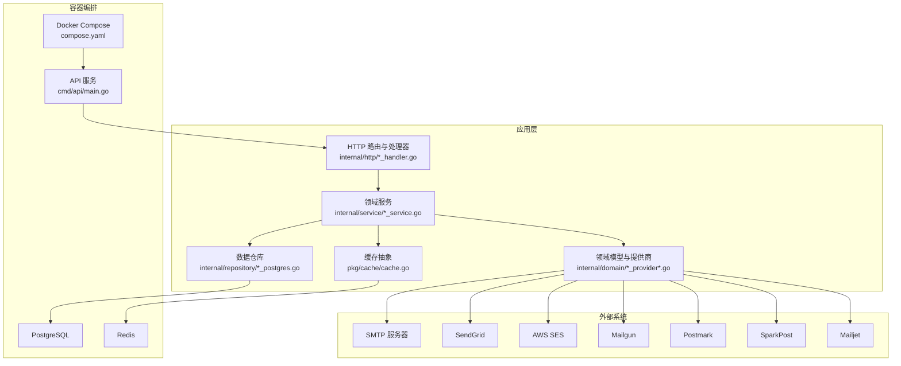
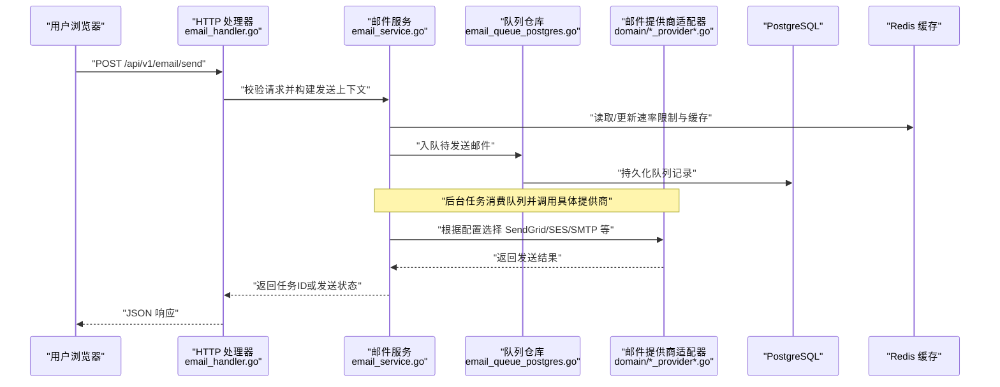
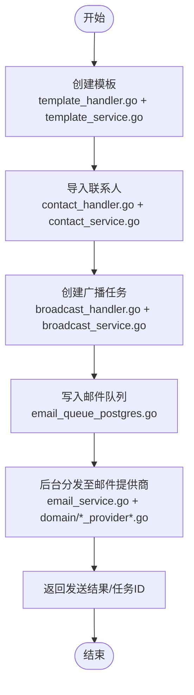
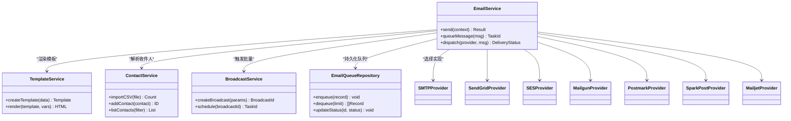
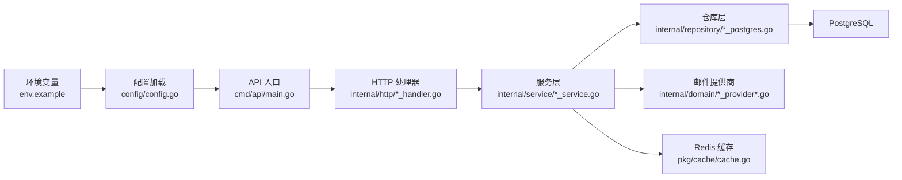

# 快速开始

<cite>
**本文引用的文件**   
- [compose.yaml](file://notifuse/compose.yaml)
- [env.example](file://notifuse/env.example)
- [config/config.go](file://notifuse/config/config.go)
- [cmd/api/main.go](file://notifuse/cmd/api/main.go)
- [internal/database/init.go](file://notifuse/internal/database/init.go)
- [internal/migrations/manager.go](file://notifuse/internal/migrations/manager.go)
- [internal/repository/email_queue_postgres.go](file://notifuse/internal/repository/email_queue_postgres.go)
- [internal/service/email_service.go](file://notifuse/internal/service/email_service.go)
- [internal/domain/email_provider_smtp.go](file://notifuse/internal/domain/email_provider_smtp.go)
- [internal/domain/email_provider_sendgrid.go](file://notifuse/internal/domain/email_provider_sendgrid.go)
- [internal/domain/email_provider_ses.go](file://notifuse/internal/domain/email_provider_ses.go)
- [internal/domain/email_provider_mailgun.go](file://notifuse/internal/domain/email_provider_mailgun.go)
- [internal/domain/email_provider_postmark.go](file://notifuse/internal/domain/email_provider_postmark.go)
- [internal/domain/email_provider_sparkpost.go](file://notifuse/internal/domain/email_provider_mailjet.go)
- [internal/http/email_handler.go](file://notifuse/internal/http/email_handler.go)
- [internal/http/template_handler.go](file://notifuse/internal/http/template_handler.go)
- [internal/http/contact_handler.go](file://notifuse/internal/http/contact_handler.go)
- [internal/http/broadcast_handler.go](file://notifuse/internal/http/broadcast_handler.go)
- [internal/service/template_service.go](file://notifuse/internal/service/template_service.go)
- [internal/service/contact_service.go](file://notifuse/internal/service/contact_service.go)
- [internal/service/broadcast_service.go](file://notifuse/internal/service/broadcast_service.go)
- [pkg/cache/cache.go](file://notifuse/pkg/cache/cache.go)
- [samples/sample_contacts.csv](file://notifuse/samples/sample_contacts.csv)
- [README.md](file://notifuse/README.md)
</cite>

## 目录
1. [简介](#简介)
2. [项目结构](#项目结构)
3. [核心组件](#核心组件)
4. [架构总览](#架构总览)
5. [详细组件分析](#详细组件分析)
6. [依赖关系分析](#依赖关系分析)
7. [性能考虑](#性能考虑)
8. [故障排查指南](#故障排查指南)
9. [结论](#结论)
10. [附录](#附录)

## 简介
本指南面向首次接触 Notifuse 的用户，目标是在 30 分钟内完成环境搭建、数据库初始化、关键环境变量配置，并通过“模板创建 → 联系人导入 → 批量发送”的完整流程成功发出第一封邮件。文档同时提供 Docker Compose 部署方式、本地开发环境说明、常见问题与优化建议。

## 项目结构
Notifuse 采用前后端分离与多服务编排：
- 后端 API（Go）：负责业务逻辑、数据持久化、队列与任务调度、第三方邮件服务商集成等
- 前端控制台（React/Vite）：提供模板管理、联系人管理、广播发送、设置等界面
- 数据库与缓存：PostgreSQL 用于持久化，Redis 用于缓存与会话/限流等
- 外部邮件服务：支持 SMTP、SendGrid、SES、Mailgun、Postmark、SparkPost、Mailjet 等

图表来源
- [compose.yaml:1-200](file://notifuse/compose.yaml#L1-L200)
- [cmd/api/main.go:1-200](file://notifuse/cmd/api/main.go#L1-L200)
- [internal/http/email_handler.go:1-200](file://notifuse/internal/http/email_handler.go#L1-L200)
- [internal/service/email_service.go:1-200](file://notifuse/internal/service/email_service.go#L1-L200)
- [internal/repository/email_queue_postgres.go:1-200](file://notifuse/internal/repository/email_queue_postgres.go#L1-L200)
- [pkg/cache/cache.go:1-200](file://notifuse/pkg/cache/cache.go#L1-L200)

章节来源
- [compose.yaml:1-200](file://notifuse/compose.yaml#L1-L200)
- [README.md:1-200](file://notifuse/README.md#L1-L200)

## 核心组件
- 配置与环境变量
  - 通过环境变量注入数据库连接、Redis、邮件提供商密钥、平台域名与安全参数等
  - 参考示例文件与配置加载实现以了解所有可用键名与默认值
- 数据库与迁移
  - 启动时自动执行数据库迁移，确保表结构与版本一致
- HTTP 接口
  - 暴露模板、联系人、广播、事务性邮件等 REST 接口
- 领域服务
  - 封装模板渲染、联系人管理、广播调度、消息历史、工作区权限等
- 邮件提供商适配
  - 统一抽象多种邮件服务商，按配置选择具体实现
- 缓存
  - 基于 Redis 的通用缓存接口，供热点数据与限流使用

章节来源
- [env.example:1-200](file://notifuse/env.example#L1-L200)
- [config/config.go:1-200](file://notifuse/config/config.go#L1-L200)
- [internal/database/init.go:1-200](file://notifuse/internal/database/init.go#L1-L200)
- [internal/migrations/manager.go:1-200](file://notifuse/internal/migrations/manager.go#L1-L200)
- [internal/http/email_handler.go:1-200](file://notifuse/internal/http/email_handler.go#L1-L200)
- [internal/service/email_service.go:1-200](file://notifuse/internal/service/email_service.go#L1-L200)
- [internal/domain/email_provider_smtp.go:1-200](file://notifuse/internal/domain/email_provider_smtp.go#L1-L200)
- [internal/domain/email_provider_sendgrid.go:1-200](file://notifuse/internal/domain/email_provider_sendgrid.go#L1-L200)
- [internal/domain/email_provider_ses.go:1-200](file://notifuse/internal/domain/email_provider_ses.go#L1-L200)
- [internal/domain/email_provider_mailgun.go:1-200](file://notifuse/internal/domain/email_provider_mailgun.go#L1-L200)
- [internal/domain/email_provider_postmark.go:1-200](file://notifuse/internal/domain/email_provider_postmark.go#L1-L200)
- [internal/domain/email_provider_sparkpost.go:1-200](file://notifuse/internal/domain/email_provider_sparkpost.go#L1-L200)
- [internal/domain/email_provider_mailjet.go:1-200](file://notifuse/internal/domain/email_provider_mailjet.go#L1-L200)
- [pkg/cache/cache.go:1-200](file://notifuse/pkg/cache/cache.go#L1-L200)

## 架构总览
下图展示从浏览器到邮件投递的关键调用链，涵盖模板渲染、联系人解析、队列写入与最终投递。

图表来源
- [internal/http/email_handler.go:1-200](file://notifuse/internal/http/email_handler.go#L1-L200)
- [internal/service/email_service.go:1-200](file://notifuse/internal/service/email_service.go#L1-L200)
- [internal/repository/email_queue_postgres.go:1-200](file://notifuse/internal/repository/email_queue_postgres.go#L1-L200)
- [internal/domain/email_provider_sendgrid.go:1-200](file://notifuse/internal/domain/email_provider_sendgrid.go#L1-L200)
- [internal/domain/email_provider_ses.go:1-200](file://notifuse/internal/domain/email_provider_ses.go#L1-L200)
- [internal/domain/email_provider_smtp.go:1-200](file://notifuse/internal/domain/email_provider_smtp.go#L1-L200)
- [pkg/cache/cache.go:1-200](file://notifuse/pkg/cache/cache.go#L1-L200)

## 详细组件分析

### 环境搭建与运行（Docker Compose）
- 准备配置文件
  - 复制示例环境变量文件并根据需要修改
  - 重点项包括数据库连接、Redis、邮件提供商密钥、平台域名与安全盐值等
- 启动服务
  - 使用 Docker Compose 一键拉起 API、数据库与缓存
  - 首次启动会自动执行数据库迁移
- 访问控制台
  - 浏览器打开控制台地址，完成初始管理员账户创建
  - 在设置中配置首选邮件提供商（如 SMTP、SendGrid、SES 等）

章节来源
- [compose.yaml:1-200](file://notifuse/compose.yaml#L1-L200)
- [env.example:1-200](file://notifuse/env.example#L1-L200)
- [internal/database/init.go:1-200](file://notifuse/internal/database/init.go#L1-L200)
- [internal/migrations/manager.go:1-200](file://notifuse/internal/migrations/manager.go#L1-L200)
- [README.md:1-200](file://notifuse/README.md#L1-L200)

### 环境变量配置要点
- 数据库连接
  - 主机、端口、用户名、密码、库名、SSL 模式等
- Redis 缓存
  - 主机、端口、密码、数据库索引、连接池大小等
- 邮件提供商
  - SMTP：主机、端口、加密方式、认证凭据、发件人域名
  - SendGrid：API Key、默认发件人与域名
  - AWS SES：Access Key、Secret Key、Region、发件域名
  - Mailgun：API Key、域名、区域
  - Postmark：Server Token、发件域名
  - SparkPost：API Key、发件域名
  - Mailjet：API Key、Secret Key、发件域名
- 平台与安全
  - 站点域名、Cookie 安全标志、JWT 密钥、CSRF 保护开关等

章节来源
- [env.example:1-200](file://notifuse/env.example#L1-L200)
- [config/config.go:1-200](file://notifuse/config/config.go#L1-L200)

### 第一个邮件发送全流程演示
步骤概览：
1) 创建模板
   - 在控制台新建模板，编写主题与正文（支持变量占位）
   - 保存并发布
2) 导入联系人
   - 下载示例 CSV，填写姓名与邮箱后上传
   - 或在控制台手动添加联系人
3) 发起广播（批量发送）
   - 选择已创建的模板与联系人列表
   - 预览并发送，查看发送统计与消息历史

图表来源
- [internal/http/template_handler.go:1-200](file://notifuse/internal/http/template_handler.go#L1-L200)
- [internal/service/template_service.go:1-200](file://notifuse/internal/service/template_service.go#L1-L200)
- [internal/http/contact_handler.go:1-200](file://notifuse/internal/http/contact_handler.go#L1-L200)
- [internal/service/contact_service.go:1-200](file://notifuse/internal/service/contact_service.go#L1-L200)
- [internal/http/broadcast_handler.go:1-200](file://notifuse/internal/http/broadcast_handler.go#L1-L200)
- [internal/service/broadcast_service.go:1-200](file://notifuse/internal/service/broadcast_service.go#L1-L200)
- [internal/repository/email_queue_postgres.go:1-200](file://notifuse/internal/repository/email_queue_postgres.go#L1-L200)
- [internal/service/email_service.go:1-200](file://notifuse/internal/service/email_service.go#L1-L200)
- [internal/domain/email_provider_smtp.go:1-200](file://notifuse/internal/domain/email_provider_smtp.go#L1-L200)
- [internal/domain/email_provider_sendgrid.go:1-200](file://notifuse/internal/domain/email_provider_sendgrid.go#L1-L200)
- [internal/domain/email_provider_ses.go:1-200](file://notifuse/internal/domain/email_provider_ses.go#L1-L200)
- [internal/domain/email_provider_mailgun.go:1-200](file://notifuse/internal/domain/email_provider_mailgun.go#L1-L200)
- [internal/domain/email_provider_postmark.go:1-200](file://notifuse/internal/domain/email_provider_postmark.go#L1-L200)
- [internal/domain/email_provider_sparkpost.go:1-200](file://notifuse/internal/domain/email_provider_sparkpost.go#L1-L200)
- [internal/domain/email_provider_mailjet.go:1-200](file://notifuse/internal/domain/email_provider_mailjet.go#L1-L200)
- [samples/sample_contacts.csv:1-200](file://notifuse/samples/sample_contacts.csv#L1-L200)

章节来源
- [internal/http/template_handler.go:1-200](file://notifuse/internal/http/template_handler.go#L1-L200)
- [internal/service/template_service.go:1-200](file://notifuse/internal/service/template_service.go#L1-L200)
- [internal/http/contact_handler.go:1-200](file://notifuse/internal/http/contact_handler.go#L1-L200)
- [internal/service/contact_service.go:1-200](file://notifuse/internal/service/contact_service.go#L1-L200)
- [internal/http/broadcast_handler.go:1-200](file://notifuse/internal/http/broadcast_handler.go#L1-L200)
- [internal/service/broadcast_service.go:1-200](file://notifuse/internal/service/broadcast_service.go#L1-L200)
- [internal/repository/email_queue_postgres.go:1-200](file://notifuse/internal/repository/email_queue_postgres.go#L1-L200)
- [internal/service/email_service.go:1-200](file://notifuse/internal/service/email_service.go#L1-L200)
- [samples/sample_contacts.csv:1-200](file://notifuse/samples/sample_contacts.csv#L1-L200)

### 对象关系与类图（核心领域与服务）

图表来源
- [internal/service/email_service.go:1-200](file://notifuse/internal/service/email_service.go#L1-L200)
- [internal/service/template_service.go:1-200](file://notifuse/internal/service/template_service.go#L1-L200)
- [internal/service/contact_service.go:1-200](file://notifuse/internal/service/contact_service.go#L1-L200)
- [internal/service/broadcast_service.go:1-200](file://notifuse/internal/service/broadcast_service.go#L1-L200)
- [internal/repository/email_queue_postgres.go:1-200](file://notifuse/internal/repository/email_queue_postgres.go#L1-L200)
- [internal/domain/email_provider_smtp.go:1-200](file://notifuse/internal/domain/email_provider_smtp.go#L1-L200)
- [internal/domain/email_provider_sendgrid.go:1-200](file://notifuse/internal/domain/email_provider_sendgrid.go#L1-L200)
- [internal/domain/email_provider_ses.go:1-200](file://notifuse/internal/domain/email_provider_ses.go#L1-L200)
- [internal/domain/email_provider_mailgun.go:1-200](file://notifuse/internal/domain/email_provider_mailgun.go#L1-L200)
- [internal/domain/email_provider_postmark.go:1-200](file://notifuse/internal/domain/email_provider_postmark.go#L1-L200)
- [internal/domain/email_provider_sparkpost.go:1-200](file://notifuse/internal/domain/email_provider_sparkpost.go#L1-L200)
- [internal/domain/email_provider_mailjet.go:1-200](file://notifuse/internal/domain/email_provider_mailjet.go#L1-L200)

## 依赖关系分析
- 直接依赖
  - HTTP 处理器依赖服务层；服务层依赖仓库与领域提供商；仓库依赖数据库；服务层可选依赖缓存
- 间接依赖
  - 迁移管理器在启动阶段初始化数据库结构；配置模块集中加载环境变量
- 外部依赖
  - 多种邮件服务商 SDK/HTTP 客户端；Redis 客户端；PostgreSQL 驱动

图表来源
- [env.example:1-200](file://notifuse/env.example#L1-L200)
- [config/config.go:1-200](file://notifuse/config/config.go#L1-L200)
- [cmd/api/main.go:1-200](file://notifuse/cmd/api/main.go#L1-L200)
- [internal/http/email_handler.go:1-200](file://notifuse/internal/http/email_handler.go#L1-L200)
- [internal/service/email_service.go:1-200](file://notifuse/internal/service/email_service.go#L1-L200)
- [internal/repository/email_queue_postgres.go:1-200](file://notifuse/internal/repository/email_queue_postgres.go#L1-L200)
- [internal/domain/email_provider_smtp.go:1-200](file://notifuse/internal/domain/email_provider_smtp.go#L1-L200)
- [pkg/cache/cache.go:1-200](file://notifuse/pkg/cache/cache.go#L1-L200)

章节来源
- [cmd/api/main.go:1-200](file://notifuse/cmd/api/main.go#L1-L200)
- [config/config.go:1-200](file://notifuse/config/config.go#L1-L200)
- [internal/database/init.go:1-200](file://notifuse/internal/database/init.go#L1-L200)
- [internal/migrations/manager.go:1-200](file://notifuse/internal/migrations/manager.go#L1-L200)

## 性能考虑
- 并发与队列
  - 合理调整队列消费者数量与批处理大小，避免下游邮件服务商限流
- 缓存策略
  - 对热点模板、联系人片段、速率限制计数进行缓存，降低数据库压力
- 数据库
  - 为常用查询字段建立索引；监控慢查询；定期清理历史消息
- 外部服务
  - 启用重试与退避；区分瞬时错误与永久错误；记录失败原因便于排障
- 资源隔离
  - 将高吞吐的广播任务与事务性邮件任务拆分到不同队列与消费者组

[本节为通用指导，不直接分析具体文件]

## 故障排查指南
- 无法连接数据库
  - 检查数据库主机、端口、用户名、密码与 SSL 模式是否正确
  - 确认迁移是否成功执行
- 无法连接 Redis
  - 检查 Redis 主机、端口、密码与数据库索引
- 邮件发送失败
  - 核对所选邮件提供商的配置（API Key/Token、域名、区域等）
  - 查看发送日志与错误分类，定位是认证、域名验证还是内容问题
- 模板渲染异常
  - 检查模板语法与变量映射；确认必填字段存在
- 速率限制
  - 检查全局与单域名的发送速率限制配置；适当放宽或分时段发送

章节来源
- [internal/database/init.go:1-200](file://notifuse/internal/database/init.go#L1-L200)
- [internal/migrations/manager.go:1-200](file://notifuse/internal/migrations/manager.go#L1-L200)
- [internal/service/email_service.go:1-200](file://notifuse/internal/service/email_service.go#L1-L200)
- [internal/domain/email_provider_smtp.go:1-200](file://notifuse/internal/domain/email_provider_smtp.go#L1-L200)
- [internal/domain/email_provider_sendgrid.go:1-200](file://notifuse/internal/domain/email_provider_sendgrid.go#L1-L200)
- [internal/domain/email_provider_ses.go:1-200](file://notifuse/internal/domain/email_provider_ses.go#L1-L200)
- [internal/domain/email_provider_mailgun.go:1-200](file://notifuse/internal/domain/email_provider_mailgun.go#L1-L200)
- [internal/domain/email_provider_postmark.go:1-200](file://notifuse/internal/domain/email_provider_postmark.go#L1-L200)
- [internal/domain/email_provider_sparkpost.go:1-200](file://notifuse/internal/domain/email_provider_sparkpost.go#L1-L200)
- [internal/domain/email_provider_mailjet.go:1-200](file://notifuse/internal/domain/email_provider_mailjet.go#L1-L200)

## 结论
通过本指南，您可以在 30 分钟内完成 Notifuse 的环境搭建、基础配置与首次邮件发送。后续可根据业务规模扩展队列与缓存、接入更多邮件提供商，并结合监控与告警提升稳定性与可观测性。

## 附录
- 示例联系人文件路径
  - [samples/sample_contacts.csv](file://notifuse/samples/sample_contacts.csv)
- 官方 README 与更多说明
  - [README.md](file://notifuse/README.md)