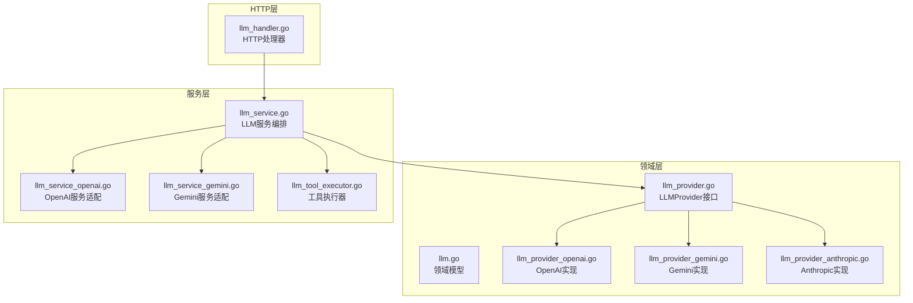
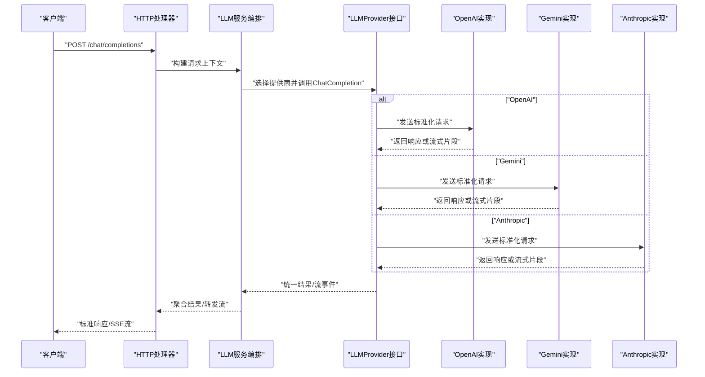
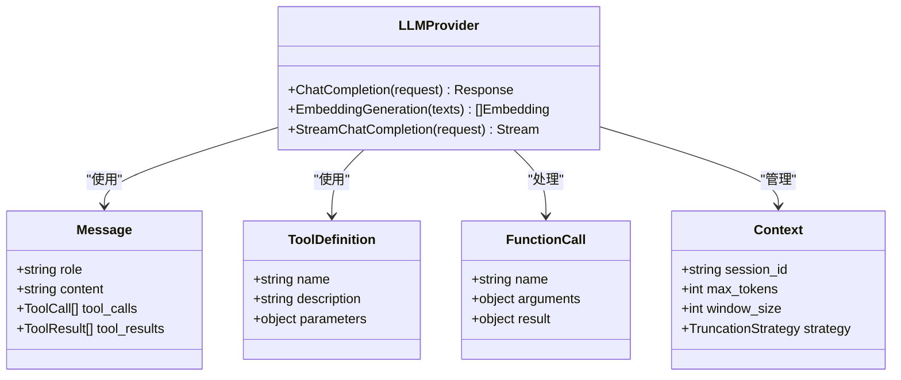
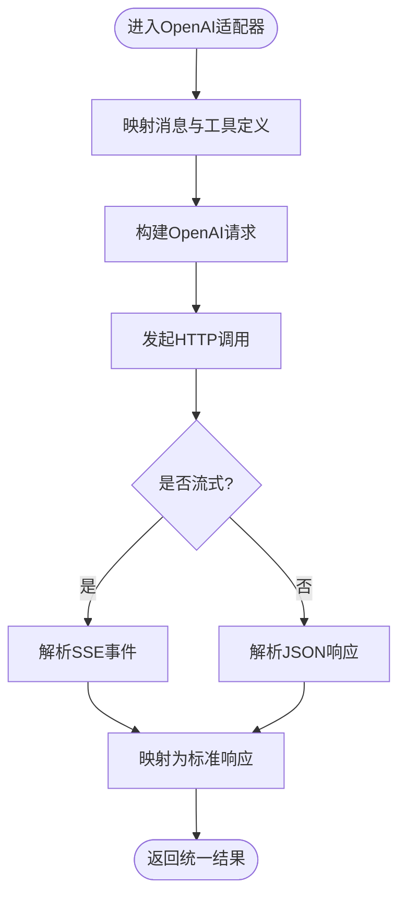
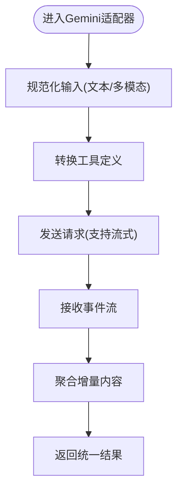
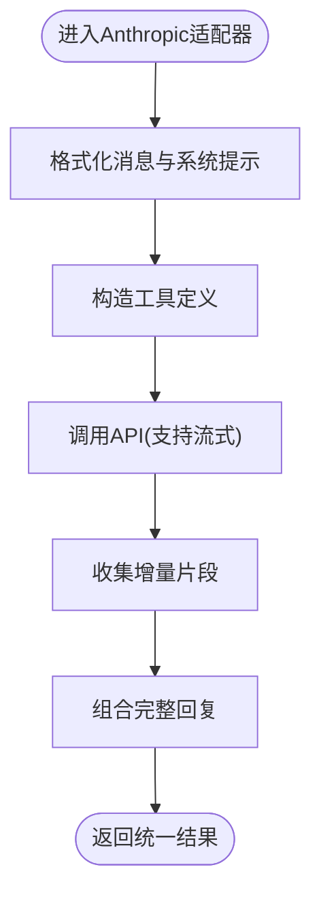
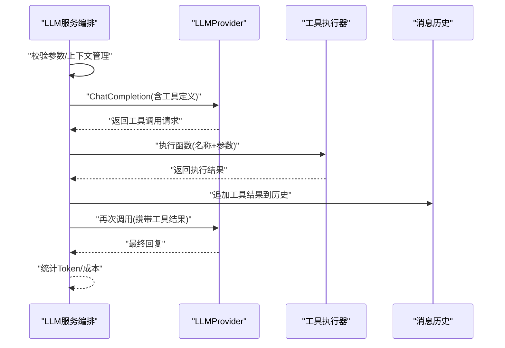
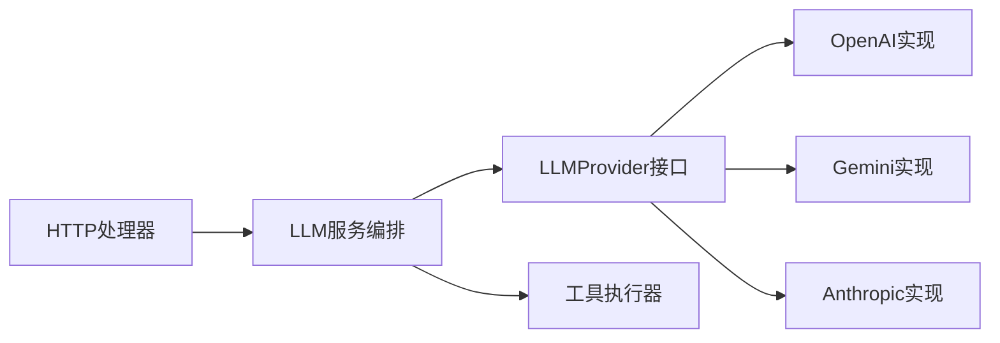
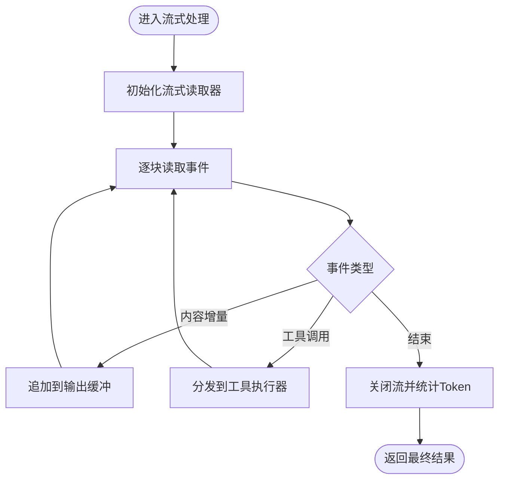

# LLM提供商适配器开发

<cite>
**本文引用的文件**   
- [llm.go](file://notifuse/internal/domain/llm.go)
- [llm_provider.go](file://notifuse/internal/domain/llm_provider.go)
- [llm_provider_openai.go](file://notifuse/internal/domain/llm_provider_openai.go)
- [llm_provider_gemini.go](file://notifuse/internal/domain/llm_provider_gemini.go)
- [llm_provider_anthropic.go](file://notifuse/internal/domain/llm_provider_anthropic.go)
- [llm_service.go](file://notifuse/internal/service/llm_service.go)
- [llm_service_openai.go](file://notifuse/internal/service/llm_service_openai.go)
- [llm_service_gemini.go](file://notifuse/internal/service/llm_service_gemini.go)
- [llm_tool_executor.go](file://notifuse/internal/service/llm_tool_executor.go)
- [llm_handler.go](file://notifuse/internal/http/llm_handler.go)
</cite>

## 目录
1. [简介](#简介)
2. [项目结构](#项目结构)
3. [核心组件](#核心组件)
4. [架构总览](#架构总览)
5. [详细组件分析](#详细组件分析)
6. [依赖关系分析](#依赖关系分析)
7. [性能考量](#性能考量)
8. [故障排查指南](#故障排查指南)
9. [结论](#结论)
10. [附录](#附录)

## 简介
本指南面向Notifuse平台中LLM提供商适配器的开发与集成，聚焦以下目标：
- 明确LLMProvider接口定义与实现要求（ChatCompletion、EmbeddingGeneration等）
- 统一不同AI提供商的API差异处理、认证机制与错误映射
- 规范消息格式转换、上下文管理与Token计算策略
- 提供OpenAI、Gemini、Anthropic等主流服务的集成示例与最佳实践
- 说明流式响应处理、并发控制与缓存策略
- 解释工具调用机制、函数定义与执行框架
- 给出测试用例模板、性能基准测试方法与故障恢复机制

## 项目结构
Notifuse中与LLM相关的代码主要分布在internal/domain与internal/service两个层次：
- internal/domain：定义领域模型与LLMProvider接口，以及各提供商的具体实现
- internal/service：封装服务层逻辑，包括编排、工具执行、流式处理、重试与限流等
- internal/http：HTTP处理器将外部请求转换为内部服务调用

图表来源
- [llm.go:1-200](file://notifuse/internal/domain/llm.go#L1-L200)
- [llm_provider.go:1-200](file://notifuse/internal/domain/llm_provider.go#L1-L200)
- [llm_provider_openai.go:1-200](file://notifuse/internal/domain/llm_provider_openai.go#L1-L200)
- [llm_provider_gemini.go:1-200](file://notifuse/internal/domain/llm_provider_gemini.go#L1-L200)
- [llm_provider_anthropic.go:1-200](file://notifuse/internal/domain/llm_provider_anthropic.go#L1-L200)
- [llm_service.go:1-200](file://notifuse/internal/service/llm_service.go#L1-L200)
- [llm_service_openai.go:1-200](file://notifuse/internal/service/llm_service_openai.go#L1-L200)
- [llm_service_gemini.go:1-200](file://notifuse/internal/service/llm_service_gemini.go#L1-L200)
- [llm_tool_executor.go:1-200](file://notifuse/internal/service/llm_tool_executor.go#L1-L200)
- [llm_handler.go:1-200](file://notifuse/internal/http/llm_handler.go#L1-L200)

章节来源
- [llm.go:1-200](file://notifuse/internal/domain/llm.go#L1-L200)
- [llm_provider.go:1-200](file://notifuse/internal/domain/llm_provider.go#L1-L200)
- [llm_service.go:1-200](file://notifuse/internal/service/llm_service.go#L1-L200)
- [llm_handler.go:1-200](file://notifuse/internal/http/llm_handler.go#L1-L200)

## 核心组件
- LLMProvider接口：定义统一的聊天补全与嵌入生成能力，屏蔽底层提供商差异
- 领域模型：消息、角色、工具定义、函数调用、结果等数据结构
- 服务编排：负责参数校验、上下文管理、重试与限流、流式输出、工具执行调度
- HTTP处理器：将外部请求解析为内部领域对象，并返回标准化响应

章节来源
- [llm_provider.go:1-200](file://notifuse/internal/domain/llm_provider.go#L1-L200)
- [llm.go:1-200](file://notifuse/internal/domain/llm.go#L1-L200)
- [llm_service.go:1-200](file://notifuse/internal/service/llm_service.go#L1-L200)
- [llm_handler.go:1-200](file://notifuse/internal/http/llm_handler.go#L1-L200)

## 架构总览
整体采用“接口抽象 + 多实现 + 服务编排”的分层设计。HTTP层仅做协议适配，核心业务在service层，具体网络交互在domain层的各Provider实现中完成。

图表来源
- [llm_handler.go:1-200](file://notifuse/internal/http/llm_handler.go#L1-L200)
- [llm_service.go:1-200](file://notifuse/internal/service/llm_service.go#L1-L200)
- [llm_provider.go:1-200](file://notifuse/internal/domain/llm_provider.go#L1-L200)
- [llm_provider_openai.go:1-200](file://notifuse/internal/domain/llm_provider_openai.go#L1-L200)
- [llm_provider_gemini.go:1-200](file://notifuse/internal/domain/llm_provider_gemini.go#L1-L200)
- [llm_provider_anthropic.go:1-200](file://notifuse/internal/domain/llm_provider_anthropic.go#L1-L200)

## 详细组件分析

### LLMProvider接口与领域模型
- 接口职责
  - ChatCompletion：支持文本对话、系统提示、历史上下文、工具定义与调用
  - EmbeddingGeneration：向量化文本，用于检索增强或相似度匹配
  - 可选：流式输出、Token统计、成本估算
- 领域模型要点
  - 消息角色：system、user、assistant、tool等
  - 工具定义：名称、描述、参数Schema
  - 函数调用：调用名、参数、返回值
  - 上下文：会话ID、窗口大小、截断策略
  - Token计算：按提供商规则统计输入/输出Token数

图表来源
- [llm_provider.go:1-200](file://notifuse/internal/domain/llm_provider.go#L1-L200)
- [llm.go:1-200](file://notifuse/internal/domain/llm.go#L1-L200)

章节来源
- [llm_provider.go:1-200](file://notifuse/internal/domain/llm_provider.go#L1-L200)
- [llm.go:1-200](file://notifuse/internal/domain/llm.go#L1-L200)

### OpenAI适配器
- API差异处理
  - 消息结构与角色映射
  - 工具定义与函数调用格式转换
  - 流式响应事件类型映射
- 认证机制
  - 通过环境变量或配置注入API密钥
  - 请求头设置与重试策略
- 错误映射
  - 将提供商错误码映射为平台通用错误类型
  - 区分速率限制、鉴权失败、内容安全拦截等

图表来源
- [llm_provider_openai.go:1-200](file://notifuse/internal/domain/llm_provider_openai.go#L1-L200)

章节来源
- [llm_provider_openai.go:1-200](file://notifuse/internal/domain/llm_provider_openai.go#L1-L200)

### Gemini适配器
- API差异处理
  - 多模态输入与文本输入的兼容
  - 工具调用与函数声明的差异映射
  - 流式事件与增量输出的合并
- 认证机制
  - 使用API密钥或OAuth令牌
  - 请求路径与版本前缀处理
- 错误映射
  - 针对配额、模型不可用、参数不合法等错误进行归类

图表来源
- [llm_provider_gemini.go:1-200](file://notifuse/internal/domain/llm_provider_gemini.go#L1-L200)

章节来源
- [llm_provider_gemini.go:1-200](file://notifuse/internal/domain/llm_provider_gemini.go#L1-L200)

### Anthropic适配器
- API差异处理
  - 消息格式与系统提示的处理方式
  - 工具调用与函数返回的结构映射
  - 流式输出中的delta与usage字段
- 认证机制
  - 基于API密钥的请求签名与头部设置
- 错误映射
  - 对超时、中断、内容过滤等错误进行分类与重试策略

图表来源
- [llm_provider_anthropic.go:1-200](file://notifuse/internal/domain/llm_provider_anthropic.go#L1-L200)

章节来源
- [llm_provider_anthropic.go:1-200](file://notifuse/internal/domain/llm_provider_anthropic.go#L1-L200)

### 服务编排与工具执行
- 编排职责
  - 参数校验、上下文裁剪、Token预算控制
  - 重试与退避、限流与熔断
  - 流式转发与缓冲
- 工具执行框架
  - 函数注册表、参数校验、执行环境隔离
  - 错误捕获与结果回写至消息历史

图表来源
- [llm_service.go:1-200](file://notifuse/internal/service/llm_service.go#L1-L200)
- [llm_tool_executor.go:1-200](file://notifuse/internal/service/llm_tool_executor.go#L1-L200)

章节来源
- [llm_service.go:1-200](file://notifuse/internal/service/llm_service.go#L1-L200)
- [llm_tool_executor.go:1-200](file://notifuse/internal/service/llm_tool_executor.go#L1-L200)

### HTTP处理器与外部集成
- 请求解析与响应封装
  - 将REST/GraphQL请求转换为内部领域对象
  - 支持SSE流式响应的转发
- 鉴权与审计
  - 工作区级鉴权、操作日志记录
- 错误与状态码映射
  - 将内部错误映射为HTTP状态码与错误体

章节来源
- [llm_handler.go:1-200](file://notifuse/internal/http/llm_handler.go#L1-L200)

## 依赖关系分析
- 耦合与内聚
  - domain层保持高内聚，仅暴露接口与领域模型
  - service层负责跨模块协作与横切关注点
  - http层仅做协议适配，避免业务逻辑下沉
- 外部依赖
  - HTTP客户端、加密库、日志与追踪
  - 第三方SDK或原生HTTP调用
- 潜在循环依赖
  - 通过接口解耦避免循环引用
  - 工具执行器以注册表形式扩展，降低紧耦合

图表来源
- [llm_handler.go:1-200](file://notifuse/internal/http/llm_handler.go#L1-L200)
- [llm_service.go:1-200](file://notifuse/internal/service/llm_service.go#L1-L200)
- [llm_provider.go:1-200](file://notifuse/internal/domain/llm_provider.go#L1-L200)
- [llm_provider_openai.go:1-200](file://notifuse/internal/domain/llm_provider_openai.go#L1-L200)
- [llm_provider_gemini.go:1-200](file://notifuse/internal/domain/llm_provider_gemini.go#L1-L200)
- [llm_provider_anthropic.go:1-200](file://notifuse/internal/domain/llm_provider_anthropic.go#L1-L200)
- [llm_tool_executor.go:1-200](file://notifuse/internal/service/llm_tool_executor.go#L1-L200)

章节来源
- [llm_handler.go:1-200](file://notifuse/internal/http/llm_handler.go#L1-L200)
- [llm_service.go:1-200](file://notifuse/internal/service/llm_service.go#L1-L200)
- [llm_provider.go:1-200](file://notifuse/internal/domain/llm_provider.go#L1-L200)

## 性能考量
- 流式响应
  - 优先使用SSE或Server-Sent Events减少首字节延迟
  - 合理设置缓冲区大小与背压策略
- 并发控制
  - 使用goroutine池或通道限制并发度
  - 对下游提供商进行限流与熔断保护
- 缓存策略
  - 对Embedding结果进行键值缓存（按文本哈希）
  - 对短上下文重复查询进行短期缓存
- Token计算与成本优化
  - 精确统计输入/输出Token，结合价格模型估算成本
  - 上下文裁剪与摘要压缩以降低Token消耗

[本节为通用指导，无需特定文件来源]

## 故障排查指南
- 常见错误分类
  - 鉴权失败：检查API密钥与工作区权限
  - 速率限制：启用指数退避与队列化重试
  - 内容安全拦截：调整提示词或白名单
  - 网络异常：重试策略与超时配置
- 诊断手段
  - 开启详细日志与追踪ID
  - 记录请求/响应摘要与Token用量
  - 使用模拟提供商进行回归测试

章节来源
- [llm_service.go:1-200](file://notifuse/internal/service/llm_service.go#L1-L200)
- [llm_handler.go:1-200](file://notifuse/internal/http/llm_handler.go#L1-L200)

## 结论
通过统一的LLMProvider接口与服务编排层，Notifuse能够以最小改动接入多家AI提供商，并在认证、错误映射、流式响应、工具执行与Token管理等方面保持一致体验。建议持续完善测试覆盖与性能基准，确保在多提供商场景下的稳定性与可观测性。

[本节为总结性内容，无需特定文件来源]

## 附录

### 测试用例模板
- 单元测试
  - 验证消息格式转换、工具定义与函数调用流程
  - 模拟提供商返回成功/失败/流式事件
- 集成测试
  - 端到端调用真实提供商（沙箱或Mock）
  - 校验Token统计与成本估算
- 性能基准
  - 吞吐与延迟指标采集
  - 不同上下文长度与并发度的压力测试

[本节为通用指导，无需特定文件来源]

### 流式响应处理流程图

图表来源
- [llm_service.go:1-200](file://notifuse/internal/service/llm_service.go#L1-L200)
- [llm_tool_executor.go:1-200](file://notifuse/internal/service/llm_tool_executor.go#L1-L200)