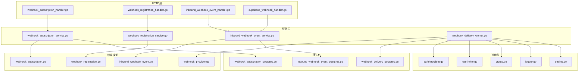
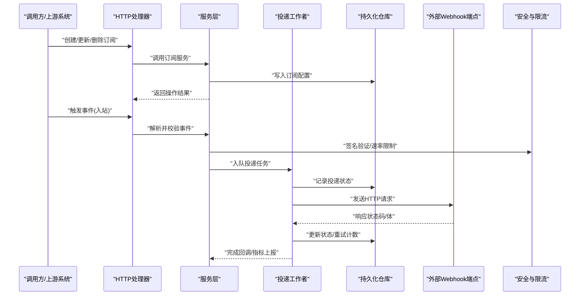
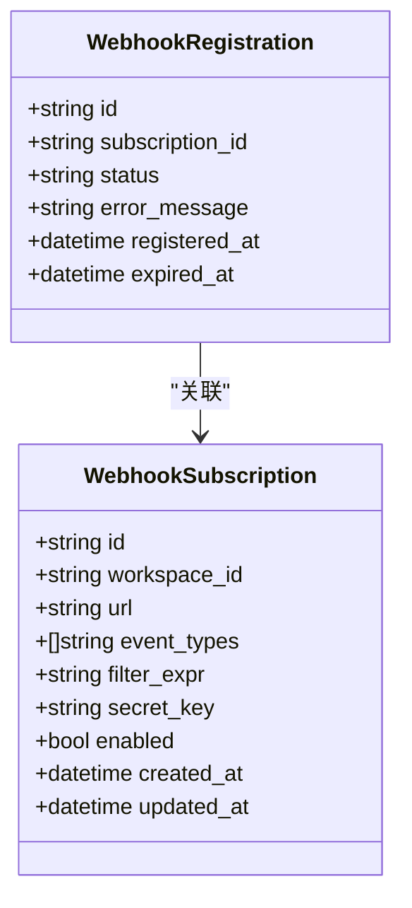
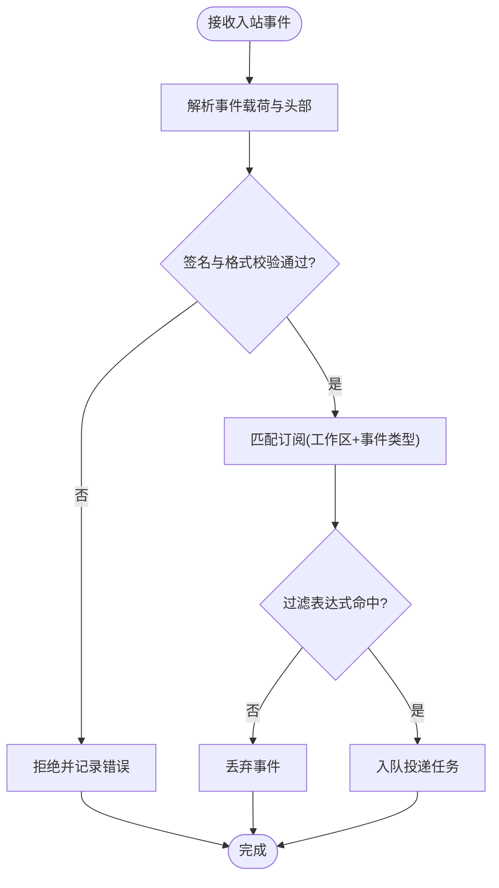
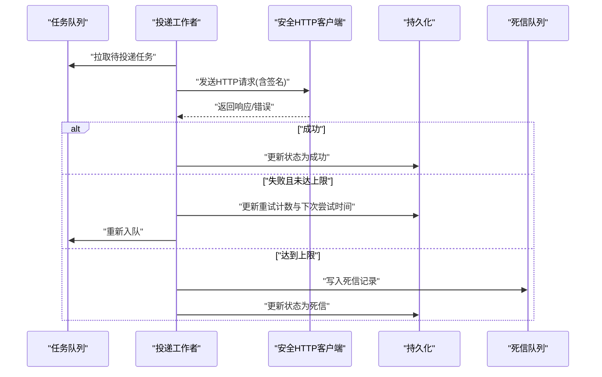
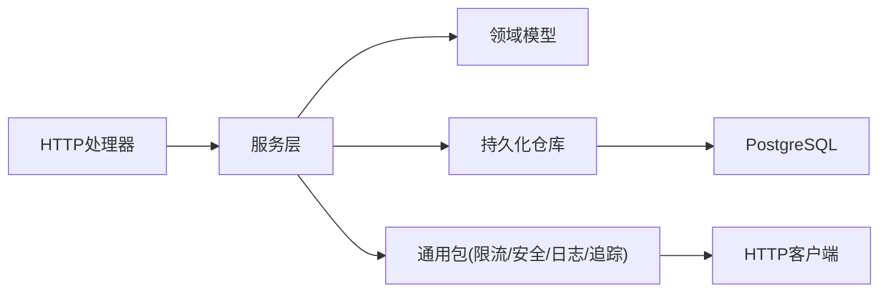

# Webhook事件处理器开发

<cite>
**本文引用的文件**   
- [webhook_provider.go](file://notifuse/internal/domain/webhook_provider.go)
- [webhook_subscription.go](file://notifuse/internal/domain/webhook_subscription.go)
- [webhook_registration.go](file://notifuse/internal/domain/webhook_registration.go)
- [inbound_webhook_event.go](file://notifuse/internal/domain/inbound_webhook_event.go)
- [webhook_delivery_worker.go](file://notifuse/internal/service/webhook_delivery_worker.go)
- [webhook_subscription_service.go](file://notifuse/internal/service/webhook_subscription_service.go)
- [webhook_registration_service.go](file://notifuse/internal/service/webhook_registration_service.go)
- [inbound_webhook_event_service.go](file://notifuse/internal/service/inbound_webhook_event_service.go)
- [webhook_subscription_handler.go](file://notifuse/internal/http/webhook_subscription_handler.go)
- [webhook_registration_handler.go](file://notifuse/internal/http/webhook_registration_handler.go)
- [inbound_webhook_event_handler.go](file://notifuse/internal/http/inbound_webhook_event_handler.go)
- [supabase_webhook_handler.go](file://notifuse/internal/http/supabase_webhook_handler.go)
- [webhook_delivery_postgres.go](file://notifuse/internal/repository/webhook_delivery_postgres.go)
- [webhook_subscription_postgres.go](file://notifuse/internal/repository/webhook_subscription_postgres.go)
- [inbound_webhook_event_postgres.go](file://notifuse/internal/repository/inbound_webhook_event_postgres.go)
- [ratelimiter.go](file://notifuse/pkg/ratelimiter/ratelimiter.go)
- [safehttpclient.go](file://notifuse/pkg/safehttpclient/safehttpclient.go)
- [crypto.go](file://notifuse/pkg/crypto/crypto.go)
- [logger.go](file://notifuse/pkg/logger/logger.go)
- [tracing.go](file://notifuse/pkg/tracing/tracing.go)
- [openapi.yaml](file://notifuse/openapi/openapi.yaml)
- [webhook-subscriptions.yaml](file://notifuse/openapi/paths/webhook-subscriptions.yaml)
</cite>

## 目录
1. [简介](#简介)
2. [项目结构](#项目结构)
3. [核心组件](#核心组件)
4. [架构总览](#架构总览)
5. [详细组件分析](#详细组件分析)
6. [依赖关系分析](#依赖关系分析)
7. [性能与可靠性](#性能与可靠性)
8. [故障排查指南](#故障排查指南)
9. [结论](#结论)
10. [附录](#附录)

## 简介
本指南面向需要在Notifuse平台中扩展Webhook能力的开发者，围绕WebhookProvider接口定义、事件订阅、消息发送、状态跟踪、重试与失败处理、死信队列管理、签名验证、安全与速率限制、监控指标、事件过滤与路由、批量处理机制以及测试与调试工具进行系统化说明。文档同时提供自定义Webhook事件类型的开发示例，帮助快速落地生产级能力。

## 项目结构
Notifuse的Webhook子系统采用分层设计：领域模型（domain）、服务层（service）、HTTP处理器（http）、持久化（repository）与通用包（pkg）。Webhook相关代码主要分布在internal/domain、internal/service、internal/http、internal/repository与pkg下。

图表来源
- [webhook_subscription_handler.go](file://notifuse/internal/http/webhook_subscription_handler.go)
- [webhook_registration_handler.go](file://notifuse/internal/http/webhook_registration_handler.go)
- [inbound_webhook_event_handler.go](file://notifuse/internal/http/inbound_webhook_event_handler.go)
- [supabase_webhook_handler.go](file://notifuse/internal/http/supabase_webhook_handler.go)
- [webhook_subscription_service.go](file://notifuse/internal/service/webhook_subscription_service.go)
- [webhook_registration_service.go](file://notifuse/internal/service/webhook_registration_service.go)
- [inbound_webhook_event_service.go](file://notifuse/internal/service/inbound_webhook_event_service.go)
- [webhook_delivery_worker.go](file://notifuse/internal/service/webhook_delivery_worker.go)
- [webhook_provider.go](file://notifuse/internal/domain/webhook_provider.go)
- [webhook_subscription.go](file://notifuse/internal/domain/webhook_subscription.go)
- [webhook_registration.go](file://notifuse/internal/domain/webhook_registration.go)
- [inbound_webhook_event.go](file://notifuse/internal/domain/inbound_webhook_event.go)
- [webhook_subscription_postgres.go](file://notifuse/internal/repository/webhook_subscription_postgres.go)
- [webhook_delivery_postgres.go](file://notifuse/internal/repository/webhook_delivery_postgres.go)
- [inbound_webhook_event_postgres.go](file://notifuse/internal/repository/inbound_webhook_event_postgres.go)
- [ratelimiter.go](file://notifuse/pkg/ratelimiter/ratelimiter.go)
- [safehttpclient.go](file://notifuse/pkg/safehttpclient/safehttpclient.go)
- [crypto.go](file://notifuse/pkg/crypto/crypto.go)
- [logger.go](file://notifuse/pkg/logger/logger.go)
- [tracing.go](file://notifuse/pkg/tracing/tracing.go)

章节来源
- [webhook_subscription_handler.go](file://notifuse/internal/http/webhook_subscription_handler.go)
- [webhook_registration_handler.go](file://notifuse/internal/http/webhook_registration_handler.go)
- [inbound_webhook_event_handler.go](file://notifuse/internal/http/inbound_webhook_event_handler.go)
- [supabase_webhook_handler.go](file://notifuse/internal/http/supabase_webhook_handler.go)
- [webhook_subscription_service.go](file://notifuse/internal/service/webhook_subscription_service.go)
- [webhook_registration_service.go](file://notifuse/internal/service/webhook_registration_service.go)
- [inbound_webhook_event_service.go](file://notifuse/internal/service/inbound_webhook_event_service.go)
- [webhook_delivery_worker.go](file://notifuse/internal/service/webhook_delivery_worker.go)
- [webhook_provider.go](file://notifuse/internal/domain/webhook_provider.go)
- [webhook_subscription.go](file://notifuse/internal/domain/webhook_subscription.go)
- [webhook_registration.go](file://notifuse/internal/domain/webhook_registration.go)
- [inbound_webhook_event.go](file://notifuse/internal/domain/inbound_webhook_event.go)
- [webhook_subscription_postgres.go](file://notifuse/internal/repository/webhook_subscription_postgres.go)
- [webhook_delivery_postgres.go](file://notifuse/internal/repository/webhook_delivery_postgres.go)
- [inbound_webhook_event_postgres.go](file://notifuse/internal/repository/inbound_webhook_event_postgres.go)
- [ratelimiter.go](file://notifuse/pkg/ratelimiter/ratelimiter.go)
- [safehttpclient.go](file://notifuse/pkg/safehttpclient/safehttpclient.go)
- [crypto.go](file://notifuse/pkg/crypto/crypto.go)
- [logger.go](file://notifuse/pkg/logger/logger.go)
- [tracing.go](file://notifuse/pkg/tracing/tracing.go)

## 核心组件
本节聚焦WebhookProvider接口及其在系统中的职责边界，包括事件订阅、消息发送与状态跟踪。

- WebhookProvider接口
  - 职责：定义外部Webhook提供方与系统交互的统一契约，涵盖事件订阅、消息发送与状态回写。
  - 关键方法（概念性描述）：
    - 订阅管理：注册/取消订阅目标端点、配置签名密钥与过滤规则。
    - 消息发送：将领域事件序列化为标准消息格式并投递到目标URL。
    - 状态跟踪：记录投递结果、错误码、重试次数与最终状态。
  - 实现要求：
    - 幂等性：对同一事件ID的请求需保证幂等。
    - 可观测性：埋点日志、指标上报与链路追踪。
    - 安全性：支持HMAC签名校验、TLS传输与证书校验。
    - 容错性：遵循指数退避重试策略，失败进入死信队列。

- 事件订阅与注册
  - webhook_subscription：表示某工作区下的订阅配置，包含目标URL、事件类型白名单、过滤条件、签名配置等。
  - webhook_registration：表示一次具体的注册生命周期，用于跟踪订阅创建、更新、删除与生效状态。

- 入站事件与出站投递
  - inbound_webhook_event：记录来自上游或内部触发的入站事件，作为后续分发与投递的源数据。
  - webhook_delivery_worker：负责从队列拉取待投递任务，执行发送、重试、落库与指标统计。

章节来源
- [webhook_provider.go](file://notifuse/internal/domain/webhook_provider.go)
- [webhook_subscription.go](file://notifuse/internal/domain/webhook_subscription.go)
- [webhook_registration.go](file://notifuse/internal/domain/webhook_registration.go)
- [inbound_webhook_event.go](file://notifuse/internal/domain/inbound_webhook_event.go)
- [webhook_delivery_worker.go](file://notifuse/internal/service/webhook_delivery_worker.go)

## 架构总览
下图展示了Webhook从触发到投递的全链路流程，包括HTTP入口、服务编排、投递器、持久化与安全组件的协作。

图表来源
- [webhook_subscription_handler.go](file://notifuse/internal/http/webhook_subscription_handler.go)
- [webhook_registration_handler.go](file://notifuse/internal/http/webhook_registration_handler.go)
- [inbound_webhook_event_handler.go](file://notifuse/internal/http/inbound_webhook_event_handler.go)
- [supabase_webhook_handler.go](file://notifuse/internal/http/supabase_webhook_handler.go)
- [webhook_subscription_service.go](file://notifuse/internal/service/webhook_subscription_service.go)
- [webhook_registration_service.go](file://notifuse/internal/service/webhook_registration_service.go)
- [inbound_webhook_event_service.go](file://notifuse/internal/service/inbound_webhook_event_service.go)
- [webhook_delivery_worker.go](file://notifuse/internal/service/webhook_delivery_worker.go)
- [webhook_subscription_postgres.go](file://notifuse/internal/repository/webhook_subscription_postgres.go)
- [webhook_delivery_postgres.go](file://notifuse/internal/repository/webhook_delivery_postgres.go)
- [inbound_webhook_event_postgres.go](file://notifuse/internal/repository/inbound_webhook_event_postgres.go)
- [ratelimiter.go](file://notifuse/pkg/ratelimiter/ratelimiter.go)
- [crypto.go](file://notifuse/pkg/crypto/crypto.go)

## 详细组件分析

### WebhookProvider接口与实现要点
- 接口职责
  - 订阅管理：提供注册、查询、更新与删除订阅的能力；支持按工作区隔离。
  - 消息发送：将事件转换为标准消息格式，附加签名头与必要元数据后发送至目标URL。
  - 状态跟踪：记录每次投递的状态、错误信息、重试次数与时间戳，支持查询与审计。
- 实现约束
  - 幂等键：使用事件ID或组合键避免重复投递。
  - 超时与重试：基于指数退避与抖动，设置最大重试次数与死信阈值。
  - 安全：强制HTTPS、可选客户端证书、HMAC签名验证。
  - 可观测性：结构化日志、指标计数、分布式追踪上下文透传。
- 典型实现模式
  - 工厂模式：根据订阅配置选择具体实现（如不同签名算法或协议适配）。
  - 装饰器模式：为发送过程叠加限流、签名、压缩、重试等横切逻辑。

章节来源
- [webhook_provider.go](file://notifuse/internal/domain/webhook_provider.go)

### 事件订阅与注册
- 订阅模型
  - 字段维度：工作区ID、目标URL、事件类型列表、过滤表达式、签名密钥、启用状态、创建/更新时间。
  - 行为语义：支持动态启用/禁用、灰度发布与A/B路由。
- 注册生命周期
  - 创建注册项，校验URL可达性与签名配置，生成唯一注册ID，持久化并返回。
  - 支持变更同步与失效清理。

图表来源
- [webhook_subscription.go](file://notifuse/internal/domain/webhook_subscription.go)
- [webhook_registration.go](file://notifuse/internal/domain/webhook_registration.go)

章节来源
- [webhook_subscription.go](file://notifuse/internal/domain/webhook_subscription.go)
- [webhook_registration.go](file://notifuse/internal/domain/webhook_registration.go)
- [webhook_subscription_service.go](file://notifuse/internal/service/webhook_subscription_service.go)
- [webhook_registration_service.go](file://notifuse/internal/service/webhook_registration_service.go)
- [webhook_subscription_postgres.go](file://notifuse/internal/repository/webhook_subscription_postgres.go)

### 入站事件处理与路由
- 入站事件模型
  - 字段维度：事件ID、类型、工作区ID、载荷JSON、来源标识、时间戳、签名与校验结果。
- 路由与过滤
  - 基于事件类型与工作区匹配订阅，应用过滤表达式筛选有效订阅。
  - 支持多订阅广播与去重策略。

图表来源
- [inbound_webhook_event.go](file://notifuse/internal/domain/inbound_webhook_event.go)
- [inbound_webhook_event_service.go](file://notifuse/internal/service/inbound_webhook_event_service.go)
- [inbound_webhook_event_handler.go](file://notifuse/internal/http/inbound_webhook_event_handler.go)

章节来源
- [inbound_webhook_event.go](file://notifuse/internal/domain/inbound_webhook_event.go)
- [inbound_webhook_event_service.go](file://notifuse/internal/service/inbound_webhook_event_service.go)
- [inbound_webhook_event_handler.go](file://notifuse/internal/http/inbound_webhook_event_handler.go)
- [inbound_webhook_event_postgres.go](file://notifuse/internal/repository/inbound_webhook_event_postgres.go)

### 投递工作者与重试/死信队列
- 投递流程
  - 从队列拉取任务，构建HTTP请求，附加签名头与追踪上下文。
  - 发送请求，解析响应，更新投递状态与重试计数。
  - 超过最大重试次数的事件转入死信队列，供人工干预与回放。
- 重试策略
  - 指数退避+随机抖动，区分瞬时错误与业务错误。
  - 针对特定HTTP状态码与网络异常进行差异化处理。
- 死信队列
  - 持久化失败详情、最后一次响应体与堆栈信息。
  - 提供查询、重试与告警能力。

图表来源
- [webhook_delivery_worker.go](file://notifuse/internal/service/webhook_delivery_worker.go)
- [webhook_delivery_postgres.go](file://notifuse/internal/repository/webhook_delivery_postgres.go)
- [safehttpclient.go](file://notifuse/pkg/safehttpclient/safehttpclient.go)

章节来源
- [webhook_delivery_worker.go](file://notifuse/internal/service/webhook_delivery_worker.go)
- [webhook_delivery_postgres.go](file://notifuse/internal/repository/webhook_delivery_postgres.go)

### 签名验证机制与消息格式规范
- 签名算法
  - 推荐使用HMAC-SHA256，使用订阅配置的密钥对请求体与关键头部进行签名。
  - 签名值放入自定义头部（例如X-Webhook-Signature），附带时间戳与随机数防重放。
- 消息格式
  - 统一JSON结构，包含事件ID、类型、时间戳、工作区ID、载荷与可选元数据。
  - 支持版本字段以兼容未来演进。
- 校验流程
  - 服务端收到请求后，提取签名与时间戳，使用相同算法计算期望签名并比对。
  - 校验时间窗口，拒绝过期请求。

章节来源
- [crypto.go](file://notifuse/pkg/crypto/crypto.go)
- [inbound_webhook_event.go](file://notifuse/internal/domain/inbound_webhook_event.go)
- [inbound_webhook_event_service.go](file://notifuse/internal/service/inbound_webhook_event_service.go)

### 安全考虑、速率限制与监控指标
- 安全
  - 强制HTTPS与证书校验，支持双向TLS。
  - HMAC签名与时间戳防重放，IP白名单与来源校验。
  - 敏感字段脱敏与最小权限原则。
- 速率限制
  - 基于工作区或目标URL维度进行令牌桶或滑动窗口限流。
  - 超限返回429并记录指标。
- 监控指标
  - 投递成功率、失败率、平均延迟、P95/P99延迟、重试次数分布、死信数量。
  - 订阅数量、事件吞吐、签名校验失败率。

章节来源
- [ratelimiter.go](file://notifuse/pkg/ratelimiter/ratelimiter.go)
- [safehttpclient.go](file://notifuse/pkg/safehttpclient/safehttpclient.go)
- [logger.go](file://notifuse/pkg/logger/logger.go)
- [tracing.go](file://notifuse/pkg/tracing/tracing.go)

### 事件过滤、路由规则与批量处理
- 过滤规则
  - 基于事件字段的路径表达式与比较运算符，支持AND/OR组合。
  - 预编译与缓存以提升性能。
- 路由规则
  - 多订阅广播与优先级排序，支持按标签或权重分流。
- 批量处理
  - 聚合多个事件为批请求以降低下游压力，注意幂等与一致性。
  - 分批大小与超时控制，失败子批次重试与整体补偿。

章节来源
- [webhook_subscription.go](file://notifuse/internal/domain/webhook_subscription.go)
- [webhook_subscription_service.go](file://notifuse/internal/service/webhook_subscription_service.go)

### 自定义Webhook事件类型开发示例
- 触发条件
  - 定义业务事件触发点（如联系人新增、模板更新、自动化节点完成）。
- 数据模型
  - 明确事件类型名称、必填字段、载荷结构与版本。
- 回调处理
  - 在服务层构造入站事件，写入持久化并投递。
  - 在订阅侧实现对应事件类型的解析与业务逻辑。

章节来源
- [inbound_webhook_event.go](file://notifuse/internal/domain/inbound_webhook_event.go)
- [inbound_webhook_event_service.go](file://notifuse/internal/service/inbound_webhook_event_service.go)
- [webhook_subscription.go](file://notifuse/internal/domain/webhook_subscription.go)

### API与OpenAPI参考
- OpenAPI定义
  - 提供订阅管理的REST接口定义，包括路径、参数、请求体与响应体。
- 关键路径
  - 订阅CRUD、事件触发、状态查询与重试。

章节来源
- [openapi.yaml](file://notifuse/openapi/openapi.yaml)
- [webhook-subscriptions.yaml](file://notifuse/openapi/paths/webhook-subscriptions.yaml)

## 依赖关系分析
Webhook子系统各层之间的依赖关系如下：

图表来源
- [webhook_subscription_handler.go](file://notifuse/internal/http/webhook_subscription_handler.go)
- [webhook_registration_handler.go](file://notifuse/internal/http/webhook_registration_handler.go)
- [inbound_webhook_event_handler.go](file://notifuse/internal/http/inbound_webhook_event_handler.go)
- [webhook_subscription_service.go](file://notifuse/internal/service/webhook_subscription_service.go)
- [webhook_registration_service.go](file://notifuse/internal/service/webhook_registration_service.go)
- [inbound_webhook_event_service.go](file://notifuse/internal/service/inbound_webhook_event_service.go)
- [webhook_subscription_postgres.go](file://notifuse/internal/repository/webhook_subscription_postgres.go)
- [webhook_delivery_postgres.go](file://notifuse/internal/repository/webhook_delivery_postgres.go)
- [inbound_webhook_event_postgres.go](file://notifuse/internal/repository/inbound_webhook_event_postgres.go)
- [ratelimiter.go](file://notifuse/pkg/ratelimiter/ratelimiter.go)
- [safehttpclient.go](file://notifuse/pkg/safehttpclient/safehttpclient.go)
- [logger.go](file://notifuse/pkg/logger/logger.go)
- [tracing.go](file://notifuse/pkg/tracing/tracing.go)

章节来源
- [webhook_subscription_handler.go](file://notifuse/internal/http/webhook_subscription_handler.go)
- [webhook_registration_handler.go](file://notifuse/internal/http/webhook_registration_handler.go)
- [inbound_webhook_event_handler.go](file://notifuse/internal/http/inbound_webhook_event_handler.go)
- [webhook_subscription_service.go](file://notifuse/internal/service/webhook_subscription_service.go)
- [webhook_registration_service.go](file://notifuse/internal/service/webhook_registration_service.go)
- [inbound_webhook_event_service.go](file://notifuse/internal/service/inbound_webhook_event_service.go)
- [webhook_subscription_postgres.go](file://notifuse/internal/repository/webhook_subscription_postgres.go)
- [webhook_delivery_postgres.go](file://notifuse/internal/repository/webhook_delivery_postgres.go)
- [inbound_webhook_event_postgres.go](file://notifuse/internal/repository/inbound_webhook_event_postgres.go)
- [ratelimiter.go](file://notifuse/pkg/ratelimiter/ratelimiter.go)
- [safehttpclient.go](file://notifuse/pkg/safehttpclient/safehttpclient.go)
- [logger.go](file://notifuse/pkg/logger/logger.go)
- [tracing.go](file://notifuse/pkg/tracing/tracing.go)

## 性能与可靠性
- 并发与吞吐
  - 投递工作者按工作区并行，避免热点冲突。
  - 连接池与超时控制，减少资源争用。
- 重试与背压
  - 指数退避与抖动降低雪崩风险。
  - 队列积压时自动降速与告警。
- 存储与索引
  - 订阅与投递记录按工作区与时间分区，提升查询效率。
  - 关键查询建立复合索引。
- 容量规划
  - 根据事件峰值估算队列深度与工作者数量。
  - 预留CPU与内存余量以应对突发流量。

[本节为通用指导，不直接分析具体文件]

## 故障排查指南
- 常见问题
  - 签名校验失败：检查密钥、时间戳窗口与头部命名。
  - 429限流：调整限流阈值或分片目标URL。
  - 投递超时：优化下游响应时间与网络质量。
  - 死信堆积：定位业务错误并批量重试。
- 诊断步骤
  - 查看投递状态与重试计数，确认是否达到死信阈值。
  - 检索最近失败的请求体与响应体，分析错误码与消息。
  - 核对订阅配置与过滤表达式，确保命中预期。
  - 检查限流与证书配置，排除基础设施问题。

章节来源
- [webhook_delivery_worker.go](file://notifuse/internal/service/webhook_delivery_worker.go)
- [webhook_delivery_postgres.go](file://notifuse/internal/repository/webhook_delivery_postgres.go)
- [inbound_webhook_event_service.go](file://notifuse/internal/service/inbound_webhook_event_service.go)
- [logger.go](file://notifuse/pkg/logger/logger.go)
- [tracing.go](file://notifuse/pkg/tracing/tracing.go)

## 结论
通过统一的WebhookProvider接口与分层架构，Notifuse实现了可扩展、高可靠、可观测的Webhook事件处理能力。结合签名验证、速率限制、重试与死信队列，系统在安全性与稳定性方面具备生产级保障。开发者可基于本文档快速扩展自定义事件类型与路由策略，并通过完善的测试与调试工具确保交付质量。

[本节为总结性内容，不直接分析具体文件]

## 附录
- 术语表
  - 订阅：工作区维度的Webhook目标配置。
  - 注册：订阅的生命周期实例，用于跟踪状态。
  - 入站事件：由上游或内部触发的原始事件。
  - 投递：将事件发送到目标URL的过程。
  - 死信：多次重试仍失败的事件，需人工介入。
- 最佳实践
  - 事件命名采用“域.动作”风格，保持清晰与稳定。
  - 载荷尽量小且幂等，避免携带敏感信息。
  - 为每个工作区独立密钥与限流策略。
  - 持续监控与告警，关注失败率与延迟。

[本节为补充信息，不直接分析具体文件]