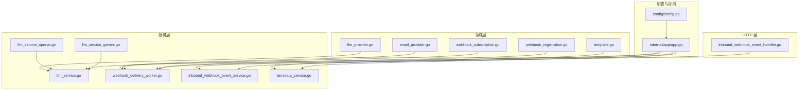
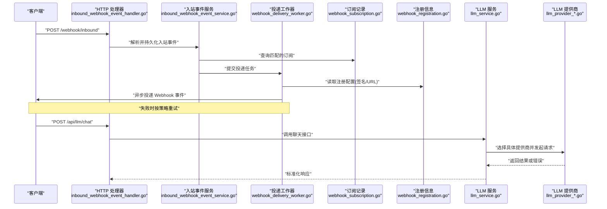
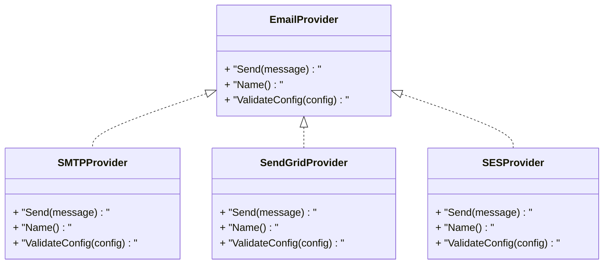
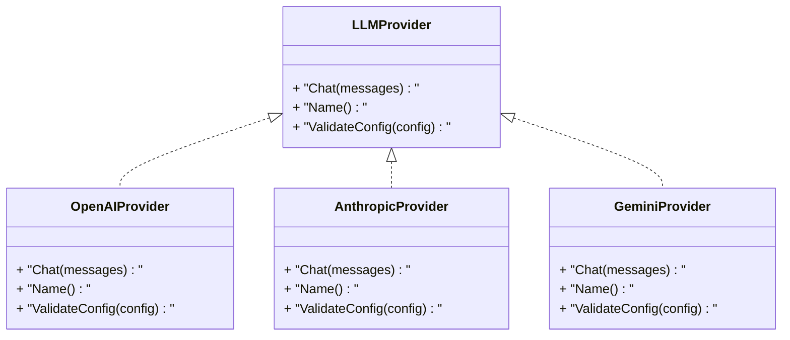
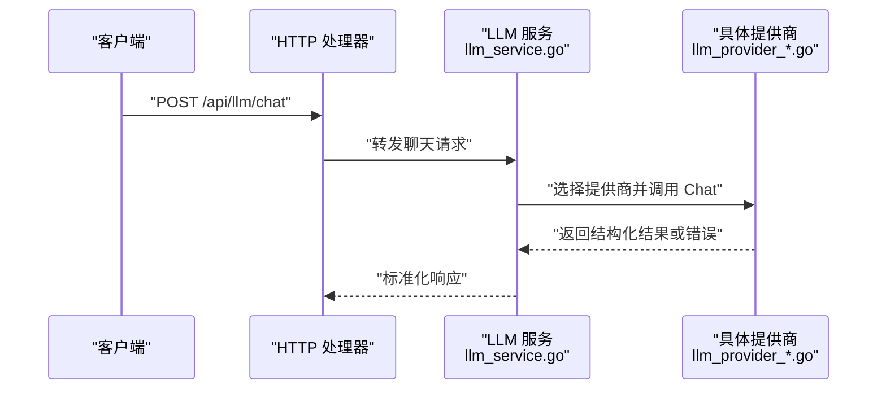
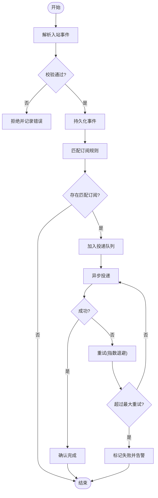
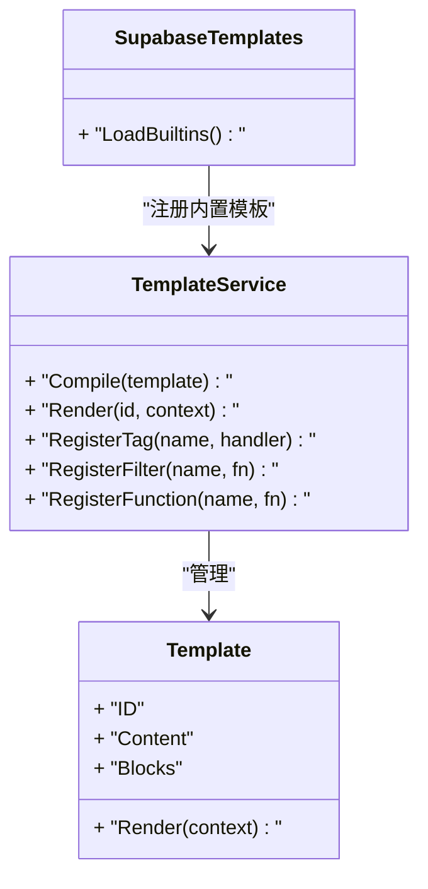
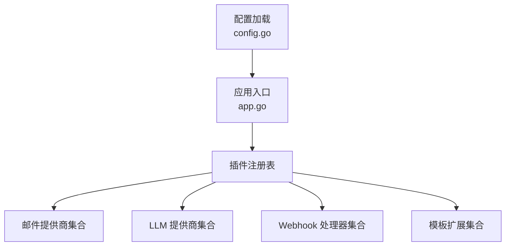
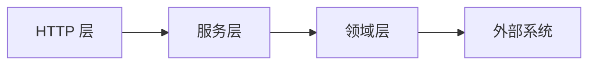

# 扩展开发

<cite>
**本文引用的文件**   
- [internal/domain/email_provider.go](file://notifuse/internal/domain/email_provider.go)
- [internal/domain/email_provider_smtp.go](file://notifuse/internal/domain/email_provider_smtp.go)
- [internal/domain/email_provider_sendgrid.go](file://notifuse/internal/domain/email_provider_sendgrid.go)
- [internal/domain/email_provider_ses.go](file://notifuse/internal/domain/email_provider_ses.go)
- [internal/domain/llm_provider.go](file://notifuse/internal/domain/llm_provider.go)
- [internal/domain/llm_provider_openai.go](file://notifuse/internal/domain/llm_provider_openai.go)
- [internal/domain/llm_provider_anthropic.go](file://notifuse/internal/domain/llm_provider_anthropic.go)
- [internal/domain/llm_provider_gemini.go](file://notifuse/internal/domain/llm_provider_gemini.go)
- [internal/service/llm_service.go](file://notifuse/internal/service/llm_service.go)
- [internal/service/llm_service_openai.go](file://notifuse/internal/service/llm_service_openai.go)
- [internal/service/llm_service_gemini.go](file://notifuse/internal/service/llm_service_gemini.go)
- [internal/domain/webhook_subscription.go](file://notifuse/internal/domain/webhook_subscription.go)
- [internal/domain/webhook_registration.go](file://notifuse/internal/domain/webhook_registration.go)
- [internal/service/webhook_delivery_worker.go](file://notifuse/internal/service/webhook_delivery_worker.go)
- [internal/service/inbound_webhook_event_service.go](file://notifuse/internal/service/inbound_webhook_event_service.go)
- [internal/http/inbound_webhook_event_handler.go](file://notifuse/internal/http/inbound_webhook_event_handler.go)
- [pkg/templates/supabase.go](file://notifuse/pkg/templates/supabase.go)
- [pkg/templates/supabase_email_change.go](file://notifuse/pkg/templates/supabase_email_change.go)
- [internal/domain/template.go](file://notifuse/internal/domain/template.go)
- [internal/service/template_service.go](file://notifuse/internal/service/template_service.go)
- [internal/app/app.go](file://notifuse/internal/app/app.go)
- [config/config.go](file://notifuse/config/config.go)
</cite>

## 目录
1. [简介](#简介)
2. [项目结构](#项目结构)
3. [核心组件](#核心组件)
4. [架构总览](#架构总览)
5. [详细组件分析](#详细组件分析)
6. [依赖关系分析](#依赖关系分析)
7. [性能考虑](#性能考虑)
8. [故障排查指南](#故障排查指南)
9. [结论](#结论)
10. [附录](#附录)

## 简介
本指南面向希望在 Notifuse 平台上进行扩展开发的工程师，覆盖以下主题：
- 自定义邮件提供商插件：接口定义、实现要求与测试方法
- LLM 提供商适配器：API 集成、认证处理与错误映射
- Webhook 事件处理器：事件订阅、消息处理与重试机制
- 模板引擎扩展：自定义标签、过滤器与函数
- 插件注册机制、配置管理与版本兼容性
- 完整开发示例、代码模板与调试技巧

## 项目结构
Notifuse 采用分层与领域驱动相结合的组织方式：
- internal/domain：领域模型与对外抽象接口（如邮件提供商、LLM 提供商、Webhook 订阅等）
- internal/service：业务服务编排与外部系统交互（如 LLM 服务、Webhook 投递工作器、模板服务等）
- internal/http：HTTP 层处理器，负责路由与请求解析
- pkg/templates：内置模板资源与渲染辅助
- config：平台配置加载与管理
- internal/app：应用启动与装配入口

图表来源
- [internal/domain/email_provider.go](file://notifuse/internal/domain/email_provider.go)
- [internal/domain/llm_provider.go](file://notifuse/internal/domain/llm_provider.go)
- [internal/domain/webhook_subscription.go](file://notifuse/internal/domain/webhook_subscription.go)
- [internal/domain/webhook_registration.go](file://notifuse/internal/domain/webhook_registration.go)
- [internal/domain/template.go](file://notifuse/internal/domain/template.go)
- [internal/service/llm_service.go](file://notifuse/internal/service/llm_service.go)
- [internal/service/llm_service_openai.go](file://notifuse/internal/service/llm_service_openai.go)
- [internal/service/llm_service_gemini.go](file://notifuse/internal/service/llm_service_gemini.go)
- [internal/service/webhook_delivery_worker.go](file://notifuse/internal/service/webhook_delivery_worker.go)
- [internal/service/inbound_webhook_event_service.go](file://notifuse/internal/service/inbound_webhook_event_service.go)
- [internal/http/inbound_webhook_event_handler.go](file://notifuse/internal/http/inbound_webhook_event_handler.go)
- [internal/domain/template.go](file://notifuse/internal/domain/template.go)
- [internal/service/template_service.go](file://notifuse/internal/service/template_service.go)
- [config/config.go](file://notifuse/config/config.go)
- [internal/app/app.go](file://notifuse/internal/app/app.go)

章节来源
- [internal/app/app.go](file://notifuse/internal/app/app.go)
- [config/config.go](file://notifuse/config/config.go)

## 核心组件
- 邮件提供商接口与实现：提供统一的发送能力，屏蔽底层差异
- LLM 提供商接口与服务：统一调用不同大模型 API，封装认证与错误映射
- Webhook 订阅与投递：支持事件订阅、异步投递与重试
- 模板服务与内置模板：提供模板渲染与扩展点

章节来源
- [internal/domain/email_provider.go](file://notifuse/internal/domain/email_provider.go)
- [internal/domain/llm_provider.go](file://notifuse/internal/domain/llm_provider.go)
- [internal/domain/webhook_subscription.go](file://notifuse/internal/domain/webhook_subscription.go)
- [internal/domain/webhook_registration.go](file://notifuse/internal/domain/webhook_registration.go)
- [internal/domain/template.go](file://notifuse/internal/domain/template.go)
- [internal/service/llm_service.go](file://notifuse/internal/service/llm_service.go)
- [internal/service/webhook_delivery_worker.go](file://notifuse/internal/service/webhook_delivery_worker.go)
- [internal/service/inbound_webhook_event_service.go](file://notifuse/internal/service/inbound_webhook_event_service.go)
- [internal/service/template_service.go](file://notifuse/internal/service/template_service.go)

## 架构总览
下图展示了从 HTTP 请求到领域服务与外部系统的整体流程，包括 Webhook 入站事件处理与 LLM 调用路径。

图表来源
- [internal/http/inbound_webhook_event_handler.go](file://notifuse/internal/http/inbound_webhook_event_handler.go)
- [internal/service/inbound_webhook_event_service.go](file://notifuse/internal/service/inbound_webhook_event_service.go)
- [internal/service/webhook_delivery_worker.go](file://notifuse/internal/service/webhook_delivery_worker.go)
- [internal/domain/webhook_subscription.go](file://notifuse/internal/domain/webhook_subscription.go)
- [internal/domain/webhook_registration.go](file://notifuse/internal/domain/webhook_registration.go)
- [internal/service/llm_service.go](file://notifuse/internal/service/llm_service.go)
- [internal/domain/llm_provider.go](file://notifuse/internal/domain/llm_provider.go)
- [internal/domain/llm_provider_openai.go](file://notifuse/internal/domain/llm_provider_openai.go)
- [internal/domain/llm_provider_anthropic.go](file://notifuse/internal/domain/llm_provider_anthropic.go)
- [internal/domain/llm_provider_gemini.go](file://notifuse/internal/domain/llm_provider_gemini.go)

## 详细组件分析

### 邮件提供商插件开发
- 目标：实现一个可插拔的邮件发送后端，遵循统一接口，便于在系统中替换与扩展
- 关键要点：
  - 实现领域定义的邮件提供商接口，包含必要的发送方法与元数据描述
  - 处理认证凭据、连接池、限流与错误分类
  - 提供单元测试以验证发送路径与错误分支
- 参考实现：
  - SMTP 提供商：用于本地或第三方 SMTP 服务器
  - SendGrid/SES 等云厂商提供商：展示如何适配不同 API 风格

图表来源
- [internal/domain/email_provider.go](file://notifuse/internal/domain/email_provider.go)
- [internal/domain/email_provider_smtp.go](file://notifuse/internal/domain/email_provider_smtp.go)
- [internal/domain/email_provider_sendgrid.go](file://notifuse/internal/domain/email_provider_sendgrid.go)
- [internal/domain/email_provider_ses.go](file://notifuse/internal/domain/email_provider_ses.go)

章节来源
- [internal/domain/email_provider.go](file://notifuse/internal/domain/email_provider.go)
- [internal/domain/email_provider_smtp.go](file://notifuse/internal/domain/email_provider_smtp.go)
- [internal/domain/email_provider_sendgrid.go](file://notifuse/internal/domain/email_provider_sendgrid.go)
- [internal/domain/email_provider_ses.go](file://notifuse/internal/domain/email_provider_ses.go)

#### 实现要求与测试方法
- 接口一致性：确保方法签名与行为符合领域接口约定
- 配置校验：对凭据、端点、区域等参数进行严格校验
- 错误分类：将下游错误映射为内部错误类型，便于上层统一处理
- 测试建议：
  - 使用内存或模拟 SMTP/HTTP 服务端进行单测
  - 覆盖成功、网络异常、认证失败、限流等场景
  - 断言日志与指标输出是否符合预期

章节来源
- [internal/domain/email_provider.go](file://notifuse/internal/domain/email_provider.go)

### LLM 提供商适配器开发
- 目标：为不同大模型（OpenAI、Anthropic、Gemini 等）提供统一调用入口
- 关键要点：
  - 实现领域定义的 LLM 提供商接口，封装各自 API 的差异
  - 处理认证（密钥、OAuth、签名等）、重试与超时
  - 将各提供商的错误码映射为统一错误类型
- 服务编排：
  - LLM 服务根据配置选择具体提供商实例
  - 提供聊天、补全等通用能力

图表来源
- [internal/domain/llm_provider.go](file://notifuse/internal/domain/llm_provider.go)
- [internal/domain/llm_provider_openai.go](file://notifuse/internal/domain/llm_provider_openai.go)
- [internal/domain/llm_provider_anthropic.go](file://notifuse/internal/domain/llm_provider_anthropic.go)
- [internal/domain/llm_provider_gemini.go](file://notifuse/internal/domain/llm_provider_gemini.go)

图表来源
- [internal/service/llm_service.go](file://notifuse/internal/service/llm_service.go)
- [internal/service/llm_service_openai.go](file://notifuse/internal/service/llm_service_openai.go)
- [internal/service/llm_service_gemini.go](file://notifuse/internal/service/llm_service_gemini.go)
- [internal/domain/llm_provider.go](file://notifuse/internal/domain/llm_provider.go)
- [internal/domain/llm_provider_openai.go](file://notifuse/internal/domain/llm_provider_openai.go)
- [internal/domain/llm_provider_anthropic.go](file://notifuse/internal/domain/llm_provider_anthropic.go)
- [internal/domain/llm_provider_gemini.go](file://notifuse/internal/domain/llm_provider_gemini.go)

章节来源
- [internal/domain/llm_provider.go](file://notifuse/internal/domain/llm_provider.go)
- [internal/domain/llm_provider_openai.go](file://notifuse/internal/domain/llm_provider_openai.go)
- [internal/domain/llm_provider_anthropic.go](file://notifuse/internal/domain/llm_provider_anthropic.go)
- [internal/domain/llm_provider_gemini.go](file://notifuse/internal/domain/llm_provider_gemini.go)
- [internal/service/llm_service.go](file://notifuse/internal/service/llm_service.go)
- [internal/service/llm_service_openai.go](file://notifuse/internal/service/llm_service_openai.go)
- [internal/service/llm_service_gemini.go](file://notifuse/internal/service/llm_service_gemini.go)

### Webhook 事件处理器开发
- 目标：实现事件订阅、入站事件处理与出站投递，具备可靠的重试机制
- 关键要点：
  - 订阅模型：定义事件类型、过滤条件与目标 URL
  - 注册信息：存储签名密钥、回调地址等
  - 入站事件服务：解析、校验与持久化入站事件
  - 投递工作器：异步投递、指数退避重试、失败告警
- 典型流程：

图表来源
- [internal/http/inbound_webhook_event_handler.go](file://notifuse/internal/http/inbound_webhook_event_handler.go)
- [internal/service/inbound_webhook_event_service.go](file://notifuse/internal/service/inbound_webhook_event_service.go)
- [internal/service/webhook_delivery_worker.go](file://notifuse/internal/service/webhook_delivery_worker.go)
- [internal/domain/webhook_subscription.go](file://notifuse/internal/domain/webhook_subscription.go)
- [internal/domain/webhook_registration.go](file://notifuse/internal/domain/webhook_registration.go)

章节来源
- [internal/domain/webhook_subscription.go](file://notifuse/internal/domain/webhook_subscription.go)
- [internal/domain/webhook_registration.go](file://notifuse/internal/domain/webhook_registration.go)
- [internal/service/inbound_webhook_event_service.go](file://notifuse/internal/service/inbound_webhook_event_service.go)
- [internal/service/webhook_delivery_worker.go](file://notifuse/internal/service/webhook_delivery_worker.go)
- [internal/http/inbound_webhook_event_handler.go](file://notifuse/internal/http/inbound_webhook_event_handler.go)

### 模板引擎扩展开发
- 目标：扩展模板渲染能力，支持自定义标签、过滤器与函数
- 关键要点：
  - 模板领域模型：定义模板结构与块组织
  - 模板服务：编译、缓存与渲染
  - 内置模板资源：提供开箱即用的模板样例
- 扩展模式：
  - 自定义标签：在渲染阶段注入逻辑
  - 过滤器：对变量进行转换
  - 函数：暴露可复用的计算能力

图表来源
- [internal/domain/template.go](file://notifuse/internal/domain/template.go)
- [internal/service/template_service.go](file://notifuse/internal/service/template_service.go)
- [pkg/templates/supabase.go](file://notifuse/pkg/templates/supabase.go)
- [pkg/templates/supabase_email_change.go](file://notifuse/pkg/templates/supabase_email_change.go)

章节来源
- [internal/domain/template.go](file://notifuse/internal/domain/template.go)
- [internal/service/template_service.go](file://notifuse/internal/service/template_service.go)
- [pkg/templates/supabase.go](file://notifuse/pkg/templates/supabase.go)
- [pkg/templates/supabase_email_change.go](file://notifuse/pkg/templates/supabase_email_change.go)

### 插件注册机制、配置管理与版本兼容
- 插件注册：
  - 在应用启动时集中注册邮件提供商、LLM 提供商、Webhook 处理器与模板扩展
  - 通过配置开关启用/禁用特定插件
- 配置管理：
  - 集中加载环境变量与配置文件
  - 提供默认值与校验
- 版本兼容：
  - 迁移脚本与版本号管理，保证升级平滑
  - 向后兼容字段与弃用策略

图表来源
- [internal/app/app.go](file://notifuse/internal/app/app.go)
- [config/config.go](file://notifuse/config/config.go)

章节来源
- [internal/app/app.go](file://notifuse/internal/app/app.go)
- [config/config.go](file://notifuse/config/config.go)

## 依赖关系分析
- 低耦合高内聚：领域接口与服务实现分离，HTTP 层仅依赖服务层
- 外部依赖：
  - 邮件提供商依赖 SMTP/HTTP SDK
  - LLM 提供商依赖各自 API 客户端
  - Webhook 投递依赖 HTTP 客户端与队列/调度器
- 潜在循环依赖：
  - 避免服务层直接引用 HTTP 层
  - 领域层不依赖具体实现细节

图表来源
- [internal/http/inbound_webhook_event_handler.go](file://notifuse/internal/http/inbound_webhook_event_handler.go)
- [internal/service/inbound_webhook_event_service.go](file://notifuse/internal/service/inbound_webhook_event_service.go)
- [internal/domain/webhook_subscription.go](file://notifuse/internal/domain/webhook_subscription.go)

章节来源
- [internal/http/inbound_webhook_event_handler.go](file://notifuse/internal/http/inbound_webhook_event_handler.go)
- [internal/service/inbound_webhook_event_service.go](file://notifuse/internal/service/inbound_webhook_event_service.go)
- [internal/domain/webhook_subscription.go](file://notifuse/internal/domain/webhook_subscription.go)

## 性能考虑
- 连接复用：SMTP/HTTP 客户端应复用连接，减少握手开销
- 并发控制：限制并发请求数，避免压垮下游服务
- 重试策略：指数退避与抖动，防止雪崩
- 缓存：模板编译结果与配置缓存，降低重复计算
- 监控：埋点与指标收集，识别瓶颈与异常

[本节为通用指导，无需源码引用]

## 故障排查指南
- 常见问题：
  - 认证失败：检查凭据格式、权限范围与签名算法
  - 网络超时：调整超时与重试参数，检查防火墙与代理
  - 模板渲染错误：验证上下文数据与自定义标签/过滤器实现
- 调试技巧：
  - 开启详细日志，记录请求/响应与错误堆栈
  - 使用本地模拟服务（SMTP/HTTP）隔离问题
  - 逐步缩小范围，定位是上游还是下游问题

章节来源
- [internal/service/webhook_delivery_worker.go](file://notifuse/internal/service/webhook_delivery_worker.go)
- [internal/service/inbound_webhook_event_service.go](file://notifuse/internal/service/inbound_webhook_event_service.go)
- [internal/service/template_service.go](file://notifuse/internal/service/template_service.go)

## 结论
通过遵循统一的领域接口与服务编排模式，开发者可以高效地为 Notifuse 平台扩展邮件提供商、LLM 适配器、Webhook 处理器与模板能力。结合完善的配置管理与版本兼容策略，可在保持系统稳定性的同时快速迭代新功能。

[本节为总结性内容，无需源码引用]

## 附录
- 开发清单：
  - 明确接口契约与错误语义
  - 编写覆盖多场景的单测与集成测试
  - 提供配置示例与文档
  - 增加监控与告警
- 参考路径：
  - 邮件提供商实现参考：[internal/domain/email_provider_smtp.go](file://notifuse/internal/domain/email_provider_smtp.go)、[internal/domain/email_provider_sendgrid.go](file://notifuse/internal/domain/email_provider_sendgrid.go)、[internal/domain/email_provider_ses.go](file://notifuse/internal/domain/email_provider_ses.go)
  - LLM 提供商实现参考：[internal/domain/llm_provider_openai.go](file://notifuse/internal/domain/llm_provider_openai.go)、[internal/domain/llm_provider_anthropic.go](file://notifuse/internal/domain/llm_provider_anthropic.go)、[internal/domain/llm_provider_gemini.go](file://notifuse/internal/domain/llm_provider_gemini.go)
  - Webhook 处理参考：[internal/service/webhook_delivery_worker.go](file://notifuse/internal/service/webhook_delivery_worker.go)、[internal/service/inbound_webhook_event_service.go](file://notifuse/internal/service/inbound_webhook_event_service.go)
  - 模板扩展参考：[internal/service/template_service.go](file://notifuse/internal/service/template_service.go)、[pkg/templates/supabase.go](file://notifuse/pkg/templates/supabase.go)