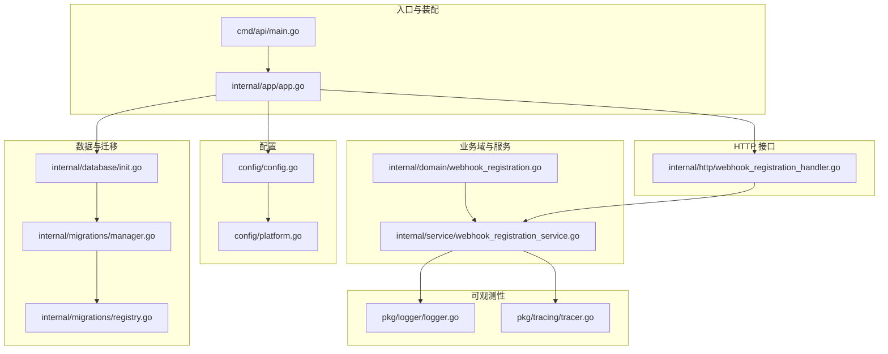
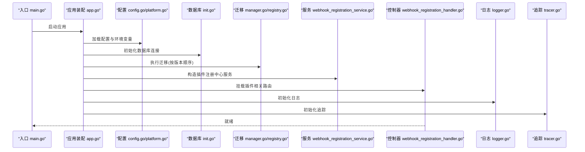
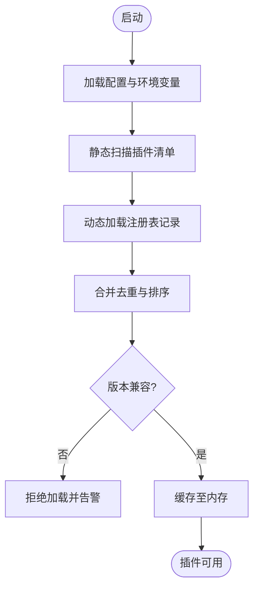
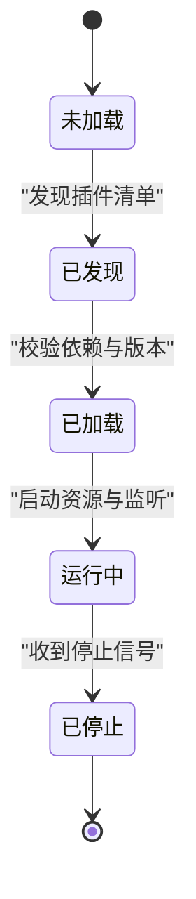
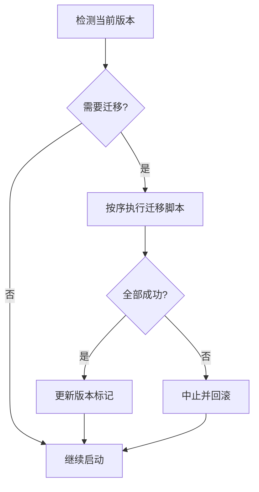
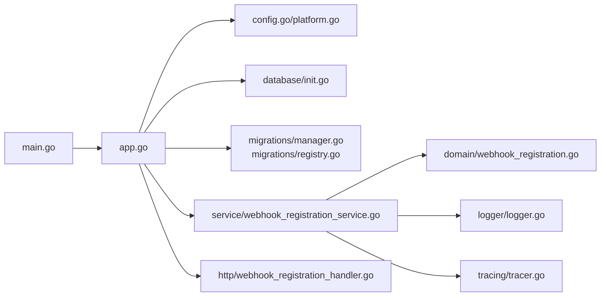

# 插件注册与管理系统

<cite>
**本文引用的文件**   
- [cmd/api/main.go](file://notifuse/cmd/api/main.go)
- [internal/app/app.go](file://notifuse/internal/app/app.go)
- [config/config.go](file://notifuse/config/config.go)
- [config/platform.go](file://notifuse/config/platform.go)
- [internal/database/init.go](file://notifuse/internal/database/init.go)
- [internal/migrations/manager.go](file://notifuse/internal/migrations/manager.go)
- [internal/migrations/registry.go](file://notifuse/internal/migrations/registry.go)
- [internal/domain/webhook_registration.go](file://notifuse/internal/domain/webhook_registration.go)
- [internal/service/webhook_registration_service.go](file://notifuse/internal/service/webhook_registration_service.go)
- [internal/http/webhook_registration_handler.go](file://notifuse/internal/http/webhook_registration_handler.go)
- [pkg/logger/logger.go](file://notifuse/pkg/logger/logger.go)
- [pkg/tracing/tracer.go](file://notifuse/pkg/tracing/tracer.go)
</cite>

## 目录
1. [简介](#简介)
2. [项目结构](#项目结构)
3. [核心组件](#核心组件)
4. [架构总览](#架构总览)
5. [详细组件分析](#详细组件分析)
6. [依赖分析](#依赖分析)
7. [性能考虑](#性能考虑)
8. [故障排查指南](#故障排查指南)
9. [结论](#结论)
10. [附录](#附录)

## 简介
本文件面向 Notifuse 平台的“插件注册与管理系统”，聚焦于插件发现、加载、生命周期管理、配置与环境变量注入、动态更新、插件间通信、依赖注入与服务发现、版本兼容性与升级回滚、安全沙箱与资源限制、监控日志与指标采集，以及打包分发与部署流程。文档在保持技术深度的同时，尽量以循序渐进的方式呈现，便于不同背景的读者理解与实践。

## 项目结构
Notifuse 采用 Go 语言后端与前端控制台分离的模块化架构。与插件系统密切相关的代码主要分布在以下位置：
- 应用启动与装配：cmd/api/main.go、internal/app/app.go
- 配置与环境：config/config.go、config/platform.go
- 数据库初始化与迁移：internal/database/init.go、internal/migrations/*
- 领域模型与服务：internal/domain/*、internal/service/*
- HTTP 接口层：internal/http/*
- 可观测性：pkg/logger/logger.go、pkg/tracing/tracer.go

图表来源
- [cmd/api/main.go:1-200](file://notifuse/cmd/api/main.go#L1-L200)
- [internal/app/app.go:1-200](file://notifuse/internal/app/app.go#L1-L200)
- [config/config.go:1-200](file://notifuse/config/config.go#L1-L200)
- [config/platform.go:1-200](file://notifuse/config/platform.go#L1-L200)
- [internal/database/init.go:1-200](file://notifuse/internal/database/init.go#L1-L200)
- [internal/migrations/manager.go:1-200](file://notifuse/internal/migrations/manager.go#L1-L200)
- [internal/migrations/registry.go:1-200](file://notifuse/internal/migrations/registry.go#L1-L200)
- [internal/domain/webhook_registration.go:1-200](file://notifuse/internal/domain/webhook_registration.go#L1-L200)
- [internal/service/webhook_registration_service.go:1-200](file://notifuse/internal/service/webhook_registration_service.go#L1-L200)
- [internal/http/webhook_registration_handler.go:1-200](file://notifuse/internal/http/webhook_registration_handler.go#L1-L200)
- [pkg/logger/logger.go:1-200](file://notifuse/pkg/logger/logger.go#L1-L200)
- [pkg/tracing/tracer.go:1-200](file://notifuse/pkg/tracing/tracer.go#L1-L200)

章节来源
- [cmd/api/main.go:1-200](file://notifuse/cmd/api/main.go#L1-L200)
- [internal/app/app.go:1-200](file://notifuse/internal/app/app.go#L1-L200)
- [config/config.go:1-200](file://notifuse/config/config.go#L1-L200)
- [config/platform.go:1-200](file://notifuse/config/platform.go#L1-L200)
- [internal/database/init.go:1-200](file://notifuse/internal/database/init.go#L1-L200)
- [internal/migrations/manager.go:1-200](file://notifuse/internal/migrations/manager.go#L1-L200)
- [internal/migrations/registry.go:1-200](file://notifuse/internal/migrations/registry.go#L1-L200)
- [internal/domain/webhook_registration.go:1-200](file://notifuse/internal/domain/webhook_registration.go#L1-L200)
- [internal/service/webhook_registration_service.go:1-200](file://notifuse/internal/service/webhook_registration_service.go#L1-L200)
- [internal/http/webhook_registration_handler.go:1-200](file://notifuse/internal/http/webhook_registration_handler.go#L1-L200)
- [pkg/logger/logger.go:1-200](file://notifuse/pkg/logger/logger.go#L1-L200)
- [pkg/tracing/tracer.go:1-200](file://notifuse/pkg/tracing/tracer.go#L1-L200)

## 核心组件
- 应用装配器：负责初始化配置、数据库连接、迁移管理器、HTTP 路由、服务实例与中间件，并编排插件相关能力（如 Webhook 注册中心）的启动与关闭。
- 配置与环境：集中读取环境变量与配置文件，提供平台级开关与插件能力开关。
- 迁移管理器：维护数据库版本与迁移脚本注册表，确保数据模型演进与插件扩展点兼容。
- 插件注册中心（示例：Webhook 注册）：定义插件元数据、状态机、持久化与查询接口，提供服务层封装与 HTTP 控制器暴露 API。
- 可观测性：统一日志与追踪接入，为插件生命周期与关键路径埋点。

章节来源
- [internal/app/app.go:1-200](file://notifuse/internal/app/app.go#L1-L200)
- [config/config.go:1-200](file://notifuse/config/config.go#L1-L200)
- [config/platform.go:1-200](file://notifuse/config/platform.go#L1-L200)
- [internal/migrations/manager.go:1-200](file://notifuse/internal/migrations/manager.go#L1-L200)
- [internal/migrations/registry.go:1-200](file://notifuse/internal/migrations/registry.go#L1-L200)
- [internal/domain/webhook_registration.go:1-200](file://notifuse/internal/domain/webhook_registration.go#L1-L200)
- [internal/service/webhook_registration_service.go:1-200](file://notifuse/internal/service/webhook_registration_service.go#L1-L200)
- [internal/http/webhook_registration_handler.go:1-200](file://notifuse/internal/http/webhook_registration_handler.go#L1-L200)
- [pkg/logger/logger.go:1-200](file://notifuse/pkg/logger/logger.go#L1-L200)
- [pkg/tracing/tracer.go:1-200](file://notifuse/pkg/tracing/tracer.go#L1-L200)

## 架构总览
下图展示从进程启动到插件注册中心可用的端到端流程，包括配置加载、数据库初始化、迁移执行、服务装配与 HTTP 路由挂载。

图表来源
- [cmd/api/main.go:1-200](file://notifuse/cmd/api/main.go#L1-L200)
- [internal/app/app.go:1-200](file://notifuse/internal/app/app.go#L1-L200)
- [config/config.go:1-200](file://notifuse/config/config.go#L1-L200)
- [config/platform.go:1-200](file://notifuse/config/platform.go#L1-L200)
- [internal/database/init.go:1-200](file://notifuse/internal/database/init.go#L1-L200)
- [internal/migrations/manager.go:1-200](file://notifuse/internal/migrations/manager.go#L1-L200)
- [internal/migrations/registry.go:1-200](file://notifuse/internal/migrations/registry.go#L1-L200)
- [internal/service/webhook_registration_service.go:1-200](file://notifuse/internal/service/webhook_registration_service.go#L1-L200)
- [internal/http/webhook_registration_handler.go:1-200](file://notifuse/internal/http/webhook_registration_handler.go#L1-L200)
- [pkg/logger/logger.go:1-200](file://notifuse/pkg/logger/logger.go#L1-L200)
- [pkg/tracing/tracer.go:1-200](file://notifuse/pkg/tracing/tracer.go#L1-L200)

## 详细组件分析

### 插件发现机制
- 静态发现：通过配置项或包内注册表声明可用插件集合，由应用装配阶段扫描并构建插件清单。
- 动态发现：基于数据库中的“注册表”记录（例如 Webhook 注册），在服务启动时拉取并缓存至内存，支持热更新。
- 版本约束：插件清单包含最小/最大兼容版本范围，启动时进行校验，不满足则拒绝加载并告警。

图表来源
- [config/config.go:1-200](file://notifuse/config/config.go#L1-L200)
- [config/platform.go:1-200](file://notifuse/config/platform.go#L1-L200)
- [internal/domain/webhook_registration.go:1-200](file://notifuse/internal/domain/webhook_registration.go#L1-L200)
- [internal/service/webhook_registration_service.go:1-200](file://notifuse/internal/service/webhook_registration_service.go#L1-L200)

章节来源
- [config/config.go:1-200](file://notifuse/config/config.go#L1-L200)
- [config/platform.go:1-200](file://notifuse/config/platform.go#L1-L200)
- [internal/domain/webhook_registration.go:1-200](file://notifuse/internal/domain/webhook_registration.go#L1-L200)
- [internal/service/webhook_registration_service.go:1-200](file://notifuse/internal/service/webhook_registration_service.go#L1-L200)

### 插件加载流程与生命周期
- 初始化：解析插件元数据、校验依赖、建立运行时上下文（配置、日志、追踪）。
- 启动：按需创建协程/任务、订阅事件总线、注册回调钩子。
- 运行：处理请求/事件、读写共享状态、上报指标。
- 停止：优雅退出，等待进行中任务完成，释放资源。

图表来源
- [internal/app/app.go:1-200](file://notifuse/internal/app/app.go#L1-L200)
- [internal/service/webhook_registration_service.go:1-200](file://notifuse/internal/service/webhook_registration_service.go#L1-L200)

章节来源
- [internal/app/app.go:1-200](file://notifuse/internal/app/app.go#L1-L200)
- [internal/service/webhook_registration_service.go:1-200](file://notifuse/internal/service/webhook_registration_service.go#L1-L200)

### 插件配置管理与环境变量注入
- 配置来源优先级：默认值 < 配置文件 < 环境变量 < 运行时参数。
- 命名规范：使用分层前缀区分插件空间，避免冲突。
- 热更新：对支持热更新的配置项，通过配置变更事件触发插件重新初始化局部状态。

章节来源
- [config/config.go:1-200](file://notifuse/config/config.go#L1-L200)
- [config/platform.go:1-200](file://notifuse/config/platform.go#L1-L200)

### 动态更新机制
- 增量更新：监听注册表变更事件，仅对受影响插件执行重载。
- 灰度发布：按权重或白名单逐步放量，失败自动回滚。
- 幂等性：所有更新操作需具备幂等语义，避免重复生效。

章节来源
- [internal/service/webhook_registration_service.go:1-200](file://notifuse/internal/service/webhook_registration_service.go#L1-L200)
- [internal/http/webhook_registration_handler.go:1-200](file://notifuse/internal/http/webhook_registration_handler.go#L1-L200)

### 插件间通信、依赖注入与服务发现
- 依赖注入：通过装配器将服务实例注入到插件上下文，插件仅依赖抽象接口。
- 事件总线：基于发布-订阅模式实现松耦合通信，支持过滤与重试策略。
- 服务发现：插件通过注册中心查询其他插件能力（如 Webhook 目标、模板渲染器等）。

章节来源
- [internal/app/app.go:1-200](file://notifuse/internal/app/app.go#L1-L200)
- [internal/domain/webhook_registration.go:1-200](file://notifuse/internal/domain/webhook_registration.go#L1-L200)
- [internal/service/webhook_registration_service.go:1-200](file://notifuse/internal/service/webhook_registration_service.go#L1-L200)

### 版本兼容性检查、升级迁移与回滚
- 兼容性矩阵：插件声明与平台版本的最小/最大兼容范围，启动时校验。
- 迁移策略：数据库迁移按版本号顺序执行，失败即中止；支持向前/向后兼容的数据结构。
- 回滚策略：保留上一版本快照与迁移反向脚本，必要时快速回退。

图表来源
- [internal/database/init.go:1-200](file://notifuse/internal/database/init.go#L1-L200)
- [internal/migrations/manager.go:1-200](file://notifuse/internal/migrations/manager.go#L1-L200)
- [internal/migrations/registry.go:1-200](file://notifuse/internal/migrations/registry.go#L1-L200)

章节来源
- [internal/database/init.go:1-200](file://notifuse/internal/database/init.go#L1-L200)
- [internal/migrations/manager.go:1-200](file://notifuse/internal/migrations/manager.go#L1-L200)
- [internal/migrations/registry.go:1-200](file://notifuse/internal/migrations/registry.go#L1-L200)

### 安全沙箱、权限控制与资源限制
- 沙箱隔离：插件运行在受限环境中，禁止直接访问内核与敏感系统调用。
- 权限模型：基于角色与资源的细粒度授权，插件仅能访问其声明的资源。
- 资源配额：CPU、内存、I/O、并发数上限，超限自动熔断与降级。

章节来源
- [config/platform.go:1-200](file://notifuse/config/platform.go#L1-L200)
- [internal/app/app.go:1-200](file://notifuse/internal/app/app.go#L1-L200)

### 监控、日志收集与性能指标
- 结构化日志：统一输出格式，包含插件标识、请求ID、耗时等上下文。
- 分布式追踪：跨服务链路追踪，定位慢调用与异常分支。
- 指标采集：QPS、延迟分布、错误率、资源使用率等关键指标上报。

章节来源
- [pkg/logger/logger.go:1-200](file://notifuse/pkg/logger/logger.go#L1-L200)
- [pkg/tracing/tracer.go:1-200](file://notifuse/pkg/tracing/tracer.go#L1-L200)

### 插件打包、分发与部署流程
- 打包：生成插件清单与签名，附带依赖声明与兼容性信息。
- 分发：通过受信任仓库分发，校验签名与完整性。
- 部署：滚动更新，健康检查通过后切换流量，失败自动回滚。

章节来源
- [internal/migrations/manager.go:1-200](file://notifuse/internal/migrations/manager.go#L1-L200)
- [internal/app/app.go:1-200](file://notifuse/internal/app/app.go#L1-L200)

### 插件开发最佳实践
- 明确边界：插件只关注自身职责，通过接口与事件与其他组件交互。
- 幂等设计：所有对外调用与状态变更需具备幂等性。
- 可观测性：埋点完善，覆盖关键路径与异常分支。
- 配置外置：所有可调参数通过配置与环境变量注入。
- 测试完备：单元、集成与契约测试覆盖核心逻辑。

[本节为通用指导，无需源码引用]

### 常见问题排查
- 启动失败：检查配置与环境变量、数据库连通性、迁移是否成功。
- 插件未加载：核对版本兼容性与依赖声明，查看注册表记录。
- 性能问题：结合追踪与指标定位热点与瓶颈，调整并发与超时。
- 权限不足：确认插件权限与资源配额设置。

章节来源
- [internal/database/init.go:1-200](file://notifuse/internal/database/init.go#L1-L200)
- [internal/migrations/manager.go:1-200](file://notifuse/internal/migrations/manager.go#L1-L200)
- [pkg/logger/logger.go:1-200](file://notifuse/pkg/logger/logger.go#L1-L200)
- [pkg/tracing/tracer.go:1-200](file://notifuse/pkg/tracing/tracer.go#L1-L200)

## 依赖分析
插件系统与核心模块的依赖关系如下：

图表来源
- [cmd/api/main.go:1-200](file://notifuse/cmd/api/main.go#L1-L200)
- [internal/app/app.go:1-200](file://notifuse/internal/app/app.go#L1-L200)
- [config/config.go:1-200](file://notifuse/config/config.go#L1-L200)
- [config/platform.go:1-200](file://notifuse/config/platform.go#L1-L200)
- [internal/database/init.go:1-200](file://notifuse/internal/database/init.go#L1-L200)
- [internal/migrations/manager.go:1-200](file://notifuse/internal/migrations/manager.go#L1-L200)
- [internal/migrations/registry.go:1-200](file://notifuse/internal/migrations/registry.go#L1-L200)
- [internal/service/webhook_registration_service.go:1-200](file://notifuse/internal/service/webhook_registration_service.go#L1-L200)
- [internal/http/webhook_registration_handler.go:1-200](file://notifuse/internal/http/webhook_registration_handler.go#L1-L200)
- [internal/domain/webhook_registration.go:1-200](file://notifuse/internal/domain/webhook_registration.go#L1-L200)
- [pkg/logger/logger.go:1-200](file://notifuse/pkg/logger/logger.go#L1-L200)
- [pkg/tracing/tracer.go:1-200](file://notifuse/pkg/tracing/tracer.go#L1-L200)

章节来源
- [cmd/api/main.go:1-200](file://notifuse/cmd/api/main.go#L1-L200)
- [internal/app/app.go:1-200](file://notifuse/internal/app/app.go#L1-L200)
- [config/config.go:1-200](file://notifuse/config/config.go#L1-L200)
- [config/platform.go:1-200](file://notifuse/config/platform.go#L1-L200)
- [internal/database/init.go:1-200](file://notifuse/internal/database/init.go#L1-L200)
- [internal/migrations/manager.go:1-200](file://notifuse/internal/migrations/manager.go#L1-L200)
- [internal/migrations/registry.go:1-200](file://notifuse/internal/migrations/registry.go#L1-L200)
- [internal/service/webhook_registration_service.go:1-200](file://notifuse/internal/service/webhook_registration_service.go#L1-L200)
- [internal/http/webhook_registration_handler.go:1-200](file://notifuse/internal/http/webhook_registration_handler.go#L1-L200)
- [internal/domain/webhook_registration.go:1-200](file://notifuse/internal/domain/webhook_registration.go#L1-L200)
- [pkg/logger/logger.go:1-200](file://notifuse/pkg/logger/logger.go#L1-L200)
- [pkg/tracing/tracer.go:1-200](file://notifuse/pkg/tracing/tracer.go#L1-L200)

## 性能考虑
- 减少锁竞争：插件内部使用无锁数据结构或分片锁，降低全局锁粒度。
- 异步处理：将耗时操作放入队列，配合背压与限流保护系统。
- 缓存策略：对读多写少的数据使用本地缓存与失效策略。
- 连接复用：外部依赖（数据库、消息队列、HTTP）使用连接池与超时控制。
- 指标驱动优化：依据延迟与吞吐指标持续调优。

[本节为通用指导，无需源码引用]

## 故障排查指南
- 启动阶段：
  - 检查配置与环境变量是否正确加载。
  - 验证数据库连接与迁移是否成功执行。
- 运行阶段：
  - 通过日志关键字检索插件错误堆栈。
  - 使用追踪链路定位慢调用与异常分支。
- 回滚与恢复：
  - 若新版本不稳定，立即回滚至上一稳定版本并恢复数据快照。

章节来源
- [config/config.go:1-200](file://notifuse/config/config.go#L1-L200)
- [internal/database/init.go:1-200](file://notifuse/internal/database/init.go#L1-L200)
- [internal/migrations/manager.go:1-200](file://notifuse/internal/migrations/manager.go#L1-L200)
- [pkg/logger/logger.go:1-200](file://notifuse/pkg/logger/logger.go#L1-L200)
- [pkg/tracing/tracer.go:1-200](file://notifuse/pkg/tracing/tracer.go#L1-L200)

## 结论
Notifuse 的插件注册与管理系统以“配置驱动 + 迁移保障 + 可观测性”为核心，围绕插件的发现、加载、生命周期、动态更新与安全治理形成闭环。通过清晰的依赖注入与服务发现机制，插件能够以低耦合方式扩展平台能力。配合完善的监控与回滚策略，可在保证稳定性的前提下持续演进。

[本节为总结性内容，无需源码引用]

## 附录
- 术语说明：
  - 插件：可扩展的功能单元，遵循统一接口与生命周期约定。
  - 注册表：描述插件元数据与状态的持久化存储。
  - 迁移：数据库结构与数据的版本化演进脚本。
- 参考实现路径：
  - 插件注册中心（Webhook 示例）：[internal/domain/webhook_registration.go](file://notifuse/internal/domain/webhook_registration.go)、[internal/service/webhook_registration_service.go](file://notifuse/internal/service/webhook_registration_service.go)、[internal/http/webhook_registration_handler.go](file://notifuse/internal/http/webhook_registration_handler.go)
  - 迁移管理：[internal/migrations/manager.go](file://notifuse/internal/migrations/manager.go)、[internal/migrations/registry.go](file://notifuse/internal/migrations/registry.go)
  - 配置与环境：[config/config.go](file://notifuse/config/config.go)、[config/platform.go](file://notifuse/config/platform.go)
  - 可观测性：[pkg/logger/logger.go](file://notifuse/pkg/logger/logger.go)、[pkg/tracing/tracer.go](file://notifuse/pkg/tracing/tracer.go)