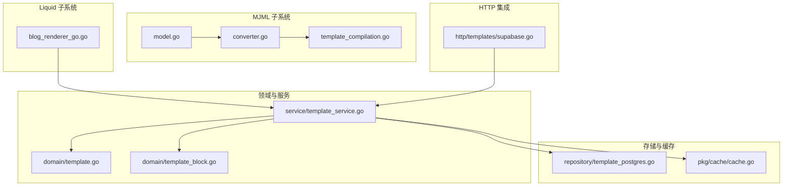
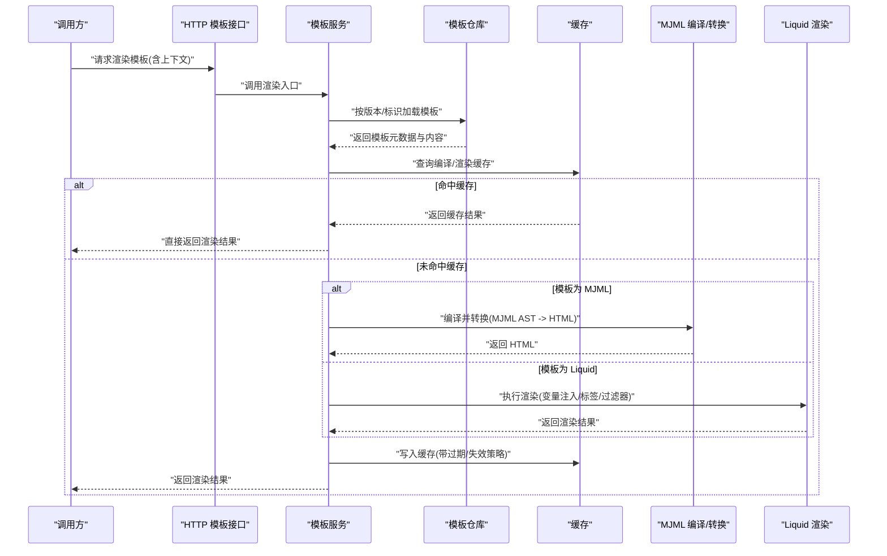
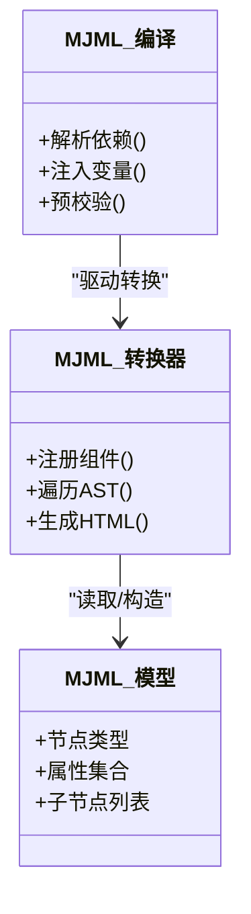
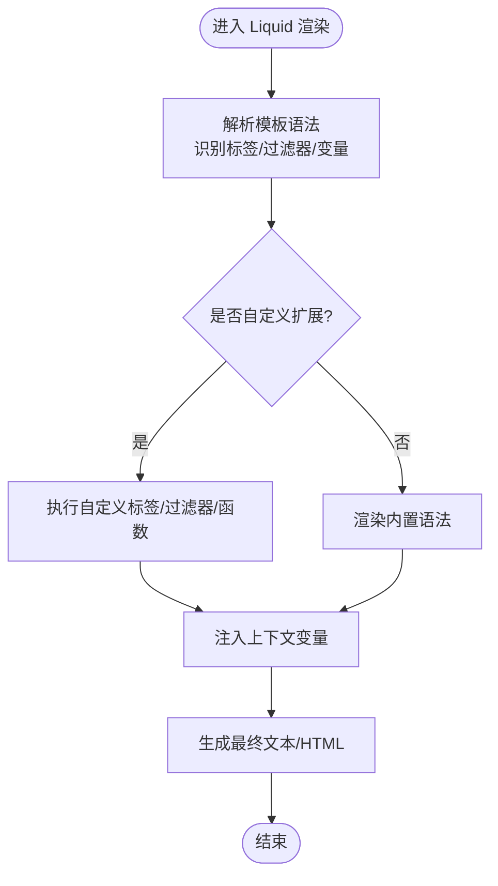
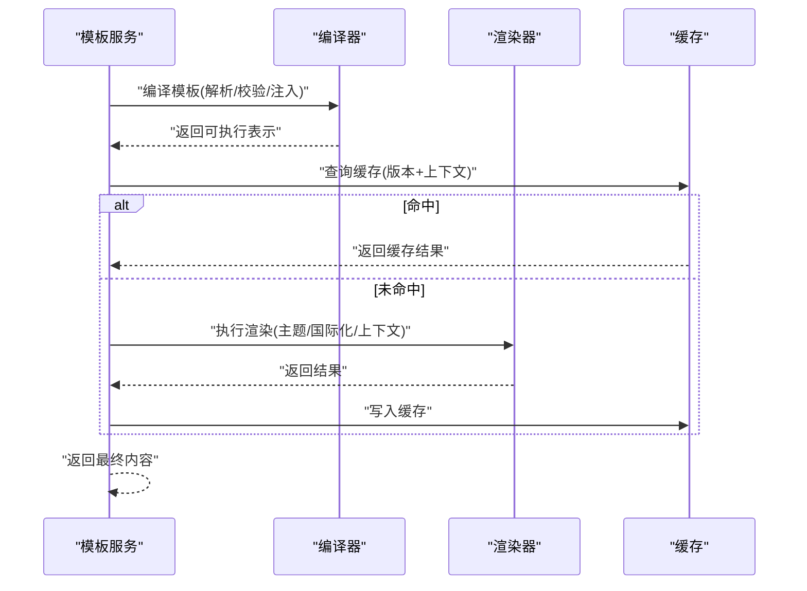
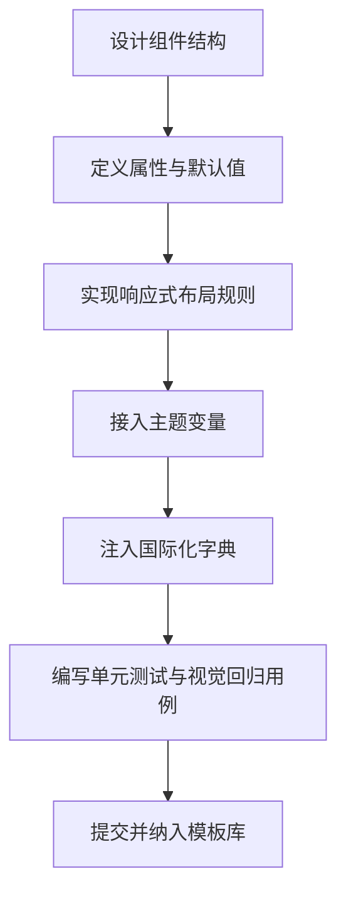
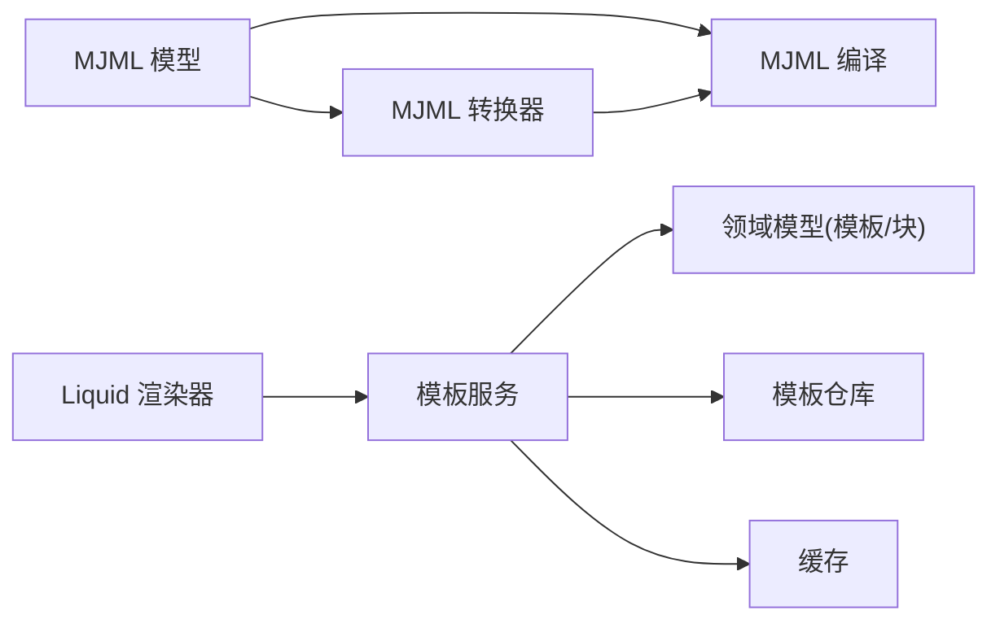

# 模板引擎扩展开发

<cite>
**本文引用的文件**   
- [notifuse/pkg/notifuse_mjml/converter.go](file://notifuse/pkg/notifuse_mjml/converter.go)
- [notifuse/pkg/notifuse_mjml/template_compilation.go](file://notifuse/pkg/notifuse_mjml/template_compilation.go)
- [notifuse/pkg/notifuse_mjml/model.go](file://notifuse/pkg/notifuse_mjml/model.go)
- [notifuse/pkg/liquid/blog_renderer_go.go](file://notifuse/pkg/liquid/blog_renderer_go.go)
- [notifuse/internal/domain/template.go](file://notifuse/internal/domain/template.go)
- [notifuse/internal/domain/template_block.go](file://notifuse/internal/domain/template_block.go)
- [notifuse/internal/service/template_service.go](file://notifuse/internal/service/template_service.go)
- [notifuse/internal/http/templates/supabase.go](file://notifuse/internal/http/templates/supabase.go)
- [notifuse/internal/repository/template_postgres.go](file://notifuse/internal/repository/template_postgres.go)
- [notifuse/pkg/cache/cache.go](file://notifuse/pkg/cache/cache.go)
</cite>

## 目录
1. [简介](#简介)
2. [项目结构](#项目结构)
3. [核心组件](#核心组件)
4. [架构总览](#架构总览)
5. [详细组件分析](#详细组件分析)
6. [依赖关系分析](#依赖关系分析)
7. [性能考虑](#性能考虑)
8. [故障排查指南](#故障排查指南)
9. [结论](#结论)
10. [附录](#附录)

## 简介
本指南面向需要在 Notifuse 平台中扩展模板能力的开发者，聚焦以下目标：
- MJML 模板系统的扩展机制：自定义组件、块元素与属性的添加方式
- Liquid 模板引擎的扩展点：自定义标签、过滤器与函数的实现路径
- 模板编译流程、渲染管道与优化策略
- 复杂布局组件的开发示例：响应式、主题定制与国际化支持
- 模板验证、错误检查与性能分析
- 模板版本管理、依赖解析与缓存机制
- 完整的开发工具链、调试器与测试框架使用建议

## 项目结构
Notifuse 中与模板相关的核心代码主要分布在以下模块：
- MJML 转换与编译：pkg/notifuse_mjml
- Liquid 渲染（博客等场景）：pkg/liquid
- 领域模型与业务服务：internal/domain、internal/service
- HTTP 层模板集成：internal/http/templates
- 持久化与缓存：internal/repository、pkg/cache

图表来源
- [notifuse/pkg/notifuse_mjml/model.go](file://notifuse/pkg/notifuse_mjml/model.go)
- [notifuse/pkg/notifuse_mjml/converter.go](file://notifuse/pkg/notifuse_mjml/converter.go)
- [notifuse/pkg/notifuse_mjml/template_compilation.go](file://notifuse/pkg/notifuse_mjml/template_compilation.go)
- [notifuse/pkg/liquid/blog_renderer_go.go](file://notifuse/pkg/liquid/blog_renderer_go.go)
- [notifuse/internal/domain/template.go](file://notifuse/internal/domain/template.go)
- [notifuse/internal/domain/template_block.go](file://notifuse/internal/domain/template_block.go)
- [notifuse/internal/service/template_service.go](file://notifuse/internal/service/template_service.go)
- [notifuse/internal/http/templates/supabase.go](file://notifuse/internal/http/templates/supabase.go)
- [notifuse/internal/repository/template_postgres.go](file://notifuse/internal/repository/template_postgres.go)
- [notifuse/pkg/cache/cache.go](file://notifuse/pkg/cache/cache.go)

章节来源
- [notifuse/pkg/notifuse_mjml/model.go](file://notifuse/pkg/notifuse_mjml/model.go)
- [notifuse/pkg/notifuse_mjml/converter.go](file://notifuse/pkg/notifuse_mjml/converter.go)
- [notifuse/pkg/notifuse_mjml/template_compilation.go](file://notifuse/pkg/notifuse_mjml/template_compilation.go)
- [notifuse/pkg/liquid/blog_renderer_go.go](file://notifuse/pkg/liquid/blog_renderer_go.go)
- [notifuse/internal/domain/template.go](file://notifuse/internal/domain/template.go)
- [notifuse/internal/domain/template_block.go](file://notifuse/internal/domain/template_block.go)
- [notifuse/internal/service/template_service.go](file://notifuse/internal/service/template_service.go)
- [notifuse/internal/http/templates/supabase.go](file://notifuse/internal/http/templates/supabase.go)
- [notifuse/internal/repository/template_postgres.go](file://notifuse/internal/repository/template_postgres.go)
- [notifuse/pkg/cache/cache.go](file://notifuse/pkg/cache/cache.go)

## 核心组件
- MJML 模型与转换
  - model.go：定义 MJML 节点、属性与树形结构的领域模型
  - converter.go：将 MJML AST 转换为 HTML 或中间表示，处理内置组件与规则
  - template_compilation.go：负责模板编译期逻辑，如变量注入、依赖解析、预校验
- Liquid 渲染
  - blog_renderer_go.go：提供 Liquid 渲染能力，包含上下文构建、变量替换与输出
- 领域与服务
  - domain/template.go、domain/template_block.go：模板与模板块的领域模型与约束
  - service/template_service.go：编排模板加载、编译、渲染、缓存与版本控制
- HTTP 集成
  - http/templates/supabase.go：在 HTTP 层接入模板系统（例如 Supabase 场景）
- 存储与缓存
  - repository/template_postgres.go：模板持久化与版本查询
  - pkg/cache/cache.go：通用缓存抽象，用于模板编译结果与渲染产物缓存

章节来源
- [notifuse/pkg/notifuse_mjml/model.go](file://notifuse/pkg/notifuse_mjml/model.go)
- [notifuse/pkg/notifuse_mjml/converter.go](file://notifuse/pkg/notifuse_mjml/converter.go)
- [notifuse/pkg/notifuse_mjml/template_compilation.go](file://notifuse/pkg/notifuse_mjml/template_compilation.go)
- [notifuse/pkg/liquid/blog_renderer_go.go](file://notifuse/pkg/liquid/blog_renderer_go.go)
- [notifuse/internal/domain/template.go](file://notifuse/internal/domain/template.go)
- [notifuse/internal/domain/template_block.go](file://notifuse/internal/domain/template_block.go)
- [notifuse/internal/service/template_service.go](file://notifuse/internal/service/template_service.go)
- [notifuse/internal/http/templates/supabase.go](file://notifuse/internal/http/templates/supabase.go)
- [notifuse/internal/repository/template_postgres.go](file://notifuse/internal/repository/template_postgres.go)
- [notifuse/pkg/cache/cache.go](file://notifuse/pkg/cache/cache.go)

## 架构总览
下图展示了从模板源到最终渲染产物的端到端流程，涵盖 MJML 与 Liquid 两条路径。

图表来源
- [notifuse/internal/http/templates/supabase.go](file://notifuse/internal/http/templates/supabase.go)
- [notifuse/internal/service/template_service.go](file://notifuse/internal/service/template_service.go)
- [notifuse/internal/repository/template_postgres.go](file://notifuse/internal/repository/template_postgres.go)
- [notifuse/pkg/cache/cache.go](file://notifuse/pkg/cache/cache.go)
- [notifuse/pkg/notifuse_mjml/template_compilation.go](file://notifuse/pkg/notifuse_mjml/template_compilation.go)
- [notifuse/pkg/notifuse_mjml/converter.go](file://notifuse/pkg/notifuse_mjml/converter.go)
- [notifuse/pkg/liquid/blog_renderer_go.go](file://notifuse/pkg/liquid/blog_renderer_go.go)

## 详细组件分析

### MJML 模板系统扩展机制
- 自定义组件
  - 在转换器中注册新组件类型，映射到对应的渲染函数或 HTML 片段生成逻辑
  - 通过模型层定义组件节点结构与属性契约，确保 AST 一致性
- 块元素与属性
  - 在模型中新增块元素节点类型与属性字段，并在转换器中实现其布局与样式合成
  - 对属性进行校验与默认值填充，保证渲染稳定性
- 编译期增强
  - 在模板编译阶段进行依赖解析、变量注入与静态检查，提前发现不兼容的自定义组件/属性

图表来源
- [notifuse/pkg/notifuse_mjml/model.go](file://notifuse/pkg/notifuse_mjml/model.go)
- [notifuse/pkg/notifuse_mjml/converter.go](file://notifuse/pkg/notifuse_mjml/converter.go)
- [notifuse/pkg/notifuse_mjml/template_compilation.go](file://notifuse/pkg/notifuse_mjml/template_compilation.go)

章节来源
- [notifuse/pkg/notifuse_mjml/model.go](file://notifuse/pkg/notifuse_mjml/model.go)
- [notifuse/pkg/notifuse_mjml/converter.go](file://notifuse/pkg/notifuse_mjml/converter.go)
- [notifuse/pkg/notifuse_mjml/template_compilation.go](file://notifuse/pkg/notifuse_mjml/template_compilation.go)

### Liquid 模板引擎扩展点
- 自定义标签
  - 在渲染器中注册新标签处理器，定义语法解析与执行逻辑
- 自定义过滤器
  - 扩展过滤器表，实现字符串、日期、数值等常用变换
- 自定义函数
  - 暴露安全函数给模板上下文，避免任意代码执行风险

图表来源
- [notifuse/pkg/liquid/blog_renderer_go.go](file://notifuse/pkg/liquid/blog_renderer_go.go)

章节来源
- [notifuse/pkg/liquid/blog_renderer_go.go](file://notifuse/pkg/liquid/blog_renderer_go.go)

### 模板编译与渲染管道
- 编译阶段
  - 解析模板源（MJML/Liquid），构建 AST 或中间表示
  - 执行依赖解析、变量注入、静态校验与安全检查
- 渲染阶段
  - 根据模板类型选择渲染器（MJML 转换器或 Liquid 渲染器）
  - 应用主题、语言包与上下文数据，输出最终内容
- 缓存策略
  - 以模板版本+上下文指纹作为键，缓存编译与渲染结果，降低重复开销

图表来源
- [notifuse/internal/service/template_service.go](file://notifuse/internal/service/template_service.go)
- [notifuse/pkg/notifuse_mjml/template_compilation.go](file://notifuse/pkg/notifuse_mjml/template_compilation.go)
- [notifuse/pkg/liquid/blog_renderer_go.go](file://notifuse/pkg/liquid/blog_renderer_go.go)
- [notifuse/pkg/cache/cache.go](file://notifuse/pkg/cache/cache.go)

章节来源
- [notifuse/internal/service/template_service.go](file://notifuse/internal/service/template_service.go)
- [notifuse/pkg/notifuse_mjml/template_compilation.go](file://notifuse/pkg/notifuse_mjml/template_compilation.go)
- [notifuse/pkg/liquid/blog_renderer_go.go](file://notifuse/pkg/liquid/blog_renderer_go.go)
- [notifuse/pkg/cache/cache.go](file://notifuse/pkg/cache/cache.go)

### 复杂布局组件开发示例
- 响应式设计
  - 在 MJML 块元素中引入媒体查询与栅格布局，结合主题变量实现自适应
- 主题定制
  - 通过主题配置对象注入颜色、字体、间距等变量，组件读取变量渲染
- 国际化支持
  - 在上下文注入 i18n 字典，组件按需渲染多语言文案

[本节为概念性说明，无需源码引用]

### 模板验证、错误检查与性能分析
- 验证与检查
  - 编译期进行语法与语义校验，捕获未知组件/属性、缺失必填项
  - 运行时记录关键指标（渲染耗时、内存占用）
- 性能分析
  - 对热点路径进行采样与火焰图分析，定位瓶颈
  - 利用缓存命中率与降级策略提升吞吐

章节来源
- [notifuse/pkg/notifuse_mjml/template_compilation.go](file://notifuse/pkg/notifuse_mjml/template_compilation.go)
- [notifuse/pkg/liquid/blog_renderer_go.go](file://notifuse/pkg/liquid/blog_renderer_go.go)
- [notifuse/pkg/cache/cache.go](file://notifuse/pkg/cache/cache.go)

### 模板版本管理、依赖解析与缓存机制
- 版本管理
  - 以版本号或哈希标识模板，支持灰度发布与回滚
- 依赖解析
  - 解析模板间引用关系，构建依赖图，确保变更影响范围可控
- 缓存机制
  - 多级缓存：编译结果缓存、渲染结果缓存；支持按租户/工作区隔离

章节来源
- [notifuse/internal/repository/template_postgres.go](file://notifuse/internal/repository/template_postgres.go)
- [notifuse/internal/service/template_service.go](file://notifuse/internal/service/template_service.go)
- [notifuse/pkg/cache/cache.go](file://notifuse/pkg/cache/cache.go)

### 开发工具链、调试器与测试框架
- 开发工具链
  - 本地热重载与增量编译，快速迭代 MJML/Liquid 模板
- 调试器
  - 启用详细日志与追踪，输出 AST、中间表示与渲染步骤
- 测试框架
  - 单元测试覆盖组件渲染、过滤器与标签逻辑
  - 集成测试模拟完整渲染管道，断言输出与性能阈值

章节来源
- [notifuse/pkg/notifuse_mjml/converter.go](file://notifuse/pkg/notifuse_mjml/converter.go)
- [notifuse/pkg/liquid/blog_renderer_go.go](file://notifuse/pkg/liquid/blog_renderer_go.go)
- [notifuse/internal/service/template_service.go](file://notifuse/internal/service/template_service.go)

## 依赖关系分析
模板子系统内部依赖如下：
- MJML 模型被转换器与编译器共同消费
- 转换器依赖模型与编译期配置
- Liquid 渲染器独立于 MJML，但共享模板服务与缓存
- 模板服务协调领域模型、仓库与缓存，统一对外提供渲染能力

图表来源
- [notifuse/pkg/notifuse_mjml/model.go](file://notifuse/pkg/notifuse_mjml/model.go)
- [notifuse/pkg/notifuse_mjml/converter.go](file://notifuse/pkg/notifuse_mjml/converter.go)
- [notifuse/pkg/notifuse_mjml/template_compilation.go](file://notifuse/pkg/notifuse_mjml/template_compilation.go)
- [notifuse/pkg/liquid/blog_renderer_go.go](file://notifuse/pkg/liquid/blog_renderer_go.go)
- [notifuse/internal/domain/template.go](file://notifuse/internal/domain/template.go)
- [notifuse/internal/domain/template_block.go](file://notifuse/internal/domain/template_block.go)
- [notifuse/internal/service/template_service.go](file://notifuse/internal/service/template_service.go)
- [notifuse/internal/repository/template_postgres.go](file://notifuse/internal/repository/template_postgres.go)
- [notifuse/pkg/cache/cache.go](file://notifuse/pkg/cache/cache.go)

章节来源
- [notifuse/pkg/notifuse_mjml/model.go](file://notifuse/pkg/notifuse_mjml/model.go)
- [notifuse/pkg/notifuse_mjml/converter.go](file://notifuse/pkg/notifuse_mjml/converter.go)
- [notifuse/pkg/notifuse_mjml/template_compilation.go](file://notifuse/pkg/notifuse_mjml/template_compilation.go)
- [notifuse/pkg/liquid/blog_renderer_go.go](file://notifuse/pkg/liquid/blog_renderer_go.go)
- [notifuse/internal/domain/template.go](file://notifuse/internal/domain/template.go)
- [notifuse/internal/domain/template_block.go](file://notifuse/internal/domain/template_block.go)
- [notifuse/internal/service/template_service.go](file://notifuse/internal/service/template_service.go)
- [notifuse/internal/repository/template_postgres.go](file://notifuse/internal/repository/template_postgres.go)
- [notifuse/pkg/cache/cache.go](file://notifuse/pkg/cache/cache.go)

## 性能考虑
- 减少重复编译：对稳定模板启用长期缓存，结合版本哈希失效
- 渲染并行化：对批量渲染任务采用并发控制与背压
- 资源裁剪：按需加载主题与国际化资源，避免全量注入
- 监控与告警：跟踪 P95/P99 延迟、错误率与缓存命中率

[本节为通用指导，无需源码引用]

## 故障排查指南
- 常见问题
  - 模板语法错误：检查编译期日志与 AST 输出
  - 自定义组件未注册：确认转换器注册表与命名空间
  - 缓存不一致：清理对应键或强制刷新版本
- 诊断步骤
  - 开启详细日志，记录输入上下文与中间结果
  - 使用最小复现模板定位问题边界
  - 对比不同版本的渲染差异，定位回归点

章节来源
- [notifuse/pkg/notifuse_mjml/template_compilation.go](file://notifuse/pkg/notifuse_mjml/template_compilation.go)
- [notifuse/pkg/liquid/blog_renderer_go.go](file://notifuse/pkg/liquid/blog_renderer_go.go)
- [notifuse/pkg/cache/cache.go](file://notifuse/pkg/cache/cache.go)

## 结论
通过在 MJML 与 Liquid 两个子系统上提供清晰的扩展点与统一的模板服务，Notifuse 实现了高内聚、低耦合的模板引擎架构。借助编译期校验、运行时缓存与完善的测试体系，开发者可以高效地扩展组件、标签与过滤器，同时保障性能与稳定性。

[本节为总结性内容，无需源码引用]

## 附录
- 术语
  - MJML：邮件友好的标记语言，编译为跨客户端兼容的 HTML
  - Liquid：轻量级模板语言，常用于动态内容渲染
  - 模板块：可复用的布局单元，支持嵌套与参数化
- 参考路径
  - MJML 模型与转换：[model.go](file://notifuse/pkg/notifuse_mjml/model.go)、[converter.go](file://notifuse/pkg/notifuse_mjml/converter.go)
  - MJML 编译：[template_compilation.go](file://notifuse/pkg/notifuse_mjml/template_compilation.go)
  - Liquid 渲染：[blog_renderer_go.go](file://notifuse/pkg/liquid/blog_renderer_go.go)
  - 领域与服务：[template.go](file://notifuse/internal/domain/template.go)、[template_block.go](file://notifuse/internal/domain/template_block.go)、[template_service.go](file://notifuse/internal/service/template_service.go)
  - HTTP 集成：[supabase.go](file://notifuse/internal/http/templates/supabase.go)
  - 存储与缓存：[template_postgres.go](file://notifuse/internal/repository/template_postgres.go)、[cache.go](file://notifuse/pkg/cache/cache.go)