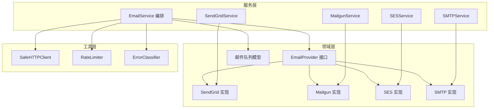
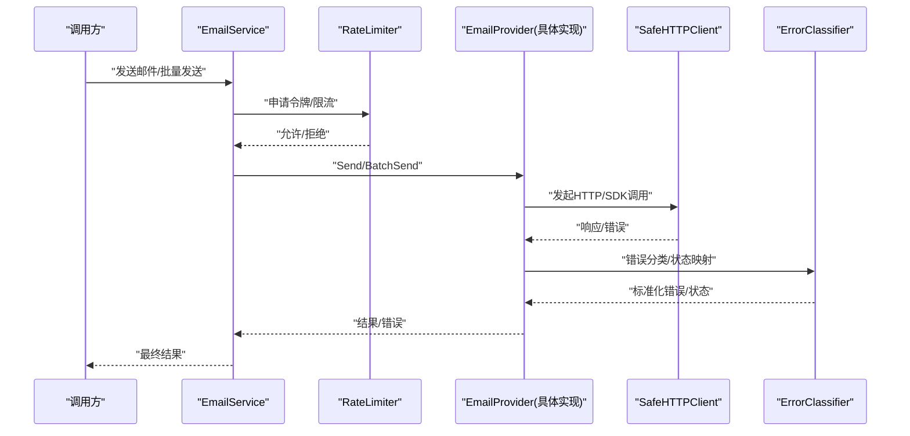
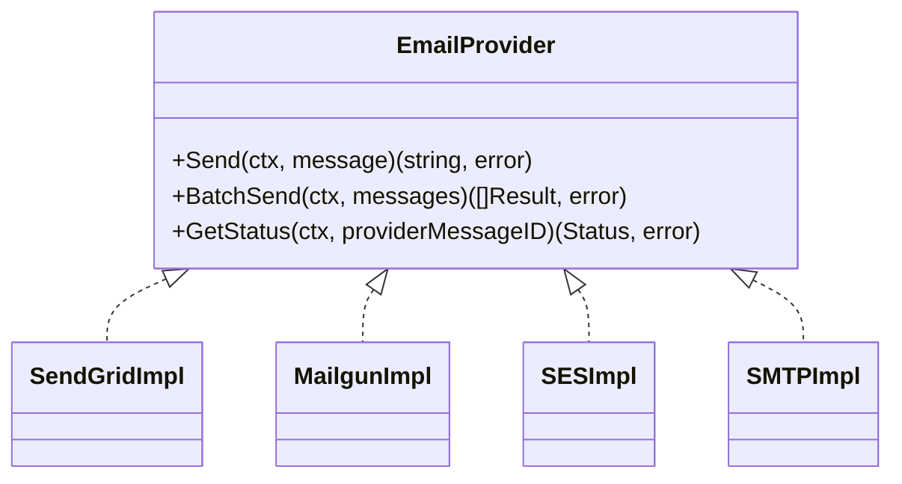
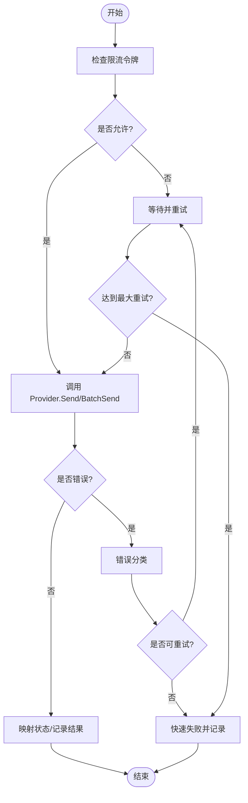
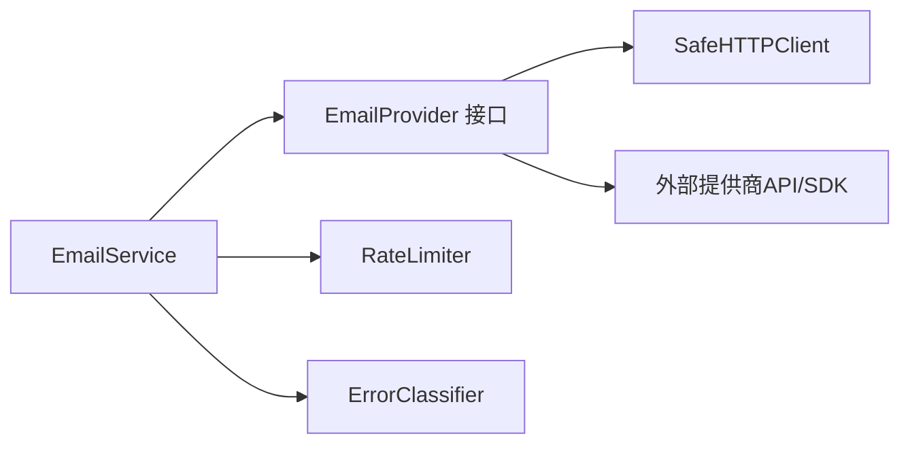

# 邮件提供商插件开发

<cite>
**本文引用的文件**   
- [email_provider.go](file://notifuse/internal/domain/email_provider.go)
- [email_provider_sendgrid.go](file://notifuse/internal/domain/email_provider_sendgrid.go)
- [email_provider_mailgun.go](file://notifuse/internal/domain/email_provider_mailgun.go)
- [email_provider_ses.go](file://notifuse/internal/domain/email_provider_ses.go)
- [email_provider_smtp.go](file://notifuse/internal/domain/email_provider_smtp.go)
- [email_queue.go](file://notifuse/internal/domain/email_queue.go)
- [email_service.go](file://notifuse/internal/service/email_service.go)
- [sendgrid_service.go](file://notifuse/internal/service/sendgrid_service.go)
- [ses_service.go](file://notifuse/internal/service/ses_service.go)
- [smtp_service.go](file://notifuse/internal/service/smtp_service.go)
- [mailgun_service.go](file://notifuse/internal/service/mailgun_service.go)
- [errors.go](file://notifuse/internal/domain/errors.go)
- [classifier.go](file://notifuse/pkg/emailerror/classifier.go)
- [safehttpclient.go](file://notifuse/pkg/safehttpclient/safehttpclient.go)
- [ratelimiter.go](file://notifuse/pkg/ratelimiter/ratelimiter.go)
</cite>

## 目录
1. [简介](#简介)
2. [项目结构](#项目结构)
3. [核心组件](#核心组件)
4. [架构总览](#架构总览)
5. [详细组件分析](#详细组件分析)
6. [依赖关系分析](#依赖关系分析)
7. [性能考虑](#性能考虑)
8. [故障排查指南](#故障排查指南)
9. [结论](#结论)
10. [附录](#附录)

## 简介
本指南面向希望在 Notifuse 平台中扩展或实现自定义邮件提供商的开发者。文档围绕 EmailProvider 接口及其实现规范展开，涵盖 Send、BatchSend、GetStatus 等核心方法的行为约定、错误处理与重试策略、状态码映射、认证配置管理、API 限流与连接池优化，并提供主流提供商（SendGrid、Mailgun、AWS SES）的集成模式参考。同时包含单元测试编写建议、性能测试方法与调试技巧，以及插件注册机制、配置验证与版本兼容性处理的说明。

## 项目结构
Notifuse 将“领域模型/接口定义”与“服务层实现”分层组织：
- 领域层 domain：定义 EmailProvider 接口及具体提供商实现（SendGrid、Mailgun、SES、SMTP 等），并维护邮件队列模型。
- 服务层 service：封装业务编排、重试、限流、指标上报、与外部客户端交互等逻辑。
- 工具层 pkg：提供通用能力，如安全 HTTP 客户端、速率限制器、错误分类器等。

图表来源
- [email_provider.go:1-200](file://notifuse/internal/domain/email_provider.go#L1-L200)
- [email_queue.go:1-200](file://notifuse/internal/domain/email_queue.go#L1-L200)
- [email_service.go:1-200](file://notifuse/internal/service/email_service.go#L1-L200)
- [sendgrid_service.go:1-200](file://notifuse/internal/service/sendgrid_service.go#L1-L200)
- [ses_service.go:1-200](file://notifuse/internal/service/ses_service.go#L1-L200)
- [smtp_service.go:1-200](file://notifuse/internal/service/smtp_service.go#L1-L200)
- [mailgun_service.go:1-200](file://notifuse/internal/service/mailgun_service.go#L1-L200)
- [safehttpclient.go:1-200](file://notifuse/pkg/safehttpclient/safehttpclient.go#L1-L200)
- [ratelimiter.go:1-200](file://notifuse/pkg/ratelimiter/ratelimiter.go#L1-L200)
- [classifier.go:1-200](file://notifuse/pkg/emailerror/classifier.go#L1-L200)

章节来源
- [email_provider.go:1-200](file://notifuse/internal/domain/email_provider.go#L1-L200)
- [email_queue.go:1-200](file://notifuse/internal/domain/email_queue.go#L1-L200)
- [email_service.go:1-200](file://notifuse/internal/service/email_service.go#L1-L200)

## 核心组件
本节聚焦 EmailProvider 接口及其关键方法的实现要求与行为约定。

- 接口职责
  - 发送单封邮件：Send
  - 批量发送：BatchSend
  - 查询投递状态：GetStatus
  - 可选：健康检查、元数据获取、回调/事件订阅等（按具体实现扩展）

- 方法语义与返回约定
  - Send(ctx, message): 返回 provider 侧消息 ID 与错误；幂等性由调用方保证或通过 provider 特性保障。
  - BatchSend(ctx, messages): 支持批量提交，返回各条目的结果集合；失败条目应保留上下文以便重试。
  - GetStatus(ctx, providerMessageID): 返回标准化状态与时间戳；对不支持的状态查询应返回明确错误类型。

- 错误处理与可重试判定
  - 区分网络错误、认证错误、配额/限流错误、参数错误、服务端错误等。
  - 使用统一错误类型包装，便于上层进行重试决策与指标统计。
  - 对于瞬时错误（如 429、5xx、超时）应标记为可重试；对于永久错误（如 4xx 中的无效参数）不应重试。

- 状态码映射
  - 将不同提供商的状态码映射到内部标准状态（如 delivered、queued、bounced、complaint、failed）。
  - 未识别状态需记录日志并降级为未知状态，避免阻塞流程。

- 并发与批处理
  - BatchSend 内部应控制并发度，结合 RateLimiter 保护下游 API。
  - 对部分失败的批次，应返回明细以便上层选择性重试。

- 认证与配置
  - 通过配置对象注入密钥、端点、区域等敏感信息；启动时校验必填字段。
  - 支持多工作区隔离的配置加载与缓存。

- 连接池与超时
  - 复用 HTTP/TCP 连接，设置合理的最大空闲连接数、连接生命周期与请求超时。
  - 针对长尾响应启用超时与取消传播。

章节来源
- [email_provider.go:1-200](file://notifuse/internal/domain/email_provider.go#L1-L200)
- [errors.go:1-200](file://notifuse/internal/domain/errors.go#L1-L200)
- [classifier.go:1-200](file://notifuse/pkg/emailerror/classifier.go#L1-L200)

## 架构总览
下图展示从 EmailService 到具体提供商实现的调用链，以及限流、错误分类与安全客户端的协作方式。

图表来源
- [email_service.go:1-200](file://notifuse/internal/service/email_service.go#L1-L200)
- [email_provider.go:1-200](file://notifuse/internal/domain/email_provider.go#L1-L200)
- [safehttpclient.go:1-200](file://notifuse/pkg/safehttpclient/safehttpclient.go#L1-L200)
- [ratelimiter.go:1-200](file://notifuse/pkg/ratelimiter/ratelimiter.go#L1-L200)
- [classifier.go:1-200](file://notifuse/pkg/emailerror/classifier.go#L1-L200)

## 详细组件分析

### EmailProvider 接口与实现要点
- 设计目标
  - 抽象不同邮件服务商的差异，向上提供一致的方法签名与错误语义。
  - 向下屏蔽认证、限流、重试、状态映射等横切关注点。

- 关键方法
  - Send：单封发送，返回 provider 消息 ID 与错误。
  - BatchSend：批量发送，返回每条结果，支持部分成功。
  - GetStatus：根据 provider 消息 ID 查询投递状态，返回标准化状态。

- 实现约束
  - 必须正确处理 ctx 取消与超时。
  - 必须对不可重试错误快速失败，避免浪费资源。
  - 必须记录必要上下文（如 workspaceId、messageId）用于追踪。

图表来源
- [email_provider.go:1-200](file://notifuse/internal/domain/email_provider.go#L1-L200)
- [email_provider_sendgrid.go:1-200](file://notifuse/internal/domain/email_provider_sendgrid.go#L1-L200)
- [email_provider_mailgun.go:1-200](file://notifuse/internal/domain/email_provider_mailgun.go#L1-L200)
- [email_provider_ses.go:1-200](file://notifuse/internal/domain/email_provider_ses.go#L1-L200)
- [email_provider_smtp.go:1-200](file://notifuse/internal/domain/email_provider_smtp.go#L1-L200)

章节来源
- [email_provider.go:1-200](file://notifuse/internal/domain/email_provider.go#L1-L200)
- [email_provider_sendgrid.go:1-200](file://notifuse/internal/domain/email_provider_sendgrid.go#L1-L200)
- [email_provider_mailgun.go:1-200](file://notifuse/internal/domain/email_provider_mailgun.go#L1-L200)
- [email_provider_ses.go:1-200](file://notifuse/internal/domain/email_provider_ses.go#L1-L200)
- [email_provider_smtp.go:1-200](file://notifuse/internal/domain/email_provider_smtp.go#L1-L200)

### 服务层编排：EmailService
- 职责
  - 协调 Provider 选择、重试、限流、指标上报。
  - 将领域层的错误转换为业务错误，供上层消费。
  - 管理队列与任务调度（与 email_queue 模型协作）。

- 重试策略
  - 指数退避 + 抖动，针对瞬时错误自动重试。
  - 最大重试次数与退避上限可配置。
  - 对幂等键（providerMessageID）去重，避免重复投递。

- 限流与背压
  - 基于 RateLimiter 控制并发与 QPS。
  - 当检测到 429 或上游限流信号时，主动降速。

- 状态同步
  - 定时或事件驱动地调用 GetStatus，更新投递状态。
  - 对长时间处于中间态的消息进行告警与人工介入提示。

图表来源
- [email_service.go:1-200](file://notifuse/internal/service/email_service.go#L1-L200)
- [ratelimiter.go:1-200](file://notifuse/pkg/ratelimiter/ratelimiter.go#L1-L200)
- [classifier.go:1-200](file://notifuse/pkg/emailerror/classifier.go#L1-L200)

章节来源
- [email_service.go:1-200](file://notifuse/internal/service/email_service.go#L1-L200)
- [email_queue.go:1-200](file://notifuse/internal/domain/email_queue.go#L1-L200)

### 典型提供商实现模式

#### SendGrid 集成模式
- 认证与端点
  - 通过配置注入 API Key 与基础 URL。
  - 支持多环境端点切换（生产/沙箱）。
- 发送与批量
  - Send 对应单封发送 API；BatchSend 使用批量端点或循环调用并合并结果。
- 状态查询
  - 使用事件/回执 API 或消息查询接口，映射为标准状态。
- 错误与重试
  - 对 429/5xx 进行指数退避重试；对 4xx 参数错误快速失败。
- 限流与连接池
  - 遵循官方速率限制；复用 HTTP 连接，合理设置超时。

章节来源
- [email_provider_sendgrid.go:1-200](file://notifuse/internal/domain/email_provider_sendgrid.go#L1-L200)
- [sendgrid_service.go:1-200](file://notifuse/internal/service/sendgrid_service.go#L1-L200)

#### Mailgun 集成模式
- 认证与端点
  - 使用 API Key 与域名配置；区分区域端点。
- 发送与批量
  - 使用 /messages 与 /messages.mime 端点；批量可通过并行化与限流控制。
- 状态查询
  - 使用事件 API 或消息查询接口，解析事件类型映射到标准状态。
- 错误与重试
  - 对临时错误重试；对非法地址/权限问题快速失败。
- 限流与连接池
  - 遵守域级与账户级速率限制；复用连接并设置超时。

章节来源
- [email_provider_mailgun.go:1-200](file://notifuse/internal/domain/email_provider_mailgun.go#L1-L200)
- [mailgun_service.go:1-200](file://notifuse/internal/service/mailgun_service.go#L1-L200)

#### AWS SES 集成模式
- 认证与端点
  - 使用 AK/SK 或 IAM 角色；指定 Region。
- 发送与批量
  - 使用 SendEmail 与 SendBulkTemplatedEmail 等接口；注意配额与并发限制。
- 状态查询
  - 使用 SNS 事件或查询接口；将 bounce/complaint/delivery 映射为标准状态。
- 错误与重试
  - 对 Throttling/TemporarilyUnavailable 等错误重试；对 InvalidParameter 快速失败。
- 限流与连接池
  - 遵循 SES 配额；复用 SDK 底层连接，合理设置超时。

章节来源
- [email_provider_ses.go:1-200](file://notifuse/internal/domain/email_provider_ses.go#L1-L200)
- [ses_service.go:1-200](file://notifuse/internal/service/ses_service.go#L1-L200)

#### SMTP 集成模式
- 认证与端点
  - 支持明文/STARTTLS/TLS；支持多种认证机制。
- 发送与批量
  - 单封发送为主；批量通过并发与连接池提升吞吐。
- 状态查询
  - 通常无原生状态查询；依赖回执或应用层跟踪。
- 错误与重试
  - 对网络/认证错误重试；对语法/权限错误快速失败。
- 限流与连接池
  - 控制并发连接数与每连接队列长度；设置读写超时。

章节来源
- [email_provider_smtp.go:1-200](file://notifuse/internal/domain/email_provider_smtp.go#L1-L200)
- [smtp_service.go:1-200](file://notifuse/internal/service/smtp_service.go#L1-L200)

### 错误处理与状态码映射
- 错误分类
  - 使用统一错误类型与分类器，将不同提供商的错误归一化为可重试/不可重试两类。
- 状态映射
  - 将各提供商的状态码/事件类型映射为内部标准状态，确保上层一致性。
- 诊断信息
  - 在错误中附带 providerMessageID、workspaceId、attemptCount 等上下文。

章节来源
- [errors.go:1-200](file://notifuse/internal/domain/errors.go#L1-L200)
- [classifier.go:1-200](file://notifuse/pkg/emailerror/classifier.go#L1-L200)

### 认证配置管理与验证
- 配置项
  - 密钥、端点、区域、域名、证书路径等。
- 校验规则
  - 必填字段校验、格式校验、连通性探测（可选）。
- 安全存储
  - 敏感信息加密存储，运行时解密注入。
- 多工作区隔离
  - 以 workspaceId 为维度加载与缓存配置。

章节来源
- [email_provider.go:1-200](file://notifuse/internal/domain/email_provider.go#L1-L200)
- [email_service.go:1-200](file://notifuse/internal/service/email_service.go#L1-L200)

### 插件注册机制、配置验证与版本兼容
- 插件注册
  - 在服务启动阶段，将已实现的 EmailProvider 实现注册到工厂/路由表，按名称或类型选择。
- 配置验证
  - 在创建 Provider 实例前执行配置校验，失败则阻止启动或降级。
- 版本兼容
  - 对 API 版本变更采用向后兼容策略；在 Provider 实现中显式声明支持的最低版本。
  - 通过能力检测或版本号协商决定使用何种端点/字段。

章节来源
- [email_provider.go:1-200](file://notifuse/internal/domain/email_provider.go#L1-L200)
- [email_service.go:1-200](file://notifuse/internal/service/email_service.go#L1-L200)

## 依赖关系分析
- 组件耦合
  - EmailService 依赖 EmailProvider 接口，解耦具体实现。
  - Provider 实现依赖 SafeHTTPClient 与第三方 SDK。
  - 错误分类器与限流器作为横切能力被广泛复用。
- 外部依赖
  - 各提供商 API/SDK、TLS 证书、DNS 解析等。
- 潜在循环依赖
  - 领域与服务层之间通过接口解耦，避免直接循环引用。

图表来源
- [email_service.go:1-200](file://notifuse/internal/service/email_service.go#L1-L200)
- [email_provider.go:1-200](file://notifuse/internal/domain/email_provider.go#L1-L200)
- [safehttpclient.go:1-200](file://notifuse/pkg/safehttpclient/safehttpclient.go#L1-L200)
- [ratelimiter.go:1-200](file://notifuse/pkg/ratelimiter/ratelimiter.go#L1-L200)
- [classifier.go:1-200](file://notifuse/pkg/emailerror/classifier.go#L1-L200)

章节来源
- [email_service.go:1-200](file://notifuse/internal/service/email_service.go#L1-L200)
- [email_provider.go:1-200](file://notifuse/internal/domain/email_provider.go#L1-L200)

## 性能考虑
- 连接池
  - 复用 TCP/HTTP 连接，调整最大空闲连接数与连接存活时间。
  - 针对不同提供商设置独立连接池以避免相互影响。
- 并发与批处理
  - 合理使用 goroutine 并发，配合 RateLimiter 控制 QPS。
  - 批量发送优先使用原生批量接口，减少往返开销。
- 超时与取消
  - 设置合理的请求超时与读取超时，及时释放资源。
  - 传播 ctx 取消，避免僵尸请求。
- 指标与观测
  - 记录发送耗时、成功率、失败原因分布、重试次数等指标。
  - 对慢请求与异常峰值进行告警。

[本节为通用指导，不直接分析具体文件]

## 故障排查指南
- 常见问题定位
  - 认证失败：检查密钥、域名、区域与端点是否正确；查看错误分类结果。
  - 限流触发：观察 429 频率，调整限流参数与退避策略。
  - 连接异常：检查 TLS 证书、DNS 解析与网络连通性。
  - 状态不一致：核对 GetStatus 返回与内部状态机转换逻辑。
- 调试技巧
  - 开启详细日志，记录 providerMessageID、workspaceId、attemptCount。
  - 使用 Mock 或本地代理模拟下游错误场景。
  - 对关键路径添加埋点，便于链路追踪。

章节来源
- [errors.go:1-200](file://notifuse/internal/domain/errors.go#L1-L200)
- [classifier.go:1-200](file://notifuse/pkg/emailerror/classifier.go#L1-L200)

## 结论
通过统一的 EmailProvider 接口与完善的错误分类、限流与重试机制，Notifuse 能够以低耦合的方式接入多种邮件提供商。遵循本文的实现规范与最佳实践，开发者可以快速构建稳定、可扩展且易于观测的邮件发送插件。

[本节为总结性内容，不直接分析具体文件]

## 附录

### 单元测试编写指南
- 覆盖范围
  - 正常路径、边界条件、错误分支、重试与限流行为、状态映射。
- 测试策略
  - 使用 Mock 替代真实网络调用；构造各种错误类型与状态码。
  - 验证重试次数、退避时间与最终失败路径。
- 断言要点
  - 返回值、错误类型、状态码映射、指标计数、日志关键字。

[本节为通用指导，不直接分析具体文件]

### 性能测试方法
- 基准测试
  - 针对 Send/BatchSend 进行吞吐与延迟基准测试。
- 压力测试
  - 逐步增加并发与 QPS，观察限流与错误率变化。
- 资源监控
  - 监控 CPU、内存、连接池使用率与 GC 情况。

[本节为通用指导，不直接分析具体文件]

### 调试技巧
- 日志级别
  - 在开发与联调阶段提高日志级别，捕获更多上下文。
- 链路追踪
  - 为每次发送生成唯一 traceId，贯穿服务与 Provider 调用。
- 本地代理
  - 使用代理拦截并回放下游响应，复现线上问题。

[本节为通用指导，不直接分析具体文件]