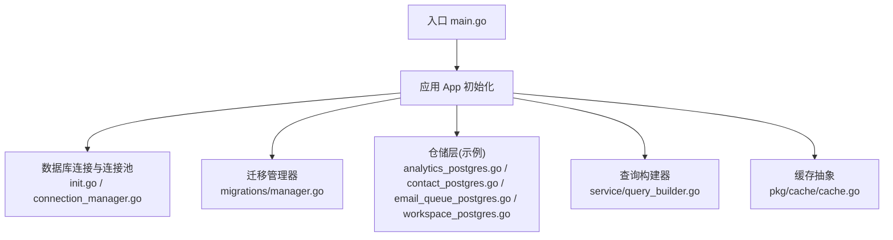
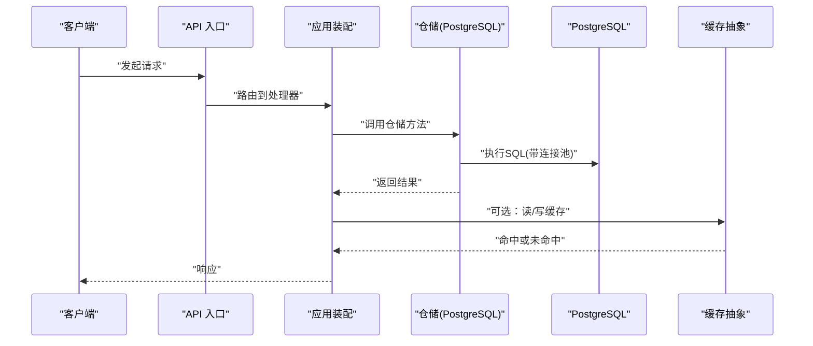
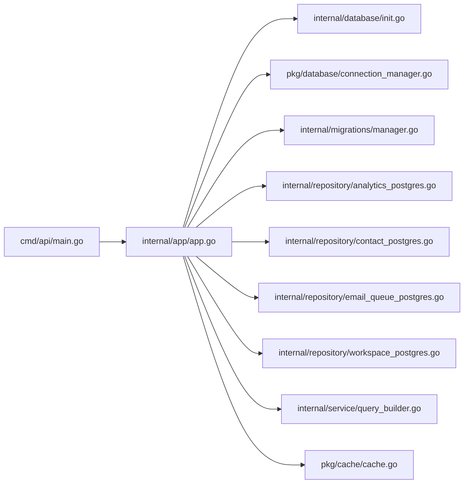

# 性能优化

<cite>
**本文引用的文件**   
- [internal/database/init.go](file://notifuse/internal/database/init.go)
- [pkg/database/connection_manager.go](file://notifuse/pkg/database/connection_manager.go)
- [config/config.go](file://notifuse/config/config.go)
- [internal/repository/analytics_postgres.go](file://notifuse/internal/repository/analytics_postgres.go)
- [internal/repository/contact_postgres.go](file://notifuse/internal/repository/contact_postgres.go)
- [internal/repository/email_queue_postgres.go](file://notifuse/internal/repository/email_queue_postgres.go)
- [internal/repository/workspace_postgres.go](file://notifuse/internal/repository/workspace_postgres.go)
- [internal/service/query_builder.go](file://notifuse/internal/service/query_builder.go)
- [pkg/cache/cache.go](file://notifuse/pkg/cache/cache.go)
- [internal/migrations/manager.go](file://notifuse/internal/migrations/manager.go)
- [internal/app/app.go](file://notifuse/internal/app/app.go)
- [cmd/api/main.go](file://notifuse/cmd/api/main.go)
</cite>

## 目录
1. [简介](#简介)
2. [项目结构](#项目结构)
3. [核心组件](#核心组件)
4. [架构总览](#架构总览)
5. [详细组件分析](#详细组件分析)
6. [依赖关系分析](#依赖关系分析)
7. [性能考量](#性能考量)
8. [故障排查指南](#故障排查指南)
9. [结论](#结论)
10. [附录](#附录)

## 简介
本文件面向Notifuse平台的数据库性能优化，聚焦连接池配置、查询与索引策略、慢查询分析与执行计划解读、监控指标、缓存策略（含Redis层、失效与穿透防护）、大数据量场景的分页/批量/异步方案、分库分表与读写分离、容量规划与自动扩缩容，以及性能测试方法与基准工具使用。文档基于仓库中数据库初始化、连接管理、仓储实现与服务构建等源码进行归纳与提炼，并提供可落地的最佳实践建议。

## 项目结构
与数据库性能相关的关键位置：
- 应用启动与依赖装配：入口与App组装负责初始化数据库连接、迁移、服务与HTTP路由。
- 数据库连接与迁移：封装PostgreSQL连接参数、连接池设置与迁移管理器。
- 仓储层：各业务实体的PostgreSQL实现，承载具体SQL与分页/批量操作。
- 查询构建器：统一拼装复杂查询条件，避免重复拼接错误与低效SQL。
- 缓存抽象：提供统一的缓存接口，便于接入Redis或内存缓存。

图表来源
- [cmd/api/main.go:1-200](file://notifuse/cmd/api/main.go#L1-L200)
- [internal/app/app.go:1-200](file://notifuse/internal/app/app.go#L1-L200)
- [internal/database/init.go:1-200](file://notifuse/internal/database/init.go#L1-L200)
- [pkg/database/connection_manager.go:1-200](file://notifuse/pkg/database/connection_manager.go#L1-L200)
- [internal/migrations/manager.go:1-200](file://notifuse/internal/migrations/manager.go#L1-L200)
- [internal/repository/analytics_postgres.go:1-200](file://notifuse/internal/repository/analytics_postgres.go#L1-L200)
- [internal/repository/contact_postgres.go:1-200](file://notifuse/internal/repository/contact_postgres.go#L1-L200)
- [internal/repository/email_queue_postgres.go:1-200](file://notifuse/internal/repository/email_queue_postgres.go#L1-L200)
- [internal/repository/workspace_postgres.go:1-200](file://notifuse/internal/repository/workspace_postgres.go#L1-L200)
- [internal/service/query_builder.go:1-200](file://notifuse/internal/service/query_builder.go#L1-L200)
- [pkg/cache/cache.go:1-200](file://notifuse/pkg/cache/cache.go#L1-L200)

章节来源
- [cmd/api/main.go:1-200](file://notifuse/cmd/api/main.go#L1-L200)
- [internal/app/app.go:1-200](file://notifuse/internal/app/app.go#L1-L200)
- [internal/database/init.go:1-200](file://notifuse/internal/database/init.go#L1-L200)
- [pkg/database/connection_manager.go:1-200](file://notifuse/pkg/database/connection_manager.go#L1-L200)
- [internal/migrations/manager.go:1-200](file://notifuse/internal/migrations/manager.go#L1-L200)
- [internal/repository/analytics_postgres.go:1-200](file://notifuse/internal/repository/analytics_postgres.go#L1-L200)
- [internal/repository/contact_postgres.go:1-200](file://notifuse/internal/repository/contact_postgres.go#L1-L200)
- [internal/repository/email_queue_postgres.go:1-200](file://notifuse/internal/repository/email_queue_postgres.go#L1-L200)
- [internal/repository/workspace_postgres.go:1-200](file://notifuse/internal/repository/workspace_postgres.go#L1-L200)
- [internal/service/query_builder.go:1-200](file://notifuse/internal/service/query_builder.go#L1-L200)
- [pkg/cache/cache.go:1-200](file://notifuse/pkg/cache/cache.go#L1-L200)

## 核心组件
- 数据库连接与连接池
  - 通过初始化模块加载配置并建立PostgreSQL连接，暴露连接池能力供仓储层使用。
  - 连接池关键参数包括最大连接数、最小空闲连接、连接生命周期、空闲超时、等待获取连接的超时时间等，需结合QPS、并发度与数据库资源上限综合设定。
- 迁移管理
  - 迁移管理器在应用启动时按版本顺序执行DDL/DML变更，确保Schema演进一致性与可回滚性。
- 仓储层（PostgreSQL）
  - 各实体仓储以PostgreSQL为后端，提供CRUD、分页、批量写入、事务与锁等能力。
  - 典型高频路径包括联系人列表分页、邮件队列消费、工作区权限校验与分析统计聚合。
- 查询构建器
  - 将动态过滤条件转换为安全且高效的SQL片段，减少手写拼接带来的性能陷阱。
- 缓存抽象
  - 定义统一缓存接口，便于在不同环境切换Redis/内存实现，支撑热点数据读取加速与写扩散控制。

章节来源
- [internal/database/init.go:1-200](file://notifuse/internal/database/init.go#L1-L200)
- [pkg/database/connection_manager.go:1-200](file://notifuse/pkg/database/connection_manager.go#L1-L200)
- [internal/migrations/manager.go:1-200](file://notifuse/internal/migrations/manager.go#L1-L200)
- [internal/repository/analytics_postgres.go:1-200](file://notifuse/internal/repository/analytics_postgres.go#L1-L200)
- [internal/repository/contact_postgres.go:1-200](file://notifuse/internal/repository/contact_postgres.go#L1-L200)
- [internal/repository/email_queue_postgres.go:1-200](file://notifuse/internal/repository/email_queue_postgres.go#L1-L200)
- [internal/repository/workspace_postgres.go:1-200](file://notifuse/internal/repository/workspace_postgres.go#L1-L200)
- [internal/service/query_builder.go:1-200](file://notifuse/internal/service/query_builder.go#L1-L200)
- [pkg/cache/cache.go:1-200](file://notifuse/pkg/cache/cache.go#L1-L200)

## 架构总览
下图展示从HTTP请求到数据库访问的链路，以及缓存与迁移的位置。

图表来源
- [cmd/api/main.go:1-200](file://notifuse/cmd/api/main.go#L1-L200)
- [internal/app/app.go:1-200](file://notifuse/internal/app/app.go#L1-L200)
- [internal/repository/contact_postgres.go:1-200](file://notifuse/internal/repository/contact_postgres.go#L1-L200)
- [pkg/cache/cache.go:1-200](file://notifuse/pkg/cache/cache.go#L1-L200)

## 详细组件分析

### 连接池配置与调优
- 关键参数
  - 最大连接数：根据CPU核数、IOPS与业务并发估算，通常不超过数据库max_connections的合理比例。
  - 最小空闲连接：用于削峰填谷，降低冷启动延迟。
  - 连接生命周期与空闲超时：避免长连接占用与僵尸连接。
  - 获取连接超时：防止雪崩式阻塞。
- 配置来源
  - 应用配置模块提供数据库连接参数；连接管理器负责创建与管理连接池实例。
- 调优建议
  - 压测驱动：以P95/P99延迟与吞吐为目标，逐步提升最大连接数直至出现数据库侧瓶颈。
  - 观察指标：活跃连接数、等待获取连接次数、连接复用率、数据库CPU/IO/锁等待。
  - 多租户隔离：不同工作区或业务域可拆分连接池，避免相互影响。

章节来源
- [config/config.go:1-200](file://notifuse/config/config.go#L1-L200)
- [pkg/database/connection_manager.go:1-200](file://notifuse/pkg/database/connection_manager.go#L1-L200)
- [internal/database/init.go:1-200](file://notifuse/internal/database/init.go#L1-L200)

### 查询优化与索引策略
- 通用原则
  - 优先走索引：WHERE/JOIN/ORDER BY/GROUP BY字段尽量命中B-Tree或GIN/GiST索引。
  - 覆盖索引：对只读报表类查询，考虑包含所需列以减少回表。
  - 避免函数包裹索引列：如将索引列放入函数会导致索引失效。
  - 限制扫描范围：分页采用“游标”或“键集分页”，避免深分页。
- 仓储层实践
  - 联系人列表分页：建议使用基于主键或唯一键的键集分页，避免OFFSET深翻页。
  - 邮件队列消费：按状态+优先级+时间戳复合索引，配合LIMIT/N锁定行级更新。
  - 工作区权限校验：对workspace_id与角色/权限字段建立联合索引。
  - 分析统计：预聚合表或物化视图，定时刷新，避免在线大聚合。
- 索引设计要点
  - 选择性高的列优先建单列索引；多列组合遵循最左前缀原则。
  - 高基数枚举/标签类字段考虑GIN索引（JSONB/数组）。
  - 定期ANALYZE与VACUUM，保证统计信息准确。

章节来源
- [internal/repository/contact_postgres.go:1-200](file://notifuse/internal/repository/contact_postgres.go#L1-L200)
- [internal/repository/email_queue_postgres.go:1-200](file://notifuse/internal/repository/email_queue_postgres.go#L1-L200)
- [internal/repository/workspace_postgres.go:1-200](file://notifuse/internal/repository/workspace_postgres.go#L1-L200)
- [internal/repository/analytics_postgres.go:1-200](file://notifuse/internal/repository/analytics_postgres.go#L1-L200)

### 慢查询分析与执行计划解读
- 定位慢查询
  - 开启数据库慢查询日志，阈值建议100ms~500ms，结合应用层耗时埋点。
  - 在仓储层记录关键SQL与其耗时，关联TraceID以便端到端追踪。
- 执行计划解读
  - 关注Seq Scan、Index Scan、Bitmap Heap Scan、Nested Loop、Hash Join等节点成本。
  - 检查Rows Removed by Filter、Actual Time、Loops等指标，识别全表扫描与过度回表。
- 优化闭环
  - 针对缺失索引的列补充索引；对复杂查询拆分为多次简单查询或引入中间表。
  - 调整统计信息收集频率，必要时对热点表单独ANALYZE。

章节来源
- [internal/repository/contact_postgres.go:1-200](file://notifuse/internal/repository/contact_postgres.go#L1-L200)
- [internal/repository/email_queue_postgres.go:1-200](file://notifuse/internal/repository/email_queue_postgres.go#L1-L200)

### 性能监控指标
- 应用层
  - 请求延迟分布（P50/P90/P95/P99）、错误率、并发度、队列积压。
  - 数据库连接池指标：活跃/空闲连接、获取等待次数、超时次数。
- 数据库层
  - CPU/IO/内存使用率、锁等待、死锁、缓冲命中率、WAL增长、复制延迟（若启用）。
- 采集与告警
  - 使用Prometheus+Grafana采集，设置阈值告警；结合分布式追踪定位热点接口。

章节来源
- [internal/app/app.go:1-200](file://notifuse/internal/app/app.go#L1-L200)
- [pkg/database/connection_manager.go:1-200](file://notifuse/pkg/database/connection_manager.go#L1-L200)

### 缓存策略设计（Redis）
- 分层缓存
  - L1进程内缓存：短TTL、小对象、强一致性要求低的热点数据。
  - L2 Redis缓存：跨实例共享、支持过期与淘汰策略。
- 缓存模式
  - Cache-Aside：先读缓存，未命中再读DB并回填；写时删除缓存。
  - Write-Behind：批量异步落盘，适用于高吞吐写入但允许短暂不一致的场景。
- 失效策略
  - 基于事件驱动的失效（写后删），或基于TTL的软失效（读时重建）。
  - 热点Key防抖动：加互斥锁或布隆过滤器，避免缓存击穿。
- 穿透防护
  - 空值缓存：对不存在的数据设置短TTL。
  - 布隆过滤器：拦截非法Key，降低DB压力。
- 一致性
  - 最终一致性可接受时采用“写后删”；强一致场景考虑分布式锁或版本号。

章节来源
- [pkg/cache/cache.go:1-200](file://notifuse/pkg/cache/cache.go#L1-L200)

### 大数据量场景：分页、批量与异步
- 分页
  - 键集分页：基于排序键（如id或更新时间）+上一页最后一条记录的键值，避免深翻页。
  - 游标分页：服务端维护游标指针，适合流式导出。
- 批量操作
  - 批量插入/更新：使用COPY或批量语句，减少往返开销。
  - 分批提交：每批大小适中，避免长事务与锁竞争。
- 异步处理
  - 消息队列：将耗时任务（如模板渲染、外部API调用）入队，消费者并行处理。
  - 重试与幂等：失败重试、去重与补偿机制。

章节来源
- [internal/repository/contact_postgres.go:1-200](file://notifuse/internal/repository/contact_postgres.go#L1-L200)
- [internal/repository/email_queue_postgres.go:1-200](file://notifuse/internal/repository/email_queue_postgres.go#L1-L200)

### 分库分表与读写分离
- 分库分表
  - 水平分片：按tenant_id或workspace_id哈希分片，保证同租户数据局部性。
  - 垂直拆分：将热数据与冷数据拆分至不同库/表，降低热点冲突。
- 读写分离
  - 主库写、从库读；注意复制延迟对一致性的影响，必要时强制走主库。
- 负载均衡
  - 连接池层面做读路由；或使用代理（如PgBouncer）集中管理连接与路由。

章节来源
- [internal/repository/workspace_postgres.go:1-200](file://notifuse/internal/repository/workspace_postgres.go#L1-L200)
- [pkg/database/connection_manager.go:1-200](file://notifuse/pkg/database/connection_manager.go#L1-L200)

### 容量规划、资源监控与自动扩缩容
- 容量规划
  - 以峰值QPS、平均/峰值延迟、数据增长率为依据，评估CPU/内存/磁盘/网络与连接池规模。
- 资源监控
  - 容器/主机级别：CPU、内存、磁盘IO、网络带宽。
  - 数据库级别：连接数、锁等待、慢查询、复制延迟。
- 自动扩缩容
  - 基于CPU/内存/延迟/队列长度触发HPA；数据库侧按需扩容副本或分片。
  - 灰度发布与滚动升级，保障扩缩容过程平滑。

章节来源
- [internal/app/app.go:1-200](file://notifuse/internal/app/app.go#L1-L200)
- [pkg/database/connection_manager.go:1-200](file://notifuse/pkg/database/connection_manager.go#L1-L200)

### 性能测试方法与基准工具
- 压测目标
  - 明确SLO：P95/P99延迟、吞吐、错误率、资源利用率上限。
- 工具与方法
  - 使用标准压测工具模拟真实负载曲线，覆盖峰值与长尾。
  - 对关键仓储路径编写基准测试，回归验证SQL与索引改动效果。
- 观测与回归
  - 压测前后对比执行计划、慢查询数量、连接池指标与数据库资源消耗。
  - 建立自动化回归流水线，失败阻断发布。

章节来源
- [internal/repository/analytics_postgres.go:1-200](file://notifuse/internal/repository/analytics_postgres.go#L1-L200)
- [internal/repository/contact_postgres.go:1-200](file://notifuse/internal/repository/contact_postgres.go#L1-L200)

## 依赖关系分析
- 入口与应用装配
  - 入口负责解析配置、启动HTTP服务与初始化应用上下文。
  - 应用装配负责注入数据库连接、迁移、仓储与服务，形成完整运行期依赖图。
- 仓储与数据库
  - 仓储依赖连接池提供的连接句柄，执行SQL并映射结果。
- 迁移与数据库
  - 迁移管理器在启动阶段按版本顺序执行DDL/DML，确保Schema一致。

图表来源
- [cmd/api/main.go:1-200](file://notifuse/cmd/api/main.go#L1-L200)
- [internal/app/app.go:1-200](file://notifuse/internal/app/app.go#L1-L200)
- [internal/database/init.go:1-200](file://notifuse/internal/database/init.go#L1-L200)
- [pkg/database/connection_manager.go:1-200](file://notifuse/pkg/database/connection_manager.go#L1-L200)
- [internal/migrations/manager.go:1-200](file://notifuse/internal/migrations/manager.go#L1-L200)
- [internal/repository/analytics_postgres.go:1-200](file://notifuse/internal/repository/analytics_postgres.go#L1-L200)
- [internal/repository/contact_postgres.go:1-200](file://notifuse/internal/repository/contact_postgres.go#L1-L200)
- [internal/repository/email_queue_postgres.go:1-200](file://notifuse/internal/repository/email_queue_postgres.go#L1-L200)
- [internal/repository/workspace_postgres.go:1-200](file://notifuse/internal/repository/workspace_postgres.go#L1-L200)
- [internal/service/query_builder.go:1-200](file://notifuse/internal/service/query_builder.go#L1-L200)
- [pkg/cache/cache.go:1-200](file://notifuse/pkg/cache/cache.go#L1-L200)

章节来源
- [cmd/api/main.go:1-200](file://notifuse/cmd/api/main.go#L1-L200)
- [internal/app/app.go:1-200](file://notifuse/internal/app/app.go#L1-L200)
- [internal/database/init.go:1-200](file://notifuse/internal/database/init.go#L1-L200)
- [pkg/database/connection_manager.go:1-200](file://notifuse/pkg/database/connection_manager.go#L1-L200)
- [internal/migrations/manager.go:1-200](file://notifuse/internal/migrations/manager.go#L1-L200)
- [internal/repository/analytics_postgres.go:1-200](file://notifuse/internal/repository/analytics_postgres.go#L1-L200)
- [internal/repository/contact_postgres.go:1-200](file://notifuse/internal/repository/contact_postgres.go#L1-L200)
- [internal/repository/email_queue_postgres.go:1-200](file://notifuse/internal/repository/email_queue_postgres.go#L1-L200)
- [internal/repository/workspace_postgres.go:1-200](file://notifuse/internal/repository/workspace_postgres.go#L1-L200)
- [internal/service/query_builder.go:1-200](file://notifuse/internal/service/query_builder.go#L1-L200)
- [pkg/cache/cache.go:1-200](file://notifuse/pkg/cache/cache.go#L1-L200)

## 性能考量
- 连接池
  - 根据并发与数据库能力设置合理的最大连接数与超时，避免连接风暴与长时间等待。
- 查询与索引
  - 以执行计划为导向优化SQL，优先命中索引，减少回表与临时表。
- 缓存
  - 用缓存化解热点读，配合失效与穿透防护策略，降低数据库压力。
- 分页与批量
  - 键集分页替代深翻页，批量写入减少往返，异步解耦耗时流程。
- 分片与读写分离
  - 按租户/工作区分片，读写分离缓解主库压力，注意复制延迟。
- 容量与弹性
  - 以指标驱动扩缩容，灰度发布与滚动升级保障稳定性。

[本节为通用指导，不直接分析具体文件]

## 故障排查指南
- 常见问题
  - 连接池耗尽：检查最大连接数、泄漏与等待超时；观察活跃连接与获取等待次数。
  - 慢查询突增：核对新增索引是否生效、统计信息是否过时、是否存在全表扫描。
  - 缓存穿透/击穿：确认空值缓存与互斥锁策略是否生效。
  - 深分页卡顿：改用键集分页或游标分页。
- 定位手段
  - 应用层埋点与TraceID串联；数据库慢查询日志与执行计划；连接池与系统指标看板。
- 恢复策略
  - 快速降级：关闭非核心功能、限流与熔断；必要时回滚变更。

章节来源
- [pkg/database/connection_manager.go:1-200](file://notifuse/pkg/database/connection_manager.go#L1-L200)
- [internal/repository/contact_postgres.go:1-200](file://notifuse/internal/repository/contact_postgres.go#L1-L200)
- [pkg/cache/cache.go:1-200](file://notifuse/pkg/cache/cache.go#L1-L200)

## 结论
通过对连接池、查询与索引、缓存、分页与批量、分片与读写分离、容量与弹性等方面的系统化优化，Notifuse平台可在高并发与大数据量场景下保持稳定与高性能。建议以压测与监控为抓手，持续迭代SQL与索引，完善缓存与异步化改造，并结合分片与读写分离实现横向扩展。

[本节为总结性内容，不直接分析具体文件]

## 附录
- 术语
  - 键集分页：基于排序键的无偏移分页方式，避免深翻页性能问题。
  - 覆盖索引：索引包含查询所需全部列，无需回表。
  - 复制延迟：主从复制过程中从库落后于主库的时间差。
- 参考路径
  - 连接池与初始化：[internal/database/init.go](file://notifuse/internal/database/init.go)、[pkg/database/connection_manager.go](file://notifuse/pkg/database/connection_manager.go)
  - 仓储实现：[internal/repository/contact_postgres.go](file://notifuse/internal/repository/contact_postgres.go)、[internal/repository/email_queue_postgres.go](file://notifuse/internal/repository/email_queue_postgres.go)、[internal/repository/workspace_postgres.go](file://notifuse/internal/repository/workspace_postgres.go)、[internal/repository/analytics_postgres.go](file://notifuse/internal/repository/analytics_postgres.go)
  - 查询构建器：[internal/service/query_builder.go](file://notifuse/internal/service/query_builder.go)
  - 缓存抽象：[pkg/cache/cache.go](file://notifuse/pkg/cache/cache.go)
  - 迁移管理：[internal/migrations/manager.go](file://notifuse/internal/migrations/manager.go)
  - 应用装配与入口：[internal/app/app.go](file://notifuse/internal/app/app.go)、[cmd/api/main.go](file://notifuse/cmd/api/main.go)