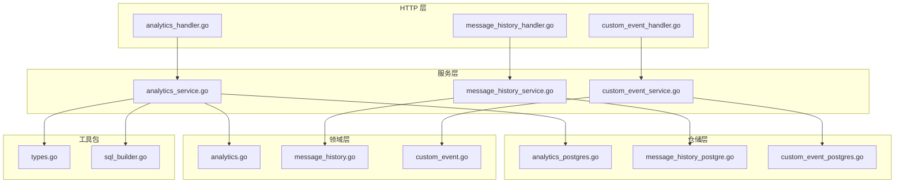
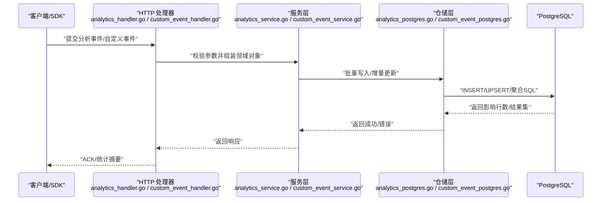
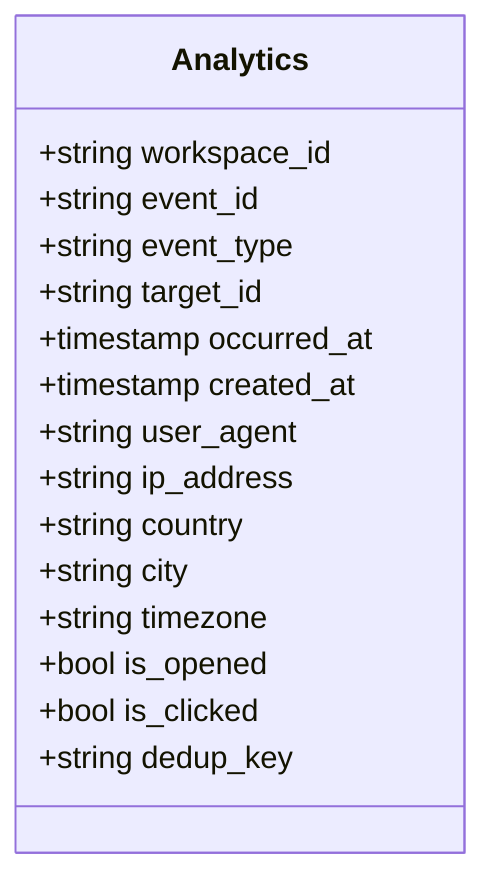
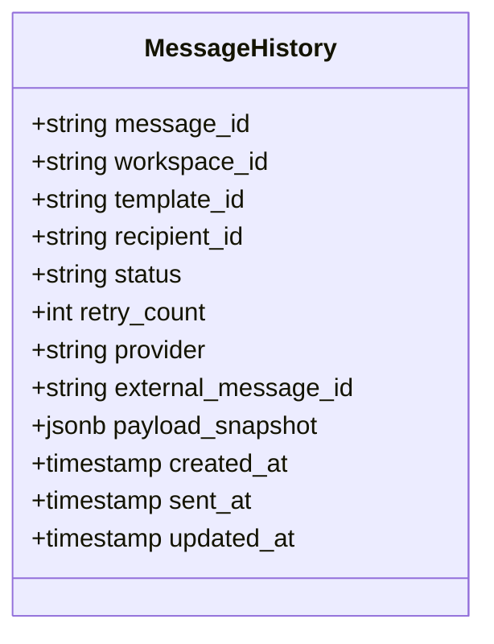
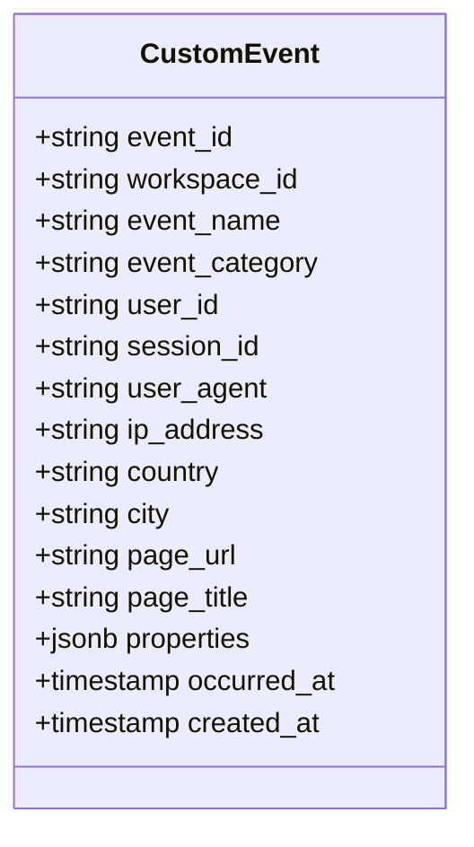
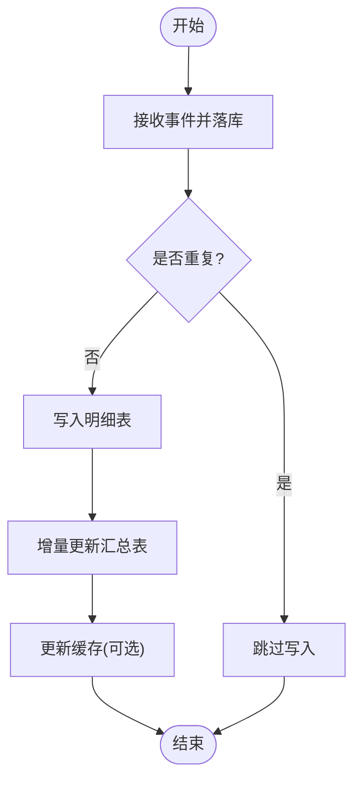
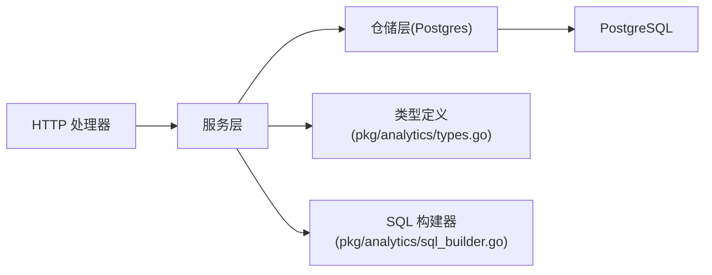

# 分析与追踪表

<cite>
**本文引用的文件**   
- [internal/domain/analytics.go](file://notifuse/internal/domain/analytics.go)
- [internal/domain/message_history.go](file://notifuse/internal/domain/message_history.go)
- [internal/domain/custom_event.go](file://notifuse/internal/domain/custom_event.go)
- [internal/repository/analytics_postgres.go](file://notifuse/internal/repository/analytics_postgres.go)
- [internal/repository/message_history_postgre.go](file://notifuse/internal/repository/message_history_postgre.go)
- [internal/repository/custom_event_postgres.go](file://notifuse/internal/repository/custom_event_postgres.go)
- [internal/http/analytics_handler.go](file://notifuse/internal/http/analytics_handler.go)
- [internal/http/message_history_handler.go](file://notifuse/internal/http/message_history_handler.go)
- [internal/http/custom_event_handler.go](file://notifuse/internal/http/custom_event_handler.go)
- [internal/service/analytics_service.go](file://notifuse/internal/service/analytics_service.go)
- [internal/service/message_history_service.go](file://notifuse/internal/service/message_history_service.go)
- [internal/service/custom_event_service.go](file://notifuse/internal/service/custom_event_service.go)
- [pkg/analytics/types.go](file://notifuse/pkg/analytics/types.go)
- [pkg/analytics/sql_builder.go](file://notifuse/pkg/analytics/sql_builder.go)
- [internal/database/schema/](file://notifuse/internal/database/schema/)
</cite>

## 目录
1. [简介](#简介)
2. [项目结构](#项目结构)
3. [核心组件](#核心组件)
4. [架构总览](#架构总览)
5. [详细组件分析](#详细组件分析)
6. [依赖关系分析](#依赖关系分析)
7. [性能考虑](#性能考虑)
8. [故障排查指南](#故障排查指南)
9. [结论](#结论)
10. [附录](#附录)

## 简介
本文件面向 Notifuse 平台的数据分析与用户行为追踪系统，聚焦以下数据模型与流程：
- 分析数据（Analytics）：用于聚合与查询邮件打开率、点击率等关键指标。
- 消息历史（MessageHistory）：记录每次发送的邮件详情与状态，支撑送达与打开/点击归因。
- 自定义事件（CustomEvent）：承载业务侧埋点事件，支持页面浏览、按钮点击与交互事件的持久化。

文档将说明事件时间戳、用户代理信息与地理位置数据的记录方式；解释实时分析的聚合与缓存设计（预计算指标与增量更新）；并提供大规模数据分析的性能优化方案（分区、索引与查询优化）。

## 项目结构
与分析和追踪相关的代码主要分布在如下层次：
- 领域层（domain）：定义分析、消息历史、自定义事件等实体与值对象。
- 仓储层（repository）：PostgreSQL 实现，负责 SQL 构建与读写。
- 服务层（service）：编排业务逻辑，协调 HTTP 处理器与仓储。
- HTTP 层（http）：暴露分析采集与查询接口。
- 工具包（pkg/analytics）：提供分析类型与 SQL 构建器。
- 数据库迁移（internal/database/schema）：存放 DDL 与迁移脚本。

图表来源
- [internal/http/analytics_handler.go](file://notifuse/internal/http/analytics_handler.go)
- [internal/service/analytics_service.go](file://notifuse/internal/service/analytics_service.go)
- [internal/repository/analytics_postgres.go](file://notifuse/internal/repository/analytics_postgres.go)
- [internal/domain/analytics.go](file://notifuse/internal/domain/analytics.go)
- [pkg/analytics/types.go](file://notifuse/pkg/analytics/types.go)
- [pkg/analytics/sql_builder.go](file://notifuse/pkg/analytics/sql_builder.go)
- [internal/http/message_history_handler.go](file://notifuse/internal/http/message_history_handler.go)
- [internal/service/message_history_service.go](file://notifuse/internal/service/message_history_service.go)
- [internal/repository/message_history_postgre.go](file://notifuse/internal/repository/message_history_postgre.go)
- [internal/domain/message_history.go](file://notifuse/internal/domain/message_history.go)
- [internal/http/custom_event_handler.go](file://notifuse/internal/http/custom_event_handler.go)
- [internal/service/custom_event_service.go](file://notifuse/internal/service/custom_event_service.go)
- [internal/repository/custom_event_postgres.go](file://notifuse/internal/repository/custom_event_postgres.go)
- [internal/domain/custom_event.go](file://notifuse/internal/domain/custom_event.go)

章节来源
- [internal/domain/analytics.go](file://notifuse/internal/domain/analytics.go)
- [internal/domain/message_history.go](file://notifuse/internal/domain/message_history.go)
- [internal/domain/custom_event.go](file://notifuse/internal/domain/custom_event.go)
- [internal/repository/analytics_postgres.go](file://notifuse/internal/repository/analytics_postgres.go)
- [internal/repository/message_history_postgre.go](file://notifuse/internal/repository/message_history_postgre.go)
- [internal/repository/custom_event_postgres.go](file://notifuse/internal/repository/custom_event_postgres.go)
- [internal/http/analytics_handler.go](file://notifuse/internal/http/analytics_handler.go)
- [internal/http/message_history_handler.go](file://notifuse/internal/http/message_history_handler.go)
- [internal/http/custom_event_handler.go](file://notifuse/internal/http/custom_event_handler.go)
- [internal/service/analytics_service.go](file://notifuse/internal/service/analytics_service.go)
- [internal/service/message_history_service.go](file://notifuse/internal/service/message_history_service.go)
- [internal/service/custom_event_service.go](file://notifuse/internal/service/custom_event_service.go)
- [pkg/analytics/types.go](file://notifuse/pkg/analytics/types.go)
- [pkg/analytics/sql_builder.go](file://notifuse/pkg/analytics/sql_builder.go)

## 核心组件
本节概述三大核心表及其在系统中的职责与关联：
- 分析数据（Analytics）：存储事件级明细与聚合结果，支撑打开率、点击率等指标计算。
- 消息历史（MessageHistory）：记录每封邮件的发送上下文与投递状态，作为事件归因的锚点。
- 自定义事件（CustomEvent）：承载前端或后端埋点事件，包括页面浏览、按钮点击与交互事件。

章节来源
- [internal/domain/analytics.go](file://notifuse/internal/domain/analytics.go)
- [internal/domain/message_history.go](file://notifuse/internal/domain/message_history.go)
- [internal/domain/custom_event.go](file://notifuse/internal/domain/custom_event.go)

## 架构总览
下图展示从客户端到数据库的分析与追踪数据流，涵盖事件采集、写入、聚合与查询路径。

图表来源
- [internal/http/analytics_handler.go](file://notifuse/internal/http/analytics_handler.go)
- [internal/http/custom_event_handler.go](file://notifuse/internal/http/custom_event_handler.go)
- [internal/service/analytics_service.go](file://notifuse/internal/service/analytics_service.go)
- [internal/service/custom_event_service.go](file://notifuse/internal/service/custom_event_service.go)
- [internal/repository/analytics_postgres.go](file://notifuse/internal/repository/analytics_postgres.go)
- [internal/repository/custom_event_postgres.go](file://notifuse/internal/repository/custom_event_postgres.go)

## 详细组件分析

### 分析数据（Analytics）
- 职责
  - 记录与分析相关的事件明细与聚合结果，支撑打开率、点击率等指标。
  - 提供按工作区、模板、联系人、时间窗口的多维查询能力。
- 关键字段与语义
  - 标识字段：工作区ID、事件ID、事件类型（如打开、点击）、目标资源ID（如模板ID、链接ID）。
  - 时间字段：事件发生时间戳、入库时间戳。
  - 上下文字段：用户代理、IP、地理位置（国家/城市/时区）、浏览器/操作系统信息。
  - 指标字段：是否已计入打开/点击、去重键（避免重复计数）。
- 聚合与预计算
  - 通过 SQL 构建器生成窗口聚合语句，按天/小时维度预计算打开数、点击数、曝光数等。
  - 增量更新策略：基于事件时间戳进行幂等写入，使用 UPSERT 保证重复上报不重复计数。
- 查询优化
  - 针对常用过滤条件建立复合索引（如工作区ID+事件类型+时间戳）。
  - 对高频聚合维度建立物化视图或汇总表，减少在线扫描成本。

图表来源
- [internal/domain/analytics.go](file://notifuse/internal/domain/analytics.go)
- [pkg/analytics/types.go](file://notifuse/pkg/analytics/types.go)
- [pkg/analytics/sql_builder.go](file://notifuse/pkg/analytics/sql_builder.go)
- [internal/repository/analytics_postgres.go](file://notifuse/internal/repository/analytics_postgres.go)

章节来源
- [internal/domain/analytics.go](file://notifuse/internal/domain/analytics.go)
- [pkg/analytics/types.go](file://notifuse/pkg/analytics/types.go)
- [pkg/analytics/sql_builder.go](file://notifuse/pkg/analytics/sql_builder.go)
- [internal/repository/analytics_postgres.go](file://notifuse/internal/repository/analytics_postgres.go)

### 消息历史（MessageHistory）
- 职责
  - 记录每封邮件的发送上下文与投递状态，为打开/点击事件提供归因依据。
- 关键字段与语义
  - 标识字段：消息ID、工作区ID、模板ID、收件人ID。
  - 状态字段：发送状态（排队、发送中、已送达、失败）、重试次数、最终状态码。
  - 内容字段：主题、发件人、附件数量、模板变量快照。
  - 时间字段：创建时间、首次发送时间、最后更新时间。
  - 扩展字段：提供者信息（如 SES/SendGrid）、外部消息ID。
- 与 Analytics 的关系
  - 通过消息ID与模板ID关联，将打开/点击事件归因到具体邮件与模板。
- 查询优化
  - 针对工作区ID+状态+时间戳建立复合索引，加速送达率与失败率统计。
  - 对大表采用时间分区（按月/周），降低全表扫描成本。

图表来源
- [internal/domain/message_history.go](file://notifuse/internal/domain/message_history.go)
- [internal/repository/message_history_postgre.go](file://notifuse/internal/repository/message_history_postgre.go)

章节来源
- [internal/domain/message_history.go](file://notifuse/internal/domain/message_history.go)
- [internal/repository/message_history_postgre.go](file://notifuse/internal/repository/message_history_postgre.go)

### 自定义事件（CustomEvent）
- 职责
  - 承载业务侧埋点事件，包括页面浏览、按钮点击与用户交互事件。
- 关键字段与语义
  - 标识字段：事件ID、工作区ID、事件名称、事件分类。
  - 主体字段：用户ID（可选）、会话ID、设备指纹（可选）。
  - 上下文字段：用户代理、IP、地理位置、页面URL、页面标题、来源渠道。
  - 属性字段：JSON 扩展属性（如按钮ID、表单字段、A/B 分组）。
  - 时间字段：事件发生时间戳、入库时间戳。
- 采集与处理
  - 通过 HTTP 接口接收事件，服务层进行基础校验与脱敏。
  - 仓储层批量写入，支持幂等去重（基于事件ID或签名）。
- 查询与聚合
  - 针对事件名称+时间戳建立索引，便于按事件维度做漏斗与留存分析。
  - 结合 Analytics 表进行跨域分析（例如将点击事件与邮件打开事件关联）。

图表来源
- [internal/domain/custom_event.go](file://notifuse/internal/domain/custom_event.go)
- [internal/repository/custom_event_postgres.go](file://notifuse/internal/repository/custom_event_postgres.go)

章节来源
- [internal/domain/custom_event.go](file://notifuse/internal/domain/custom_event.go)
- [internal/repository/custom_event_postgres.go](file://notifuse/internal/repository/custom_event_postgres.go)

### 关键指标收集与存储机制
- 打开率与点击率
  - 数据来源：Analytics 表中事件类型为“打开”和“点击”的记录。
  - 计算口径：以消息历史中的送达数为分母，打开/点击数为分子，按工作区/模板/时间窗口聚合。
  - 去重策略：基于事件ID或去重键进行幂等写入，避免重复上报导致指标膨胀。
- 事件时间戳
  - 使用事件发生时间戳（occurred_at）作为主时间轴，入库时间戳（created_at）用于审计与延迟补偿。
- 用户代理与地理位置
  - 用户代理：记录完整 UA 字符串，便于后续解析浏览器/操作系统版本。
  - 地理位置：记录国家/城市与时区，支持地域维度分析。
- 页面浏览与交互事件
  - 通过 CustomEvent 表记录页面浏览（event_name=page_view）与按钮点击（event_name=button_click）等事件。
  - 使用 JSON 属性字段灵活扩展事件属性，满足多场景埋点需求。

章节来源
- [internal/domain/analytics.go](file://notifuse/internal/domain/analytics.go)
- [internal/domain/custom_event.go](file://notifuse/internal/domain/custom_event.go)
- [internal/domain/message_history.go](file://notifuse/internal/domain/message_history.go)
- [pkg/analytics/sql_builder.go](file://notifuse/pkg/analytics/sql_builder.go)

### 实时分析聚合与缓存设计
- 预计算指标
  - 按小时/天维度预计算打开数、点击数、曝光数等指标，存储在汇总表或物化视图中。
  - 使用 SQL 构建器动态生成聚合语句，支持多维度切片（工作区、模板、渠道）。
- 增量更新
  - 基于事件时间戳进行增量写入，UPSERT 保证幂等性。
  - 后台任务定期刷新汇总表，确保近实时可查。
- 缓存策略
  - 热点查询结果（如最近24小时指标）缓存至内存或 Redis，缩短响应时间。
  - 缓存失效策略：基于时间窗口与事件写入触发失效。

图表来源
- [internal/service/analytics_service.go](file://notifuse/internal/service/analytics_service.go)
- [internal/repository/analytics_postgres.go](file://notifuse/internal/repository/analytics_postgres.go)
- [pkg/analytics/sql_builder.go](file://notifuse/pkg/analytics/sql_builder.go)

章节来源
- [internal/service/analytics_service.go](file://notifuse/internal/service/analytics_service.go)
- [internal/repository/analytics_postgres.go](file://notifuse/internal/repository/analytics_postgres.go)
- [pkg/analytics/sql_builder.go](file://notifuse/pkg/analytics/sql_builder.go)

### 用户行为追踪的数据模型与持久化策略
- 数据模型
  - 使用 CustomEvent 表统一承载页面浏览、按钮点击与交互事件。
  - 通过 JSON 属性字段表达事件特有上下文，保持模型扩展性。
- 持久化策略
  - 批量写入：服务端聚合多条事件后批量插入，降低数据库压力。
  - 幂等去重：基于事件ID或签名进行去重，防止网络重试导致重复。
  - 异步落库：在高并发场景下采用队列缓冲，削峰填谷。
- 查询与归档
  - 近期数据在线查询，历史数据归档至冷存储或分区表，降低热表体积。

章节来源
- [internal/domain/custom_event.go](file://notifuse/internal/domain/custom_event.go)
- [internal/repository/custom_event_postgres.go](file://notifuse/internal/repository/custom_event_postgres.go)

## 依赖关系分析
- 组件耦合
  - HTTP 处理器依赖服务层进行参数校验与业务编排。
  - 服务层依赖仓储层执行 SQL 操作，领域对象贯穿各层。
  - 工具包提供类型定义与 SQL 构建器，被服务层与仓储层复用。
- 外部依赖
  - PostgreSQL：作为主数据存储，承担明细与聚合查询。
  - 可选缓存：Redis/内存缓存用于热点指标快速读取。

图表来源
- [internal/http/analytics_handler.go](file://notifuse/internal/http/analytics_handler.go)
- [internal/service/analytics_service.go](file://notifuse/internal/service/analytics_service.go)
- [internal/repository/analytics_postgres.go](file://notifuse/internal/repository/analytics_postgres.go)
- [pkg/analytics/types.go](file://notifuse/pkg/analytics/types.go)
- [pkg/analytics/sql_builder.go](file://notifuse/pkg/analytics/sql_builder.go)

章节来源
- [internal/http/analytics_handler.go](file://notifuse/internal/http/analytics_handler.go)
- [internal/service/analytics_service.go](file://notifuse/internal/service/analytics_service.go)
- [internal/repository/analytics_postgres.go](file://notifuse/internal/repository/analytics_postgres.go)
- [pkg/analytics/types.go](file://notifuse/pkg/analytics/types.go)
- [pkg/analytics/sql_builder.go](file://notifuse/pkg/analytics/sql_builder.go)

## 性能考虑
- 数据分区
  - 对高吞吐表（Analytics、CustomEvent）按时间分区（月/周），提升查询与归档效率。
  - 消息历史表可按工作区+时间分区，隔离不同租户数据。
- 索引策略
  - 复合索引：工作区ID+事件类型+时间戳（Analytics）；工作区ID+状态+时间戳（MessageHistory）；事件名称+时间戳（CustomEvent）。
  - 部分索引：仅对活跃时间段或特定状态建立索引，减少索引体积。
- 查询优化
  - 使用物化视图或汇总表承载常见聚合，避免在线全表扫描。
  - 限制时间窗口与维度数量，避免笛卡尔积与过度聚合。
- 写入优化
  - 批量插入与 UPSERT，减少事务开销。
  - 异步写入与背压控制，保障高并发下的稳定性。
- 缓存与预热
  - 热点指标缓存，设置合理 TTL 与失效策略。
  - 定时预热：在高峰前预加载常用查询结果。

[本节为通用性能建议，无需列出具体文件来源]

## 故障排查指南
- 常见问题
  - 指标异常波动：检查去重键与事件ID是否唯一，确认重复上报是否被正确忽略。
  - 打开/点击未归因：核对消息历史中的消息ID与 Analytics 事件中的目标ID是否一致。
  - 地理位置缺失：确认上游是否传递 IP 与地理解析服务可用。
- 定位步骤
  - 查看 HTTP 层日志，确认请求参数与响应码。
  - 检查服务层校验与转换逻辑，验证领域对象字段完整性。
  - 审查仓储层 SQL 与影响行数，确认写入是否成功。
  - 对比明细表与汇总表数据一致性，定位聚合任务是否正常运行。

章节来源
- [internal/http/analytics_handler.go](file://notifuse/internal/http/analytics_handler.go)
- [internal/service/analytics_service.go](file://notifuse/internal/service/analytics_service.go)
- [internal/repository/analytics_postgres.go](file://notifuse/internal/repository/analytics_postgres.go)

## 结论
通过对 Analytics、MessageHistory 与 CustomEvent 三张核心表的设计与实现进行系统化梳理，Notifuse 平台实现了从事件采集、写入、聚合到查询的完整链路。借助时间分区、复合索引与物化视图等手段，系统在大规模数据场景下具备良好的可扩展性与查询性能。建议在后续迭代中持续完善缓存策略与监控告警，进一步提升实时性与稳定性。

[本节为总结性内容，无需列出具体文件来源]

## 附录
- 数据库迁移与 DDL
  - 参考 internal/database/schema 目录下的迁移脚本，了解实际建表语句与索引定义。
- 示例查询
  - 打开率：按工作区与模板维度，计算打开数/送达数。
  - 点击率：按工作区与模板维度，计算点击数/曝光数。
  - 页面浏览趋势：按时间窗口统计 page_view 事件量。

章节来源
- [internal/database/schema/](file://notifuse/internal/database/schema/)