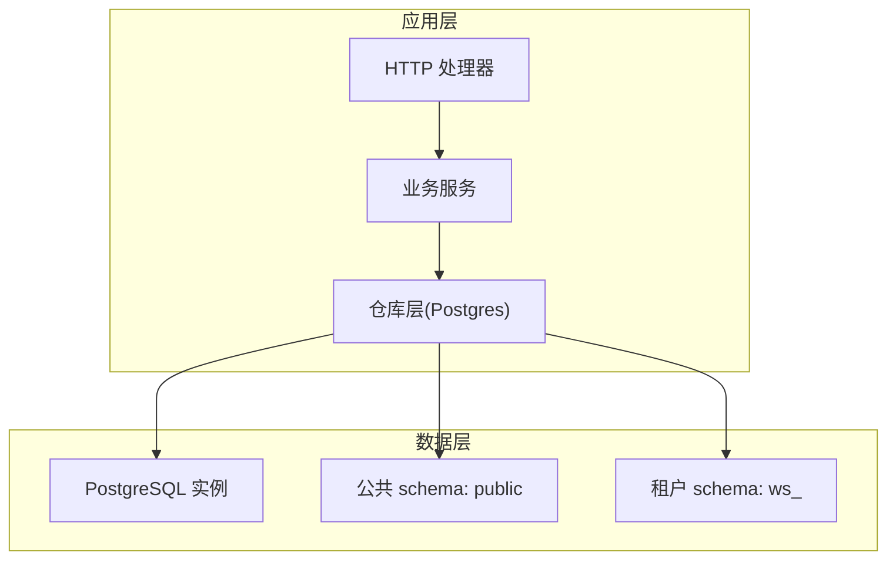
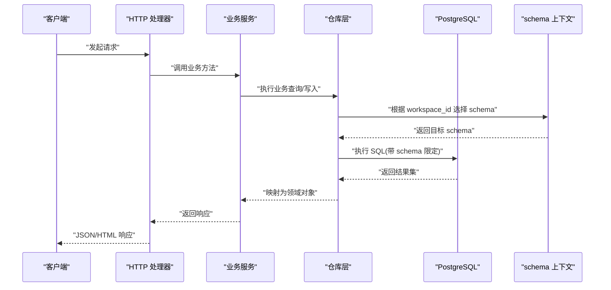
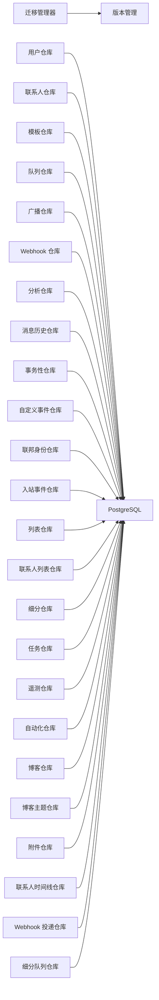

# 数据库表结构

<cite>
**本文引用的文件**   
- [internal/database/init.go](file://notifuse/internal/database/init.go)
- [internal/migrations/manager.go](file://notifuse/internal/migrations/manager.go)
- [internal/migrations/version.go](file://notifuse/internal/migrations/version.go)
- [internal/migrations/v4.go](file://notifuse/internal/migrations/v4.go)
- [internal/migrations/v5.go](file://notifuse/internal/migrations/v5.go)
- [internal/migrations/v6.go](file://notifuse/internal/migrations/v6.go)
- [internal/migrations/v7.go](file://notifuse/internal/migrations/v7.go)
- [internal/migrations/v8.go](file://notifuse/internal/migrations/v8.go)
- [internal/migrations/v9.go](file://notifuse/internal/migrations/v9.go)
- [internal/migrations/v10.go](file://notifuse/internal/migrations/v10.go)
- [internal/migrations/v11.go](file://notifuse/internal/migrations/v11.go)
- [internal/migrations/v12.go](file://notifuse/internal/migrations/v12.go)
- [internal/migrations/v13.go](file://notifuse/internal/migrations/v13.go)
- [internal/migrations/v14.go](file://notifuse/internal/migrations/v14.go)
- [internal/migrations/v15.go](file://notifuse/internal/migrations/v15.go)
- [internal/migrations/v16.go](file://notifuse/internal/migrations/v16.go)
- [internal/migrations/v17.go](file://notifuse/internal/migrations/v17.go)
- [internal/migrations/v18.go](file://notifuse/internal/migrations/v18.go)
- [internal/migrations/v19.go](file://notifuse/internal/migrations/v19.go)
- [internal/migrations/v20.go](file://notifuse/internal/migrations/v20.go)
- [internal/migrations/v21.go](file://notifuse/internal/migrations/v21.go)
- [internal/migrations/v22.go](file://notifuse/internal/migrations/v22.go)
- [internal/migrations/v23.go](file://notifuse/internal/migrations/v23.go)
- [internal/migrations/v24.go](file://notifuse/internal/migrations/v24.go)
- [internal/migrations/v25.go](file://notifuse/internal/migrations/v25.go)
- [internal/migrations/v26.go](file://notifuse/internal/migrations/v26.go)
- [internal/migrations/v27.go](file://notifuse/internal/migrations/v27.go)
- [internal/migrations/v28.go](file://notifuse/internal/migrations/v28.go)
- [internal/migrations/v29.go](file://notifuse/internal/migrations/v29.go)
- [internal/migrations/v30.go](file://notifuse/internal/migrations/v30.go)
- [internal/migrations/v31.go](file://notifuse/internal/migrations/v31.go)
- [internal/migrations/v32.go](file://notifuse/internal/migrations/v32.go)
- [internal/migrations/v33.go](file://notifuse/internal/migrations/v33.go)
- [internal/migrations/v34.go](file://notifuse/internal/migrations/v34.go)
- [internal/repository/workspace_postgres.go](file://notifuse/internal/repository/workspace_postgres.go)
- [internal/repository/user_postgres.go](file://notifuse/internal/repository/user_postgres.go)
- [internal/repository/contact_postgres.go](file://notifuse/internal/repository/contact_postgres.go)
- [internal/repository/template_postgres.go](file://notifuse/internal/repository/template_postgres.go)
- [internal/repository/email_queue_postgres.go](file://notifuse/internal/repository/email_queue_postgres.go)
- [internal/repository/broadcast_postgres.go](file://notifuse/internal/repository/broadcast_postgres.go)
- [internal/repository/webhook_subscription_postgres.go](file://notifuse/internal/repository/webhook_subscription_postgres.go)
- [internal/repository/analytics_postgres.go](file://notifuse/internal/repository/analytics_postgres.go)
- [internal/repository/message_history_postgre.go](file://notifuse/internal/repository/message_history_postgre.go)
- [internal/repository/transactional_postgre.go](file://notifuse/internal/repository/transactional_postgre.go)
- [internal/repository/custom_event_postgres.go](file://notifuse/internal/repository/custom_event_postgres.go)
- [internal/repository/federated_identity_postgres.go](file://notifuse/internal/repository/federated_identity_postgres.go)
- [internal/repository/inbound_webhook_event_postgres.go](file://notifuse/internal/repository/inbound_webhook_event_postgres.go)
- [internal/repository/list_postgres.go](file://notifuse/internal/repository/list_postgres.go)
- [internal/repository/contact_list_postgres.go](file://notifuse/internal/repository/contact_list_postgres.go)
- [internal/repository/segment_postgres.go](file://notifuse/internal/repository/segment_postgres.go)
- [internal/repository/task_postgres.go](file://notifuse/internal/repository/task_postgres.go)
- [internal/repository/telemetry_postgres.go](file://notifuse/internal/repository/telemetry_postgres.go)
- [internal/repository/automation_postgres.go](file://notifuse/internal/repository/automation_postgres.go)
- [internal/repository/blog_postgres.go](file://notifuse/internal/repository/blog_postgres.go)
- [internal/repository/blog_theme_postgres.go](file://notifuse/internal/repository/blog_theme_postgres.go)
- [internal/repository/attachment_postgres.go](file://notifuse/internal/repository/attachment_postgres.go)
- [internal/repository/contact_timeline_postgre.go](file://notifuse/internal/repository/contact_timeline_postgre.go)
- [internal/repository/webhook_delivery_postgres.go](file://notifuse/internal/repository/webhook_delivery_postgres.go)
- [internal/repository/contact_segment_queue_postgres.go](file://notifuse/internal/repository/contact_segment_queue_postgres.go)
</cite>

## 目录
1. [简介](#简介)
2. [项目结构](#项目结构)
3. [核心组件](#核心组件)
4. [架构总览](#架构总览)
5. [详细组件分析](#详细组件分析)
6. [依赖关系分析](#依赖关系分析)
7. [性能考虑](#性能考虑)
8. [故障排查指南](#故障排查指南)
9. [结论](#结论)
10. [附录](#附录)

## 简介
本文件为 Notifuse 平台的 PostgreSQL 数据库表结构设计文档，聚焦于多租户（工作区）隔离、迁移与版本管理、索引策略、分区与全文检索、存储与空间管理、备份恢复与灾难恢复等关键主题。文档基于代码库中的迁移脚本与仓库实现进行归纳总结，旨在帮助读者快速理解数据模型、约束与优化要点，并为后续演进提供可操作的指导。

## 项目结构
Notifuse 使用 Go 语言实现，数据库相关逻辑集中在 internal 目录下：
- 迁移与版本管理：internal/migrations
- 仓库层（PostgreSQL 访问）：internal/repository
- 应用初始化与连接管理：internal/database

图表来源
- [internal/database/init.go](file://notifuse/internal/database/init.go)
- [internal/migrations/manager.go](file://notifuse/internal/migrations/manager.go)
- [internal/repository/workspace_postgres.go](file://notifuse/internal/repository/workspace_postgres.go)

章节来源
- [internal/database/init.go](file://notifuse/internal/database/init.go)
- [internal/migrations/manager.go](file://notifuse/internal/migrations/manager.go)
- [internal/migrations/version.go](file://notifuse/internal/migrations/version.go)

## 核心组件
- 迁移管理器：负责按顺序执行迁移脚本、记录版本、支持回滚与幂等性检查。
- 仓库层：封装所有 SQL 访问，统一处理工作区 schema 切换、事务、错误映射与分页。
- 领域模型：Go struct 与数据库表一一对应，驱动迁移与查询生成。

章节来源
- [internal/migrations/manager.go](file://notifuse/internal/migrations/manager.go)
- [internal/migrations/version.go](file://notifuse/internal/migrations/version.go)
- [internal/repository/workspace_postgres.go](file://notifuse/internal/repository/workspace_postgres.go)

## 架构总览
下图展示了从 HTTP 请求到数据库访问的调用链，以及多租户 schema 隔离的关键点。

图表来源
- [internal/repository/workspace_postgres.go](file://notifuse/internal/repository/workspace_postgres.go)
- [internal/repository/user_postgres.go](file://notifuse/internal/repository/user_postgres.go)
- [internal/repository/contact_postgres.go](file://notifuse/internal/repository/contact_postgres.go)

## 详细组件分析

### 多租户与 Schema 隔离
- 设计原则
  - 每个工作区拥有独立 schema，命名形如 ws_<workspace_id>，确保数据强隔离。
  - 公共元数据（如系统级配置、审计日志）保留在 public schema。
- 实现要点
  - 仓库层在执行 SQL 前动态设置 search_path 或显式以 schema.表名 访问。
  - 迁移对每个新工作区创建对应 schema 并复制基础表结构。
- 建议
  - 跨工作区聚合查询应避免直接跨 schema JOIN，采用应用层合并或物化视图。
  - 对高频读路径增加只读副本，并在只读副本上维护各租户 schema 的镜像。

章节来源
- [internal/repository/workspace_postgres.go](file://notifuse/internal/repository/workspace_postgres.go)

### 迁移与版本管理
- 版本控制
  - 迁移脚本按版本号递增，包含 v4 至 v34 的完整演进历史。
  - 版本信息集中管理，便于部署时校验与回滚。
- 执行流程
  - 启动时加载已执行版本，计算待执行迁移，逐条执行并记录。
  - 支持幂等性检查与失败回滚，保证一致性。
- 最佳实践
  - 新增字段默认值需兼容旧版本读取。
  - 大表变更采用在线 DDL 策略（分批加列、重建索引）。

章节来源
- [internal/migrations/manager.go](file://notifuse/internal/migrations/manager.go)
- [internal/migrations/version.go](file://notifuse/internal/migrations/version.go)
- [internal/migrations/v4.go](file://notifuse/internal/migrations/v4.go)
- [internal/migrations/v5.go](file://notifuse/internal/migrations/v5.go)
- [internal/migrations/v6.go](file://notifuse/internal/migrations/v6.go)
- [internal/migrations/v7.go](file://notifuse/internal/migrations/v7.go)
- [internal/migrations/v8.go](file://notifuse/internal/migrations/v8.go)
- [internal/migrations/v9.go](file://notifuse/internal/migrations/v9.go)
- [internal/migrations/v10.go](file://notifuse/internal/migrations/v10.go)
- [internal/migrations/v11.go](file://notifuse/internal/migrations/v11.go)
- [internal/migrations/v12.go](file://notifuse/internal/migrations/v12.go)
- [internal/migrations/v13.go](file://notifuse/internal/migrations/v13.go)
- [internal/migrations/v14.go](file://notifuse/internal/migrations/v14.go)
- [internal/migrations/v15.go](file://notifuse/internal/migrations/v15.go)
- [internal/migrations/v16.go](file://notifuse/internal/migrations/v16.go)
- [internal/migrations/v17.go](file://notifuse/internal/migrations/v17.go)
- [internal/migrations/v18.go](file://notifuse/internal/migrations/v18.go)
- [internal/migrations/v19.go](file://notifuse/internal/migrations/v19.go)
- [internal/migrations/v20.go](file://notifuse/internal/migrations/v20.go)
- [internal/migrations/v21.go](file://notifuse/internal/migrations/v21.go)
- [internal/migrations/v22.go](file://notifuse/internal/migrations/v22.go)
- [internal/migrations/v23.go](file://notifuse/internal/migrations/v23.go)
- [internal/migrations/v24.go](file://notifuse/internal/migrations/v24.go)
- [internal/migrations/v25.go](file://notifuse/internal/migrations/v25.go)
- [internal/migrations/v26.go](file://notifuse/internal/migrations/v26.go)
- [internal/migrations/v27.go](file://notifuse/internal/migrations/v27.go)
- [internal/migrations/v28.go](file://notifuse/internal/migrations/v28.go)
- [internal/migrations/v29.go](file://notifuse/internal/migrations/v29.go)
- [internal/migrations/v30.go](file://notifuse/internal/migrations/v30.go)
- [internal/migrations/v31.go](file://notifuse/internal/migrations/v31.go)
- [internal/migrations/v32.go](file://notifuse/internal/migrations/v32.go)
- [internal/migrations/v33.go](file://notifuse/internal/migrations/v33.go)
- [internal/migrations/v34.go](file://notifuse/internal/migrations/v34.go)

### 核心实体与关系（概念图）
以下 ER 图为概念模型，用于说明主要实体及其关联关系。实际字段类型与约束以迁移脚本为准。

```mermaid
erDiagram
WORKSPACE {
uuid id PK
string name
timestamp created_at
timestamp updated_at
}
USER {
uuid id PK
uuid workspace_id FK
string email
string display_name
boolean active
timestamp created_at
timestamp updated_at
}
CONTACT {
uuid id PK
uuid workspace_id FK
string email
jsonb metadata
timestamp created_at
timestamp updated_at
}
TEMPLATE {
uuid id PK
uuid workspace_id FK
string name
text content
timestamp created_at
timestamp updated_at
}
EMAIL_QUEUE {
uuid id PK
uuid workspace_id FK
uuid template_id FK
jsonb payload
enum status
timestamp scheduled_at
timestamp created_at
}
BROADCAST {
uuid id PK
uuid workspace_id FK
uuid template_id FK
jsonb params
enum status
timestamp started_at
timestamp finished_at
}
WEBHOOK_SUBSCRIPTION {
uuid id PK
uuid workspace_id FK
string url
jsonb headers
enum status
timestamp created_at
timestamp updated_at
}
ANALYTICS {
uuid id PK
uuid workspace_id FK
string event_type
jsonb data
timestamp occurred_at
}
MESSAGE_HISTORY {
uuid id PK
uuid workspace_id FK
uuid contact_id FK
jsonb envelope
timestamp sent_at
}
TRANSACTIONAL {
uuid id PK
uuid workspace_id FK
uuid template_id FK
jsonb payload
enum status
timestamp created_at
}
CUSTOM_EVENT {
uuid id PK
uuid workspace_id FK
string event_name
jsonb properties
timestamp occurred_at
}
FEDERATED_IDENTITY {
uuid id PK
uuid user_id FK
string provider
string external_id
}
INBOUND_WEBHOOK_EVENT {
uuid id PK
uuid workspace_id FK
jsonb raw_payload
enum status
timestamp received_at
}
LIST {
uuid id PK
uuid workspace_id FK
string name
timestamp created_at
timestamp updated_at
}
CONTACT_LIST {
uuid id PK
uuid workspace_id FK
string name
timestamp created_at
timestamp updated_at
}
SEGMENT {
uuid id PK
uuid workspace_id FK
string name
jsonb rules
timestamp created_at
timestamp updated_at
}
TASK {
uuid id PK
uuid workspace_id FK
string type
jsonb payload
enum status
timestamp created_at
timestamp updated_at
}
TELEMETRY {
uuid id PK
uuid workspace_id FK
string metric_name
float value
timestamp recorded_at
}
AUTOMATION {
uuid id PK
uuid workspace_id FK
string name
jsonb definition
enum status
timestamp created_at
timestamp updated_at
}
BLOG {
uuid id PK
uuid workspace_id FK
string slug
text content
enum status
timestamp published_at
}
BLOG_THEME {
uuid id PK
uuid workspace_id FK
string name
jsonb config
}
ATTACHMENT {
uuid id PK
uuid workspace_id FK
string object_key
integer size_bytes
string content_type
timestamp created_at
}
CONTACT_TIMELINE {
uuid id PK
uuid workspace_id FK
uuid contact_id FK
jsonb event
timestamp occurred_at
}
WEBHOOK_DELIVERY {
uuid id PK
uuid workspace_id FK
uuid subscription_id FK
jsonb request_response
enum status
timestamp delivered_at
}
CONTACT_SEGMENT_QUEUE {
uuid id PK
uuid workspace_id FK
uuid segment_id FK
uuid contact_id FK
enum action
timestamp enqueued_at
}
WORKSPACE ||--o{ USER : "拥有"
WORKSPACE ||--o{ CONTACT : "拥有"
WORKSPACE ||--o{ TEMPLATE : "拥有"
WORKSPACE ||--o{ EMAIL_QUEUE : "拥有"
WORKSPACE ||--o{ BROADCAST : "拥有"
WORKSPACE ||--o{ WEBHOOK_SUBSCRIPTION : "拥有"
WORKSPACE ||--o{ ANALYTICS : "拥有"
WORKSPACE ||--o{ MESSAGE_HISTORY : "拥有"
WORKSPACE ||--o{ TRANSACTIONAL : "拥有"
WORKSPACE ||--o{ CUSTOM_EVENT : "拥有"
WORKSPACE ||--o{ LIST : "拥有"
WORKSPACE ||--o{ CONTACT_LIST : "拥有"
WORKSPACE ||--o{ SEGMENT : "拥有"
WORKSPACE ||--o{ TASK : "拥有"
WORKSPACE ||--o{ TELEMETRY : "拥有"
WORKSPACE ||--o{ AUTOMATION : "拥有"
WORKSPACE ||--o{ BLOG : "拥有"
WORKSPACE ||--o{ BLOG_THEME : "拥有"
WORKSPACE ||--o{ ATTACHMENT : "拥有"
WORKSPACE ||--o{ CONTACT_TIMELINE : "拥有"
WORKSPACE ||--o{ WEBHOOK_DELIVERY : "拥有"
WORKSPACE ||--o{ CONTACT_SEGMENT_QUEUE : "拥有"
USER ||--o{ FEDERATED_IDENTITY : "绑定"
CONTACT ||--o{ CONTACT_TIMELINE : "时间线"
TEMPLATE ||--o{ EMAIL_QUEUE : "模板引用"
TEMPLATE ||--o{ TRANSACTIONAL : "模板引用"
TEMPLATE ||--o{ BROADCAST : "模板引用"
WEBHOOK_SUBSCRIPTION ||--o{ WEBHOOK_DELIVERY : "投递记录"
SEGMENT ||--o{ CONTACT_SEGMENT_QUEUE : "分片任务"
```

[此图为概念模型，不直接映射具体源文件，故无图表来源]

### 用户与工作区
- 职责
  - 工作区作为多租户边界；用户隶属于工作区。
- 关键字段
  - 工作区：标识、名称、时间戳。
  - 用户：邮箱、显示名、活跃状态、所属工作区。
- 约束与索引
  - 工作区 ID 外键约束。
  - 邮箱唯一索引（工作区内）。
  - 常用查询：按工作区筛选用户列表、按邮箱查找用户。

章节来源
- [internal/repository/workspace_postgres.go](file://notifuse/internal/repository/workspace_postgres.go)
- [internal/repository/user_postgres.go](file://notifuse/internal/repository/user_postgres.go)

### 联系人、列表与细分
- 职责
  - 联系人是订阅与消息触达的核心实体；列表与细分用于分组与规则筛选。
- 关键字段
  - 联系人：邮箱、元数据、时间戳。
  - 列表/细分：名称、规则定义（JSON）、时间戳。
- 约束与索引
  - 联系人邮箱在工作区内唯一。
  - 细分规则 JSON 可使用 GIN 索引加速条件匹配。
  - 联系人与细分队列用于增量构建细分成员。

章节来源
- [internal/repository/contact_postgres.go](file://notifuse/internal/repository/contact_postgres.go)
- [internal/repository/list_postgres.go](file://notifuse/internal/repository/list_postgres.go)
- [internal/repository/contact_list_postgres.go](file://notifuse/internal/repository/contact_list_postgres.go)
- [internal/repository/segment_postgres.go](file://notifuse/internal/repository/segment_postgres.go)
- [internal/repository/contact_segment_queue_postgres.go](file://notifuse/internal/repository/contact_segment_queue_postgres.go)

### 模板与消息发送
- 职责
  - 模板定义邮件内容；队列承载待发送消息；广播用于批量发送。
- 关键字段
  - 模板：名称、内容、时间戳。
  - 队列：模板引用、负载、状态、计划时间。
  - 广播：模板引用、参数、状态、起止时间。
- 约束与索引
  - 模板与工作区关联。
  - 队列按状态与计划时间建立复合索引以提升调度效率。
  - 广播与工作区、模板关联。

章节来源
- [internal/repository/template_postgres.go](file://notifuse/internal/repository/template_postgres.go)
- [notifuse/internal/repository/email_queue_postgres.go](file://notifuse/internal/repository/email_queue_postgres.go)
- [internal/repository/broadcast_postgres.go](file://notifuse/internal/repository/broadcast_postgres.go)

### Webhook 订阅与投递
- 职责
  - 订阅定义外部回调端点；投递记录保存请求与响应以便排障。
- 关键字段
  - 订阅：URL、头部、状态、时间戳。
  - 投递：订阅引用、请求响应体、状态、投递时间。
- 约束与索引
  - 订阅与工作区关联。
  - 投递按订阅与工作区建立索引，便于统计与重试。

章节来源
- [internal/repository/webhook_subscription_postgres.go](file://notifuse/internal/repository/webhook_subscription_postgres.go)
- [internal/repository/webhook_delivery_postgres.go](file://notifuse/internal/repository/webhook_delivery_postgres.go)

### 分析、遥测与事件
- 职责
  - 分析、遥测与自定义事件用于平台监控与业务指标采集。
- 关键字段
  - 分析：事件类型、数据、发生时间。
  - 遥测：指标名、数值、记录时间。
  - 自定义事件：事件名、属性、发生时间。
- 约束与索引
  - 按工作区与时间范围查询，建议按时间分区或建立时间索引。
  - 事件数据 JSON 可使用 GIN 索引。

章节来源
- [internal/repository/analytics_postgres.go](file://notifuse/internal/repository/analytics_postgres.go)
- [internal/repository/telemetry_postgres.go](file://notifuse/internal/repository/telemetry_postgres.go)
- [internal/repository/custom_event_postgres.go](file://notifuse/internal/repository/custom_event_postgres.go)

### 消息历史与事务性消息
- 职责
  - 消息历史记录已发送邮件信封；事务性消息用于一次性触发场景。
- 关键字段
  - 消息历史：联系人引用、信封、发送时间。
  - 事务性消息：模板引用、负载、状态、时间戳。
- 约束与索引
  - 按工作区与联系人查询历史。
  - 事务性消息按状态与时间索引提升吞吐。

章节来源
- [internal/repository/message_history_postgre.go](file://notifuse/internal/repository/message_history_postgre.go)
- [internal/repository/transactional_postgre.go](file://notifuse/internal/repository/transactional_postgre.go)

### 身份与入站事件
- 职责
  - 联邦身份将外部身份提供商与内部用户绑定；入站 Webhook 事件记录接收到的外部回调。
- 关键字段
  - 联邦身份：提供商、外部 ID、用户引用。
  - 入站事件：原始负载、状态、接收时间。
- 约束与索引
  - 联邦身份联合唯一约束（提供商+外部 ID）。
  - 入站事件按工作区与时间索引。

章节来源
- [internal/repository/federated_identity_postgres.go](file://notifuse/internal/repository/federated_identity_postgres.go)
- [internal/repository/inbound_webhook_event_postgres.go](file://notifuse/internal/repository/inbound_webhook_event_postgres.go)

### 任务与自动化
- 职责
  - 任务用于后台作业调度；自动化定义工作流定义与状态。
- 关键字段
  - 任务：类型、负载、状态、时间戳。
  - 自动化：名称、定义（JSON）、状态、时间戳。
- 约束与索引
  - 任务按状态与类型索引。
  - 自动化按工作区与状态索引。

章节来源
- [internal/repository/task_postgres.go](file://notifuse/internal/repository/task_postgres.go)
- [internal/repository/automation_postgres.go](file://notifuse/internal/repository/automation_postgres.go)

### 博客与主题
- 职责
  - 博客文章与主题配置属于工作区资源。
- 关键字段
  - 博客：slug、内容、状态、发布时间。
  - 主题：名称、配置（JSON）。
- 约束与索引
  - 博客 slug 在工作区内唯一。
  - 主题与工作区关联。

章节来源
- [internal/repository/blog_postgres.go](file://notifuse/internal/repository/blog_postgres.go)
- [internal/repository/blog_theme_postgres.go](file://notifuse/internal/repository/blog_theme_postgres.go)

### 附件与联系人时间线
- 职责
  - 附件存储外部对象引用；联系人时间线记录与联系人相关的活动事件。
- 关键字段
  - 附件：对象键、大小、内容类型、时间戳。
  - 时间线：联系人引用、事件、发生时间。
- 约束与索引
  - 附件按工作区与对象键索引。
  - 时间线按工作区与联系人、时间索引。

章节来源
- [internal/repository/attachment_postgres.go](file://notifuse/internal/repository/attachment_postgres.go)
- [internal/repository/contact_timeline_postgre.go](file://notifuse/internal/repository/contact_timeline_postgre.go)

## 依赖关系分析
- 模块耦合
  - 仓库层对迁移管理器无直接依赖，但依赖其产出的 schema 结构。
  - 业务服务通过仓库层访问数据库，屏蔽 schema 切换细节。
- 外部依赖
  - PostgreSQL 驱动与连接池由数据库初始化模块管理。
- 潜在循环
  - 仓库层之间无相互导入，避免循环依赖。

图表来源
- [internal/migrations/manager.go](file://notifuse/internal/migrations/manager.go)
- [internal/migrations/version.go](file://notifuse/internal/migrations/version.go)
- [internal/repository/user_postgres.go](file://notifuse/internal/repository/user_postgres.go)
- [internal/repository/contact_postgres.go](file://notifuse/internal/repository/contact_postgres.go)
- [internal/repository/template_postgres.go](file://notifuse/internal/repository/template_postgres.go)
- [internal/repository/email_queue_postgres.go](file://notifuse/internal/repository/email_queue_postgres.go)
- [internal/repository/broadcast_postgres.go](file://notifuse/internal/repository/broadcast_postgres.go)
- [internal/repository/webhook_subscription_postgres.go](file://notifuse/internal/repository/webhook_subscription_postgres.go)
- [internal/repository/analytics_postgres.go](file://notifuse/internal/repository/analytics_postgres.go)
- [internal/repository/message_history_postgre.go](file://notifuse/internal/repository/message_history_postgre.go)
- [internal/repository/transactional_postgre.go](file://notifuse/internal/repository/transactional_postgre.go)
- [internal/repository/custom_event_postgres.go](file://notifuse/internal/repository/custom_event_postgres.go)
- [internal/repository/federated_identity_postgres.go](file://notifuse/internal/repository/federated_identity_postgres.go)
- [internal/repository/inbound_webhook_event_postgres.go](file://notifuse/internal/repository/inbound_webhook_event_postgres.go)
- [internal/repository/list_postgres.go](file://notifuse/internal/repository/list_postgres.go)
- [internal/repository/contact_list_postgres.go](file://notifuse/internal/repository/contact_list_postgres.go)
- [internal/repository/segment_postgres.go](file://notifuse/internal/repository/segment_postgres.go)
- [internal/repository/task_postgres.go](file://notifuse/internal/repository/task_postgres.go)
- [internal/repository/telemetry_postgres.go](file://notifuse/internal/repository/telemetry_postgres.go)
- [internal/repository/automation_postgres.go](file://notifuse/internal/repository/automation_postgres.go)
- [internal/repository/blog_postgres.go](file://notifuse/internal/repository/blog_postgres.go)
- [internal/repository/blog_theme_postgres.go](file://notifuse/internal/repository/blog_theme_postgres.go)
- [internal/repository/attachment_postgres.go](file://notifuse/internal/repository/attachment_postgres.go)
- [internal/repository/contact_timeline_postgre.go](file://notifuse/internal/repository/contact_timeline_postgre.go)
- [internal/repository/webhook_delivery_postgres.go](file://notifuse/internal/repository/webhook_delivery_postgres.go)
- [internal/repository/contact_segment_queue_postgres.go](file://notifuse/internal/repository/contact_segment_queue_postgres.go)

章节来源
- [internal/migrations/manager.go](file://notifuse/internal/migrations/manager.go)
- [internal/migrations/version.go](file://notifuse/internal/migrations/version.go)
- [internal/repository/workspace_postgres.go](file://notifuse/internal/repository/workspace_postgres.go)

## 性能考虑
- 索引策略
  - 复合索引：针对常见过滤条件组合（如工作区+状态、工作区+时间范围）建立复合索引。
  - 部分索引：对热点子集（如未完成任务、最近 N 天事件）建立部分索引以减少体积。
  - 全文搜索：对标题、内容等文本字段使用 GIN + tsvector 索引，结合 to_tsvector 与 to_tsquery 查询。
  - JSON 索引：对 JSONB 字段使用 GIN 索引，必要时创建表达式索引以覆盖常用路径。
- 分区策略
  - 时间序列表（分析、遥测、事件、投递记录）建议按月或按周分区，提升查询与归档效率。
  - 分区键优先选择工作区+时间，兼顾隔离与范围扫描。
- 查询优化
  - 避免 SELECT *，仅选取必要字段。
  - 使用 EXPLAIN ANALYZE 验证执行计划，关注全表扫描与临时排序。
  - 分页采用游标或基于索引的 keyset 分页替代 OFFSET。
- 存储与空间
  - 合理设置表空间，将热数据与冷数据分离。
  - 定期 VACUUM/ANALYZE，保持统计信息与索引健康。
  - 对大表 DDL 操作采用并发创建索引与在线重定义。

[本节为通用性能建议，不直接分析具体文件，故无章节来源]

## 故障排查指南
- 常见问题
  - 迁移失败：检查版本记录与迁移幂等性，确认依赖表存在。
  - 权限不足：确认应用账户具备 DDL/DML 权限与 schema 访问权限。
  - 锁等待：长事务或长时间运行的 DDL 可能导致锁竞争，需定位并终止阻塞会话。
  - 索引膨胀：频繁更新导致索引碎片，执行 REINDEX 或重建索引。
- 诊断工具
  - 使用 pg_stat_statements 查看慢查询。
  - 使用 pg_locks 与 pg_blocking_pids 定位锁冲突。
  - 使用 pg_stat_user_tables 与 pg_statio_user_tables 观察 I/O 与命中情况。
- 回滚策略
  - 迁移失败时回滚到上一个稳定版本。
  - 数据修复采用只写最小变更的补丁迁移。

章节来源
- [internal/migrations/manager.go](file://notifuse/internal/migrations/manager.go)
- [internal/migrations/version.go](file://notifuse/internal/migrations/version.go)

## 结论
Notifuse 的数据库设计围绕多租户 schema 隔离与严格的迁移版本管理展开，仓库层屏蔽了 schema 切换细节，使上层业务简洁一致。通过合理的索引、分区与存储策略，可在高并发与大数据量场景下保持稳定性能。建议在后续演进中持续完善分区与全文检索能力，并强化备份与灾难恢复演练，确保业务连续性与数据安全。

## 附录

### 表空间与存储引擎配置
- 表空间
  - 为热数据与冷数据分别创建表空间，并按工作区划分物理存储位置。
- 存储引擎
  - PostgreSQL 使用内置存储引擎，无需额外配置；可通过 wal_level、max_wal_size 等参数调优 WAL 与持久化。
- 连接池
  - 合理设置最大连接数与空闲超时，避免连接耗尽。

[本节为通用配置建议，不直接分析具体文件，故无章节来源]

### 查询优化建议
- 使用 CTE 与窗口函数简化复杂分析。
- 对 JSONB 字段使用 @> 与 ? 等操作符配合 GIN 索引。
- 对时间范围查询使用分区裁剪。
- 避免在 WHERE 中对索引列使用函数包裹。

[本节为通用优化建议，不直接分析具体文件，故无章节来源]

### 变更管理与版本控制策略
- 变更流程
  - 提交迁移脚本并附带测试用例。
  - 在预发环境执行灰度迁移，验证回滚路径。
  - 生产环境分批次滚动升级，监控错误率与延迟。
- 版本控制
  - 迁移文件名遵循版本号规范，禁止修改已发布迁移。
  - 版本表记录当前版本与执行时间，支持断点续跑。
- 回滚策略
  - 为每次重大变更编写反向迁移。
  - 数据修复优先采用追加字段与默认值，避免破坏性变更。

章节来源
- [internal/migrations/manager.go](file://notifuse/internal/migrations/manager.go)
- [internal/migrations/version.go](file://notifuse/internal/migrations/version.go)

### 数据备份恢复与灾难恢复
- 备份策略
  - 全量备份：每日一次，保留至少 7 天。
  - 增量备份：每小时一次，保留至少 24 小时。
  - 异地容灾：跨区域同步或异步复制。
- 恢复演练
  - 定期在隔离环境执行恢复演练，验证 RTO/RPO。
  - 针对单表/单 schema 恢复提供细粒度恢复脚本。
- 灾难恢复
  - 主备切换：自动故障转移与手动切换预案。
  - 数据一致性：利用 WAL 归档与时间点恢复（PITR）。

[本节为通用备份与灾难恢复建议，不直接分析具体文件，故无章节来源]