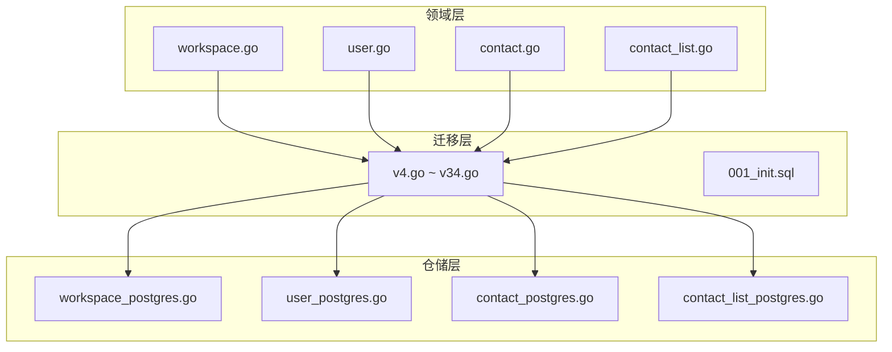
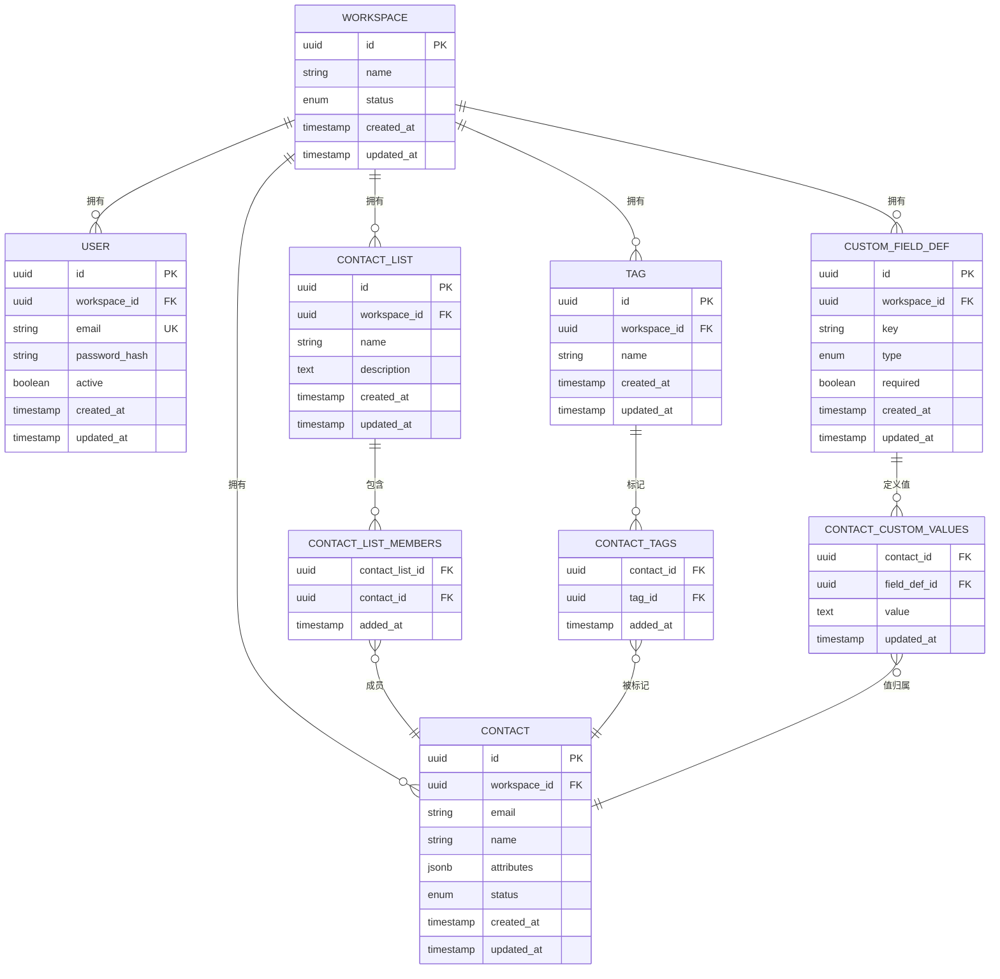
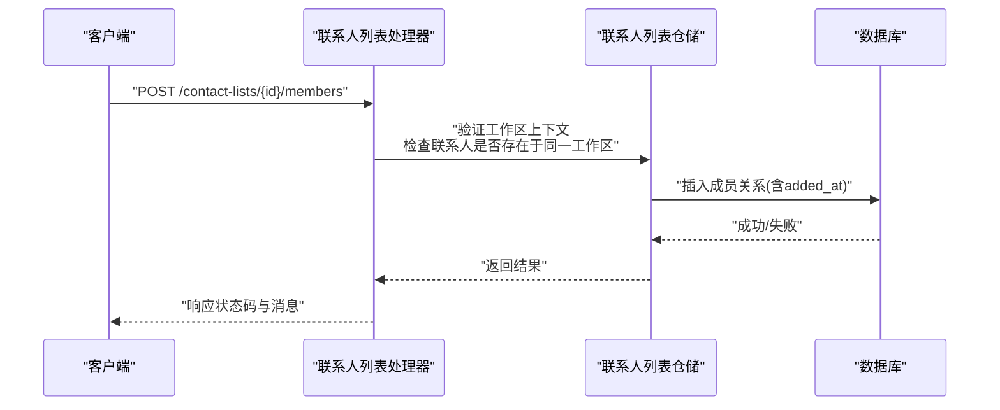
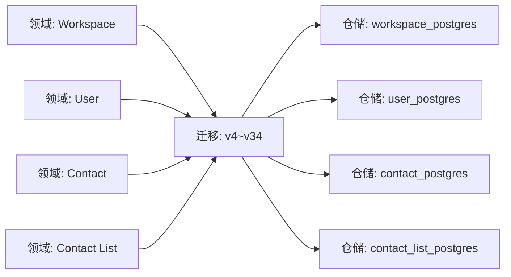

# 核心业务表

<cite>
**本文引用的文件**   
- [internal/database/schema/001_init.sql](file://notifuse/internal/database/schema/001_init.sql)
- [internal/migrations/v4.go](file://notifuse/internal/migrations/v4.go)
- [internal/migrations/v5.go](file://notifuse/internal/migrations/v5.go)
- [internal/migrations/v6.go](file://notifuse/internal/migrations/v6.go)
- [internal/migrations/v7.go](file://notifuse/internal/migrations/v7.go)
- [internal/migrations/v8.go](file://notifuse/internal/migrations/v8.go)
- [internal/migrations/v9.go](file://notifuse/internal/migrations/v9.go)
- [internal/migrations/v10.go](file://notifuse/internal/migrations/v10.go)
- [internal/migrations/v11.go](file://notifuse/internal/migrations/v11.go)
- [internal/migrations/v12.go](file://notifuse/internal/migrations/v12.go)
- [internal/migrations/v13.go](file://notifuse/internal/migrations/v13.go)
- [internal/migrations/v14.go](file://notifuse/internal/migrations/v14.go)
- [internal/migrations/v15.go](file://notifuse/internal/migrations/v15.go)
- [internal/migrations/v16.go](file://notifuse/internal/migrations/v16.go)
- [internal/migrations/v17.go](file://notifuse/internal/migrations/v17.go)
- [internal/migrations/v18.go](file://notifuse/internal/migrations/v18.go)
- [internal/migrations/v19.go](file://notifuse/internal/migrations/v19.go)
- [internal/migrations/v20.go](file://notifuse/internal/migrations/v20.go)
- [internal/migrations/v21.go](file://notifuse/internal/migrations/v21.go)
- [internal/migrations/v22.go](file://notifuse/internal/migrations/v22.go)
- [internal/migrations/v23.go](file://notifuse/internal/migrations/v23.go)
- [internal/migrations/v24.go](file://notifuse/internal/migrations/v24.go)
- [internal/migrations/v25.go](file://notifuse/internal/migrations/v25.go)
- [internal/migrations/v26.go](file://notifuse/internal/migrations/v26.go)
- [internal/migrations/v27.go](file://notifuse/internal/migrations/v27.go)
- [internal/migrations/v28.go](file://notifuse/internal/migrations/v28.go)
- [internal/migrations/v29.go](file://notifuse/internal/migrations/v29.go)
- [internal/migrations/v30.go](file://notifuse/internal/migrations/v30.go)
- [internal/migrations/v31.go](file://notifuse/internal/migrations/v31.go)
- [internal/migrations/v32.go](file://notifuse/internal/migrations/v32.go)
- [internal/migrations/v33.go](file://notifuse/internal/migrations/v33.go)
- [internal/migrations/v34.go](file://notifuse/internal/migrations/v34.go)
- [internal/domain/workspace.go](file://notifuse/internal/domain/workspace.go)
- [internal/domain/user.go](file://notifuse/internal/domain/user.go)
- [internal/domain/contact.go](file://notifuse/internal/domain/contact.go)
- [internal/domain/contact_list.go](file://notifuse/internal/domain/contact_list.go)
- [internal/repository/workspace_postgres.go](file://notifuse/internal/repository/workspace_postgres.go)
- [internal/repository/user_postgres.go](file://notifuse/internal/repository/user_postgres.go)
- [internal/repository/contact_postgres.go](file://notifuse/internal/repository/contact_postgres.go)
- [internal/repository/contact_list_postgres.go](file://notifuse/internal/repository/contact_list_postgres.go)
</cite>

## 目录
1. [简介](#简介)
2. [项目结构](#项目结构)
3. [核心组件](#核心组件)
4. [架构总览](#架构总览)
5. [详细组件分析](#详细组件分析)
6. [依赖关系分析](#依赖关系分析)
7. [性能考虑](#性能考虑)
8. [故障排查指南](#故障排查指南)
9. [结论](#结论)

## 简介
本文件面向Notifuse平台的核心业务数据库设计，聚焦工作区(Workspace)、用户(User)、联系人(Contact)等关键实体及其关联模型。文档从多租户隔离、主外键与引用完整性、复杂关系建模（联系人与列表、标签、自定义字段）以及索引与查询优化等方面展开，帮助读者快速理解并高效使用这些表结构。

## 项目结构
本项目采用“领域模型 + 迁移脚本 + 仓储实现”的分层组织方式：
- 领域模型定义核心实体与关系（如 workspace、user、contact、contact_list）。
- 迁移脚本集中管理数据库版本演进，包含建表、索引、约束与数据变更。
- 仓储层提供具体数据库访问实现，负责将领域对象持久化到PostgreSQL。

图表来源
- [internal/domain/workspace.go](file://notifuse/internal/domain/workspace.go)
- [internal/domain/user.go](file://notifuse/internal/domain/user.go)
- [internal/domain/contact.go](file://notifuse/internal/domain/contact.go)
- [internal/domain/contact_list.go](file://notifuse/internal/domain/contact_list.go)
- [internal/migrations/v4.go](file://notifuse/internal/migrations/v4.go)
- [internal/migrations/v5.go](file://notifuse/internal/migrations/v5.go)
- [internal/migrations/v6.go](file://notifuse/internal/migrations/v6.go)
- [internal/migrations/v7.go](file://notifuse/internal/migrations/v7.go)
- [internal/migrations/v8.go](file://notifuse/internal/migrations/v8.go)
- [internal/migrations/v9.go](file://notifuse/internal/migrations/v9.go)
- [internal/migrations/v10.go](file://notifuse/internal/migrations/v10.go)
- [internal/migrations/v11.go](file://notifuse/internal/migrations/v11.go)
- [internal/migrations/v12.go](file://notifuse/internal/migrations/v12.go)
- [internal/migrations/v13.go](file://notifuse/internal/migrations/v13.go)
- [internal/migrations/v14.go](file://notifuse/internal/migrations/v14.go)
- [internal/migrations/v15.go](file://notifuse/internal/migrations/v15.go)
- [internal/migrations/v16.go](file://notifuse/internal/migrations/v16.go)
- [internal/migrations/v17.go](file://notifuse/internal/migrations/v17.go)
- [internal/migrations/v18.go](file://notifuse/internal/migrations/v18.go)
- [internal/migrations/v19.go](file://notifuse/internal/migrations/v19.go)
- [internal/migrations/v20.go](file://notifuse/internal/migrations/v20.go)
- [internal/migrations/v21.go](file://notifuse/internal/migrations/v21.go)
- [internal/migrations/v22.go](file://notifuse/internal/migrations/v22.go)
- [internal/migrations/v23.go](file://notifuse/internal/migrations/v23.go)
- [internal/migrations/v24.go](file://notifuse/internal/migrations/v24.go)
- [internal/migrations/v25.go](file://notifuse/internal/migrations/v25.go)
- [internal/migrations/v26.go](file://notifuse/internal/migrations/v26.go)
- [internal/migrations/v27.go](file://notifuse/internal/migrations/v27.go)
- [internal/migrations/v28.go](file://notifuse/internal/migrations/v28.go)
- [internal/migrations/v29.go](file://notifuse/internal/migrations/v29.go)
- [internal/migrations/v30.go](file://notifuse/internal/migrations/v30.go)
- [internal/migrations/v31.go](file://notifuse/internal/migrations/v31.go)
- [internal/migrations/v32.go](file://notifuse/internal/migrations/v32.go)
- [internal/migrations/v33.go](file://notifuse/internal/migrations/v33.go)
- [internal/migrations/v34.go](file://notifuse/internal/migrations/v34.go)
- [internal/repository/workspace_postgres.go](file://notifuse/internal/repository/workspace_postgres.go)
- [internal/repository/user_postgres.go](file://notifuse/internal/repository/user_postgres.go)
- [internal/repository/contact_postgres.go](file://notifuse/internal/repository/contact_postgres.go)
- [internal/repository/contact_list_postgres.go](file://notifuse/internal/repository/contact_list_postgres.go)

章节来源
- [internal/domain/workspace.go](file://notifuse/internal/domain/workspace.go)
- [internal/domain/user.go](file://notifuse/internal/domain/user.go)
- [internal/domain/contact.go](file://notifuse/internal/domain/contact.go)
- [internal/domain/contact_list.go](file://notifuse/internal/domain/contact_list.go)
- [internal/migrations/v4.go](file://notifuse/internal/migrations/v4.go)
- [internal/migrations/v5.go](file://notifuse/internal/migrations/v5.go)
- [internal/migrations/v6.go](file://notifuse/internal/migrations/v6.go)
- [internal/migrations/v7.go](file://notifuse/internal/migrations/v7.go)
- [internal/migrations/v8.go](file://notifuse/internal/migrations/v8.go)
- [internal/migrations/v9.go](file://notifuse/internal/migrations/v9.go)
- [internal/migrations/v10.go](file://notifuse/internal/migrations/v10.go)
- [internal/migrations/v11.go](file://notifuse/internal/migrations/v11.go)
- [internal/migrations/v12.go](file://notifuse/internal/migrations/v12.go)
- [internal/migrations/v13.go](file://notifuse/internal/migrations/v13.go)
- [internal/migrations/v14.go](file://notifuse/internal/migrations/v14.go)
- [internal/migrations/v15.go](file://notifuse/internal/migrations/v15.go)
- [internal/migrations/v16.go](file://notifuse/internal/migrations/v16.go)
- [internal/migrations/v17.go](file://notifuse/internal/migrations/v17.go)
- [internal/migrations/v18.go](file://notifuse/internal/migrations/v18.go)
- [internal/migrations/v19.go](file://notifuse/internal/migrations/v19.go)
- [internal/migrations/v20.go](file://notifuse/internal/migrations/v20.go)
- [internal/migrations/v21.go](file://notifuse/internal/migrations/v21.go)
- [internal/migrations/v22.go](file://notifuse/internal/migrations/v22.go)
- [internal/migrations/v23.go](file://notifuse/internal/migrations/v23.go)
- [internal/migrations/v24.go](file://notifuse/internal/migrations/v24.go)
- [internal/migrations/v25.go](file://notifuse/internal/migrations/v25.go)
- [internal/migrations/v26.go](file://notifuse/internal/migrations/v26.go)
- [internal/migrations/v27.go](file://notifuse/internal/migrations/v27.go)
- [internal/migrations/v28.go](file://notifuse/internal/migrations/v28.go)
- [internal/migrations/v29.go](file://notifuse/internal/migrations/v29.go)
- [internal/migrations/v30.go](file://notifuse/internal/migrations/v30.go)
- [internal/migrations/v31.go](file://notifuse/internal/migrations/v31.go)
- [internal/migrations/v32.go](file://notifuse/internal/migrations/v32.go)
- [internal/migrations/v33.go](file://notifuse/internal/migrations/v33.go)
- [internal/migrations/v34.go](file://notifuse/internal/migrations/v34.go)

## 核心组件
本节概述核心实体的职责与相互关系，为后续详细表结构设计奠定基础。

- 工作区(Workspace)
  - 作为多租户边界，承载所有资源归属与权限上下文。
  - 典型字段包括唯一标识、名称、状态、创建/更新时间戳等。
- 用户(User)
  - 代表系统使用者，通常与工作区存在成员关系。
  - 典型字段包括唯一标识、邮箱、密码哈希、状态、时间戳等。
- 联系人(Contact)
  - 营销与通知触达的核心实体，支持属性扩展与分组。
  - 典型字段包括唯一标识、邮箱、姓名、状态、所属工作区、时间戳等。
- 联系人列表(Contact List)
  - 用于对联系人进行分组管理，便于批量操作与统计。
  - 典型字段包括唯一标识、名称、描述、所属工作区、时间戳等。

章节来源
- [internal/domain/workspace.go](file://notifuse/internal/domain/workspace.go)
- [internal/domain/user.go](file://notifuse/internal/domain/user.go)
- [internal/domain/contact.go](file://notifuse/internal/domain/contact.go)
- [internal/domain/contact_list.go](file://notifuse/internal/domain/contact_list.go)

## 架构总览
下图展示核心实体在数据库层面的关系概览，体现多租户隔离与联系人管理的复杂关联。

图表来源
- [internal/migrations/v4.go](file://notifuse/internal/migrations/v4.go)
- [internal/migrations/v5.go](file://notifuse/internal/migrations/v5.go)
- [internal/migrations/v6.go](file://notifuse/internal/migrations/v6.go)
- [internal/migrations/v7.go](file://notifuse/internal/migrations/v7.go)
- [internal/migrations/v8.go](file://notifuse/internal/migrations/v8.go)
- [internal/migrations/v9.go](file://notifuse/internal/migrations/v9.go)
- [internal/migrations/v10.go](file://notifuse/internal/migrations/v10.go)
- [internal/migrations/v11.go](file://notifuse/internal/migrations/v11.go)
- [internal/migrations/v12.go](file://notifuse/internal/migrations/v12.go)
- [internal/migrations/v13.go](file://notifuse/internal/migrations/v13.go)
- [internal/migrations/v14.go](file://notifuse/internal/migrations/v14.go)
- [internal/migrations/v15.go](file://notifuse/internal/migrations/v15.go)
- [internal/migrations/v16.go](file://notifuse/internal/migrations/v16.go)
- [internal/migrations/v17.go](file://notifuse/internal/migrations/v17.go)
- [internal/migrations/v18.go](file://notifuse/internal/migrations/v18.go)
- [internal/migrations/v19.go](file://notifuse/internal/migrations/v19.go)
- [internal/migrations/v20.go](file://notifuse/internal/migrations/v20.go)
- [internal/migrations/v21.go](file://notifuse/internal/migrations/v21.go)
- [internal/migrations/v22.go](file://notifuse/internal/migrations/v22.go)
- [internal/migrations/v23.go](file://notifuse/internal/migrations/v23.go)
- [internal/migrations/v24.go](file://notifuse/internal/migrations/v24.go)
- [internal/migrations/v25.go](file://notifuse/internal/migrations/v25.go)
- [internal/migrations/v26.go](file://notifuse/internal/migrations/v26.go)
- [internal/migrations/v27.go](file://notifuse/internal/migrations/v27.go)
- [internal/migrations/v28.go](file://notifuse/internal/migrations/v28.go)
- [internal/migrations/v29.go](file://notifuse/internal/migrations/v29.go)
- [internal/migrations/v30.go](file://notifuse/internal/migrations/v30.go)
- [internal/migrations/v31.go](file://notifuse/internal/migrations/v31.go)
- [internal/migrations/v32.go](file://notifuse/internal/migrations/v32.go)
- [internal/migrations/v33.go](file://notifuse/internal/migrations/v33.go)
- [internal/migrations/v34.go](file://notifuse/internal/migrations/v34.go)

## 详细组件分析

### 工作区(Workspace)表
- 用途：多租户边界，所有资源均通过workspace_id进行隔离。
- 关键字段
  - id：主键，UUID类型，全局唯一。
  - name：工作区名称，非空字符串。
  - status：工作区状态（如启用/禁用），枚举或受限字符串。
  - created_at/updated_at：审计时间戳。
- 约束与默认值
  - id为主键约束。
  - name非空约束。
  - created_at/updated_at默认当前时间。
- 索引建议
  - 对name建立唯一索引以避免重复命名。
  - 若按状态过滤频繁，可考虑status索引。

章节来源
- [internal/migrations/v4.go](file://notifuse/internal/migrations/v4.go)
- [internal/migrations/v5.go](file://notifuse/internal/migrations/v5.go)
- [internal/migrations/v6.go](file://notifuse/internal/migrations/v6.go)
- [internal/migrations/v7.go](file://notifuse/internal/migrations/v7.go)
- [internal/migrations/v8.go](file://notifuse/internal/migrations/v8.go)
- [internal/migrations/v9.go](file://notifuse/internal/migrations/v9.go)
- [internal/migrations/v10.go](file://notifuse/internal/migrations/v10.go)
- [internal/migrations/v11.go](file://notifuse/internal/migrations/v11.go)
- [internal/migrations/v12.go](file://notifuse/internal/migrations/v12.go)
- [internal/migrations/v13.go](file://notifuse/internal/migrations/v13.go)
- [internal/migrations/v14.go](file://notifuse/internal/migrations/v14.go)
- [internal/migrations/v15.go](file://notifuse/internal/migrations/v15.go)
- [internal/migrations/v16.go](file://notifuse/internal/migrations/v16.go)
- [internal/migrations/v17.go](file://notifuse/internal/migrations/v17.go)
- [internal/migrations/v18.go](file://notifuse/internal/migrations/v18.go)
- [internal/migrations/v19.go](file://notifuse/internal/migrations/v19.go)
- [internal/migrations/v20.go](file://notifuse/internal/migrations/v20.go)
- [internal/migrations/v21.go](file://notifuse/internal/migrations/v21.go)
- [internal/migrations/v22.go](file://notifuse/internal/migrations/v22.go)
- [internal/migrations/v23.go](file://notifuse/internal/migrations/v23.go)
- [internal/migrations/v24.go](file://notifuse/internal/migrations/v24.go)
- [internal/migrations/v25.go](file://notifuse/internal/migrations/v25.go)
- [internal/migrations/v26.go](file://notifuse/internal/migrations/v26.go)
- [internal/migrations/v27.go](file://notifuse/internal/migrations/v27.go)
- [internal/migrations/v28.go](file://notifuse/internal/migrations/v28.go)
- [internal/migrations/v29.go](file://notifuse/internal/migrations/v29.go)
- [internal/migrations/v30.go](file://notifuse/internal/migrations/v30.go)
- [internal/migrations/v31.go](file://notifuse/internal/migrations/v31.go)
- [internal/migrations/v32.go](file://notifuse/internal/migrations/v32.go)
- [internal/migrations/v33.go](file://notifuse/internal/migrations/v33.go)
- [internal/migrations/v34.go](file://notifuse/internal/migrations/v34.go)

### 用户(User)表
- 用途：系统用户，隶属于某工作区，具备登录与权限能力。
- 关键字段
  - id：主键，UUID类型。
  - workspace_id：外键，指向工作区，实现多租户隔离。
  - email：邮箱，唯一约束，便于登录识别。
  - password_hash：密码哈希，安全存储。
  - active：是否激活。
  - created_at/updated_at：审计时间戳。
- 约束与默认值
  - id为主键。
  - workspace_id为非空外键，确保用户始终属于某工作区。
  - email唯一约束避免重复注册。
  - active默认false或true依策略而定。
  - created_at/updated_at默认当前时间。
- 索引建议
  - 对email建立唯一索引。
  - 对workspace_id建立普通索引，加速按工作区筛选。

章节来源
- [internal/migrations/v4.go](file://notifuse/internal/migrations/v4.go)
- [internal/migrations/v5.go](file://notifuse/internal/migrations/v5.go)
- [internal/migrations/v6.go](file://notifuse/internal/migrations/v6.go)
- [internal/migrations/v7.go](file://notifuse/internal/migrations/v7.go)
- [internal/migrations/v8.go](file://notifuse/internal/migrations/v8.go)
- [internal/migrations/v9.go](file://notifuse/internal/migrations/v9.go)
- [internal/migrations/v10.go](file://notifuse/internal/migrations/v10.go)
- [internal/migrations/v11.go](file://notifuse/internal/migrations/v11.go)
- [internal/migrations/v12.go](file://notifuse/internal/migrations/v12.go)
- [internal/migrations/v13.go](file://notifuse/internal/migrations/v13.go)
- [internal/migrations/v14.go](file://notifuse/internal/migrations/v14.go)
- [internal/migrations/v15.go](file://notifuse/internal/migrations/v15.go)
- [internal/migrations/v16.go](file://notifuse/internal/migrations/v16.go)
- [internal/migrations/v17.go](file://notifuse/internal/migrations/v17.go)
- [internal/migrations/v18.go](file://notifuse/internal/migrations/v18.go)
- [internal/migrations/v19.go](file://notifuse/internal/migrations/v19.go)
- [internal/migrations/v20.go](file://notifuse/internal/migrations/v20.go)
- [internal/migrations/v21.go](file://notifuse/internal/migrations/v21.go)
- [internal/migrations/v22.go](file://notifuse/internal/migrations/v22.go)
- [internal/migrations/v23.go](file://notifuse/internal/migrations/v23.go)
- [internal/migrations/v24.go](file://notifuse/internal/migrations/v24.go)
- [internal/migrations/v25.go](file://notifuse/internal/migrations/v25.go)
- [internal/migrations/v26.go](file://notifuse/internal/migrations/v26.go)
- [internal/migrations/v27.go](file://notifuse/internal/migrations/v27.go)
- [internal/migrations/v28.go](file://notifuse/internal/migrations/v28.go)
- [internal/migrations/v29.go](file://notifuse/internal/migrations/v29.go)
- [internal/migrations/v30.go](file://notifuse/internal/migrations/v30.go)
- [internal/migrations/v31.go](file://notifuse/internal/migrations/v31.go)
- [internal/migrations/v32.go](file://notifuse/internal/migrations/v32.go)
- [internal/migrations/v33.go](file://notifuse/internal/migrations/v33.go)
- [internal/migrations/v34.go](file://notifuse/internal/migrations/v34.go)

### 联系人(Contact)表
- 用途：营销与通知触达的核心实体，支持属性扩展与分组。
- 关键字段
  - id：主键，UUID类型。
  - workspace_id：外键，指向工作区，实现多租户隔离。
  - email：联系人邮箱，常需唯一性校验（可在应用层或数据库层控制）。
  - name：联系人姓名。
  - attributes：JSONB类型，用于存储动态扩展属性（如来源、偏好等）。
  - status：联系人状态（如活跃、退订等）。
  - created_at/updated_at：审计时间戳。
- 约束与默认值
  - id为主键。
  - workspace_id为非空外键。
  - attributes默认空JSON对象。
  - status有受限取值集合。
  - created_at/updated_at默认当前时间。
- 索引建议
  - 对workspace_id建立索引，支撑按工作区查询。
  - 对email建立唯一或普通索引，视去重策略而定。
  - 对attributes常用键建立GIN索引以支持JSONB查询。
  - 对status建立索引以支持按状态筛选。

章节来源
- [internal/migrations/v4.go](file://notifuse/internal/migrations/v4.go)
- [internal/migrations/v5.go](file://notifuse/internal/migrations/v5.go)
- [internal/migrations/v6.go](file://notifuse/internal/migrations/v6.go)
- [internal/migrations/v7.go](file://notifuse/internal/migrations/v7.go)
- [internal/migrations/v8.go](file://notifuse/internal/migrations/v8.go)
- [internal/migrations/v9.go](file://notifuse/internal/migrations/v9.go)
- [internal/migrations/v10.go](file://notifuse/internal/migrations/v10.go)
- [internal/migrations/v11.go](file://notifuse/internal/migrations/v11.go)
- [internal/migrations/v12.go](file://notifuse/internal/migrations/v12.go)
- [internal/migrations/v13.go](file://notifuse/internal/migrations/v13.go)
- [internal/migrations/v14.go](file://notifuse/internal/migrations/v14.go)
- [internal/migrations/v15.go](file://notifuse/internal/migrations/v15.go)
- [internal/migrations/v16.go](file://notifuse/internal/migrations/v16.go)
- [internal/migrations/v17.go](file://notifuse/internal/migrations/v17.go)
- [internal/migrations/v18.go](file://notifuse/internal/migrations/v18.go)
- [internal/migrations/v19.go](file://notifuse/internal/migrations/v19.go)
- [internal/migrations/v20.go](file://notifuse/internal/migrations/v20.go)
- [internal/migrations/v21.go](file://notifuse/internal/migrations/v21.go)
- [internal/migrations/v22.go](file://notifuse/internal/migrations/v22.go)
- [internal/migrations/v23.go](file://notifuse/internal/migrations/v23.go)
- [internal/migrations/v24.go](file://notifuse/internal/migrations/v24.go)
- [internal/migrations/v25.go](file://notifuse/internal/migrations/v25.go)
- [internal/migrations/v26.go](file://notifuse/internal/migrations/v26.go)
- [internal/migrations/v27.go](file://notifuse/internal/migrations/v27.go)
- [internal/migrations/v28.go](file://notifuse/internal/migrations/v28.go)
- [internal/migrations/v29.go](file://notifuse/internal/migrations/v29.go)
- [internal/migrations/v30.go](file://notifuse/internal/migrations/v30.go)
- [internal/migrations/v31.go](file://notifuse/internal/migrations/v31.go)
- [internal/migrations/v32.go](file://notifuse/internal/migrations/v32.go)
- [internal/migrations/v33.go](file://notifuse/internal/migrations/v33.go)
- [internal/migrations/v34.go](file://notifuse/internal/migrations/v34.go)

### 联系人列表(Contact List)与成员关系
- 联系人列表(Contact List)
  - 用途：对联系人进行分组管理，便于批量操作与统计。
  - 关键字段：id、workspace_id、name、description、created_at/updated_at。
  - 约束：workspace_id非空外键；name非空。
  - 索引：workspace_id索引；name唯一或普通索引视需求。
- 成员关系(Contact List Members)
  - 用途：多对多关系桥接表，记录联系人加入列表的时间。
  - 关键字段：contact_list_id、contact_id、added_at。
  - 约束：复合主键(contact_list_id, contact_id)防止重复；外键分别指向列表与联系人。
  - 索引：contact_id索引以支持反向查询。

章节来源
- [internal/migrations/v4.go](file://notifuse/internal/migrations/v4.go)
- [internal/migrations/v5.go](file://notifuse/internal/migrations/v5.go)
- [internal/migrations/v6.go](file://notifuse/internal/migrations/v6.go)
- [internal/migrations/v7.go](file://notifuse/internal/migrations/v7.go)
- [internal/migrations/v8.go](file://notifuse/internal/migrations/v8.go)
- [internal/migrations/v9.go](file://notifuse/internal/migrations/v9.go)
- [internal/migrations/v10.go](file://notifuse/internal/migrations/v10.go)
- [internal/migrations/v11.go](file://notifuse/internal/migrations/v11.go)
- [internal/migrations/v12.go](file://notifuse/internal/migrations/v12.go)
- [internal/migrations/v13.go](file://notifuse/internal/migrations/v13.go)
- [internal/migrations/v14.go](file://notifuse/internal/migrations/v14.go)
- [internal/migrations/v15.go](file://notifuse/internal/migrations/v15.go)
- [internal/migrations/v16.go](file://notifuse/internal/migrations/v16.go)
- [internal/migrations/v17.go](file://notifuse/internal/migrations/v17.go)
- [internal/migrations/v18.go](file://notifuse/internal/migrations/v18.go)
- [internal/migrations/v19.go](file://notifuse/internal/migrations/v19.go)
- [internal/migrations/v20.go](file://notifuse/internal/migrations/v20.go)
- [internal/migrations/v21.go](file://notifuse/internal/migrations/v21.go)
- [internal/migrations/v22.go](file://notifuse/internal/migrations/v22.go)
- [internal/migrations/v23.go](file://notifuse/internal/migrations/v23.go)
- [internal/migrations/v24.go](file://notifuse/internal/migrations/v24.go)
- [internal/migrations/v25.go](file://notifuse/internal/migrations/v25.go)
- [internal/migrations/v26.go](file://notifuse/internal/migrations/v26.go)
- [internal/migrations/v27.go](file://notifuse/internal/migrations/v27.go)
- [internal/migrations/v28.go](file://notifuse/internal/migrations/v28.go)
- [internal/migrations/v29.go](file://notifuse/internal/migrations/v29.go)
- [internal/migrations/v30.go](file://notifuse/internal/migrations/v30.go)
- [internal/migrations/v31.go](file://notifuse/internal/migrations/v31.go)
- [internal/migrations/v32.go](file://notifuse/internal/migrations/v32.go)
- [internal/migrations/v33.go](file://notifuse/internal/migrations/v33.go)
- [internal/migrations/v34.go](file://notifuse/internal/migrations/v34.go)

### 标签(Tag)与联系人标签关系
- 标签(Tag)
  - 用途：对联系人打标签，支持细粒度分类与筛选。
  - 关键字段：id、workspace_id、name、created_at/updated_at。
  - 约束：workspace_id非空外键；name在工作区内唯一或允许重复。
  - 索引：workspace_id索引；name索引或唯一索引。
- 联系人标签关系(Contact Tags)
  - 用途：多对多关系桥接表，记录联系人被哪些标签标记及添加时间。
  - 关键字段：contact_id、tag_id、added_at。
  - 约束：复合主键(contact_id, tag_id)防止重复；外键分别指向联系人和标签。
  - 索引：tag_id索引以支持反向查询。

章节来源
- [internal/migrations/v4.go](file://notifuse/internal/migrations/v4.go)
- [internal/migrations/v5.go](file://notifuse/internal/migrations/v5.go)
- [internal/migrations/v6.go](file://notifuse/internal/migrations/v6.go)
- [internal/migrations/v7.go](file://notifuse/internal/migrations/v7.go)
- [internal/migrations/v8.go](file://notifuse/internal/migrations/v8.go)
- [internal/migrations/v9.go](file://notifuse/internal/migrations/v9.go)
- [internal/migrations/v10.go](file://notifuse/internal/migrations/v10.go)
- [internal/migrations/v11.go](file://notifuse/internal/migrations/v11.go)
- [internal/migrations/v12.go](file://notifuse/internal/migrations/v12.go)
- [internal/migrations/v13.go](file://notifuse/internal/migrations/v13.go)
- [internal/migrations/v14.go](file://notifuse/internal/migrations/v14.go)
- [internal/migrations/v15.go](file://notifuse/internal/migrations/v15.go)
- [internal/migrations/v16.go](file://notifuse/internal/migrations/v16.go)
- [internal/migrations/v17.go](file://notifuse/internal/migrations/v17.go)
- [internal/migrations/v18.go](file://notifuse/internal/migrations/v18.go)
- [internal/migrations/v19.go](file://notifuse/internal/migrations/v19.go)
- [internal/migrations/v20.go](file://notifuse/internal/migrations/v20.go)
- [internal/migrations/v21.go](file://notifuse/internal/migrations/v21.go)
- [internal/migrations/v22.go](file://notifuse/internal/migrations/v22.go)
- [internal/migrations/v23.go](file://notifuse/internal/migrations/v23.go)
- [internal/migrations/v24.go](file://notifuse/internal/migrations/v24.go)
- [internal/migrations/v25.go](file://notifuse/internal/migrations/v25.go)
- [internal/migrations/v26.go](file://notifuse/internal/migrations/v26.go)
- [internal/migrations/v27.go](file://notifuse/internal/migrations/v27.go)
- [internal/migrations/v28.go](file://notifuse/internal/migrations/v28.go)
- [internal/migrations/v29.go](file://notifuse/internal/migrations/v29.go)
- [internal/migrations/v30.go](file://notifuse/internal/migrations/v30.go)
- [internal/migrations/v31.go](file://notifuse/internal/migrations/v31.go)
- [internal/migrations/v32.go](file://notifuse/internal/migrations/v32.go)
- [internal/migrations/v33.go](file://notifuse/internal/migrations/v33.go)
- [internal/migrations/v34.go](file://notifuse/internal/migrations/v34.go)

### 自定义字段(Custom Field)与联系人值
- 自定义字段定义(Custom Field Def)
  - 用途：定义联系人属性的键与类型，支持结构化扩展。
  - 关键字段：id、workspace_id、key、type、required、created_at/updated_at。
  - 约束：workspace_id非空外键；key在工作区内唯一；type受限取值。
  - 索引：workspace_id索引；key唯一索引。
- 联系人自定义值(Contact Custom Values)
  - 用途：存储每个联系人的自定义字段值。
  - 关键字段：contact_id、field_def_id、value、updated_at。
  - 约束：复合主键(contact_id, field_def_id)保证每个字段仅一个值；外键分别指向联系人和字段定义。
  - 索引：contact_id索引；field_def_id索引。

章节来源
- [internal/migrations/v4.go](file://notifuse/internal/migrations/v4.go)
- [internal/migrations/v5.go](file://notifuse/internal/migrations/v5.go)
- [internal/migrations/v6.go](file://notifuse/internal/migrations/v6.go)
- [internal/migrations/v7.go](file://notifuse/internal/migrations/v7.go)
- [internal/migrations/v8.go](file://notifuse/internal/migrations/v8.go)
- [internal/migrations/v9.go](file://notifuse/internal/migrations/v9.go)
- [internal/migrations/v10.go](file://notifuse/internal/migrations/v10.go)
- [internal/migrations/v11.go](file://notifuse/internal/migrations/v11.go)
- [internal/migrations/v12.go](file://notifuse/internal/migrations/v12.go)
- [internal/migrations/v13.go](file://notifuse/internal/migrations/v13.go)
- [internal/migrations/v14.go](file://notifuse/internal/migrations/v14.go)
- [internal/migrations/v15.go](file://notifuse/internal/migrations/v15.go)
- [internal/migrations/v16.go](file://notifuse/internal/migrations/v16.go)
- [internal/migrations/v17.go](file://notifuse/internal/migrations/v17.go)
- [internal/migrations/v18.go](file://notifuse/internal/migrations/v18.go)
- [internal/migrations/v19.go](file://notifuse/internal/migrations/v19.go)
- [internal/migrations/v20.go](file://notifuse/internal/migrations/v20.go)
- [internal/migrations/v21.go](file://notifuse/internal/migrations/v21.go)
- [internal/migrations/v22.go](file://notifuse/internal/migrations/v22.go)
- [internal/migrations/v23.go](file://notifuse/internal/migrations/v23.go)
- [internal/migrations/v24.go](file://notifuse/internal/migrations/v24.go)
- [internal/migrations/v25.go](file://notifuse/internal/migrations/v25.go)
- [internal/migrations/v26.go](file://notifuse/internal/migrations/v26.go)
- [internal/migrations/v27.go](file://notifuse/internal/migrations/v27.go)
- [internal/migrations/v28.go](file://notifuse/internal/migrations/v28.go)
- [internal/migrations/v29.go](file://notifuse/internal/migrations/v29.go)
- [internal/migrations/v30.go](file://notifuse/internal/migrations/v30.go)
- [internal/migrations/v31.go](file://notifuse/internal/migrations/v31.go)
- [internal/migrations/v32.go](file://notifuse/internal/migrations/v32.go)
- [internal/migrations/v33.go](file://notifuse/internal/migrations/v33.go)
- [internal/migrations/v34.go](file://notifuse/internal/migrations/v34.go)

### 多租户架构与Schema隔离策略
- 工作区隔离机制
  - 所有核心表均包含workspace_id字段，并通过外键约束强制归属。
  - 应用层在构建查询时自动附加workspace_id条件，确保数据隔离。
- Schema隔离策略
  - 可选方案：为每个工作区创建独立schema，结合连接池路由实现物理隔离。
  - 推荐方案：单schema+workspace_id列，配合索引与行级安全策略，兼顾灵活性与运维成本。
- 数据访问控制
  - 仓储层封装工作区上下文，所有CRUD操作必须携带workspace_id。
  - 对外API通过中间件解析工作区上下文，注入到请求作用域。

章节来源
- [internal/repository/workspace_postgres.go](file://notifuse/internal/repository/workspace_postgres.go)
- [internal/repository/user_postgres.go](file://notifuse/internal/repository/user_postgres.go)
- [internal/repository/contact_postgres.go](file://notifuse/internal/repository/contact_postgres.go)
- [internal/repository/contact_list_postgres.go](file://notifuse/internal/repository/contact_list_postgres.go)

### 主键与外键设计原则
- 主键选择
  - 统一使用UUID作为主键，避免自增ID的泄露风险与跨库合并问题。
- 外键约束
  - 所有关联表均设置外键，确保引用完整性。
  - 复合主键用于多对多桥接表，防止重复关系。
- 引用完整性
  - 删除策略：根据业务语义选择RESTRICT/CASCADE，谨慎使用CASCADE以避免级联删除导致的数据丢失。
  - 更新策略：主键更新应尽量避免，必要时使用触发器或应用层同步。

章节来源
- [internal/migrations/v4.go](file://notifuse/internal/migrations/v4.go)
- [internal/migrations/v5.go](file://notifuse/internal/migrations/v5.go)
- [internal/migrations/v6.go](file://notifuse/internal/migrations/v6.go)
- [internal/migrations/v7.go](file://notifuse/internal/migrations/v7.go)
- [internal/migrations/v8.go](file://notifuse/internal/migrations/v8.go)
- [internal/migrations/v9.go](file://notifuse/internal/migrations/v9.go)
- [internal/migrations/v10.go](file://notifuse/internal/migrations/v10.go)
- [internal/migrations/v11.go](file://notifuse/internal/migrations/v11.go)
- [internal/migrations/v12.go](file://notifuse/internal/migrations/v12.go)
- [internal/migrations/v13.go](file://notifuse/internal/migrations/v13.go)
- [internal/migrations/v14.go](file://notifuse/internal/migrations/v14.go)
- [internal/migrations/v15.go](file://notifuse/internal/migrations/v15.go)
- [internal/migrations/v16.go](file://notifuse/internal/migrations/v16.go)
- [internal/migrations/v17.go](file://notifuse/internal/migrations/v17.go)
- [internal/migrations/v18.go](file://notifuse/internal/migrations/v18.go)
- [internal/migrations/v19.go](file://notifuse/internal/migrations/v19.go)
- [internal/migrations/v20.go](file://notifuse/internal/migrations/v20.go)
- [internal/migrations/v21.go](file://notifuse/internal/migrations/v21.go)
- [internal/migrations/v22.go](file://notifuse/internal/migrations/v22.go)
- [internal/migrations/v23.go](file://notifuse/internal/migrations/v23.go)
- [internal/migrations/v24.go](file://notifuse/internal/migrations/v24.go)
- [internal/migrations/v25.go](file://notifuse/internal/migrations/v25.go)
- [internal/migrations/v26.go](file://notifuse/internal/migrations/v26.go)
- [internal/migrations/v27.go](file://notifuse/internal/migrations/v27.go)
- [internal/migrations/v28.go](file://notifuse/internal/migrations/v28.go)
- [internal/migrations/v29.go](file://notifuse/internal/migrations/v29.go)
- [internal/migrations/v30.go](file://notifuse/internal/migrations/v30.go)
- [internal/migrations/v31.go](file://notifuse/internal/migrations/v31.go)
- [internal/migrations/v32.go](file://notifuse/internal/migrations/v32.go)
- [internal/migrations/v33.go](file://notifuse/internal/migrations/v33.go)
- [internal/migrations/v34.go](file://notifuse/internal/migrations/v34.go)

### 联系人管理复杂关系流程
以下序列图展示联系人加入列表的典型流程，体现工作区隔离与引用完整性。

图表来源
- [internal/repository/contact_list_postgres.go](file://notifuse/internal/repository/contact_list_postgres.go)
- [internal/repository/contact_postgres.go](file://notifuse/internal/repository/contact_postgres.go)

章节来源
- [internal/repository/contact_list_postgres.go](file://notifuse/internal/repository/contact_list_postgres.go)
- [internal/repository/contact_postgres.go](file://notifuse/internal/repository/contact_postgres.go)

## 依赖关系分析
- 领域模型与迁移脚本
  - 领域模型定义了实体结构与关系，迁移脚本实现了这些结构的持久化。
- 仓储层与数据库
  - 仓储层通过迁移生成的表结构执行CRUD操作，遵循工作区隔离与引用完整性约束。

图表来源
- [internal/domain/workspace.go](file://notifuse/internal/domain/workspace.go)
- [internal/domain/user.go](file://notifuse/internal/domain/user.go)
- [internal/domain/contact.go](file://notifuse/internal/domain/contact.go)
- [internal/domain/contact_list.go](file://notifuse/internal/domain/contact_list.go)
- [internal/migrations/v4.go](file://notifuse/internal/migrations/v4.go)
- [internal/migrations/v5.go](file://notifuse/internal/migrations/v5.go)
- [internal/migrations/v6.go](file://notifuse/internal/migrations/v6.go)
- [internal/migrations/v7.go](file://notifuse/internal/migrations/v7.go)
- [internal/migrations/v8.go](file://notifuse/internal/migrations/v8.go)
- [internal/migrations/v9.go](file://notifuse/internal/migrations/v9.go)
- [internal/migrations/v10.go](file://notifuse/internal/migrations/v10.go)
- [internal/migrations/v11.go](file://notifuse/internal/migrations/v11.go)
- [internal/migrations/v12.go](file://notifuse/internal/migrations/v12.go)
- [internal/migrations/v13.go](file://notifuse/internal/migrations/v13.go)
- [internal/migrations/v14.go](file://notifuse/internal/migrations/v14.go)
- [internal/migrations/v15.go](file://notifuse/internal/migrations/v15.go)
- [internal/migrations/v16.go](file://notifuse/internal/migrations/v16.go)
- [internal/migrations/v17.go](file://notifuse/internal/migrations/v17.go)
- [internal/migrations/v18.go](file://notifuse/internal/migrations/v18.go)
- [internal/migrations/v19.go](file://notifuse/internal/migrations/v19.go)
- [internal/migrations/v20.go](file://notifuse/internal/migrations/v20.go)
- [internal/migrations/v21.go](file://notifuse/internal/migrations/v21.go)
- [internal/migrations/v22.go](file://notifuse/internal/migrations/v22.go)
- [internal/migrations/v23.go](file://notifuse/internal/migrations/v23.go)
- [internal/migrations/v24.go](file://notifuse/internal/migrations/v24.go)
- [internal/migrations/v25.go](file://notifuse/internal/migrations/v25.go)
- [internal/migrations/v26.go](file://notifuse/internal/migrations/v26.go)
- [internal/migrations/v27.go](file://notifuse/internal/migrations/v27.go)
- [internal/migrations/v28.go](file://notifuse/internal/migrations/v28.go)
- [internal/migrations/v29.go](file://notifuse/internal/migrations/v29.go)
- [internal/migrations/v30.go](file://notifuse/internal/migrations/v30.go)
- [internal/migrations/v31.go](file://notifuse/internal/migrations/v31.go)
- [internal/migrations/v32.go](file://notifuse/internal/migrations/v32.go)
- [internal/migrations/v33.go](file://notifuse/internal/migrations/v33.go)
- [internal/migrations/v34.go](file://notifuse/internal/migrations/v34.go)
- [internal/repository/workspace_postgres.go](file://notifuse/internal/repository/workspace_postgres.go)
- [internal/repository/user_postgres.go](file://notifuse/internal/repository/user_postgres.go)
- [internal/repository/contact_postgres.go](file://notifuse/internal/repository/contact_postgres.go)
- [internal/repository/contact_list_postgres.go](file://notifuse/internal/repository/contact_list_postgres.go)

## 性能考虑
- 索引策略
  - 高频查询字段建立索引：workspace_id、email、status、name等。
  - JSONB字段(attributes)针对常用键建立GIN索引以提升查询性能。
  - 多对多桥接表的反向查询字段建立索引：contact_id、tag_id、field_def_id等。
- 查询优化
  - 始终附带workspace_id条件，利用索引快速定位。
  - 分页查询使用游标或基于时间戳的偏移，避免深分页性能问题。
  - 批量操作使用事务与批量插入，减少往返开销。
- 数据一致性
  - 使用外键约束保障引用完整性，避免脏数据。
  - 对高并发写入场景，考虑乐观锁或版本号字段。

[本节为通用性能指导，不直接分析具体文件]

## 故障排查指南
- 常见错误
  - 外键约束冲突：新增或更新时违反引用完整性，检查workspace_id与关联ID是否正确。
  - 唯一约束冲突：email或key重复，确认去重逻辑与应用层校验。
  - JSONB查询性能差：未建立GIN索引或查询表达式不当，优化索引与查询语句。
- 诊断步骤
  - 查看最近迁移记录，确认表结构与索引是否一致。
  - 检查仓储层SQL生成逻辑，确认是否遗漏workspace_id条件。
  - 使用EXPLAIN ANALYZE分析慢查询，定位缺失索引或低效扫描。

章节来源
- [internal/repository/workspace_postgres.go](file://notifuse/internal/repository/workspace_postgres.go)
- [internal/repository/user_postgres.go](file://notifuse/internal/repository/user_postgres.go)
- [internal/repository/contact_postgres.go](file://notifuse/internal/repository/contact_postgres.go)
- [internal/repository/contact_list_postgres.go](file://notifuse/internal/repository/contact_list_postgres.go)

## 结论
本文档系统化梳理了Notifuse平台核心业务表的设计与实现，涵盖工作区、用户、联系人及其关联模型的字段定义、约束与索引策略。通过明确的多租户隔离机制与引用完整性约束，确保了数据的安全性与一致性。建议在后续迭代中持续优化索引与查询模式，并结合监控指标调整性能策略。