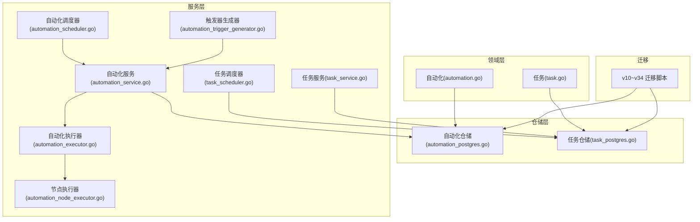
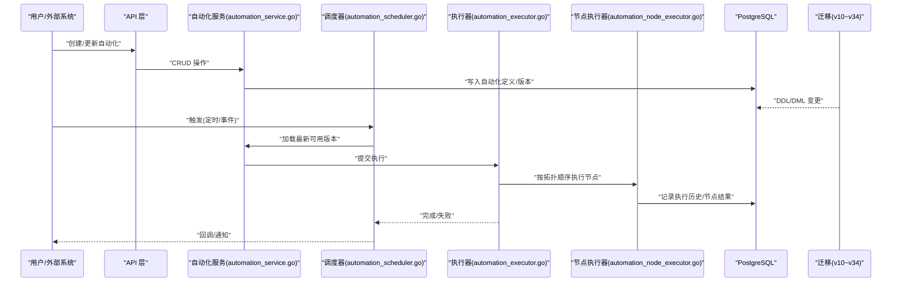
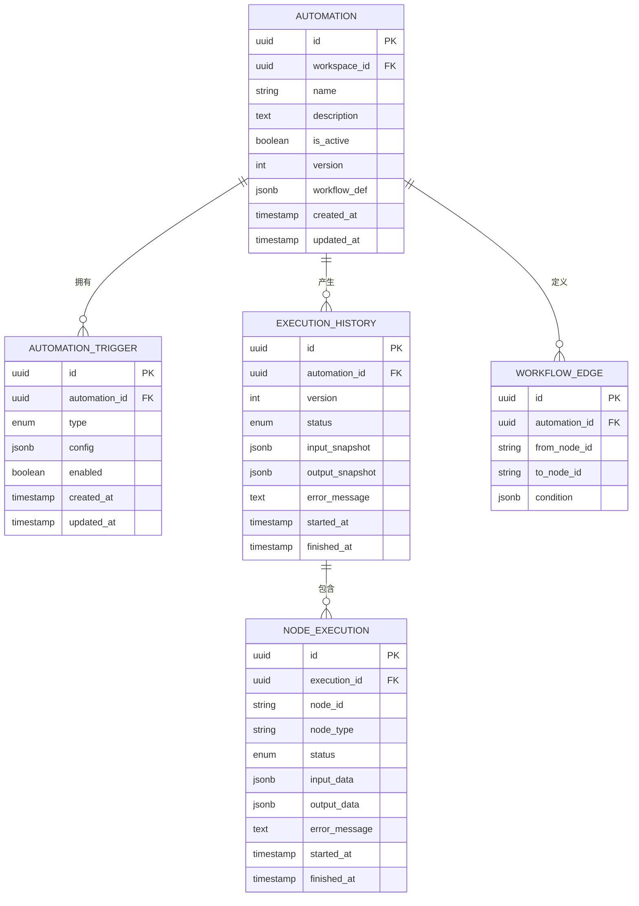
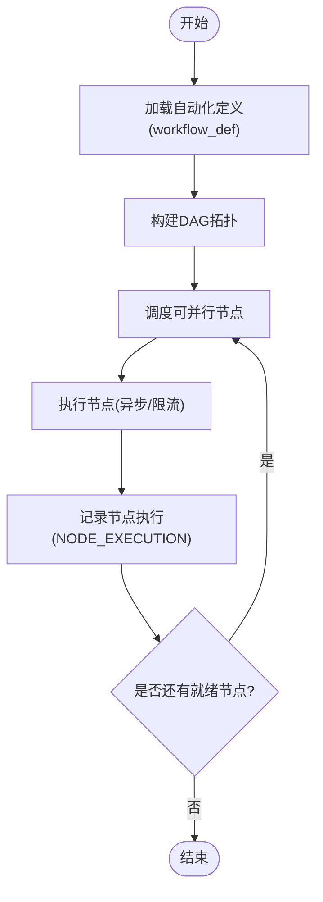
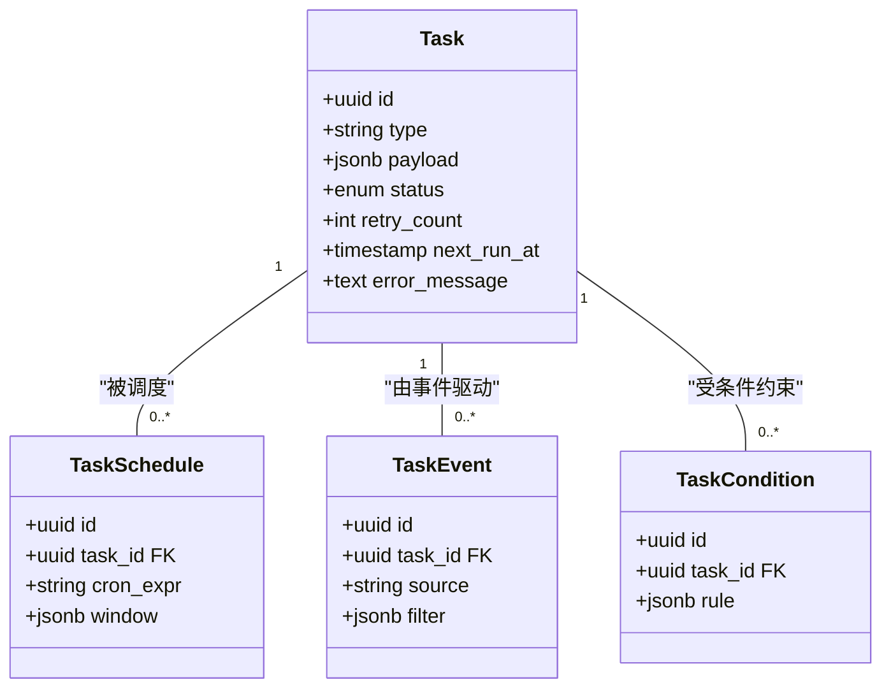
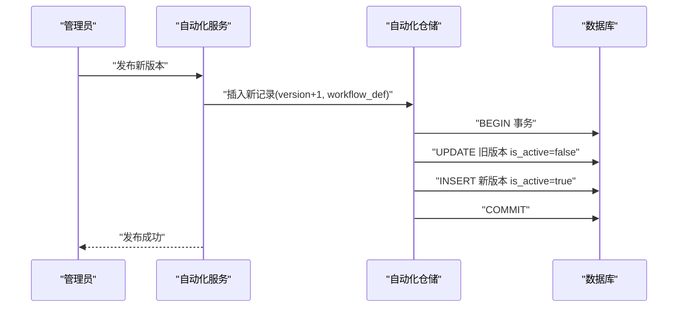
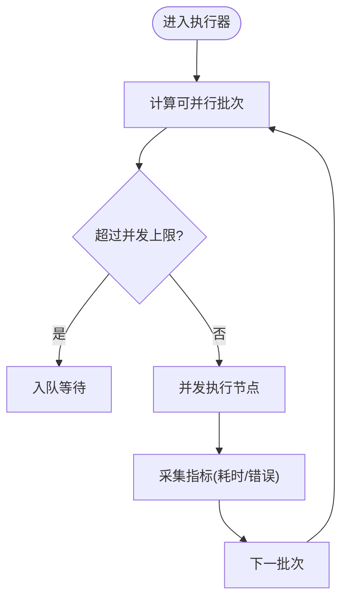
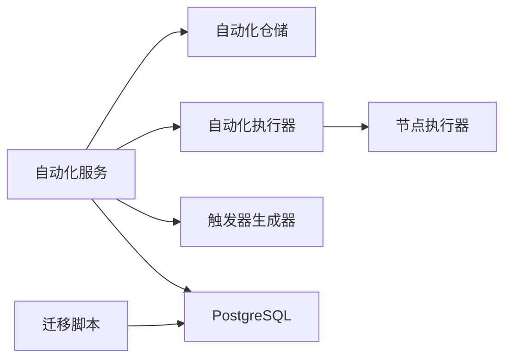

# 自动化工作流表

<cite>
**本文引用的文件**   
- [automation.go](file://notifuse/internal/domain/automation.go)
- [automation_postgres.go](file://notifuse/internal/repository/automation_postgres.go)
- [automation_service.go](file://notifuse/internal/service/automation_service.go)
- [automation_executor.go](file://notifuse/internal/service/automation_executor.go)
- [automation_node_executor.go](file://notifuse/internal/service/automation_node_executor.go)
- [automation_scheduler.go](file://notifuse/internal/service/automation_scheduler.go)
- [automation_trigger_generator.go](file://notifuse/internal/service/automation_trigger_generator.go)
- [task.go](file://notifuse/internal/domain/task.go)
- [task_postgres.go](file://notifuse/internal/repository/task_postgres.go)
- [task_scheduler.go](file://notifuse/internal/service/task_scheduler.go)
- [task_service.go](file://notifuse/internal/service/task_service.go)
- [v10.go](file://notifuse/internal/migrations/v10.go)
- [v11.go](file://notifuse/internal/migrations/v11.go)
- [v12.go](file://notifuse/internal/migrations/v12.go)
- [v13.go](file://notifuse/internal/migrations/v13.go)
- [v14.go](file://notifuse/internal/migrations/v14.go)
- [v15.go](file://notifuse/internal/migrations/v15.go)
- [v16.go](file://notifuse/internal/migrations/v16.go)
- [v17.go](file://notifuse/internal/migrations/v17.go)
- [v18.go](file://notifuse/internal/migrations/v18.go)
- [v19.go](file://notifuse/internal/migrations/v19.go)
- [v20.go](file://notifuse/internal/migrations/v20.go)
- [v21.go](file://notifuse/internal/migrations/v21.go)
- [v22.go](file://notifuse/internal/migrations/v22.go)
- [v23.go](file://notifuse/internal/migrations/v23.go)
- [v24.go](file://notifuse/internal/migrations/v24.go)
- [v25.go](file://notifuse/internal/migrations/v25.go)
- [v26.go](file://notifuse/internal/migrations/v26.go)
- [v27.go](file://notifuse/internal/migrations/v27.go)
- [v28.go](file://notifuse/internal/migrations/v28.go)
- [v29.go](file://notifuse/internal/migrations/v29.go)
- [v30.go](file://notifuse/internal/migrations/v30.go)
- [v31.go](file://notifuse/internal/migrations/v31.go)
- [v32.go](file://notifuse/internal/migrations/v32.go)
- [v33.go](file://notifuse/internal/migrations/v33.go)
- [v34.go](file://notifuse/internal/migrations/v34.go)
</cite>

## 目录
1. [简介](#简介)
2. [项目结构](#项目结构)
3. [核心组件](#核心组件)
4. [架构总览](#架构总览)
5. [详细组件分析](#详细组件分析)
6. [依赖分析](#依赖分析)
7. [性能考虑](#性能考虑)
8. [故障排查指南](#故障排查指南)
9. [结论](#结论)
10. [附录](#附录)

## 简介
本文件为 Notifuse 平台的“自动化工作流”子系统提供数据库设计文档，围绕以下目标展开：
- 定义并说明自动化工作流（Automation）、触发器（Trigger）、节点（Node）与执行历史（ExecutionHistory）等核心实体的表结构设计。
- 描述可视化工作流的数据建模方法，包括节点类型、连接关系存储与执行路径追踪。
- 文档化任务调度系统的数据结构，涵盖定时任务、条件触发与事件驱动的执行机制。
- 解释工作流版本控制与回滚机制的实现思路，包括快照保存与状态恢复的数据模型。
- 给出自动化执行的性能优化策略，包括并行处理、资源限制与监控指标的数据收集设计。

## 项目结构
自动化相关代码主要分布在以下模块：
- 领域模型：internal/domain/automation.go、internal/domain/task.go
- 数据访问层：internal/repository/automation_postgres.go、internal/repository/task_postgres.go
- 服务与执行层：internal/service/automation_service.go、automation_executor.go、automation_node_executor.go、automation_scheduler.go、automation_trigger_generator.go、task_scheduler.go、task_service.go
- 数据库迁移：internal/migrations/v*.go

图表来源
- [automation.go:1-200](file://notifuse/internal/domain/automation.go#L1-L200)
- [task.go:1-200](file://notifuse/internal/domain/task.go#L1-L200)
- [automation_postgres.go:1-200](file://notifuse/internal/repository/automation_postgres.go#L1-L200)
- [task_postgres.go:1-200](file://notifuse/internal/repository/task_postgres.go#L1-L200)
- [automation_service.go:1-200](file://notifuse/internal/service/automation_service.go#L1-L200)
- [automation_executor.go:1-200](file://notifuse/internal/service/automation_executor.go#L1-L200)
- [automation_node_executor.go:1-200](file://notifuse/internal/service/automation_node_executor.go#L1-L200)
- [automation_scheduler.go:1-200](file://notifuse/internal/service/automation_scheduler.go#L1-L200)
- [automation_trigger_generator.go:1-200](file://notifuse/internal/service/automation_trigger_generator.go#L1-L200)
- [task_scheduler.go:1-200](file://notifuse/internal/service/task_scheduler.go#L1-L200)
- [task_service.go:1-200](file://notifuse/internal/service/task_service.go#L1-L200)
- [v10.go:1-200](file://notifuse/internal/migrations/v10.go#L1-L200)
- [v11.go:1-200](file://notifuse/internal/migrations/v11.go#L1-L200)
- [v12.go:1-200](file://notifuse/internal/migrations/v12.go#L1-L200)
- [v13.go:1-200](file://notifuse/internal/migrations/v13.go#L1-L200)
- [v14.go:1-200](file://notifuse/internal/migrations/v14.go#L1-L200)
- [v15.go:1-200](file://notifuse/internal/migrations/v15.go#L1-L200)
- [v16.go:1-200](file://notifuse/internal/migrations/v16.go#L1-L200)
- [v17.go:1-200](file://notifuse/internal/migrations/v17.go#L1-L200)
- [v18.go:1-200](file://notifuse/internal/migrations/v18.go#L1-L200)
- [v19.go:1-200](file://notifuse/internal/migrations/v19.go#L1-L200)
- [v20.go:1-200](file://notifuse/internal/migrations/v20.go#L1-L200)
- [v21.go:1-200](file://notifuse/internal/migrations/v21.go#L1-L200)
- [v22.go:1-200](file://notifuse/internal/migrations/v22.go#L1-L200)
- [v23.go:1-200](file://notifuse/internal/migrations/v23.go#L1-L200)
- [v24.go:1-200](file://notifuse/internal/migrations/v24.go#L1-L200)
- [v25.go:1-200](file://notifuse/internal/migrations/v25.go#L1-L200)
- [v26.go:1-200](file://notifuse/internal/migrations/v26.go#L1-L200)
- [v27.go:1-200](file://notifuse/internal/migrations/v27.go#L1-L200)
- [v28.go:1-200](file://notifuse/internal/migrations/v28.go#L1-L200)
- [v29.go:1-200](file://notifuse/internal/migrations/v29.go#L1-L200)
- [v30.go:1-200](file://notifuse/internal/migrations/v30.go#L1-L200)
- [v31.go:1-200](file://notifuse/internal/migrations/v31.go#L1-L200)
- [v32.go:1-200](file://notifuse/internal/migrations/v32.go#L1-L200)
- [v33.go:1-200](file://notifuse/internal/migrations/v33.go#L1-L200)
- [v34.go:1-200](file://notifuse/internal/migrations/v34.go#L1-L200)

章节来源
- [automation.go:1-200](file://notifuse/internal/domain/automation.go#L1-L200)
- [task.go:1-200](file://notifuse/internal/domain/task.go#L1-L200)
- [automation_postgres.go:1-200](file://notifuse/internal/repository/automation_postgres.go#L1-L200)
- [task_postgres.go:1-200](file://notifuse/internal/repository/task_postgres.go#L1-L200)
- [automation_service.go:1-200](file://notifuse/internal/service/automation_service.go#L1-L200)
- [automation_executor.go:1-200](file://notifuse/internal/service/automation_executor.go#L1-L200)
- [automation_node_executor.go:1-200](file://notifuse/internal/service/automation_node_executor.go#L1-L200)
- [automation_scheduler.go:1-200](file://notifuse/internal/service/automation_scheduler.go#L1-L200)
- [automation_trigger_generator.go:1-200](file://notifuse/internal/service/automation_trigger_generator.go#L1-L200)
- [task_scheduler.go:1-200](file://notifuse/internal/service/task_scheduler.go#L1-L200)
- [task_service.go:1-200](file://notifuse/internal/service/task_service.go#L1-L200)
- [v10.go:1-200](file://notifuse/internal/migrations/v10.go#L1-L200)
- [v11.go:1-200](file://notifuse/internal/migrations/v11.go#L1-L200)
- [v12.go:1-200](file://notifuse/internal/migrations/v12.go#L1-L200)
- [v13.go:1-200](file://notifuse/internal/migrations/v13.go#L1-L200)
- [v14.go:1-200](file://notifuse/internal/migrations/v14.go#L1-L200)
- [v15.go:1-200](file://notifuse/internal/migrations/v15.go#L1-L200)
- [v16.go:1-200](file://notifuse/internal/migrations/v16.go#L1-L200)
- [v17.go:1-200](file://notifuse/internal/migrations/v17.go#L1-L200)
- [v18.go:1-200](file://notifuse/internal/migrations/v18.go#L1-L200)
- [v19.go:1-200](file://notifuse/internal/migrations/v19.go#L1-L200)
- [v20.go:1-200](file://notifuse/internal/migrations/v20.go#L1-L200)
- [v21.go:1-200](file://notifuse/internal/migrations/v21.go#L1-L200)
- [v22.go:1-200](file://notifuse/internal/migrations/v22.go#L1-L200)
- [v23.go:1-200](file://notifuse/internal/migrations/v23.go#L1-L200)
- [v24.go:1-200](file://notifuse/internal/migrations/v24.go#L1-L200)
- [v25.go:1-200](file://notifuse/internal/migrations/v25.go#L1-L200)
- [v26.go:1-200](file://notifuse/internal/migrations/v26.go#L1-L200)
- [v27.go:1-200](file://notifuse/internal/migrations/v27.go#L1-L200)
- [v28.go:1-200](file://notifuse/internal/migrations/v28.go#L1-L200)
- [v29.go:1-200](file://notifuse/internal/migrations/v29.go#L1-L200)
- [v30.go:1-200](file://notifuse/internal/migrations/v30.go#L1-L200)
- [v31.go:1-200](file://notifuse/internal/migrations/v31.go#L1-L200)
- [v32.go:1-200](file://notifuse/internal/migrations/v32.go#L1-L200)
- [v33.go:1-200](file://notifuse/internal/migrations/v33.go#L1-L200)
- [v34.go:1-200](file://notifuse/internal/migrations/v34.go#L1-L200)

## 核心组件
本节聚焦于自动化工作流的核心实体与职责划分：
- 自动化（Automation）：表示一个可执行的流程定义，包含名称、描述、可见性、启用状态、版本、JSON 工作流图、创建/更新时间戳等。
- 触发器（Trigger）：定义自动化的启动方式，如定时（cron）、事件（webhook/custom event）、外部集成回调等。
- 节点（Node）：工作流图中的最小执行单元，例如条件判断、HTTP 请求、邮件发送、LLM 调用、延迟等待等。
- 执行历史（ExecutionHistory）：记录一次自动化运行的全生命周期，包括开始/结束时间、状态、错误信息、输入输出摘要、上下文快照等。

这些实体通过仓储接口持久化到 PostgreSQL，并由服务层编排执行与调度。

章节来源
- [automation.go:1-200](file://notifuse/internal/domain/automation.go#L1-L200)
- [task.go:1-200](file://notifuse/internal/domain/task.go#L1-L200)
- [automation_postgres.go:1-200](file://notifuse/internal/repository/automation_postgres.go#L1-L200)
- [task_postgres.go:1-200](file://notifuse/internal/repository/task_postgres.go#L1-L200)

## 架构总览
下图展示了从触发到执行、再到历史记录落库的整体数据流与组件交互。

图表来源
- [automation_service.go:1-200](file://notifuse/internal/service/automation_service.go#L1-L200)
- [automation_scheduler.go:1-200](file://notifuse/internal/service/automation_scheduler.go#L1-L200)
- [automation_executor.go:1-200](file://notifuse/internal/service/automation_executor.go#L1-L200)
- [automation_node_executor.go:1-200](file://notifuse/internal/service/automation_node_executor.go#L1-L200)
- [automation_postgres.go:1-200](file://notifuse/internal/repository/automation_postgres.go#L1-L200)
- [v10.go:1-200](file://notifuse/internal/migrations/v10.go#L1-L200)
- [v11.go:1-200](file://notifuse/internal/migrations/v11.go#L1-L200)
- [v12.go:1-200](file://notifuse/internal/migrations/v12.go#L1-L200)
- [v13.go:1-200](file://notifuse/internal/migrations/v13.go#L1-L200)
- [v14.go:1-200](file://notifuse/internal/migrations/v14.go#L1-L200)
- [v15.go:1-200](file://notifuse/internal/migrations/v15.go#L1-L200)
- [v16.go:1-200](file://notifuse/internal/migrations/v16.go#L1-L200)
- [v17.go:1-200](file://notifuse/internal/migrations/v17.go#L1-L200)
- [v18.go:1-200](file://notifuse/internal/migrations/v18.go#L1-L200)
- [v19.go:1-200](file://notifuse/internal/migrations/v19.go#L1-L200)
- [v20.go:1-200](file://notifuse/internal/migrations/v20.go#L1-L200)
- [v21.go:1-200](file://notifuse/internal/migrations/v21.go#L1-L200)
- [v22.go:1-200](file://notifuse/internal/migrations/v22.go#L1-L200)
- [v23.go:1-200](file://notifuse/internal/migrations/v23.go#L1-L200)
- [v24.go:1-200](file://notifuse/internal/migrations/v24.go#L1-L200)
- [v25.go:1-200](file://notifuse/internal/migrations/v25.go#L1-L200)
- [v26.go:1-200](file://notifuse/internal/migrations/v26.go#L1-L200)
- [v27.go:1-200](file://notifuse/internal/migrations/v27.go#L1-L200)
- [v28.go:1-200](file://notifuse/internal/migrations/v28.go#L1-L200)
- [v29.go:1-200](file://notifuse/internal/migrations/v29.go#L1-L200)
- [v30.go:1-200](file://notifuse/internal/migrations/v30.go#L1-L200)
- [v31.go:1-200](file://notifuse/internal/migrations/v31.go#L1-L200)
- [v32.go:1-200](file://notifuse/internal/migrations/v32.go#L1-L200)
- [v33.go:1-200](file://notifuse/internal/migrations/v33.go#L1-L200)
- [v34.go:1-200](file://notifuse/internal/migrations/v34.go#L1-L200)

## 详细组件分析

### 实体与表结构（ER 模型）
下图给出自动化工作流相关核心表的 ER 关系建议，结合领域模型与服务实现进行映射。

说明要点
- AUTOMATION.workflow_def 以 JSONB 存储可视化工作流图，便于前端渲染与后端解析。
- AUTOMATION_TRIGGER.type 支持 cron、event、webhook 等多种触发方式；config 字段承载具体配置。
- EXECUTION_HISTORY 记录每次运行级别的状态、输入/输出快照与错误信息。
- NODE_EXECUTION 细化到每个节点的执行结果，用于排障与审计。
- WORKFLOW_EDGE 显式存储节点间的连接与条件，便于拓扑排序与执行路径追踪。

章节来源
- [automation.go:1-200](file://notifuse/internal/domain/automation.go#L1-L200)
- [automation_postgres.go:1-200](file://notifuse/internal/repository/automation_postgres.go#L1-L200)
- [v10.go:1-200](file://notifuse/internal/migrations/v10.go#L1-L200)
- [v11.go:1-200](file://notifuse/internal/migrations/v11.go#L1-L200)
- [v12.go:1-200](file://notifuse/internal/migrations/v12.go#L1-L200)
- [v13.go:1-200](file://notifuse/internal/migrations/v13.go#L1-L200)
- [v14.go:1-200](file://notifuse/internal/migrations/v14.go#L1-L200)
- [v15.go:1-200](file://notifuse/internal/migrations/v15.go#L1-L200)
- [v16.go:1-200](file://notifuse/internal/migrations/v16.go#L1-L200)
- [v17.go:1-200](file://notifuse/internal/migrations/v17.go#L1-L200)
- [v18.go:1-200](file://notifuse/internal/migrations/v18.go#L1-L200)
- [v19.go:1-200](file://notifuse/internal/migrations/v19.go#L1-L200)
- [v20.go:1-200](file://notifuse/internal/migrations/v20.go#L1-L200)
- [v21.go:1-200](file://notifuse/internal/migrations/v21.go#L1-L200)
- [v22.go:1-200](file://notifuse/internal/migrations/v22.go#L1-L200)
- [v23.go:1-200](file://notifuse/internal/migrations/v23.go#L1-L200)
- [v24.go:1-200](file://notifuse/internal/migrations/v24.go#L1-L200)
- [v25.go:1-200](file://notifuse/internal/migrations/v25.go#L1-L200)
- [v26.go:1-200](file://notifuse/internal/migrations/v26.go#L1-L200)
- [v27.go:1-200](file://notifuse/internal/migrations/v27.go#L1-L200)
- [v28.go:1-200](file://notifuse/internal/migrations/v28.go#L1-L200)
- [v29.go:1-200](file://notifuse/internal/migrations/v29.go#L1-L200)
- [v30.go:1-200](file://notifuse/internal/migrations/v30.go#L1-L200)
- [v31.go:1-200](file://notifuse/internal/migrations/v31.go#L1-L200)
- [v32.go:1-200](file://notifuse/internal/migrations/v32.go#L1-L200)
- [v33.go:1-200](file://notifuse/internal/migrations/v33.go#L1-L200)
- [v34.go:1-200](file://notifuse/internal/migrations/v34.go#L1-L200)

### 可视化工作流建模与执行路径追踪
- 节点类型定义：在 workflow_def 中以统一 schema 描述节点类型（如 if、http、email、llm、delay 等），并通过 node_id 唯一标识。
- 连接关系存储：WORKFLOW_EDGE 表维护 from_node_id 与 to_node_id 的有向边，condition 字段表达分支条件表达式或权重。
- 执行路径追踪：执行时根据拓扑排序生成 DAG 执行计划，NODE_EXECUTION 记录每个节点的开始/结束时间与输入/输出，从而还原完整执行路径。

图表来源
- [automation_executor.go:1-200](file://notifuse/internal/service/automation_executor.go#L1-L200)
- [automation_node_executor.go:1-200](file://notifuse/internal/service/automation_node_executor.go#L1-L200)
- [automation_postgres.go:1-200](file://notifuse/internal/repository/automation_postgres.go#L1-L200)

章节来源
- [automation_executor.go:1-200](file://notifuse/internal/service/automation_executor.go#L1-L200)
- [automation_node_executor.go:1-200](file://notifuse/internal/service/automation_node_executor.go#L1-L200)
- [automation_postgres.go:1-200](file://notifuse/internal/repository/automation_postgres.go#L1-L200)

### 任务调度系统数据结构
任务调度系统支撑定时任务、条件触发与事件驱动的执行机制，关键表如下：
- TASK：通用任务表，包含任务类型、参数、状态、重试次数、下次执行时间、错误信息等。
- TASK_SCHEDULE：定时任务配置，支持 cron 表达式与时间窗口。
- TASK_EVENT：事件驱动的任务入口，记录事件源、过滤条件与关联自动化。
- TASK_CONDITION：条件触发规则，将业务条件与自动化绑定。

图表来源
- [task.go:1-200](file://notifuse/internal/domain/task.go#L1-L200)
- [task_postgres.go:1-200](file://notifuse/internal/repository/task_postgres.go#L1-L200)
- [task_scheduler.go:1-200](file://notifuse/internal/service/task_scheduler.go#L1-L200)
- [task_service.go:1-200](file://notifuse/internal/service/task_service.go#L1-L200)

章节来源
- [task.go:1-200](file://notifuse/internal/domain/task.go#L1-L200)
- [task_postgres.go:1-200](file://notifuse/internal/repository/task_postgres.go#L1-L200)
- [task_scheduler.go:1-200](file://notifuse/internal/service/task_scheduler.go#L1-L200)
- [task_service.go:1-200](file://notifuse/internal/service/task_service.go#L1-L200)

### 工作流版本控制与回滚机制
- 版本化：AUTOMATION.version 递增，workflow_def 随版本保存，确保历史可追溯。
- 快照保存：EXECUTION_HISTORY.input_snapshot/output_snapshot 保存运行时快照，便于复现问题。
- 回滚策略：选择指定 version 作为“活跃版本”，通过切换 is_active 或锁定当前执行使用的版本，避免并发修改影响正在运行的实例。
- 一致性保障：在更新自动化定义时采用事务与乐观锁，保证版本原子性与幂等性。

图表来源
- [automation_service.go:1-200](file://notifuse/internal/service/automation_service.go#L1-L200)
- [automation_postgres.go:1-200](file://notifuse/internal/repository/automation_postgres.go#L1-L200)

章节来源
- [automation_service.go:1-200](file://notifuse/internal/service/automation_service.go#L1-L200)
- [automation_postgres.go:1-200](file://notifuse/internal/repository/automation_postgres.go#L1-L200)

### 自动化执行性能优化策略
- 并行处理：基于 DAG 的可并行节点集合，使用 goroutine 池或队列并发执行，减少端到端耗时。
- 资源限制：对 I/O 密集节点设置超时与并发上限，防止雪崩；对 CPU 密集节点限制并行度。
- 监控指标：在 EXECUTION_HISTORY 与 NODE_EXECUTION 中记录耗时、重试、错误码等，形成可观测性基础。
- 缓存与批处理：对重复查询与模板渲染引入缓存；批量 HTTP/邮件发送降低外部调用开销。

图表来源
- [automation_executor.go:1-200](file://notifuse/internal/service/automation_executor.go#L1-L200)
- [automation_node_executor.go:1-200](file://notifuse/internal/service/automation_node_executor.go#L1-L200)

章节来源
- [automation_executor.go:1-200](file://notifuse/internal/service/automation_executor.go#L1-L200)
- [automation_node_executor.go:1-200](file://notifuse/internal/service/automation_node_executor.go#L1-L200)

## 依赖分析
自动化子系统内部依赖关系如下：
- 服务层依赖仓储层进行数据读写。
- 执行器依赖节点执行器与调度器。
- 触发器生成器负责将外部事件转换为自动化执行任务。
- 迁移脚本负责 DDL/DML 演进，确保数据库结构与领域模型一致。

图表来源
- [automation_service.go:1-200](file://notifuse/internal/service/automation_service.go#L1-L200)
- [automation_postgres.go:1-200](file://notifuse/internal/repository/automation_postgres.go#L1-L200)
- [automation_executor.go:1-200](file://notifuse/internal/service/automation_executor.go#L1-L200)
- [automation_node_executor.go:1-200](file://notifuse/internal/service/automation_node_executor.go#L1-L200)
- [automation_trigger_generator.go:1-200](file://notifuse/internal/service/automation_trigger_generator.go#L1-L200)
- [v10.go:1-200](file://notifuse/internal/migrations/v10.go#L1-L200)
- [v11.go:1-200](file://notifuse/internal/migrations/v11.go#L1-L200)
- [v12.go:1-200](file://notifuse/internal/migrations/v12.go#L1-L200)
- [v13.go:1-200](file://notifuse/internal/migrations/v13.go#L1-L200)
- [v14.go:1-200](file://notifuse/internal/migrations/v14.go#L1-L200)
- [v15.go:1-200](file://notifuse/internal/migrations/v15.go#L1-L200)
- [v16.go:1-200](file://notifuse/internal/migrations/v16.go#L1-L200)
- [v17.go:1-200](file://notifuse/internal/migrations/v17.go#L1-L200)
- [v18.go:1-200](file://notifuse/internal/migrations/v18.go#L1-L200)
- [v19.go:1-200](file://notifuse/internal/migrations/v19.go#L1-L200)
- [v20.go:1-200](file://notifuse/internal/migrations/v20.go#L1-L200)
- [v21.go:1-200](file://notifuse/internal/migrations/v21.go#L1-L200)
- [v22.go:1-200](file://notifuse/internal/migrations/v22.go#L1-L200)
- [v23.go:1-200](file://notifuse/internal/migrations/v23.go#L1-L200)
- [v24.go:1-200](file://notifuse/internal/migrations/v24.go#L1-L200)
- [v25.go:1-200](file://notifuse/internal/migrations/v25.go#L1-L200)
- [v26.go:1-200](file://notifuse/internal/migrations/v26.go#L1-L200)
- [v27.go:1-200](file://notifuse/internal/migrations/v27.go#L1-L200)
- [v28.go:1-200](file://notifuse/internal/migrations/v28.go#L1-L200)
- [v29.go:1-200](file://notifuse/internal/migrations/v29.go#L1-L200)
- [v30.go:1-200](file://notifuse/internal/migrations/v30.go#L1-L200)
- [v31.go:1-200](file://notifuse/internal/migrations/v31.go#L1-L200)
- [v32.go:1-200](file://notifuse/internal/migrations/v32.go#L1-L200)
- [v33.go:1-200](file://notifuse/internal/migrations/v33.go#L1-L200)
- [v34.go:1-200](file://notifuse/internal/migrations/v34.go#L1-L200)

章节来源
- [automation_service.go:1-200](file://notifuse/internal/service/automation_service.go#L1-L200)
- [automation_postgres.go:1-200](file://notifuse/internal/repository/automation_postgres.go#L1-L200)
- [automation_executor.go:1-200](file://notifuse/internal/service/automation_executor.go#L1-L200)
- [automation_node_executor.go:1-200](file://notifuse/internal/service/automation_node_executor.go#L1-L200)
- [automation_trigger_generator.go:1-200](file://notifuse/internal/service/automation_trigger_generator.go#L1-L200)
- [v10.go:1-200](file://notifuse/internal/migrations/v10.go#L1-L200)
- [v11.go:1-200](file://notifuse/internal/migrations/v11.go#L1-L200)
- [v12.go:1-200](file://notifuse/internal/migrations/v12.go#L1-L200)
- [v13.go:1-200](file://notifuse/internal/migrations/v13.go#L1-L200)
- [v14.go:1-200](file://notifuse/internal/migrations/v14.go#L1-L200)
- [v15.go:1-200](file://notifuse/internal/migrations/v15.go#L1-L200)
- [v16.go:1-200](file://notifuse/internal/migrations/v16.go#L1-L200)
- [v17.go:1-200](file://notifuse/internal/migrations/v17.go#L1-L200)
- [v18.go:1-200](file://notifuse/internal/migrations/v18.go#L1-L200)
- [v19.go:1-200](file://notifuse/internal/migrations/v19.go#L1-L200)
- [v20.go:1-200](file://notifuse/internal/migrations/v20.go#L1-L200)
- [v21.go:1-200](file://notifuse/internal/migrations/v21.go#L1-L200)
- [v22.go:1-200](file://notifuse/internal/migrations/v22.go#L1-L200)
- [v23.go:1-200](file://notifuse/internal/migrations/v23.go#L1-L200)
- [v24.go:1-200](file://notifuse/internal/migrations/v24.go#L1-L200)
- [v25.go:1-200](file://notifuse/internal/migrations/v25.go#L1-L200)
- [v26.go:1-200](file://notifuse/internal/migrations/v26.go#L1-L200)
- [v27.go:1-200](file://notifuse/internal/migrations/v27.go#L1-L200)
- [v28.go:1-200](file://notifuse/internal/migrations/v28.go#L1-L200)
- [v29.go:1-200](file://notifuse/internal/migrations/v29.go#L1-L200)
- [v30.go:1-200](file://notifuse/internal/migrations/v30.go#L1-L200)
- [v31.go:1-200](file://notifuse/internal/migrations/v31.go#L1-L200)
- [v32.go:1-200](file://notifuse/internal/migrations/v32.go#L1-L200)
- [v33.go:1-200](file://notifuse/internal/migrations/v33.go#L1-L200)
- [v34.go:1-200](file://notifuse/internal/migrations/v34.go#L1-L200)

## 性能考虑
- 并发与限流：在执行器中维护 goroutine 池大小与队列长度，避免资源耗尽。
- 超时与重试：为每个节点设置合理超时与最大重试次数，失败后进入死信队列以便人工干预。
- 索引与查询：为常用查询列建立索引（如 automation_id、status、started_at），提升历史查询效率。
- 监控与告警：基于执行历史与节点执行记录聚合指标（成功率、P95/P99 耗时、错误分布），接入告警系统。

[本节为通用指导，不直接分析具体文件]

## 故障排查指南
- 定位失败原因：查看 EXECUTION_HISTORY.error_message 与 NODE_EXECUTION.error_message，结合 input/output 快照快速复现。
- 版本回退：确认目标版本存在且可用，切换 is_active 或锁定执行版本，重新触发验证。
- 调度异常：检查 TASK_SCHEDULE.cron_expr 与 TASK.next_run_at，确认任务未被阻塞或达到最大重试次数。
- 触发器未生效：核对 AUTOMATION_TRIGGER.type 与 config 配置，确认事件源与过滤条件匹配。

章节来源
- [automation_postgres.go:1-200](file://notifuse/internal/repository/automation_postgres.go#L1-L200)
- [task_postgres.go:1-200](file://notifuse/internal/repository/task_postgres.go#L1-L200)
- [automation_service.go:1-200](file://notifuse/internal/service/automation_service.go#L1-L200)
- [task_service.go:1-200](file://notifuse/internal/service/task_service.go#L1-L200)

## 结论
本文档围绕 Notifuse 自动化工作流的数据库设计进行了系统化阐述，覆盖核心实体、可视化建模、任务调度、版本控制与回滚、以及性能优化策略。通过清晰的表结构与数据流设计，平台可实现高可靠、可观测、可扩展的自动化执行能力。

[本节为总结性内容，不直接分析具体文件]

## 附录
- 术语表
  - 自动化（Automation）：可执行的工作流定义。
  - 触发器（Trigger）：启动自动化的事件或定时规则。
  - 节点（Node）：工作流中的最小执行单元。
  - 执行历史（ExecutionHistory）：一次自动化运行的完整记录。
  - 任务（Task）：通用任务抽象，支撑定时、条件与事件驱动。

[本节为概念性内容，不直接分析具体文件]