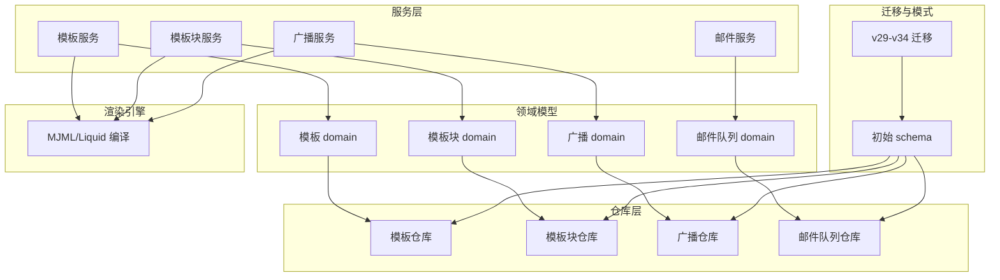
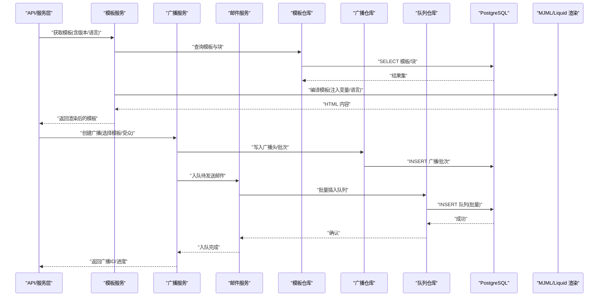
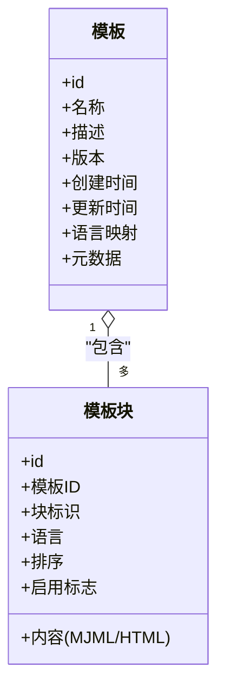
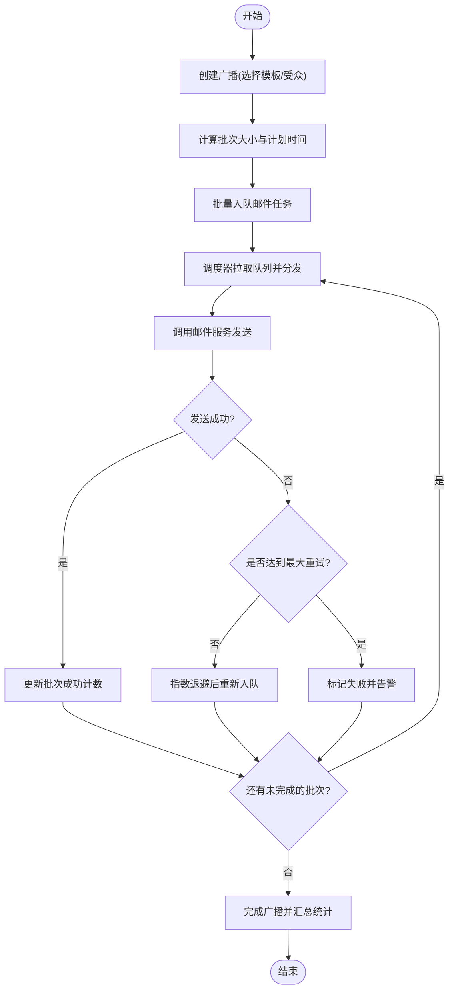
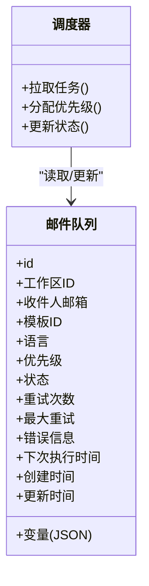
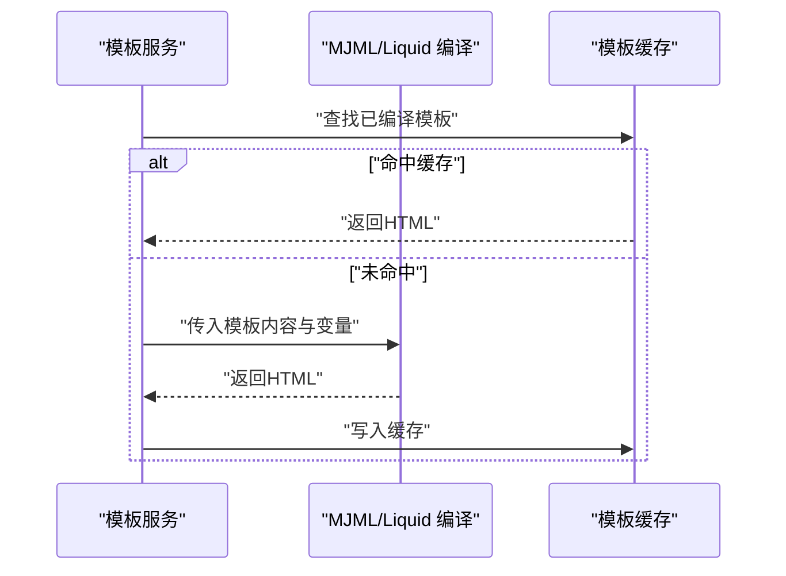
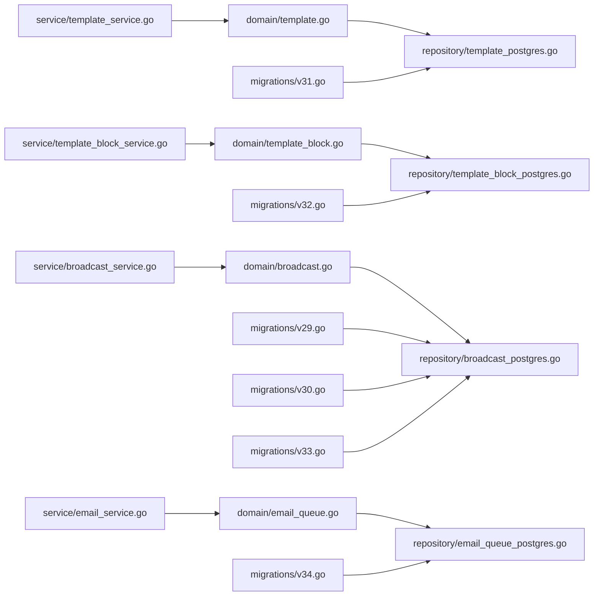

# 邮件系统表

<cite>
**本文引用的文件**   
- [internal/database/schema/001_initial.sql](file://notifuse/internal/database/schema/001_initial.sql)
- [internal/migrations/v29.go](file://notifuse/internal/migrations/v29.go)
- [internal/migrations/v30.go](file://notifuse/internal/migrations/v30.go)
- [internal/migrations/v31.go](file://notifuse/internal/migrations/v31.go)
- [internal/migrations/v32.go](file://notifuse/internal/migrations/v32.go)
- [internal/migrations/v33.go](file://notifuse/internal/migrations/v33.go)
- [internal/migrations/v34.go](file://notifuse/internal/migrations/v34.go)
- [internal/domain/template.go](file://notifuse/internal/domain/template.go)
- [internal/domain/template_block.go](file://notifuse/internal/domain/template_block.go)
- [internal/domain/broadcast.go](file://notifuse/internal/domain/broadcast.go)
- [internal/domain/email_queue.go](file://notifuse/internal/domain/email_queue.go)
- [internal/repository/template_postgres.go](file://notifuse/internal/repository/template_postgres.go)
- [internal/repository/template_block_postgres.go](file://notifuse/internal/repository/template_block_postgres.go)
- [internal/repository/broadcast_postgres.go](file://notifuse/internal/repository/broadcast_postgres.go)
- [internal/repository/email_queue_postgres.go](file://notifuse/internal/repository/email_queue_postgres.go)
- [internal/service/template_service.go](file://notifuse/internal/service/template_service.go)
- [internal/service/template_block_service.go](file://notifuse/internal/service/template_block_service.go)
- [internal/service/broadcast_service.go](file://notifuse/internal/service/broadcast_service.go)
- [internal/service/email_service.go](file://notifuse/internal/service/email_service.go)
- [pkg/notifuse_mjml/model.go](file://notifuse/pkg/notifuse_mjml/model.go)
- [pkg/notifuse_mjml/template_compilation.go](file://notifuse/pkg/notifuse_mjml/template_compilation.go)
</cite>

## 目录
1. [简介](#简介)
2. [项目结构](#项目结构)
3. [核心组件](#核心组件)
4. [架构总览](#架构总览)
5. [详细组件分析](#详细组件分析)
6. [依赖分析](#依赖分析)
7. [性能考虑](#性能考虑)
8. [故障排查指南](#故障排查指南)
9. [结论](#结论)
10. [附录](#附录)

## 简介
本文件为 Notifuse 平台邮件系统的数据库设计文档，聚焦以下核心能力的数据模型与实现：
- 邮件模板（Table）及其版本管理、多语言支持
- 广播发送（Broadcast）的状态跟踪、进度管理与重试机制
- 邮件队列（EmailQueue）的异步处理、任务调度、优先级与失败重试策略
- 模板块（Block）的存储结构与渲染引擎集成
- 高并发场景下的批量操作与事务处理优化建议

## 项目结构
邮件系统相关代码主要分布在以下模块：
- 领域模型：定义模板、模板块、广播、邮件队列等数据结构与行为
- 迁移脚本：维护数据库模式演进，包含模板、广播、队列等表的创建与变更
- 仓库层：PostgreSQL 持久化实现，负责 SQL 查询与事务边界
- 服务层：编排业务逻辑，协调模板渲染、广播分片、队列消费等流程
- 渲染引擎：MJML + Liquid 模板编译与渲染，支撑多语言与动态内容

图表来源
- [internal/migrations/v29.go](file://notifuse/internal/migrations/v29.go)
- [internal/migrations/v30.go](file://notifuse/internal/migrations/v30.go)
- [internal/migrations/v31.go](file://notifuse/internal/migrations/v31.go)
- [internal/migrations/v32.go](file://notifuse/internal/migrations/v32.go)
- [internal/migrations/v33.go](file://notifuse/internal/migrations/v33.go)
- [internal/migrations/v34.go](file://notifuse/internal/migrations/v34.go)
- [internal/database/schema/001_initial.sql](file://notifuse/internal/database/schema/001_initial.sql)
- [internal/domain/template.go](file://notifuse/internal/domain/template.go)
- [internal/domain/template_block.go](file://notifuse/internal/domain/template_block.go)
- [internal/domain/broadcast.go](file://notifuse/internal/domain/broadcast.go)
- [internal/domain/email_queue.go](file://notifuse/internal/domain/email_queue.go)
- [internal/repository/template_postgres.go](file://notifuse/internal/repository/template_postgres.go)
- [internal/repository/template_block_postgres.go](file://notifuse/internal/repository/template_block_postgres.go)
- [internal/repository/broadcast_postgres.go](file://notifuse/internal/repository/broadcast_postgres.go)
- [internal/repository/email_queue_postgres.go](file://notifuse/internal/repository/email_queue_postgres.go)
- [internal/service/template_service.go](file://notifuse/internal/service/template_service.go)
- [internal/service/template_block_service.go](file://notifuse/internal/service/template_block_service.go)
- [internal/service/broadcast_service.go](file://notifuse/internal/service/broadcast_service.go)
- [internal/service/email_service.go](file://notifuse/internal/service/email_service.go)
- [pkg/notifuse_mjml/model.go](file://notifuse/pkg/notifuse_mjml/model.go)
- [pkg/notifuse_mjml/template_compilation.go](file://notifuse/pkg/notifuse_mjml/template_compilation.go)

章节来源
- [internal/migrations/v29.go](file://notifuse/internal/migrations/v29.go)
- [internal/migrations/v30.go](file://notifuse/internal/migrations/v30.go)
- [internal/migrations/v31.go](file://notifuse/internal/migrations/v31.go)
- [internal/migrations/v32.go](file://notifuse/internal/migrations/v32.go)
- [internal/migrations/v33.go](file://notifuse/internal/migrations/v33.go)
- [internal/migrations/v34.go](file://notifuse/internal/migrations/v34.go)
- [internal/database/schema/001_initial.sql](file://notifuse/internal/database/schema/001_initial.sql)

## 核心组件
本节概述邮件系统的关键数据实体与职责：
- 模板（Template）：承载邮件主题、正文、变量与元信息；支持版本控制与多语言键值映射
- 模板块（Template Block）：可复用的 HTML/MJML 片段，支持按语言或条件选择
- 广播（Broadcast）：面向受众群体的批量邮件活动，记录目标范围、状态、批次与进度
- 邮件队列（Email Queue）：异步任务载体，封装收件人、模板上下文、投递参数与重试计数

章节来源
- [internal/domain/template.go](file://notifuse/internal/domain/template.go)
- [internal/domain/template_block.go](file://notifuse/internal/domain/template_block.go)
- [internal/domain/broadcast.go](file://notifuse/internal/domain/broadcast.go)
- [internal/domain/email_queue.go](file://notifuse/internal/domain/email_queue.go)

## 架构总览
邮件系统采用分层架构：服务层编排业务逻辑，仓库层对接 PostgreSQL，迁移脚本驱动模式演进，渲染引擎提供 MJML/Liquid 编译能力。

图表来源
- [internal/service/template_service.go](file://notifuse/internal/service/template_service.go)
- [internal/service/broadcast_service.go](file://notifuse/internal/service/broadcast_service.go)
- [internal/service/email_service.go](file://notifuse/internal/service/email_service.go)
- [internal/repository/template_postgres.go](file://notifuse/internal/repository/template_postgres.go)
- [internal/repository/broadcast_postgres.go](file://notifuse/internal/repository/broadcast_postgres.go)
- [internal/repository/email_queue_postgres.go](file://notifuse/internal/repository/email_queue_postgres.go)
- [pkg/notifuse_mjml/template_compilation.go](file://notifuse/pkg/notifuse_mjml/template_compilation.go)

## 详细组件分析

### 模板与模板块（Template & Template Block）
- 模板版本管理：通过版本号字段与时间戳保证可追溯性；同一模板存在多个版本时，渲染选择最新可用版本
- 多语言支持：模板与块均支持语言键（如 en、zh），渲染时根据用户偏好或上下文选择对应语言内容
- 模板块结构：以独立行存储，关联到模板；支持复用与组合，减少重复内容并提升一致性

图表来源
- [internal/domain/template.go](file://notifuse/internal/domain/template.go)
- [internal/domain/template_block.go](file://notifuse/internal/domain/template_block.go)
- [internal/migrations/v31.go](file://notifuse/internal/migrations/v31.go)
- [internal/migrations/v32.go](file://notifuse/internal/migrations/v32.go)

章节来源
- [internal/domain/template.go](file://notifuse/internal/domain/template.go)
- [internal/domain/template_block.go](file://notifuse/internal/domain/template_block.go)
- [internal/repository/template_postgres.go](file://notifuse/internal/repository/template_postgres.go)
- [internal/repository/template_block_postgres.go](file://notifuse/internal/repository/template_block_postgres.go)
- [internal/service/template_service.go](file://notifuse/internal/service/template_service.go)
- [internal/service/template_block_service.go](file://notifuse/internal/service/template_block_service.go)
- [internal/migrations/v31.go](file://notifuse/internal/migrations/v31.go)
- [internal/migrations/v32.go](file://notifuse/internal/migrations/v32.go)

### 广播发送（Broadcast）
- 广播头：记录活动基本信息、选择模板、受众范围、计划时间与总体状态
- 批次（Batch）：将大规模受众切分为若干批次，便于进度跟踪与限流
- 状态跟踪：从“草稿”到“进行中”、“已完成”、“失败”，并在每个批次维度记录成功/失败计数
- 重试机制：对失败的批次或单封邮件进行指数退避重试，直至达到最大重试次数

图表来源
- [internal/domain/broadcast.go](file://notifuse/internal/domain/broadcast.go)
- [internal/migrations/v29.go](file://notifuse/internal/migrations/v29.go)
- [internal/migrations/v30.go](file://notifuse/internal/migrations/v30.go)
- [internal/migrations/v33.go](file://notifuse/internal/migrations/v33.go)
- [internal/migrations/v34.go](file://notifuse/internal/migrations/v34.go)
- [internal/repository/broadcast_postgres.go](file://notifuse/internal/repository/broadcast_postgres.go)
- [internal/service/broadcast_service.go](file://notifuse/internal/service/broadcast_service.go)

章节来源
- [internal/domain/broadcast.go](file://notifuse/internal/domain/broadcast.go)
- [internal/repository/broadcast_postgres.go](file://notifuse/internal/repository/broadcast_postgres.go)
- [internal/service/broadcast_service.go](file://notifuse/internal/service/broadcast_service.go)
- [internal/migrations/v29.go](file://notifuse/internal/migrations/v29.go)
- [internal/migrations/v30.go](file://notifuse/internal/migrations/v30.go)
- [internal/migrations/v33.go](file://notifuse/internal/migrations/v33.go)
- [internal/migrations/v34.go](file://notifuse/internal/migrations/v34.go)

### 邮件队列（EmailQueue）
- 任务结构：包含收件人、模板ID、变量上下文、语言、优先级、重试次数、下次执行时间等
- 任务调度：调度器周期性拉取“待处理”任务，按优先级与延迟时间排序
- 失败重试：记录错误原因与重试次数，使用指数退避策略避免雪崩
- 幂等与去重：通过唯一约束或幂等键防止重复投递

图表来源
- [internal/domain/email_queue.go](file://notifuse/internal/domain/email_queue.go)
- [internal/migrations/v31.go](file://notifuse/internal/migrations/v31.go)
- [internal/migrations/v32.go](file://notifuse/internal/migrations/v32.go)
- [internal/repository/email_queue_postgres.go](file://notifuse/internal/repository/email_queue_postgres.go)
- [internal/service/email_service.go](file://notifuse/internal/service/email_service.go)

章节来源
- [internal/domain/email_queue.go](file://notifuse/internal/domain/email_queue.go)
- [internal/repository/email_queue_postgres.go](file://notifuse/internal/repository/email_queue_postgres.go)
- [internal/service/email_service.go](file://notifuse/internal/service/email_service.go)
- [internal/migrations/v31.go](file://notifuse/internal/migrations/v31.go)
- [internal/migrations/v32.go](file://notifuse/internal/migrations/v32.go)

### 渲染引擎集成（MJML + Liquid）
- 模板编译：将 MJML 转换为 HTML，并通过 Liquid 注入变量与多语言文本
- 安全沙箱：限制危险函数与外部访问，确保渲染过程可控
- 缓存策略：对已编译模板进行缓存，降低重复编译开销

图表来源
- [pkg/notifuse_mjml/model.go](file://notifuse/pkg/notifuse_mjml/model.go)
- [pkg/notifuse_mjml/template_compilation.go](file://notifuse/pkg/notifuse_mjml/template_compilation.go)
- [internal/service/template_service.go](file://notifuse/internal/service/template_service.go)

章节来源
- [pkg/notifuse_mjml/model.go](file://notifuse/pkg/notifuse_mjml/model.go)
- [pkg/notifuse_mjml/template_compilation.go](file://notifuse/pkg/notifuse_mjml/template_compilation.go)
- [internal/service/template_service.go](file://notifuse/internal/service/template_service.go)

## 依赖分析
- 领域模型与仓库层解耦：通过接口抽象，便于替换存储实现或进行单元测试
- 迁移脚本与初始 schema 协同：v29-v34 增量变更覆盖模板、广播、队列等核心表
- 服务层编排：模板服务与广播服务协作，邮件服务作为统一入口处理队列与发送

图表来源
- [internal/domain/template.go](file://notifuse/internal/domain/template.go)
- [internal/domain/template_block.go](file://notifuse/internal/domain/template_block.go)
- [internal/domain/broadcast.go](file://notifuse/internal/domain/broadcast.go)
- [internal/domain/email_queue.go](file://notifuse/internal/domain/email_queue.go)
- [internal/repository/template_postgres.go](file://notifuse/internal/repository/template_postgres.go)
- [internal/repository/template_block_postgres.go](file://notifuse/internal/repository/template_block_postgres.go)
- [internal/repository/broadcast_postgres.go](file://notifuse/internal/repository/broadcast_postgres.go)
- [internal/repository/email_queue_postgres.go](file://notifuse/internal/repository/email_queue_postgres.go)
- [internal/service/template_service.go](file://notifuse/internal/service/template_service.go)
- [internal/service/template_block_service.go](file://notifuse/internal/service/template_block_service.go)
- [internal/service/broadcast_service.go](file://notifuse/internal/service/broadcast_service.go)
- [internal/service/email_service.go](file://notifuse/internal/service/email_service.go)
- [internal/migrations/v29.go](file://notifuse/internal/migrations/v29.go)
- [internal/migrations/v30.go](file://notifuse/internal/migrations/v30.go)
- [internal/migrations/v31.go](file://notifuse/internal/migrations/v31.go)
- [internal/migrations/v32.go](file://notifuse/internal/migrations/v32.go)
- [internal/migrations/v33.go](file://notifuse/internal/migrations/v33.go)
- [internal/migrations/v34.go](file://notifuse/internal/migrations/v34.go)

章节来源
- [internal/domain/template.go](file://notifuse/internal/domain/template.go)
- [internal/domain/template_block.go](file://notifuse/internal/domain/template_block.go)
- [internal/domain/broadcast.go](file://notifuse/internal/domain/broadcast.go)
- [internal/domain/email_queue.go](file://notifuse/internal/domain/email_queue.go)
- [internal/repository/template_postgres.go](file://notifuse/internal/repository/template_postgres.go)
- [internal/repository/template_block_postgres.go](file://notifuse/internal/repository/template_block_postgres.go)
- [internal/repository/broadcast_postgres.go](file://notifuse/internal/repository/broadcast_postgres.go)
- [internal/repository/email_queue_postgres.go](file://notifuse/internal/repository/email_queue_postgres.go)
- [internal/service/template_service.go](file://notifuse/internal/service/template_service.go)
- [internal/service/template_block_service.go](file://notifuse/internal/service/template_block_service.go)
- [internal/service/broadcast_service.go](file://notifuse/internal/service/broadcast_service.go)
- [internal/service/email_service.go](file://notifuse/internal/service/email_service.go)
- [internal/migrations/v29.go](file://notifuse/internal/migrations/v29.go)
- [internal/migrations/v30.go](file://notifuse/internal/migrations/v30.go)
- [internal/migrations/v31.go](file://notifuse/internal/migrations/v31.go)
- [internal/migrations/v32.go](file://notifuse/internal/migrations/v32.go)
- [internal/migrations/v33.go](file://notifuse/internal/migrations/v33.go)
- [internal/migrations/v34.go](file://notifuse/internal/migrations/v34.go)

## 性能考虑
- 批量操作：在广播入队阶段采用批量 INSERT，减少往返与锁竞争
- 索引优化：为队列的“状态+下次执行时间”、广播的“状态+批次ID”建立复合索引，加速调度与进度查询
- 事务边界：模板与块的写入、广播头与批次的创建应置于同一事务，保证一致性
- 分片与分区：当队列规模增长时，可按时间或工作区进行分区，降低单表压力
- 缓存与预编译：模板编译结果缓存，避免重复渲染带来的 CPU 与 I/O 开销
- 限流与背压：广播批次大小与并发度可调，结合外部邮件服务商速率限制，避免过载

[本节为通用指导，不直接分析具体文件]

## 故障排查指南
- 队列堆积：检查“下次执行时间”与“重试次数”，确认调度器是否正常拉取与更新
- 广播失败：查看批次维度的错误信息与重试上限，定位具体失败原因（网络、认证、内容校验）
- 模板渲染异常：验证 MJML 语法与 Liquid 变量完整性，检查语言键是否存在
- 迁移问题：核对 v29-v34 迁移顺序与回滚策略，确保模式一致

章节来源
- [internal/repository/email_queue_postgres.go](file://notifuse/internal/repository/email_queue_postgres.go)
- [internal/repository/broadcast_postgres.go](file://notifuse/internal/repository/broadcast_postgres.go)
- [internal/service/email_service.go](file://notifuse/internal/service/email_service.go)
- [internal/service/broadcast_service.go](file://notifuse/internal/service/broadcast_service.go)
- [internal/migrations/v29.go](file://notifuse/internal/migrations/v29.go)
- [internal/migrations/v30.go](file://notifuse/internal/migrations/v30.go)
- [internal/migrations/v31.go](file://notifuse/internal/migrations/v31.go)
- [internal/migrations/v32.go](file://notifuse/internal/migrations/v32.go)
- [internal/migrations/v33.go](file://notifuse/internal/migrations/v33.go)
- [internal/migrations/v34.go](file://notifuse/internal/migrations/v34.go)

## 结论
Notifuse 邮件系统通过清晰的领域模型、完善的迁移脚本与分层架构，实现了模板版本管理、多语言支持、广播进度跟踪与异步队列处理。在高并发场景下，借助批量操作、索引优化与事务边界控制，能够稳定支撑大规模邮件发送需求。

[本节为总结性内容，不直接分析具体文件]

## 附录
- 关键迁移清单：
  - v29：广播基础表与状态字段
  - v30：广播批次与进度统计
  - v31：模板与模板块多语言与版本字段
  - v32：模板块索引与约束优化
  - v33：广播错误追踪与重试字段
  - v34：邮件队列优先级与调度字段

章节来源
- [internal/migrations/v29.go](file://notifuse/internal/migrations/v29.go)
- [internal/migrations/v30.go](file://notifuse/internal/migrations/v30.go)
- [internal/migrations/v31.go](file://notifuse/internal/migrations/v31.go)
- [internal/migrations/v32.go](file://notifuse/internal/migrations/v32.go)
- [internal/migrations/v33.go](file://notifuse/internal/migrations/v33.go)
- [internal/migrations/v34.go](file://notifuse/internal/migrations/v34.go)