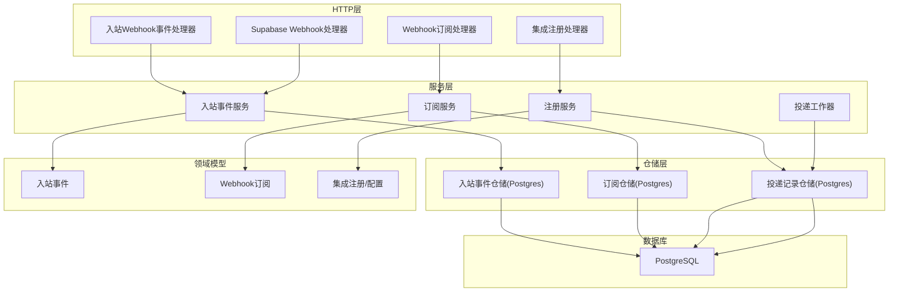
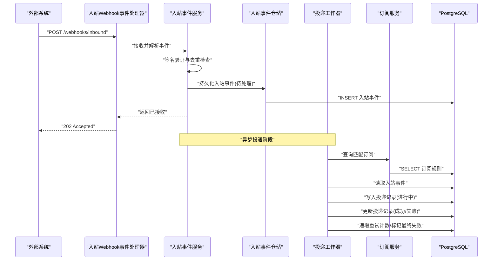
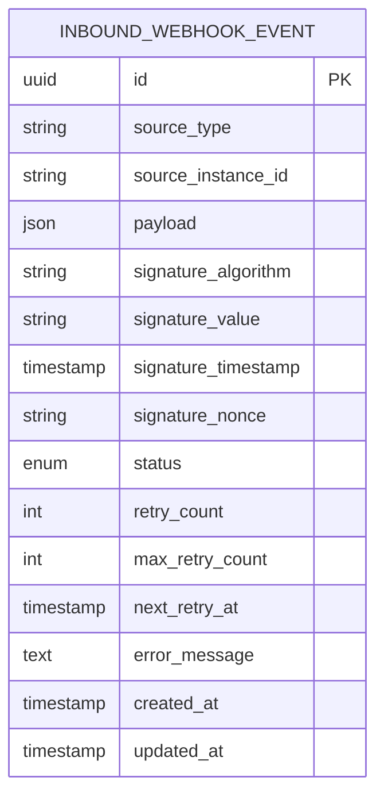
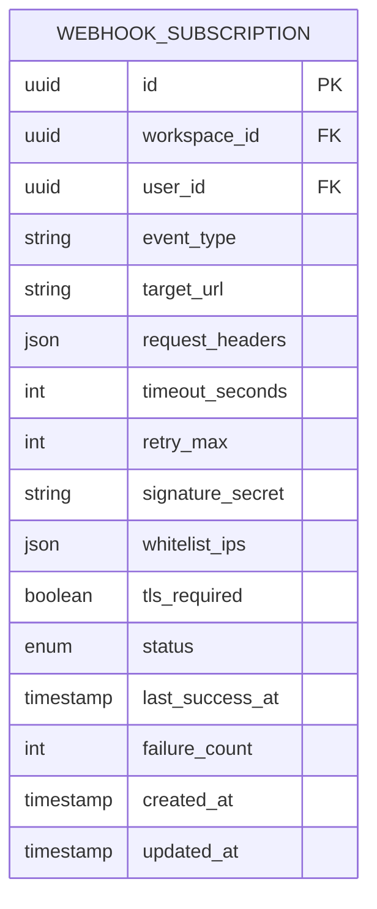
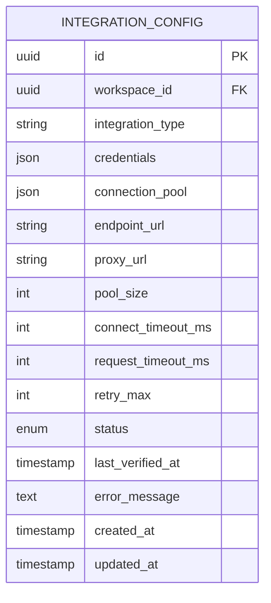
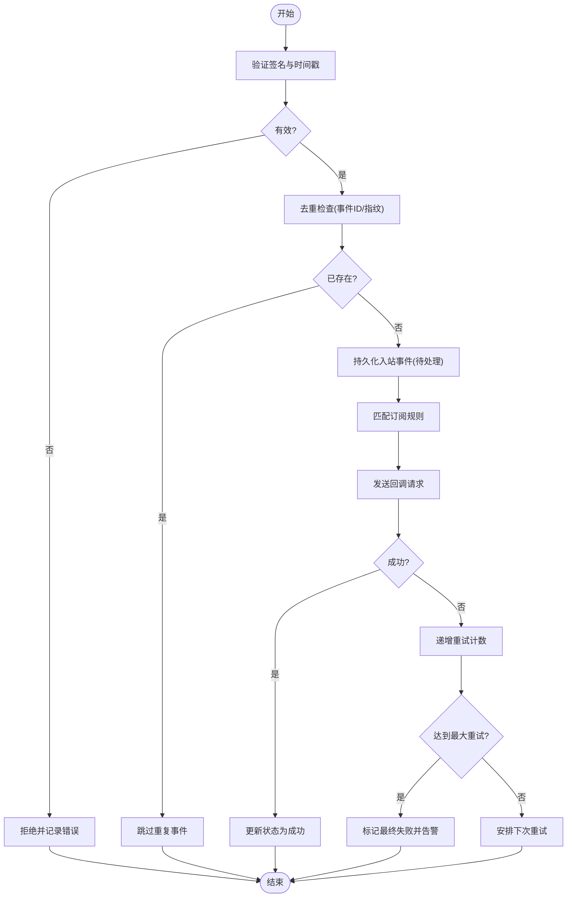
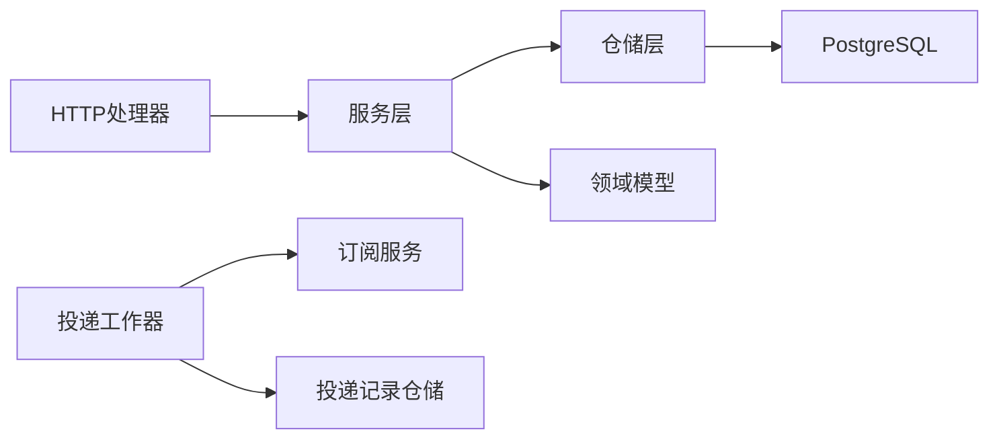

# 集成与Webhook表

<cite>
**本文引用的文件**   
- [inbound_webhook_event.go](file://notifuse/internal/domain/inbound_webhook_event.go)
- [webhook_subscription.go](file://notifuse/internal/domain/webhook_subscription.go)
- [webhook_registration.go](file://notifuse/internal/domain/webhook_registration.go)
- [inbound_webhook_event_postgres.go](file://notifuse/internal/repository/inbound_webhook_event_postgres.go)
- [webhook_subscription_postgres.go](file://notifuse/internal/repository/webhook_subscription_postgres.go)
- [webhook_delivery_postgres.go](file://notifuse/internal/repository/webhook_delivery_postgres.go)
- [inbound_webhook_event_handler.go](file://notifuse/internal/http/inbound_webhook_event_handler.go)
- [webhook_subscription_handler.go](file://notifuse/internal/http/webhook_subscription_handler.go)
- [webhook_registration_handler.go](file://notifuse/internal/http/webhook_registration_handler.go)
- [inbound_webhook_event_service.go](file://notifuse/internal/service/inbound_webhook_event_service.go)
- [webhook_subscription_service.go](file://notifuse/internal/service/webhook_subscription_service.go)
- [webhook_registration_service.go](file://notifuse/internal/service/webhook_registration_service.go)
- [webhook_delivery_worker.go](file://notifuse/internal/service/webhook_delivery_worker.go)
- [supabase_webhook_handler.go](file://notifuse/internal/http/supabase_webhook_handler.go)
- [v10.go](file://notifuse/internal/migrations/v10.go)
- [v11.go](file://notifuse/internal/migrations/v11.go)
- [v12.go](file://notifuse/internal/migrations/v12.go)
- [v13.go](file://notifuse/internal/migrations/v13.go)
- [v14.go](file://notifuse/internal/migrations/v14.go)
- [v15.go](file://notifuse/internal/migrations/v15.go)
- [v16.go](file://notifuse/internal/migrations/v16.go)
- [v17.go](file://notifuse/internal/migrations/v17.go)
- [v18.go](file://notifuse/internal/migrations/v18.go)
- [v19.go](file://notifuse/internal/migrations/v19.go)
- [v20.go](file://notifuse/internal/migrations/v20.go)
- [v21.go](file://notifuse/internal/migrations/v21.go)
- [v22.go](file://notifuse/internal/migrations/v22.go)
- [v23.go](file://notifuse/internal/migrations/v23.go)
- [v24.go](file://notifuse/internal/migrations/v24.go)
- [v25.go](file://notifuse/internal/migrations/v25.go)
- [v26.go](file://notifuse/internal/migrations/v26.go)
- [v27.go](file://notifuse/internal/migrations/v27.go)
- [v28.go](file://notifuse/internal/migrations/v28.go)
- [v29.go](file://notifuse/internal/migrations/v29.go)
- [v30.go](file://notifuse/internal/migrations/v30.go)
- [v31.go](file://notifuse/internal/migrations/v31.go)
- [v32.go](file://notifuse/internal/migrations/v32.go)
- [v33.go](file://notifuse/internal/migrations/v33.go)
- [v34.go](file://notifuse/internal/migrations/v34.go)
</cite>

## 目录
1. [简介](#简介)
2. [项目结构](#项目结构)
3. [核心组件](#核心组件)
4. [架构总览](#架构总览)
5. [详细组件分析](#详细组件分析)
6. [依赖关系分析](#依赖关系分析)
7. [性能考虑](#性能考虑)
8. [故障排查指南](#故障排查指南)
9. [结论](#结论)
10. [附录](#附录)

## 简介
本文件聚焦Notifuse平台的第三方集成与Webhook系统的数据库设计，围绕以下扩展性相关实体展开：
- Webhook订阅（WebhookSubscription）
- 入站事件（InboundWebhookEvent）
- 集成配置（IntegrationConfig）

文档将详细说明这些实体的数据结构、事件生命周期管理（注册、签名验证、重试与失败处理）、第三方服务集成配置存储（API密钥、连接池、认证令牌安全策略），以及事件驱动架构在数据库层面的实现方式（事件溯源、状态同步、一致性保证）。同时提供插件化、动态加载与热插拔的配置管理机制说明。

## 项目结构
与Webhook和集成相关的代码主要分布在以下层次：
- 领域模型层：定义Webhook订阅、入站事件、集成配置等核心实体及其行为
- 仓储层：面向PostgreSQL的持久化实现
- 服务层：编排业务逻辑，包括事件接收、校验、投递、重试与失败处理
- HTTP层：暴露REST API与Webhook回调入口
- 迁移脚本：维护数据库Schema演进

图表来源
- [inbound_webhook_event_handler.go:1-200](file://notifuse/internal/http/inbound_webhook_event_handler.go#L1-L200)
- [webhook_subscription_handler.go:1-200](file://notifuse/internal/http/webhook_subscription_handler.go#L1-L200)
- [webhook_registration_handler.go:1-200](file://notifuse/internal/http/webhook_registration_handler.go#L1-L200)
- [supabase_webhook_handler.go:1-200](file://notifuse/internal/http/supabase_webhook_handler.go#L1-L200)
- [inbound_webhook_event_service.go:1-200](file://notifuse/internal/service/inbound_webhook_event_service.go#L1-L200)
- [webhook_subscription_service.go:1-200](file://notifuse/internal/service/webhook_subscription_service.go#L1-L200)
- [webhook_registration_service.go:1-200](file://notifuse/internal/service/webhook_registration_service.go#L1-L200)
- [webhook_delivery_worker.go:1-200](file://notifuse/internal/service/webhook_delivery_worker.go#L1-L200)
- [inbound_webhook_event_postgres.go:1-200](file://notifuse/internal/repository/inbound_webhook_event_postgres.go#L1-L200)
- [webhook_subscription_postgres.go:1-200](file://notifuse/internal/repository/webhook_subscription_postgres.go#L1-L200)
- [webhook_delivery_postgres.go:1-200](file://notifuse/internal/repository/webhook_delivery_postgres.go#L1-L200)

章节来源
- [inbound_webhook_event_handler.go:1-200](file://notifuse/internal/http/inbound_webhook_event_handler.go#L1-L200)
- [webhook_subscription_handler.go:1-200](file://notifuse/internal/http/webhook_subscription_handler.go#L1-L200)
- [webhook_registration_handler.go:1-200](file://notifuse/internal/http/webhook_registration_handler.go#L1-L200)
- [supabase_webhook_handler.go:1-200](file://notifuse/internal/http/supabase_webhook_handler.go#L1-L200)
- [inbound_webhook_event_service.go:1-200](file://notifuse/internal/service/inbound_webhook_event_service.go#L1-L200)
- [webhook_subscription_service.go:1-200](file://notifuse/internal/service/webhook_subscription_service.go#L1-L200)
- [webhook_registration_service.go:1-200](file://notifuse/internal/service/webhook_registration_service.go#L1-L200)
- [webhook_delivery_worker.go:1-200](file://notifuse/internal/service/webhook_delivery_worker.go#L1-L200)
- [inbound_webhook_event_postgres.go:1-200](file://notifuse/internal/repository/inbound_webhook_event_postgres.go#L1-L200)
- [webhook_subscription_postgres.go:1-200](file://notifuse/internal/repository/webhook_subscription_postgres.go#L1-L200)
- [webhook_delivery_postgres.go:1-200](file://notifuse/internal/repository/webhook_delivery_postgres.go#L1-L200)

## 核心组件
本节概述与Webhook和集成相关的核心数据模型与职责边界：
- 入站事件（InboundWebhookEvent）：记录外部系统通过Webhook推送的事件，包含事件标识、来源、载荷、签名信息、处理状态与重试计数等
- Webhook订阅（WebhookSubscription）：描述平台内部对某类事件的订阅规则，包括目标URL、过滤条件、启用状态、签名密钥等
- 集成配置（IntegrationConfig）：用于存储第三方服务的连接与认证信息，如API密钥、OAuth令牌、TLS设置、连接池参数等

章节来源
- [inbound_webhook_event.go:1-200](file://notifuse/internal/domain/inbound_webhook_event.go#L1-L200)
- [webhook_subscription.go:1-200](file://notifuse/internal/domain/webhook_subscription.go#L1-L200)
- [webhook_registration.go:1-200](file://notifuse/internal/domain/webhook_registration.go#L1-L200)

## 架构总览
下图展示从外部系统触发到平台内处理与投递的整体流程，涵盖事件注册、签名验证、持久化、投递与重试机制。

图表来源
- [inbound_webhook_event_handler.go:1-200](file://notifuse/internal/http/inbound_webhook_event_handler.go#L1-L200)
- [inbound_webhook_event_service.go:1-200](file://notifuse/internal/service/inbound_webhook_event_service.go#L1-L200)
- [inbound_webhook_event_postgres.go:1-200](file://notifuse/internal/repository/inbound_webhook_event_postgres.go#L1-L200)
- [webhook_delivery_worker.go:1-200](file://notifuse/internal/service/webhook_delivery_worker.go#L1-L200)
- [webhook_subscription_service.go:1-200](file://notifuse/internal/service/webhook_subscription_service.go#L1-L200)
- [webhook_subscription_postgres.go:1-200](file://notifuse/internal/repository/webhook_subscription_postgres.go#L1-L200)
- [webhook_delivery_postgres.go:1-200](file://notifuse/internal/repository/webhook_delivery_postgres.go#L1-L200)

## 详细组件分析

### 入站事件（InboundWebhookEvent）数据模型
- 字段要点
  - 唯一标识：事件ID（UUID或自增主键）
  - 来源标识：事件来源类型与来源实例ID
  - 载荷：JSON格式事件体
  - 签名：签名算法、签名值、时间戳、随机数
  - 状态：待处理、处理中、成功、失败、最终失败
  - 重试：重试次数、最大重试次数、下次重试时间
  - 审计：创建时间、更新时间、错误信息
- 索引建议
  - 按来源类型与来源实例ID建立复合索引以加速路由
  - 按状态与下次重试时间建立索引以支持投递调度
  - 按事件ID建立唯一索引以保障幂等

图表来源
- [inbound_webhook_event.go:1-200](file://notifuse/internal/domain/inbound_webhook_event.go#L1-L200)
- [inbound_webhook_event_postgres.go:1-200](file://notifuse/internal/repository/inbound_webhook_event_postgres.go#L1-L200)

章节来源
- [inbound_webhook_event.go:1-200](file://notifuse/internal/domain/inbound_webhook_event.go#L1-L200)
- [inbound_webhook_event_postgres.go:1-200](file://notifuse/internal/repository/inbound_webhook_event_postgres.go#L1-L200)

### Webhook订阅（WebhookSubscription）数据模型
- 字段要点
  - 唯一标识：订阅ID
  - 关联：工作区ID、用户ID（权限隔离）
  - 事件类型：订阅的事件类别
  - 目标：回调URL、请求头模板、超时与重试策略
  - 安全：签名密钥、白名单IP、TLS要求
  - 状态：启用/禁用、最后成功时间、失败统计
- 索引建议
  - 按工作区ID与事件类型建立复合索引
  - 按状态与最后成功时间建立索引以支持健康检查与清理

图表来源
- [webhook_subscription.go:1-200](file://notifuse/internal/domain/webhook_subscription.go#L1-L200)
- [webhook_subscription_postgres.go:1-200](file://notifuse/internal/repository/webhook_subscription_postgres.go#L1-L200)

章节来源
- [webhook_subscription.go:1-200](file://notifuse/internal/domain/webhook_subscription.go#L1-L200)
- [webhook_subscription_postgres.go:1-200](file://notifuse/internal/repository/webhook_subscription_postgres.go#L1-L200)

### 集成配置（IntegrationConfig）数据模型
- 字段要点
  - 唯一标识：配置ID
  - 关联：工作区ID、集成类型（如邮件提供商、LLM提供商、Supabase等）
  - 凭证：API密钥、OAuth令牌、私钥、证书路径
  - 连接：端点URL、代理设置、连接池大小、超时、重试策略
  - 状态：启用/禁用、最后验证时间、错误信息
- 安全策略
  - 敏感字段加密存储（AES-GCM或KMS托管）
  - 访问控制基于工作区与角色
  - 日志脱敏，禁止输出完整密钥
  - 定期轮换与过期检测

图表来源
- [webhook_registration.go:1-200](file://notifuse/internal/domain/webhook_registration.go#L1-L200)
- [webhook_registration_service.go:1-200](file://notifuse/internal/service/webhook_registration_service.go#L1-L200)

章节来源
- [webhook_registration.go:1-200](file://notifuse/internal/domain/webhook_registration.go#L1-L200)
- [webhook_registration_service.go:1-200](file://notifuse/internal/service/webhook_registration_service.go#L1-L200)

### 事件生命周期管理与数据流
- 事件注册
  - 通过注册服务创建或更新集成配置，完成凭据与连接参数的校验与持久化
- 签名验证
  - 入站事件处理器调用服务层进行签名算法选择、时间戳与随机数校验、防重放攻击
- 持久化与去重
  - 入站事件服务将事件写入数据库，使用事件ID或签名指纹做幂等去重
- 投递与重试
  - 投递工作器根据订阅规则匹配目标，发送HTTP请求；成功则更新状态，失败则递增重试计数并按退避策略安排下次重试
- 失败处理
  - 超过最大重试次数后标记为最终失败，记录错误信息并触发告警

图表来源
- [inbound_webhook_event_handler.go:1-200](file://notifuse/internal/http/inbound_webhook_event_handler.go#L1-L200)
- [inbound_webhook_event_service.go:1-200](file://notifuse/internal/service/inbound_webhook_event_service.go#L1-L200)
- [webhook_delivery_worker.go:1-200](file://notifuse/internal/service/webhook_delivery_worker.go#L1-L200)
- [webhook_subscription_service.go:1-200](file://notifuse/internal/service/webhook_subscription_service.go#L1-L200)

章节来源
- [inbound_webhook_event_handler.go:1-200](file://notifuse/internal/http/inbound_webhook_event_handler.go#L1-L200)
- [inbound_webhook_event_service.go:1-200](file://notifuse/internal/service/inbound_webhook_event_service.go#L1-L200)
- [webhook_delivery_worker.go:1-200](file://notifuse/internal/service/webhook_delivery_worker.go#L1-L200)
- [webhook_subscription_service.go:1-200](file://notifuse/internal/service/webhook_subscription_service.go#L1-L200)

### 第三方服务集成的配置存储与安全策略
- API密钥管理
  - 采用加密存储，密钥分片或KMS托管，避免明文落盘
  - 访问需鉴权，仅允许具备相应角色的用户或服务账户读取
- 连接池配置
  - 可配置连接池大小、超时与重试策略，适配不同第三方服务的限流与SLA
- 认证令牌的安全存储
  - OAuth令牌与短期凭证采用加密存储与自动刷新机制
  - 令牌泄露检测与自动吊销流程
- 审计与合规
  - 记录配置变更审计日志，保留最小必要信息
  - 支持密钥轮换与过期提醒

章节来源
- [webhook_registration_service.go:1-200](file://notifuse/internal/service/webhook_registration_service.go#L1-L200)
- [webhook_registration.go:1-200](file://notifuse/internal/domain/webhook_registration.go#L1-L200)

### 事件驱动的架构模式在数据库层面的实现
- 事件溯源
  - 入站事件作为不可变事实记录，所有后续处理步骤通过状态字段与审计字段体现
- 状态同步
  - 投递记录仓储维护每次尝试的状态，确保最终一致性与可观测性
- 数据一致性保证
  - 使用事务与唯一约束保障幂等写入
  - 通过索引优化查询与调度性能

章节来源
- [inbound_webhook_event_postgres.go:1-200](file://notifuse/internal/repository/inbound_webhook_event_postgres.go#L1-L200)
- [webhook_delivery_postgres.go:1-200](file://notifuse/internal/repository/webhook_delivery_postgres.go#L1-L200)

### 扩展性设计：插件化、动态加载与热插拔
- 插件化架构
  - 通过集成类型与处理器接口抽象，新增第三方服务只需实现对应处理器与配置映射
- 动态加载
  - 运行时扫描已注册的集成类型，按需加载处理器与配置
- 热插拔配置管理
  - 配置变更无需重启服务，通过缓存失效与懒加载机制生效
- 版本兼容
  - 迁移脚本保证Schema演进与向后兼容

章节来源
- [webhook_registration_service.go:1-200](file://notifuse/internal/service/webhook_registration_service.go#L1-L200)
- [v10.go:1-200](file://notifuse/internal/migrations/v10.go#L1-L200)
- [v11.go:1-200](file://notifuse/internal/migrations/v11.go#L1-L200)
- [v12.go:1-200](file://notifuse/internal/migrations/v12.go#L1-L200)
- [v13.go:1-200](file://notifuse/internal/migrations/v13.go#L1-L200)
- [v14.go:1-200](file://notifuse/internal/migrations/v14.go#L1-L200)
- [v15.go:1-200](file://notifuse/internal/migrations/v15.go#L1-L200)
- [v16.go:1-200](file://notifuse/internal/migrations/v16.go#L1-L200)
- [v17.go:1-200](file://notifuse/internal/migrations/v17.go#L1-L200)
- [v18.go:1-200](file://notifuse/internal/migrations/v18.go#L1-L200)
- [v19.go:1-200](file://notifuse/internal/migrations/v19.go#L1-L200)
- [v20.go:1-200](file://notifuse/internal/migrations/v20.go#L1-L200)
- [v21.go:1-200](file://notifuse/internal/migrations/v21.go#L1-L200)
- [v22.go:1-200](file://notifuse/internal/migrations/v22.go#L1-L200)
- [v23.go:1-200](file://notifuse/internal/migrations/v23.go#L1-L200)
- [v24.go:1-200](file://notifuse/internal/migrations/v24.go#L1-L200)
- [v25.go:1-200](file://notifuse/internal/migrations/v25.go#L1-L200)
- [v26.go:1-200](file://notifuse/internal/migrations/v26.go#L1-L200)
- [v27.go:1-200](file://notifuse/internal/migrations/v27.go#L1-L200)
- [v28.go:1-200](file://notifuse/internal/migrations/v28.go#L1-L200)
- [v29.go:1-200](file://notifuse/internal/migrations/v29.go#L1-L200)
- [v30.go:1-200](file://notifuse/internal/migrations/v30.go#L1-L200)
- [v31.go:1-200](file://notifuse/internal/migrations/v31.go#L1-L200)
- [v32.go:1-200](file://notifuse/internal/migrations/v32.go#L1-L200)
- [v33.go:1-200](file://notifuse/internal/migrations/v33.go#L1-L200)
- [v34.go:1-200](file://notifuse/internal/migrations/v34.go#L1-L200)

## 依赖关系分析
- 组件耦合
  - HTTP层依赖服务层，服务层依赖仓储层与领域模型
  - 投递工作器依赖订阅服务与投递记录仓储
- 外部依赖
  - PostgreSQL作为持久化后端
  - 可选KMS或加密库用于敏感字段保护
- 潜在循环依赖
  - 通过分层与接口抽象避免循环引用

图表来源
- [inbound_webhook_event_handler.go:1-200](file://notifuse/internal/http/inbound_webhook_event_handler.go#L1-L200)
- [inbound_webhook_event_service.go:1-200](file://notifuse/internal/service/inbound_webhook_event_service.go#L1-L200)
- [inbound_webhook_event_postgres.go:1-200](file://notifuse/internal/repository/inbound_webhook_event_postgres.go#L1-L200)
- [webhook_delivery_worker.go:1-200](file://notifuse/internal/service/webhook_delivery_worker.go#L1-L200)
- [webhook_subscription_service.go:1-200](file://notifuse/internal/service/webhook_subscription_service.go#L1-L200)
- [webhook_subscription_postgres.go:1-200](file://notifuse/internal/repository/webhook_subscription_postgres.go#L1-L200)
- [webhook_delivery_postgres.go:1-200](file://notifuse/internal/repository/webhook_delivery_postgres.go#L1-L200)

章节来源
- [inbound_webhook_event_handler.go:1-200](file://notifuse/internal/http/inbound_webhook_event_handler.go#L1-L200)
- [inbound_webhook_event_service.go:1-200](file://notifuse/internal/service/inbound_webhook_event_service.go#L1-L200)
- [inbound_webhook_event_postgres.go:1-200](file://notifuse/internal/repository/inbound_webhook_event_postgres.go#L1-L200)
- [webhook_delivery_worker.go:1-200](file://notifuse/internal/service/webhook_delivery_worker.go#L1-L200)
- [webhook_subscription_service.go:1-200](file://notifuse/internal/service/webhook_subscription_service.go#L1-L200)
- [webhook_subscription_postgres.go:1-200](file://notifuse/internal/repository/webhook_subscription_postgres.go#L1-L200)
- [webhook_delivery_postgres.go:1-200](file://notifuse/internal/repository/webhook_delivery_postgres.go#L1-L200)

## 性能考虑
- 索引优化
  - 针对高频查询字段建立合适索引，减少全表扫描
- 批量操作
  - 批量插入与更新以减少数据库往返
- 连接池调优
  - 根据并发量与第三方服务限流调整连接池大小与超时
- 重试退避
  - 指数退避与抖动策略降低雪崩风险
- 缓存策略
  - 订阅规则与配置缓存，配合失效机制提升读取性能

[本节为通用指导，不直接分析具体文件]

## 故障排查指南
- 常见问题
  - 签名验证失败：检查签名算法、时间戳与随机数是否匹配
  - 重复事件：确认事件ID或指纹去重逻辑是否生效
  - 投递失败：查看错误信息与重试计数，定位网络或目标服务问题
  - 配置错误：核对集成配置的凭据与连接参数
- 诊断手段
  - 查看入站事件与投递记录的错误消息与时间戳
  - 启用调试日志，注意脱敏敏感字段
  - 使用健康检查接口验证订阅可用性

章节来源
- [inbound_webhook_event_handler.go:1-200](file://notifuse/internal/http/inbound_webhook_event_handler.go#L1-L200)
- [inbound_webhook_event_service.go:1-200](file://notifuse/internal/service/inbound_webhook_event_service.go#L1-L200)
- [webhook_delivery_worker.go:1-200](file://notifuse/internal/service/webhook_delivery_worker.go#L1-L200)

## 结论
通过对Webhook订阅、入站事件与集成配置的数据模型与生命周期进行深入分析，Notifuse平台实现了可扩展、高可靠的事件驱动架构。借助严格的签名验证、幂等去重、重试与失败处理机制，以及安全的配置存储策略，平台能够稳定对接多种第三方服务。结合插件化与热插拔的设计，未来可快速扩展新的集成类型并保持向后兼容。

[本节为总结性内容，不直接分析具体文件]

## 附录
- 相关迁移脚本
  - v10至v34涵盖了Webhook与集成相关表的演进与优化，确保Schema平滑升级

章节来源
- [v10.go:1-200](file://notifuse/internal/migrations/v10.go#L1-L200)
- [v11.go:1-200](file://notifuse/internal/migrations/v11.go#L1-L200)
- [v12.go:1-200](file://notifuse/internal/migrations/v12.go#L1-L200)
- [v13.go:1-200](file://notifuse/internal/migrations/v13.go#L1-L200)
- [v14.go:1-200](file://notifuse/internal/migrations/v14.go#L1-L200)
- [v15.go:1-200](file://notifuse/internal/migrations/v15.go#L1-L200)
- [v16.go:1-200](file://notifuse/internal/migrations/v16.go#L1-L200)
- [v17.go:1-200](file://notifuse/internal/migrations/v17.go#L1-L200)
- [v18.go:1-200](file://notifuse/internal/migrations/v18.go#L1-L200)
- [v19.go:1-200](file://notifuse/internal/migrations/v19.go#L1-L200)
- [v20.go:1-200](file://notifuse/internal/migrations/v20.go#L1-L200)
- [v21.go:1-200](file://notifuse/internal/migrations/v21.go#L1-L200)
- [v22.go:1-200](file://notifuse/internal/migrations/v22.go#L1-L200)
- [v23.go:1-200](file://notifuse/internal/migrations/v23.go#L1-L200)
- [v24.go:1-200](file://notifuse/internal/migrations/v24.go#L1-L200)
- [v25.go:1-200](file://notifuse/internal/migrations/v25.go#L1-L200)
- [v26.go:1-200](file://notifuse/internal/migrations/v26.go#L1-L200)
- [v27.go:1-200](file://notifuse/internal/migrations/v27.go#L1-L200)
- [v28.go:1-200](file://notifuse/internal/migrations/v28.go#L1-L200)
- [v29.go:1-200](file://notifuse/internal/migrations/v29.go#L1-L200)
- [v30.go:1-200](file://notifuse/internal/migrations/v30.go#L1-L200)
- [v31.go:1-200](file://notifuse/internal/migrations/v31.go#L1-L200)
- [v32.go:1-200](file://notifuse/internal/migrations/v32.go#L1-L200)
- [v33.go:1-200](file://notifuse/internal/migrations/v33.go#L1-L200)
- [v34.go:1-200](file://notifuse/internal/migrations/v34.go#L1-L200)