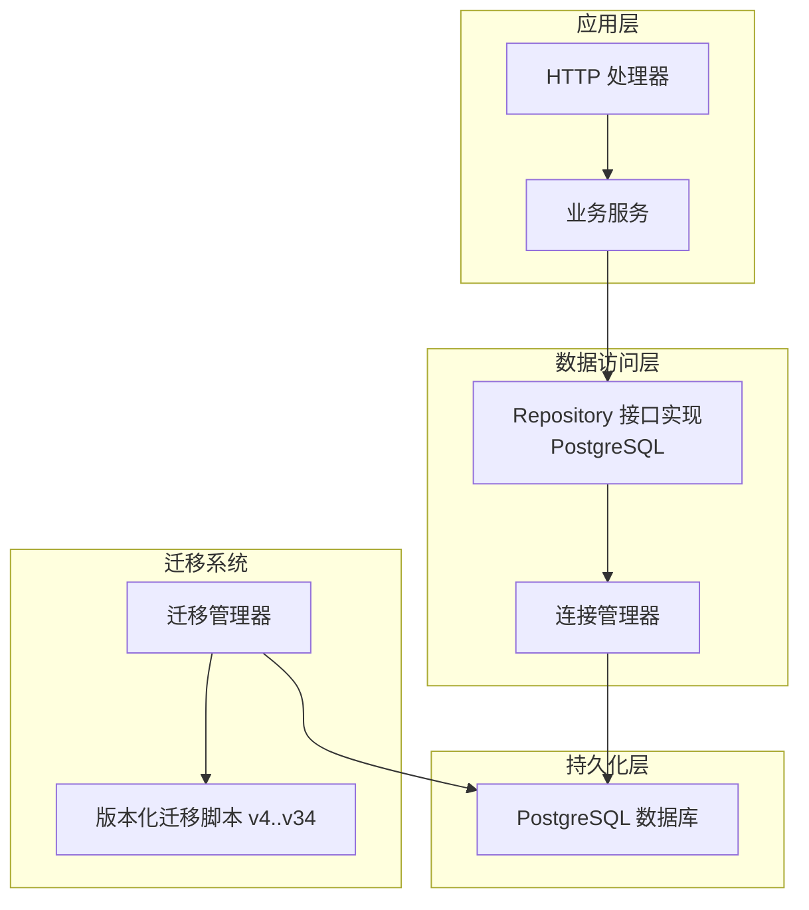
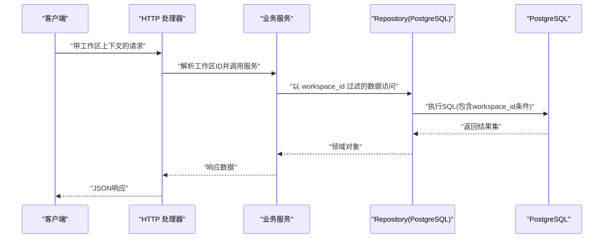
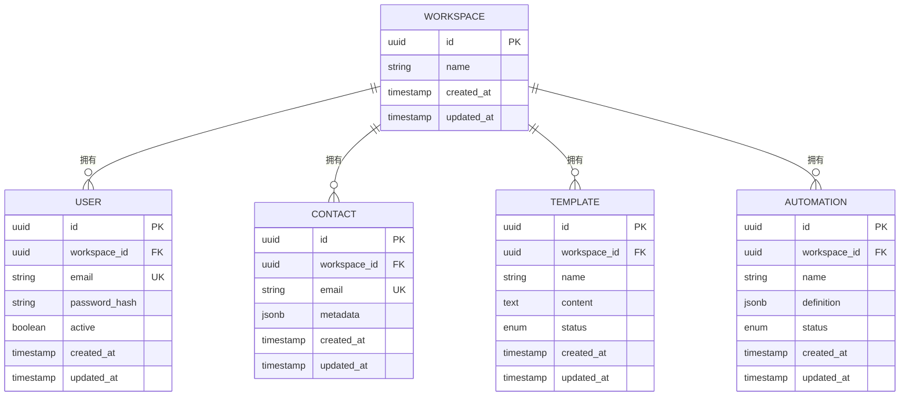
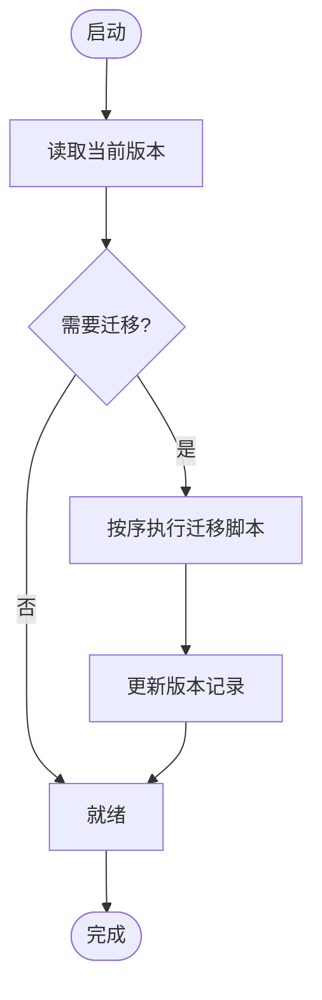
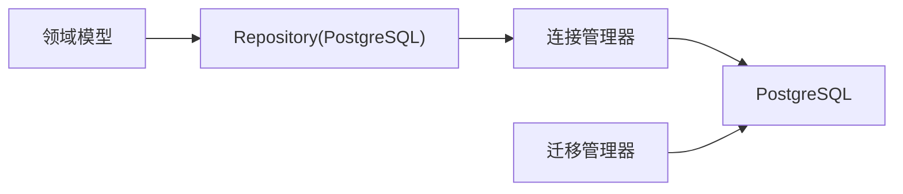

# 数据库设计

<cite>
**本文引用的文件**   
- [internal/database/init.go](file://notifuse/internal/database/init.go)
- [internal/migrations/manager.go](file://notifuse/internal/migrations/manager.go)
- [internal/migrations/version.go](file://notifuse/internal/migrations/version.go)
- [internal/migrations/v4.go](file://notifuse/internal/migrations/v4.go)
- [internal/migrations/v5.go](file://notifuse/internal/migrations/v5.go)
- [internal/migrations/v6.go](file://notifuse/internal/migrations/v6.go)
- [internal/migrations/v7.go](file://notifuse/internal/migrations/v7.go)
- [internal/migrations/v8.go](file://notifuse/internal/migrations/v8.go)
- [internal/migrations/v9.go](file://notifuse/internal/migrations/v9.go)
- [internal/migrations/v10.go](file://notifuse/internal/migrations/v10.go)
- [internal/migrations/v11.go](file://notifuse/internal/migrations/v11.go)
- [internal/migrations/v12.go](file://notifuse/internal/migrations/v12.go)
- [internal/migrations/v13.go](file://notifuse/internal/migrations/v13.go)
- [internal/migrations/v14.go](file://notifuse/internal/migrations/v14.go)
- [internal/migrations/v15.go](file://notifuse/internal/migrations/v15.go)
- [internal/migrations/v16.go](file://notifuse/internal/migrations/v16.go)
- [internal/migrations/v17.go](file://notifuse/internal/migrations/v17.go)
- [internal/migrations/v18.go](file://notifuse/internal/migrations/v18.go)
- [internal/migrations/v19.go](file://notifuse/internal/migrations/v19.go)
- [internal/migrations/v20.go](file://notifuse/internal/migrations/v20.go)
- [internal/migrations/v21.go](file://notifuse/internal/migrations/v21.go)
- [internal/migrations/v22.go](file://notifuse/internal/migrations/v22.go)
- [internal/migrations/v23.go](file://notifuse/internal/migrations/v23.go)
- [internal/migrations/v24.go](file://notifuse/internal/migrations/v24.go)
- [internal/migrations/v25.go](file://notifuse/internal/migrations/v25.go)
- [internal/migrations/v26.go](file://notifuse/internal/migrations/v26.go)
- [internal/migrations/v27.go](file://notifuse/internal/migrations/v27.go)
- [internal/migrations/v28.go](file://notifuse/internal/migrations/v28.go)
- [internal/migrations/v29.go](file://notifuse/internal/migrations/v29.go)
- [internal/migrations/v30.go](file://notifuse/internal/migrations/v30.go)
- [internal/migrations/v31.go](file://notifuse/internal/migrations/v31.go)
- [internal/migrations/v32.go](file://notifuse/internal/migrations/v32.go)
- [internal/migrations/v33.go](file://notifuse/internal/migrations/v33.go)
- [internal/migrations/v34.go](file://notifuse/internal/migrations/v34.go)
- [internal/domain/workspace.go](file://notifuse/internal/domain/workspace.go)
- [internal/domain/user.go](file://notifuse/internal/domain/user.go)
- [internal/domain/contact.go](file://notifuse/internal/domain/contact.go)
- [internal/domain/template.go](file://notifuse/internal/domain/template.go)
- [internal/domain/automation.go](file://notifuse/internal/domain/automation.go)
- [internal/repository/workspace_postgres.go](file://notifuse/internal/repository/workspace_postgres.go)
- [internal/repository/user_postgres.go](file://notifuse/internal/repository/user_postgres.go)
- [internal/repository/contact_postgres.go](file://notifuse/internal/repository/contact_postgres.go)
- [internal/repository/template_postgres.go](file://notifuse/internal/repository/template_postgres.go)
- [internal/repository/automation_postgres.go](file://notifuse/internal/repository/automation_postgres.go)
- [pkg/database/connection_manager.go](file://notifuse/pkg/database/connection_manager.go)
</cite>

## 目录
1. [简介](#简介)
2. [项目结构](#项目结构)
3. [核心组件](#核心组件)
4. [架构总览](#架构总览)
5. [详细组件分析](#详细组件分析)
6. [依赖关系分析](#依赖关系分析)
7. [性能考虑](#性能考虑)
8. [故障排查指南](#故障排查指南)
9. [结论](#结论)
10. [附录](#附录)

## 简介
本文件为 Notifuse 平台的数据库设计文档，聚焦 PostgreSQL 的实体关系模型、索引与查询优化、多租户数据隔离与工作区级权限控制、迁移策略与版本管理、数据访问模式与缓存策略、备份恢复与监控指标、容量规划以及数据生命周期与归档合规。文档面向产品、研发与运维人员，力求在保持技术深度的同时易于理解。

## 项目结构
Notifuse 后端采用 Go 语言实现，数据库相关代码主要分布在以下模块：
- 数据库初始化与连接管理：internal/database、pkg/database
- 迁移系统：internal/migrations（含版本化迁移脚本）
- 领域模型：internal/domain（工作区、用户、联系人、模板、自动化等）
- 数据访问层：internal/repository（PostgreSQL 实现）
- HTTP 服务与业务编排：internal/http、internal/service（通过 repository 访问数据库）

图表来源
- [internal/database/init.go](file://notifuse/internal/database/init.go)
- [pkg/database/connection_manager.go](file://notifuse/pkg/database/connection_manager.go)
- [internal/migrations/manager.go](file://notifuse/internal/migrations/manager.go)
- [internal/migrations/version.go](file://notifuse/internal/migrations/version.go)

章节来源
- [internal/database/init.go](file://notifuse/internal/database/init.go)
- [pkg/database/connection_manager.go](file://notifuse/pkg/database/connection_manager.go)
- [internal/migrations/manager.go](file://notifuse/internal/migrations/manager.go)
- [internal/migrations/version.go](file://notifuse/internal/migrations/version.go)

## 核心组件
本节概述与数据库密切相关的核心组件及其职责：
- 连接管理器：负责数据库连接池配置、健康检查与上下文传播。
- 迁移管理器：按版本号顺序执行迁移脚本，维护当前版本并支持回滚。
- Repository 层：封装 SQL 操作，提供领域对象到表结构的映射。
- 领域模型：定义工作区、用户、联系人、模板、自动化等实体的字段与约束。

章节来源
- [pkg/database/connection_manager.go](file://notifuse/pkg/database/connection_manager.go)
- [internal/migrations/manager.go](file://notifuse/internal/migrations/manager.go)
- [internal/repository/workspace_postgres.go](file://notifuse/internal/repository/workspace_postgres.go)
- [internal/repository/user_postgres.go](file://notifuse/internal/repository/user_postgres.go)
- [internal/repository/contact_postgres.go](file://notifuse/internal/repository/contact_postgres.go)
- [internal/repository/template_postgres.go](file://notifuse/internal/repository/template_postgres.go)
- [internal/repository/automation_postgres.go](file://notifuse/internal/repository/automation_postgres.go)

## 架构总览
下图展示从请求到数据库的关键路径，突出多租户工作区标识在查询中的贯穿作用。

图表来源
- [internal/repository/workspace_postgres.go](file://notifuse/internal/repository/workspace_postgres.go)
- [internal/repository/user_postgres.go](file://notifuse/internal/repository/user_postgres.go)
- [internal/repository/contact_postgres.go](file://notifuse/internal/repository/contact_postgres.go)
- [internal/repository/template_postgres.go](file://notifuse/internal/repository/template_postgres.go)
- [internal/repository/automation_postgres.go](file://notifuse/internal/repository/automation_postgres.go)

## 详细组件分析

### 实体关系模型（ER）
以下为 Notifuse 平台的核心实体及关系。所有业务实体均通过 workspace_id 进行多租户隔离。

图表来源
- [internal/domain/workspace.go](file://notifuse/internal/domain/workspace.go)
- [internal/domain/user.go](file://notifuse/internal/domain/user.go)
- [internal/domain/contact.go](file://notifuse/internal/domain/contact.go)
- [internal/domain/template.go](file://notifuse/internal/domain/template.go)
- [internal/domain/automation.go](file://notifuse/internal/domain/automation.go)

#### 字段与约束说明
- 工作区（WORKSPACE）
  - 主键：id（UUID）
  - 名称：name
  - 时间戳：created_at、updated_at
- 用户（USER）
  - 主键：id（UUID）
  - 外键：workspace_id → WORKSPACE.id
  - 邮箱：email（唯一）
  - 密码哈希：password_hash
  - 状态：active
  - 时间戳：created_at、updated_at
- 联系人（CONTACT）
  - 主键：id（UUID）
  - 外键：workspace_id → WORKSPACE.id
  - 邮箱：email（唯一）
  - 元数据：metadata（JSONB）
  - 时间戳：created_at、updated_at
- 模板（TEMPLATE）
  - 主键：id（UUID）
  - 外键：workspace_id → WORKSPACE.id
  - 名称：name
  - 内容：content
  - 状态：status
  - 时间戳：created_at、updated_at
- 自动化（AUTOMATION）
  - 主键：id（UUID）
  - 外键：workspace_id → WORKSPACE.id
  - 名称：name
  - 定义：definition（JSONB）
  - 状态：status
  - 时间戳：created_at、updated_at

章节来源
- [internal/domain/workspace.go](file://notifuse/internal/domain/workspace.go)
- [internal/domain/user.go](file://notifuse/internal/domain/user.go)
- [internal/domain/contact.go](file://notifuse/internal/domain/contact.go)
- [internal/domain/template.go](file://notifuse/internal/domain/template.go)
- [internal/domain/automation.go](file://notifuse/internal/domain/automation.go)

### 索引策略与查询优化
- 多租户隔离索引
  - 建议在每个业务表上对 (workspace_id, 常用筛选字段) 建立复合索引，例如：
    - (workspace_id, email)
    - (workspace_id, status)
    - (workspace_id, created_at)
- 唯一性约束
  - 用户与联系人的 email 在各自工作区内唯一，可通过 (workspace_id, email) 唯一索引或联合唯一约束保障。
- JSONB 查询优化
  - 对 metadata、definition 等 JSONB 字段，按需创建 GIN 索引以提升复杂查询性能。
- 时间范围查询
  - 针对 created_at、updated_at 建立 B-tree 索引，配合范围扫描优化报表与审计查询。
- 分页与排序
  - 使用基于主键或索引列的分页，避免深分页导致的性能问题。

章节来源
- [internal/repository/contact_postgres.go](file://notifuse/internal/repository/contact_postgres.go)
- [internal/repository/template_postgres.go](file://notifuse/internal/repository/template_postgres.go)
- [internal/repository/automation_postgres.go](file://notifuse/internal/repository/automation_postgres.go)

### 多租户架构与数据隔离
- 数据隔离机制
  - 所有业务表包含 workspace_id 字段，作为多租户隔离键。
  - 所有读写操作必须在 SQL 中强制附加 workspace_id 条件，确保跨租户数据不可见。
- 工作区级权限控制
  - 用户与工作的关联通过 USER.workspace_id 限定其可访问资源范围。
  - 建议引入角色与权限表（如 WORKSPACE_ROLE、WORKSPACE_USER_ROLE），在工作区维度实施细粒度授权。
- 上下文传递
  - 在 HTTP 层解析工作区上下文，并在服务层与仓库层透传 workspace_id，保证全链路隔离。

章节来源
- [internal/repository/workspace_postgres.go](file://notifuse/internal/repository/workspace_postgres.go)
- [internal/repository/user_postgres.go](file://notifuse/internal/repository/user_postgres.go)

### 迁移策略、版本管理与回滚
- 版本化迁移
  - 迁移脚本按版本号组织（v4..v34），由迁移管理器按序执行。
  - 版本信息持久化，防止重复执行与确保一致性。
- 回滚机制
  - 为关键变更编写反向迁移，或在升级前生成快照以便快速回退。
- 幂等性与安全
  - 迁移应幂等，避免重复执行导致副作用。
  - 大表变更建议使用在线DDL策略，减少锁等待。

图表来源
- [internal/migrations/manager.go](file://notifuse/internal/migrations/manager.go)
- [internal/migrations/version.go](file://notifuse/internal/migrations/version.go)
- [internal/migrations/v4.go](file://notifuse/internal/migrations/v4.go)
- [internal/migrations/v5.go](file://notifuse/internal/migrations/v5.go)
- [internal/migrations/v6.go](file://notifuse/internal/migrations/v6.go)
- [internal/migrations/v7.go](file://notifuse/internal/migrations/v7.go)
- [internal/migrations/v8.go](file://notifuse/internal/migrations/v8.go)
- [internal/migrations/v9.go](file://notifuse/internal/migrations/v9.go)
- [internal/migrations/v10.go](file://notifuse/internal/migrations/v10.go)
- [internal/migrations/v11.go](file://notifuse/internal/migrations/v11.go)
- [internal/migrations/v12.go](file://notifuse/internal/migrations/v12.go)
- [internal/migrations/v13.go](file://notifuse/internal/migrations/v13.go)
- [internal/migrations/v14.go](file://notifuse/internal/migrations/v14.go)
- [internal/migrations/v15.go](file://notifuse/internal/migrations/v15.go)
- [internal/migrations/v16.go](file://notifuse/internal/migrations/v16.go)
- [internal/migrations/v17.go](file://notifuse/internal/migrations/v17.go)
- [internal/migrations/v18.go](file://notifuse/internal/migrations/v18.go)
- [internal/migrations/v19.go](file://notifuse/internal/migrations/v19.go)
- [internal/migrations/v20.go](file://notifuse/internal/migrations/v20.go)
- [internal/migrations/v21.go](file://notifuse/internal/migrations/v21.go)
- [internal/migrations/v22.go](file://notifuse/internal/migrations/v22.go)
- [internal/migrations/v23.go](file://notifuse/internal/migrations/v23.go)
- [internal/migrations/v24.go](file://notifuse/internal/migrations/v24.go)
- [internal/migrations/v25.go](file://notifuse/internal/migrations/v25.go)
- [internal/migrations/v26.go](file://notifuse/internal/migrations/v26.go)
- [internal/migrations/v27.go](file://notifuse/internal/migrations/v27.go)
- [internal/migrations/v28.go](file://notifuse/internal/migrations/v28.go)
- [internal/migrations/v29.go](file://notifuse/internal/migrations/v29.go)
- [internal/migrations/v30.go](file://notifuse/internal/migrations/v30.go)
- [internal/migrations/v31.go](file://notifuse/internal/migrations/v31.go)
- [internal/migrations/v32.go](file://notifuse/internal/migrations/v32.go)
- [internal/migrations/v33.go](file://notifuse/internal/migrations/v33.go)
- [internal/migrations/v34.go](file://notifuse/internal/migrations/v34.go)

章节来源
- [internal/migrations/manager.go](file://notifuse/internal/migrations/manager.go)
- [internal/migrations/version.go](file://notifuse/internal/migrations/version.go)

### 数据访问模式与缓存策略
- 数据访问模式
  - 所有查询必须携带 workspace_id 条件，禁止跨租户扫描。
  - 批量写入优先使用 UPSERT 与事务，降低竞争与不一致风险。
- 缓存策略
  - 热点只读数据（如模板、设置）可使用内存缓存或外部缓存（Redis），并设置合理的失效策略。
  - 缓存键需包含 workspace_id，避免跨租户污染。
- 读写分离
  - 对于高并发读场景，可引入只读副本，但需确保工作区隔离逻辑在应用层统一处理。

章节来源
- [internal/repository/contact_postgres.go](file://notifuse/internal/repository/contact_postgres.go)
- [internal/repository/template_postgres.go](file://notifuse/internal/repository/template_postgres.go)
- [internal/repository/automation_postgres.go](file://notifuse/internal/repository/automation_postgres.go)

### 备份恢复方案
- 定期备份
  - 每日全量备份 + 增量 WAL 归档，保留周期依据合规要求设定。
- 恢复演练
  - 定期进行恢复演练，验证 RPO/RTO 目标达成。
- 多区域容灾
  - 跨区域复制与异地备份，提升灾难恢复能力。

[本节为通用指导，不直接分析具体文件]

### 监控指标与容量规划
- 监控指标
  - 连接池使用率、慢查询数量、锁等待、IOPS、磁盘空间、WAL 增长。
  - 业务指标：各工作区数据量、邮件发送量、自动化任务数。
- 容量规划
  - 根据联系人规模与消息量估算存储与吞吐，预留扩展空间。
  - 分库分表或分区策略：按 workspace_id 或时间分区，便于扩容与维护。

[本节为通用指导，不直接分析具体文件]

### 数据生命周期管理与归档合规
- 生命周期
  - 联系人、模板、自动化等数据按活跃期与归档阈值进行分层存储。
- 归档策略
  - 历史数据迁移至冷存储，保留必要审计字段。
- 合规性
  - 遵循隐私法规（如 GDPR），提供数据删除与导出能力。
  - 日志与敏感字段脱敏与加密存储。

[本节为通用指导，不直接分析具体文件]

## 依赖关系分析
- 组件耦合
  - Repository 层强依赖领域模型与数据库连接管理器。
  - 迁移管理器独立于业务逻辑，仅依赖数据库连接。
- 外部依赖
  - PostgreSQL 驱动与连接池配置。
  - 可选缓存与监控系统集成点。

图表来源
- [internal/domain/workspace.go](file://notifuse/internal/domain/workspace.go)
- [internal/domain/user.go](file://notifuse/internal/domain/user.go)
- [internal/domain/contact.go](file://notifuse/internal/domain/contact.go)
- [internal/domain/template.go](file://notifuse/internal/domain/template.go)
- [internal/domain/automation.go](file://notifuse/internal/domain/automation.go)
- [internal/repository/workspace_postgres.go](file://notifuse/internal/repository/workspace_postgres.go)
- [internal/repository/user_postgres.go](file://notifuse/internal/repository/user_postgres.go)
- [internal/repository/contact_postgres.go](file://notifuse/internal/repository/contact_postgres.go)
- [internal/repository/template_postgres.go](file://notifuse/internal/repository/template_postgres.go)
- [internal/repository/automation_postgres.go](file://notifuse/internal/repository/automation_postgres.go)
- [pkg/database/connection_manager.go](file://notifuse/pkg/database/connection_manager.go)
- [internal/migrations/manager.go](file://notifuse/internal/migrations/manager.go)

章节来源
- [internal/repository/workspace_postgres.go](file://notifuse/internal/repository/workspace_postgres.go)
- [internal/repository/user_postgres.go](file://notifuse/internal/repository/user_postgres.go)
- [internal/repository/contact_postgres.go](file://notifuse/internal/repository/contact_postgres.go)
- [internal/repository/template_postgres.go](file://notifuse/internal/repository/template_postgres.go)
- [internal/repository/automation_postgres.go](file://notifuse/internal/repository/automation_postgres.go)
- [pkg/database/connection_manager.go](file://notifuse/pkg/database/connection_manager.go)
- [internal/migrations/manager.go](file://notifuse/internal/migrations/manager.go)

## 性能考虑
- 索引设计
  - 复合索引覆盖高频查询条件，避免选择性低的单列索引。
  - JSONB 字段按需建 GIN 索引，谨慎评估写入放大。
- 查询优化
  - 使用 EXPLAIN ANALYZE 分析执行计划，消除全表扫描。
  - 限制返回字段，避免 SELECT *。
- 事务与批处理
  - 合理拆分事务边界，减少长事务带来的锁竞争。
  - 批量插入/更新使用 COPY 或批量语句。
- 连接池调优
  - 根据并发与延迟目标调整最大连接数与空闲超时。

[本节为通用指导，不直接分析具体文件]

## 故障排查指南
- 常见问题
  - 连接池耗尽：检查连接泄漏与长事务。
  - 慢查询：定位缺失索引与低效 JOIN。
  - 迁移失败：核对版本一致性与回滚脚本。
- 诊断工具
  - 启用慢查询日志与统计信息收集。
  - 使用 pg_stat_statements 分析热点 SQL。
- 回滚步骤
  - 停止应用，执行反向迁移，校验数据一致性后重启。

章节来源
- [internal/migrations/manager.go](file://notifuse/internal/migrations/manager.go)
- [internal/migrations/version.go](file://notifuse/internal/migrations/version.go)

## 结论
Notifuse 的数据库设计围绕多租户工作区展开，通过统一的 workspace_id 隔离与严格的查询约束保障数据安全。结合版本化迁移、索引优化与缓存策略，系统在可扩展性与性能方面具备良好基础。建议持续完善权限模型、监控与归档策略，以满足更高可用与合规要求。

[本节为总结性内容，不直接分析具体文件]

## 附录
- 术语
  - 工作区：多租户隔离的基本单位。
  - 迁移：数据库结构与数据的有序变更脚本。
  - 只读副本：用于分担读压力的数据库实例。
- 参考实现路径
  - 领域模型：internal/domain/*.go
  - 仓库实现：internal/repository/*_postgres.go
  - 迁移脚本：internal/migrations/v*.go

[本节为补充信息，不直接分析具体文件]