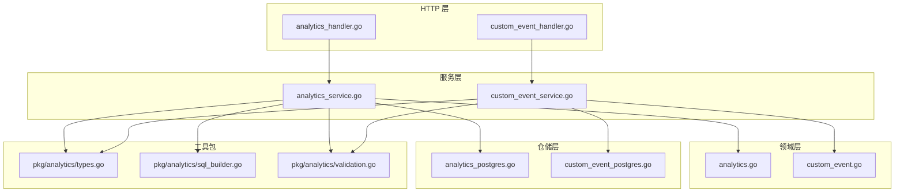
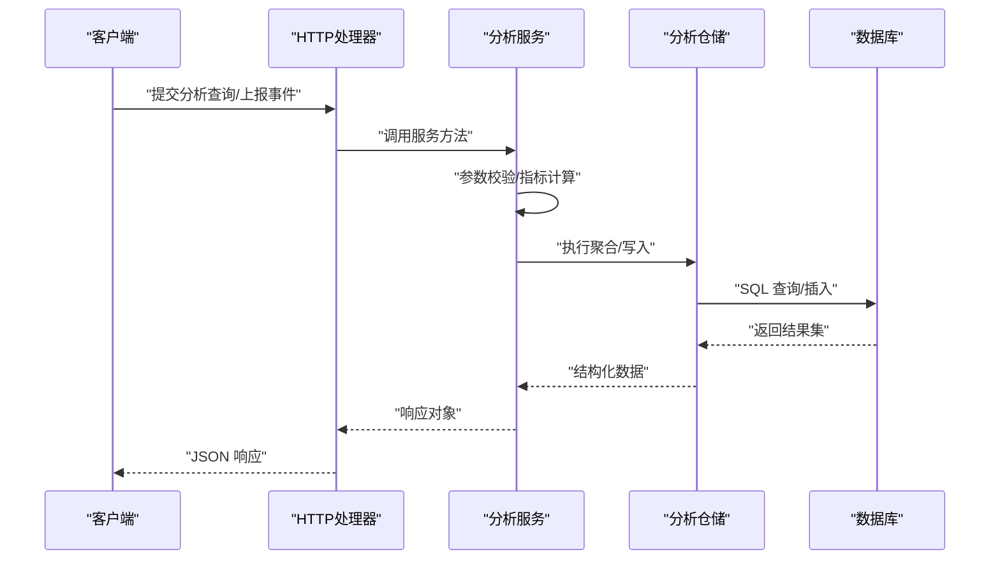
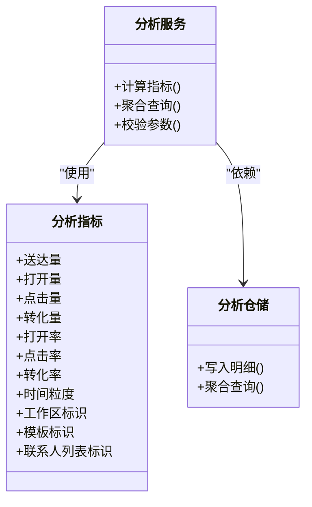
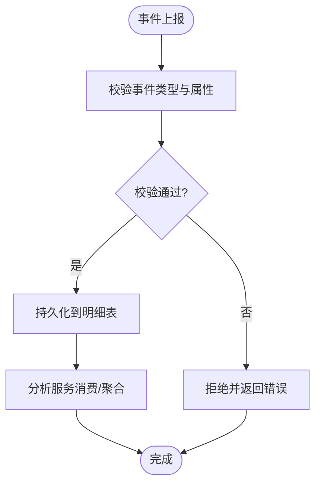
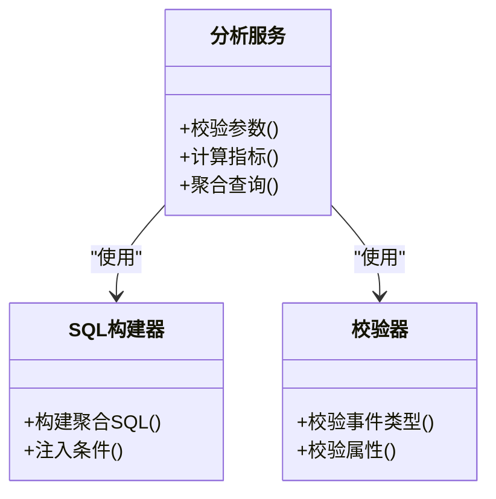
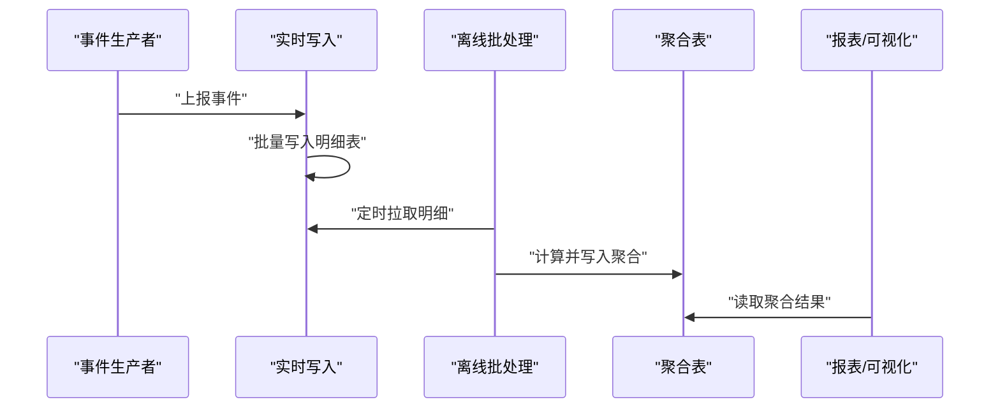
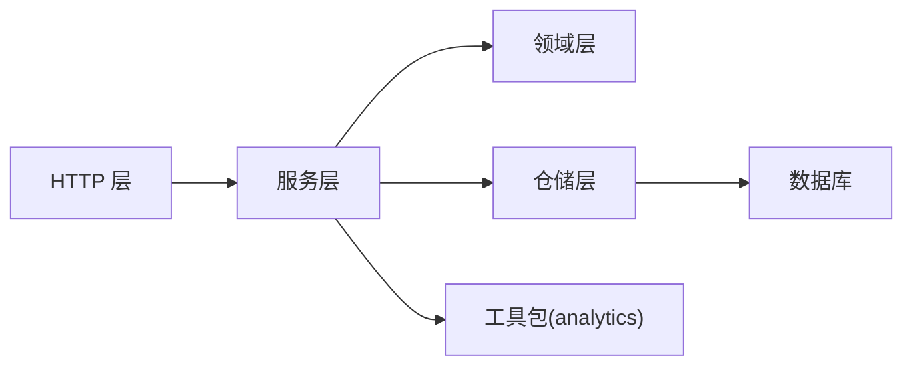

# 分析模型

<cite>
**本文引用的文件**   
- [internal/domain/analytics.go](file://notifuse/internal/domain/analytics.go)
- [internal/domain/custom_event.go](file://notifuse/internal/domain/custom_event.go)
- [internal/http/analytics_handler.go](file://notifuse/internal/http/analytics_handler.go)
- [internal/http/custom_event_handler.go](file://notifuse/internal/http/custom_event_handler.go)
- [internal/repository/analytics_postgres.go](file://notifuse/internal/repository/analytics_postgres.go)
- [internal/repository/custom_event_postgres.go](file://notifuse/internal/repository/custom_event_postgres.go)
- [internal/service/analytics_service.go](file://notifuse/internal/service/analytics_service.go)
- [internal/service/custom_event_service.go](file://notifuse/internal/service/custom_event_service.go)
- [pkg/analytics/types.go](file://notifuse/pkg/analytics/types.go)
- [pkg/analytics/sql_builder.go](file://notifuse/pkg/analytics/sql_builder.go)
- [pkg/analytics/validation.go](file://notifuse/pkg/analytics/validation.go)
</cite>

## 目录
1. [简介](#简介)
2. [项目结构](#项目结构)
3. [核心组件](#核心组件)
4. [架构总览](#架构总览)
5. [详细组件分析](#详细组件分析)
6. [依赖关系分析](#依赖关系分析)
7. [性能考虑](#性能考虑)
8. [故障排查指南](#故障排查指南)
9. [结论](#结论)
10. [附录](#附录)

## 简介
本文件为 Notifuse 平台的“分析(Analytics)”实体与“自定义事件(Custom Event)”系统的数据模型文档。内容覆盖：
- 分析指标字段定义（邮件打开率、点击率、转化率等）
- 自定义事件的灵活追踪体系（事件类型与属性扩展机制）
- 数据分析聚合的计算逻辑与存储优化策略
- 实时分析与离线批处理的混合架构说明
- 报表生成与可视化数据源设计
- 隐私保护与匿名化处理机制

## 项目结构
分析相关代码主要分布在以下层次：
- 领域层(domain)：定义分析实体、指标结构与约束
- 服务层(service)：编排业务逻辑，协调仓储与校验
- HTTP 层(http)：暴露 API 入口，处理请求/响应
- 仓储层(repository)：对接数据库，执行读写与聚合查询
- 工具包(pkg/analytics)：SQL 构建器、类型定义与校验规则

图表来源
- [internal/http/analytics_handler.go](file://notifuse/internal/http/analytics_handler.go)
- [internal/http/custom_event_handler.go](file://notifuse/internal/http/custom_event_handler.go)
- [internal/service/analytics_service.go](file://notifuse/internal/service/analytics_service.go)
- [internal/service/custom_event_service.go](file://notifuse/internal/service/custom_event_service.go)
- [internal/domain/analytics.go](file://notifuse/internal/domain/analytics.go)
- [internal/domain/custom_event.go](file://notifuse/internal/domain/custom_event.go)
- [internal/repository/analytics_postgres.go](file://notifuse/internal/repository/analytics_postgres.go)
- [internal/repository/custom_event_postgres.go](file://notifuse/internal/repository/custom_event_postgres.go)
- [pkg/analytics/types.go](file://notifuse/pkg/analytics/types.go)
- [pkg/analytics/sql_builder.go](file://notifuse/pkg/analytics/sql_builder.go)
- [pkg/analytics/validation.go](file://notifuse/pkg/analytics/validation.go)

章节来源
- [internal/domain/analytics.go](file://notifuse/internal/domain/analytics.go)
- [internal/domain/custom_event.go](file://notifuse/internal/domain/custom_event.go)
- [internal/http/analytics_handler.go](file://notifuse/internal/http/analytics_handler.go)
- [internal/http/custom_event_handler.go](file://notifuse/internal/http/custom_event_handler.go)
- [internal/service/analytics_service.go](file://notifuse/internal/service/analytics_service.go)
- [internal/service/custom_event_service.go](file://notifuse/internal/service/custom_event_service.go)
- [internal/repository/analytics_postgres.go](file://notifuse/internal/repository/analytics_postgres.go)
- [internal/repository/custom_event_postgres.go](file://notifuse/internal/repository/custom_event_postgres.go)
- [pkg/analytics/types.go](file://notifuse/pkg/analytics/types.go)
- [pkg/analytics/sql_builder.go](file://notifuse/pkg/analytics/sql_builder.go)
- [pkg/analytics/validation.go](file://notifuse/pkg/analytics/validation.go)

## 核心组件
- 分析实体与分析指标
  - 用于记录和分析邮件发送效果的关键指标，包括送达量、打开量、点击量、转化量等，并支持按工作区、模板、联系人列表、时间窗口等维度进行聚合。
  - 指标计算遵循统一的口径定义，确保打开率、点击率、转化率等比率的一致性与可复现性。
- 自定义事件(Custom Event)
  - 提供灵活的事件追踪能力，允许在任意业务触点上报事件，并通过可扩展的属性键值对描述上下文信息。
  - 事件类型与属性由平台侧统一管理与校验，保证数据质量与一致性。
- 分析服务与分析仓储
  - 服务层负责参数校验、指标计算、结果组装；仓储层负责持久化与复杂聚合查询。
- 工具包
  - 类型定义集中管理，SQL 构建器封装常用聚合查询模式，校验器保障输入合法性。

章节来源
- [internal/domain/analytics.go](file://notifuse/internal/domain/analytics.go)
- [internal/domain/custom_event.go](file://notifuse/internal/domain/custom_event.go)
- [pkg/analytics/types.go](file://notifuse/pkg/analytics/types.go)
- [pkg/analytics/sql_builder.go](file://notifuse/pkg/analytics/sql_builder.go)
- [pkg/analytics/validation.go](file://notifuse/pkg/analytics/validation.go)

## 架构总览
分析子系统采用分层架构，结合实时写入与离线聚合的混合模式：
- 实时路径：HTTP 接收事件或分析请求 → 服务层校验与计算 → 仓储层写入/查询
- 离线路径：定时任务或外部管道批量拉取原始事件 → 聚合计算 → 落库供报表使用
- 数据源：面向报表与可视化的聚合表与明细表分离，兼顾查询性能与灵活性

图表来源
- [internal/http/analytics_handler.go](file://notifuse/internal/http/analytics_handler.go)
- [internal/service/analytics_service.go](file://notifuse/internal/service/analytics_service.go)
- [internal/repository/analytics_postgres.go](file://notifuse/internal/repository/analytics_postgres.go)
- [pkg/analytics/sql_builder.go](file://notifuse/pkg/analytics/sql_builder.go)

## 详细组件分析

### 分析实体与指标模型
- 关键指标字段
  - 送达量：成功投递的邮件数量
  - 打开量：被打开的邮件数量
  - 点击量：邮件内链接被点击的数量
  - 转化量：完成目标行为（如注册、购买）的次数
  - 打开率：打开量 / 送达量
  - 点击率：点击量 / 送达量
  - 转化率：转化量 / 送达量
- 维度字段
  - 工作区标识、模板标识、联系人列表标识、时间粒度（日/周/月）、渠道/供应商等
- 计算口径
  - 比率类指标以送达量为分母，避免除零异常；当送达量为 0 时，比率置空或 0，具体取决于实现约定
- 存储建议
  - 明细表：记录每次触达与交互事件，便于回溯与细粒度分析
  - 聚合表：按时间窗口与维度预聚合，提升报表查询性能

图表来源
- [internal/domain/analytics.go](file://notifuse/internal/domain/analytics.go)
- [internal/service/analytics_service.go](file://notifuse/internal/service/analytics_service.go)
- [internal/repository/analytics_postgres.go](file://notifuse/internal/repository/analytics_postgres.go)
- [pkg/analytics/types.go](file://notifuse/pkg/analytics/types.go)

章节来源
- [internal/domain/analytics.go](file://notifuse/internal/domain/analytics.go)
- [internal/service/analytics_service.go](file://notifuse/internal/service/analytics_service.go)
- [internal/repository/analytics_postgres.go](file://notifuse/internal/repository/analytics_postgres.go)
- [pkg/analytics/types.go](file://notifuse/pkg/analytics/types.go)

### 自定义事件(Custom Event)模型
- 事件类型
  - 平台维护一组受控的事件类型，用于区分不同业务场景（如页面浏览、按钮点击、表单提交等）
- 属性扩展机制
  - 每个事件携带一组键值对属性，支持字符串、数值、布尔、时间戳等基础类型
  - 属性键需通过平台侧的白名单或模式校验，防止滥用与污染
- 生命周期
  - 创建：HTTP 接口接收事件，服务层校验后入库
  - 消费：分析服务读取事件明细，参与指标计算或独立分析
- 数据治理
  - 属性命名规范、长度限制、敏感字段过滤与脱敏策略

图表来源
- [internal/domain/custom_event.go](file://notifuse/internal/domain/custom_event.go)
- [internal/http/custom_event_handler.go](file://notifuse/internal/http/custom_event_handler.go)
- [internal/service/custom_event_service.go](file://notifuse/internal/service/custom_event_service.go)
- [internal/repository/custom_event_postgres.go](file://notifuse/internal/repository/custom_event_postgres.go)
- [pkg/analytics/validation.go](file://notifuse/pkg/analytics/validation.go)

章节来源
- [internal/domain/custom_event.go](file://notifuse/internal/domain/custom_event.go)
- [internal/http/custom_event_handler.go](file://notifuse/internal/http/custom_event_handler.go)
- [internal/service/custom_event_service.go](file://notifuse/internal/service/custom_event_service.go)
- [internal/repository/custom_event_postgres.go](file://notifuse/internal/repository/custom_event_postgres.go)
- [pkg/analytics/validation.go](file://notifuse/pkg/analytics/validation.go)

### 分析服务与 SQL 构建器
- 分析服务职责
  - 参数校验：时间范围、维度过滤、分页排序
  - 指标计算：基于明细数据计算比率与汇总
  - 结果组装：将底层数据转换为上层可用的响应结构
- SQL 构建器
  - 封装常见聚合模式（SUM/COUNT/AVG/GROUP BY），减少重复 SQL 拼接
  - 支持动态条件注入，提高查询灵活性
- 校验器
  - 统一校验事件类型、属性键名与取值范围，保障数据质量

图表来源
- [internal/service/analytics_service.go](file://notifuse/internal/service/analytics_service.go)
- [pkg/analytics/sql_builder.go](file://notifuse/pkg/analytics/sql_builder.go)
- [pkg/analytics/validation.go](file://notifuse/pkg/analytics/validation.go)

章节来源
- [internal/service/analytics_service.go](file://notifuse/internal/service/analytics_service.go)
- [pkg/analytics/sql_builder.go](file://notifuse/pkg/analytics/sql_builder.go)
- [pkg/analytics/validation.go](file://notifuse/pkg/analytics/validation.go)

### 实时分析与离线批处理混合架构
- 实时流处理
  - 事件上报与即时查询走实时路径，强调低延迟与高吞吐
  - 写入采用批量插入与事务控制，降低数据库压力
- 离线批处理
  - 定时任务拉取原始事件，按天/周/月进行聚合，写入聚合表
  - 聚合结果用于报表与可视化，减少在线查询复杂度
- 数据一致性
  - 通过幂等写入与去重键，避免重复计数
  - 聚合任务具备重试与补偿机制

[此图为概念流程示意，不直接映射具体源码文件]

## 依赖关系分析
- 组件耦合
  - HTTP 层仅依赖服务层，服务层依赖领域模型与仓储层，仓储层依赖数据库驱动
  - 工具包被服务层与仓储层共同复用，形成稳定的公共能力
- 外部依赖
  - 数据库：PostgreSQL（根据仓储文件名推断）
  - 可选：消息队列/流处理引擎（用于离线批处理与实时管道扩展）

图表来源
- [internal/http/analytics_handler.go](file://notifuse/internal/http/analytics_handler.go)
- [internal/service/analytics_service.go](file://notifuse/internal/service/analytics_service.go)
- [internal/domain/analytics.go](file://notifuse/internal/domain/analytics.go)
- [internal/repository/analytics_postgres.go](file://notifuse/internal/repository/analytics_postgres.go)
- [pkg/analytics/types.go](file://notifuse/pkg/analytics/types.go)

章节来源
- [internal/http/analytics_handler.go](file://notifuse/internal/http/analytics_handler.go)
- [internal/service/analytics_service.go](file://notifuse/internal/service/analytics_service.go)
- [internal/domain/analytics.go](file://notifuse/internal/domain/analytics.go)
- [internal/repository/analytics_postgres.go](file://notifuse/internal/repository/analytics_postgres.go)
- [pkg/analytics/types.go](file://notifuse/pkg/analytics/types.go)

## 性能考虑
- 索引设计
  - 为时间戳、工作区标识、模板标识、联系人列表标识建立复合索引，加速聚合查询
- 分区与归档
  - 按时间分区明细表，历史数据归档至冷存储，缩短热数据规模
- 聚合预计算
  - 对高频查询维度（日/周/月）预聚合，减少在线计算开销
- 批量写入
  - 使用批量插入与事务合并，降低 I/O 次数
- 缓存策略
  - 对热点聚合结果设置短期缓存，减轻数据库压力

[本节为通用性能指导，不直接分析具体文件]

## 故障排查指南
- 常见问题
  - 指标异常波动：检查去重键与幂等写入是否生效
  - 打开率/点击率为 0：确认送达量统计口径与事件上报链路
  - 自定义事件属性缺失：核对属性白名单与校验规则
- 定位步骤
  - 查看 HTTP 日志与服务层错误码
  - 检查仓储层 SQL 执行计划与慢查询
  - 验证聚合任务的幂等与重试状态
- 恢复措施
  - 修正属性校验配置，重新上报缺失事件
  - 触发补聚合任务，修复历史聚合偏差

章节来源
- [internal/http/analytics_handler.go](file://notifuse/internal/http/analytics_handler.go)
- [internal/service/analytics_service.go](file://notifuse/internal/service/analytics_service.go)
- [internal/repository/analytics_postgres.go](file://notifuse/internal/repository/analytics_postgres.go)
- [pkg/analytics/validation.go](file://notifuse/pkg/analytics/validation.go)

## 结论
Notifuse 的分析模型围绕“指标清晰、事件灵活、架构稳健”的目标展开：
- 指标口径统一，便于跨维度对比与归因
- 自定义事件提供可扩展的追踪能力，支撑精细化运营
- 实时与离线混合架构兼顾低延迟与高性能
- 通过索引、分区、预聚合与缓存等手段优化存储与查询性能
- 强化校验与治理，保障数据质量与合规性

[本节为总结性内容，不直接分析具体文件]

## 附录
- 报表与可视化数据源设计
  - 明细表：保留原始事件与触达记录，支持回溯与深度分析
  - 聚合表：按时间窗口与维度预聚合，作为报表与仪表盘的主要数据源
  - 视图层：提供只读视图，屏蔽底层表结构变更，稳定对外接口
- 隐私保护与匿名化处理
  - 属性脱敏：对邮箱、手机号等敏感字段进行哈希或掩码处理
  - 访问控制：基于工作区隔离，限制跨租户数据访问
  - 审计日志：记录数据访问与导出操作，满足合规要求

[本节为概念性补充，不直接分析具体文件]