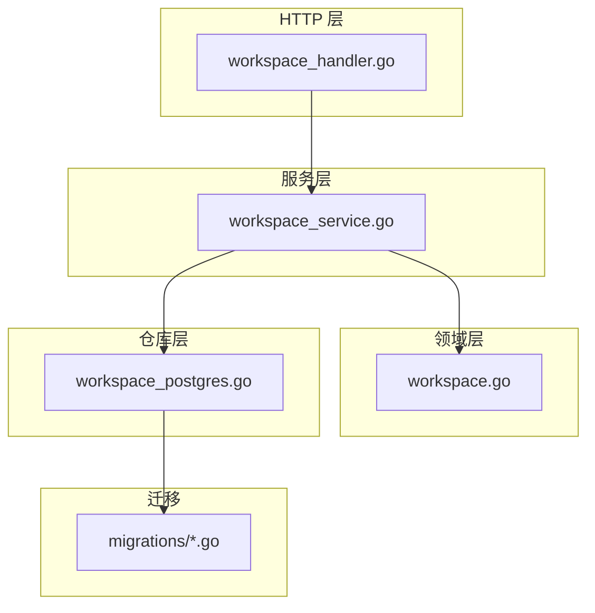
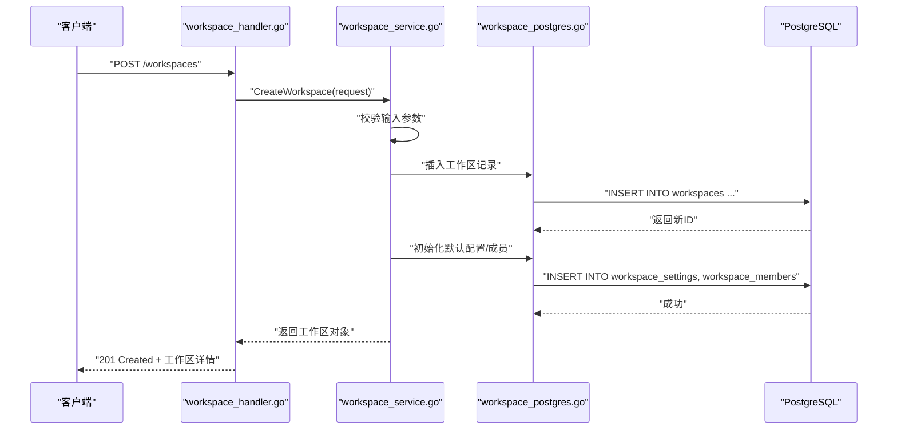
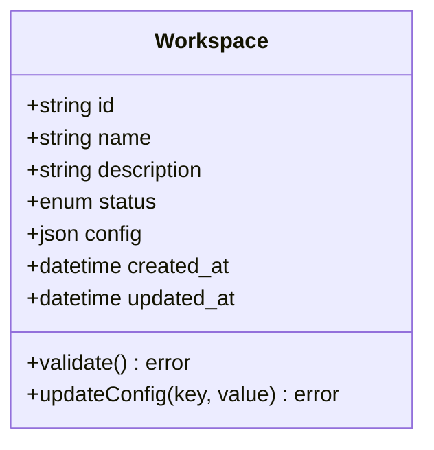
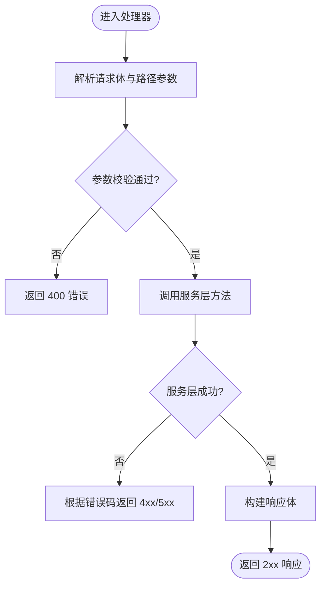
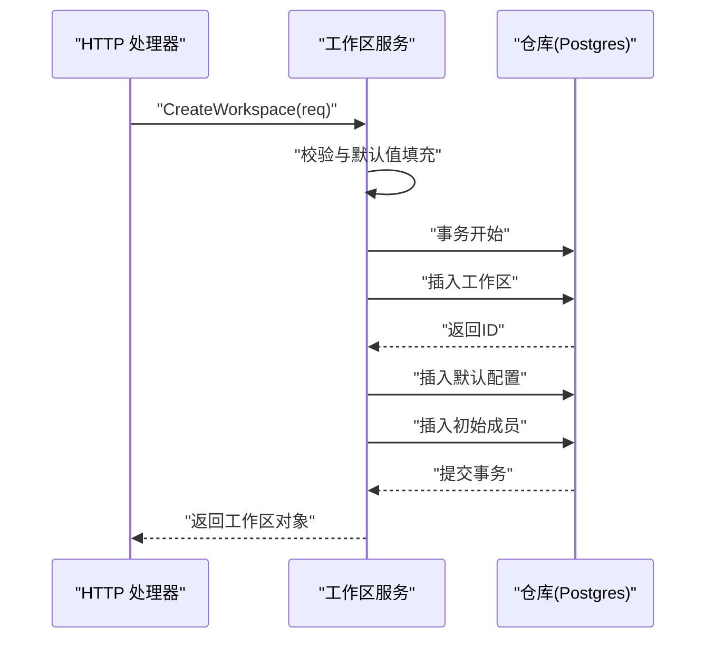
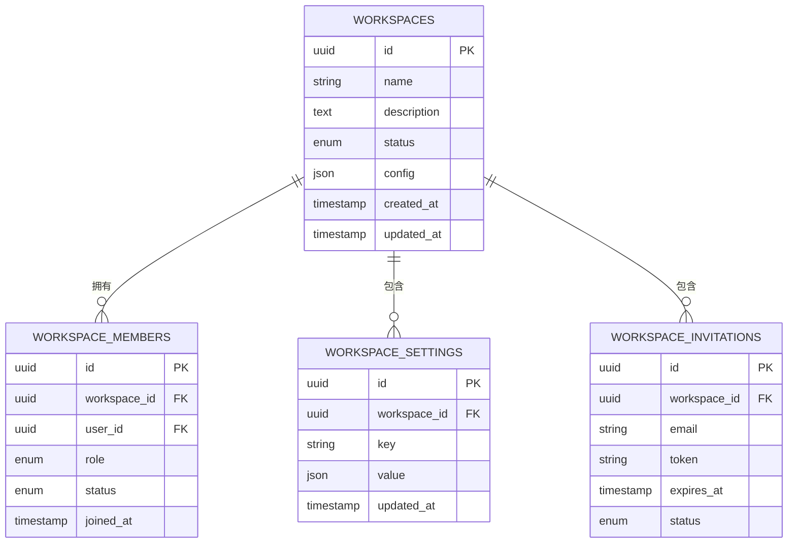
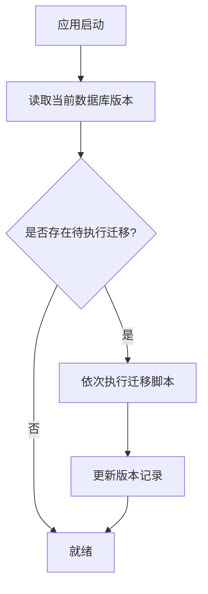
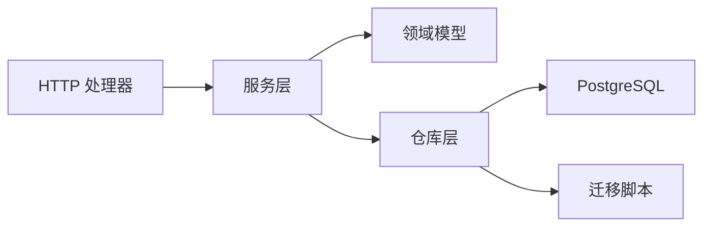

# 工作区模型

<cite>
**本文引用的文件**   
- [workspace.go](file://notifuse/internal/domain/workspace.go)
- [workspace_test.go](file://notifuse/internal/domain/workspace_test.go)
- [workspace_handler.go](file://notifuse/internal/http/workspace_handler.go)
- [workspace_service.go](file://notifuse/internal/service/workspace_service.go)
- [workspace_postgres.go](file://notifuse/internal/repository/workspace_postgres.go)
- [workspace_users_operations_test.go](file://notifuse/internal/repository/workspace_users_operations_test.go)
- [workspace_users_membership_test.go](file://notifuse/internal/repository/workspace_users_membership_test.go)
- [workspace_users_email_test.go](file://notifuse/internal/repository/workspace_users_email_test.go)
- [workspace_invitations_test.go](file://notifuse/internal/repository/workspace_invitations_test.go)
- [workspace_core_test.go](file://notifuse/internal/repository/workspace_core_test.go)
- [workspace_database_test.go](file://notifuse/internal/repository/workspace_database_test.go)
- [v10.go](file://notifuse/internal/migrations/v10.go)
- [v11.go](file://notifuse/internal/migrations/v11.go)
- [v12.go](file://notifuse/internal/migrations/v12.go)
- [v13.go](file://notifuse/internal/migrations/v13.go)
- [v14.go](file://notifuse/internal/migrations/v14.go)
- [v15.go](file://notifuse/internal/migrations/v15.go)
- [v16.go](file://notifuse/internal/migrations/v16.go)
- [v17.go](file://notifuse/internal/migrations/v17.go)
- [v18.go](file://notifuse/internal/migrations/v18.go)
- [v19.go](file://notifuse/internal/migrations/v19.go)
- [v20.go](file://notifuse/internal/migrations/v20.go)
- [v21.go](file://notifuse/internal/migrations/v21.go)
- [v22.go](file://notifuse/internal/migrations/v22.go)
- [v23.go](file://notifuse/internal/migrations/v23.go)
- [v24.go](file://notifuse/internal/migrations/v24.go)
- [v25.go](file://notifuse/internal/migrations/v25.go)
- [v26.go](file://notifuse/internal/migrations/v26.go)
- [v27.go](file://notifuse/internal/migrations/v27.go)
- [v28.go](file://notifuse/internal/migrations/v28.go)
- [v29.go](file://notifuse/internal/migrations/v29.go)
- [v30.go](file://notifuse/internal/migrations/v30.go)
- [v31.go](file://notifuse/internal/migrations/v31.go)
- [v32.go](file://notifuse/internal/migrations/v32.go)
- [v33.go](file://notifuse/internal/migrations/v33.go)
- [v34.go](file://notifuse/internal/migrations/v34.go)
- [version.go](file://notifuse/internal/migrations/version.go)
</cite>

## 目录
1. [简介](#简介)
2. [项目结构](#项目结构)
3. [核心组件](#核心组件)
4. [架构总览](#架构总览)
5. [详细组件分析](#详细组件分析)
6. [依赖分析](#依赖分析)
7. [性能考虑](#性能考虑)
8. [故障排查指南](#故障排查指南)
9. [结论](#结论)
10. [附录](#附录)

## 简介
本文件为 Notifuse 平台的工作区（Workspace）实体提供完整的数据模型文档。内容覆盖：
- 字段定义与约束（ID、名称、描述、状态、配置等）
- 多租户设计模式（数据隔离与权限控制）
- 生命周期管理（创建、更新、启用/禁用、删除）
- 与其他实体的关系映射（用户、联系人、模板等）
- 配置项定义与管理接口
- 迁移策略与备份恢复建议

## 项目结构
围绕工作区的代码主要分布在领域层、服务层、HTTP 处理层、仓库层以及数据库迁移脚本中：
- 领域模型：定义工作区实体及其校验规则
- HTTP 处理器：暴露 REST API，负责请求解析与响应封装
- 服务层：编排业务逻辑，协调仓库访问与跨域操作
- 仓库层：实现持久化细节（PostgreSQL）
- 迁移脚本：维护工作区相关表结构与索引演进

图表来源
- [workspace_handler.go](file://notifuse/internal/http/workspace_handler.go)
- [workspace_service.go](file://notifuse/internal/service/workspace_service.go)
- [workspace.go](file://notifuse/internal/domain/workspace.go)
- [workspace_postgres.go](file://notifuse/internal/repository/workspace_postgres.go)
- [v10.go](file://notifuse/internal/migrations/v10.go)

章节来源
- [workspace.go](file://notifuse/internal/domain/workspace.go)
- [workspace_handler.go](file://notifuse/internal/http/workspace_handler.go)
- [workspace_service.go](file://notifuse/internal/service/workspace_service.go)
- [workspace_postgres.go](file://notifuse/internal/repository/workspace_postgres.go)

## 核心组件
本节聚焦工作区领域模型与服务/仓储交互的关键点。

- 领域模型与工作区属性
  - 标识与元信息：唯一 ID、显示名称、描述、创建/更新时间戳
  - 状态：用于表示工作区是否可用或已停用
  - 配置：以 JSON 形式存储键值对，支持扩展性配置项
  - 校验：在创建/更新时进行必填项与格式校验，确保数据一致性

- 服务层职责
  - 创建工作区：生成默认配置、初始化成员关系
  - 查询与过滤：按条件检索工作区列表与详情
  - 更新与软删除：更新元信息与配置，支持标记删除
  - 权限校验：基于当前上下文中的工作区范围进行鉴权

- 仓库层职责
  - 读写工作区主表及关联表（成员、邀请等）
  - 使用工作区 ID 作为所有查询的强制条件，保证数据隔离
  - 事务性写入，确保成员与配置的原子性

章节来源
- [workspace.go](file://notifuse/internal/domain/workspace.go)
- [workspace_service.go](file://notifuse/internal/service/workspace_service.go)
- [workspace_postgres.go](file://notifuse/internal/repository/workspace_postgres.go)

## 架构总览
下图展示了从 HTTP 请求到数据库落库的调用链，并体现工作区在多租户场景下的贯穿式作用。

图表来源
- [workspace_handler.go](file://notifuse/internal/http/workspace_handler.go)
- [workspace_service.go](file://notifuse/internal/service/workspace_service.go)
- [workspace_postgres.go](file://notifuse/internal/repository/workspace_postgres.go)

## 详细组件分析

### 领域模型：工作区实体
- 字段说明
  - ID：全局唯一标识，通常由系统生成
  - 名称：工作区展示名，需非空且长度受限
  - 描述：可选的富文本或纯文本描述
  - 状态：枚举值，如“活跃”、“停用”等
  - 配置：JSON 结构，包含键值对，支持嵌套与类型推断
  - 时间戳：创建时间、更新时间
- 约束与校验
  - 名称必填、去空白、最大长度限制
  - 配置项键名规范、值类型校验、敏感字段加密（若适用）
  - 状态变更需满足前置条件（例如存在至少一名管理员）

图表来源
- [workspace.go](file://notifuse/internal/domain/workspace.go)

章节来源
- [workspace.go](file://notifuse/internal/domain/workspace.go)
- [workspace_test.go](file://notifuse/internal/domain/workspace_test.go)

### HTTP 处理器：工作区 API
- 典型端点
  - 创建工作区：POST /workspaces
  - 获取工作区详情：GET /workspaces/:id
  - 更新工作区：PATCH /workspaces/:id
  - 删除工作区：DELETE /workspaces/:id
  - 列出工作区：GET /workspaces
- 鉴权与会话
  - 通过中间件注入当前用户与工作区上下文
  - 所有写操作均需具备相应角色（如管理员）

图表来源
- [workspace_handler.go](file://notifuse/internal/http/workspace_handler.go)

章节来源
- [workspace_handler.go](file://notifuse/internal/http/workspace_handler.go)

### 服务层：工作区业务编排
- 关键流程
  - 创建：生成 ID、设置默认状态、写入初始配置与成员
  - 更新：合并配置项、校验状态转换合法性
  - 删除：软删除标记，清理或归档关联资源（视策略而定）
  - 查询：按名称、状态、分页与排序筛选
- 权限控制
  - 基于当前登录用户所属工作区范围进行鉴权
  - 拒绝跨工作区访问，防止越权

图表来源
- [workspace_service.go](file://notifuse/internal/service/workspace_service.go)
- [workspace_postgres.go](file://notifuse/internal/repository/workspace_postgres.go)

章节来源
- [workspace_service.go](file://notifuse/internal/service/workspace_service.go)
- [workspace_postgres.go](file://notifuse/internal/repository/workspace_postgres.go)

### 仓库层：工作区持久化
- 数据隔离机制
  - 所有查询强制附加 WHERE workspace_id = ?，避免跨租户泄漏
  - 使用数据库连接池与事务边界，保障并发安全
- 索引与性能
  - 针对常用查询列建立索引（如名称、状态、更新时间）
  - 大 JSON 配置采用部分读取与按需更新策略
- 关联表
  - 成员表：用户与工作区的多对多关系，含角色与状态
  - 邀请表：临时邀请令牌与过期时间
  - 设置表：键值型配置，便于扩展

图表来源
- [workspace_postgres.go](file://notifuse/internal/repository/workspace_postgres.go)

章节来源
- [workspace_postgres.go](file://notifuse/internal/repository/workspace_postgres.go)
- [workspace_users_operations_test.go](file://notifuse/internal/repository/workspace_users_operations_test.go)
- [workspace_users_membership_test.go](file://notifuse/internal/repository/workspace_users_membership_test.go)
- [workspace_users_email_test.go](file://notifuse/internal/repository/workspace_users_email_test.go)
- [workspace_invitations_test.go](file://notifuse/internal/repository/workspace_invitations_test.go)
- [workspace_core_test.go](file://notifuse/internal/repository/workspace_core_test.go)
- [workspace_database_test.go](file://notifuse/internal/repository/workspace_database_test.go)

### 迁移与版本管理
- 迁移策略
  - 每个版本对应一个迁移脚本，顺序执行，幂等设计
  - 新增字段、索引、约束均在迁移中声明
- 工作区相关迁移要点
  - 初始化工作区主表与基础索引
  - 引入成员、邀请、设置等辅助表
  - 调整配置结构（JSON 规范化）、添加审计字段
- 版本检查
  - 启动时校验数据库版本，自动应用未执行的迁移

图表来源
- [version.go](file://notifuse/internal/migrations/version.go)
- [v10.go](file://notifuse/internal/migrations/v10.go)
- [v11.go](file://notifuse/internal/migrations/v11.go)
- [v12.go](file://notifuse/internal/migrations/v12.go)
- [v13.go](file://notifuse/internal/migrations/v13.go)
- [v14.go](file://notifuse/internal/migrations/v14.go)
- [v15.go](file://notifuse/internal/migrations/v15.go)
- [v16.go](file://notifuse/internal/migrations/v16.go)
- [v17.go](file://notifuse/internal/migrations/v17.go)
- [v18.go](file://notifuse/internal/migrations/v18.go)
- [v19.go](file://notifuse/internal/migrations/v19.go)
- [v20.go](file://notifuse/internal/migrations/v20.go)
- [v21.go](file://notifuse/internal/migrations/v21.go)
- [v22.go](file://notifuse/internal/migrations/v22.go)
- [v23.go](file://notifuse/internal/migrations/v23.go)
- [v24.go](file://notifuse/internal/migrations/v24.go)
- [v25.go](file://notifuse/internal/migrations/v25.go)
- [v26.go](file://notifuse/internal/migrations/v26.go)
- [v27.go](file://notifuse/internal/migrations/v27.go)
- [v28.go](file://notifuse/internal/migrations/v28.go)
- [v29.go](file://notifuse/internal/migrations/v29.go)
- [v30.go](file://notifuse/internal/migrations/v30.go)
- [v31.go](file://notifuse/internal/migrations/v31.go)
- [v32.go](file://notifuse/internal/migrations/v32.go)
- [v33.go](file://notifuse/internal/migrations/v33.go)
- [v34.go](file://notifuse/internal/migrations/v34.go)

章节来源
- [version.go](file://notifuse/internal/migrations/version.go)
- [v10.go](file://notifuse/internal/migrations/v10.go)
- [v11.go](file://notifuse/internal/migrations/v11.go)
- [v12.go](file://notifuse/internal/migrations/v12.go)
- [v13.go](file://notifuse/internal/migrations/v13.go)
- [v14.go](file://notifuse/internal/migrations/v14.go)
- [v15.go](file://notifuse/internal/migrations/v15.go)
- [v16.go](file://notifuse/internal/migrations/v16.go)
- [v17.go](file://notifuse/internal/migrations/v17.go)
- [v18.go](file://notifuse/internal/migrations/v18.go)
- [v19.go](file://notifuse/internal/migrations/v19.go)
- [v20.go](file://notifuse/internal/migrations/v20.go)
- [v21.go](file://notifuse/internal/migrations/v21.go)
- [v22.go](file://notifuse/internal/migrations/v22.go)
- [v23.go](file://notifuse/internal/migrations/v23.go)
- [v24.go](file://notifuse/internal/migrations/v24.go)
- [v25.go](file://notifuse/internal/migrations/v25.go)
- [v26.go](file://notifuse/internal/migrations/v26.go)
- [v27.go](file://notifuse/internal/migrations/v27.go)
- [v28.go](file://notifuse/internal/migrations/v28.go)
- [v29.go](file://notifuse/internal/migrations/v29.go)
- [v30.go](file://notifuse/internal/migrations/v30.go)
- [v31.go](file://notifuse/internal/migrations/v31.go)
- [v32.go](file://notifuse/internal/migrations/v32.go)
- [v33.go](file://notifuse/internal/migrations/v33.go)
- [v34.go](file://notifuse/internal/migrations/v34.go)

## 依赖分析
- 组件耦合
  - HTTP 处理器仅依赖服务层接口，不直接访问仓库
  - 服务层组合领域模型与仓库接口，承担事务与编排
  - 仓库层实现具体 SQL 与索引策略，屏蔽数据库差异
- 外部依赖
  - PostgreSQL：主数据存储
  - 迁移框架：版本管理与脚本执行
- 潜在循环依赖
  - 当前分层清晰，未发现循环导入；建议在新增模块时保持单向依赖

图表来源
- [workspace_handler.go](file://notifuse/internal/http/workspace_handler.go)
- [workspace_service.go](file://notifuse/internal/service/workspace_service.go)
- [workspace_postgres.go](file://notifuse/internal/repository/workspace_postgres.go)
- [workspace.go](file://notifuse/internal/domain/workspace.go)

章节来源
- [workspace_handler.go](file://notifuse/internal/http/workspace_handler.go)
- [workspace_service.go](file://notifuse/internal/service/workspace_service.go)
- [workspace_postgres.go](file://notifuse/internal/repository/workspace_postgres.go)
- [workspace.go](file://notifuse/internal/domain/workspace.go)

## 性能考虑
- 查询优化
  - 为高频过滤字段（名称、状态、更新时间）建立索引
  - 使用分页与只读投影减少数据传输
- 配置读写
  - 对大型 JSON 配置采用增量更新与缓存策略
  - 热点配置可引入内存缓存（注意失效与一致性）
- 事务边界
  - 将成员与配置写入置于同一事务，避免不一致
- 并发控制
  - 使用行级锁或乐观锁防止竞态条件

[本节为通用指导，无需特定文件引用]

## 故障排查指南
- 常见错误
  - 参数校验失败：检查名称、描述、配置键值是否符合约束
  - 权限不足：确认当前用户在工作区内具有所需角色
  - 数据冲突：重复键名或唯一约束冲突，需修正后重试
- 定位步骤
  - 查看 HTTP 层日志，确认请求参数与响应码
  - 在服务层捕获异常堆栈，定位业务规则失败点
  - 在仓库层检查 SQL 执行计划与索引命中情况
- 回滚与恢复
  - 使用迁移框架回退至上一版本
  - 结合数据库快照与备份点进行恢复

章节来源
- [workspace_handler.go](file://notifuse/internal/http/workspace_handler.go)
- [workspace_service.go](file://notifuse/internal/service/workspace_service.go)
- [workspace_postgres.go](file://notifuse/internal/repository/workspace_postgres.go)

## 结论
工作区作为 Notifuse 的多租户核心，通过清晰的领域模型、严格的服务编排与强隔离的仓库实现，确保了数据一致性与安全性。配合完善的迁移与测试体系，可在持续演进中保持稳定性与可扩展性。

[本节为总结性内容，无需特定文件引用]

## 附录

### 工作区字段定义与约束
- ID：系统生成，不可变
- 名称：必填，长度上限，禁止特殊字符
- 描述：可选，最大长度限制
- 状态：枚举，允许的状态转换需在服务层校验
- 配置：JSON 键值对，键名规范与值类型校验
- 时间戳：创建与更新时间自动维护

章节来源
- [workspace.go](file://notifuse/internal/domain/workspace.go)
- [workspace_test.go](file://notifuse/internal/domain/workspace_test.go)

### 工作区与其他实体的关系映射
- 用户：通过成员表建立多对多关系，含角色与加入时间
- 联系人：属于工作区范围，所有联系人查询必须带工作区 ID
- 模板：模板归属工作区，模板渲染与变量替换在工作区上下文中进行
- 自动化与事件：均受工作区隔离，避免跨租户干扰

章节来源
- [workspace_postgres.go](file://notifuse/internal/repository/workspace_postgres.go)

### 工作区配置项定义与管理接口
- 配置项示例
  - 邮件提供商密钥（加密存储）
  - 主题与语言偏好
  - 功能开关与配额限制
- 管理接口
  - 获取配置：GET /workspaces/:id/settings
  - 更新配置：PATCH /workspaces/:id/settings
  - 批量更新：PUT /workspaces/:id/settings/batch

章节来源
- [workspace_service.go](file://notifuse/internal/service/workspace_service.go)
- [workspace_postgres.go](file://notifuse/internal/repository/workspace_postgres.go)

### 工作区生命周期管理
- 创建：校验输入、生成默认配置、初始化成员
- 更新：合并配置、更新元信息、审计日志
- 启用/禁用：状态转换校验、通知相关方
- 删除：软删除标记、清理或归档关联资源

章节来源
- [workspace_service.go](file://notifuse/internal/service/workspace_service.go)
- [workspace_postgres.go](file://notifuse/internal/repository/workspace_postgres.go)

### 迁移与备份恢复策略
- 迁移
  - 每次变更编写独立迁移脚本，确保幂等与可回滚
  - 启动时自动检测并执行待迁移脚本
- 备份
  - 定期全量备份数据库，保留历史版本
  - 对配置与附件进行对象存储备份
- 恢复
  - 选择合适的时间点快照进行恢复
  - 验证数据完整性与一致性后再上线

章节来源
- [version.go](file://notifuse/internal/migrations/version.go)
- [v10.go](file://notifuse/internal/migrations/v10.go)
- [v11.go](file://notifuse/internal/migrations/v11.go)
- [v12.go](file://notifuse/internal/migrations/v12.go)
- [v13.go](file://notifuse/internal/migrations/v13.go)
- [v14.go](file://notifuse/internal/migrations/v14.go)
- [v15.go](file://notifuse/internal/migrations/v15.go)
- [v16.go](file://notifuse/internal/migrations/v16.go)
- [v17.go](file://notifuse/internal/migrations/v17.go)
- [v18.go](file://notifuse/internal/migrations/v18.go)
- [v19.go](file://notifuse/internal/migrations/v19.go)
- [v20.go](file://notifuse/internal/migrations/v20.go)
- [v21.go](file://notifuse/internal/migrations/v21.go)
- [v22.go](file://notifuse/internal/migrations/v22.go)
- [v23.go](file://notifuse/internal/migrations/v23.go)
- [v24.go](file://notifuse/internal/migrations/v24.go)
- [v25.go](file://notifuse/internal/migrations/v25.go)
- [v26.go](file://notifuse/internal/migrations/v26.go)
- [v27.go](file://notifuse/internal/migrations/v27.go)
- [v28.go](file://notifuse/internal/migrations/v28.go)
- [v29.go](file://notifuse/internal/migrations/v29.go)
- [v30.go](file://notifuse/internal/migrations/v30.go)
- [v31.go](file://notifuse/internal/migrations/v31.go)
- [v32.go](file://notifuse/internal/migrations/v32.go)
- [v33.go](file://notifuse/internal/migrations/v33.go)
- [v34.go](file://notifuse/internal/migrations/v34.go)