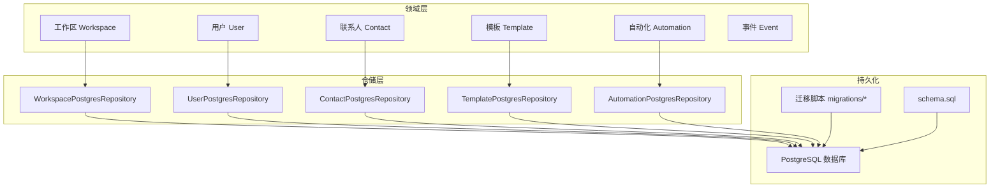
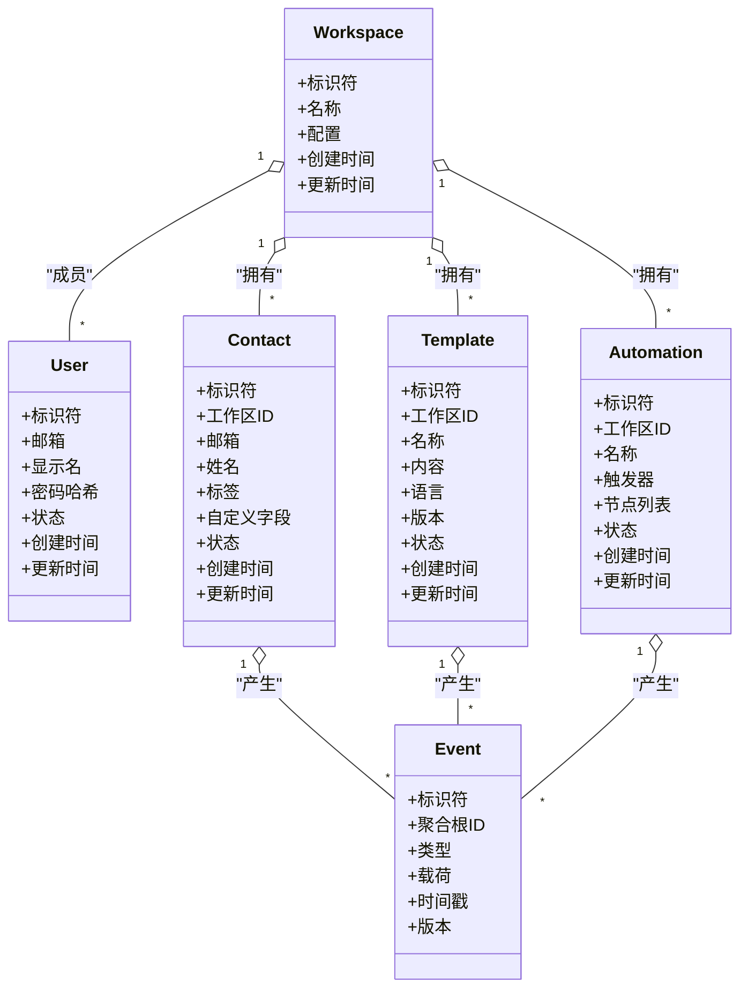
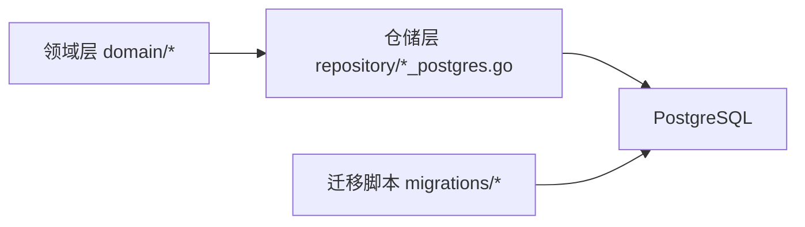
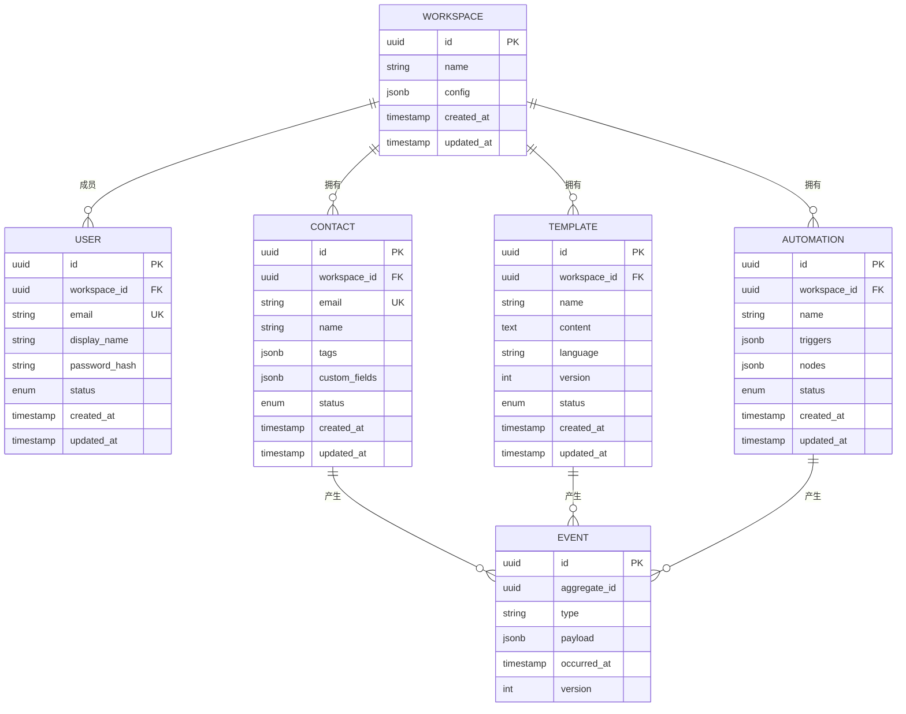

# 数据模型

<cite>
**本文引用的文件**   
- [internal/domain/workspace.go](file://notifuse/internal/domain/workspace.go)
- [internal/domain/user.go](file://notifuse/internal/domain/user.go)
- [internal/domain/contact.go](file://notifuse/internal/domain/contact.go)
- [internal/domain/template.go](file://notifuse/internal/domain/template.go)
- [internal/domain/automation.go](file://notifuse/internal/domain/automation.go)
- [internal/domain/event.go](file://notifuse/internal/domain/event.go)
- [internal/database/schema/schema.sql](file://notifuse/internal/database/schema/schema.sql)
- [internal/migrations/v4.go](file://notifuse/internal/migrations/v4.go)
- [internal/migrations/v10.go](file://notifuse/internal/migrations/v10.go)
- [internal/migrations/v20.go](file://notifuse/internal/migrations/v20.go)
- [internal/migrations/v30.go](file://notifuse/internal/migrations/v30.go)
- [internal/repository/workspace_postgres.go](file://notifuse/internal/repository/workspace_postgres.go)
- [internal/repository/user_postgres.go](file://notifuse/internal/repository/user_postgres.go)
- [internal/repository/contact_postgres.go](file://notifuse/internal/repository/contact_postgres.go)
- [internal/repository/template_postgres.go](file://notifuse/internal/repository/template_postgres.go)
- [internal/repository/automation_postgres.go](file://notifuse/internal/repository/automation_postgres.go)
</cite>

## 目录
1. [简介](#简介)
2. [项目结构](#项目结构)
3. [核心组件](#核心组件)
4. [架构总览](#架构总览)
5. [详细组件分析](#详细组件分析)
6. [依赖分析](#依赖分析)
7. [性能考虑](#性能考虑)
8. [故障排查指南](#故障排查指南)
9. [结论](#结论)
10. [附录](#附录)

## 简介
本文件为 Notifuse 平台的数据模型文档，聚焦领域层实体与持久化映射，覆盖工作区(Workspace)、用户(User)、联系人(Contact)、模板(Template)、自动化工作流(Automation)等关键实体。文档说明字段定义、数据类型、约束与业务规则；描述实体关系（一对一、一对多、多对多）；记录枚举类型、状态机与验证规则；阐述生命周期管理、数据完整性保障、领域事件设计与事件溯源模式的应用；并给出数据模型版本兼容性与向后兼容策略。

## 项目结构
Notifuse 采用分层架构：领域层(internal/domain)定义核心实体与行为；仓储层(internal/repository)实现持久化细节；数据库迁移(internal/migrations)与初始化脚本(internal/database/schema)维护物理模型。API 与服务层通过仓储访问领域对象，保证领域模型的稳定性与可演进性。

图表来源
- [internal/domain/workspace.go](file://notifuse/internal/domain/workspace.go)
- [internal/domain/user.go](file://notifuse/internal/domain/user.go)
- [internal/domain/contact.go](file://notifuse/internal/domain/contact.go)
- [internal/domain/template.go](file://notifuse/internal/domain/template.go)
- [internal/domain/automation.go](file://notifuse/internal/domain/automation.go)
- [internal/repository/workspace_postgres.go](file://notifuse/internal/repository/workspace_postgres.go)
- [internal/repository/user_postgres.go](file://notifuse/internal/repository/user_postgres.go)
- [internal/repository/contact_postgres.go](file://notifuse/internal/repository/contact_postgres.go)
- [internal/repository/template_postgres.go](file://notifuse/internal/repository/template_postgres.go)
- [internal/repository/automation_postgres.go](file://notifuse/internal/repository/automation_postgres.go)
- [internal/database/schema/schema.sql](file://notifuse/internal/database/schema/schema.sql)
- [internal/migrations/v4.go](file://notifuse/internal/migrations/v4.go)
- [internal/migrations/v10.go](file://notifuse/internal/migrations/v10.go)
- [internal/migrations/v20.go](file://notifuse/internal/migrations/v20.go)
- [internal/migrations/v30.go](file://notifuse/internal/migrations/v30.go)

章节来源
- [internal/database/schema/schema.sql](file://notifuse/internal/database/schema/schema.sql)
- [internal/migrations/v4.go](file://notifuse/internal/migrations/v4.go)
- [internal/migrations/v10.go](file://notifuse/internal/migrations/v10.go)
- [internal/migrations/v20.go](file://notifuse/internal/migrations/v20.go)
- [internal/migrations/v30.go](file://notifuse/internal/migrations/v30.go)

## 核心组件
本节概述各核心实体的职责与关键字段类别，具体字段与约束见“详细组件分析”。

- 工作区(Workspace)：租户边界与资源隔离单元，承载用户成员、联系人、模板、自动化等资源集合。
- 用户(User)：系统使用者，与工作区存在成员关系，具备认证与授权上下文。
- 联系人(Contact)：营销与通知触达的目标主体，包含基础属性与扩展元数据。
- 模板(Template)：消息内容模板，支持变量渲染与区块组合。
- 自动化工作流(Automation)：基于触发器与节点编排的自动化流程，驱动任务执行。
- 事件(Event)：领域事件载体，用于事件发布、订阅与事件溯源。

章节来源
- [internal/domain/workspace.go](file://notifuse/internal/domain/workspace.go)
- [internal/domain/user.go](file://notifuse/internal/domain/user.go)
- [internal/domain/contact.go](file://notifuse/internal/domain/contact.go)
- [internal/domain/template.go](file://notifuse/internal/domain/template.go)
- [internal/domain/automation.go](file://notifuse/internal/domain/automation.go)
- [internal/domain/event.go](file://notifuse/internal/domain/event.go)

## 架构总览
下图展示领域实体与仓储层的对应关系及主要关联。

图表来源
- [internal/domain/workspace.go](file://notifuse/internal/domain/workspace.go)
- [internal/domain/user.go](file://notifuse/internal/domain/user.go)
- [internal/domain/contact.go](file://notifuse/internal/domain/contact.go)
- [internal/domain/template.go](file://notifuse/internal/domain/template.go)
- [internal/domain/automation.go](file://notifuse/internal/domain/automation.go)
- [internal/domain/event.go](file://notifuse/internal/domain/event.go)

## 详细组件分析

### 工作区(Workspace)
- 角色与边界
  - 作为多租户隔离的基本单位，所有资源均归属某个工作区。
- 关键字段类别
  - 标识符、名称、配置(JSON/JSONB)、审计时间戳。
- 约束与规则
  - 名称唯一性在工作区内校验；配置需满足键值结构与长度限制。
- 关系
  - 一对多：工作区 -> 用户成员、联系人、模板、自动化。
- 生命周期
  - 创建时生成默认配置与审计字段；删除时级联清理或软删除（依迁移策略）。
- 版本兼容
  - 配置字段采用可扩展 JSON 结构，新增字段保持向后兼容。

章节来源
- [internal/domain/workspace.go](file://notifuse/internal/domain/workspace.go)
- [internal/repository/workspace_postgres.go](file://notifuse/internal/repository/workspace_postgres.go)
- [internal/migrations/v4.go](file://notifuse/internal/migrations/v4.go)

### 用户(User)
- 角色与边界
  - 系统使用者，具备认证信息与权限上下文。
- 关键字段类别
  - 标识符、邮箱、显示名、密码哈希、状态、审计时间戳。
- 约束与规则
  - 邮箱格式与唯一性校验；密码强度与加密存储；状态机控制可用/禁用。
- 关系
  - 多对一：用户 -> 工作区成员（通过中间表或外键）。
- 生命周期
  - 注册->激活->使用->禁用；密码重置与头像更新等变更产生事件。
- 安全
  - 敏感字段加密存储；登录失败计数与锁定策略（若启用）。

章节来源
- [internal/domain/user.go](file://notifuse/internal/domain/user.go)
- [internal/repository/user_postgres.go](file://notifuse/internal/repository/user_postgres.go)
- [internal/migrations/v10.go](file://notifuse/internal/migrations/v10.go)

### 联系人(Contact)
- 角色与边界
  - 营销与通知触达目标，支持标签与自定义字段。
- 关键字段类别
  - 标识符、工作区ID、邮箱、姓名、标签(JSON/数组)、自定义字段(JSON/JSONB)、状态、审计时间戳。
- 约束与规则
  - 邮箱唯一性在工作区内校验；标签与自定义字段遵循 schema 校验；去重策略支持 upsert。
- 关系
  - 多对一：联系人 -> 工作区；一对多：联系人 -> 事件。
- 生命周期
  - 导入/注册->活跃->退订->归档；批量操作支持事务与幂等。
- 性能
  - 索引优化：工作区ID+邮箱唯一索引；标签与自定义字段使用 GIN 索引以支持查询。

章节来源
- [internal/domain/contact.go](file://notifuse/internal/domain/contact.go)
- [internal/repository/contact_postgres.go](file://notifuse/internal/repository/contact_postgres.go)
- [internal/migrations/v20.go](file://notifuse/internal/migrations/v20.go)

### 模板(Template)
- 角色与边界
  - 消息内容模板，支持变量与区块组合，便于复用与版本管理。
- 关键字段类别
  - 标识符、工作区ID、名称、内容(HTML/文本)、语言、版本、状态、审计时间戳。
- 约束与规则
  - 名称在工作区内唯一；内容需通过渲染引擎校验；版本递增与冻结策略。
- 关系
  - 多对一：模板 -> 工作区；一对多：模板 -> 事件。
- 生命周期
  - 草稿->已发布->已归档；发布后旧版本保留以供回滚。
- 兼容性
  - 内容结构采用向后兼容的序列化格式；新增变量不破坏已有渲染。

章节来源
- [internal/domain/template.go](file://notifuse/internal/domain/template.go)
- [internal/repository/template_postgres.go](file://notifuse/internal/repository/template_postgres.go)
- [internal/migrations/v30.go](file://notifuse/internal/migrations/v30.go)

### 自动化工作流(Automation)
- 角色与边界
  - 基于触发器与节点的流程编排，驱动任务执行与条件分支。
- 关键字段类别
  - 标识符、工作区ID、名称、触发器(JSON/JSONB)、节点列表(JSON/JSONB)、状态、审计时间戳。
- 约束与规则
  - 触发器与节点需通过 DSL 校验；状态机控制运行/暂停/停止；并发与重试策略。
- 关系
  - 多对一：自动化 -> 工作区；一对多：自动化 -> 事件。
- 生命周期
  - 设计->测试->上线->下线；运行时状态变更产生事件。
- 可靠性
  - 任务队列持久化；失败重试与死信队列；幂等执行确保一致性。

章节来源
- [internal/domain/automation.go](file://notifuse/internal/domain/automation.go)
- [internal/repository/automation_postgres.go](file://notifuse/internal/repository/automation_postgres.go)
- [internal/migrations/v30.go](file://notifuse/internal/migrations/v30.go)

### 事件(Event)
- 角色与边界
  - 领域事件载体，记录聚合根变更，支撑事件溯源与审计。
- 关键字段类别
  - 标识符、聚合根ID、类型、载荷(JSON/JSONB)、时间戳、版本。
- 约束与规则
  - 载荷需符合事件类型定义的 schema；版本用于排序与一致性检查。
- 关系
  - 多对一：事件 -> 聚合根（如联系人、模板、自动化）。
- 生命周期
  - 产生->持久化->消费->归档；支持按聚合根查询历史。
- 溯源
  - 通过事件序列重建聚合根状态；提供快照机制提升性能。

章节来源
- [internal/domain/event.go](file://notifuse/internal/domain/event.go)

## 依赖分析
- 耦合与内聚
  - 领域层低耦合，仓储层封装 SQL 与方言差异；迁移脚本独立演进。
- 外部依赖
  - PostgreSQL 作为主存储；JSON/JSONB 用于灵活扩展；索引策略影响查询性能。
- 循环依赖
  - 领域层无循环引用；仓储仅依赖领域对象与数据库接口。
- 接口契约
  - 仓储接口定义 CRUD 与复杂查询；领域对象提供不变式与校验方法。

图表来源
- [internal/domain/workspace.go](file://notifuse/internal/domain/workspace.go)
- [internal/domain/user.go](file://notifuse/internal/domain/user.go)
- [internal/domain/contact.go](file://notifuse/internal/domain/contact.go)
- [internal/domain/template.go](file://notifuse/internal/domain/template.go)
- [internal/domain/automation.go](file://notifuse/internal/domain/automation.go)
- [internal/domain/event.go](file://notifuse/internal/domain/event.go)
- [internal/repository/workspace_postgres.go](file://notifuse/internal/repository/workspace_postgres.go)
- [internal/repository/user_postgres.go](file://notifuse/internal/repository/user_postgres.go)
- [internal/repository/contact_postgres.go](file://notifuse/internal/repository/contact_postgres.go)
- [internal/repository/template_postgres.go](file://notifuse/internal/repository/template_postgres.go)
- [internal/repository/automation_postgres.go](file://notifuse/internal/repository/automation_postgres.go)
- [internal/migrations/v4.go](file://notifuse/internal/migrations/v4.go)
- [internal/migrations/v10.go](file://notifuse/internal/migrations/v10.go)
- [internal/migrations/v20.go](file://notifuse/internal/migrations/v20.go)
- [internal/migrations/v30.go](file://notifuse/internal/migrations/v30.go)

章节来源
- [internal/repository/workspace_postgres.go](file://notifuse/internal/repository/workspace_postgres.go)
- [internal/repository/user_postgres.go](file://notifuse/internal/repository/user_postgres.go)
- [internal/repository/contact_postgres.go](file://notifuse/internal/repository/contact_postgres.go)
- [internal/repository/template_postgres.go](file://notifuse/internal/repository/template_postgres.go)
- [internal/repository/automation_postgres.go](file://notifuse/internal/repository/automation_postgres.go)

## 性能考虑
- 索引策略
  - 高频查询列建立 B-tree 索引；JSON/JSONB 字段使用 GIN 索引以提升过滤与检索性能。
- 分页与批处理
  - 大数据量导入与导出采用分批事务与游标读取，避免长事务锁竞争。
- 缓存与快照
  - 热点模板与配置可引入缓存层；事件溯源结合快照减少回放成本。
- 连接池与超时
  - 合理设置连接池大小与读写超时，防止雪崩效应。

[本节为通用指导，无需特定文件来源]

## 故障排查指南
- 常见错误
  - 唯一性冲突：邮箱或名称重复导致插入失败；检查唯一索引与业务去重逻辑。
  - JSON 校验失败：自定义字段或配置不符合 schema；确认前端与后端校验一致。
  - 迁移失败：版本不一致或回滚不完整；核对迁移顺序与幂等性。
- 诊断步骤
  - 查看事件日志定位聚合根变更；比对事件序列与当前状态是否一致。
  - 检查仓储层 SQL 执行计划与索引命中情况。
  - 验证迁移版本与数据库 schema 对齐。

章节来源
- [internal/migrations/v4.go](file://notifuse/internal/migrations/v4.go)
- [internal/migrations/v10.go](file://notifuse/internal/migrations/v10.go)
- [internal/migrations/v20.go](file://notifuse/internal/migrations/v20.go)
- [internal/migrations/v30.go](file://notifuse/internal/migrations/v30.go)

## 结论
Notifuse 的数据模型以领域层为核心，通过仓储层与迁移脚本实现稳定且可演进的持久化方案。工作区作为租户边界，用户、联系人、模板与自动化围绕其组织；事件贯穿生命周期，支撑溯源与审计。通过合理的索引、批处理与快照策略，系统在可扩展性与性能之间取得平衡。

[本节为总结性内容，无需特定文件来源]

## 附录

### 实体关系图（ERD）

图表来源
- [internal/database/schema/schema.sql](file://notifuse/internal/database/schema/schema.sql)
- [internal/migrations/v4.go](file://notifuse/internal/migrations/v4.go)
- [internal/migrations/v10.go](file://notifuse/internal/migrations/v10.go)
- [internal/migrations/v20.go](file://notifuse/internal/migrations/v20.go)
- [internal/migrations/v30.go](file://notifuse/internal/migrations/v30.go)

### 状态机与枚举
- 用户状态：未激活、已激活、已禁用。
- 联系人状态：活跃、退订、归档。
- 模板状态：草稿、已发布、已归档。
- 自动化状态：设计、测试、运行中、暂停、停止。
- 事件版本：单调递增，用于排序与一致性校验。

章节来源
- [internal/domain/user.go](file://notifuse/internal/domain/user.go)
- [internal/domain/contact.go](file://notifuse/internal/domain/contact.go)
- [internal/domain/template.go](file://notifuse/internal/domain/template.go)
- [internal/domain/automation.go](file://notifuse/internal/domain/automation.go)
- [internal/domain/event.go](file://notifuse/internal/domain/event.go)

### 数据模型版本兼容性与向后兼容策略
- 增量迁移
  - 每个迁移文件对应一个版本号，确保幂等与可回滚。
- 字段扩展
  - 优先使用 JSON/JSONB 字段承载可选与可变信息，避免频繁 DDL。
- 默认值与空值
  - 为新字段提供合理默认值，避免现有查询报错。
- 废弃字段
  - 标记废弃但不立即删除，逐步迁移后再清理。
- 事件载荷
  - 事件类型与载荷 schema 演进需保持向后兼容，消费者忽略未知字段。

章节来源
- [internal/migrations/v4.go](file://notifuse/internal/migrations/v4.go)
- [internal/migrations/v10.go](file://notifuse/internal/migrations/v10.go)
- [internal/migrations/v20.go](file://notifuse/internal/migrations/v20.go)
- [internal/migrations/v30.go](file://notifuse/internal/migrations/v30.go)