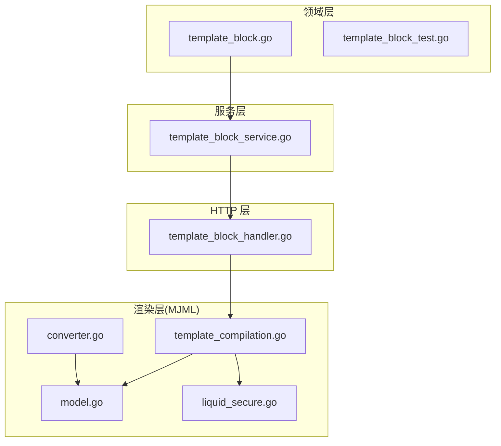
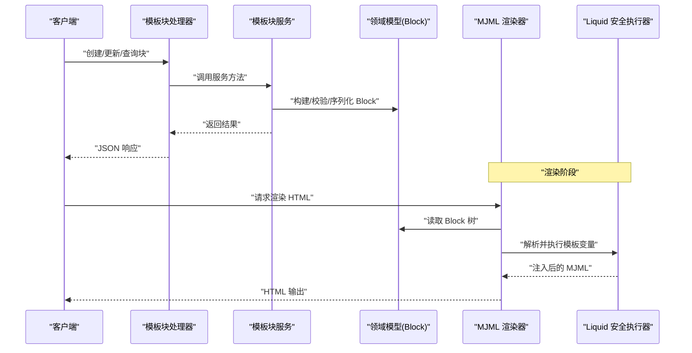
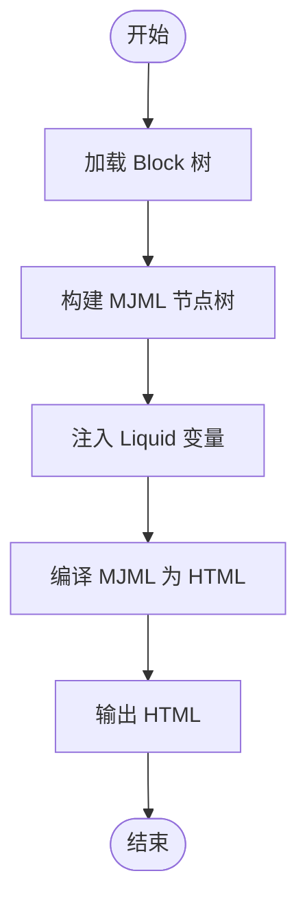
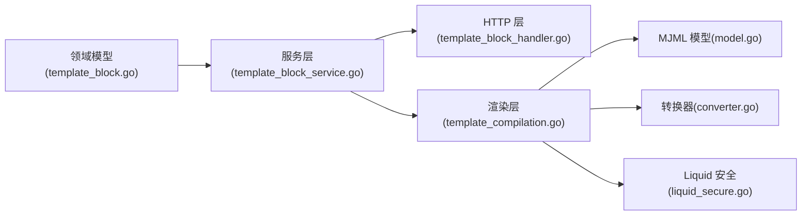

# 模板块组件模型

<cite>
**本文引用的文件**   
- [internal/domain/template_block.go](file://notifuse/internal/domain/template_block.go)
- [internal/domain/template_block_test.go](file://notifuse/internal/domain/template_block_test.go)
- [internal/service/template_block_service.go](file://notifuse/internal/service/template_block_service.go)
- [internal/http/template_block_handler.go](file://notifuse/internal/http/template_block_handler.go)
- [pkg/notifuse_mjml/model.go](file://notifuse/pkg/notifuse_mjml/model.go)
- [pkg/notifuse_mjml/converter.go](file://notifuse/pkg/notifuse_mjml/converter.go)
- [pkg/notifuse_mjml/liquid_secure.go](file://notifuse/pkg/notifuse_mjml/liquid_secure.go)
- [pkg/notifuse_mjml/template_compilation.go](file://notifuse/pkg/notifuse_mjml/template_compilation.go)
</cite>

## 目录
1. [简介](#简介)
2. [项目结构](#项目结构)
3. [核心组件](#核心组件)
4. [架构总览](#架构总览)
5. [详细组件分析](#详细组件分析)
6. [依赖关系分析](#依赖关系分析)
7. [性能考虑](#性能考虑)
8. [故障排查指南](#故障排查指南)
9. [结论](#结论)
10. [附录](#附录)

## 简介
本文件为 Notifuse 平台的“模板块(Template Block)”组件系统的数据模型文档。重点覆盖：
- Block 实体的通用结构与类型定义（块 ID、类型、属性、样式等）
- 常见邮件组件的具体结构（文本、图片、按钮、分隔符等）
- 块的嵌套与层级关系及布局约束
- 渲染引擎实现（Liquid 模板语法支持与动态变量替换）
- 验证规则与错误处理机制
- 自定义扩展接口与插件开发指南

## 项目结构
围绕模板块的核心代码主要分布在以下模块：
- 领域层：Block 数据模型、校验与树形结构工具
- 服务层：块的增删改查、排序、校验与序列化
- HTTP 层：REST API 路由与请求响应映射
- MJML 渲染层：MJML 模型、编译与 Liquid 安全执行



图表来源
- [internal/domain/template_block.go](file://notifuse/internal/domain/template_block.go)
- [internal/service/template_block_service.go](file://notifuse/internal/service/template_block_service.go)
- [internal/http/template_block_handler.go](file://notifuse/internal/http/template_block_handler.go)
- [pkg/notifuse_mjml/model.go](file://notifuse/pkg/notifuse_mjml/model.go)
- [pkg/notifuse_mjml/converter.go](file://notifuse/pkg/notifuse_mjml/converter.go)
- [pkg/notifuse_mjml/liquid_secure.go](file://notifuse/pkg/notifuse_mjml/liquid_secure.go)
- [pkg/notifuse_mjml/template_compilation.go](file://notifuse/pkg/notifuse_mjml/template_compilation.go)

章节来源
- [internal/domain/template_block.go](file://notifuse/internal/domain/template_block.go)
- [internal/service/template_block_service.go](file://notifuse/internal/service/template_block_service.go)
- [internal/http/template_block_handler.go](file://notifuse/internal/http/template_block_handler.go)
- [pkg/notifuse_mjml/model.go](file://notifuse/pkg/notifuse_mjml/model.go)
- [pkg/notifuse_mjml/converter.go](file://notifuse/pkg/notifuse_mjml/converter.go)
- [pkg/notifuse_mjml/liquid_secure.go](file://notifuse/pkg/notifuse_mjml/liquid_secure.go)
- [pkg/notifuse_mjml/template_compilation.go](file://notifuse/pkg/notifuse_mjml/template_compilation.go)

## 核心组件
本节聚焦 Block 的通用数据结构与类型，以及常见组件类型的字段约定。

- 通用 Block 实体
  - 标识与元信息：块唯一 ID、块类型、名称、可见性、顺序等
  - 内容属性：根据类型不同而变化的键值集合（如文本、链接、图片地址等）
  - 样式属性：字体、颜色、间距、对齐、边框、圆角等
  - 行为属性：点击事件、跳转链接、目标窗口等
  - 嵌套关系：子块列表、父块引用、布局容器（列、行、分区等）

- 常见组件类型与典型属性
  - 文本块：富文本或纯文本内容、字号、行高、颜色、对齐方式
  - 图片块：图片 URL、替代文本、宽度、高度、对齐、链接
  - 按钮块：显示文本、链接、背景色、文字色、圆角、内边距
  - 分隔符块：线宽、颜色、样式（实线/虚线）、上下间距
  - 布局容器：列/行/分区，包含若干子块，控制栅格与间距

- 类型系统与枚举
  - 块类型枚举：用于区分不同组件类别
  - 样式键空间：统一的样式键名规范，便于前端编辑器与后端渲染一致化

章节来源
- [internal/domain/template_block.go](file://notifuse/internal/domain/template_block.go)
- [internal/domain/template_block_test.go](file://notifuse/internal/domain/template_block_test.go)

## 架构总览
从请求到渲染的整体流程如下：



图表来源
- [internal/http/template_block_handler.go](file://notifuse/internal/http/template_block_handler.go)
- [internal/service/template_block_service.go](file://notifuse/internal/service/template_block_service.go)
- [internal/domain/template_block.go](file://notifuse/internal/domain/template_block.go)
- [pkg/notifuse_mjml/template_compilation.go](file://notifuse/pkg/notifuse_mjml/template_compilation.go)
- [pkg/notifuse_mjml/liquid_secure.go](file://notifuse/pkg/notifuse_mjml/liquid_secure.go)

## 详细组件分析

### 领域模型：Block 实体与树形结构
- 设计要点
  - 使用统一的结构体表示所有块类型，通过类型字段区分具体组件
  - 支持父子关系，形成可遍历的树形结构
  - 提供校验入口，确保必填字段、格式与业务约束正确
- 关键能力
  - 序列化/反序列化：与 JSON 互转，适配 API 与存储
  - 树操作：插入、删除、移动、排序、查找
  - 校验：类型相关字段完整性、样式键合法性、URL 格式等

```mermaid
classDiagram
class Block {
+string id
+string type
+map~string,string~ attributes
+map~string,string~ styles
+[]Block children
+Block parent
+Validate() error
+Serialize() map[string]interface{}
+Deserialize(map[string]interface{}) error
}
```

图表来源
- [internal/domain/template_block.go](file://notifuse/internal/domain/template_block.go)

章节来源
- [internal/domain/template_block.go](file://notifuse/internal/domain/template_block.go)
- [internal/domain/template_block_test.go](file://notifuse/internal/domain/template_block_test.go)

### 服务层：模板块服务
- 职责
  - 封装块的 CRUD 逻辑
  - 执行跨字段的业务校验
  - 维护块的顺序与层级一致性
  - 将领域对象转换为 API 响应结构
- 关键点
  - 事务性更新：批量调整顺序时保证一致性
  - 幂等性：重复提交不会产生副作用
  - 错误聚合：收集多条校验错误并一次性返回

章节来源
- [internal/service/template_block_service.go](file://notifuse/internal/service/template_block_service.go)

### HTTP 层：模板块处理器
- 职责
  - 解析请求参数与路径
  - 调用服务层执行业务逻辑
  - 标准化响应与错误码
- 关键点
  - 输入校验前置：快速失败
  - 权限与上下文：工作区隔离、用户鉴权（由上层中间件负责）
  - 日志与追踪：记录关键操作

章节来源
- [internal/http/template_block_handler.go](file://notifuse/internal/http/template_block_handler.go)

### 渲染层：MJML 模型与编译
- MJML 模型
  - 将 Block 树映射为 MJML 节点树
  - 将样式与属性转换为 MJML 标签属性
- 编译流程
  - 遍历 Block 树生成 MJML 字符串
  - 注入动态变量（Liquid 表达式）
  - 输出最终 HTML



图表来源
- [pkg/notifuse_mjml/model.go](file://notifuse/pkg/notifuse_mjml/model.go)
- [pkg/notifuse_mjml/converter.go](file://notifuse/pkg/notifuse_mjml/converter.go)
- [pkg/notifuse_mjml/template_compilation.go](file://notifuse/pkg/notifuse_mjml/template_compilation.go)

章节来源
- [pkg/notifuse_mjml/model.go](file://notifuse/pkg/notifuse_mjml/model.go)
- [pkg/notifuse_mjml/converter.go](file://notifuse/pkg/notifuse_mjml/converter.go)
- [pkg/notifuse_mjml/template_compilation.go](file://notifuse/pkg/notifuse_mjml/template_compilation.go)

### 渲染层：Liquid 安全执行
- 目标
  - 在受控沙箱中执行 Liquid 模板表达式
  - 限制危险函数与外部访问
- 关键点
  - 白名单函数：仅允许安全的内置函数
  - 变量注入：从上下文注入用户与模板变量
  - 超时与内存保护：防止恶意模板导致资源耗尽

章节来源
- [pkg/notifuse_mjml/liquid_secure.go](file://notifuse/pkg/notifuse_mjml/liquid_secure.go)

## 依赖关系分析
- 耦合与内聚
  - 领域模型独立于 HTTP 与服务层，保持高内聚
  - 服务层依赖领域模型，不直接依赖 HTTP
  - 渲染层通过服务层间接消费 Block 树，避免与业务细节耦合
- 外部依赖
  - MJML 渲染库：用于将 MJML 转为 HTML
  - Liquid 引擎：用于模板变量替换与安全执行



图表来源
- [internal/domain/template_block.go](file://notifuse/internal/domain/template_block.go)
- [internal/service/template_block_service.go](file://notifuse/internal/service/template_block_service.go)
- [internal/http/template_block_handler.go](file://notifuse/internal/http/template_block_handler.go)
- [pkg/notifuse_mjml/template_compilation.go](file://notifuse/pkg/notifuse_mjml/template_compilation.go)
- [pkg/notifuse_mjml/model.go](file://notifuse/pkg/notifuse_mjml/model.go)
- [pkg/notifuse_mjml/converter.go](file://notifuse/pkg/notifuse_mjml/converter.go)
- [pkg/notifuse_mjml/liquid_secure.go](file://notifuse/pkg/notifuse_mjml/liquid_secure.go)

章节来源
- [internal/domain/template_block.go](file://notifuse/internal/domain/template_block.go)
- [internal/service/template_block_service.go](file://notifuse/internal/service/template_block_service.go)
- [internal/http/template_block_handler.go](file://notifuse/internal/http/template_block_handler.go)
- [pkg/notifuse_mjml/template_compilation.go](file://notifuse/pkg/notifuse_mjml/template_compilation.go)
- [pkg/notifuse_mjml/model.go](file://notifuse/pkg/notifuse_mjml/model.go)
- [pkg/notifuse_mjml/converter.go](file://notifuse/pkg/notifuse_mjml/converter.go)
- [pkg/notifuse_mjml/liquid_secure.go](file://notifuse/pkg/notifuse_mjml/liquid_secure.go)

## 性能考虑
- 渲染优化
  - 缓存编译后的 MJML 片段，减少重复计算
  - 对静态属性进行预计算，避免每次渲染都解析
- 模板执行
  - 限制 Liquid 表达式复杂度，设置执行超时
  - 复用上下文对象，减少分配
- 数据传输
  - 按需返回块字段，避免大对象传输
  - 分页与增量更新，降低网络开销

[本节为通用指导，无需特定文件来源]

## 故障排查指南
- 常见问题
  - 块类型未知：检查类型枚举是否匹配
  - 必填字段缺失：查看校验错误聚合结果
  - 样式键非法：确认样式键是否在白名单中
  - Liquid 执行失败：检查变量是否存在、函数是否被允许
- 定位步骤
  - 查看服务层返回的错误详情
  - 打印渲染前的 MJML 片段以定位问题
  - 启用调试日志，观察变量注入过程

章节来源
- [internal/service/template_block_service.go](file://notifuse/internal/service/template_block_service.go)
- [pkg/notifuse_mjml/liquid_secure.go](file://notifuse/pkg/notifuse_mjml/liquid_secure.go)

## 结论
本模型通过统一的 Block 实体与类型系统，结合 MJML 渲染与安全的 Liquid 执行，提供了可扩展、可验证、可渲染的模板块组件体系。建议在生产环境中启用严格的校验与渲染沙箱策略，并结合缓存与限流提升整体性能与稳定性。

[本节为总结，无需特定文件来源]

## 附录

### 常见块类型与属性约定（示例说明）
- 文本块
  - 属性：content、fontSize、color、align
  - 样式：padding、margin、border
- 图片块
  - 属性：src、alt、width、height、link
  - 样式：objectFit、borderRadius
- 按钮块
  - 属性：text、link、target
  - 样式：backgroundColor、textColor、borderRadius、padding
- 分隔符块
  - 属性：lineWidth、lineStyle、color
  - 样式：marginTop、marginBottom

[本节为概念性说明，无需特定文件来源]

### 自定义扩展接口与插件开发指南
- 新增块类型
  - 在类型枚举中添加新类型
  - 在属性与样式白名单中注册新键
  - 在渲染器中为新类型添加 MJML 映射
- 插件化建议
  - 将渲染逻辑按类型拆分，便于独立测试与维护
  - 提供配置项开关，控制功能启用与否
  - 遵循最小权限原则，限制外部访问

[本节为概念性说明，无需特定文件来源]