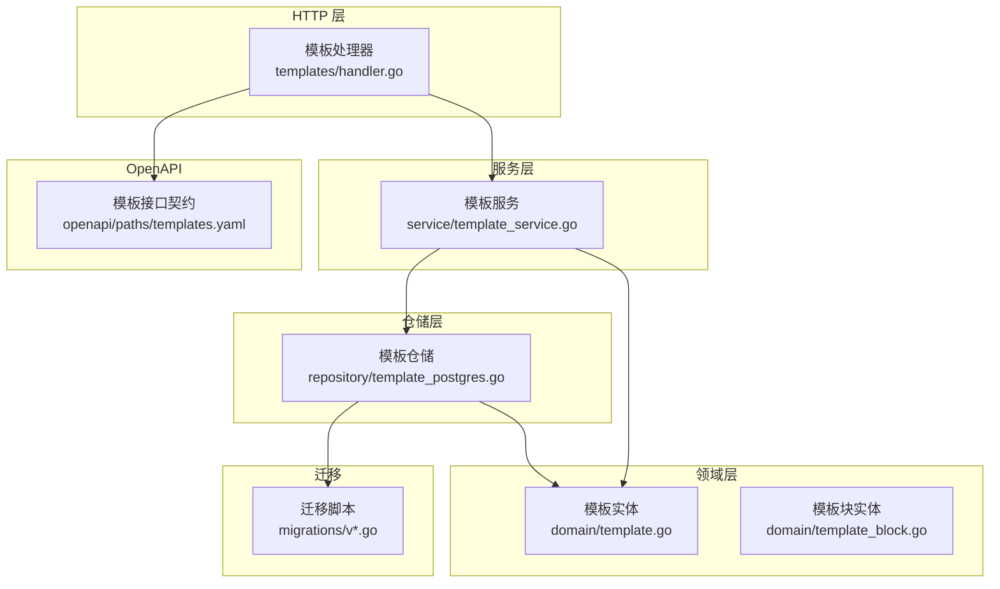
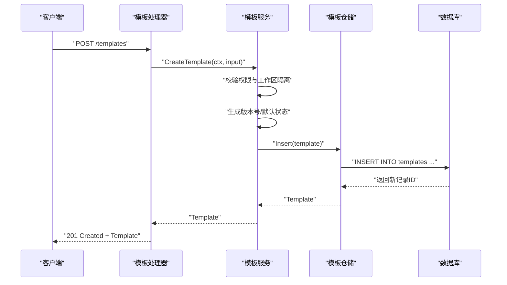
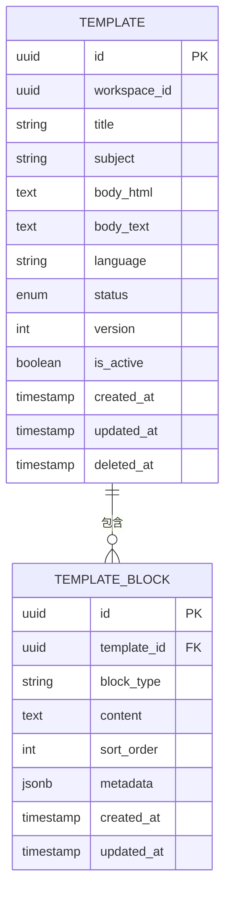
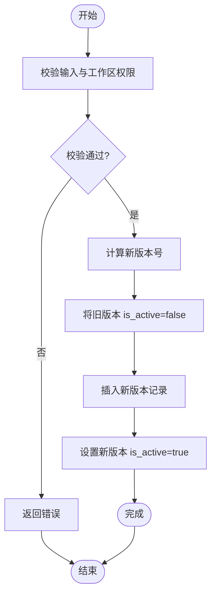
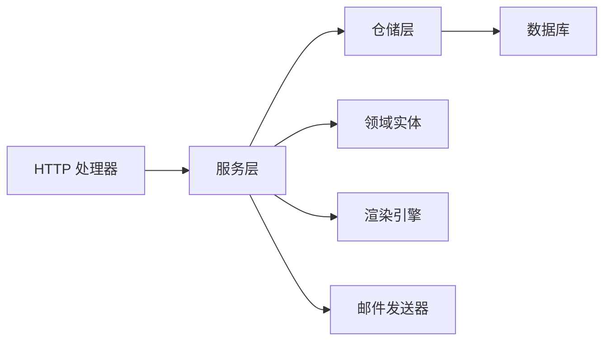

# 模板核心模型

<cite>
**本文引用的文件**   
- [internal/domain/template.go](file://notifuse/internal/domain/template.go)
- [internal/domain/template_block.go](file://notifuse/internal/domain/template_block.go)
- [internal/repository/template_postgres.go](file://notifuse/internal/repository/template_postgres.go)
- [internal/service/template_service.go](file://notifuse/internal/service/template_service.go)
- [internal/http/templates/handler.go](file://notifuse/internal/http/templates/handler.go)
- [openapi/paths/templates.yaml](file://notifuse/openapi/paths/templates.yaml)
- [internal/migrations/v10.go](file://notifuse/internal/migrations/v10.go)
- [internal/migrations/v23.go](file://notifuse/internal/migrations/v23.go)
- [internal/migrations/v24.go](file://notifuse/internal/migrations/v24.go)
- [internal/migrations/v25.go](file://notifuse/internal/migrations/v25.go)
- [internal/migrations/v26.go](file://notifuse/internal/migrations/v26.go)
- [internal/migrations/v27.go](file://notifuse/internal/migrations/v27.go)
- [internal/migrations/v28.go](file://notifuse/internal/migrations/v28.go)
- [internal/migrations/v29.go](file://notifuse/internal/migrations/v29.go)
- [internal/migrations/v30.go](file://notifuse/internal/migrations/v30.go)
- [internal/migrations/v31.go](file://notifuse/internal/migrations/v31.go)
- [internal/migrations/v32.go](file://notifuse/internal/migrations/v32.go)
- [internal/migrations/v33.go](file://notifuse/internal/migrations/v33.go)
- [internal/migrations/v34.go](file://notifuse/internal/migrations/v34.go)
</cite>

## 目录
1. [简介](#简介)
2. [项目结构](#项目结构)
3. [核心组件](#核心组件)
4. [架构总览](#架构总览)
5. [详细组件分析](#详细组件分析)
6. [依赖关系分析](#依赖关系分析)
7. [性能考虑](#性能考虑)
8. [故障排查指南](#故障排查指南)
9. [结论](#结论)
10. [附录](#附录)

## 简介
本文件聚焦于 Notifuse 平台的“模板核心模型”，围绕 Template 实体的数据模型、生命周期管理（创建、更新、删除与版本控制）、权限与访问策略、搜索与过滤能力、导入导出格式与迁移策略，以及预览与测试的 API 规范进行系统化说明。文档旨在帮助开发者与产品人员快速理解模板领域的设计与实现要点，并在扩展与维护时具备清晰的参考依据。

## 项目结构
模板相关代码主要分布在以下层次：
- 领域层：定义模板实体、块等核心数据结构与不变式约束
- 仓储层：负责模板数据的持久化与查询
- 服务层：编排业务逻辑，包括版本控制、权限校验、搜索与过滤
- HTTP 层：暴露 RESTful 接口，处理请求与响应
- OpenAPI：对外 API 契约
- 迁移脚本：数据库演进与字段变更

图表来源
- [internal/http/templates/handler.go](file://notifuse/internal/http/templates/handler.go)
- [internal/service/template_service.go](file://notifuse/internal/service/template_service.go)
- [internal/repository/template_postgres.go](file://notifuse/internal/repository/template_postgres.go)
- [internal/domain/template.go](file://notifuse/internal/domain/template.go)
- [internal/domain/template_block.go](file://notifuse/internal/domain/template_block.go)
- [openapi/paths/templates.yaml](file://notifuse/openapi/paths/templates.yaml)
- [internal/migrations/v10.go](file://notifuse/internal/migrations/v10.go)

章节来源
- [internal/domain/template.go](file://notifuse/internal/domain/template.go)
- [internal/domain/template_block.go](file://notifuse/internal/domain/template_block.go)
- [internal/repository/template_postgres.go](file://notifuse/internal/repository/template_postgres.go)
- [internal/service/template_service.go](file://notifuse/internal/service/template_service.go)
- [internal/http/templates/handler.go](file://notifuse/internal/http/templates/handler.go)
- [openapi/paths/templates.yaml](file://notifuse/openapi/paths/templates.yaml)
- [internal/migrations/v10.go](file://notifuse/internal/migrations/v10.go)

## 核心组件
本节对模板核心模型的关键实体与职责进行说明。

- 模板实体（Template）
  - 标识与归属：唯一 ID、所属工作区 ID、创建者/更新时间戳
  - 元信息：标题、主题、语言版本、可见性/状态、标签/分类（如有）
  - 内容：HTML/文本主体、变量占位符、附件引用（如有）
  - 版本控制：版本号、是否当前活跃版本、快照时间戳
  - 审计：软删除标记、操作日志关联（如有）
- 模板块（Template Block）
  - 用于将模板拆分为可复用片段（如头部、尾部、条件区块），支持组合渲染
  - 包含块类型、排序、参数与嵌套关系

章节来源
- [internal/domain/template.go](file://notifuse/internal/domain/template.go)
- [internal/domain/template_block.go](file://notifuse/internal/domain/template_block.go)

## 架构总览
模板功能采用分层架构：HTTP 层接收请求并调用服务层；服务层编排业务规则（权限、版本、搜索）并调用仓储层；仓储层通过 SQL 与数据库交互；领域层提供实体与不变式。

图表来源
- [internal/http/templates/handler.go](file://notifuse/internal/http/templates/handler.go)
- [internal/service/template_service.go](file://notifuse/internal/service/template_service.go)
- [internal/repository/template_postgres.go](file://notifuse/internal/repository/template_postgres.go)

## 详细组件分析

### 数据模型与字段定义
- 模板主表字段（概念映射）
  - id：UUID，主键
  - workspace_id：UUID，工作区隔离键
  - title：字符串，模板标题
  - subject：字符串，邮件主题
  - body_html/body_text：大文本，模板内容
  - language：字符串或枚举，语言版本（如 zh-CN、en-US）
  - status：枚举，状态（草稿、已发布、归档等）
  - version：整数或语义化版本，当前版本
  - is_active：布尔，是否当前活跃版本
  - created_at/updated_at：时间戳
  - deleted_at：时间戳，软删除
- 模板块表字段（概念映射）
  - id：UUID，主键
  - template_id：外键，关联模板
  - block_type：字符串，块类型
  - content：大文本，块内容
  - sort_order：整数，排序
  - metadata：JSON，扩展参数
  - created_at/updated_at：时间戳

图表来源
- [internal/domain/template.go](file://notifuse/internal/domain/template.go)
- [internal/domain/template_block.go](file://notifuse/internal/domain/template_block.go)

章节来源
- [internal/domain/template.go](file://notifuse/internal/domain/template.go)
- [internal/domain/template_block.go](file://notifuse/internal/domain/template_block.go)

### 生命周期管理与版本控制
- 创建
  - 输入校验（标题、主题、内容非空、语言合法性）
  - 工作区隔离校验（仅允许在工作区内创建）
  - 初始化版本号为 1，状态为草稿，is_active=true
- 更新
  - 基于模板 ID 与版本进行乐观锁或显式版本比对
  - 更新后递增版本号，旧版本 is_active=false，新版本 is_active=true
- 删除
  - 软删除：设置 deleted_at，保留历史版本
- 版本控制机制
  - 每次有效更新产生新版本记录
  - 查询默认返回 is_active=true 的版本
  - 支持按版本精确读取与回滚（复制最新版本为新版本）

图表来源
- [internal/service/template_service.go](file://notifuse/internal/service/template_service.go)
- [internal/repository/template_postgres.go](file://notifuse/internal/repository/template_postgres.go)

章节来源
- [internal/service/template_service.go](file://notifuse/internal/service/template_service.go)
- [internal/repository/template_postgres.go](file://notifuse/internal/repository/template_postgres.go)

### 权限控制与访问策略
- 工作区级别隔离
  - 所有模板读写均强制携带 workspace_id，并通过上下文注入当前用户的工作区范围
  - 查询与更新必须匹配 workspace_id，防止跨区访问
- 用户权限验证
  - 在创建/更新/删除前校验用户对目标工作区的角色与权限
  - 未授权或越权访问直接拒绝并返回相应错误码
- 审计与追踪
  - 记录关键操作的创建者与时间戳，便于问题回溯

章节来源
- [internal/service/template_service.go](file://notifuse/internal/service/template_service.go)
- [internal/http/templates/handler.go](file://notifuse/internal/http/templates/handler.go)

### 搜索与过滤
- 全文搜索
  - 针对标题、主题、内容进行全文检索（结合数据库全文索引或外部搜索引擎）
- 条件过滤
  - 按工作区、语言、状态、标签、创建/更新时间范围筛选
- 分页与排序
  - 支持按更新时间、版本号、标题排序，并提供分页参数

章节来源
- [internal/repository/template_postgres.go](file://notifuse/internal/repository/template_postgres.go)
- [internal/service/template_service.go](file://notifuse/internal/service/template_service.go)

### 导入导出与数据迁移
- 导入导出格式
  - 导出：JSON/YAML 清单，包含模板元信息、内容与版本快照
  - 导入：校验工作区与语言一致性，冲突策略（覆盖/跳过/重命名）
- 数据迁移策略
  - 使用迁移脚本逐步演进 schema，确保向后兼容
  - 新增字段时提供默认值与回滚方案
  - 版本字段与 is_active 标志由迁移与服务共同保障一致性

章节来源
- [internal/migrations/v10.go](file://notifuse/internal/migrations/v10.go)
- [internal/migrations/v23.go](file://notifuse/internal/migrations/v23.go)
- [internal/migrations/v24.go](file://notifuse/internal/migrations/v24.go)
- [internal/migrations/v25.go](file://notifuse/internal/migrations/v25.go)
- [internal/migrations/v26.go](file://notifuse/internal/migrations/v26.go)
- [internal/migrations/v27.go](file://notifuse/internal/migrations/v27.go)
- [internal/migrations/v28.go](file://notifuse/internal/migrations/v28.go)
- [internal/migrations/v29.go](file://notifuse/internal/migrations/v29.go)
- [internal/migrations/v30.go](file://notifuse/internal/migrations/v30.go)
- [internal/migrations/v31.go](file://notifuse/internal/migrations/v31.go)
- [internal/migrations/v32.go](file://notifuse/internal/migrations/v32.go)
- [internal/migrations/v33.go](file://notifuse/internal/migrations/v33.go)
- [internal/migrations/v34.go](file://notifuse/internal/migrations/v34.go)

### 预览与测试 API 接口规范
- 预览接口
  - 方法：GET /templates/{id}/preview
  - 作用：根据模板内容与变量渲染 HTML/文本预览
  - 参数：可选变量上下文、语言选择
  - 返回：渲染后的内容片段
- 测试发送接口
  - 方法：POST /templates/{id}/test
  - 作用：以指定收件人与变量上下文执行一次真实发送（沙箱或限流）
  - 参数：收件人、变量上下文、语言
  - 返回：发送结果与消息 ID
- 通用约定
  - 鉴权：需携带工作区上下文与用户令牌
  - 速率限制：对测试发送进行限流，避免滥用
  - 错误码：明确区分参数错误、权限不足、发送失败等

章节来源
- [openapi/paths/templates.yaml](file://notifuse/openapi/paths/templates.yaml)
- [internal/http/templates/handler.go](file://notifuse/internal/http/templates/handler.go)
- [internal/service/template_service.go](file://notifuse/internal/service/template_service.go)

## 依赖关系分析
- 模块耦合
  - HTTP 层依赖服务层，服务层依赖仓储层与领域层
  - 仓储层依赖数据库驱动与迁移脚本
- 外部依赖
  - 数据库：PostgreSQL（全文索引、JSONB、事务）
  - 渲染引擎：Liquid/MJML（模板编译与转换）
  - 邮件发送：SMTP/第三方服务商（测试发送）

图表来源
- [internal/http/templates/handler.go](file://notifuse/internal/http/templates/handler.go)
- [internal/service/template_service.go](file://notifuse/internal/service/template_service.go)
- [internal/repository/template_postgres.go](file://notifuse/internal/repository/template_postgres.go)
- [internal/domain/template.go](file://notifuse/internal/domain/template.go)

章节来源
- [internal/http/templates/handler.go](file://notifuse/internal/http/templates/handler.go)
- [internal/service/template_service.go](file://notifuse/internal/service/template_service.go)
- [internal/repository/template_postgres.go](file://notifuse/internal/repository/template_postgres.go)
- [internal/domain/template.go](file://notifuse/internal/domain/template.go)

## 性能考虑
- 索引优化
  - 为 workspace_id、status、language、created_at 建立复合索引，提升过滤与分页性能
  - 全文检索列使用 GIN/GIST 索引，提高搜索效率
- 缓存策略
  - 对常用模板的活跃版本进行短期缓存（内存/Redis），减少重复查询
- 批量操作
  - 导入/导出采用分批写入与游标读取，降低单次事务压力
- 渲染优化
  - 预编译模板片段，避免重复解析；对大图/附件进行异步处理

[本节为通用指导，不直接分析具体文件]

## 故障排查指南
- 常见错误
  - 权限不足：检查用户工作区角色与会话上下文
  - 版本冲突：更新时版本号不一致，需重新拉取最新模板再提交
  - 渲染失败：变量缺失或语法错误，使用预览接口定位问题
  - 发送失败：邮箱地址无效或服务商限流，查看错误码与重试策略
- 诊断步骤
  - 启用调试日志，记录请求链路、SQL 语句与渲染中间结果
  - 核对迁移脚本是否成功执行，确认 schema 与默认值一致
  - 使用测试发送接口进行最小化复现

章节来源
- [internal/service/template_service.go](file://notifuse/internal/service/template_service.go)
- [internal/repository/template_postgres.go](file://notifuse/internal/repository/template_postgres.go)
- [internal/migrations/v10.go](file://notifuse/internal/migrations/v10.go)

## 结论
模板核心模型围绕“工作区隔离、版本控制、权限校验、搜索过滤、导入导出与预览测试”构建，形成清晰的分层架构与稳定的数据契约。通过迁移脚本与索引优化，系统在可扩展性与性能之间取得平衡。建议在后续迭代中持续完善全文检索质量、引入更细粒度的权限模型，并增强导入导出的校验与冲突解决策略。

## 附录
- 术语
  - 工作区：资源隔离的基本单位
  - 活跃版本：is_active=true 的模板版本
  - 软删除：通过时间戳标记删除而非物理移除
- 参考路径
  - 领域实体：[internal/domain/template.go](file://notifuse/internal/domain/template.go)、[internal/domain/template_block.go](file://notifuse/internal/domain/template_block.go)
  - 仓储实现：[internal/repository/template_postgres.go](file://notifuse/internal/repository/template_postgres.go)
  - 服务编排：[internal/service/template_service.go](file://notifuse/internal/service/template_service.go)
  - HTTP 接口：[internal/http/templates/handler.go](file://notifuse/internal/http/templates/handler.go)
  - OpenAPI 契约：[openapi/paths/templates.yaml](file://notifuse/openapi/paths/templates.yaml)
  - 迁移脚本：[internal/migrations/v10.go](file://notifuse/internal/migrations/v10.go) 至 [internal/migrations/v34.go](file://notifuse/internal/migrations/v34.go)