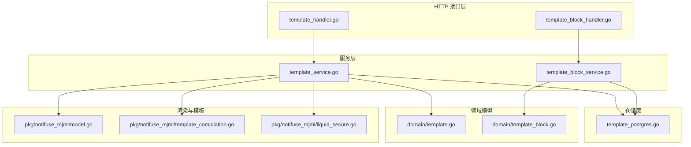
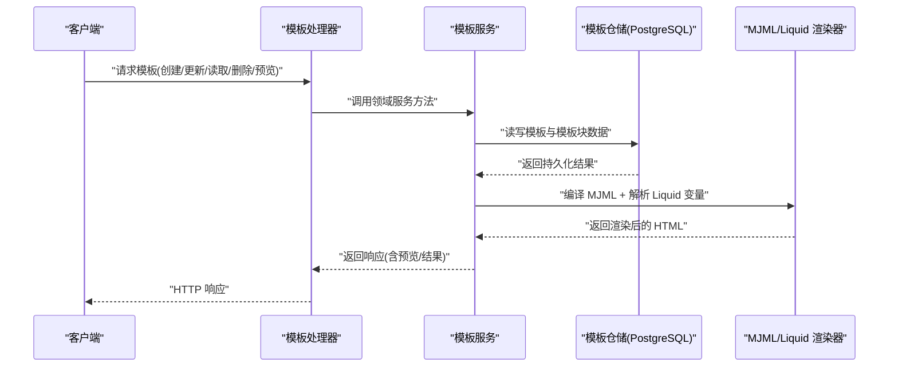
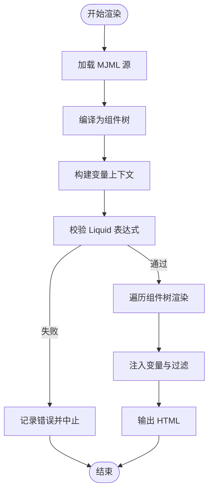
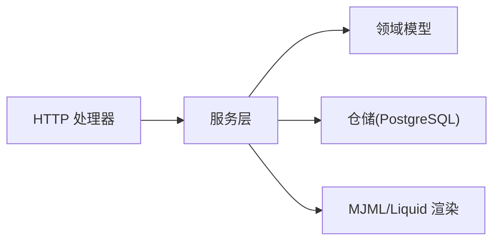

# 模板模型

<cite>
**本文引用的文件**   
- [internal/domain/template.go](file://notifuse/internal/domain/template.go)
- [internal/domain/template_block.go](file://notifuse/internal/domain/template_block.go)
- [internal/repository/template_postgres.go](file://notifuse/internal/repository/template_postgres.go)
- [internal/service/template_service.go](file://notifuse/internal/service/template_service.go)
- [internal/service/template_block_service.go](file://notifuse/internal/service/template_block_service.go)
- [internal/http/template_handler.go](file://notifuse/internal/http/template_handler.go)
- [internal/http/template_block_handler.go](file://notifuse/internal/http/template_block_handler.go)
- [pkg/notifuse_mjml/model.go](file://notifuse/pkg/notifuse_mjml/model.go)
- [pkg/notifuse_mjml/template_compilation.go](file://notifuse/pkg/notifuse_mjml/template_compilation.go)
- [pkg/notifuse_mjml/liquid_secure.go](file://notifuse/pkg/notifuse_mjml/liquid_secure.go)
- [openapi/paths/templates.yaml](file://notifuse/openapi/paths/templates.yaml)
</cite>

## 目录
1. [简介](#简介)
2. [项目结构](#项目结构)
3. [核心组件](#核心组件)
4. [架构总览](#架构总览)
5. [详细组件分析](#详细组件分析)
6. [依赖分析](#依赖分析)
7. [性能考虑](#性能考虑)
8. [故障排查指南](#故障排查指南)
9. [结论](#结论)
10. [附录](#附录)

## 简介
本文件为 Notifuse 平台的“模板（Template）”实体提供完整的数据模型与实现文档，覆盖以下方面：
- 模板字段定义：标题、内容、主题、语言版本等核心属性
- 模板块（Template Block）的组件化设计：邮件组件结构与属性
- 模板版本控制与变更历史机制
- 渲染引擎工作原理：Liquid 语法支持与变量替换
- 模板预览与测试功能实现细节
- 模板导入导出与共享协作的设计说明

## 项目结构
围绕模板能力的相关代码主要分布在领域层、仓储层、服务层、HTTP 接口层以及 MJML/Liquid 渲染相关包中。下图展示了与模板相关的模块关系与职责边界。

图表来源
- [internal/http/template_handler.go](file://notifuse/internal/http/template_handler.go)
- [internal/http/template_block_handler.go](file://notifuse/internal/http/template_block_handler.go)
- [internal/service/template_service.go](file://notifuse/internal/service/template_service.go)
- [internal/service/template_block_service.go](file://notifuse/internal/service/template_block_service.go)
- [internal/repository/template_postgres.go](file://notifuse/internal/repository/template_postgres.go)
- [internal/domain/template.go](file://notifuse/internal/domain/template.go)
- [internal/domain/template_block.go](file://notifuse/internal/domain/template_block.go)
- [pkg/notifuse_mjml/model.go](file://notifuse/pkg/notifuse_mjml/model.go)
- [pkg/notifuse_mjml/template_compilation.go](file://notifuse/pkg/notifuse_mjml/template_compilation.go)
- [pkg/notifuse_mjml/liquid_secure.go](file://notifuse/pkg/notifuse_mjml/liquid_secure.go)

章节来源
- [internal/domain/template.go](file://notifuse/internal/domain/template.go)
- [internal/domain/template_block.go](file://notifuse/internal/domain/template_block.go)
- [internal/repository/template_postgres.go](file://notifuse/internal/repository/template_postgres.go)
- [internal/service/template_service.go](file://notifuse/internal/service/template_service.go)
- [internal/service/template_block_service.go](file://notifuse/internal/service/template_block_service.go)
- [internal/http/template_handler.go](file://notifuse/internal/http/template_handler.go)
- [internal/http/template_block_handler.go](file://notifuse/internal/http/template_block_handler.go)
- [pkg/notifuse_mjml/model.go](file://notifuse/pkg/notifuse_mjml/model.go)
- [pkg/notifuse_mjml/template_compilation.go](file://notifuse/pkg/notifuse_mjml/template_compilation.go)
- [pkg/notifuse_mjml/liquid_secure.go](file://notifuse/pkg/notifuse_mjml/liquid_secure.go)

## 核心组件
本节聚焦模板与模板块的核心数据模型与关键行为。

- 模板（Template）
  - 标识与归属：工作区 ID、唯一键、名称、描述、可见性、创建/更新时间戳、创建者/更新者
  - 内容与样式：HTML 主体、MJML 源、CSS 样式、主题引用
  - 国际化与多语言：语言代码映射到对应内容或片段
  - 版本控制：版本号、是否发布、快照/差异信息、变更历史指针
  - 元数据：标签、分类、SEO 字段、扩展 JSON 字段
  - 状态：草稿、已发布、归档等生命周期状态

- 模板块（Template Block）
  - 标识与归属：所属模板 ID、块类型、排序权重、启用标志
  - 组件结构：组件类型（如文本、图片、按钮、分隔线、表格、列表等）、组件参数（JSON 配置）、占位符与条件渲染规则
  - 国际化：按语言提供不同块内容或参数
  - 版本：块级版本与合并策略（用于细粒度变更追踪）

- 渲染与编译
  - MJML 模型：将 MJML 转换为内部模型，支持响应式布局与组件树
  - Liquid 安全沙箱：限制危险函数，仅允许白名单过滤器与表达式
  - 变量替换：上下文对象注入（联系人、业务数据、系统变量），并支持嵌套访问与默认值

章节来源
- [internal/domain/template.go](file://notifuse/internal/domain/template.go)
- [internal/domain/template_block.go](file://notifuse/internal/domain/template_block.go)
- [pkg/notifuse_mjml/model.go](file://notifuse/pkg/notifuse_mjml/model.go)
- [pkg/notifuse_mjml/template_compilation.go](file://notifuse/pkg/notifuse_mjml/template_compilation.go)
- [pkg/notifuse_mjml/liquid_secure.go](file://notifuse/pkg/notifuse_mjml/liquid_secure.go)

## 架构总览
模板能力从 HTTP 接口进入，经服务层编排，调用仓储持久化，并在渲染阶段使用 MJML 与 Liquid 完成最终 HTML 输出。

图表来源
- [internal/http/template_handler.go](file://notifuse/internal/http/template_handler.go)
- [internal/service/template_service.go](file://notifuse/internal/service/template_service.go)
- [internal/repository/template_postgres.go](file://notifuse/internal/repository/template_postgres.go)
- [pkg/notifuse_mjml/template_compilation.go](file://notifuse/pkg/notifuse_mjml/template_compilation.go)
- [pkg/notifuse_mjml/liquid_secure.go](file://notifuse/pkg/notifuse_mjml/liquid_secure.go)

## 详细组件分析

### 模板实体（Template）数据模型
- 基础字段
  - 标识：UUID 主键、工作区 ID、唯一键
  - 名称/描述：人类可读的标题与说明
  - 可见性：私有/团队/公开（影响共享与协作范围）
  - 时间戳：创建时间、更新时间、发布时间
  - 作者：创建者/最后更新者
- 内容与样式
  - HTML 主体：最终渲染产物缓存（可选）
  - MJML 源：可编辑的 MJML 字符串
  - CSS 样式：全局样式或主题覆盖
  - 主题：关联的主题 ID 或内联主题配置
- 国际化
  - 语言映射：语言代码 -> 内容/片段
  - 默认语言：未匹配时的回退语言
- 版本控制
  - 版本号：语义化或自增编号
  - 发布标记：是否对外可用
  - 变更历史：每次变更的快照或差异记录
  - 回滚：基于历史版本恢复
- 元数据
  - 标签/分类：便于检索与组织
  - SEO：主题行、摘要、预览图
  - 扩展字段：JSON 扩展，兼容未来新增属性

章节来源
- [internal/domain/template.go](file://notifuse/internal/domain/template.go)
- [internal/repository/template_postgres.go](file://notifuse/internal/repository/template_postgres.go)
- [openapi/paths/templates.yaml](file://notifuse/openapi/paths/templates.yaml)

### 模板块（Template Block）组件化设计
- 块标识与顺序
  - 块 ID、所属模板 ID、排序权重、启用/禁用
- 组件类型与参数
  - 文本块：富文本、占位符、条件显示
  - 图片块：URL、替代文本、尺寸、链接
  - 按钮块：文案、链接、样式
  - 分隔线/段落/容器：布局与间距
  - 表格/列表：数据绑定与循环渲染
- 国际化与条件渲染
  - 按语言提供不同块内容
  - 基于上下文变量的条件逻辑
- 版本与合并
  - 块级版本与合并策略，支持增量更新与冲突检测

章节来源
- [internal/domain/template_block.go](file://notifuse/internal/domain/template_block.go)
- [internal/service/template_block_service.go](file://notifuse/internal/service/template_block_service.go)

### 模板版本控制与变更历史
- 版本策略
  - 每次保存生成新版本；发布时锁定当前版本
  - 支持对比视图（差异高亮）
- 变更历史
  - 记录操作人、时间、变更摘要、变更内容（快照或 diff）
  - 支持回滚至指定版本
- 并发与一致性
  - 乐观锁或版本号校验，避免覆盖写入
  - 事务保证模板与块的原子提交

章节来源
- [internal/domain/template.go](file://notifuse/internal/domain/template.go)
- [internal/repository/template_postgres.go](file://notifuse/internal/repository/template_postgres.go)
- [internal/service/template_service.go](file://notifuse/internal/service/template_service.go)

### 渲染引擎：MJML + Liquid
- MJML 编译
  - 将 MJML 源码编译为内部组件树，进行布局计算与响应式适配
  - 支持主题注入与样式覆盖
- Liquid 安全执行
  - 白名单过滤器与函数，禁止任意代码执行
  - 变量作用域隔离，支持嵌套访问与默认值
- 变量替换流程
  - 构建上下文：联系人信息、业务数据、系统变量
  - 遍历组件树，逐节点注入变量并渲染
  - 错误处理：缺失变量、非法表达式、渲染异常

图表来源
- [pkg/notifuse_mjml/template_compilation.go](file://notifuse/pkg/notifuse_mjml/template_compilation.go)
- [pkg/notifuse_mjml/liquid_secure.go](file://notifuse/pkg/notifuse_mjml/liquid_secure.go)
- [pkg/notifuse_mjml/model.go](file://notifuse/pkg/notifuse_mjml/model.go)

章节来源
- [pkg/notifuse_mjml/template_compilation.go](file://notifuse/pkg/notifuse_mjml/template_compilation.go)
- [pkg/notifuse_mjml/liquid_secure.go](file://notifuse/pkg/notifuse_mjml/liquid_secure.go)
- [pkg/notifuse_mjml/model.go](file://notifuse/pkg/notifuse_mjml/model.go)

### 模板预览与测试
- 预览
  - 输入：模板 ID 或草稿内容、可选上下文变量
  - 过程：即时编译 MJML + 安全执行 Liquid，返回 HTML 预览
  - 输出：HTML 片段或完整页面，支持移动端/桌面端切换
- 测试
  - 批量变量集：模拟不同联系人/业务场景
  - 断言：主题行、正文长度、链接有效性、图片可达性
  - 报告：渲染耗时、错误日志、兼容性提示

章节来源
- [internal/http/template_handler.go](file://notifuse/internal/http/template_handler.go)
- [internal/service/template_service.go](file://notifuse/internal/service/template_service.go)
- [pkg/notifuse_mjml/template_compilation.go](file://notifuse/pkg/notifuse_mjml/template_compilation.go)
- [pkg/notifuse_mjml/liquid_secure.go](file://notifuse/pkg/notifuse_mjml/liquid_secure.go)

### 模板导入导出与共享协作
- 导入导出
  - 导出：打包模板、模板块、主题、语言资源为结构化文件
  - 导入：校验结构、冲突处理、版本合并策略
- 共享协作
  - 可见性与权限：私有/团队/公开，结合工作区成员角色
  - 评论与审批：变更评审、发布门禁
  - 同步与分发：跨环境（开发/预发/生产）同步模板

章节来源
- [internal/domain/template.go](file://notifuse/internal/domain/template.go)
- [internal/http/template_handler.go](file://notifuse/internal/http/template_handler.go)
- [openapi/paths/templates.yaml](file://notifuse/openapi/paths/templates.yaml)

## 依赖分析
- 组件耦合
  - HTTP 处理器依赖服务层，服务层依赖领域模型与仓储
  - 渲染模块独立于存储，通过服务层注入上下文
- 外部依赖
  - PostgreSQL：模板与块数据持久化
  - MJML/Liquid：渲染与变量替换
- 潜在循环依赖
  - 服务层不应直接依赖 HTTP 层；渲染模块不反向依赖服务层

图表来源
- [internal/http/template_handler.go](file://notifuse/internal/http/template_handler.go)
- [internal/service/template_service.go](file://notifuse/internal/service/template_service.go)
- [internal/repository/template_postgres.go](file://notifuse/internal/repository/template_postgres.go)
- [pkg/notifuse_mjml/template_compilation.go](file://notifuse/pkg/notifuse_mjml/template_compilation.go)
- [pkg/notifuse_mjml/liquid_secure.go](file://notifuse/pkg/notifuse_mjml/liquid_secure.go)

章节来源
- [internal/http/template_handler.go](file://notifuse/internal/http/template_handler.go)
- [internal/service/template_service.go](file://notifuse/internal/service/template_service.go)
- [internal/repository/template_postgres.go](file://notifuse/internal/repository/template_postgres.go)
- [pkg/notifuse_mjml/template_compilation.go](file://notifuse/pkg/notifuse_mjml/template_compilation.go)
- [pkg/notifuse_mjml/liquid_secure.go](file://notifuse/pkg/notifuse_mjml/liquid_secure.go)

## 性能考虑
- 渲染优化
  - 缓存编译后的组件树与静态样式
  - 对重复变量上下文做局部缓存
- 数据库优化
  - 索引：工作区 ID、唯一键、版本号、状态
  - 分页与只读副本：查询密集型场景
- 并发与限流
  - 预览/测试接口限流，防止滥用
  - 大模板分块渲染与超时保护

[本节为通用指导，无需特定文件来源]

## 故障排查指南
- 常见问题
  - Liquid 表达式报错：检查白名单过滤器与变量路径
  - MJML 编译失败：确认标签闭合与属性合法
  - 变量缺失：验证上下文对象结构与必填字段
  - 版本冲突：比较版本号与变更历史，必要时回滚
- 定位手段
  - 查看渲染日志与错误堆栈
  - 使用最小复现上下文变量逐步缩小问题范围
  - 对比相邻版本的差异，定位引入问题的变更

章节来源
- [pkg/notifuse_mjml/liquid_secure.go](file://notifuse/pkg/notifuse_mjml/liquid_secure.go)
- [pkg/notifuse_mjml/template_compilation.go](file://notifuse/pkg/notifuse_mjml/template_compilation.go)
- [internal/service/template_service.go](file://notifuse/internal/service/template_service.go)

## 结论
Notifuse 的模板体系以领域模型为核心，结合 MJML 与安全的 Liquid 渲染，提供了强大的邮件模板能力。通过完善的版本控制、预览测试、导入导出与协作机制，能够满足复杂业务场景下的模板管理与交付需求。建议在后续迭代中持续完善国际化、主题系统与性能监控，进一步提升用户体验与稳定性。

[本节为总结性内容，无需特定文件来源]

## 附录
- API 参考
  - 模板 CRUD、预览、版本管理、导入导出接口定义参见 OpenAPI 规范
- 术语表
  - 模板：可复用邮件内容集合
  - 模板块：构成模板的最小可复用单元
  - 渲染：将模板与上下文变量组合生成最终 HTML 的过程

章节来源
- [openapi/paths/templates.yaml](file://notifuse/openapi/paths/templates.yaml)