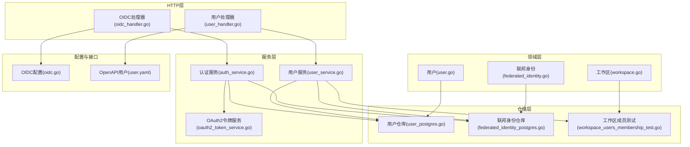
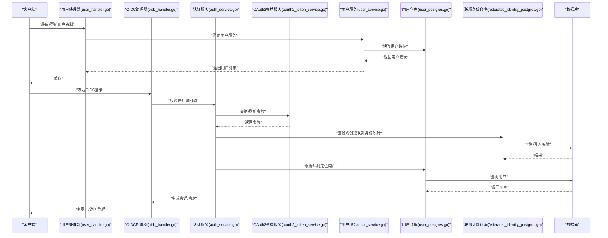
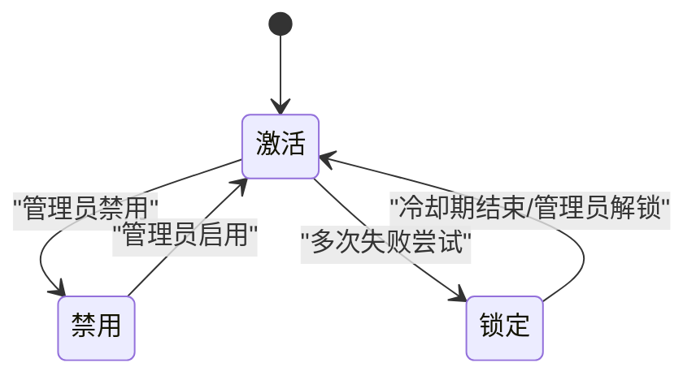
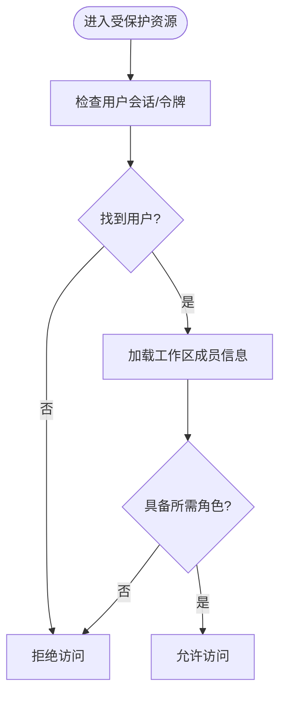
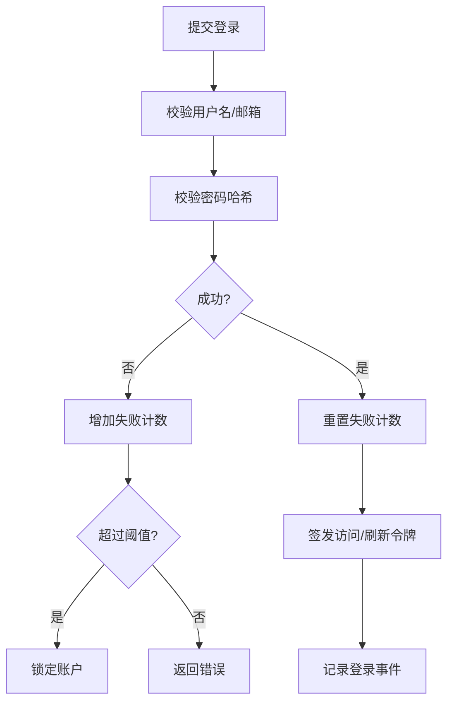
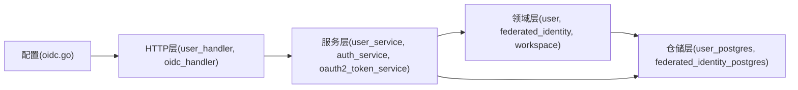

# 用户模型

<cite>
**本文引用的文件**   
- [internal/domain/user.go](file://notifuse/internal/domain/user.go)
- [internal/domain/federated_identity.go](file://notifuse/internal/domain/federated_identity.go)
- [internal/domain/workspace.go](file://notifuse/internal/domain/workspace.go)
- [internal/repository/user_postgres.go](file://notifuse/internal/repository/user_postgres.go)
- [internal/repository/federated_identity_postgres.go](file://notifuse/internal/repository/federated_identity_postgres.go)
- [internal/repository/workspace_users_membership_test.go](file://notifuse/internal/repository/workspace_users_membership_test.go)
- [internal/service/user_service.go](file://notifuse/internal/service/user_service.go)
- [internal/http/user_handler.go](file://notifuse/internal/http/user_handler.go)
- [internal/http/oidc_handler.go](file://notifuse/internal/http/oidc_handler.go)
- [internal/service/auth_service.go](file://notifuse/internal/service/auth_service.go)
- [internal/service/oauth2_token_service.go](file://notifuse/internal/service/oauth2_token_service.go)
- [config/oidc.go](file://notifuse/config/oidc.go)
- [openapi/components/schemas/user.yaml](file://notifuse/openapi/components/schemas/user.yaml)
</cite>

## 目录
1. [简介](#简介)
2. [项目结构](#项目结构)
3. [核心组件](#核心组件)
4. [架构总览](#架构总览)
5. [详细组件分析](#详细组件分析)
6. [依赖关系分析](#依赖关系分析)
7. [性能考虑](#性能考虑)
8. [故障排查指南](#故障排查指南)
9. [结论](#结论)
10. [附录](#附录)

## 简介
本文件为 Notifuse 平台的“用户(User)”实体提供数据模型与相关机制的权威文档，覆盖以下方面：
- 用户字段定义：基本信息、认证信息、偏好设置等核心属性
- 用户与工作区的关联：成员身份、角色权限与访问控制
- 联邦身份集成（Federated Identity）：支持 OAuth2/OIDC 第三方认证
- 用户状态管理：激活、禁用、锁定等状态转换
- 密码安全策略与会话管理
- 数据隐私保护与 GDPR 合规性考虑

## 项目结构
围绕用户模型的相关代码分布在领域层、仓储层、服务层、HTTP 层以及配置与 OpenAPI 定义中。下图展示了与用户模型直接相关的模块组织与交互关系。



图表来源
- [internal/domain/user.go](file://notifuse/internal/domain/user.go)
- [internal/domain/federated_identity.go](file://notifuse/internal/domain/federated_identity.go)
- [internal/domain/workspace.go](file://notifuse/internal/domain/workspace.go)
- [internal/repository/user_postgres.go](file://notifuse/internal/repository/user_postgres.go)
- [internal/repository/federated_identity_postgres.go](file://notifuse/internal/repository/federated_identity_postgres.go)
- [internal/repository/workspace_users_membership_test.go](file://notifuse/internal/repository/workspace_users_membership_test.go)
- [internal/service/user_service.go](file://notifuse/internal/service/user_service.go)
- [internal/service/auth_service.go](file://notifuse/internal/service/auth_service.go)
- [internal/service/oauth2_token_service.go](file://notifuse/internal/service/oauth2_token_service.go)
- [internal/http/user_handler.go](file://notifuse/internal/http/user_handler.go)
- [internal/http/oidc_handler.go](file://notifuse/internal/http/oidc_handler.go)
- [config/oidc.go](file://notifuse/config/oidc.go)
- [openapi/components/schemas/user.yaml](file://notifuse/openapi/components/schemas/user.yaml)

章节来源
- [internal/domain/user.go](file://notifuse/internal/domain/user.go)
- [internal/domain/federated_identity.go](file://notifuse/internal/domain/federated_identity.go)
- [internal/domain/workspace.go](file://notifuse/internal/domain/workspace.go)
- [internal/repository/user_postgres.go](file://notifuse/internal/repository/user_postgres.go)
- [internal/repository/federated_identity_postgres.go](file://notifuse/internal/repository/federated_identity_postgres.go)
- [internal/repository/workspace_users_membership_test.go](file://notifuse/internal/repository/workspace_users_membership_test.go)
- [internal/service/user_service.go](file://notifuse/internal/service/user_service.go)
- [internal/service/auth_service.go](file://notifuse/internal/service/auth_service.go)
- [internal/service/oauth2_token_service.go](file://notifuse/internal/service/oauth2_token_service.go)
- [internal/http/user_handler.go](file://notifuse/internal/http/user_handler.go)
- [internal/http/oidc_handler.go](file://notifuse/internal/http/oidc_handler.go)
- [config/oidc.go](file://notifuse/config/oidc.go)
- [openapi/components/schemas/user.yaml](file://notifuse/openapi/components/schemas/user.yaml)

## 核心组件
本节聚焦用户实体的数据模型与关键行为，包括字段定义、状态机、与联邦身份及工作区的关联。

- 用户实体字段类别
  - 基本信息：标识符、显示名、邮箱、头像、语言与时区等
  - 认证信息：本地密码哈希、邮箱验证标记、最近登录时间、失败尝试计数等
  - 偏好设置：通知渠道、主题、默认工作区等
  - 审计字段：创建时间、更新时间、最后修改人等
- 用户状态
  - 常见状态：激活、禁用、锁定；状态转换受业务规则约束
- 联邦身份
  - 将外部提供商（如 Google、GitHub、Azure AD）的身份映射到平台用户
  - 支持 OAuth2/OIDC 流程中的授权码、ID Token、Access Token 管理
- 工作区关联
  - 多对多成员关系，包含角色与权限、加入时间、邀请状态等

章节来源
- [internal/domain/user.go](file://notifuse/internal/domain/user.go)
- [internal/domain/federated_identity.go](file://notifuse/internal/domain/federated_identity.go)
- [internal/domain/workspace.go](file://notifuse/internal/domain/workspace.go)

## 架构总览
下图展示从 HTTP 请求到领域模型与持久化的端到端调用路径，重点体现用户认证、联邦身份与工作区访问控制的协作。



图表来源
- [internal/http/user_handler.go](file://notifuse/internal/http/user_handler.go)
- [internal/http/oidc_handler.go](file://notifuse/internal/http/oidc_handler.go)
- [internal/service/auth_service.go](file://notifuse/internal/service/auth_service.go)
- [internal/service/oauth2_token_service.go](file://notifuse/internal/service/oauth2_token_service.go)
- [internal/service/user_service.go](file://notifuse/internal/service/user_service.go)
- [internal/repository/user_postgres.go](file://notifuse/internal/repository/user_postgres.go)
- [internal/repository/federated_identity_postgres.go](file://notifuse/internal/repository/federated_identity_postgres.go)

## 详细组件分析

### 用户实体与字段定义
- 基本信息
  - 唯一标识、显示名称、邮箱地址、头像URL、语言、时区、注册来源等
- 认证信息
  - 本地密码哈希、邮箱是否已验证、最近登录时间、连续失败尝试次数、锁定截止时间等
- 偏好设置
  - 通知渠道开关、邮件模板偏好、界面主题、默认工作区等
- 审计字段
  - 创建时间、更新时间、软删除标记（如有）

建议的数据类型与约束
- 邮箱：唯一索引，大小写不敏感匹配
- 密码：仅存储哈希值，禁止明文
- 状态：使用枚举或受限字符串集，配合迁移脚本保证一致性
- 时间戳：统一使用 UTC 存储，前端按用户时区展示

章节来源
- [internal/domain/user.go](file://notifuse/internal/domain/user.go)
- [openapi/components/schemas/user.yaml](file://notifuse/openapi/components/schemas/user.yaml)

### 用户状态管理与转换
典型状态与转换
- 激活 → 禁用：管理员操作或违规触发
- 激活 → 锁定：多次密码失败后自动锁定，可配置冷却期
- 禁用 → 激活：管理员重新启用
- 锁定 → 激活：冷却期结束或管理员解锁

实现要点
- 在用户服务中封装状态变更方法，确保原子性与幂等
- 结合审计日志记录状态变更原因与操作者
- 通过数据库约束与索引保障状态一致性



章节来源
- [internal/service/user_service.go](file://notifuse/internal/service/user_service.go)
- [internal/repository/user_postgres.go](file://notifuse/internal/repository/user_postgres.go)

### 联邦身份集成（OAuth2/OIDC）
设计目标
- 将第三方身份提供者（IdP）的用户映射到平台用户
- 支持授权码流程、ID Token 解析、Access Token 缓存与刷新
- 允许一个用户绑定多个 IdP 账户

关键实体与关系
- 联邦身份表：提供商、外部用户ID、外部邮箱、附加声明、创建/更新时间
- 用户表：与联邦身份通过外部邮箱或外部用户ID建立映射
- 工作区成员：基于用户ID进行权限控制

```mermaid
classDiagram
class 用户 {
+标识符
+邮箱
+显示名
+状态
+创建时间
+更新时间
}
class 联邦身份 {
+提供商
+外部用户ID
+外部邮箱
+附加声明
+创建时间
+更新时间
}
class 工作区成员 {
+用户ID
+工作区ID
+角色
+加入时间
+状态
}
用户 ||--o{ 联邦身份 : "一对多映射"
用户 ||--o{ 工作区成员 : "多对多成员"
```

图表来源
- [internal/domain/user.go](file://notifuse/internal/domain/user.go)
- [internal/domain/federated_identity.go](file://notifuse/internal/domain/federated_identity.go)
- [internal/domain/workspace.go](file://notifuse/internal/domain/workspace.go)

章节来源
- [internal/domain/federated_identity.go](file://notifuse/internal/domain/federated_identity.go)
- [internal/repository/federated_identity_postgres.go](file://notifuse/internal/repository/federated_identity_postgres.go)
- [internal/service/auth_service.go](file://notifuse/internal/service/auth_service.go)
- [internal/service/oauth2_token_service.go](file://notifuse/internal/service/oauth2_token_service.go)
- [config/oidc.go](file://notifuse/config/oidc.go)

### 用户与工作区关联、成员身份与访问控制
- 成员关系
  - 用户与工作区为多对多关系，通过中间表维护成员资格
  - 成员状态：邀请中、已加入、已移除
- 角色与权限
  - 常见角色：所有者、管理员、编辑者、观察者
  - 权限粒度：资源级（工作区、列表、联系人、自动化等）
- 访问控制
  - 在请求处理链中校验用户角色与资源归属
  - 支持继承与合并策略（例如全局角色与工作区级角色）



章节来源
- [internal/repository/workspace_users_membership_test.go](file://notifuse/internal/repository/workspace_users_membership_test.go)
- [internal/domain/workspace.go](file://notifuse/internal/domain/workspace.go)

### 密码安全策略与会话管理
- 密码策略
  - 强制复杂度、历史重复限制、定期轮换（可选）
  - 仅存储哈希值，使用强哈希算法与盐值
- 失败尝试与锁定
  - 连续失败达到阈值后锁定账户，设置冷却期
  - 解锁需管理员介入或等待冷却期结束
- 会话管理
  - 使用短期访问令牌与长期刷新令牌
  - 会话绑定设备指纹或IP白名单（可选）
  - 登出时主动失效会话与刷新令牌



章节来源
- [internal/service/auth_service.go](file://notifuse/internal/service/auth_service.go)
- [internal/service/oauth2_token_service.go](file://notifuse/internal/service/oauth2_token_service.go)
- [internal/repository/user_postgres.go](file://notifuse/internal/repository/user_postgres.go)

### 数据隐私与GDPR合规性
- 最小化采集：仅收集必要个人信息
- 同意与撤回：明确同意记录，支持撤回与影响评估
- 数据主体权利
  - 访问权：导出用户数据
  - 更正权：修正不准确信息
  - 删除权：彻底删除或匿名化处理
  - 可携带权：结构化格式导出
- 数据保留与销毁
  - 设定保留周期，到期自动归档或删除
  - 备份与日志脱敏策略
- 跨境传输与安全
  - 加密传输与静态加密
  - 访问审计与异常告警

章节来源
- [internal/domain/user.go](file://notifuse/internal/domain/user.go)
- [internal/service/user_service.go](file://notifuse/internal/service/user_service.go)

## 依赖关系分析
- 低耦合高内聚
  - 领域层定义用户、联邦身份与工作区模型，不包含I/O细节
  - 仓储层负责持久化，服务层编排业务逻辑
- 外部依赖
  - OIDC 配置来自配置文件，支持多提供商
  - 数据库采用 Postgres，通过迁移脚本演进 schema
- 潜在循环依赖
  - 服务层不应反向依赖 HTTP 层；仓储层不应依赖服务层



图表来源
- [internal/domain/user.go](file://notifuse/internal/domain/user.go)
- [internal/domain/federated_identity.go](file://notifuse/internal/domain/federated_identity.go)
- [internal/domain/workspace.go](file://notifuse/internal/domain/workspace.go)
- [internal/repository/user_postgres.go](file://notifuse/internal/repository/user_postgres.go)
- [internal/repository/federated_identity_postgres.go](file://notifuse/internal/repository/federated_identity_postgres.go)
- [internal/service/user_service.go](file://notifuse/internal/service/user_service.go)
- [internal/service/auth_service.go](file://notifuse/internal/service/auth_service.go)
- [internal/service/oauth2_token_service.go](file://notifuse/internal/service/oauth2_token_service.go)
- [internal/http/user_handler.go](file://notifuse/internal/http/user_handler.go)
- [internal/http/oidc_handler.go](file://notifuse/internal/http/oidc_handler.go)
- [config/oidc.go](file://notifuse/config/oidc.go)

章节来源
- [internal/domain/user.go](file://notifuse/internal/domain/user.go)
- [internal/domain/federated_identity.go](file://notifuse/internal/domain/federated_identity.go)
- [internal/domain/workspace.go](file://notifuse/internal/domain/workspace.go)
- [internal/repository/user_postgres.go](file://notifuse/internal/repository/user_postgres.go)
- [internal/repository/federated_identity_postgres.go](file://notifuse/internal/repository/federated_identity_postgres.go)
- [internal/service/user_service.go](file://notifuse/internal/service/user_service.go)
- [internal/service/auth_service.go](file://notifuse/internal/service/auth_service.go)
- [internal/service/oauth2_token_service.go](file://notifuse/internal/service/oauth2_token_service.go)
- [internal/http/user_handler.go](file://notifuse/internal/http/user_handler.go)
- [internal/http/oidc_handler.go](file://notifuse/internal/http/oidc_handler.go)
- [config/oidc.go](file://notifuse/config/oidc.go)

## 性能考虑
- 索引优化
  - 为用户邮箱、状态、更新时间建立合适索引
  - 联邦身份表对外部邮箱与外部用户ID建立唯一索引
- 查询优化
  - 分页与投影：只返回必要字段
  - 批量操作：批量导入/更新用户与成员关系
- 缓存策略
  - 用户资料与角色缓存，设置合理TTL与失效策略
- 并发与锁
  - 状态变更使用乐观锁或行级锁避免竞态条件
- 审计与日志
  - 异步写入审计日志，避免阻塞主流程

[本节为通用指导，无需特定文件引用]

## 故障排查指南
- 常见问题
  - 登录失败：检查密码哈希、失败计数与锁定状态
  - 联邦身份映射失败：核对提供商、外部用户ID与邮箱一致性
  - 工作区访问被拒：确认成员状态与角色权限
- 诊断步骤
  - 查看用户状态与最近登录事件
  - 检查联邦身份表是否存在冲突映射
  - 审查工作区成员表的角色与状态
- 恢复措施
  - 管理员解锁账户或重置密码
  - 清理或修复联邦身份映射
  - 重新分配工作区角色

章节来源
- [internal/service/auth_service.go](file://notifuse/internal/service/auth_service.go)
- [internal/repository/federated_identity_postgres.go](file://notifuse/internal/repository/federated_identity_postgres.go)
- [internal/repository/workspace_users_membership_test.go](file://notifuse/internal/repository/workspace_users_membership_test.go)

## 结论
Notifuse 的用户模型以清晰的领域分层为基础，结合联邦身份与工作区成员体系，提供了可扩展且安全的用户管理能力。通过严格的状态机、密码策略与会话管理，以及完善的隐私与合规考量，系统能够在复杂的企业环境中稳定运行。

[本节为总结性内容，无需特定文件引用]

## 附录
- 术语
  - 联邦身份：第三方身份提供者与平台用户的映射关系
  - 工作区：团队协作的资源边界
  - 角色：在工作区内定义的权限集合
- 参考
  - OpenAPI 用户模式定义用于前后端契约
  - OIDC 配置用于接入不同提供商

章节来源
- [openapi/components/schemas/user.yaml](file://notifuse/openapi/components/schemas/user.yaml)
- [config/oidc.go](file://notifuse/config/oidc.go)