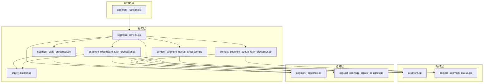
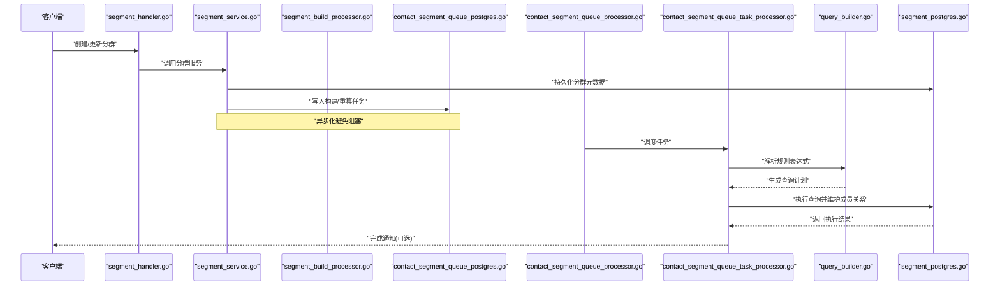
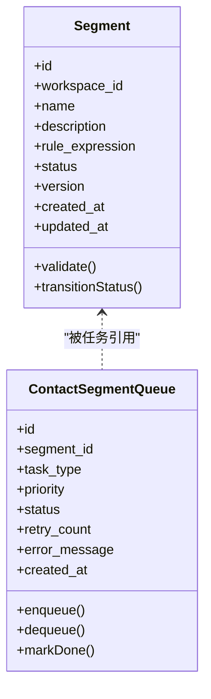
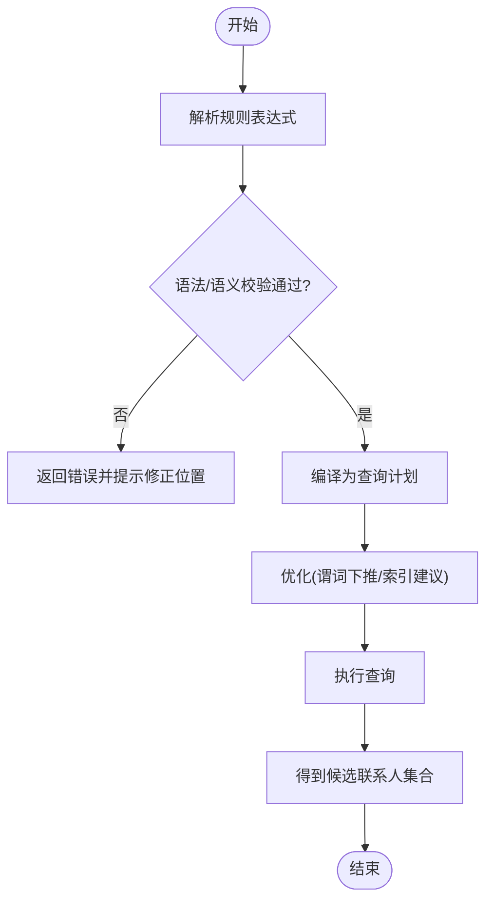
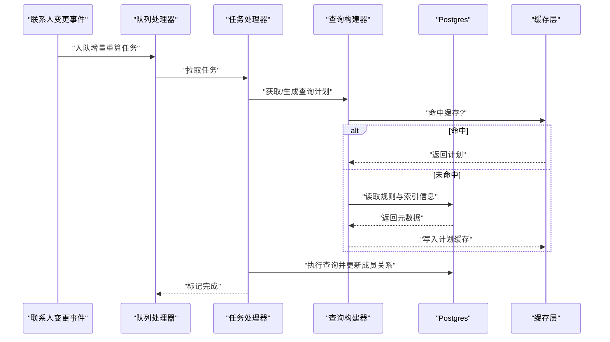
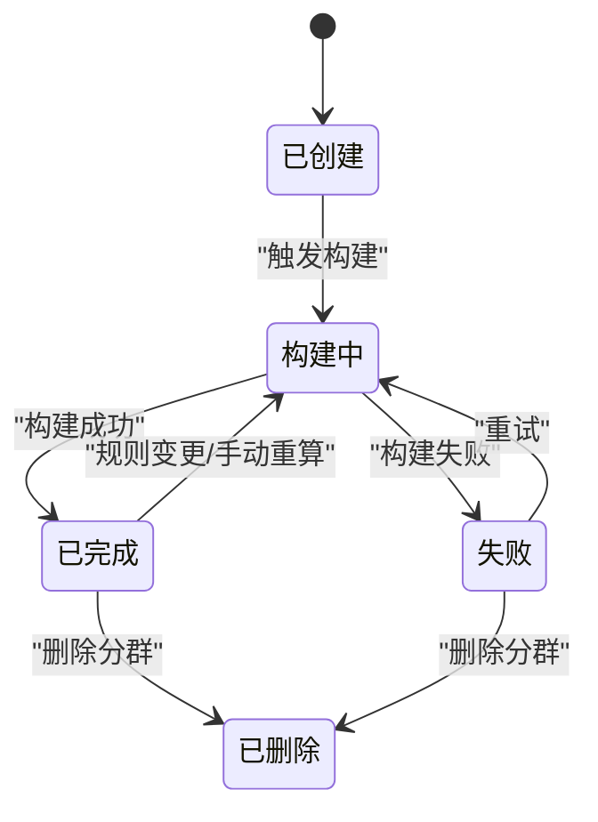
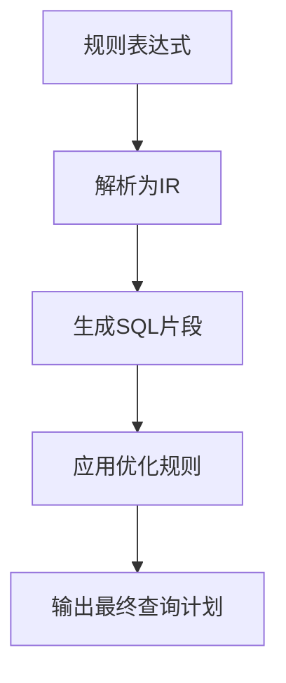
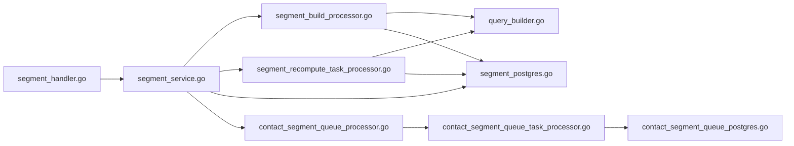

# 联系人分群系统

<cite>
**本文引用的文件**   
- [segment.go](file://notifuse/internal/domain/segment.go)
- [segment_test.go](file://notifuse/internal/domain/segment_test.go)
- [segment_handler.go](file://notifuse/internal/http/segment_handler.go)
- [segment_handler_test.go](file://notifuse/internal/http/segment_handler_test.go)
- [segment_postgres.go](file://notifuse/internal/repository/segment_postgres.go)
- [segment_postgres_test.go](file://notifuse/internal/repository/segment_postgres_test.go)
- [contact_segment_queue.go](file://notifuse/internal/domain/contact_segment_queue.go)
- [contact_segment_queue_postgres.go](file://notifuse/internal/repository/contact_segment_queue_postgres.go)
- [contact_segment_queue_processor.go](file://notifuse/internal/service/contact_segment_queue_processor.go)
- [contact_segment_queue_task_processor.go](file://notifuse/internal/service/contact_segment_queue_task_processor.go)
- [segment_service.go](file://notifuse/internal/service/segment_service.go)
- [segment_build_processor.go](file://notifuse/internal/service/segment_build_processor.go)
- [segment_recompute_task_processor.go](file://notifuse/internal/service/segment_recompute_task_processor.go)
- [query_builder.go](file://notifuse/internal/service/query_builder.go)
</cite>

## 目录
1. [简介](#简介)
2. [项目结构](#项目结构)
3. [核心组件](#核心组件)
4. [架构总览](#架构总览)
5. [详细组件分析](#详细组件分析)
6. [依赖关系分析](#依赖关系分析)
7. [性能考量](#性能考量)
8. [故障排查指南](#故障排查指南)
9. [结论](#结论)
10. [附录](#附录)

## 简介
本文件为 Notifuse 平台的“联系人分群(Segment)”系统提供数据模型与实现文档。重点覆盖：
- 分群的动态规则引擎架构，包括条件表达式语法、运算符支持与逻辑组合方式
- 分群规则的实时计算机制与缓存策略
- 分群生命周期管理（创建、更新、删除、重新计算）
- 分群与联系人的多对多关系及数据同步机制
- 面向大数据集的性能优化策略
- 分群规则的测试与调试工具使用方法

## 项目结构
围绕分群系统的代码主要分布在以下层次：
- 领域层(domain)：定义分群实体、队列任务等核心数据结构与校验
- 服务层(service)：编排分群构建、重算、队列处理等业务流程
- 仓储层(repository)：持久化分群、队列任务以及查询构建器
- HTTP 层(http)：对外暴露的分群 API 处理器
- 数据库迁移(migrations)：分群相关表结构与索引演进

图表来源
- [segment_handler.go](file://notifuse/internal/http/segment_handler.go)
- [segment_service.go](file://notifuse/internal/service/segment_service.go)
- [segment_build_processor.go](file://notifuse/internal/service/segment_build_processor.go)
- [segment_recompute_task_processor.go](file://notifuse/internal/service/segment_recompute_task_processor.go)
- [contact_segment_queue_processor.go](file://notifuse/internal/service/contact_segment_queue_processor.go)
- [contact_segment_queue_task_processor.go](file://notifuse/internal/service/contact_segment_queue_task_processor.go)
- [query_builder.go](file://notifuse/internal/service/query_builder.go)
- [segment_postgres.go](file://notifuse/internal/repository/segment_postgres.go)
- [contact_segment_queue_postgres.go](file://notifuse/internal/repository/contact_segment_queue_postgres.go)
- [segment.go](file://notifuse/internal/domain/segment.go)
- [contact_segment_queue.go](file://notifuse/internal/domain/contact_segment_queue.go)

章节来源
- [segment_handler.go](file://notifuse/internal/http/segment_handler.go)
- [segment_service.go](file://notifuse/internal/service/segment_service.go)
- [segment_build_processor.go](file://notifuse/internal/service/segment_build_processor.go)
- [segment_recompute_task_processor.go](file://notifuse/internal/service/segment_recompute_task_processor.go)
- [contact_segment_queue_processor.go](file://notifuse/internal/service/contact_segment_queue_processor.go)
- [contact_segment_queue_task_processor.go](file://notifuse/internal/service/contact_segment_queue_task_processor.go)
- [query_builder.go](file://notifuse/internal/service/query_builder.go)
- [segment_postgres.go](file://notifuse/internal/repository/segment_postgres.go)
- [contact_segment_queue_postgres.go](file://notifuse/internal/repository/contact_segment_queue_postgres.go)
- [segment.go](file://notifuse/internal/domain/segment.go)
- [contact_segment_queue.go](file://notifuse/internal/domain/contact_segment_queue.go)

## 核心组件
本节聚焦分群系统的关键领域对象与服务职责，帮助读者快速建立整体认知。

- 分群实体与规则
  - 分群实体包含名称、描述、工作区标识、规则表达式、状态、版本等元信息
  - 规则表达式用于声明式地筛选联系人，支持字段比较、集合匹配、时间范围、布尔组合等
  - 参考路径：[segment.go](file://notifuse/internal/domain/segment.go)

- 分群构建与重算
  - 构建处理器负责将规则表达式转换为可执行的查询计划并执行
  - 重算处理器用于增量或全量刷新分群成员
  - 参考路径：[segment_build_processor.go](file://notifuse/internal/service/segment_build_processor.go)、[segment_recompute_task_processor.go](file://notifuse/internal/service/segment_recompute_task_processor.go)

- 队列与异步任务
  - 分群队列任务用于解耦构建与重算流程，支持批量与重试
  - 参考路径：[contact_segment_queue.go](file://notifuse/internal/domain/contact_segment_queue.go)、[contact_segment_queue_postgres.go](file://notifuse/internal/repository/contact_segment_queue_postgres.go)

- 查询构建器
  - 将规则表达式编译为 SQL 片段或查询计划，便于在 Postgres 中高效执行
  - 参考路径：[query_builder.go](file://notifuse/internal/service/query_builder.go)

- 仓储与持久化
  - 分群与队列任务的读写接口，封装 Postgres 访问细节
  - 参考路径：[segment_postgres.go](file://notifuse/internal/repository/segment_postgres.go)、[contact_segment_queue_postgres.go](file://notifuse/internal/repository/contact_segment_queue_postgres.go)

- HTTP 接口
  - 提供分群的 CRUD、触发构建/重算、查看结果等能力
  - 参考路径：[segment_handler.go](file://notifuse/internal/http/segment_handler.go)

章节来源
- [segment.go](file://notifuse/internal/domain/segment.go)
- [segment_build_processor.go](file://notifuse/internal/service/segment_build_processor.go)
- [segment_recompute_task_processor.go](file://notifuse/internal/service/segment_recompute_task_processor.go)
- [contact_segment_queue.go](file://notifuse/internal/domain/contact_segment_queue.go)
- [contact_segment_queue_postgres.go](file://notifuse/internal/repository/contact_segment_queue_postgres.go)
- [query_builder.go](file://notifuse/internal/service/query_builder.go)
- [segment_postgres.go](file://notifuse/internal/repository/segment_postgres.go)
- [segment_handler.go](file://notifuse/internal/http/segment_handler.go)

## 架构总览
下图展示了从 HTTP 请求到规则计算与结果落库的端到端流程，体现“声明式规则 → 查询构建 → 异步队列 → 结果持久化”的整体设计。

图表来源
- [segment_handler.go](file://notifuse/internal/http/segment_handler.go)
- [segment_service.go](file://notifuse/internal/service/segment_service.go)
- [segment_build_processor.go](file://notifuse/internal/service/segment_build_processor.go)
- [segment_recompute_task_processor.go](file://notifuse/internal/service/segment_recompute_task_processor.go)
- [contact_segment_queue_processor.go](file://notifuse/internal/service/contact_segment_queue_processor.go)
- [contact_segment_queue_task_processor.go](file://notifuse/internal/service/contact_segment_queue_task_processor.go)
- [query_builder.go](file://notifuse/internal/service/query_builder.go)
- [segment_postgres.go](file://notifuse/internal/repository/segment_postgres.go)
- [contact_segment_queue_postgres.go](file://notifuse/internal/repository/contact_segment_queue_postgres.go)

## 详细组件分析

### 领域模型与数据流
- 分群实体
  - 关键字段：工作区 ID、名称、描述、规则表达式、状态、版本、创建/更新时间戳
  - 行为：规则校验、版本控制、状态机转换（如待构建、构建中、已完成、失败）
  - 参考路径：[segment.go](file://notifuse/internal/domain/segment.go)

- 分群队列任务
  - 关键字段：分群 ID、任务类型（构建/重算）、优先级、状态、重试次数、错误信息、时间戳
  - 行为：入队、出队、重试、幂等去重
  - 参考路径：[contact_segment_queue.go](file://notifuse/internal/domain/contact_segment_queue.go)

图表来源
- [segment.go](file://notifuse/internal/domain/segment.go)
- [contact_segment_queue.go](file://notifuse/internal/domain/contact_segment_queue.go)

章节来源
- [segment.go](file://notifuse/internal/domain/segment.go)
- [contact_segment_queue.go](file://notifuse/internal/domain/contact_segment_queue.go)

### 规则引擎与表达式语法
- 表达式组成
  - 原子条件：字段名、操作符、值（支持字符串、数值、布尔、日期、集合等）
  - 复合条件：AND/OR/NOT 组合，支持嵌套括号
  - 函数与辅助：时间窗口、模糊匹配、正则、集合包含/不包含等
- 操作符类别
  - 比较：等于、不等于、大于、小于、介于
  - 集合：包含、不包含、为空、非空
  - 文本：前缀、后缀、包含、正则
  - 时间：早于、晚于、区间、相对时间
- 语义与短路
  - 遵循标准布尔语义；短路求值以优化性能
- 编译与验证
  - 在构建阶段进行语法与语义校验，生成中间表示(IR)
  - 参考路径：[segment_build_processor.go](file://notifuse/internal/service/segment_build_processor.go)、[query_builder.go](file://notifuse/internal/service/query_builder.go)

图表来源
- [segment_build_processor.go](file://notifuse/internal/service/segment_build_processor.go)
- [query_builder.go](file://notifuse/internal/service/query_builder.go)

章节来源
- [segment_build_processor.go](file://notifuse/internal/service/segment_build_processor.go)
- [query_builder.go](file://notifuse/internal/service/query_builder.go)

### 实时计算与缓存策略
- 实时计算
  - 当联系人属性变更时，触发增量重算任务，仅评估受影响的分群
  - 使用队列任务保证高可用与可扩展性
  - 参考路径：[contact_segment_queue_processor.go](file://notifuse/internal/service/contact_segment_queue_processor.go)、[contact_segment_queue_task_processor.go](file://notifuse/internal/service/contact_segment_queue_task_processor.go)

- 缓存策略
  - 查询计划缓存：相同规则表达式的 IR/SQL 片段可复用
  - 结果集缓存：热点分群的结果集可按 TTL 缓存，减少重复计算
  - 失效策略：分群规则变更、联系人属性变更、定时过期
  - 参考路径：[segment_build_processor.go](file://notifuse/internal/service/segment_build_processor.go)、[segment_recompute_task_processor.go](file://notifuse/internal/service/segment_recompute_task_processor.go)

图表来源
- [contact_segment_queue_processor.go](file://notifuse/internal/service/contact_segment_queue_processor.go)
- [contact_segment_queue_task_processor.go](file://notifuse/internal/service/contact_segment_queue_task_processor.go)
- [query_builder.go](file://notifuse/internal/service/query_builder.go)
- [segment_postgres.go](file://notifuse/internal/repository/segment_postgres.go)

章节来源
- [contact_segment_queue_processor.go](file://notifuse/internal/service/contact_segment_queue_processor.go)
- [contact_segment_queue_task_processor.go](file://notifuse/internal/service/contact_segment_queue_task_processor.go)
- [query_builder.go](file://notifuse/internal/service/query_builder.go)
- [segment_postgres.go](file://notifuse/internal/repository/segment_postgres.go)

### 生命周期管理与数据同步
- 生命周期
  - 创建：校验规则表达式，持久化分群元数据，入队初始构建任务
  - 更新：版本号递增，规则变更后触发增量或全量重算
  - 删除：软删除或硬删除，清理关联任务与缓存
  - 重新计算：支持手动触发与自动触发（基于变更事件）
  - 参考路径：[segment_service.go](file://notifuse/internal/service/segment_service.go)、[segment_handler.go](file://notifuse/internal/http/segment_handler.go)

- 多对多关系与同步
  - 分群与联系人通过中间表维护成员关系
  - 同步机制：构建/重算任务按批次写入，支持幂等与冲突解决
  - 参考路径：[segment_postgres.go](file://notifuse/internal/repository/segment_postgres.go)、[contact_segment_queue_postgres.go](file://notifuse/internal/repository/contact_segment_queue_postgres.go)

图表来源
- [segment_service.go](file://notifuse/internal/service/segment_service.go)
- [segment_handler.go](file://notifuse/internal/http/segment_handler.go)
- [segment_postgres.go](file://notifuse/internal/repository/segment_postgres.go)

章节来源
- [segment_service.go](file://notifuse/internal/service/segment_service.go)
- [segment_handler.go](file://notifuse/internal/http/segment_handler.go)
- [segment_postgres.go](file://notifuse/internal/repository/segment_postgres.go)

### 查询构建器与 SQL 优化
- 功能要点
  - 将规则表达式编译为 SQL 片段，支持谓词下推、索引友好写法
  - 针对常见模式生成最优查询计划，减少扫描范围
  - 参考路径：[query_builder.go](file://notifuse/internal/service/query_builder.go)

- 典型优化
  - 使用覆盖索引与部分索引
  - 将复杂条件拆分为多个子查询合并
  - 限制结果集大小与分页游标
  - 参考路径：[segment_postgres.go](file://notifuse/internal/repository/segment_postgres.go)

图表来源
- [query_builder.go](file://notifuse/internal/service/query_builder.go)
- [segment_postgres.go](file://notifuse/internal/repository/segment_postgres.go)

章节来源
- [query_builder.go](file://notifuse/internal/service/query_builder.go)
- [segment_postgres.go](file://notifuse/internal/repository/segment_postgres.go)

### HTTP 接口与控制器
- 能力清单
  - 分群列表、详情、创建、更新、删除
  - 触发构建/重算、查看构建日志与状态
  - 参考路径：[segment_handler.go](file://notifuse/internal/http/segment_handler.go)

- 错误处理
  - 统一错误码与消息，记录上下文以便排障
  - 参考路径：[segment_handler.go](file://notifuse/internal/http/segment_handler.go)

章节来源
- [segment_handler.go](file://notifuse/internal/http/segment_handler.go)

## 依赖关系分析
- 组件耦合
  - HTTP 层仅依赖服务层，服务层依赖领域与仓储，仓储直接访问数据库
  - 查询构建器作为共享组件被构建与重算处理器复用
- 外部依赖
  - Postgres 作为主存储，需确保关键索引存在
  - 队列后端（由仓储抽象）用于任务持久化与调度

图表来源
- [segment_handler.go](file://notifuse/internal/http/segment_handler.go)
- [segment_service.go](file://notifuse/internal/service/segment_service.go)
- [segment_build_processor.go](file://notifuse/internal/service/segment_build_processor.go)
- [segment_recompute_task_processor.go](file://notifuse/internal/service/segment_recompute_task_processor.go)
- [query_builder.go](file://notifuse/internal/service/query_builder.go)
- [segment_postgres.go](file://notifuse/internal/repository/segment_postgres.go)
- [contact_segment_queue_processor.go](file://notifuse/internal/service/contact_segment_queue_processor.go)
- [contact_segment_queue_task_processor.go](file://notifuse/internal/service/contact_segment_queue_task_processor.go)
- [contact_segment_queue_postgres.go](file://notifuse/internal/repository/contact_segment_queue_postgres.go)

章节来源
- [segment_handler.go](file://notifuse/internal/http/segment_handler.go)
- [segment_service.go](file://notifuse/internal/service/segment_service.go)
- [segment_build_processor.go](file://notifuse/internal/service/segment_build_processor.go)
- [segment_recompute_task_processor.go](file://notifuse/internal/service/segment_recompute_task_processor.go)
- [query_builder.go](file://notifuse/internal/service/query_builder.go)
- [segment_postgres.go](file://notifuse/internal/repository/segment_postgres.go)
- [contact_segment_queue_processor.go](file://notifuse/internal/service/contact_segment_queue_processor.go)
- [contact_segment_queue_task_processor.go](file://notifuse/internal/service/contact_segment_queue_task_processor.go)
- [contact_segment_queue_postgres.go](file://notifuse/internal/repository/contact_segment_queue_postgres.go)

## 性能考量
- 索引设计
  - 为常用过滤字段建立单列或多列索引，必要时使用部分索引
  - 为分群成员关系表建立联合索引以加速成员查询
- 批处理与分页
  - 构建/重算采用分批提交，降低事务锁竞争与内存占用
  - 使用游标分页避免大结果集一次性加载
- 并行与限流
  - 队列消费者水平扩展，结合速率限制保护下游数据库
- 缓存与去重
  - 查询计划与热点结果集缓存，配合失效策略提升命中率
- 监控与观测
  - 记录关键指标：构建耗时、队列积压、失败率、缓存命中率

[本节为通用指导，不直接分析具体文件]

## 故障排查指南
- 常见问题定位
  - 规则表达式语法错误：检查构建阶段的错误信息与提示位置
  - 构建超时或内存溢出：调整批大小与并发度，优化索引
  - 队列堆积：扩容消费者，检查任务重试与死信策略
  - 结果不一致：确认幂等性与冲突解决逻辑
- 调试工具
  - 单元测试：覆盖规则解析、查询构建、仓储读写
  - 集成测试：端到端验证构建与重算流程
  - 参考路径：[segment_test.go](file://notifuse/internal/domain/segment_test.go)、[segment_handler_test.go](file://notifuse/internal/http/segment_handler_test.go)、[segment_postgres_test.go](file://notifuse/internal/repository/segment_postgres_test.go)

章节来源
- [segment_test.go](file://notifuse/internal/domain/segment_test.go)
- [segment_handler_test.go](file://notifuse/internal/http/segment_handler_test.go)
- [segment_postgres_test.go](file://notifuse/internal/repository/segment_postgres_test.go)

## 结论
Notifuse 的分群系统通过“声明式规则 + 查询构建 + 异步队列 + 持久化”的架构，实现了高性能、可扩展且易维护的联系人分群能力。借助完善的测试与调试手段，可在复杂业务场景下稳定运行。

[本节为总结性内容，不直接分析具体文件]

## 附录
- 术语
  - 分群：根据规则筛选出的联系人集合
  - 规则表达式：用于描述筛选条件的声明式语言
  - 查询计划：由规则表达式编译生成的可执行查询
- 最佳实践
  - 优先使用选择性高的条件以减少扫描范围
  - 合理设置缓存 TTL 与失效策略
  - 定期审查索引与查询计划，持续优化

[本节为补充说明，不直接分析具体文件]