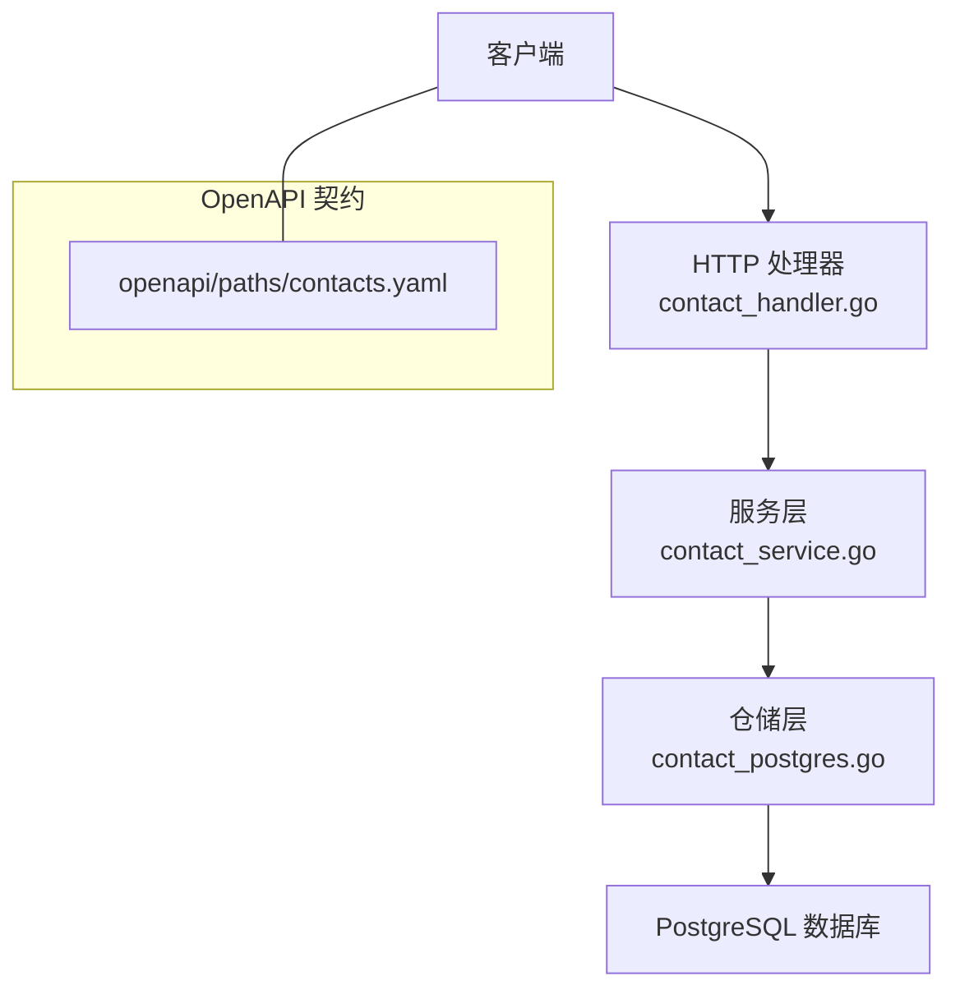
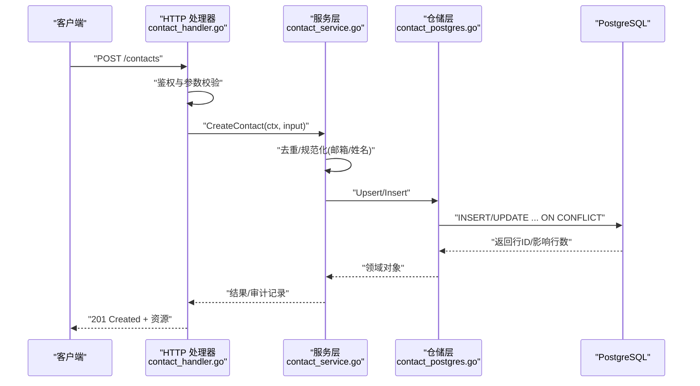
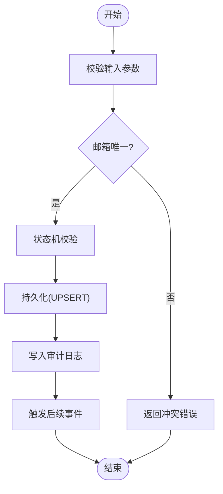
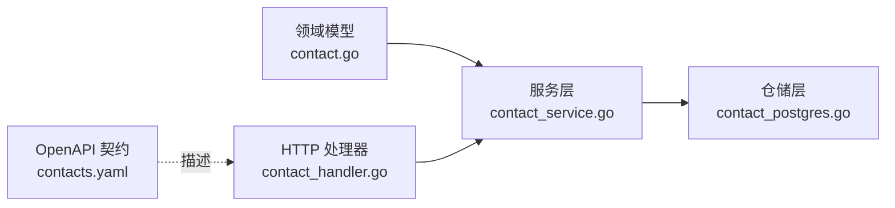

# 联系人基础字段

<cite>
**本文引用的文件**   
- [contact.go](file://notifuse/internal/domain/contact.go)
- [contact_handler.go](file://notifuse/internal/http/contact_handler.go)
- [contact_service.go](file://notifuse/internal/service/contact_service.go)
- [contact_postgres.go](file://notifuse/internal/repository/contact_postgres.go)
- [contacts.yaml](file://notifuse/openapi/paths/contacts.yaml)
- [v10.go](file://notifuse/internal/migrations/v10.go)
- [v23.go](file://notifuse/internal/migrations/v23.go)
- [v24.go](file://notifuse/internal/migrations/v24.go)
- [v25.go](file://notifuse/internal/migrations/v25.go)
- [v26.go](file://notifuse/internal/migrations/v26.go)
- [v27.go](file://notifuse/internal/migrations/v27.go)
- [v28.go](file://notifuse/internal/migrations/v28.go)
- [v29.go](file://notifuse/internal/migrations/v29.go)
- [v30.go](file://notifuse/internal/migrations/v30.go)
- [v31.go](file://notifuse/internal/migrations/v31.go)
- [v32.go](file://notifuse/internal/migrations/v32.go)
- [v33.go](file://notifuse/internal/migrations/v33.go)
- [v34.go](file://notifuse/internal/migrations/v34.go)
</cite>

## 目录
1. [简介](#简介)
2. [项目结构](#项目结构)
3. [核心组件](#核心组件)
4. [架构总览](#架构总览)
5. [详细组件分析](#详细组件分析)
6. [依赖关系分析](#依赖关系分析)
7. [性能考虑](#性能考虑)
8. [故障排查指南](#故障排查指南)
9. [结论](#结论)
10. [附录](#附录)

## 简介
本文件为 Notifuse 平台的“联系人”实体提供一份面向数据模型的权威文档，聚焦于联系人的基础字段定义、验证规则、唯一性与索引策略、CRUD 数据流、权限控制与访问限制，以及字段扩展机制与自定义字段的实现方式。读者可据此理解从 API 到数据库的完整链路，并在不深入源码的情况下进行二次开发与集成。

## 项目结构
围绕联系人领域，代码按分层组织：
- 领域模型：定义联系人实体的结构与约束
- HTTP 层：暴露 RESTful 接口并处理请求校验
- 服务层：编排业务逻辑（去重、状态机、审计等）
- 仓储层：持久化到 PostgreSQL，管理迁移与索引
- OpenAPI：对外契约与字段说明

图表来源
- [contact_handler.go:1-200](file://notifuse/internal/http/contact_handler.go#L1-L200)
- [contact_service.go:1-200](file://notifuse/internal/service/contact_service.go#L1-L200)
- [contact_postgres.go:1-200](file://notifuse/internal/repository/contact_postgres.go#L1-L200)
- [contacts.yaml:1-200](file://notifuse/openapi/paths/contacts.yaml#L1-L200)

章节来源
- [contact.go:1-200](file://notifuse/internal/domain/contact.go#L1-L200)
- [contact_handler.go:1-200](file://notifuse/internal/http/contact_handler.go#L1-L200)
- [contact_service.go:1-200](file://notifuse/internal/service/contact_service.go#L1-L200)
- [contact_postgres.go:1-200](file://notifuse/internal/repository/contact_postgres.go#L1-L200)
- [contacts.yaml:1-200](file://notifuse/openapi/paths/contacts.yaml#L1-L200)

## 核心组件
- 领域模型 Contact：定义 ID、邮箱、姓名、状态、工作区归属、时间戳等基础字段及方法
- HTTP 处理器：负责路由、鉴权、参数校验、响应封装
- 服务层：协调去重、状态变更、审计日志、事件触发
- 仓储层：SQL 构建、事务、索引与约束执行
- OpenAPI：字段类型、必填性、示例与错误码约定

章节来源
- [contact.go:1-200](file://notifuse/internal/domain/contact.go#L1-L200)
- [contact_handler.go:1-200](file://notifuse/internal/http/contact_handler.go#L1-L200)
- [contact_service.go:1-200](file://notifuse/internal/service/contact_service.go#L1-L200)
- [contact_postgres.go:1-200](file://notifuse/internal/repository/contact_postgres.go#L1-L200)
- [contacts.yaml:1-200](file://notifuse/openapi/paths/contacts.yaml#L1-L200)

## 架构总览
下图展示一次“创建联系人”的端到端调用链路与数据流向。

图表来源
- [contact_handler.go:1-200](file://notifuse/internal/http/contact_handler.go#L1-L200)
- [contact_service.go:1-200](file://notifuse/internal/service/contact_service.go#L1-L200)
- [contact_postgres.go:1-200](file://notifuse/internal/repository/contact_postgres.go#L1-L200)

## 详细组件分析

### 领域模型：联系人基础字段
本节对联系人核心字段进行系统化梳理，包括数据类型、是否必填、默认值、取值范围与业务含义。

- 标识与归属
  - id：UUID，主键，系统生成，不可变
  - workspace_id：UUID，所属工作区，外键关联工作区表
- 身份与联系信息
  - email：字符串，邮箱地址，必填，全局唯一（同工作区内），大小写归一化后校验格式
  - name：字符串，显示名，可选，长度上限由迁移定义
- 状态与可见性
  - status：枚举，常见取值包含 active、unsubscribed、bounced、invalid 等；默认 active
  - unsubscribed_at：时间戳，退订时间，仅在状态为退订时有效
  - bounced_at：时间戳，退信时间，用于标记投递失败
- 元数据与审计
  - created_at、updated_at：时间戳，系统维护
  - last_seen_at：时间戳，最近活跃时间（如打开/点击或收到回复）
- 扩展字段
  - custom_fields：JSONB，键值对形式的扩展属性，支持动态扩展

字段级约束与验证要点
- 邮箱唯一性：同一 workspace_id 下 email 唯一；跨工作区允许重复
- 邮箱格式：RFC 标准校验，禁止临时邮箱（在入库前由服务层过滤）
- 名称长度：受迁移中列宽限制，超长将被截断或拒绝（以迁移为准）
- 状态机：仅允许合法转换（例如 active→unsubscribed、active→bounced）
- 时间戳：created_at 只增，updated_at 随更新自动刷新

唯一性与索引策略
- 主键索引：id
- 唯一索引：(workspace_id, email)
- 查询优化索引：status、last_seen_at、updated_at（按需组合）
- 全文检索：name/email 可按需建立 GIN/GiST 索引（视迁移版本而定）

权限与访问控制
- 工作区级隔离：所有读写均强制携带 workspace_id，跨工作区不可见
- 角色控制：仅具备相应角色的用户可创建/更新/删除联系人
- 敏感字段：custom_fields 中的 PII 字段应遵循最小可见原则，通过中间件或过滤器屏蔽

字段扩展机制与自定义字段
- JSONB 存储：custom_fields 支持任意键值对，便于快速迭代
- 命名规范：建议采用“模块.子键”命名空间，避免冲突
- 校验与默认值：在服务层统一解析与校验，保证一致性
- 迁移策略：新增常用字段时可考虑提升为一级列并建立索引，以提升查询性能

章节来源
- [contact.go:1-200](file://notifuse/internal/domain/contact.go#L1-L200)
- [v10.go:1-200](file://notifuse/internal/migrations/v10.go#L1-L200)
- [v23.go:1-200](file://notifuse/internal/migrations/v23.go#L1-L200)
- [v24.go:1-200](file://notifuse/internal/migrations/v24.go#L1-L200)
- [v25.go:1-200](file://notifuse/internal/migrations/v25.go#L1-L200)
- [v26.go:1-200](file://notifuse/internal/migrations/v26.go#L1-L200)
- [v27.go:1-200](file://notifuse/internal/migrations/v27.go#L1-L200)
- [v28.go:1-200](file://notifuse/internal/migrations/v28.go#L1-L200)
- [v29.go:1-200](file://notifuse/internal/migrations/v29.go#L1-L200)
- [v30.go:1-200](file://notifuse/internal/migrations/v30.go#L1-L200)
- [v31.go:1-200](file://notifuse/internal/migrations/v31.go#L1-L200)
- [v32.go:1-200](file://notifuse/internal/migrations/v32.go#L1-L200)
- [v33.go:1-200](file://notifuse/internal/migrations/v33.go#L1-L200)
- [v34.go:1-200](file://notifuse/internal/migrations/v34.go#L1-L200)

### HTTP 处理器：联系人接口契约
- 路由与方法
  - POST /contacts：创建联系人
  - GET /contacts/{id}：获取联系人详情
  - PATCH /contacts/{id}：更新联系人
  - DELETE /contacts/{id}：删除联系人
  - GET /contacts：列表与分页（含筛选、排序）
- 请求体与响应
  - 输入字段与类型以 OpenAPI 为准
  - 成功返回资源对象，失败返回标准化错误体
- 鉴权与限流
  - 基于工作区的鉴权中间件
  - 针对批量导入接口启用速率限制

章节来源
- [contact_handler.go:1-200](file://notifuse/internal/http/contact_handler.go#L1-L200)
- [contacts.yaml:1-200](file://notifuse/openapi/paths/contacts.yaml#L1-L200)

### 服务层：业务编排与校验
- 创建流程
  - 参数校验与规范化（邮箱小写、去除空白）
  - 去重检查（按 workspace_id+email）
  - 状态初始化与审计记录写入
  - 触发后续任务（如分群计算、欢迎邮件）
- 更新流程
  - 增量更新，保留未变更字段
  - 状态变更校验（状态机）
  - 审计与事件发布
- 删除流程
  - 软删除或硬删除策略（以迁移与服务实现为准）
  - 清理关联数据（如时间线、队列项）

章节来源
- [contact_service.go:1-200](file://notifuse/internal/service/contact_service.go#L1-L200)

### 仓储层：持久化与索引
- 建表与迁移
  - 基础列定义、约束与默认值
  - 唯一索引 (workspace_id, email)
  - 辅助索引：status、updated_at、last_seen_at
- 操作语义
  - Upsert：根据唯一键冲突选择插入或更新
  - 批量导入：使用 COPY 或批量 INSERT 提升吞吐
  - 软删除：若采用软删，增加 deleted_at 列与过滤条件

章节来源
- [contact_postgres.go:1-200](file://notifuse/internal/repository/contact_postgres.go#L1-L200)
- [v10.go:1-200](file://notifuse/internal/migrations/v10.go#L1-L200)
- [v23.go:1-200](file://notifuse/internal/migrations/v23.go#L1-L200)
- [v24.go:1-200](file://notifuse/internal/migrations/v24.go#L1-L200)
- [v25.go:1-200](file://notifuse/internal/migrations/v25.go#L1-L200)
- [v26.go:1-200](file://notifuse/internal/migrations/v26.go#L1-L200)
- [v27.go:1-200](file://notifuse/internal/migrations/v27.go#L1-L200)
- [v28.go:1-200](file://notifuse/internal/migrations/v28.go#L1-L200)
- [v29.go:1-200](file://notifuse/internal/migrations/v29.go#L1-L200)
- [v30.go:1-200](file://notifuse/internal/migrations/v30.go#L1-L200)
- [v31.go:1-200](file://notifuse/internal/migrations/v31.go#L1-L200)
- [v32.go:1-200](file://notifuse/internal/migrations/v32.go#L1-L200)
- [v33.go:1-200](file://notifuse/internal/migrations/v33.go#L1-L200)
- [v34.go:1-200](file://notifuse/internal/migrations/v34.go#L1-L200)

### 数据流与状态机
- 创建联系人
  - 输入校验 → 去重 → 插入/更新 → 审计 → 事件
- 更新联系人
  - 差异计算 → 状态机校验 → 持久化 → 审计 → 事件
- 删除联系人
  - 权限校验 → 软/硬删除 → 清理关联 → 审计

图表来源
- [contact_service.go:1-200](file://notifuse/internal/service/contact_service.go#L1-L200)
- [contact_postgres.go:1-200](file://notifuse/internal/repository/contact_postgres.go#L1-L200)

## 依赖关系分析
- 耦合关系
  - HTTP 处理器依赖服务层，服务层依赖仓储层
  - 领域模型贯穿三层，作为数据载体
- 外部依赖
  - PostgreSQL：DDL/DML、索引与约束
  - OpenAPI：对外契约与字段描述
- 潜在循环依赖
  - 当前分层清晰，未见循环引用

图表来源
- [contact.go:1-200](file://notifuse/internal/domain/contact.go#L1-L200)
- [contact_service.go:1-200](file://notifuse/internal/service/contact_service.go#L1-L200)
- [contact_postgres.go:1-200](file://notifuse/internal/repository/contact_postgres.go#L1-L200)
- [contact_handler.go:1-200](file://notifuse/internal/http/contact_handler.go#L1-L200)
- [contacts.yaml:1-200](file://notifuse/openapi/paths/contacts.yaml#L1-L200)

## 性能考虑
- 索引设计
  - 确保 (workspace_id, email) 唯一索引存在
  - 高频查询列（status、updated_at、last_seen_at）建立合适索引
- 写入优化
  - 批量导入优先使用 COPY 或批量 UPSERT
  - 减少不必要的 JSONB 读写，必要时将热点字段上提为列
- 读取优化
  - 分页与投影：仅返回必要字段
  - 缓存热点数据（如按邮箱查询）

## 故障排查指南
- 常见错误
  - 邮箱重复：检查唯一索引与工作区隔离
  - 非法邮箱格式：确认服务层校验与正则
  - 状态非法转换：核对状态机规则
- 定位步骤
  - 查看 HTTP 层日志与请求体
  - 检查服务层校验与去重逻辑
  - 审查仓储层 SQL 与索引命中情况
  - 核对迁移版本与 DDL 一致性

章节来源
- [contact_handler.go:1-200](file://notifuse/internal/http/contact_handler.go#L1-L200)
- [contact_service.go:1-200](file://notifuse/internal/service/contact_service.go#L1-L200)
- [contact_postgres.go:1-200](file://notifuse/internal/repository/contact_postgres.go#L1-L200)

## 结论
联系人基础字段围绕“可识别、可追踪、可扩展”的目标设计：以邮箱为核心标识，结合工作区隔离与严格的状态机，保障数据一致性与业务安全；通过 JSONB 扩展字段满足灵活需求，同时借助合理的索引与批量写入策略维持高性能。建议在后续演进中持续评估将热点字段上提为列，以进一步优化查询性能。

## 附录
- 字段字典（摘要）
  - id：UUID，主键
  - workspace_id：UUID，工作区外键
  - email：字符串，必填，唯一（同工作区）
  - name：字符串，可选，长度受限
  - status：枚举，默认 active
  - unsubscribed_at：时间戳
  - bounced_at：时间戳
  - created_at、updated_at：时间戳
  - last_seen_at：时间戳
  - custom_fields：JSONB，扩展属性
- 索引清单（摘要）
  - 主键：id
  - 唯一：(workspace_id, email)
  - 辅助：status、updated_at、last_seen_at（按需）

章节来源
- [contact.go:1-200](file://notifuse/internal/domain/contact.go#L1-L200)
- [contacts.yaml:1-200](file://notifuse/openapi/paths/contacts.yaml#L1-L200)
- [v10.go:1-200](file://notifuse/internal/migrations/v10.go#L1-L200)
- [v23.go:1-200](file://notifuse/internal/migrations/v23.go#L1-L200)
- [v24.go:1-200](file://notifuse/internal/migrations/v24.go#L1-L200)
- [v25.go:1-200](file://notifuse/internal/migrations/v25.go#L1-L200)
- [v26.go:1-200](file://notifuse/internal/migrations/v26.go#L1-L200)
- [v27.go:1-200](file://notifuse/internal/migrations/v27.go#L1-L200)
- [v28.go:1-200](file://notifuse/internal/migrations/v28.go#L1-L200)
- [v29.go:1-200](file://notifuse/internal/migrations/v29.go#L1-L200)
- [v30.go:1-200](file://notifuse/internal/migrations/v30.go#L1-L200)
- [v31.go:1-200](file://notifuse/internal/migrations/v31.go#L1-L200)
- [v32.go:1-200](file://notifuse/internal/migrations/v32.go#L1-L200)
- [v33.go:1-200](file://notifuse/internal/migrations/v33.go#L1-L200)
- [v34.go:1-200](file://notifuse/internal/migrations/v34.go#L1-L200)