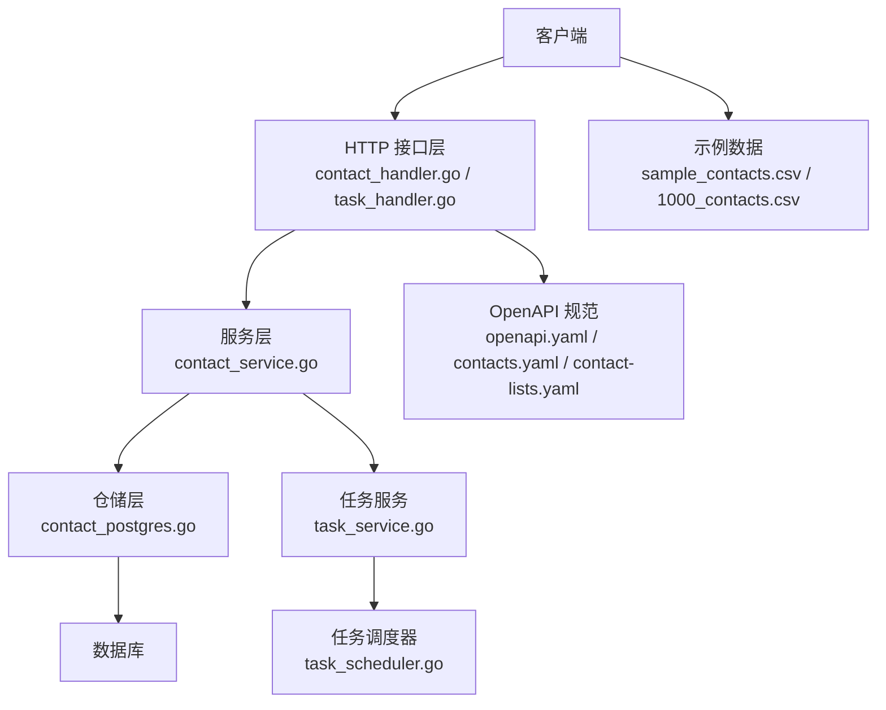
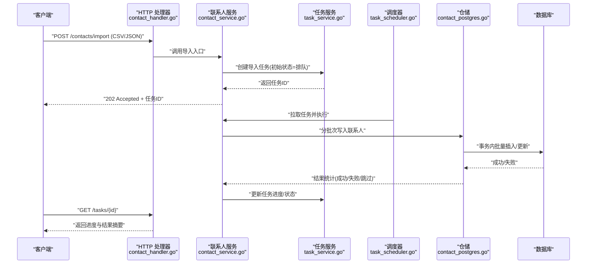
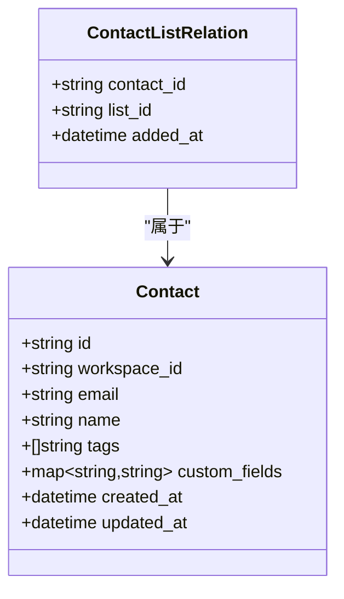
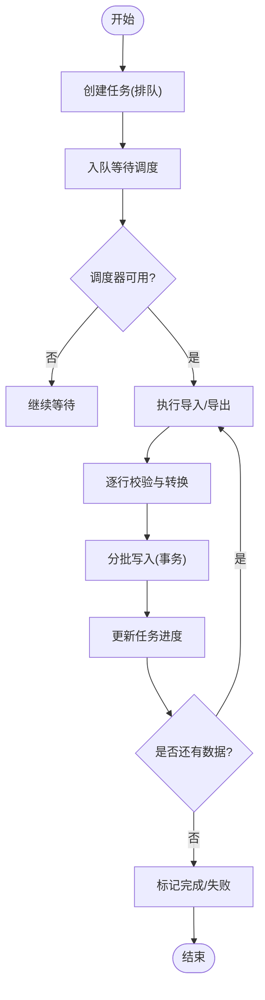
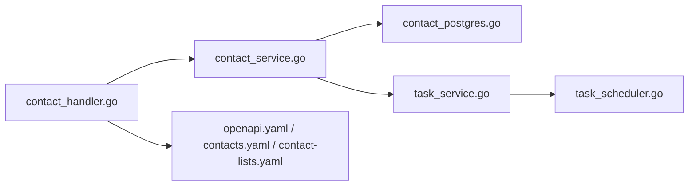

# 联系人批量操作

<cite>
**本文引用的文件**
- [contact.go](file://notifuse/internal/domain/contact.go)
- [contact_list.go](file://notifuse/internal/domain/contact_list.go)
- [contact_handler.go](file://notifuse/internal/http/contact_handler.go)
- [contact_service.go](file://notifuse/internal/service/contact_service.go)
- [contact_postgres.go](file://notifuse/internal/repository/contact_postgres.go)
- [task.go](file://notifuse/internal/domain/task.go)
- [task_service.go](file://notifuse/internal/service/task_service.go)
- [task_scheduler.go](file://notifuse/internal/service/task_scheduler.go)
- [task_handler.go](file://notifuse/internal/http/task_handler.go)
- [openapi.yaml](file://notifuse/openapi/openapi.yaml)
- [contacts.yaml](file://notifuse/openapi/paths/contacts.yaml)
- [contact-lists.yaml](file://notifuse/openapi/paths/contact-lists.yaml)
- [sample_contacts.csv](file://notifuse/samples/sample_contacts.csv)
- [1000_contacts.csv](file://notifuse/samples/1000_contacts.csv)
</cite>

## 目录
1. [简介](#简介)
2. [项目结构](#项目结构)
3. [核心组件](#核心组件)
4. [架构总览](#架构总览)
5. [详细组件分析](#详细组件分析)
6. [依赖关系分析](#依赖关系分析)
7. [性能考虑](#性能考虑)
8. [故障排查指南](#故障排查指南)
9. [结论](#结论)
10. [附录](#附录)

## 简介
本文件为 Notifuse 平台“联系人批量操作”的数据模型与处理机制文档，覆盖以下主题：
- 联系人导入/导出的数据格式与转换规则
- 批量操作的异步处理机制与进度跟踪
- 数据验证规则与错误处理策略
- 事务处理与回滚机制
- 大数据集的性能优化与内存管理
- 监控与日志记录能力

## 项目结构
围绕联系人批量操作的相关代码主要分布在以下层次：
- 领域模型层：定义联系人、联系人与列表关联等数据结构
- HTTP 接口层：提供导入/导出、任务查询等 API
- 服务层：编排导入/导出流程、校验、去重、写入等逻辑
- 仓储层：持久化联系人及批量任务状态
- 任务调度层：基于任务系统实现异步执行与进度上报
- OpenAPI 规范：对外暴露的接口契约与示例数据

图表来源
- [contact_handler.go:1-200](file://notifuse/internal/http/contact_handler.go#L1-L200)
- [contact_service.go:1-200](file://notifuse/internal/service/contact_service.go#L1-L200)
- [contact_postgres.go:1-200](file://notifuse/internal/repository/contact_postgres.go#L1-L200)
- [task_service.go:1-200](file://notifuse/internal/service/task_service.go#L1-L200)
- [task_scheduler.go:1-200](file://notifuse/internal/service/task_scheduler.go#L1-L200)
- [openapi.yaml:1-200](file://notifuse/openapi/openapi.yaml#L1-L200)
- [contacts.yaml:1-200](file://notifuse/openapi/paths/contacts.yaml#L1-L200)
- [contact-lists.yaml:1-200](file://notifuse/openapi/paths/contact-lists.yaml#L1-L200)

章节来源
- [contact_handler.go:1-200](file://notifuse/internal/http/contact_handler.go#L1-L200)
- [contact_service.go:1-200](file://notifuse/internal/service/contact_service.go#L1-L200)
- [contact_postgres.go:1-200](file://notifuse/internal/repository/contact_postgres.go#L1-L200)
- [task_service.go:1-200](file://notifuse/internal/service/task_service.go#L1-L200)
- [task_scheduler.go:1-200](file://notifuse/internal/service/task_scheduler.go#L1-L200)
- [openapi.yaml:1-200](file://notifuse/openapi/openapi.yaml#L1-L200)
- [contacts.yaml:1-200](file://notifuse/openapi/paths/contacts.yaml#L1-L200)
- [contact-lists.yaml:1-200](file://notifuse/openapi/paths/contact-lists.yaml#L1-L200)

## 核心组件
- 领域模型
  - 联系人实体：包含标识、工作空间、邮箱、姓名、标签、自定义字段、时间戳等
  - 联系人-列表关系：用于将联系人加入或移除指定列表
- 服务编排
  - 导入：解析 CSV/JSON -> 校验 -> 去重 -> 分批写入 -> 更新任务进度
  - 导出：按条件筛选 -> 分页读取 -> 序列化输出
- 任务系统
  - 使用任务域模型与任务服务创建/查询任务，调度器负责消费并推进状态
- 仓储访问
  - 批量插入/更新、条件查询、分页游标、事务边界控制

章节来源
- [contact.go:1-200](file://notifuse/internal/domain/contact.go#L1-L200)
- [contact_list.go:1-200](file://notifuse/internal/domain/contact_list.go#L1-L200)
- [task.go:1-200](file://notifuse/internal/domain/task.go#L1-L200)
- [contact_service.go:1-200](file://notifuse/internal/service/contact_service.go#L1-L200)
- [contact_postgres.go:1-200](file://notifuse/internal/repository/contact_postgres.go#L1-L200)

## 架构总览
下图展示从请求到落库的关键路径，以及任务驱动的异步处理与进度反馈。

图表来源
- [contact_handler.go:1-200](file://notifuse/internal/http/contact_handler.go#L1-L200)
- [contact_service.go:1-200](file://notifuse/internal/service/contact_service.go#L1-L200)
- [task_service.go:1-200](file://notifuse/internal/service/task_service.go#L1-L200)
- [task_scheduler.go:1-200](file://notifuse/internal/service/task_scheduler.go#L1-L200)
- [contact_postgres.go:1-200](file://notifuse/internal/repository/contact_postgres.go#L1-L200)

## 详细组件分析

### 数据模型与字段约束
- 联系人主键与工作空间隔离
- 邮箱唯一性约束（同一工作空间内）
- 必填字段：邮箱；可选字段：姓名、标签、自定义字段
- 时间戳：创建/更新时间由系统维护
- 联系人-列表关系：多对多映射，支持批量增删

图表来源
- [contact.go:1-200](file://notifuse/internal/domain/contact.go#L1-L200)
- [contact_list.go:1-200](file://notifuse/internal/domain/contact_list.go#L1-L200)

章节来源
- [contact.go:1-200](file://notifuse/internal/domain/contact.go#L1-L200)
- [contact_list.go:1-200](file://notifuse/internal/domain/contact_list.go#L1-L200)

### 导入数据格式与转换规则
- 支持格式
  - CSV：首行为列名，至少包含邮箱；可包含姓名、标签、自定义字段
  - JSON：数组对象，字段与 CSV 列名一致
- 列名映射
  - 邮箱：email
  - 姓名：name
  - 标签：tags（逗号分隔或数组）
  - 自定义字段：以 key:value 形式扩展
- 转换规则
  - 邮箱标准化：去除前后空白、统一小写
  - 标签规范化：去空、去重
  - 自定义字段：类型推断与默认值填充
  - 重复处理：同工作空间下相同邮箱视为重复，可选择“跳过/覆盖”
- 示例数据
  - sample_contacts.csv
  - 1000_contacts.csv

章节来源
- [sample_contacts.csv:1-200](file://notifuse/samples/sample_contacts.csv#L1-L200)
- [1000_contacts.csv:1-200](file://notifuse/samples/1000_contacts.csv#L1-L200)

### 导出数据格式与转换规则
- 导出格式
  - CSV：与导入列名保持一致，便于二次编辑后重新导入
  - JSON：结构化对象数组
- 过滤与排序
  - 支持按标签、自定义字段、时间范围筛选
  - 支持分页参数 limit/offset 或游标
- 字段映射
  - 导出字段与导入字段一一对应，确保往返一致性

章节来源
- [contact_service.go:1-200](file://notifuse/internal/service/contact_service.go#L1-L200)
- [contact_postgres.go:1-200](file://notifuse/internal/repository/contact_postgres.go#L1-L200)

### 异步处理机制与进度跟踪
- 任务模型
  - 任务 ID、类型（导入/导出）、状态（排队/进行中/完成/失败）、进度百分比、错误信息、开始/结束时间
- 生命周期
  - 创建任务 -> 入队 -> 调度器拉取 -> 执行 -> 更新进度 -> 完成/失败
- 进度上报
  - 每批处理后上报累计成功/失败/跳过数量与百分比
- 查询接口
  - 通过任务 ID 获取当前进度与最终结果摘要

图表来源
- [task.go:1-200](file://notifuse/internal/domain/task.go#L1-L200)
- [task_service.go:1-200](file://notifuse/internal/service/task_service.go#L1-L200)
- [task_scheduler.go:1-200](file://notifuse/internal/service/task_scheduler.go#L1-L200)
- [contact_service.go:1-200](file://notifuse/internal/service/contact_service.go#L1-L200)

章节来源
- [task.go:1-200](file://notifuse/internal/domain/task.go#L1-L200)
- [task_service.go:1-200](file://notifuse/internal/service/task_service.go#L1-L200)
- [task_scheduler.go:1-200](file://notifuse/internal/service/task_scheduler.go#L1-L200)

### 数据验证规则与错误处理策略
- 字段级验证
  - 邮箱：非空、合法格式、长度限制
  - 姓名：长度限制、字符集限制
  - 标签：长度与数量上限
  - 自定义字段：键名合法性、值类型与大小限制
- 业务级验证
  - 工作空间权限校验
  - 重复检测（邮箱唯一性）
  - 列表存在性与归属校验
- 错误分类
  - 致命错误：导致任务失败（如权限不足、存储不可用）
  - 可恢复错误：单行失败但整体继续（如格式异常），记录失败明细
- 错误响应
  - 任务级别返回错误摘要
  - 行级别失败明细可下载或查看

章节来源
- [contact_service.go:1-200](file://notifuse/internal/service/contact_service.go#L1-L200)
- [contact_postgres.go:1-200](file://notifuse/internal/repository/contact_postgres.go#L1-L200)

### 事务处理与回滚机制
- 事务边界
  - 每批写入开启独立事务，保证原子性
- 回滚策略
  - 单批失败则整批回滚，不影响其他批次
  - 任务层面记录失败批次与原因，支持重试
- 幂等性
  - 基于邮箱+工作空间的 upsert 语义，避免重复导入造成数据不一致

章节来源
- [contact_postgres.go:1-200](file://notifuse/internal/repository/contact_postgres.go#L1-L200)

### 性能优化与内存管理
- 流式读取
  - 导入采用流式解析，避免一次性加载大文件
- 分批处理
  - 设定批次大小（例如数百至数千条），平衡吞吐与内存占用
- 索引与约束
  - 利用邮箱唯一索引加速重复检测
- 并发控制
  - 限制并发写入数，避免数据库连接池耗尽
- 分页与游标
  - 导出使用分页或游标，降低单次查询压力

章节来源
- [contact_service.go:1-200](file://notifuse/internal/service/contact_service.go#L1-L200)
- [contact_postgres.go:1-200](file://notifuse/internal/repository/contact_postgres.go#L1-L200)

### 监控与日志记录
- 指标采集
  - 任务创建/完成耗时、成功率、失败率、平均批次大小
- 日志记录
  - 关键步骤打点：解析、校验、写入、进度更新
  - 失败行明细记录，便于问题定位
- 告警
  - 任务长时间未完成或失败率超阈时触发告警

章节来源
- [task_service.go:1-200](file://notifuse/internal/service/task_service.go#L1-L200)
- [contact_service.go:1-200](file://notifuse/internal/service/contact_service.go#L1-L200)

## 依赖关系分析
- HTTP 层依赖服务层进行业务编排
- 服务层依赖仓储层进行数据持久化
- 服务层依赖任务服务进行异步执行与进度上报
- 任务调度器驱动服务层执行具体任务
- OpenAPI 规范作为契约约束接口行为

图表来源
- [contact_handler.go:1-200](file://notifuse/internal/http/contact_handler.go#L1-L200)
- [contact_service.go:1-200](file://notifuse/internal/service/contact_service.go#L1-L200)
- [contact_postgres.go:1-200](file://notifuse/internal/repository/contact_postgres.go#L1-L200)
- [task_service.go:1-200](file://notifuse/internal/service/task_service.go#L1-L200)
- [task_scheduler.go:1-200](file://notifuse/internal/service/task_scheduler.go#L1-L200)
- [openapi.yaml:1-200](file://notifuse/openapi/openapi.yaml#L1-L200)
- [contacts.yaml:1-200](file://notifuse/openapi/paths/contacts.yaml#L1-L200)
- [contact-lists.yaml:1-200](file://notifuse/openapi/paths/contact-lists.yaml#L1-L200)

章节来源
- [contact_handler.go:1-200](file://notifuse/internal/http/contact_handler.go#L1-L200)
- [contact_service.go:1-200](file://notifuse/internal/service/contact_service.go#L1-L200)
- [contact_postgres.go:1-200](file://notifuse/internal/repository/contact_postgres.go#L1-L200)
- [task_service.go:1-200](file://notifuse/internal/service/task_service.go#L1-L200)
- [task_scheduler.go:1-200](file://notifuse/internal/service/task_scheduler.go#L1-L200)
- [openapi.yaml:1-200](file://notifuse/openapi/openapi.yaml#L1-L200)
- [contacts.yaml:1-200](file://notifuse/openapi/paths/contacts.yaml#L1-L200)
- [contact-lists.yaml:1-200](file://notifuse/openapi/paths/contact-lists.yaml#L1-L200)

## 性能考虑
- 合理设置批次大小与并发度，结合数据库连接池容量调优
- 使用流式解析与分页查询，避免峰值内存飙升
- 利用唯一索引与预检减少冲突与回滚
- 对热点字段建立合适索引，提升筛选与去重效率
- 导出时按需选择字段，减少网络传输与序列化开销

[本节为通用指导，不直接分析具体文件]

## 故障排查指南
- 常见问题
  - 任务长时间无进展：检查调度器健康与队列积压
  - 大量失败行：查看失败明细与错误分类，修正数据格式
  - 重复导入未生效：确认重复策略（跳过/覆盖）与唯一约束
- 定位手段
  - 通过任务 ID 查询进度与错误摘要
  - 查看关键步骤日志与指标
  - 核对示例数据与列名映射

章节来源
- [task_handler.go:1-200](file://notifuse/internal/http/task_handler.go#L1-L200)
- [contact_service.go:1-200](file://notifuse/internal/service/contact_service.go#L1-L200)

## 结论
Notifuse 的联系人批量操作通过“服务编排 + 任务调度 + 仓储事务”的组合，实现了高可靠、可扩展的导入/导出能力。配合严格的验证规则、细粒度的错误处理与完善的监控日志，能够在大数据集场景下保持稳定的性能与良好的可观测性。

[本节为总结性内容，不直接分析具体文件]

## 附录
- OpenAPI 接口参考
  - openapi.yaml
  - paths/contacts.yaml
  - paths/contact-lists.yaml
- 示例数据
  - samples/sample_contacts.csv
  - samples/1000_contacts.csv

章节来源
- [openapi.yaml:1-200](file://notifuse/openapi/openapi.yaml#L1-L200)
- [contacts.yaml:1-200](file://notifuse/openapi/paths/contacts.yaml#L1-L200)
- [contact-lists.yaml:1-200](file://notifuse/openapi/paths/contact-lists.yaml#L1-L200)
- [sample_contacts.csv:1-200](file://notifuse/samples/sample_contacts.csv#L1-L200)
- [1000_contacts.csv:1-200](file://notifuse/samples/1000_contacts.csv#L1-L200)