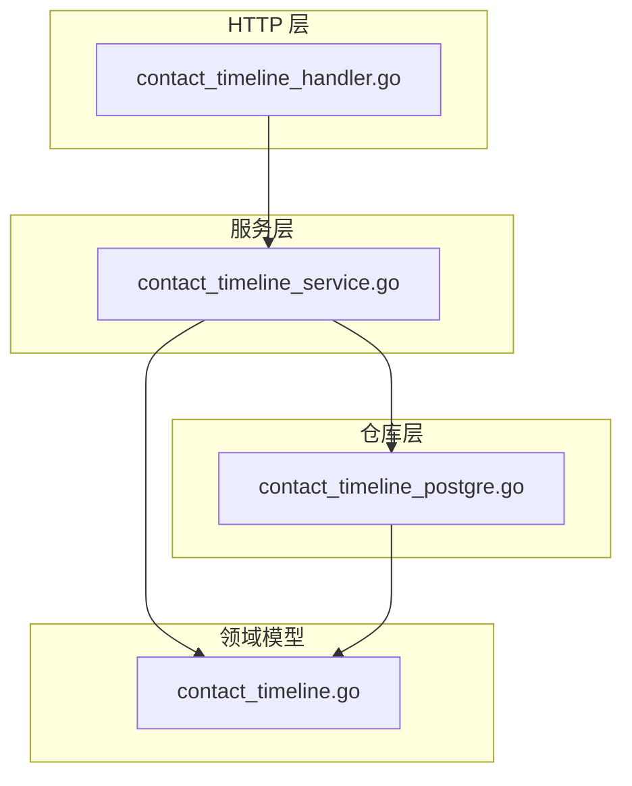
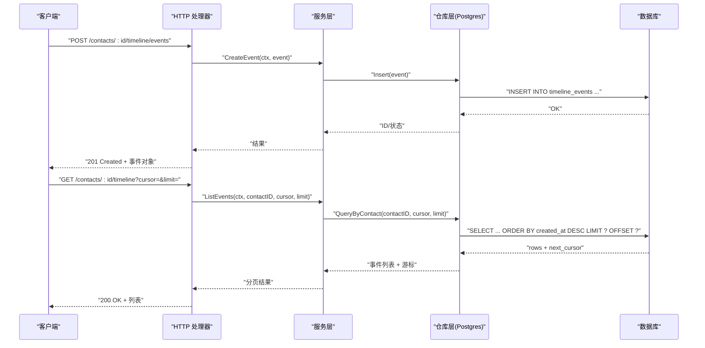
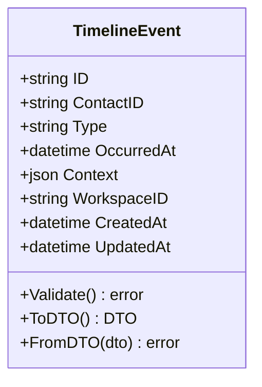
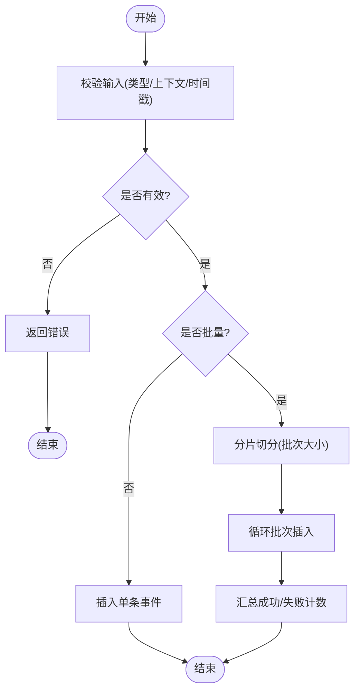
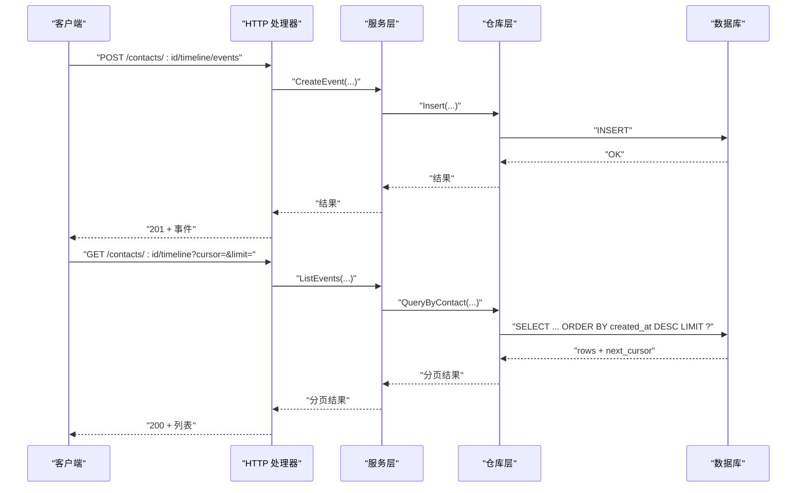
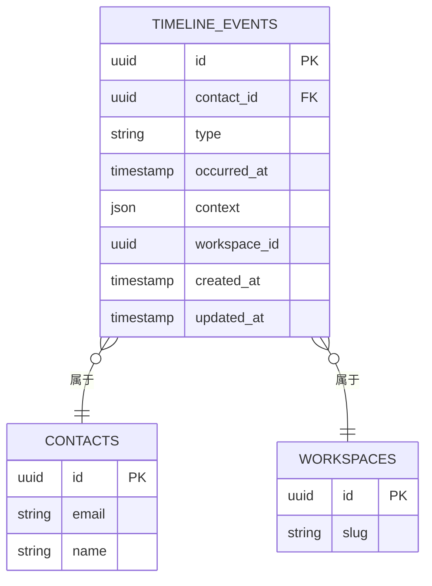
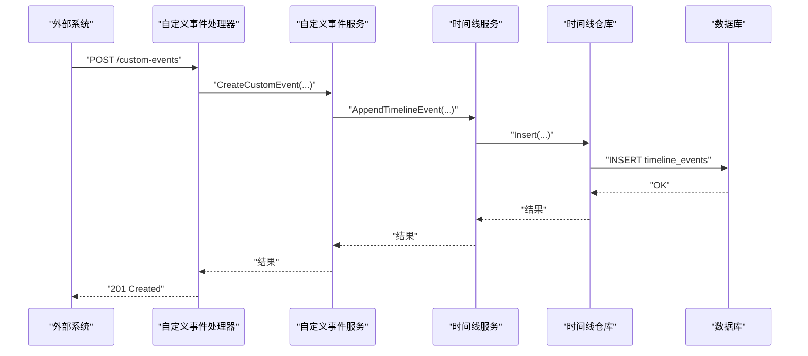
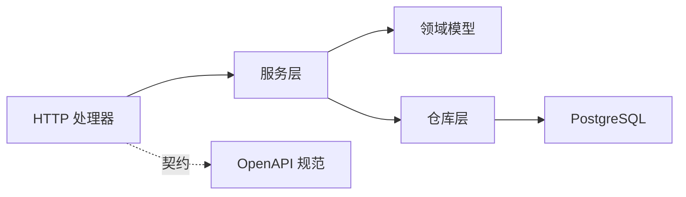

# 联系人时间线系统

<cite>
**本文引用的文件**   
- [contact_timeline.go](file://notifuse/internal/domain/contact_timeline.go)
- [contact_timeline_test.go](file://notifuse/internal/domain/contact_timeline_test.go)
- [contact_timeline_service.go](file://notifuse/internal/service/contact_timeline_service.go)
- [contact_timeline_service_test.go](file://notifuse/internal/service/contact_timeline_service_test.go)
- [contact_timeline_handler.go](file://notifuse/internal/http/contact_timeline_handler.go)
- [contact_timeline_handler_test.go](file://notifuse/internal/http/contact_timeline_handler_test.go)
- [contact_timeline_postgre.go](file://notifuse/internal/repository/contact_timeline_postgre.go)
- [contact_timeline_postgre_test.go](file://notifuse/internal/repository/contact_timeline_postgre_test.go)
- [openapi.yaml](file://notifuse/openapi/openapi.yaml)
- [custom_event.go](file://notifuse/internal/domain/custom_event.go)
- [custom_event_service.go](file://notifuse/internal/service/custom_event_service.go)
- [custom_event_handler.go](file://notifuse/internal/http/custom_event_handler.go)
</cite>

## 目录
1. [简介](#简介)
2. [项目结构](#项目结构)
3. [核心组件](#核心组件)
4. [架构总览](#架构总览)
5. [详细组件分析](#详细组件分析)
6. [依赖关系分析](#依赖关系分析)
7. [性能与存储优化](#性能与存储优化)
8. [故障排查指南](#故障排查指南)
9. [结论](#结论)
10. [附录](#附录)

## 简介
本文件为 Notifuse 平台的“联系人时间线（Contact Timeline）”系统提供数据模型与实现文档。内容覆盖：
- 时间线事件的数据结构与字段语义（事件类型、时间戳、上下文等）
- 事件写入机制与批量处理流程
- 时间线查询接口与分页策略
- 存储优化与归档策略建议
- 导出与分析能力说明
- 事件追踪集成指南与自定义事件扩展方法

## 项目结构
联系人时间线功能在后端采用分层架构，涉及领域模型、服务层、HTTP 处理器与持久化仓库四个层次：
- 领域模型：定义时间线事件实体与校验规则
- 服务层：编排业务逻辑、事务边界与批处理
- HTTP 处理器：暴露 REST 接口，负责参数校验与响应封装
- 仓库层：PostgreSQL 持久化实现，包含索引与分页查询

图表来源
- [contact_timeline_handler.go](file://notifuse/internal/http/contact_timeline_handler.go)
- [contact_timeline_service.go](file://notifuse/internal/service/contact_timeline_service.go)
- [contact_timeline.go](file://notifuse/internal/domain/contact_timeline.go)
- [contact_timeline_postgre.go](file://notifuse/internal/repository/contact_timeline_postgre.go)

章节来源
- [contact_timeline.go](file://notifuse/internal/domain/contact_timeline.go)
- [contact_timeline_service.go](file://notifuse/internal/service/contact_timeline_service.go)
- [contact_timeline_handler.go](file://notifuse/internal/http/contact_timeline_handler.go)
- [contact_timeline_postgre.go](file://notifuse/internal/repository/contact_timeline_postgre.go)

## 核心组件
- 领域模型：联系人时间线事件实体，包含事件标识、关联联系人、事件类型、时间戳、上下文 JSON 等字段，并提供基础校验与序列化支持。
- 服务层：提供创建/追加事件、批量写入、按联系人查询时间线、分页与排序等能力；封装事务与错误映射。
- HTTP 处理器：暴露 REST API，接收请求体、校验参数、调用服务层并返回统一响应格式。
- 仓库层：基于 PostgreSQL 的 SQL 实现，包括插入、批量插入、按联系人过滤与分页查询、索引优化等。

章节来源
- [contact_timeline.go](file://notifuse/internal/domain/contact_timeline.go)
- [contact_timeline_service.go](file://notifuse/internal/service/contact_timeline_service.go)
- [contact_timeline_handler.go](file://notifuse/internal/http/contact_timeline_handler.go)
- [contact_timeline_postgre.go](file://notifuse/internal/repository/contact_timeline_postgre.go)

## 架构总览
下图展示了从 HTTP 请求到数据库落盘的完整调用链，以及关键的分页与批量写入路径。

图表来源
- [contact_timeline_handler.go](file://notifuse/internal/http/contact_timeline_handler.go)
- [contact_timeline_service.go](file://notifuse/internal/service/contact_timeline_service.go)
- [contact_timeline_postgre.go](file://notifuse/internal/repository/contact_timeline_postgre.go)

## 详细组件分析

### 领域模型：时间线事件实体
- 关键字段
  - 事件唯一标识：用于幂等与去重
  - 联系人标识：外键或逻辑关联
  - 事件类型：字符串枚举，如“注册”、“登录”、“购买”、“退订”等
  - 时间戳：事件发生时间（服务器侧生成或客户端传入并经校验）
  - 上下文信息：JSON 结构，承载事件相关元数据（如来源渠道、设备、页面、交易金额等）
  - 工作区隔离：多租户隔离字段
- 约束与校验
  - 必填字段校验（联系人、类型、时间戳）
  - 上下文 JSON 合法性校验
  - 事件类型白名单校验（可扩展）
- 复杂度
  - 序列化/反序列化 O(n)（n 为上下文键值对数量）
  - 校验复杂度取决于上下文结构与正则表达式数量

图表来源
- [contact_timeline.go](file://notifuse/internal/domain/contact_timeline.go)

章节来源
- [contact_timeline.go](file://notifuse/internal/domain/contact_timeline.go)
- [contact_timeline_test.go](file://notifuse/internal/domain/contact_timeline_test.go)

### 服务层：写入与查询编排
- 写入流程
  - 单条写入：校验 -> 构建实体 -> 调用仓库插入 -> 返回结果
  - 批量写入：分批校验 -> 分片插入（控制批次大小）-> 汇总成功/失败计数
- 查询流程
  - 按联系人筛选
  - 游标分页：基于时间戳与 ID 的组合条件，避免深分页开销
  - 排序：默认按时间倒序，可配置
- 错误处理
  - 将底层错误映射为领域错误（如重复事件、非法类型、上下文不合法）
  - 记录必要日志以便排障

图表来源
- [contact_timeline_service.go](file://notifuse/internal/service/contact_timeline_service.go)

章节来源
- [contact_timeline_service.go](file://notifuse/internal/service/contact_timeline_service.go)
- [contact_timeline_service_test.go](file://notifuse/internal/service/contact_timeline_service_test.go)

### HTTP 处理器：REST 接口
- 主要接口
  - POST /contacts/{id}/timeline/events：新增时间线事件
  - GET /contacts/{id}/timeline：查询时间线（支持游标分页）
- 请求/响应
  - 请求体：事件对象（类型、上下文、可选时间戳等）
  - 响应体：标准分页结构（列表、下一页游标、总数/是否有更多）
- 权限与安全
  - 鉴权中间件（由上层路由注入）
  - 速率限制与输入长度限制
- 错误码
  - 400 参数错误
  - 404 联系人不存在
  - 409 重复事件（若启用幂等键）
  - 500 内部错误

图表来源
- [contact_timeline_handler.go](file://notifuse/internal/http/contact_timeline_handler.go)
- [contact_timeline_service.go](file://notifuse/internal/service/contact_timeline_service.go)
- [contact_timeline_postgre.go](file://notifuse/internal/repository/contact_timeline_postgre.go)

章节来源
- [contact_timeline_handler.go](file://notifuse/internal/http/contact_timeline_handler.go)
- [contact_timeline_handler_test.go](file://notifuse/internal/http/contact_timeline_handler_test.go)

### 仓库层：PostgreSQL 实现
- 表结构要点
  - 主键：事件唯一标识
  - 外键：联系人标识、工作区标识
  - 索引：按联系人+时间戳组合索引，支持高效分页
  - 列：类型、时间戳、上下文(JSON)、审计字段
- 查询优化
  - 使用游标分页（基于 created_at 与 id 的组合条件），避免深度 OFFSET
  - 选择性投影字段，减少网络传输
- 批量写入
  - 使用批量插入语句，降低往返次数
  - 控制批次大小，平衡吞吐与内存占用

图表来源
- [contact_timeline_postgre.go](file://notifuse/internal/repository/contact_timeline_postgre.go)

章节来源
- [contact_timeline_postgre.go](file://notifuse/internal/repository/contact_timeline_postgre.go)
- [contact_timeline_postgre_test.go](file://notifuse/internal/repository/contact_timeline_postgre_test.go)

### 自定义事件与扩展点
- 自定义事件类型
  - 通过“自定义事件”域与服务扩展新的事件类型，保持时间线类型的白名单可控
  - 建议在领域层增加类型注册表或服务层进行白名单校验
- 集成方式
  - 通过“自定义事件”API 触发，最终写入时间线
  - 在上下文中携带扩展字段，便于后续分析与导出

图表来源
- [custom_event_handler.go](file://notifuse/internal/http/custom_event_handler.go)
- [custom_event_service.go](file://notifuse/internal/service/custom_event_service.go)
- [contact_timeline_service.go](file://notifuse/internal/service/contact_timeline_service.go)
- [contact_timeline_postgre.go](file://notifuse/internal/repository/contact_timeline_postgre.go)

章节来源
- [custom_event.go](file://notifuse/internal/domain/custom_event.go)
- [custom_event_service.go](file://notifuse/internal/service/custom_event_service.go)
- [custom_event_handler.go](file://notifuse/internal/http/custom_event_handler.go)

## 依赖关系分析
- 耦合关系
  - HTTP 处理器仅依赖服务层接口，便于替换实现与测试
  - 服务层依赖领域模型与仓库接口，屏蔽持久化细节
  - 仓库层直接依赖领域模型与数据库驱动
- 外部依赖
  - PostgreSQL 作为主存储
  - OpenAPI 描述接口契约，便于前后端联调与代码生成

图表来源
- [contact_timeline_handler.go](file://notifuse/internal/http/contact_timeline_handler.go)
- [contact_timeline_service.go](file://notifuse/internal/service/contact_timeline_service.go)
- [contact_timeline_postgre.go](file://notifuse/internal/repository/contact_timeline_postgre.go)
- [openapi.yaml](file://notifuse/openapi/openapi.yaml)

章节来源
- [openapi.yaml](file://notifuse/openapi/openapi.yaml)

## 性能与存储优化
- 索引设计
  - 在联系人+时间戳上建立复合索引，提升按联系人时间线查询效率
  - 针对高频过滤维度（如事件类型、工作区）考虑部分索引或分区
- 分页策略
  - 使用游标分页（created_at + id），避免深度 OFFSET 带来的性能退化
  - 合理设置每页大小，兼顾前端渲染与后端负载
- 批量写入
  - 服务端分批入库，控制批次大小（例如 500~2000 条/批）
  - 开启连接池复用与事务合并，减少锁竞争
- 存储优化
  - 上下文 JSON 压缩与规范化，避免冗余字段
  - 冷热分离：历史数据归档至冷存储（如对象存储或归档库），热数据保留最近 N 个月
- 监控与容量规划
  - 监控写入 QPS、P99 延迟、索引命中率
  - 根据增长趋势规划分区与归档周期

[本节为通用指导，无需特定文件引用]

## 故障排查指南
- 常见问题
  - 事件类型非法：检查白名单与上游传参
  - 上下文 JSON 不合法：校验 schema 与字段类型
  - 重复事件：确认幂等键是否一致，必要时清理脏数据
  - 分页异常：检查游标编码与时间戳精度
- 定位手段
  - 查看服务层错误映射与日志上下文
  - 核对仓库层 SQL 执行计划与索引命中
  - 使用 OpenAPI 工具回放请求，对比期望响应

章节来源
- [contact_timeline_service.go](file://notifuse/internal/service/contact_timeline_service.go)
- [contact_timeline_postgre.go](file://notifuse/internal/repository/contact_timeline_postgre.go)

## 结论
联系人时间线系统以清晰的领域模型为核心，通过服务层编排写入与查询，配合高效的仓库层实现与合理的索引/分页策略，满足高吞吐写入与低延迟读取的需求。结合自定义事件扩展点，平台可灵活接入多种业务事件，形成统一的联系人行为视图。

[本节为总结性内容，无需特定文件引用]

## 附录

### 数据模型字段说明（摘要）
- 事件唯一标识：UUID，全局唯一，用于幂等与去重
- 联系人标识：UUID，指向联系人主表
- 事件类型：字符串，受白名单约束
- 发生时间：时间戳，建议服务器侧生成
- 上下文：JSON，结构化元数据，建议遵循命名规范
- 工作区标识：UUID，多租户隔离
- 审计字段：创建时间、更新时间

章节来源
- [contact_timeline.go](file://notifuse/internal/domain/contact_timeline.go)

### 查询与分页约定
- 查询参数
  - contact_id：必填
  - cursor：可选，上一页最后一条记录的 created_at 与 id 组合编码
  - limit：可选，默认值与最大值限制
- 排序
  - 默认按发生时间倒序
- 响应
  - 列表项：事件对象
  - 游标：下一页 cursor（若无则为空）

章节来源
- [contact_timeline_handler.go](file://notifuse/internal/http/contact_timeline_handler.go)
- [contact_timeline_service.go](file://notifuse/internal/service/contact_timeline_service.go)

### 导出与分析
- 导出
  - 提供按联系人或时间范围导出的后台任务，输出 CSV/JSON
  - 大体积导出建议异步任务与分片下载
- 分析
  - 将时间线事件同步至分析引擎（如 BigQuery/Snowflake）
  - 基于事件类型与上下文构建指标看板（留存、转化、活跃度等）

[本节为通用指导，无需特定文件引用]

### 集成与扩展指南
- 事件追踪集成
  - 在服务端 SDK 中封装时间线事件写入，统一上报格式
  - 客户端埋点生成上下文，确保关键字段齐全
- 自定义事件扩展
  - 在领域层注册新事件类型
  - 在仓库层保证索引与查询兼容
  - 更新 OpenAPI 契约与前端类型定义

章节来源
- [custom_event.go](file://notifuse/internal/domain/custom_event.go)
- [custom_event_service.go](file://notifuse/internal/service/custom_event_service.go)
- [custom_event_handler.go](file://notifuse/internal/http/custom_event_handler.go)
- [openapi.yaml](file://notifuse/openapi/openapi.yaml)