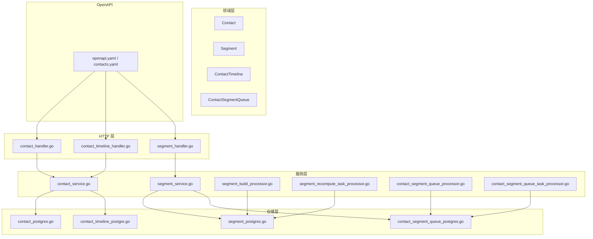
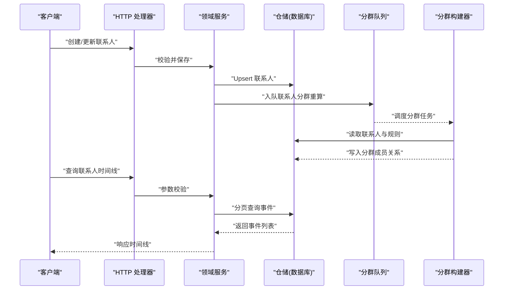
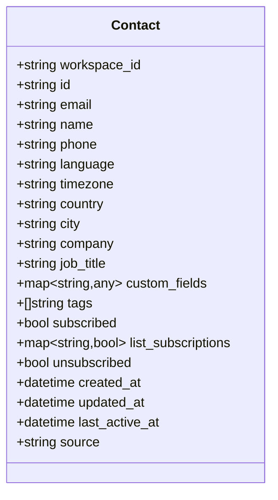
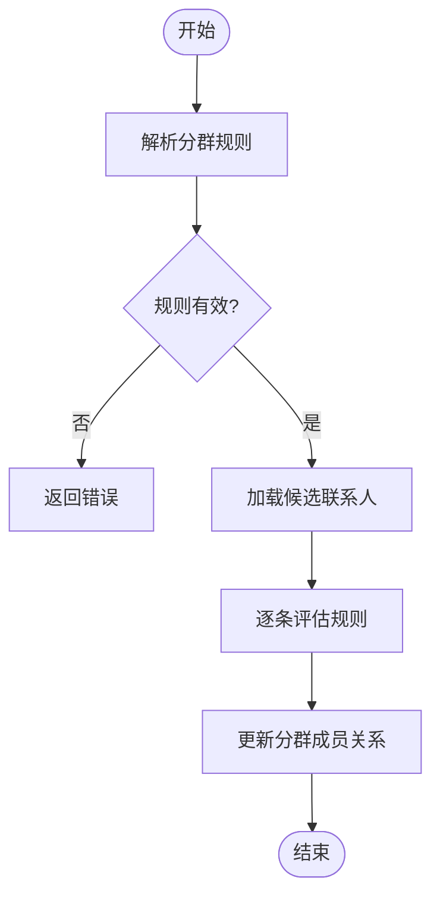
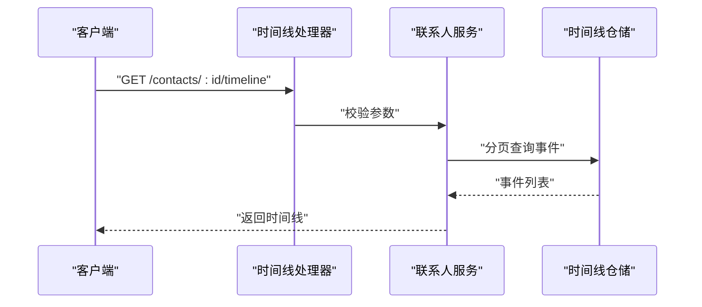
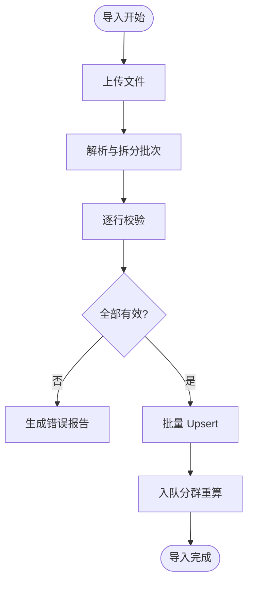
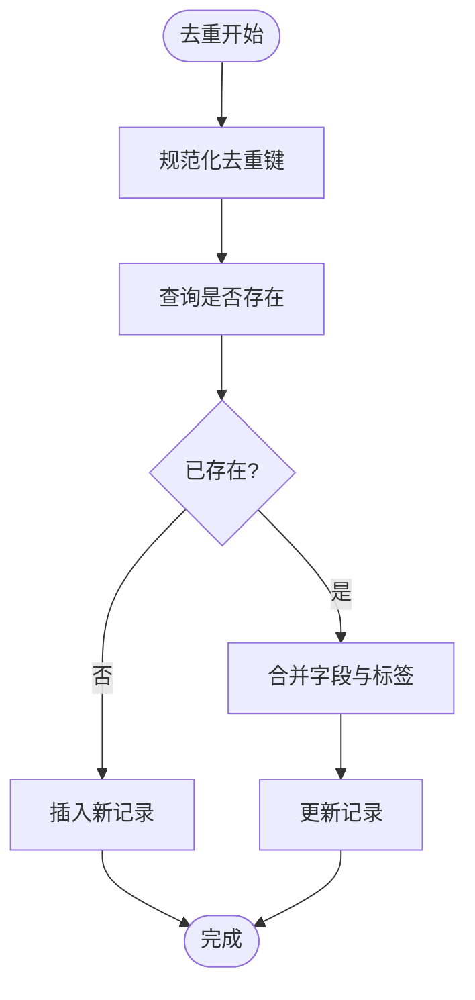
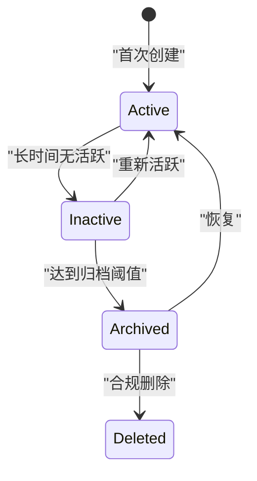
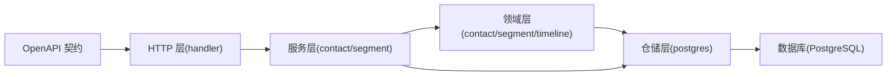

# 联系人模型

<cite>
**本文引用的文件**   
- [contact.go](file://notifuse/internal/domain/contact.go)
- [contact_test.go](file://notifuse/internal/domain/contact_test.go)
- [segment.go](file://notifuse/internal/domain/segment.go)
- [segment_test.go](file://notifuse/internal/domain/segment_test.go)
- [contact_timeline.go](file://notifuse/internal/domain/contact_timeline.go)
- [contact_timeline_test.go](file://notifuse/internal/domain/contact_timeline_test.go)
- [contact_segment_queue.go](file://notifuse/internal/domain/contact_segment_queue.go)
- [contact_postgres.go](file://notifuse/internal/repository/contact_postgres.go)
- [contact_list_postgres.go](file://notifuse/internal/repository/contact_list_postgres.go)
- [contact_timeline_postgre.go](file://notifuse/internal/repository/contact_timeline_postgre.go)
- [segment_postgres.go](file://notifuse/internal/repository/segment_postgres.go)
- [contact_segment_queue_postgres.go](file://notifuse/internal/repository/contact_segment_queue_postgres.go)
- [contact_service.go](file://notifuse/internal/service/contact_service.go)
- [contact_service_test.go](file://notifuse/internal/service/contact_service_test.go)
- [contact_segment_queue_processor.go](file://notifuse/internal/service/contact_segment_queue_processor.go)
- [contact_segment_queue_task_processor.go](file://notifuse/internal/service/contact_segment_queue_task_processor.go)
- [segment_build_processor.go](file://notifuse/internal/service/segment_build_processor.go)
- [segment_recompute_task_processor.go](file://notifuse/internal/service/segment_recompute_task_processor.go)
- [segment_service.go](file://notifuse/internal/service/segment_service.go)
- [segment_service_test.go](file://notifuse/internal/service/segment_service_test.go)
- [contact_handler.go](file://notifuse/internal/http/contact_handler.go)
- [contact_timeline_handler.go](file://notifuse/internal/http/contact_timeline_handler.go)
- [segment_handler.go](file://notifuse/internal/http/segment_handler.go)
- [openapi.yaml](file://notifuse/openapi/openapi.yaml)
- [contacts.yaml](file://notifuse/openapi/paths/contacts.yaml)
</cite>

## 目录
1. [简介](#简介)
2. [项目结构](#项目结构)
3. [核心组件](#核心组件)
4. [架构总览](#架构总览)
5. [详细组件分析](#详细组件分析)
6. [依赖关系分析](#依赖关系分析)
7. [性能考量](#性能考量)
8. [故障排查指南](#故障排查指南)
9. [结论](#结论)
10. [附录](#附录)

## 简介
本文件为 Notifuse 平台的“联系人(Contact)”实体提供数据模型与相关机制的权威文档。内容覆盖：
- 联系人的字段定义（基本信息、自定义字段、标签系统、订阅状态等）
- 联系人分群(Segment)的动态规则引擎与实时计算机制
- 联系人时间线(Contact Timeline)的事件记录系统（发送、打开、点击等行为追踪）
- 联系人导入导出的批量处理机制与数据验证规则
- 联系人去重算法与重复检测策略
- 联系人数据清理与归档的生命周期管理

## 项目结构
围绕联系人领域，代码按领域层、仓储层、服务层、HTTP 层与 OpenAPI 规范分层组织：
- 领域层(domain)：定义 Contact、Segment、ContactTimeline、ContactSegmentQueue 等核心实体与值对象
- 仓储层(repository)：PostgreSQL 实现，负责持久化与查询
- 服务层(service)：编排业务逻辑，包括分群构建、队列任务处理、联系人服务等
- HTTP 层(http)：暴露 REST API，承载导入导出、时间线查询、分群管理等能力
- OpenAPI：对外接口契约

图表来源
- [contact.go:1-200](file://notifuse/internal/domain/contact.go#L1-L200)
- [segment.go:1-200](file://notifuse/internal/domain/segment.go#L1-L200)
- [contact_timeline.go:1-200](file://notifuse/internal/domain/contact_timeline.go#L1-L200)
- [contact_segment_queue.go:1-200](file://notifuse/internal/domain/contact_segment_queue.go#L1-L200)
- [contact_postgres.go:1-200](file://notifuse/internal/repository/contact_postgres.go#L1-L200)
- [segment_postgres.go:1-200](file://notifuse/internal/repository/segment_postgres.go#L1-L200)
- [contact_timeline_postgre.go:1-200](file://notifuse/internal/repository/contact_timeline_postgre.go#L1-L200)
- [contact_segment_queue_postgres.go:1-200](file://notifuse/internal/repository/contact_segment_queue_postgres.go#L1-L200)
- [contact_service.go:1-200](file://notifuse/internal/service/contact_service.go#L1-L200)
- [segment_service.go:1-200](file://notifuse/internal/service/segment_service.go#L1-L200)
- [segment_build_processor.go:1-200](file://notifuse/internal/service/segment_build_processor.go#L1-L200)
- [segment_recompute_task_processor.go:1-200](file://notifuse/internal/service/segment_recompute_task_processor.go#L1-L200)
- [contact_segment_queue_processor.go:1-200](file://notifuse/internal/service/contact_segment_queue_processor.go#L1-L200)
- [contact_segment_queue_task_processor.go:1-200](file://notifuse/internal/service/contact_segment_queue_task_processor.go#L1-L200)
- [contact_handler.go:1-200](file://notifuse/internal/http/contact_handler.go#L1-L200)
- [contact_timeline_handler.go:1-200](file://notifuse/internal/http/contact_timeline_handler.go#L1-L200)
- [segment_handler.go:1-200](file://notifuse/internal/http/segment_handler.go#L1-L200)
- [openapi.yaml:1-200](file://notifuse/openapi/openapi.yaml#L1-L200)
- [contacts.yaml:1-200](file://notifuse/openapi/paths/contacts.yaml#L1-L200)

章节来源
- [contact.go:1-200](file://notifuse/internal/domain/contact.go#L1-L200)
- [segment.go:1-200](file://notifuse/internal/domain/segment.go#L1-L200)
- [contact_timeline.go:1-200](file://notifuse/internal/domain/contact_timeline.go#L1-L200)
- [contact_segment_queue.go:1-200](file://notifuse/internal/domain/contact_segment_queue.go#L1-L200)
- [contact_postgres.go:1-200](file://notifuse/internal/repository/contact_postgres.go#L1-L200)
- [segment_postgres.go:1-200](file://notifuse/internal/repository/segment_postgres.go#L1-L200)
- [contact_timeline_postgre.go:1-200](file://notifuse/internal/repository/contact_timeline_postgre.go#L1-L200)
- [contact_segment_queue_postgres.go:1-200](file://notifuse/internal/repository/contact_segment_queue_postgres.go#L1-L200)
- [contact_service.go:1-200](file://notifuse/internal/service/contact_service.go#L1-L200)
- [segment_service.go:1-200](file://notifuse/internal/service/segment_service.go#L1-L200)
- [segment_build_processor.go:1-200](file://notifuse/internal/service/segment_build_processor.go#L1-L200)
- [segment_recompute_task_processor.go:1-200](file://notifuse/internal/service/segment_recompute_task_processor.go#L1-L200)
- [contact_segment_queue_processor.go:1-200](file://notifuse/internal/service/contact_segment_queue_processor.go#L1-L200)
- [contact_segment_queue_task_processor.go:1-200](file://notifuse/internal/service/contact_segment_queue_task_processor.go#L1-L200)
- [contact_handler.go:1-200](file://notifuse/internal/http/contact_handler.go#L1-L200)
- [contact_timeline_handler.go:1-200](file://notifuse/internal/http/contact_timeline_handler.go#L1-L200)
- [segment_handler.go:1-200](file://notifuse/internal/http/segment_handler.go#L1-L200)
- [openapi.yaml:1-200](file://notifuse/openapi/openapi.yaml#L1-L200)
- [contacts.yaml:1-200](file://notifuse/openapi/paths/contacts.yaml#L1-L200)

## 核心组件
本节聚焦联系人域的核心数据结构与关键行为，涵盖字段定义、标签系统、订阅状态、分群规则与时间线事件。

- 联系人(Contact)
  - 标识与工作空间关联：工作空间 ID、唯一标识
  - 基本属性：邮箱、姓名、电话、语言、时区、国家/地区、城市、公司、职位等
  - 自定义字段：以键值对形式扩展，支持多种数据类型
  - 标签系统：多标签集合，用于快速筛选与分群
  - 订阅状态：全局订阅开关、各列表订阅状态、退订标记
  - 元数据：创建/更新时间、最后活跃时间、来源渠道等
  - 去重键：基于邮箱或自定义唯一键进行识别与合并

- 分群(Segment)
  - 动态规则：基于条件表达式（字段比较、包含/不包含、正则匹配、布尔组合）
  - 实时计算：联系人变更触发增量重算；支持定时全量重建
  - 成员维护：通过队列任务将结果写入中间表或索引表

- 联系人时间线(Contact Timeline)
  - 事件类型：邮件发送、送达、打开、点击、退订、投诉、硬/软退回等
  - 事件载荷：消息 ID、模板 ID、链接、用户代理、地理位置、IP 等
  - 时序性：严格时间戳排序，支持分页与过滤

- 分群队列(ContactSegmentQueue)
  - 任务粒度：单个联系人或一批联系人进入分群重算流程
  - 幂等与重试：失败重试、死信队列、进度跟踪

章节来源
- [contact.go:1-200](file://notifuse/internal/domain/contact.go#L1-L200)
- [segment.go:1-200](file://notifuse/internal/domain/segment.go#L1-L200)
- [contact_timeline.go:1-200](file://notifuse/internal/domain/contact_timeline.go#L1-L200)
- [contact_segment_queue.go:1-200](file://notifuse/internal/domain/contact_segment_queue.go#L1-L200)

## 架构总览
下图展示从 HTTP 请求到领域模型与持久化的调用链，以及分群与时间线的关键路径。

图表来源
- [contact_handler.go:1-200](file://notifuse/internal/http/contact_handler.go#L1-L200)
- [contact_timeline_handler.go:1-200](file://notifuse/internal/http/contact_timeline_handler.go#L1-L200)
- [contact_service.go:1-200](file://notifuse/internal/service/contact_service.go#L1-L200)
- [contact_postgres.go:1-200](file://notifuse/internal/repository/contact_postgres.go#L1-L200)
- [contact_timeline_postgre.go:1-200](file://notifuse/internal/repository/contact_timeline_postgre.go#L1-L200)
- [contact_segment_queue.go:1-200](file://notifuse/internal/domain/contact_segment_queue.go#L1-L200)
- [segment_build_processor.go:1-200](file://notifuse/internal/service/segment_build_processor.go#L1-L200)

## 详细组件分析

### 联系人实体与字段定义
- 基础信息
  - 工作空间 ID：隔离多租户数据
  - 唯一标识：内部主键
  - 邮箱：核心去重键之一
  - 姓名、电话、地址、公司、职位、语言、时区、国家/地区、城市等
- 自定义字段
  - 以结构化 JSON 存储，支持字符串、数字、布尔、日期等类型
  - 建议为常用查询字段建立索引以提升性能
- 标签系统
  - 多标签集合，支持增删改查
  - 标签可用于分群条件与报表统计
- 订阅状态
  - 全局订阅开关
  - 列表级订阅状态
  - 退订标记与退订时间
- 元数据
  - 创建/更新时间
  - 最后活跃时间
  - 来源渠道与追踪 ID

图表来源
- [contact.go:1-200](file://notifuse/internal/domain/contact.go#L1-L200)

章节来源
- [contact.go:1-200](file://notifuse/internal/domain/contact.go#L1-L200)
- [contact_test.go:1-200](file://notifuse/internal/domain/contact_test.go#L1-L200)

### 分群(Segment)与动态规则引擎
- 规则定义
  - 条件操作符：等于、不等于、包含、不包含、大于、小于、正则匹配、空值判断
  - 组合逻辑：AND/OR 嵌套
  - 字段范围：基础字段、自定义字段、标签、订阅状态
- 实时计算
  - 事件驱动：联系人变更入队，触发增量重算
  - 定时重建：周期性全量重建以确保一致性
- 成员维护
  - 中间表/索引表维护联系人-分群关系
  - 支持分页查询与导出

图表来源
- [segment.go:1-200](file://notifuse/internal/domain/segment.go#L1-L200)
- [segment_build_processor.go:1-200](file://notifuse/internal/service/segment_build_processor.go#L1-L200)

章节来源
- [segment.go:1-200](file://notifuse/internal/domain/segment.go#L1-L200)
- [segment_test.go:1-200](file://notifuse/internal/domain/segment_test.go#L1-L200)
- [segment_build_processor.go:1-200](file://notifuse/internal/service/segment_build_processor.go#L1-L200)
- [segment_recompute_task_processor.go:1-200](file://notifuse/internal/service/segment_recompute_task_processor.go#L1-L200)
- [segment_service.go:1-200](file://notifuse/internal/service/segment_service.go#L1-L200)
- [segment_handler.go:1-200](file://notifuse/internal/http/segment_handler.go#L1-L200)

### 联系人时间线(Contact Timeline)
- 事件类型
  - 发送、送达、打开、点击、退订、投诉、硬/软退回
- 事件载荷
  - 消息 ID、模板 ID、链接、用户代理、地理位置、IP、设备信息等
- 查询与过滤
  - 按联系人、时间范围、事件类型、消息 ID 过滤
  - 分页与排序

图表来源
- [contact_timeline.go:1-200](file://notifuse/internal/domain/contact_timeline.go#L1-L200)
- [contact_timeline_handler.go:1-200](file://notifuse/internal/http/contact_timeline_handler.go#L1-L200)
- [contact_timeline_postgre.go:1-200](file://notifuse/internal/repository/contact_timeline_postgre.go#L1-L200)

章节来源
- [contact_timeline.go:1-200](file://notifuse/internal/domain/contact_timeline.go#L1-L200)
- [contact_timeline_test.go:1-200](file://notifuse/internal/domain/contact_timeline_test.go#L1-L200)
- [contact_timeline_handler.go:1-200](file://notifuse/internal/http/contact_timeline_handler.go#L1-L200)
- [contact_timeline_postgre.go:1-200](file://notifuse/internal/repository/contact_timeline_postgre.go#L1-L200)

### 联系人导入与导出
- 导入流程
  - 接收 CSV/JSON 批量数据
  - 行级校验：必填字段、格式、去重键冲突
  - Upsert 策略：存在则更新，不存在则新增
  - 异步处理：大文件分批入库，避免阻塞
- 导出流程
  - 按条件筛选联系人
  - 流式输出，避免内存溢出
  - 支持字段选择与编码设置

图表来源
- [contact_handler.go:1-200](file://notifuse/internal/http/contact_handler.go#L1-L200)
- [contact_service.go:1-200](file://notifuse/internal/service/contact_service.go#L1-L200)
- [contact_postgres.go:1-200](file://notifuse/internal/repository/contact_postgres.go#L1-L200)
- [contact_segment_queue.go:1-200](file://notifuse/internal/domain/contact_segment_queue.go#L1-L200)

章节来源
- [contact_handler.go:1-200](file://notifuse/internal/http/contact_handler.go#L1-L200)
- [contact_service.go:1-200](file://notifuse/internal/service/contact_service.go#L1-L200)
- [contact_postgres.go:1-200](file://notifuse/internal/repository/contact_postgres.go#L1-L200)

### 联系人去重与重复检测
- 去重键
  - 默认使用邮箱作为去重键
  - 可配置自定义唯一键（如外部 CRM ID）
- 冲突策略
  - 保留最新更新时间
  - 合并自定义字段与标签
  - 保留订阅状态优先级
- 检测与合并
  - 插入前查重
  - 批量导入时预分组与合并
  - 冲突日志与审计

图表来源
- [contact.go:1-200](file://notifuse/internal/domain/contact.go#L1-L200)
- [contact_postgres.go:1-200](file://notifuse/internal/repository/contact_postgres.go#L1-L200)

章节来源
- [contact.go:1-200](file://notifuse/internal/domain/contact.go#L1-L200)
- [contact_postgres.go:1-200](file://notifuse/internal/repository/contact_postgres.go#L1-L200)

### 联系人数据清理与归档生命周期
- 清理策略
  - 长期未活跃联系人标记
  - 退订与投诉联系人限制触达
  - 合规删除（GDPR/CCPA）
- 归档策略
  - 冷数据迁移至低成本存储
  - 保留必要审计字段
  - 恢复流程与权限控制

[此图为概念性说明，不直接映射具体源码文件]

## 依赖关系分析
- 领域层依赖最小，仅包含数据结构与不变式
- 仓储层依赖领域层，封装 SQL 与事务
- 服务层编排仓储与队列，实现复杂业务
- HTTP 层仅做参数校验与响应包装
- OpenAPI 作为契约约束前后端交互

图表来源
- [contact.go:1-200](file://notifuse/internal/domain/contact.go#L1-L200)
- [segment.go:1-200](file://notifuse/internal/domain/segment.go#L1-L200)
- [contact_timeline.go:1-200](file://notifuse/internal/domain/contact_timeline.go#L1-L200)
- [contact_postgres.go:1-200](file://notifuse/internal/repository/contact_postgres.go#L1-L200)
- [segment_postgres.go:1-200](file://notifuse/internal/repository/segment_postgres.go#L1-L200)
- [contact_timeline_postgre.go:1-200](file://notifuse/internal/repository/contact_timeline_postgre.go#L1-L200)
- [contact_service.go:1-200](file://notifuse/internal/service/contact_service.go#L1-L200)
- [segment_service.go:1-200](file://notifuse/internal/service/segment_service.go#L1-L200)
- [contact_handler.go:1-200](file://notifuse/internal/http/contact_handler.go#L1-L200)
- [segment_handler.go:1-200](file://notifuse/internal/http/segment_handler.go#L1-L200)
- [openapi.yaml:1-200](file://notifuse/openapi/openapi.yaml#L1-L200)

章节来源
- [contact.go:1-200](file://notifuse/internal/domain/contact.go#L1-L200)
- [segment.go:1-200](file://notifuse/internal/domain/segment.go#L1-L200)
- [contact_timeline.go:1-200](file://notifuse/internal/domain/contact_timeline.go#L1-L200)
- [contact_postgres.go:1-200](file://notifuse/internal/repository/contact_postgres.go#L1-L200)
- [segment_postgres.go:1-200](file://notifuse/internal/repository/segment_postgres.go#L1-L200)
- [contact_timeline_postgre.go:1-200](file://notifuse/internal/repository/contact_timeline_postgre.go#L1-L200)
- [contact_service.go:1-200](file://notifuse/internal/service/contact_service.go#L1-L200)
- [segment_service.go:1-200](file://notifuse/internal/service/segment_service.go#L1-L200)
- [contact_handler.go:1-200](file://notifuse/internal/http/contact_handler.go#L1-L200)
- [segment_handler.go:1-200](file://notifuse/internal/http/segment_handler.go#L1-L200)
- [openapi.yaml:1-200](file://notifuse/openapi/openapi.yaml#L1-L200)

## 性能考量
- 索引设计
  - 邮箱、工作空间 ID、标签、订阅状态、更新时间等高频查询字段建立索引
  - 自定义字段建议使用 GIN 索引提升 JSON 查询性能
- 批量操作
  - 导入采用分批 Upsert，减少锁竞争与事务开销
  - 导出采用游标/流式读取，降低内存占用
- 分群计算
  - 增量重算优先，全量重建定期执行
  - 规则复杂度评估与缓存命中优化
- 时间线查询
  - 按时间分区与索引，分页查询避免深翻页
  - 热点联系人事件聚合与物化视图

[本节为通用指导，不直接分析具体文件]

## 故障排查指南
- 导入失败
  - 检查文件格式与编码
  - 查看行级错误报告与冲突日志
  - 确认去重键与必填字段
- 分群结果不一致
  - 核对规则语法与字段映射
  - 检查队列任务状态与重试次数
  - 对比增量与全量重建结果
- 时间线缺失
  - 确认事件上报链路是否完整
  - 检查事件入库事务与幂等键
  - 验证查询参数与索引命中

章节来源
- [contact_service.go:1-200](file://notifuse/internal/service/contact_service.go#L1-L200)
- [contact_segment_queue_processor.go:1-200](file://notifuse/internal/service/contact_segment_queue_processor.go#L1-L200)
- [contact_segment_queue_task_processor.go:1-200](file://notifuse/internal/service/contact_segment_queue_task_processor.go#L1-L200)
- [segment_build_processor.go:1-200](file://notifuse/internal/service/segment_build_processor.go#L1-L200)
- [segment_recompute_task_processor.go:1-200](file://notifuse/internal/service/segment_recompute_task_processor.go#L1-L200)

## 结论
Notifuse 的联系人模型以清晰的领域分层与可扩展的数据结构为基础，结合动态分群与时间线事件，形成完整的客户数据平台核心。通过严格的去重策略、批量导入导出与生命周期管理，确保数据质量与合规性。建议在部署中关注索引设计与批处理性能，持续优化分群规则与事件采集链路。

## 附录
- OpenAPI 参考
  - 联系人接口契约与示例
  - 分群与时间线接口定义

章节来源
- [openapi.yaml:1-200](file://notifuse/openapi/openapi.yaml#L1-L200)
- [contacts.yaml:1-200](file://notifuse/openapi/paths/contacts.yaml#L1-L200)