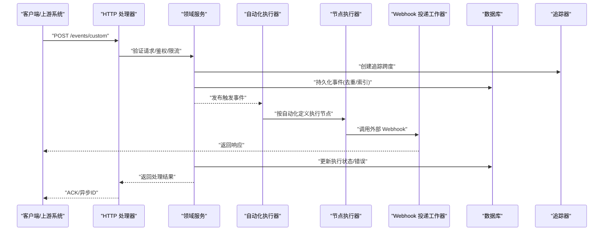
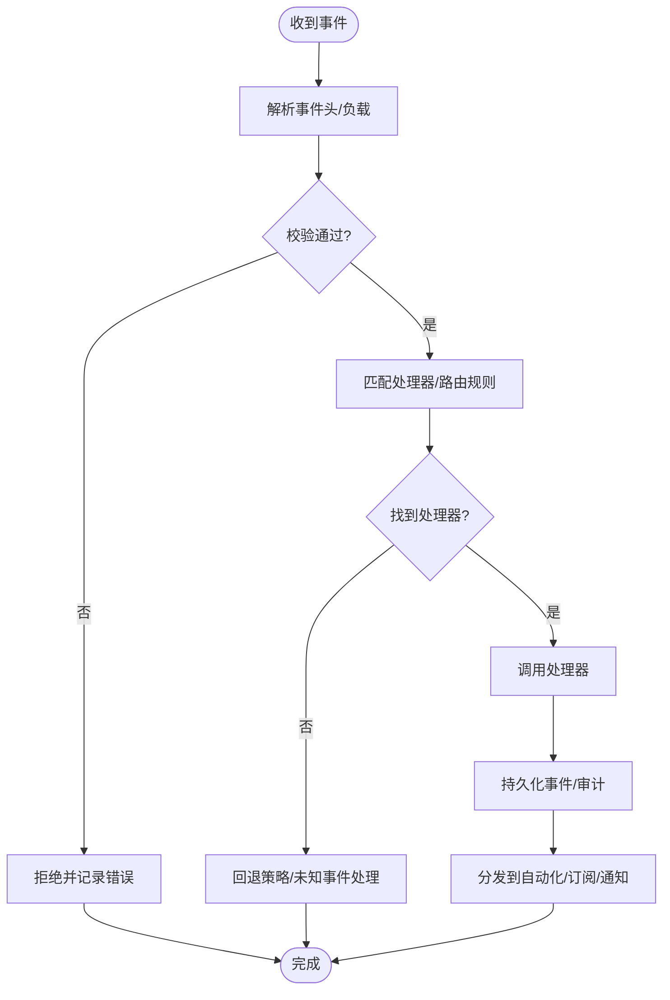
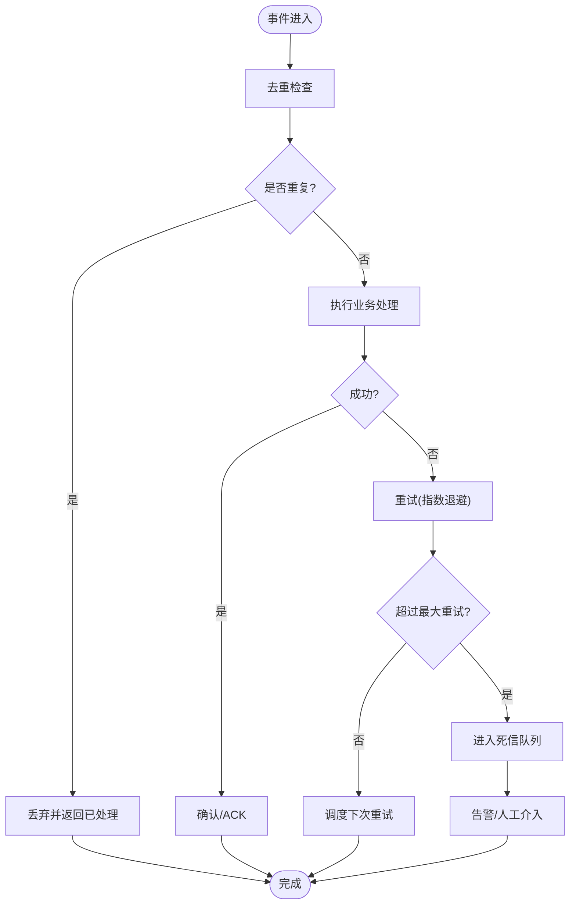
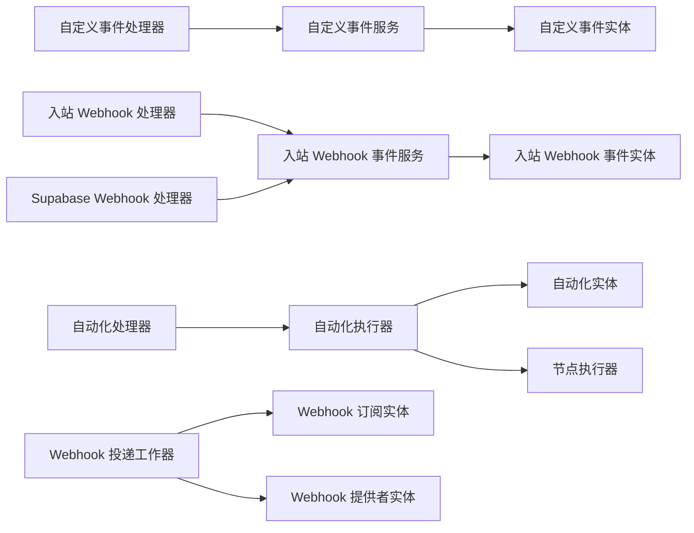

# 事件模型

<cite>
**本文引用的文件**   
- [event.go](file://notifuse/internal/domain/event.go)
- [custom_event.go](file://notifuse/internal/domain/custom_event.go)
- [inbound_webhook_event.go](file://notifuse/internal/domain/inbound_webhook_event.go)
- [automation.go](file://notifuse/internal/domain/automation.go)
- [task.go](file://notifuse/internal/domain/task.go)
- [telemetry.go](file://notifuse/internal/domain/telemetry.go)
- [analytics.go](file://notifuse/internal/domain/analytics.go)
- [message_history.go](file://notifuse/internal/domain/message_history.go)
- [notification_center.go](file://notifuse/internal/domain/notification_center.go)
- [webhook_subscription.go](file://notifuse/internal/domain/webhook_subscription.go)
- [webhook_registration.go](file://notifuse/internal/domain/webhook_registration.go)
- [webhook_provider.go](file://notifuse/internal/domain/webhook_provider.go)
- [automation_executor.go](file://notifuse/internal/service/automation_executor.go)
- [automation_scheduler.go](file://notifuse/internal/service/automation_scheduler.go)
- [automation_trigger_generator.go](file://notifuse/internal/service/automation_trigger_generator.go)
- [automation_node_executor.go](file://notifuse/internal/service/automation_node_executor.go)
- [webhook_delivery_worker.go](file://notifuse/internal/service/webhook_delivery_worker.go)
- [custom_event_service.go](file://notifuse/internal/service/custom_event_service.go)
- [inbound_webhook_event_service.go](file://notifuse/internal/service/inbound_webhook_event_service.go)
- [system_notification_service.go](file://notifuse/internal/service/system_notification_service.go)
- [supabase_notifications.go](file://notifuse/internal/service/supabase_notifications.go)
- [custom_event_handler.go](file://notifuse/internal/http/custom_event_handler.go)
- [inbound_webhook_event_handler.go](file://notifuse/internal/http/inbound_webhook_event_handler.go)
- [automation_handler.go](file://notifuse/internal/http/automation_handler.go)
- [supabase_webhook_handler.go](file://notifuse/internal/http/supabase_webhook_handler.go)
- [openapi.yaml](file://notifuse/openapi/openapi.yaml)
- [custom-events.yaml](file://notifuse/openapi/paths/custom-events.yaml)
- [subscribe.yaml](file://notifuse/openapi/paths/subscribe.yaml)
- [webhook-subscriptions.yaml](file://notifuse/openapi/paths/webhook-subscriptions.yaml)
- [tracing.go](file://notifuse/pkg/tracing/tracing.go)
</cite>

## 目录
1. [简介](#简介)
2. [项目结构](#项目结构)
3. [核心组件](#核心组件)
4. [架构总览](#架构总览)
5. [详细组件分析](#详细组件分析)
6. [依赖关系分析](#依赖关系分析)
7. [性能考虑](#性能考虑)
8. [故障排查指南](#故障排查指南)
9. [结论](#结论)
10. [附录](#附录)

## 简介
本文件为 Notifuse 平台的自动化事件实体提供数据模型与处理机制的权威文档。内容覆盖：
- 事件类型定义（系统事件、用户行为事件、外部回调事件）
- 事件数据结构（事件ID、时间戳、来源标识、负载数据、元数据等）
- 事件处理器注册机制与路由规则
- 事件序列化格式与传输协议
- 事件去重、重试与失败处理策略
- 事件追踪与调试工具设计说明

## 项目结构
Notifuse 的事件相关代码主要分布在以下层次：
- 领域层 domain：定义事件实体、枚举、约束与持久化字段
- 服务层 service：编排事件生命周期、触发器生成、执行节点、投递与调度
- HTTP 层 http：暴露 API 端点，接收外部事件并进入内部处理管线
- OpenAPI：对外契约，描述事件接口与订阅能力
- 可观测性 pkg/tracing：分布式追踪集成

```mermaid
graph TB
subgraph "HTTP 层"
CEH["自定义事件处理器<br/>custom_event_handler.go"]
IWH["入站 Webhook 处理器<br/>inbound_webhook_event_handler.go"]
AH["自动化处理器<br/>automation_handler.go"]
SWH["Supabase Webhook 处理器<br/>supabase_webhook_handler.go"]
end
subgraph "服务层"
CES["自定义事件服务<br/>custom_event_service.go"]
IWES["入站 Webhook 事件服务<br/>inbound_webhook_event_service.go"]
AEX["自动化执行器<br/>automation_executor.go"]
ASCH["自动化调度器<br/>automation_scheduler.go"]
ATG["触发器生成器<br/>automation_trigger_generator.go"]
ANE["节点执行器<br/>automation_node_executor.go"]
WDW["Webhook 投递工作器<br/>webhook_delivery_worker.go"]
SNS["系统通知服务<br/>system_notification_service.go"]
SNB["Supabase 通知桥接<br/>supabase_notifications.go"]
end
subgraph "领域层"
EVT["事件实体<br/>event.go"]
CUST["自定义事件<br/>custom_event.go"]
INW["入站 Webhook 事件<br/>inbound_webhook_event.go"]
AUT["自动化定义<br/>automation.go"]
TSK["任务实体<br/>task.go"]
TEL["遥测实体<br/>telemetry.go"]
ANA["分析实体<br/>analytics.go"]
MSG["消息历史<br/>message_history.go"]
NC["通知中心<br/>notification_center.go"]
WSUB["Webhook 订阅<br/>webhook_subscription.go"]
WREG["Webhook 注册<br/>webhook_registration.go"]
WPROV["Webhook 提供者<br/>webhook_provider.go"]
end
subgraph "OpenAPI"
OAPI["openapi.yaml"]
CEP["custom-events.yaml"]
SUB["subscribe.yaml"]
WSP["webhook-subscriptions.yaml"]
end
CEH --> CES
IWH --> IWES
AH --> AEX
SWH --> IWES
CES --> CUST
IWES --> INW
AEX --> AUT
AEX --> ANE
ASCH --> AEX
ATG --> AUT
WDW --> WSUB
WDW --> WPROV
SNS --> NC
SNB --> NC
OAPI --> CEH
OAPI --> IWH
OAPI --> AH
OAPI --> SWH
CEP --> CEH
SUB --> IWH
WSP --> WDW
```

图表来源
- [custom_event_handler.go](file://notifuse/internal/http/custom_event_handler.go)
- [inbound_webhook_event_handler.go](file://notifuse/internal/http/inbound_webhook_event_handler.go)
- [automation_handler.go](file://notifuse/internal/http/automation_handler.go)
- [supabase_webhook_handler.go](file://notifuse/internal/http/supabase_webhook_handler.go)
- [custom_event_service.go](file://notifuse/internal/service/custom_event_service.go)
- [inbound_webhook_event_service.go](file://notifuse/internal/service/inbound_webhook_event_service.go)
- [automation_executor.go](file://notifuse/internal/service/automation_executor.go)
- [automation_scheduler.go](file://notifuse/internal/service/automation_scheduler.go)
- [automation_trigger_generator.go](file://notifuse/internal/service/automation_trigger_generator.go)
- [automation_node_executor.go](file://notifuse/internal/service/automation_node_executor.go)
- [webhook_delivery_worker.go](file://notifuse/internal/service/webhook_delivery_worker.go)
- [system_notification_service.go](file://notifuse/internal/service/system_notification_service.go)
- [supabase_notifications.go](file://notifuse/internal/service/supabase_notifications.go)
- [event.go](file://notifuse/internal/domain/event.go)
- [custom_event.go](file://notifuse/internal/domain/custom_event.go)
- [inbound_webhook_event.go](file://notifuse/internal/domain/inbound_webhook_event.go)
- [automation.go](file://notifuse/internal/domain/automation.go)
- [task.go](file://notifuse/internal/domain/task.go)
- [telemetry.go](file://notifuse/internal/domain/telemetry.go)
- [analytics.go](file://notifuse/internal/domain/analytics.go)
- [message_history.go](file://notifuse/internal/domain/message_history.go)
- [notification_center.go](file://notifuse/internal/domain/notification_center.go)
- [webhook_subscription.go](file://notifuse/internal/domain/webhook_subscription.go)
- [webhook_registration.go](file://notifuse/internal/domain/webhook_registration.go)
- [webhook_provider.go](file://notifuse/internal/domain/webhook_provider.go)
- [openapi.yaml](file://notifuse/openapi/openapi.yaml)
- [custom-events.yaml](file://notifuse/openapi/paths/custom-events.yaml)
- [subscribe.yaml](file://notifuse/openapi/paths/subscribe.yaml)
- [webhook-subscriptions.yaml](file://notifuse/openapi/paths/webhook-subscriptions.yaml)

章节来源
- [event.go](file://notifuse/internal/domain/event.go)
- [custom_event.go](file://notifuse/internal/domain/custom_event.go)
- [inbound_webhook_event.go](file://notifuse/internal/domain/inbound_webhook_event.go)
- [automation.go](file://notifuse/internal/domain/automation.go)
- [task.go](file://notifuse/internal/domain/task.go)
- [telemetry.go](file://notifuse/internal/domain/telemetry.go)
- [analytics.go](file://notifuse/internal/domain/analytics.go)
- [message_history.go](file://notifuse/internal/domain/message_history.go)
- [notification_center.go](file://notifuse/internal/domain/notification_center.go)
- [webhook_subscription.go](file://notifuse/internal/domain/webhook_subscription.go)
- [webhook_registration.go](file://notifuse/internal/domain/webhook_registration.go)
- [webhook_provider.go](file://notifuse/internal/domain/webhook_provider.go)
- [openapi.yaml](file://notifuse/openapi/openapi.yaml)
- [custom-events.yaml](file://notifuse/openapi/paths/custom-events.yaml)
- [subscribe.yaml](file://notifuse/openapi/paths/subscribe.yaml)
- [webhook-subscriptions.yaml](file://notifuse/openapi/paths/webhook-subscriptions.yaml)

## 核心组件
本节聚焦事件模型的核心实体与关键属性，帮助快速理解事件在系统中的“身份”、“上下文”和“负载”。

- 通用事件实体
  - 作用：作为所有事件的基类或公共字段集合，统一事件标识、时间、来源与扩展信息
  - 关键字段：事件ID、创建时间、更新时间、来源标识、工作区标识、状态、错误信息、版本、扩展元数据
  - 用途：用于审计、查询、关联自动化与任务

- 自定义事件
  - 作用：由应用或上游系统主动上报的业务事件
  - 关键字段：事件名称、负载数据、工作区标识、标签、优先级、去重键、超时、重试策略、扩展元数据
  - 用途：驱动自动化流程、触发通知、写入消息历史与分析

- 入站 Webhook 事件
  - 作用：来自第三方平台（如 Supabase、邮件服务商）的回调事件
  - 关键字段：事件类型、签名校验结果、原始负载、转换后负载、工作区映射、来源提供者、重试计数、错误堆栈
  - 用途：标准化外部事件、路由到对应订阅或自动化

- 自动化与任务
  - 作用：将事件转化为可执行的自动化流程与任务实例
  - 关键字段：自动化ID、触发器条件、节点序列、执行状态、开始/结束时间、错误信息、重试次数
  - 用途：编排业务逻辑、协调外部调用、记录执行轨迹

- 通知与分析
  - 作用：事件触发的通知与指标采集
  - 关键字段：通知渠道、模板变量、发送状态、指标维度、聚合粒度
  - 用途：告警、运营看板、问题定位

章节来源
- [event.go](file://notifuse/internal/domain/event.go)
- [custom_event.go](file://notifuse/internal/domain/custom_event.go)
- [inbound_webhook_event.go](file://notifuse/internal/domain/inbound_webhook_event.go)
- [automation.go](file://notifuse/internal/domain/automation.go)
- [task.go](file://notifuse/internal/domain/task.go)
- [notification_center.go](file://notifuse/internal/domain/notification_center.go)
- [analytics.go](file://notifuse/internal/domain/analytics.go)

## 架构总览
下图展示从外部事件进入到内部处理、再到下游投递与记录的端到端链路。

图表来源
- [custom_event_handler.go](file://notifuse/internal/http/custom_event_handler.go)
- [custom_event_service.go](file://notifuse/internal/service/custom_event_service.go)
- [automation_executor.go](file://notifuse/internal/service/automation_executor.go)
- [automation_node_executor.go](file://notifuse/internal/service/automation_node_executor.go)
- [webhook_delivery_worker.go](file://notifuse/internal/service/webhook_delivery_worker.go)
- [tracing.go](file://notifuse/pkg/tracing/tracing.go)

## 详细组件分析

### 事件类型与分类
- 系统事件
  - 来源：平台内部定时任务、健康检查、配置变更
  - 典型字段：事件类型、级别、来源模块、影响范围、恢复状态
  - 处理：写入系统日志、通知中心、遥测

- 用户行为事件
  - 来源：控制台操作、API 调用、表单提交
  - 典型字段：用户ID、会话ID、动作、资源ID、前后快照、标签
  - 处理：审计日志、分析聚合、触发自动化

- 外部回调事件
  - 来源：第三方平台 Webhook、邮件服务商、支付网关
  - 典型字段：事件类型、签名、原始负载、转换负载、来源提供者、重试计数
  - 处理：签名校验、负载标准化、路由到订阅或自动化

章节来源
- [inbound_webhook_event.go](file://notifuse/internal/domain/inbound_webhook_event.go)
- [custom_event.go](file://notifuse/internal/domain/custom_event.go)
- [telemetry.go](file://notifuse/internal/domain/telemetry.go)
- [analytics.go](file://notifuse/internal/domain/analytics.go)

### 事件数据结构
- 事件ID
  - 唯一标识，建议采用高基数且可排序的ID（如时间分片+随机后缀），便于去重与检索
- 时间戳
  - 创建时间与更新时间，用于排序、窗口统计与重试退避计算
- 来源标识
  - 来源模块/提供者/通道，用于路由与权限控制
- 负载数据
  - 事件主体，支持结构化 JSON；对敏感字段进行脱敏或加密
- 元数据
  - 扩展键值对，包含租户/工作区、环境、追踪ID、标签、优先级、重试策略等

章节来源
- [event.go](file://notifuse/internal/domain/event.go)
- [custom_event.go](file://notifuse/internal/domain/custom_event.go)
- [inbound_webhook_event.go](file://notifuse/internal/domain/inbound_webhook_event.go)

### 事件处理器注册机制与路由规则
- 处理器注册
  - 通过命名空间或事件类型映射到具体处理器
  - 支持多实现（如不同来源提供者）与优先级选择
- 路由规则
  - 基于事件类型、来源标识、工作区、标签匹配
  - 支持通配符与正则表达式，避免过度复杂导致性能下降
- 中间件链
  - 鉴权、限流、签名校验、负载校验、追踪注入、审计落盘

图表来源
- [custom_event_handler.go](file://notifuse/internal/http/custom_event_handler.go)
- [inbound_webhook_event_handler.go](file://notifuse/internal/http/inbound_webhook_event_handler.go)
- [automation_handler.go](file://notifuse/internal/http/automation_handler.go)
- [supabase_webhook_handler.go](file://notifuse/internal/http/supabase_webhook_handler.go)

章节来源
- [custom_event_handler.go](file://notifuse/internal/http/custom_event_handler.go)
- [inbound_webhook_event_handler.go](file://notifuse/internal/http/inbound_webhook_event_handler.go)
- [automation_handler.go](file://notifuse/internal/http/automation_handler.go)
- [supabase_webhook_handler.go](file://notifuse/internal/http/supabase_webhook_handler.go)

### 序列化格式与传输协议
- 序列化格式
  - 请求体：JSON；负载字段使用标准键名，兼容大小写与下划线风格
  - 响应体：统一包装，包含状态码、消息、数据与追踪ID
- 传输协议
  - HTTPS；要求 TLS 1.2+；支持 HSTS
  - 认证：Bearer Token、API Key、HMAC 签名（可选）
  - 速率限制：基于 IP/Token/工作区的令牌桶或滑动窗口
- 幂等性
  - 客户端携带 Idempotency-Key；服务端基于该键去重

章节来源
- [custom-events.yaml](file://notifuse/openapi/paths/custom-events.yaml)
- [subscribe.yaml](file://notifuse/openapi/paths/subscribe.yaml)
- [webhook-subscriptions.yaml](file://notifuse/openapi/paths/webhook-subscriptions.yaml)
- [openapi.yaml](file://notifuse/openapi/openapi.yaml)

### 事件去重、重试与失败处理
- 去重策略
  - 基于事件ID或业务去重键（如来源+业务主键+时间窗口）
  - 存储层唯一索引或缓存 TTL 去重
- 重试策略
  - 指数退避 + 抖动；最大重试次数与死信队列
  - 按错误类别区分立即重试与延迟重试
- 失败处理
  - 记录错误堆栈与上下文；告警与降级策略
  - 补偿事务与幂等保证

图表来源
- [custom_event_service.go](file://notifuse/internal/service/custom_event_service.go)
- [inbound_webhook_event_service.go](file://notifuse/internal/service/inbound_webhook_event_service.go)
- [webhook_delivery_worker.go](file://notifuse/internal/service/webhook_delivery_worker.go)

章节来源
- [custom_event_service.go](file://notifuse/internal/service/custom_event_service.go)
- [inbound_webhook_event_service.go](file://notifuse/internal/service/inbound_webhook_event_service.go)
- [webhook_delivery_worker.go](file://notifuse/internal/service/webhook_delivery_worker.go)

### 事件追踪与调试工具
- 追踪ID
  - 每个请求/事件分配全局追踪ID，贯穿处理器、服务、外部调用
- 日志规范
  - 结构化日志，包含事件ID、工作区、来源、耗时、错误码
- 可视化
  - 与分布式追踪系统集成，提供链路视图与热点分析
- 调试工具
  - 本地回放、断点注入、慢查询分析、错误采样

章节来源
- [tracing.go](file://notifuse/pkg/tracing/tracing.go)
- [telemetry.go](file://notifuse/internal/domain/telemetry.go)
- [analytics.go](file://notifuse/internal/domain/analytics.go)

## 依赖关系分析
- 低耦合高内聚
  - HTTP 层仅负责协议适配与参数校验，核心逻辑下沉至服务层
  - 领域实体与服务解耦，通过接口抽象替换实现
- 外部依赖
  - 数据库：事件与任务的持久化
  - 外部 Webhook：投递工作器负责可靠投递
  - 追踪与遥测：可观测性基础设施

图表来源
- [custom_event_handler.go](file://notifuse/internal/http/custom_event_handler.go)
- [inbound_webhook_event_handler.go](file://notifuse/internal/http/inbound_webhook_event_handler.go)
- [automation_handler.go](file://notifuse/internal/http/automation_handler.go)
- [supabase_webhook_handler.go](file://notifuse/internal/http/supabase_webhook_handler.go)
- [custom_event_service.go](file://notifuse/internal/service/custom_event_service.go)
- [inbound_webhook_event_service.go](file://notifuse/internal/service/inbound_webhook_event_service.go)
- [automation_executor.go](file://notifuse/internal/service/automation_executor.go)
- [automation_node_executor.go](file://notifuse/internal/service/automation_node_executor.go)
- [webhook_delivery_worker.go](file://notifuse/internal/service/webhook_delivery_worker.go)
- [custom_event.go](file://notifuse/internal/domain/custom_event.go)
- [inbound_webhook_event.go](file://notifuse/internal/domain/inbound_webhook_event.go)
- [automation.go](file://notifuse/internal/domain/automation.go)
- [webhook_subscription.go](file://notifuse/internal/domain/webhook_subscription.go)
- [webhook_provider.go](file://notifuse/internal/domain/webhook_provider.go)

章节来源
- [custom_event_handler.go](file://notifuse/internal/http/custom_event_handler.go)
- [inbound_webhook_event_handler.go](file://notifuse/internal/http/inbound_webhook_event_handler.go)
- [automation_handler.go](file://notifuse/internal/http/automation_handler.go)
- [supabase_webhook_handler.go](file://notifuse/internal/http/supabase_webhook_handler.go)
- [custom_event_service.go](file://notifuse/internal/service/custom_event_service.go)
- [inbound_webhook_event_service.go](file://notifuse/internal/service/inbound_webhook_event_service.go)
- [automation_executor.go](file://notifuse/internal/service/automation_executor.go)
- [automation_node_executor.go](file://notifuse/internal/service/automation_node_executor.go)
- [webhook_delivery_worker.go](file://notifuse/internal/service/webhook_delivery_worker.go)
- [custom_event.go](file://notifuse/internal/domain/custom_event.go)
- [inbound_webhook_event.go](file://notifuse/internal/domain/inbound_webhook_event.go)
- [automation.go](file://notifuse/internal/domain/automation.go)
- [webhook_subscription.go](file://notifuse/internal/domain/webhook_subscription.go)
- [webhook_provider.go](file://notifuse/internal/domain/webhook_provider.go)

## 性能考虑
- 批量写入与合并：对高频事件进行批处理与合并，降低数据库压力
- 索引优化：针对事件ID、来源标识、时间戳建立合适索引
- 异步化：将重型处理放入后台任务，缩短请求时延
- 缓存与去重：热点去重键使用内存缓存，TTL 合理设置
- 背压与限流：保护下游服务，避免雪崩

[本节为通用指导，不直接分析具体文件]

## 故障排查指南
- 常见问题
  - 事件未到达：检查签名校验、鉴权、限流与路由规则
  - 重复处理：核对去重键与幂等键，确认唯一索引生效
  - 投递失败：查看重试计数、错误堆栈与死信队列
- 诊断步骤
  - 通过追踪ID定位链路
  - 检查事件负载与元数据完整性
  - 查看自动化执行节点日志与外部调用响应
- 工具建议
  - 启用慢查询与错误采样
  - 使用回放工具复现问题
  - 结合遥测与指标面板观察异常趋势

章节来源
- [webhook_delivery_worker.go](file://notifuse/internal/service/webhook_delivery_worker.go)
- [custom_event_service.go](file://notifuse/internal/service/custom_event_service.go)
- [inbound_webhook_event_service.go](file://notifuse/internal/service/inbound_webhook_event_service.go)
- [tracing.go](file://notifuse/pkg/tracing/tracing.go)

## 结论
Notifuse 的事件模型以统一的实体结构与清晰的分层架构为基础，结合严格的序列化与传输协议、完善的去重与重试策略，以及强大的追踪与调试能力，为自动化与外部集成提供了稳定可靠的支撑。建议在新增事件类型时遵循现有约定，确保一致性、可观测性与可扩展性。

[本节为总结性内容，不直接分析具体文件]

## 附录
- 术语表
  - 事件：一次可被记录与处理的业务或系统活动
  - 自动化：由事件触发的可编排业务流程
  - Webhook：外部系统向平台推送的回调事件
  - 去重键：用于识别重复事件的唯一组合键
  - 死信队列：无法处理的事件暂存区
- 参考契约
  - 自定义事件接口：参见 openapi 路径
  - 订阅与回调：参见 subscribe 与 webhook-subscriptions 路径

章节来源
- [openapi.yaml](file://notifuse/openapi/openapi.yaml)
- [custom-events.yaml](file://notifuse/openapi/paths/custom-events.yaml)
- [subscribe.yaml](file://notifuse/openapi/paths/subscribe.yaml)
- [webhook-subscriptions.yaml](file://notifuse/openapi/paths/webhook-subscriptions.yaml)